# All Markdown export scenarios (41)

The Word reference render (left) beside the Markdown exporter's output, rendered to PNG via the headless-browser screenshot pipeline.

Contents

- [angle-lines](#angle-lines)
- [angled-tri-fold-brochure](#angled-tri-fold-brochure)
- [archive](#archive)
- [bohemian](#bohemian)
- [business-cards-horizontal-layout](#business-cards-horizontal-layout)
- [chart-3d-area](#chart-3d-area)
- [chart-3d-column](#chart-3d-column)
- [chart-3d-pie](#chart-3d-pie)
- [chart-area](#chart-area)
- [chart-bar-column](#chart-bar-column)
- [chart-bubble](#chart-bubble)
- [chart-combo](#chart-combo)
- [chart-labels](#chart-labels)
- [chart-labels-area-radar](#chart-labels-area-radar)
- [chart-pie](#chart-pie)
- [chart-radar](#chart-radar)
- [chart-scatter](#chart-scatter)
- [chart-stacked-line](#chart-stacked-line)
- [chart-stock](#chart-stock)
- [chart-surface](#chart-surface)
- [color-block](#color-block)
- [dappled](#dappled)
- [education-infographics-poster](#education-infographics-poster)
- [fashion-infographics-poster](#fashion-infographics-poster)
- [fashion-photo-album](#fashion-photo-album)
- [funky-shapes](#funky-shapes)
- [funky-shapes-dark](#funky-shapes-dark)
- [gradient](#gradient)
- [inspirational-bookmarks](#inspirational-bookmarks)
- [leaf](#leaf)
- [lines](#lines)
- [luminous](#luminous)
- [memo](#memo)
- [minimalist-light-sales-pitch](#minimalist-light-sales-pitch)
- [offset](#offset)
- [pebble](#pebble)
- [rose-suite](#rose-suite)
- [savon](#savon)
- [shoji](#shoji)
- [sketchlines](#sketchlines)
- [tech-brochure](#tech-brochure)

## angle-lines

| Expected (Word) | Morph Markdown |
| --- | --- |
|   |  |

## angled-tri-fold-brochure

| Expected (Word) | Morph Markdown |
| --- | --- |
|   |  |

## archive

| Expected (Word) | Morph Markdown |
| --- | --- |
|   |  |

## bohemian

| Expected (Word) | Morph Markdown |
| --- | --- |
|   | 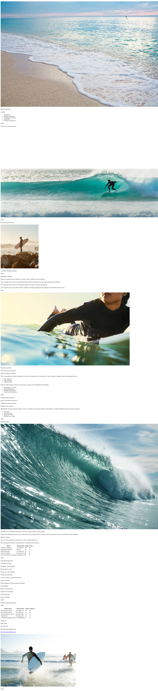 |

## business-cards-horizontal-layout

| Expected (Word) | Morph Markdown |
| --- | --- |
|  | 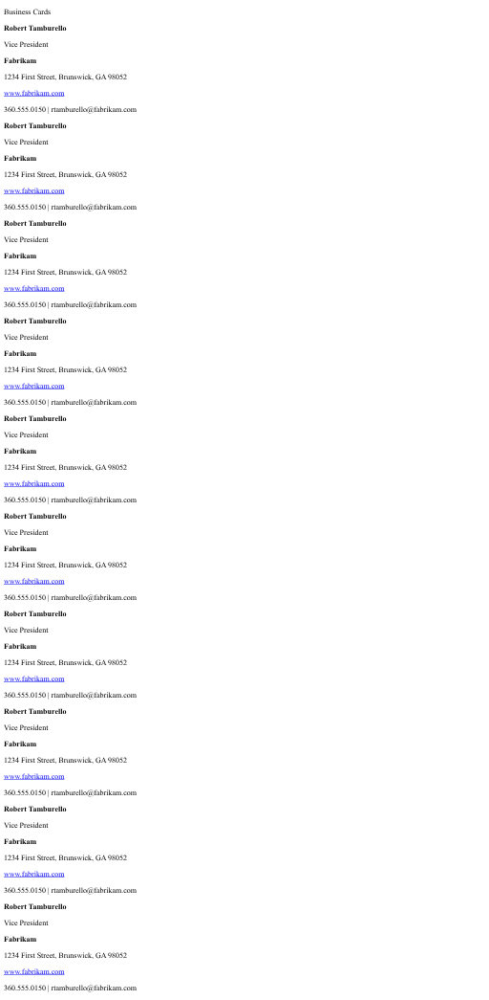 |

## chart-3d-area

| Expected (Word) | Morph Markdown |
| --- | --- |
|   |  |

## chart-3d-column

| Expected (Word) | Morph Markdown |
| --- | --- |
|   |  |

## chart-3d-pie

| Expected (Word) | Morph Markdown |
| --- | --- |
|   |  |

## chart-area

| Expected (Word) | Morph Markdown |
| --- | --- |
|   |  |

## chart-bar-column

| Expected (Word) | Morph Markdown |
| --- | --- |
|   |  |

## chart-bubble

| Expected (Word) | Morph Markdown |
| --- | --- |
|   |  |

## chart-combo

| Expected (Word) | Morph Markdown |
| --- | --- |
|   |  |

## chart-labels

| Expected (Word) | Morph Markdown |
| --- | --- |
|   |  |

## chart-labels-area-radar

| Expected (Word) | Morph Markdown |
| --- | --- |
|   |  |

## chart-pie

| Expected (Word) | Morph Markdown |
| --- | --- |
|  |  |

## chart-radar

| Expected (Word) | Morph Markdown |
| --- | --- |
|   |  |

## chart-scatter

| Expected (Word) | Morph Markdown |
| --- | --- |
|   |  |

## chart-stacked-line

| Expected (Word) | Morph Markdown |
| --- | --- |
|   |  |

## chart-stock

| Expected (Word) | Morph Markdown |
| --- | --- |
|   |  |

## chart-surface

| Expected (Word) | Morph Markdown |
| --- | --- |
|   |  |

## color-block

| Expected (Word) | Morph Markdown |
| --- | --- |
|   | 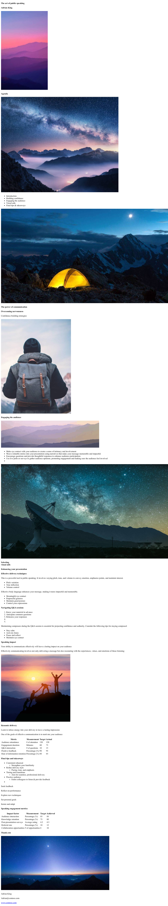 |

## dappled

| Expected (Word) | Morph Markdown |
| --- | --- |
|   |  |

## education-infographics-poster

| Expected (Word) | Morph Markdown |
| --- | --- |
|  | 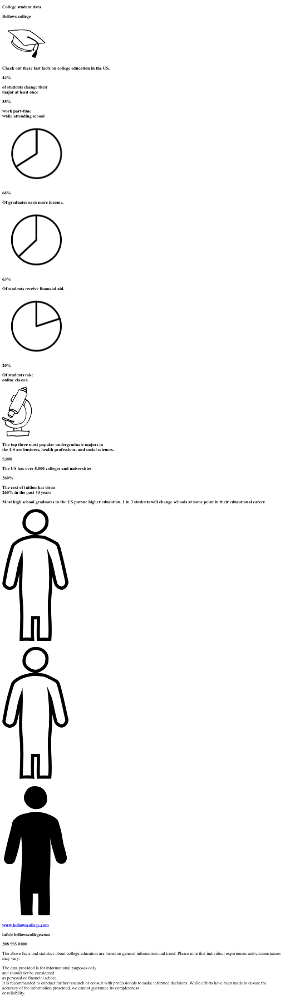 |

## fashion-infographics-poster

| Expected (Word) | Morph Markdown |
| --- | --- |
|   | 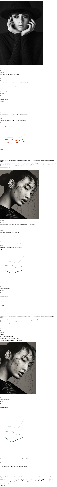 |

## fashion-photo-album

| Expected (Word) | Morph Markdown |
| --- | --- |
|   |  |

## funky-shapes

| Expected (Word) | Morph Markdown |
| --- | --- |
|   | 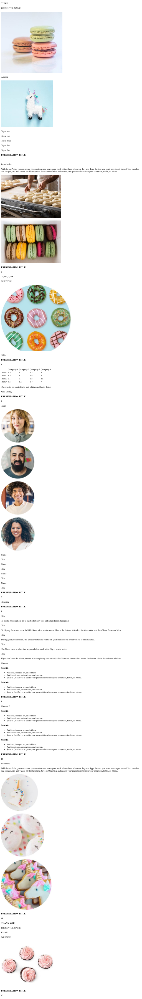 |

## funky-shapes-dark

| Expected (Word) | Morph Markdown |
| --- | --- |
|   | 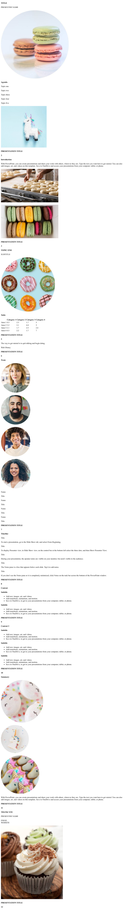 |

## gradient

| Expected (Word) | Morph Markdown |
| --- | --- |
|   | 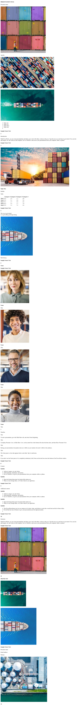 |

## inspirational-bookmarks

| Expected (Word) | Morph Markdown |
| --- | --- |
|  | 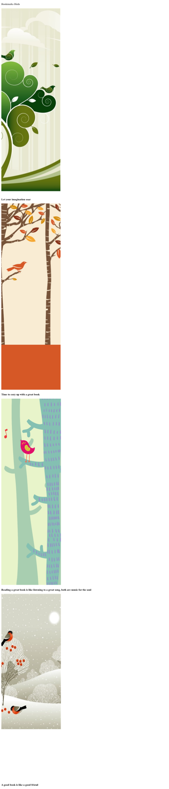 |

## leaf

| Expected (Word) | Morph Markdown |
| --- | --- |
|   | 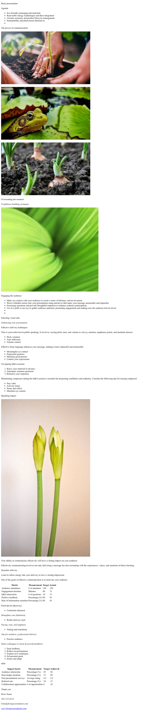 |

## lines

| Expected (Word) | Morph Markdown |
| --- | --- |
|   |  |

## luminous

| Expected (Word) | Morph Markdown |
| --- | --- |
|   | 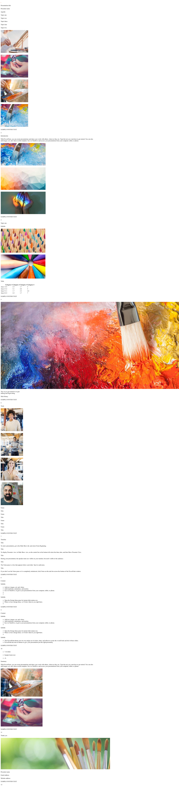 |

## memo

| Expected (Word) | Morph Markdown |
| --- | --- |
|   | 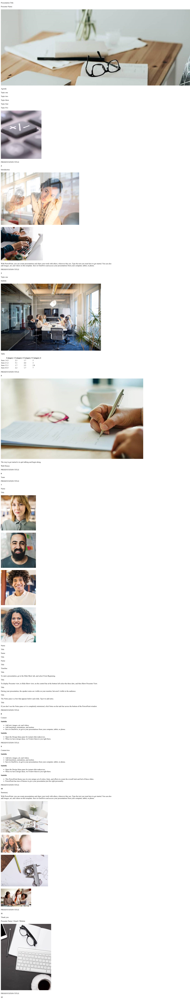 |

## minimalist-light-sales-pitch

| Expected (Word) | Morph Markdown |
| --- | --- |
|   | 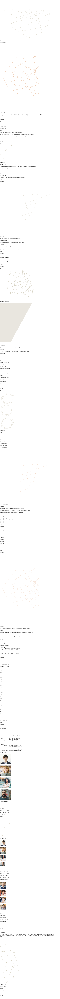 |

## offset

| Expected (Word) | Morph Markdown |
| --- | --- |
|   | 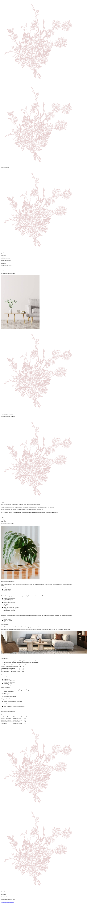 |

## pebble

| Expected (Word) | Morph Markdown |
| --- | --- |
|   | 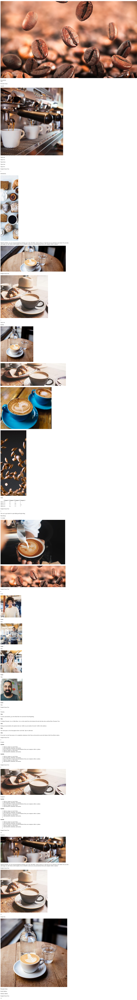 |

## rose-suite

| Expected (Word) | Morph Markdown |
| --- | --- |
|   | 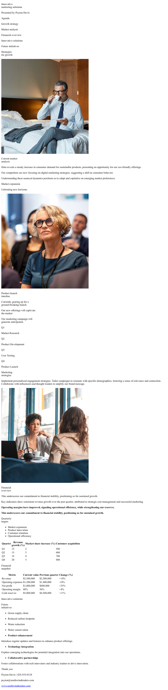 |

## savon

| Expected (Word) | Morph Markdown |
| --- | --- |
|   | 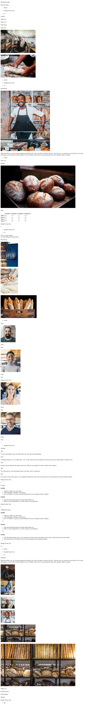 |

## shoji

| Expected (Word) | Morph Markdown |
| --- | --- |
|   | 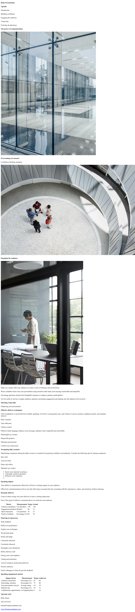 |

## sketchlines

| Expected (Word) | Morph Markdown |
| --- | --- |
|   | 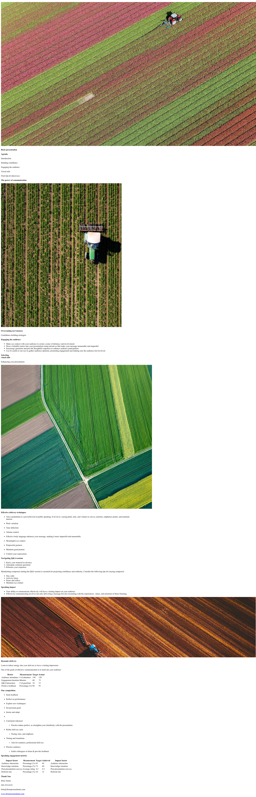 |

## tech-brochure

| Expected (Word) | Morph Markdown |
| --- | --- |
|   |  |

