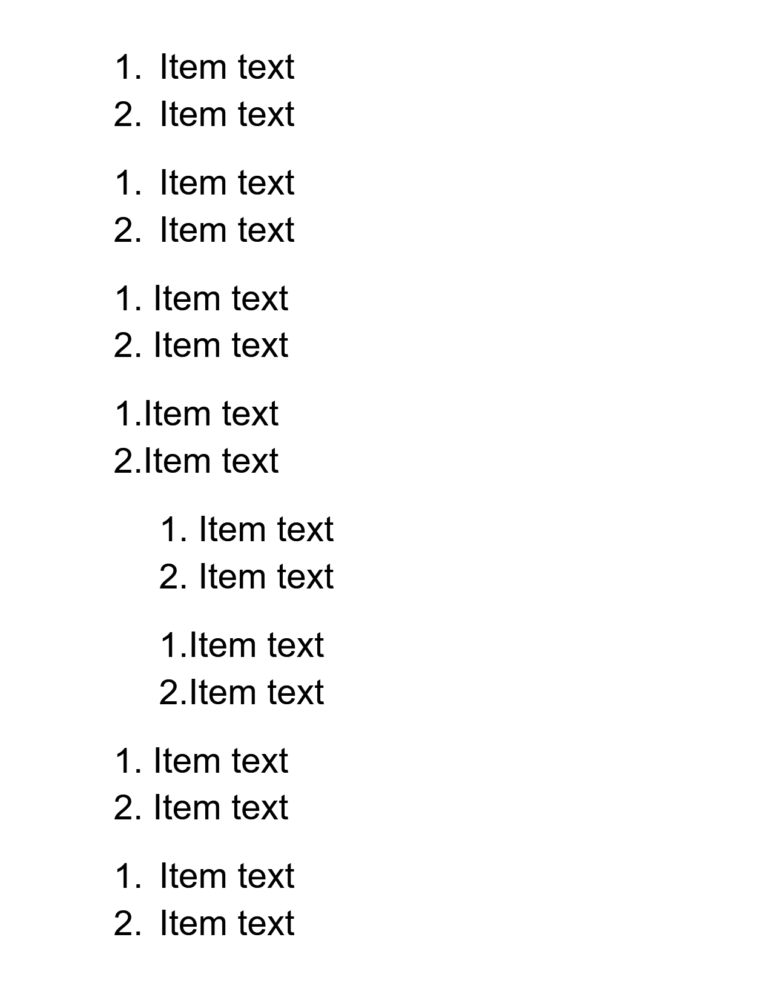

# list_marker_suffix

Pins `w:lvl/w:suff` — what follows a list marker — and where the marker sits with no hanging
indent.

Eight one-level decimal lists, two items each, Arial 28pt for marker and text alike, page margin
0.75in:

| list | suff | left / hanging (twips) |
| --- | --- | --- |
| 1 | (absent) | 1440 / 720 |
| 2 | tab | 1440 / 720 |
| 3 | space | 1440 / 720 |
| 4 | nothing | 1440 / 720 |
| 5 | space | 2880 / 1440 |
| 6 | nothing | 2880 / 1440 |
| 7 | space | 720 / 0 |
| 8 | tab | 720 / 0 |

What Word does:

* The marker always starts at the first line's own indent, left − hanging: 720 twips for lists
  1-4, 7 and 8, and 1440 for 5 and 6.
* **tab** (and an absent `w:suff`) sends the text to the hanging indent's stop at the left
  indent, or, with no hanging indent (list 8), to the next default stop: "1." at 720 twips, its
  text at 1440.
* **space** sets the text one space after the marker, and **nothing** sets it against the marker,
  whatever the indents. The left indent then plays no part on the first line.

Before this fixture Morph ignored `w:suff`, and with no hanging indent it drew the marker ending
3pt short of the left indent, with the text at the left indent, instead of starting the marker
there.

| Expected (Word) | Skia | ImageSharp |
| --- | --- | --- |
| **Page 1**&nbsp;&nbsp;&nbsp;&nbsp;&nbsp;&nbsp;&nbsp;&nbsp;&nbsp;&nbsp;&nbsp;&nbsp;&nbsp;&nbsp;&nbsp;&nbsp;&nbsp;&nbsp;&nbsp;&nbsp;&nbsp;&nbsp;&nbsp;&nbsp;&nbsp;&nbsp;&nbsp;&nbsp;&nbsp;&nbsp;&nbsp;&nbsp;&nbsp;&nbsp; | **Page 1. ErrorMetric: 0.0155 · SSIM: 0.9891** | **Page 1. ErrorMetric: 0.0147 · SSIM: 0.9927** |
|  |  |  |
| **Page 2** | **Page 2** | **Page 2** |
|  |  |  |
