# wordart

### The arches are Word-probed

`textArchUp` / `textArchDown` follow `WordArtArch`, whose rules were read off Word's XPS glyph
transforms over 32 probe boxes (see `docs/word-features.md`, WordArt Transforms):

- The text is drawn smaller than declared, by `W' / (W' + 2·ink)` (text rect width over that width plus
  twice the ink height). This page's 36pt Impact draws at 31.25pt.
- The path is the half ellipse of the text rect, scaled by that factor about the rect's centre.
- The text is laid along the path by arc length, by its in-box alignment.
- Each glyph turns to the tangent, its baseline `usWinAscent − sTypoAscender` below the path.

The glyph tops on the arch up therefore stand about 7.5pt above the box, close under the subtitle, as in
Word. The chord-sagitta circle this page used before (bbox width as chord, height as sagitta, path sized to
the text) drew the text at full size on a far tighter curve, over the subtitle.

[known] "Arc Text Down" runs about 10px wider than Word's. Word spaces an arch's glyphs either as modelled
or 1.0217 times tighter, and which one a box gets flips with changes of a few thousandths of a point in
size, with no order to it (`docs/word-features.md`, WordArt arches). This box gets the tight one; Morph
keeps the modelled spacing, which is Word's at the sizes either side of it.

### Circle

`textCircle` is the arch construction on the whole ellipse (`WordArtArch.Place`), run clockwise from its
left end: centred text sits about the right end and reads downward. Its scale takes the longer side of
the text rect. Read off Word's XPS on `_probe_circle_*`; `docs/word-features.md`, WordArt Transforms,
has the numbers and the one case that does not fit (Arial in a square box).

### Wave, chevron, slant, fade and triangle are envelope warps

Each is a top and a bottom guide drawn in the text rect by the preset's own definition, and the line's
INK box is stretched between them (`WordArtEnvelope`, `TryRenderEnvelope` in both drawers). So every
one of them fills its box edge to edge whatever size the text declares, as Word's does; the text-on-path
and per-glyph scaling this page used before drew the text at its declared size, less than half the width
Word fills. `../wordart-envelope/notes.md` has the guides of the four warps that fixture covers.

### Vertical positioning vs Word

The drift once recorded here was the layout's, not the warps': an inline WordArt dropped its own
paragraph's spacing, and the arch-up paragraph declares 10pt after, so every warp below it sat that much
high and two of them a page early. The WordArt now carries its paragraph's spacing. The line it takes is
exactly the box height (`_probe_archflow`: consecutive 72pt boxes 72pt apart at a 12pt and a 48pt
paragraph font), so every warp now starts on Word's page at Word's box top. A box carried to a fresh
page keeps its paragraph's space-after as well, which the wave at the head of page 3 had lost.

| Expected (Word) | Skia | ImageSharp |
| --- | --- | --- |
| **Page 1**&nbsp;&nbsp;&nbsp;&nbsp;&nbsp;&nbsp;&nbsp;&nbsp;&nbsp;&nbsp;&nbsp;&nbsp;&nbsp;&nbsp;&nbsp;&nbsp;&nbsp;&nbsp;&nbsp;&nbsp;&nbsp;&nbsp;&nbsp;&nbsp;&nbsp;&nbsp;&nbsp;&nbsp;&nbsp;&nbsp;&nbsp;&nbsp;&nbsp;&nbsp; | **Page 1. ErrorMetric: 0.0034 · SSIM: 0.9958** | **Page 1. ErrorMetric: 0.0038 · SSIM: 0.9959** |
|  |  |  |
| **Page 2**&nbsp;&nbsp;&nbsp;&nbsp;&nbsp;&nbsp;&nbsp;&nbsp;&nbsp;&nbsp;&nbsp;&nbsp;&nbsp;&nbsp;&nbsp;&nbsp;&nbsp;&nbsp;&nbsp;&nbsp;&nbsp;&nbsp;&nbsp;&nbsp;&nbsp;&nbsp;&nbsp;&nbsp;&nbsp;&nbsp;&nbsp;&nbsp;&nbsp;&nbsp; | **Page 2. ErrorMetric: 0.0219 · SSIM: 0.9717** | **Page 2. ErrorMetric: 0.0222 · SSIM: 0.9725** |
| 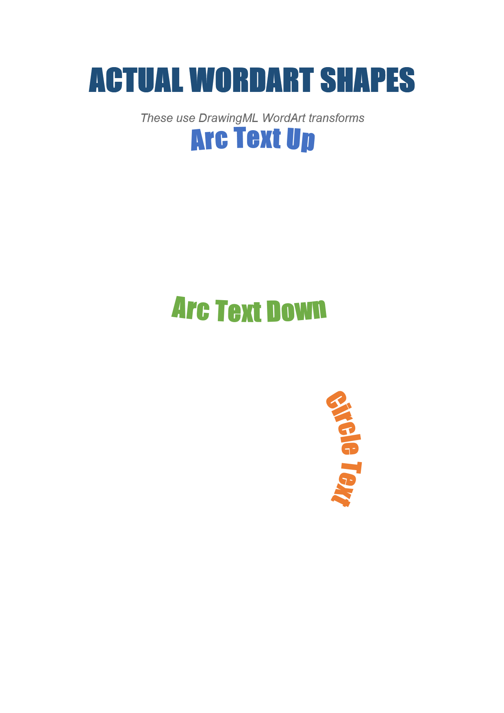 |  |  |
| **Page 3**&nbsp;&nbsp;&nbsp;&nbsp;&nbsp;&nbsp;&nbsp;&nbsp;&nbsp;&nbsp;&nbsp;&nbsp;&nbsp;&nbsp;&nbsp;&nbsp;&nbsp;&nbsp;&nbsp;&nbsp;&nbsp;&nbsp;&nbsp;&nbsp;&nbsp;&nbsp;&nbsp;&nbsp;&nbsp;&nbsp;&nbsp;&nbsp;&nbsp;&nbsp; | **Page 3. ErrorMetric: 0.0730 · SSIM: 0.9232** | **Page 3. ErrorMetric: 0.0694 · SSIM: 0.9319** |
| 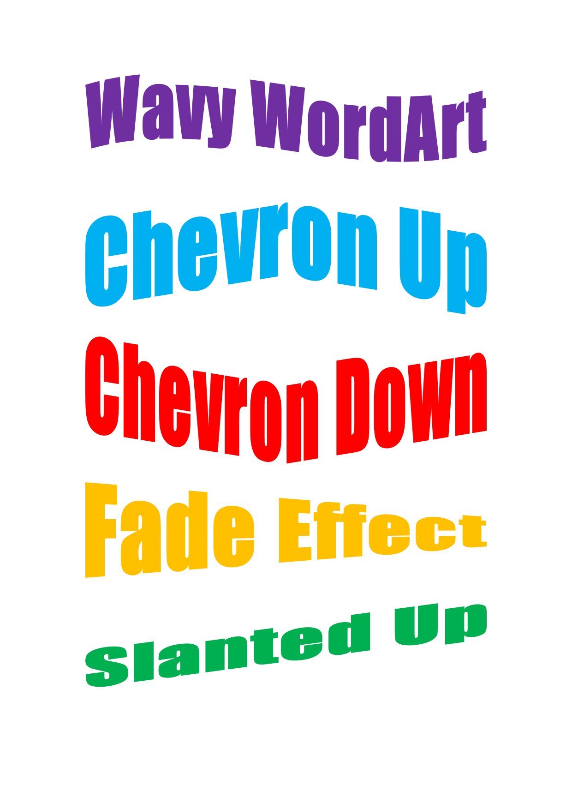 |  |  |
| **Page 4**&nbsp;&nbsp;&nbsp;&nbsp;&nbsp;&nbsp;&nbsp;&nbsp;&nbsp;&nbsp;&nbsp;&nbsp;&nbsp;&nbsp;&nbsp;&nbsp;&nbsp;&nbsp;&nbsp;&nbsp;&nbsp;&nbsp;&nbsp;&nbsp;&nbsp;&nbsp;&nbsp;&nbsp;&nbsp;&nbsp;&nbsp;&nbsp;&nbsp;&nbsp; | **Page 4. ErrorMetric: 0.0952 · SSIM: 0.9376** | **Page 4. ErrorMetric: 0.0940 · SSIM: 0.9427** |
| 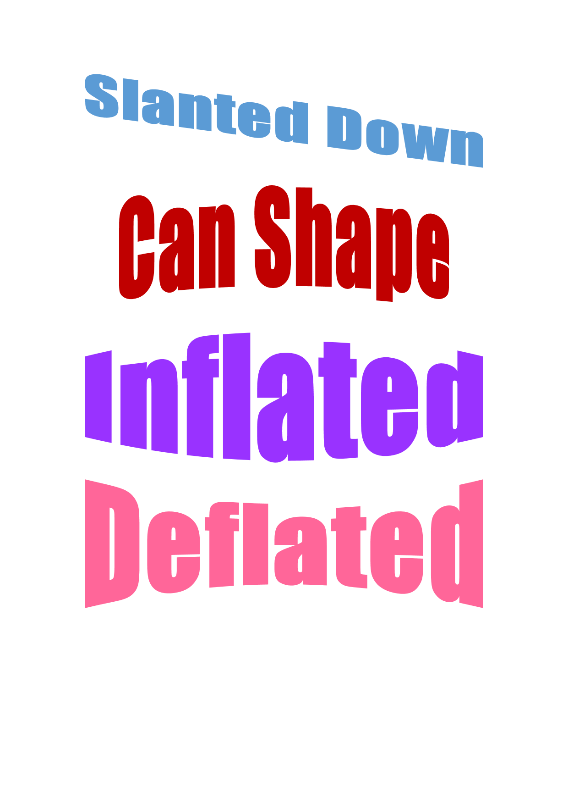 |  |  |
| **Page 5**&nbsp;&nbsp;&nbsp;&nbsp;&nbsp;&nbsp;&nbsp;&nbsp;&nbsp;&nbsp;&nbsp;&nbsp;&nbsp;&nbsp;&nbsp;&nbsp;&nbsp;&nbsp;&nbsp;&nbsp;&nbsp;&nbsp;&nbsp;&nbsp;&nbsp;&nbsp;&nbsp;&nbsp;&nbsp;&nbsp;&nbsp;&nbsp;&nbsp;&nbsp; | **Page 5. ErrorMetric: 0.0075 · SSIM: 0.9909** | **Page 5. ErrorMetric: 0.0078 · SSIM: 0.9906** |
| 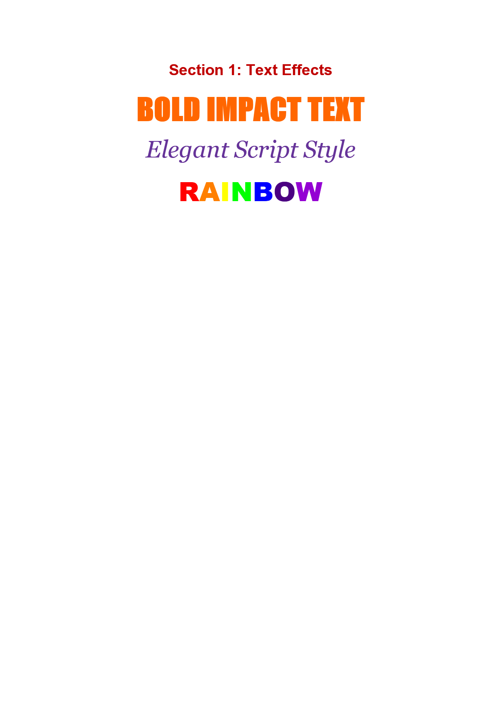 |  |  |
| **Page 6**&nbsp;&nbsp;&nbsp;&nbsp;&nbsp;&nbsp;&nbsp;&nbsp;&nbsp;&nbsp;&nbsp;&nbsp;&nbsp;&nbsp;&nbsp;&nbsp;&nbsp;&nbsp;&nbsp;&nbsp;&nbsp;&nbsp;&nbsp;&nbsp;&nbsp;&nbsp;&nbsp;&nbsp;&nbsp;&nbsp;&nbsp;&nbsp;&nbsp;&nbsp; | **Page 6. ErrorMetric: 0.0075 · SSIM: 0.9873** | **Page 6. ErrorMetric: 0.0075 · SSIM: 0.9893** |
| 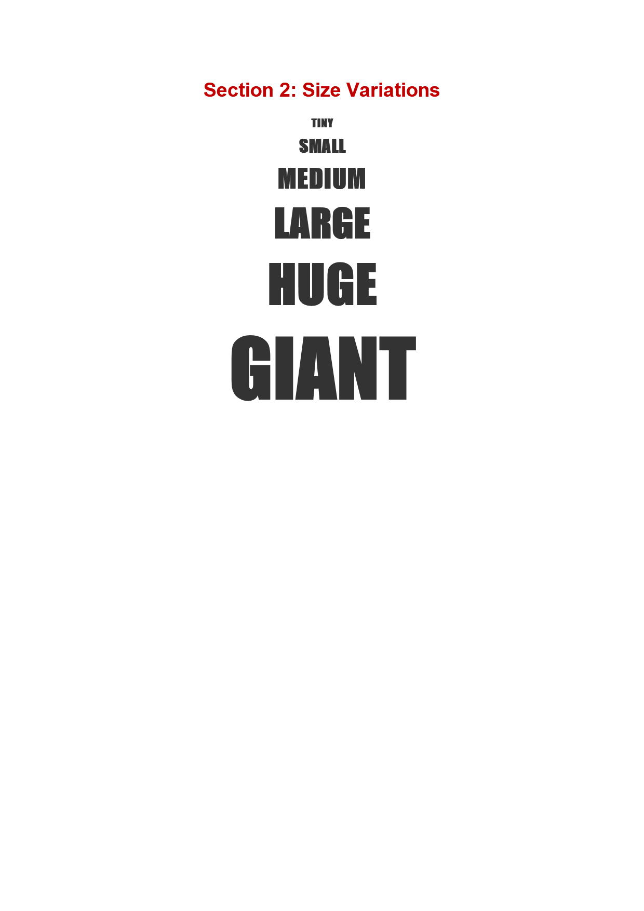 |  |  |
| **Page 7**&nbsp;&nbsp;&nbsp;&nbsp;&nbsp;&nbsp;&nbsp;&nbsp;&nbsp;&nbsp;&nbsp;&nbsp;&nbsp;&nbsp;&nbsp;&nbsp;&nbsp;&nbsp;&nbsp;&nbsp;&nbsp;&nbsp;&nbsp;&nbsp;&nbsp;&nbsp;&nbsp;&nbsp;&nbsp;&nbsp;&nbsp;&nbsp;&nbsp;&nbsp; | **Page 7. ErrorMetric: 0.0120 · SSIM: 0.9861** | **Page 7. ErrorMetric: 0.0123 · SSIM: 0.9856** |
| 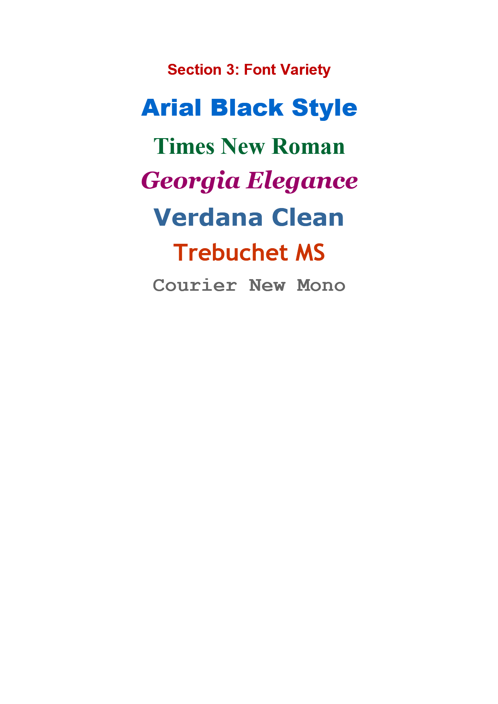 |  |  |
| **Page 8**&nbsp;&nbsp;&nbsp;&nbsp;&nbsp;&nbsp;&nbsp;&nbsp;&nbsp;&nbsp;&nbsp;&nbsp;&nbsp;&nbsp;&nbsp;&nbsp;&nbsp;&nbsp;&nbsp;&nbsp;&nbsp;&nbsp;&nbsp;&nbsp;&nbsp;&nbsp;&nbsp;&nbsp;&nbsp;&nbsp;&nbsp;&nbsp;&nbsp;&nbsp; | **Page 8. ErrorMetric: 0.0117 · SSIM: 0.9850** | **Page 8. ErrorMetric: 0.0117 · SSIM: 0.9867** |
| 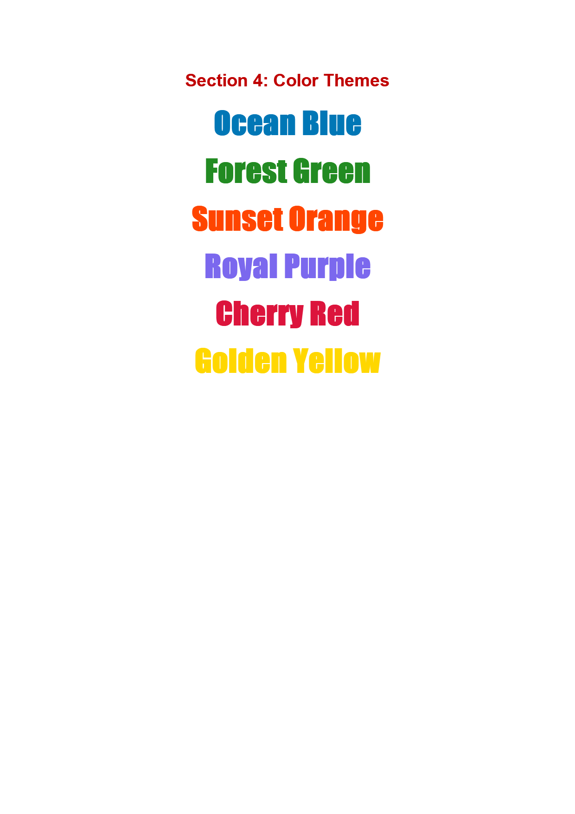 |  |  |
| **Page 9**&nbsp;&nbsp;&nbsp;&nbsp;&nbsp;&nbsp;&nbsp;&nbsp;&nbsp;&nbsp;&nbsp;&nbsp;&nbsp;&nbsp;&nbsp;&nbsp;&nbsp;&nbsp;&nbsp;&nbsp;&nbsp;&nbsp;&nbsp;&nbsp;&nbsp;&nbsp;&nbsp;&nbsp;&nbsp;&nbsp;&nbsp;&nbsp;&nbsp;&nbsp; | **Page 9. ErrorMetric: 0.0175 · SSIM: 0.9750** | **Page 9. ErrorMetric: 0.0176 · SSIM: 0.9763** |
| 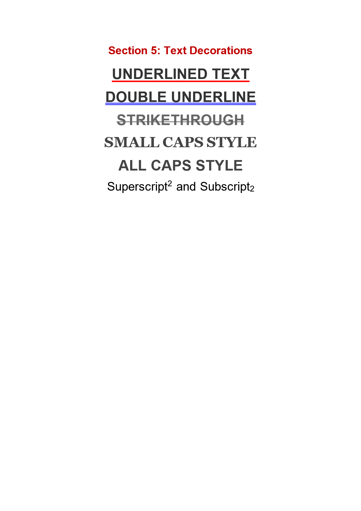 |  |  |
| **Page 10**&nbsp;&nbsp;&nbsp;&nbsp;&nbsp;&nbsp;&nbsp;&nbsp;&nbsp;&nbsp;&nbsp;&nbsp;&nbsp;&nbsp;&nbsp;&nbsp;&nbsp;&nbsp;&nbsp;&nbsp;&nbsp;&nbsp;&nbsp;&nbsp;&nbsp;&nbsp;&nbsp;&nbsp;&nbsp;&nbsp;&nbsp;&nbsp;&nbsp;&nbsp; | **Page 10. ErrorMetric: 0.0106 · SSIM: 0.9925** | **Page 10. ErrorMetric: 0.0111 · SSIM: 0.9935** |
| 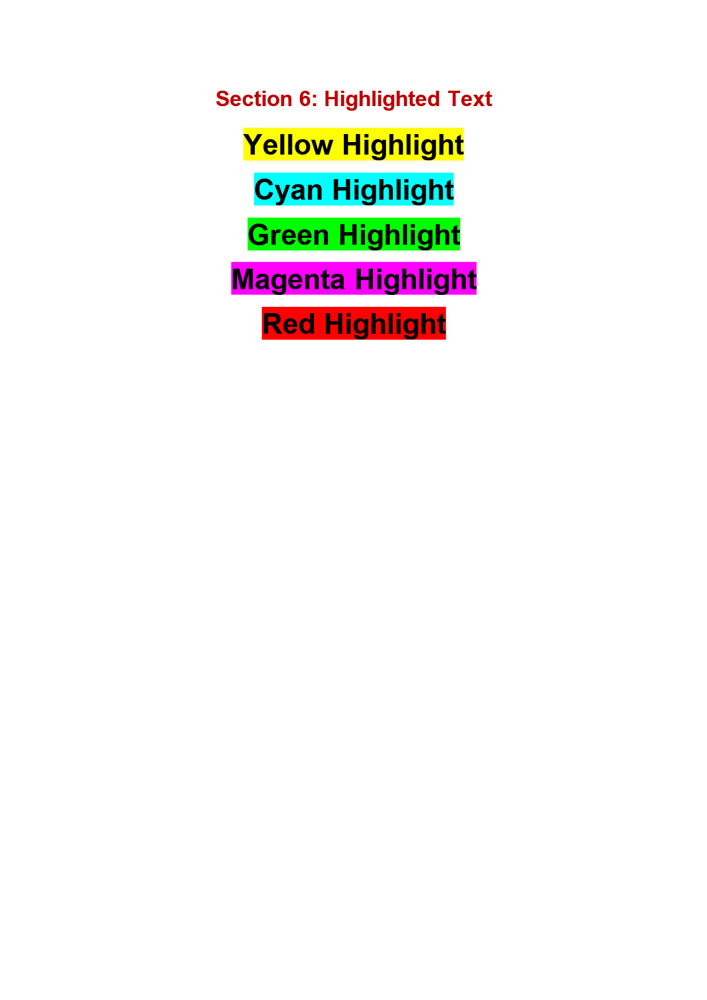 |  |  |
| **Page 11**&nbsp;&nbsp;&nbsp;&nbsp;&nbsp;&nbsp;&nbsp;&nbsp;&nbsp;&nbsp;&nbsp;&nbsp;&nbsp;&nbsp;&nbsp;&nbsp;&nbsp;&nbsp;&nbsp;&nbsp;&nbsp;&nbsp;&nbsp;&nbsp;&nbsp;&nbsp;&nbsp;&nbsp;&nbsp;&nbsp;&nbsp;&nbsp;&nbsp;&nbsp; | **Page 11. ErrorMetric: 0.0104 · SSIM: 0.9889** | **Page 11. ErrorMetric: 0.0105 · SSIM: 0.9900** |
|  |  |  |
| **Page 12**&nbsp;&nbsp;&nbsp;&nbsp;&nbsp;&nbsp;&nbsp;&nbsp;&nbsp;&nbsp;&nbsp;&nbsp;&nbsp;&nbsp;&nbsp;&nbsp;&nbsp;&nbsp;&nbsp;&nbsp;&nbsp;&nbsp;&nbsp;&nbsp;&nbsp;&nbsp;&nbsp;&nbsp;&nbsp;&nbsp;&nbsp;&nbsp;&nbsp;&nbsp; | **Page 12. ErrorMetric: 0.0064 · SSIM: 0.9900** | **Page 12. ErrorMetric: 0.0066 · SSIM: 0.9909** |
| 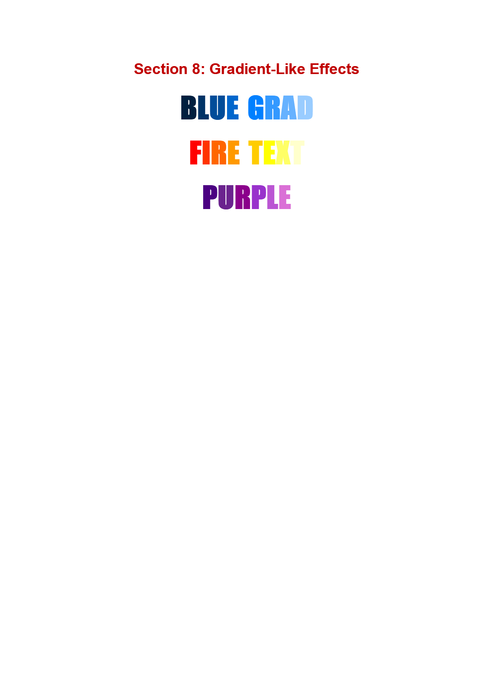 |  |  |
| **Page 13**&nbsp;&nbsp;&nbsp;&nbsp;&nbsp;&nbsp;&nbsp;&nbsp;&nbsp;&nbsp;&nbsp;&nbsp;&nbsp;&nbsp;&nbsp;&nbsp;&nbsp;&nbsp;&nbsp;&nbsp;&nbsp;&nbsp;&nbsp;&nbsp;&nbsp;&nbsp;&nbsp;&nbsp;&nbsp;&nbsp;&nbsp;&nbsp;&nbsp;&nbsp; | **Page 13. ErrorMetric: 0.0041 · SSIM: 0.9958** | **Page 13. ErrorMetric: 0.0042 · SSIM: 0.9961** |
| 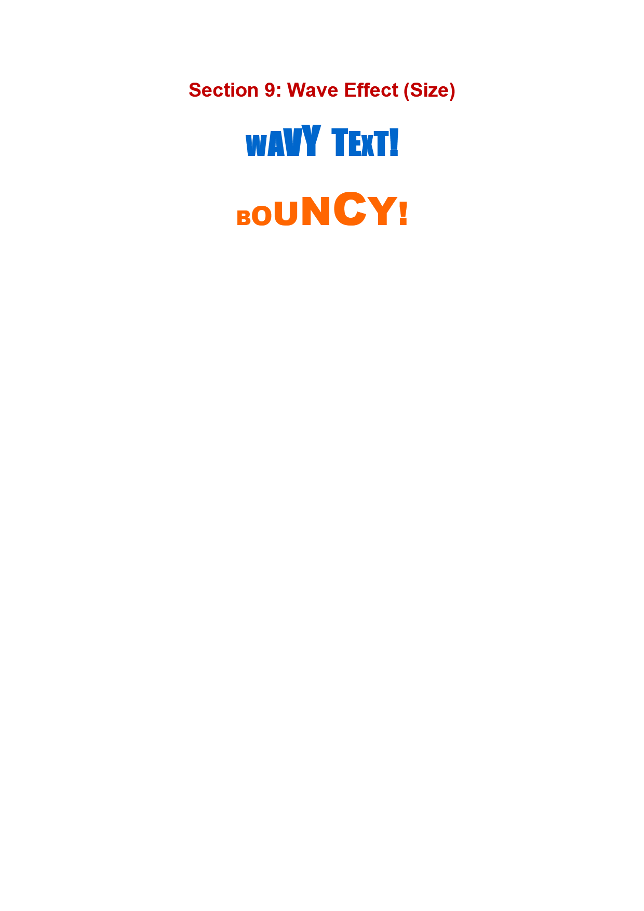 |  |  |
| **Page 14**&nbsp;&nbsp;&nbsp;&nbsp;&nbsp;&nbsp;&nbsp;&nbsp;&nbsp;&nbsp;&nbsp;&nbsp;&nbsp;&nbsp;&nbsp;&nbsp;&nbsp;&nbsp;&nbsp;&nbsp;&nbsp;&nbsp;&nbsp;&nbsp;&nbsp;&nbsp;&nbsp;&nbsp;&nbsp;&nbsp;&nbsp;&nbsp;&nbsp;&nbsp; | **Page 14. ErrorMetric: 0.0136 · SSIM: 0.9812** | **Page 14. ErrorMetric: 0.0140 · SSIM: 0.9821** |
| 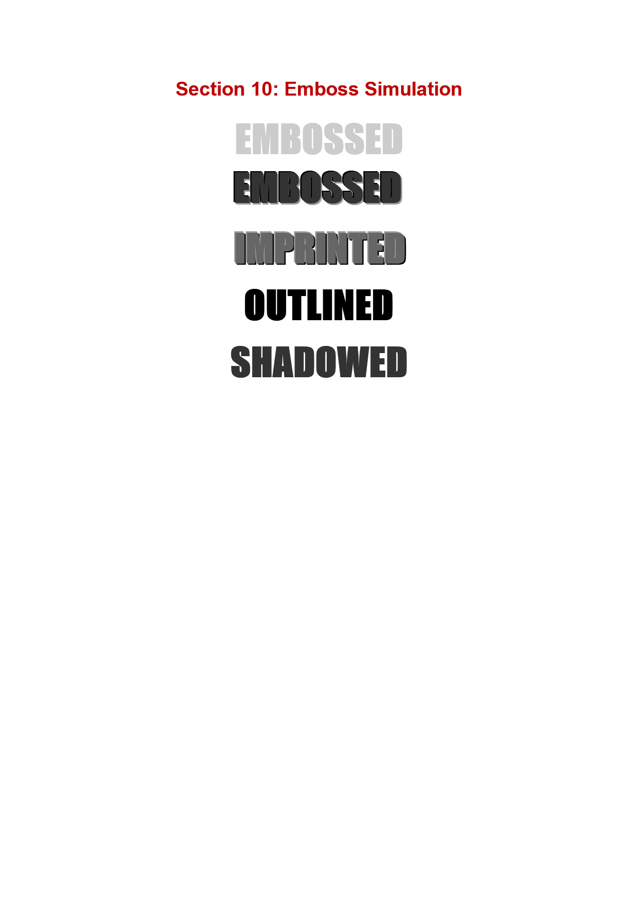 |  |  |
| **Page 15**&nbsp;&nbsp;&nbsp;&nbsp;&nbsp;&nbsp;&nbsp;&nbsp;&nbsp;&nbsp;&nbsp;&nbsp;&nbsp;&nbsp;&nbsp;&nbsp;&nbsp;&nbsp;&nbsp;&nbsp;&nbsp;&nbsp;&nbsp;&nbsp;&nbsp;&nbsp;&nbsp;&nbsp;&nbsp;&nbsp;&nbsp;&nbsp;&nbsp;&nbsp; | **Page 15. ErrorMetric: 0.0117 · SSIM: 0.9898** | **Page 15. ErrorMetric: 0.0117 · SSIM: 0.9904** |
|  |  |  |
