# Word editing behaviour

What Word 365 does for each mouse action, key and command an editor has to answer for: where the caret
and the selection land, what text and formatting result, what the undo list records. Each observation
below was produced by driving a visible Word with real keyboard and mouse input and reading the result
back over COM. The Blazor editor (`src/Morph.Blazor`, `MorphEditor`) is meant to match these; the file
doubles as its gap list through the `Morph` status each scenario carries.

<!-- probe:generated --> Generated 2026-10-25 on Word for Microsoft 365, version 16.0 build 16.0.20527 (Click-to-Run 16.0.20527.20088), Windows 11, unknown UI, one display 3440x1440 at 125 %. Undo names from the Undo list.

Keys and the commands they run are catalogued in `docs/word-command-reference.md` and are not repeated
here; this file records what a key or click **does** to the document and the selection in a given state.

## Contents

- [How this file was derived](#how-this-file-was-derived)
- [Conventions](#conventions)
- [Options in effect](#options-in-effect)
- [Fixtures](#fixtures)
- [Caret navigation](#caret-navigation)
- [Selection by keyboard](#selection-by-keyboard)
- [Mouse](#mouse)
- [Typing, Enter, Backspace, Delete and direct formatting](#typing-enter-backspace-delete-and-direct-formatting)
- [Tables](#tables)
- [Lists](#lists)
- [Undo, redo and repeat](#undo-redo-and-repeat)
- [Clipboard and drag and drop](#clipboard-and-drag-and-drop)
- [Pictures, shapes and text boxes](#pictures-shapes-and-text-boxes)
- [AutoCorrect and AutoFormat as you type](#autocorrect-and-autoformat-as-you-type)
- [Fields, hyperlinks, bookmarks and content controls](#fields-hyperlinks-bookmarks-and-content-controls)
- [Track Changes](#track-changes)
- [Headers, footers, notes, comments and text boxes](#headers-footers-notes-comments-and-text-boxes)
- [Everything else](#everything-else)
- [Keys that open a dialog, pane or view](#keys-that-open-a-dialog-pane-or-view)
- [The ribbon's state where the selection is](#the-ribbons-state-where-the-selection-is)
- [Unfiled](#unfiled)
- [Open questions](#open-questions)

## How this file was derived

**The harness.** `src/WordProbe` is a Windows-only console project (`net10.0-windows`, out of Release
solution builds like RenderHelper). It starts its own Word (`new Word.Application`, never the user's
instance), opens each fixture as an unsaved document from `src/WordProbe/Fixtures/<name>.docx`, places
and sizes the window, and keeps it in the foreground. Every step of a scenario is then performed as a
user would perform it:

- **Keys** go through `SendInput` as real key presses on the en-US layout (`VkKeyScanExW`), so
  AutoFormat and AutoCorrect see them; a character not on the layout is sent as a Unicode packet.
- **Mouse** targets are physical screen pixels from `Window.GetPoint` on a one-character range (the
  process is PerMonitorV2 DPI-aware; the display runs at 125 %). `click(P1:5)` lands on the left
  quarter of glyph 5 by default, `side=right` on its right quarter. The selection bar, a cell's left
  edge, a column's top edge, a row's margin and the table move handle are hot spots calibrated by the
  smoke test (`dotnet run --project src/WordProbe -- smoke`, gate 8) from the selection Word makes.
  Separate clicks are spaced beyond the system double-click time; double and triple clicks 110 ms apart.
- **Set-up** that is not under test (placing the caret before the step under test, an option's
  value, Track Changes) is done over COM: `select(P1:5)` is `Range.Select`, not a click.
- After each input the harness waits until two COM reads 30 ms apart agree on the selection and the
  document length (longer after a typed character, since AutoFormat runs after the trigger).

**The observation.** Read over COM after the last step: `Selection.Start/End/Type/Flags/StartIsActive`,
`Information(...)` for tables, `StoryType`, every paragraph's text with field codes and hidden text
included (so a position maps to a character), effective bold/italic/underline/strike runs by bisection
on Word's "mixed" answer, style, alignment, indents and list level, tables cell by cell, floating
shapes with their anchor, revisions, fields, notes, comments, content controls, and the **undo list's
entry names** from the hidden Undo dropdown of Word's legacy command bars (`CommandBars.FindControl(Id:
128, Visible: false)`, a split dropdown whose `List` is the stack). A scenario marked `Trace` also reads
the selection after every step. A scenario that asks for `Markup` saves a WordprocessingML diff of the
body under `src/WordProbe/Results/markup/`.

**Options.** Word persists its options when it quits, so the harness snapshots every known
`Options`/`AutoCorrect` member to `%LOCALAPPDATA%\WordProbe\options-snapshot.json` before changing
anything, forces off only UI noise (mini toolbar, paste options button, live preview, spelling marks,
AutoRecover), and restores the snapshot before quitting; `-- restore-options` repeats the restore after a
crash. Behaviour-bearing options are **recorded** (the table below) and changed only by a scenario's own
toggle, so every result states the value it was measured under.

**Fixtures.** Built once over COM from `src/Morph.Blazor/wwwroot/blank.docx` by `FixtureCatalog`,
normalised (rsids, paragraph ids, dates and author fixed) and committed, so a later test can open the
identical file. `dotnet run --project src/WordProbe -- describe <fixture>` prints any fixture in the
notation with its paragraph positions.

**Regenerating and extending.** Scenarios are C# (`src/WordProbe/Scenarios/Families/*.cs`, one static
class per family), results are `src/WordProbe/Results/<family>.json` (one record per case, written as
soon as the case is in), and this file's generated blocks are rendered from the results:

```bash
dotnet run --project src/WordProbe -- smoke            # the ten go/no-go gates, about 3 minutes
dotnet run --project src/WordProbe -- list [family]    # the catalogue, with every case's steps
dotnet run --project src/WordProbe -- run [family ...] [--scenario ID] [--force] [--max-minutes N]
dotnet run --project src/WordProbe -- render           # this file from Results/*.json, no Word needed
```

`run` skips a case whose result is already recorded for the same definition, so a changed or added
scenario reruns alone. Everything between a `<!-- probe:begin <family> -->` and its `<!-- probe:end -->`
is regenerated; everything else in this file is hand-written and left alone. A new family lands under
Unfiled until it is given a marker pair. While a run is going the keyboard and mouse belong to Word: the
harness aborts (resumably) if it sees a modifier or mouse button held, or another window take the
foreground.

## Conventions

**Identifiers.** A scenario id is its family letter and number from the catalogue (`N-12`, `E-41`); a
case id adds `[axis=value,…]` for a parameterised scenario, `/branch/path` for a node of a branch tree,
`{Options.Member=value}` for an option toggle, and `~tracked` for the Track Changes repeat. Ids are stable:
a retired id is never reused, a renamed scenario keeps its old id as an alias. A test that enforces a
scenario cites it with TUnit's `[Property("WordBehavior", "<id>")]`; the renderer lists those tests under
the scenario, so coverage is visible here.

**Status.** Each scenario carries a `Morph` status from reading the Blazor editor's code, never from
running it: `DONE` (the editor does this), `PARTIAL`, `TODO`, `UNKNOWN`. A scenario whose outcome was
uncertain before the run states the competing expectations ("Expected before the run"); the observation
then says which held.

**Rules.** Each family's `### Rules` distils its observations by hand into bullets of the form
`- **R-<family>-<n> <title>.** <what Word does> (<case ids as evidence>). — Morph: <status>`. A rule's
`Morph` status is the editor's standing against that rule; `DONE` is allowed only when a test cites one of
the rule's cases, which `WordBehaviorCoverageTests` enforces, so every rule starts as `PARTIAL`, `TODO` or
`UNKNOWN`. `❓` marks a result that contradicted the expectation recorded before the run or that one case
cannot settle; the open ones are gathered under [Open questions](#open-questions). Rules are followed by
`### State machines` where a cascade is clearer as a diagram.

**Notation.** One line per body paragraph, one per table row, then the floating shapes and any other
story, then a summary line. It extends the notations of `EditFixtures.Read` and `EditDocuments.Shape`
in the tests:

| symbol | meaning |
| --- | --- |
| `[text]`, `[b:text]`, `[bi:text]`, `[u:text]`, `[s:text]` | a run and its effective marks: `b` bold, `i` italic, `u` underline, `s` strike, `^` superscript, `v` subscript, `h` hidden, `k` small caps, `K` all caps |
| `[b 14 Georgia:text]` | after the letters, the size in points and the font name, each only when the run differs from its paragraph style |
| `{~text~}` | a tracked formatting change (a run's look, a paragraph's properties or style, a list number); the text itself is unchanged |
| ` ↑12` ` ↓24` ` ▭` ` ⇊` | paragraph suffixes for space before and after (points, shown on Normal paragraphs where they differ from the style's 0 and 8), a paragraph border, and keep-with-next |
| `‸` | the caret; inside a selection it marks the active end: `⟦abc‸⟧` end-active, `⟦‸abc⟧` start-active |
| `⟦ … ⟧` | the selection |
| `¶` | a paragraph mark, shown only when it lies inside the selection |
| `\t` `\n` `⤓` `§` `⍽` `⁃` | tab, line break, page break, section break, non-breaking space, soft hyphen |
| `▣` | an inline picture |
| `⚓1` | a floating shape's anchor; the trailing line `SHP1 ⌖P2 picture 72x72pt square @300,0` gives its anchor paragraph, kind, size, wrap and offset, and `⟦selected⟧` when it is |
| `«[ PAGE ]|[1]»` | a field: begin mark, code, separator, result, end mark |
| `<[site]>` | a hyperlink (its hidden code is not shown; the caret can still stand inside it) |
| `†1` `‡1` | a footnote or endnote reference |
| `⟪word⟫1` | a comment's scope and reference |
| `(|text|)` | a content control's content between its edge positions |
| `{+text+}` `{-text-}` | a tracked insertion and deletion |
| `{<text<}` `{>text>}` | a tracked move: the text where it was moved from, and where it was moved to (Word tracks a drag or a cut and paste as a move, which is not a deletion plus an insertion) |
| ` (center)` ` (right)` ` (both)` | alignment, when not left |
| ` #Heading1` | the style, when not Normal |
| ` •1.0 ●` ` •2.1 a.` | list number and level, then the list string Word shows |
| ` ⇥36,-18` | left and first-line indent in points, when either is not zero |
| `T1 R1 ║[One¤]║[Two¤]║¤` | a table row: cells between `║`, each with its end-of-cell mark `¤`, then the end-of-row mark; `⊞` marks a paragraph of a nested table |
| `HDR:` `FTR:` `FN:` `CMT:` `TB:` | a line of another story |
| `Selection: Normal 28–33 end-active · Cells 2 (R1C1–R1C2) · Undo: Typing "x", Bold` | the summary: type, positions, anchor side, table facts, mode flags, revisions, the undo list newest first |

A space between two differently formatted words is shown with the run before it, since Word answers for a
lone space with a neighbour's formatting; a `Markup` diff is the exact record where that matters.

A parameterised scenario renders as a table with one row per case; a branch tree as a nested list plus a
`flowchart TD` of the tree; a traced scenario as a table with one row per step.

## Options in effect

The behaviour-bearing options as this Word had them during the runs. A scenario that toggles one says so
in its heading; everything else was measured under these values.

<!-- probe:begin options -->
| option | value during the run |
| --- | --- |
| `AutoCorrect.CorrectCapsLock` | on |
| `AutoCorrect.CorrectDays` | on |
| `AutoCorrect.CorrectHangulAndAlphabet` | off |
| `AutoCorrect.CorrectInitialCaps` | on |
| `AutoCorrect.CorrectKeyboardSetting` | off |
| `AutoCorrect.CorrectSentenceCaps` | on |
| `AutoCorrect.CorrectTableCells` | on |
| `AutoCorrect.FirstLetterAutoAdd` | on |
| `AutoCorrect.OtherCorrectionsAutoAdd` | on |
| `AutoCorrect.ReplaceText` | on |
| `AutoCorrect.ReplaceTextFromSpellingChecker` | off |
| `AutoCorrect.TwoInitialCapsAutoAdd` | on |
| `Options.AllowAccentedUppercase` | off |
| `Options.AllowClickAndTypeMouse` | on |
| `Options.AllowDragAndDrop` | on |
| `Options.AutoFormatAsYouTypeApplyBorders` | on |
| `Options.AutoFormatAsYouTypeApplyBulletedLists` | on |
| `Options.AutoFormatAsYouTypeApplyClosings` | on |
| `Options.AutoFormatAsYouTypeApplyDates` | off |
| `Options.AutoFormatAsYouTypeApplyFirstIndents` | on |
| `Options.AutoFormatAsYouTypeApplyHeadings` | off |
| `Options.AutoFormatAsYouTypeApplyNumberedLists` | on |
| `Options.AutoFormatAsYouTypeApplyTables` | on |
| `Options.AutoFormatAsYouTypeAutoLetterWizard` | on |
| `Options.AutoFormatAsYouTypeDefineStyles` | off |
| `Options.AutoFormatAsYouTypeDeleteAutoSpaces` | off |
| `Options.AutoFormatAsYouTypeFormatListItemBeginning` | on |
| `Options.AutoFormatAsYouTypeInsertClosings` | on |
| `Options.AutoFormatAsYouTypeInsertOvers` | on |
| `Options.AutoFormatAsYouTypeMatchParentheses` | on |
| `Options.AutoFormatAsYouTypeReplaceFarEastDashes` | on |
| `Options.AutoFormatAsYouTypeReplaceFractions` | on |
| `Options.AutoFormatAsYouTypeReplaceHyperlinks` | on |
| `Options.AutoFormatAsYouTypeReplaceOrdinals` | on |
| `Options.AutoFormatAsYouTypeReplacePlainTextEmphasis` | off |
| `Options.AutoFormatAsYouTypeReplaceQuotes` | on |
| `Options.AutoFormatAsYouTypeReplaceSymbols` | on |
| `Options.AutoWordSelection` | on |
| `Options.CtrlClickHyperlinkToOpen` | on |
| `Options.CursorMovement` | 0 |
| `Options.INSKeyForOvertype` | off |
| `Options.INSKeyForPaste` | off |
| `Options.Overtype` | off |
| `Options.PasteAdjustParagraphSpacing` | on |
| `Options.PasteAdjustTableFormatting` | on |
| `Options.PasteAdjustWordSpacing` | on |
| `Options.PasteFormatBetweenDocuments` | 0 |
| `Options.PasteFormatBetweenStyledDocuments` | 3 |
| `Options.PasteFormatFromExternalSource` | 1 |
| `Options.PasteFormatWithinDocument` | 0 |
| `Options.PasteMergeLists` | on |
| `Options.PasteOptionKeepBulletsAndNumbers` | on |
| `Options.PasteSmartCutPaste` | on |
| `Options.PasteSmartStyleBehavior` | on |
| `Options.ReplaceSelection` | on |
| `Options.SmartCursoring` | on |
| `Options.SmartCutPaste` | on |
| `Options.SmartParaSelection` | on |
| `Options.SnapToGrid` | off |
| `Options.TabIndentKey` | on |
| `Options.VisualSelection` | 0 |
<!-- probe:end options -->

## Environment

<!-- probe:begin environment -->
| what | value |
| --- | --- |
| Word | 16.0 build 16.0.20527 (Click-to-Run 16.0.20527.20088) |
| UI language | unknown |
| display | 3440x1440 at 125 % |
| undo entry names | control128 |
| fixture opening | Documents.Add(Template: fixture) |
| hot spot `cellLeftEdgeInset` | 1 px |
| hot spot `columnTopAbove` | -4 px |
| hot spot `rowBarLeft` | 10 px |
| hot spot `selectionBarInset` | 38 px |
| hot spot `tableHandleOffset` | 4 px |
| note | Documents.Add(Template: .docx) accepted |
| note | dialog class bosa_sdm_msword ("Insert Hyperlink") |
<!-- probe:end environment -->

## Fixtures

Each fixture is a committed `.docx` under `src/WordProbe/Fixtures/`; `describe` prints it in the
notation. Geometry fixtures (`words`, `wrap`, the tables) use a 24pt face and 0.5in cell margins so a
glyph half or a cell edge is many pixels wide.

<!-- probe:begin fixtures -->
| fixture | content |
| --- | --- |
| `plain` | One Normal paragraph: the fox sentence. |
| `three-paragraphs` | Three Normal paragraphs; the second is centred with one bold word (EditFixtures.Paragraphs). |
| `words` | Word-boundary material at 24pt: double space, hyphen, apostrophe, numbers with punctuation. |
| `sentences` | Two paragraphs of short sentences with an abbreviation and a question. |
| `wrap` | One paragraph at 24pt that wraps to three lines. |
| `long-paragraph` | Three paragraphs; the middle one wraps to several lines at the default size. |
| `runs` | One paragraph with bold, italic, underlined and larger runs. |
| `mixed` | Two paragraphs: bold + italic + plain runs, then two fonts at two sizes. |
| `heading-body` | Heading 1, then a Normal paragraph. |
| `headings` | Heading 1, Heading 2, Heading 3, Normal. |
| `kinds` | One paragraph of each kind: Normal, Heading 1, bullet, centred, bordered, indented, empty, keep-with-next. |
| `merge-pairs` | Six paragraphs that each carry ONE property (centred, indented, bordered, spaced after, Heading 1, bulleted), each followed by a plain paragraph, so a merge across any boundary differs in one thing only. |
| `merge-lists` | The list merges that E-60 and L-20 left open, one pair at a time with a plain paragraph between: two bullets differing in indent only, a bullet before a centred paragraph, a level-1 bullet before a level-2 one, a centred paragraph before a bullet. |
| `empty-paragraphs` | Above, two empty paragraphs, Below. |
| `bullets` | Three bulleted items. |
| `bullets-nested` | Three bulleted items, the second at level 2. |
| `numbers` | Three numbered items. |
| `numbers-nested` | Three numbered items, the third at level 2, then a Normal paragraph. |
| `numbers-two-lists` | A numbered list, a Normal paragraph, a second numbered list. |
| `numbered-heading` | A numbered Heading 1, a Heading 2 under it, Normal. |
| `tabs-breaks` | A paragraph with a tab, one with a manual line break, one with two spaces. |
| `table-2x2` | Paragraph, a 2x2 table (One Two / Three Four) with 0.5in cell margins, paragraph. |
| `table-2x2-empty` | Paragraph, an empty 2x2 table, paragraph. |
| `table-3x3` | Paragraph, a 3x3 table with one word per cell, paragraph. |
| `table-merged` | A 3x3 table with (1,1)-(1,2) merged across and (2,3)-(3,3) merged down. |
| `table-nested` | A 2x2 table whose (1,2) holds a 2x2 inner table and a paragraph after it. |
| `table-at-start` | A 2x2 table as the first thing in the document, then a paragraph. |
| `table-at-end` | A paragraph, then a 2x2 table followed only by the final paragraph mark. |
| `tables-adjacent` | Two 2x2 tables with one empty paragraph between them. |
| `table-multi` | A 2x2 table whose (1,1) has two paragraphs and whose (2,2) holds a two-item bullet list. |
| `table-1x1` | Paragraph, a 1x1 table, paragraph. |
| `list-in-cell` | A 2x2 table whose (1,1) holds a two-item bullet list. |
| `image-inline` | Text, an inline picture between two words, text. |
| `image-edges` | A paragraph starting with an inline picture and one ending with one. |
| `image-floating` | Three paragraphs and a square-wrapped floating picture anchored to the second. |
| `text-box` | Three paragraphs and a text box (two paragraphs) anchored to the first. |
| `shape` | A paragraph and a rectangle shape with no text anchored to it. |
| `hyperlink` | A sentence with a bold hyperlink in the middle. |
| `hyperlink-internal` | The hyperlink sentence again, the link pointing at a bookmark in the second paragraph, so a key that follows it moves the caret there instead of opening a browser. |
| `field-page` | A paragraph reading 'Page N of M' from PAGE and NUMPAGES fields, then a DATE paragraph. |
| `contents` | Three headings and an automatic table of contents. |
| `page-break` | Two paragraphs with a page break between them. |
| `section-break` | Two sections, next-page break, the second landscape. |
| `header-footer` | A body paragraph, a header with text and a footer with a PAGE field. |
| `footnote` | A sentence with a footnote reference after one word, then a second paragraph; an endnote on it. |
| `comment` | The fox sentence with a comment on 'brown fox'. |
| `bookmark` | The fox sentence with a bookmark on 'brown fox'. |
| `content-control` | Rich text, plain text, checkbox and dropdown content controls, one per paragraph. |
| `tracked` | A sentence with another author's tracked insertion and deletion. |
| `special` | Non-breaking space, soft hyphen, hidden text and an em dash. |
| `columns` | Three paragraphs in a two-column section. |
| `three-pages` | Thirty paragraphs with page breaks after the tenth and twentieth. |
| `indents` | Paragraphs with a left indent, a first-line indent, a hanging indent and space after. |
| `sizes` | One paragraph per starting font size for the size ladders. |
<!-- probe:end fixtures -->

## Caret navigation

Where the arrow keys, Home/End and their Ctrl forms put the caret at every kind of boundary.

### Rules

Each rule names the cases that are its evidence. `Morph` is the Blazor editor's standing from reading its
code (`morph-edit.js` `onArrow`/`leaveEditor`, native caret movement inside the open paragraph).

- **R-N-1 One position per press, across paragraph marks.** Left and Right move one story position. Right
  at a paragraph's end lands at the next paragraph's start; Left at a paragraph's start lands before the
  previous paragraph's mark. At the document's first position Left does nothing; after the final mark Right
  does nothing (N-01, every fixture). — Morph: PARTIAL (the editor crosses paragraphs by probing the page
  with `leaveEditor`, which lands by pixel, not at the adjacent position).
- **R-N-2 Up on the first line and Down on the last line do nothing.** The caret stays where it was (N-09,
  N-07 `up` on a first line). — Morph: TODO (the editor's `leaveEditor` probes for another paragraph and may
  open one above or below).
- **R-N-3 A tab, a line break, a page break, a section break, a non-breaking space and a note reference are
  one position each**; Left and Right step over them like a character (N-01b, N-01 `tabs-breaks`,
  `page-break`, `section-break`, `footnote`, `special`). A page or section break is its own paragraph: Right
  from the paragraph before lands before the break character, Right again lands after it, before the
  following paragraph. — Morph: PARTIAL (breaks are atoms the box steps over; the break paragraph itself is
  not editable).
- **R-N-4 A result-only field (PAGE, NUMPAGES, DATE) is one position.** Right from before the begin mark
  lands after the end mark; Left mirrors it (N-02, N-01c `field-page`). The caret never stands inside the
  result. With field codes shown (Alt+F9) the code's characters are positions. — Morph: PARTIAL (a field
  is an atom in the box; no test cites the case).
- **R-N-5 A hyperlink's code is skipped, its display text is walked.** From before the link, Right lands
  after the display text's first character (the position before it looks the same as the one outside, and
  Word takes the later one); inside, one character per press; from before the last display character Right
  lands after the end mark, skipping the position between the last character and the mark. Left mirrors it
  (N-03, N-01c `hyperlink`). — Morph: PARTIAL (the editor walks the link text but has no hidden-code
  positions; the two look-alike positions do not exist, which gives the same visible result).
- **R-N-6 Hidden text and tracked deletions are skipped when they are not shown.** With marks off, Right
  before a hidden word lands after it (N-05). In All Markup a deleted word is still a run of positions; in
  Simple Markup and No Markup Ctrl+Right's next stop differs from All Markup, so the view changes the word
  stops (N-04; the All Markup Ctrl+Right stop also skips the deleted word as a word). — Morph: PARTIAL
  (deleted text is an atom; hidden text is drawn).
- **R-N-7 A content control has positions at both its edges, a bookmark has none.** Right from before the
  control's start marker lands before its content (the marker is a position of its own); Left from after
  the end marker lands before that marker, inside the control (N-06 `content-control`). A bookmark's edges
  add no position (N-06 `bookmark`). — Morph: UNKNOWN.
- **R-N-8 End on a wrapped line lands after the line's trailing space**, that is at the next line's first
  character; Home on any line lands at its first character; End on a line ending in a manual line break
  lands before the break; End in a cell lands before the cell mark (N-10). — Morph: PARTIAL (native Home/End
  inside the box; a cell mark is not a position in the box).
- **R-N-9 Ctrl+Home and Ctrl+End go to the story's ends**: from a cell to the document's start and end, not
  the cell's; in a header to the header's ends (N-11). — Morph: TODO (the viewer's Home/End change pages).
- **R-N-10 Ctrl+Right stops at word starts, at punctuation and twice at a paragraph's end.** Stops are: the
  start of the next word after its trailing spaces; a punctuation character on its own (`.`, `:`, the `/`
  of a date); a result-only field as one word; before the final punctuation of a paragraph, then before
  the mark, then the next paragraph's start. Ctrl+Left mirrors the stops; Ctrl+Left into a hyperlink stops
  at the word starts of its display text and, at the first word, before the field's begin mark (N-12
  `field-page`, `hyperlink`; the other fixtures are in the observations). — Morph: TODO (Ctrl+arrows are
  native inside the box only).

Open: the root cases of the branch trees (N-02, N-07, N-08) were added after the first run and are listed
under Open questions until rerun.

### Observations

<!-- probe:begin navigation -->
#### N-01 · Left and Right over text and every boundary

`{fixture}`

Expected before the run: Right at a paragraph's end lands at the next paragraph's start; Left at a start lands before
the previous mark; the document ends do not move; a cell end steps into the next cell.

steps `select({from})` · `{key}`

| fixture | from | key | selection | observed |
| --- | --- | --- | --- | --- |
| three-paragraphs | P1:start | Right | IP 1–1 | `[F‸irst paragraph here.] ↓0<br>[Second bold one.] (center) ↓0<br>[Third and last.] ↓0` |
| three-paragraphs | P1:start | Left | IP 0–0 | `[‸First paragraph here.] ↓0<br>[Second bold one.] (center) ↓0<br>[Third and last.] ↓0` |
| three-paragraphs | P1:end | Right | IP 22–22 | `[First paragraph here.] ↓0<br>[‸Second bold one.] (center) ↓0<br>[Third and last.] ↓0` |
| three-paragraphs | P1:end | Left | IP 20–20 | `[First paragraph here‸.] ↓0<br>[Second bold one.] (center) ↓0<br>[Third and last.] ↓0` |
| three-paragraphs | P2:start | Right | IP 23–23 | `[First paragraph here.] ↓0<br>[S‸econd bold one.] (center) ↓0<br>[Third and last.] ↓0` |
| three-paragraphs | P2:start | Left | IP 21–21 | `[First paragraph here.‸] ↓0<br>[Second bold one.] (center) ↓0<br>[Third and last.] ↓0` |
| three-paragraphs | DOC:end | Right | IP 54–54 | `[First paragraph here.] ↓0<br>[Second bold one.] (center) ↓0<br>[Third and last.‸] ↓0` |
| three-paragraphs | DOC:end | Left | IP 53–53 | `[First paragraph here.] ↓0<br>[Second bold one.] (center) ↓0<br>[Third and last‸.] ↓0` |
| tabs-breaks | P1:start | Right | IP 1–1 | `[L‸eft\tright side] ↓0<br>[Line one \nline two] ↓0<br>[Two  spaces here.] ↓0` |
| tabs-breaks | P1:start | Left | IP 0–0 | `[‸Left\tright side] ↓0<br>[Line one \nline two] ↓0<br>[Two  spaces here.] ↓0` |
| tabs-breaks | P1:end | Right | IP 16–16 | `[Left\tright side] ↓0<br>[‸Line one \nline two] ↓0<br>[Two  spaces here.] ↓0` |
| tabs-breaks | P1:end | Left | IP 14–14 | `[Left\tright sid‸e] ↓0<br>[Line one \nline two] ↓0<br>[Two  spaces here.] ↓0` |
| tabs-breaks | P2:start | Right | IP 17–17 | `[Left\tright side] ↓0<br>[L‸ine one \nline two] ↓0<br>[Two  spaces here.] ↓0` |
| tabs-breaks | P2:start | Left | IP 15–15 | `[Left\tright side‸] ↓0<br>[Line one \nline two] ↓0<br>[Two  spaces here.] ↓0` |
| tabs-breaks | DOC:end | Right | IP 52–52 | `[Left\tright side] ↓0<br>[Line one \nline two] ↓0<br>[Two  spaces here.‸] ↓0` |
| tabs-breaks | DOC:end | Left | IP 51–51 | `[Left\tright side] ↓0<br>[Line one \nline two] ↓0<br>[Two  spaces here‸.] ↓0` |
| image-inline | P1:start | Right | IP 1–1 | `[T‸ext before ▣ after end.] ↓0<br>[Second paragraph.] ↓0` |
| image-inline | P1:start | Left | IP 0–0 | `[‸Text before ▣ after end.] ↓0<br>[Second paragraph.] ↓0` |
| image-inline | P1:end | Right | IP 25–25 | `[Text before ▣ after end.] ↓0<br>[‸Second paragraph.] ↓0` |
| image-inline | P1:end | Left | IP 23–23 | `[Text before ▣ after end‸.] ↓0<br>[Second paragraph.] ↓0` |
| image-inline | P2:start | Right | IP 26–26 | `[Text before ▣ after end.] ↓0<br>[S‸econd paragraph.] ↓0` |
| image-inline | P2:start | Left | IP 24–24 | `[Text before ▣ after end.‸] ↓0<br>[Second paragraph.] ↓0` |
| image-inline | DOC:end | Right | IP 42–42 | `[Text before ▣ after end.] ↓0<br>[Second paragraph.‸] ↓0` |
| image-inline | DOC:end | Left | IP 41–41 | `[Text before ▣ after end.] ↓0<br>[Second paragraph‸.] ↓0` |
| field-page | P1:start | Right | IP 1–1 | `[P‸age ][«][ PAGE ][\|][1][»][ of ][«][ NUMPAGES ][\|][1][»][ end.] ↓0<br>[Date: ][«][ DATE \@ "d/MM/yyyy" ][\|][25/10/2026][»][ end.] ↓0` |
| field-page | P1:start | Left | IP 0–0 | `[‸Page ][«][ PAGE ][\|][1][»][ of ][«][ NUMPAGES ][\|][1][»][ end.] ↓0<br>[Date: ][«][ DATE \@ "d/MM/yyyy" ][\|][25/10/2026][»][ end.] ↓0` |
| field-page | P1:end | Right | IP 39–39 | `[Page ][«][ PAGE ][\|][1][»][ of ][«][ NUMPAGES ][\|][1][»][ end.] ↓0<br>[‸Date: ][«][ DATE \@ "d/MM/yyyy" ][\|][25/10/2026][»][ end.] ↓0` |
| field-page | P1:end | Left | IP 37–37 | `[Page ][«][ PAGE ][\|][1][»][ of ][«][ NUMPAGES ][\|][1][»][ end‸.] ↓0<br>[Date: ][«][ DATE \@ "d/MM/yyyy" ][\|][25/10/2026][»][ end.] ↓0` |
| field-page | P2:start | Right | IP 40–40 | `[Page ][«][ PAGE ][\|][1][»][ of ][«][ NUMPAGES ][\|][1][»][ end.] ↓0<br>[D‸ate: ][«][ DATE \@ "d/MM/yyyy" ][\|][25/10/2026][»][ end.] ↓0` |
| field-page | P2:start | Left | IP 38–38 | `[Page ][«][ PAGE ][\|][1][»][ of ][«][ NUMPAGES ][\|][1][»][ end.‸] ↓0<br>[Date: ][«][ DATE \@ "d/MM/yyyy" ][\|][25/10/2026][»][ end.] ↓0` |
| field-page | DOC:end | Right | IP 84–84 | `[Page ][«][ PAGE ][\|][1][»][ of ][«][ NUMPAGES ][\|][1][»][ end.] ↓0<br>[Date: ][«][ DATE \@ "d/MM/yyyy" ][\|][25/10/2026][»][ end.‸] ↓0` |
| field-page | DOC:end | Left | IP 83–83 | `[Page ][«][ PAGE ][\|][1][»][ of ][«][ NUMPAGES ][\|][1][»][ end.] ↓0<br>[Date: ][«][ DATE \@ "d/MM/yyyy" ][\|][25/10/2026][»][ end‸.] ↓0` |
| hyperlink | P1:start | Right | IP 1–1 | `[S‸ee ]<[the site]>[ today.] ↓0<br>[Second paragraph.] ↓0` |
| hyperlink | P1:start | Left | IP 0–0 | `[‸See ]<[the site]>[ today.] ↓0<br>[Second paragraph.] ↓0` |
| hyperlink | P1:end | Right | IP 56–56 | `[See ]<[the site]>[ today.] ↓0<br>[‸Second paragraph.] ↓0` |
| hyperlink | P1:end | Left | IP 54–54 | `[See ]<[the site]>[ today‸.] ↓0<br>[Second paragraph.] ↓0` |
| hyperlink | P2:start | Right | IP 57–57 | `[See ]<[the site]>[ today.] ↓0<br>[S‸econd paragraph.] ↓0` |
| hyperlink | P2:start | Left | IP 55–55 | `[See ]<[the site]>[ today.‸] ↓0<br>[Second paragraph.] ↓0` |
| hyperlink | DOC:end | Right | IP 73–73 | `[See ]<[the site]>[ today.] ↓0<br>[Second paragraph.‸] ↓0` |
| hyperlink | DOC:end | Left | IP 72–72 | `[See ]<[the site]>[ today.] ↓0<br>[Second paragraph‸.] ↓0` |
| footnote | P1:start | Right | IP 1–1 | `[T‸ext†1 more words.] ↓0<br>[Second with an end note.‡1] ↓0` |
| footnote | P1:start | Left | IP 0–0 | `[‸Text†1 more words.] ↓0<br>[Second with an end note.‡1] ↓0` |
| footnote | P1:end | Right | IP 18–18 | `[Text†1 more words.] ↓0<br>[‸Second with an end note.‡1] ↓0` |
| footnote | P1:end | Left | IP 16–16 | `[Text†1 more words‸.] ↓0<br>[Second with an end note.‡1] ↓0` |
| footnote | P2:start | Right | IP 19–19 | `[Text†1 more words.] ↓0<br>[S‸econd with an end note.‡1] ↓0` |
| footnote | P2:start | Left | IP 17–17 | `[Text†1 more words.‸] ↓0<br>[Second with an end note.‡1] ↓0` |
| footnote | DOC:end | Right | IP 43–43 | `[Text†1 more words.] ↓0<br>[Second with an end note.‡1‸] ↓0` |
| footnote | DOC:end | Left | IP 42–42 | `[Text†1 more words.] ↓0<br>[Second with an end note.‸‡1] ↓0` |
| special | P1:start | Right | IP 1–1 | `[a‸⍽b soft⁃hyphen hidden words dash—end.] ↓0` |
| special | P1:start | Left | IP 0–0 | `[‸a⍽b soft⁃hyphen hidden words dash—end.] ↓0` |
| special | P1:end | Right | IP 38–38 | `[a⍽b soft⁃hyphen hidden words dash—end.‸] ↓0` |
| special | P1:end | Left | IP 37–37 | `[a⍽b soft⁃hyphen hidden words dash—end‸.] ↓0` |
| special | DOC:end | Right | IP 38–38 | `[a⍽b soft⁃hyphen hidden words dash—end.‸] ↓0` |
| special | DOC:end | Left | IP 37–37 | `[a⍽b soft⁃hyphen hidden words dash—end‸.] ↓0` |
| page-break | P1:start | Right | IP 1–1 | `[B‸efore the break.] ↓0<br>[⤓] ↓0<br>[After the break.] ↓0` |
| page-break | P1:start | Left | IP 0–0 | `[‸Before the break.] ↓0<br>[⤓] ↓0<br>[After the break.] ↓0` |
| page-break | P1:end | Right | IP 18–18 | `[Before the break.] ↓0<br>[‸⤓] ↓0<br>[After the break.] ↓0` |
| page-break | P1:end | Left | IP 16–16 | `[Before the break‸.] ↓0<br>[⤓] ↓0<br>[After the break.] ↓0` |
| page-break | P2:start | Right | IP 19–19 | `[Before the break.] ↓0<br>[⤓‸] ↓0<br>[After the break.] ↓0` |
| page-break | P2:start | Left | IP 17–17 | `[Before the break.‸] ↓0<br>[⤓] ↓0<br>[After the break.] ↓0` |
| page-break | DOC:end | Right | IP 36–36 | `[Before the break.] ↓0<br>[⤓] ↓0<br>[After the break.‸] ↓0` |
| page-break | DOC:end | Left | IP 35–35 | `[Before the break.] ↓0<br>[⤓] ↓0<br>[After the break‸.] ↓0` |
| section-break | P1:start | Right | IP 1–1 | `[S‸ection one text.] ↓0<br>[§] ↓0<br>[Section two text.] ↓0` |
| section-break | P1:start | Left | IP 0–0 | `[‸Section one text.] ↓0<br>[§] ↓0<br>[Section two text.] ↓0` |
| section-break | P1:end | Right | IP 18–18 | `[Section one text.] ↓0<br>[‸§] ↓0<br>[Section two text.] ↓0` |
| section-break | P1:end | Left | IP 16–16 | `[Section one text‸.] ↓0<br>[§] ↓0<br>[Section two text.] ↓0` |
| section-break | P2:start | Right | IP 19–19 | `[Section one text.] ↓0<br>[§] ↓0<br>[‸Section two text.] ↓0` |
| section-break | P2:start | Left | IP 17–17 | `[Section one text.‸] ↓0<br>[§] ↓0<br>[Section two text.] ↓0` |
| section-break | DOC:end | Right | IP 36–36 | `[Section one text.] ↓0<br>[§] ↓0<br>[Section two text.‸] ↓0` |
| section-break | DOC:end | Left | IP 35–35 | `[Section one text.] ↓0<br>[§] ↓0<br>[Section two text‸.] ↓0` |
| table-2x2 | P1:start | Right | IP 1–1 | `[B‸efore the table.] ↓0<br>T1 R1 ║[One¤]║[Two¤]║¤<br>T1 R2 ║[Three¤]║[Four¤]║¤<br>[After the table.] ↓0` |
| table-2x2 | P1:start | Left | IP 0–0 | `[‸Before the table.] ↓0<br>T1 R1 ║[One¤]║[Two¤]║¤<br>T1 R2 ║[Three¤]║[Four¤]║¤<br>[After the table.] ↓0` |
| table-2x2 | P1:end | Right | IP 18–18 · Cells 1 (R1C1–R1C1) | `[Before the table.] ↓0<br>T1 R1 ║[‸One¤]║[Two¤]║¤<br>T1 R2 ║[Three¤]║[Four¤]║¤<br>[After the table.] ↓0` |
| table-2x2 | P1:end | Left | IP 16–16 | `[Before the table‸.] ↓0<br>T1 R1 ║[One¤]║[Two¤]║¤<br>T1 R2 ║[Three¤]║[Four¤]║¤<br>[After the table.] ↓0` |
| table-2x2 | P2:start | Right | IP 19–19 · Cells 1 (R1C1–R1C1) | `[Before the table.] ↓0<br>T1 R1 ║[O‸ne¤]║[Two¤]║¤<br>T1 R2 ║[Three¤]║[Four¤]║¤<br>[After the table.] ↓0` |
| table-2x2 | P2:start | Left | IP 17–17 | `[Before the table.‸] ↓0<br>T1 R1 ║[One¤]║[Two¤]║¤<br>T1 R2 ║[Three¤]║[Four¤]║¤<br>[After the table.] ↓0` |
| table-2x2 | DOC:end | Right | IP 55–55 | `[Before the table.] ↓0<br>T1 R1 ║[One¤]║[Two¤]║¤<br>T1 R2 ║[Three¤]║[Four¤]║¤<br>[After the table.‸] ↓0` |
| table-2x2 | DOC:end | Left | IP 54–54 | `[Before the table.] ↓0<br>T1 R1 ║[One¤]║[Two¤]║¤<br>T1 R2 ║[Three¤]║[Four¤]║¤<br>[After the table‸.] ↓0` |

_2 combination(s) whose set-up does not apply to the fixture are left out._

#### N-01b · Left and Right across the specials inside a paragraph

`{fixture}`

steps `select({from})` · `{key}`

| fixture | from | key | selection | observed |
| --- | --- | --- | --- | --- |
| tabs-breaks | P1:4 | Right | IP 5–5 | `[Left\t‸right side] ↓0<br>[Line one \nline two] ↓0<br>[Two  spaces here.] ↓0` |
| tabs-breaks | P1:4 | Left | IP 3–3 | `[Lef‸t\tright side] ↓0<br>[Line one \nline two] ↓0<br>[Two  spaces here.] ↓0` |
| tabs-breaks | P1:5 | Right | IP 6–6 | `[Left\tr‸ight side] ↓0<br>[Line one \nline two] ↓0<br>[Two  spaces here.] ↓0` |
| tabs-breaks | P1:5 | Left | IP 4–4 | `[Left‸\tright side] ↓0<br>[Line one \nline two] ↓0<br>[Two  spaces here.] ↓0` |
| tabs-breaks | P2:8 | Right | IP 25–25 | `[Left\tright side] ↓0<br>[Line one ‸\nline two] ↓0<br>[Two  spaces here.] ↓0` |
| tabs-breaks | P2:8 | Left | IP 23–23 | `[Left\tright side] ↓0<br>[Line on‸e \nline two] ↓0<br>[Two  spaces here.] ↓0` |
| tabs-breaks | P2:9 | Right | IP 26–26 | `[Left\tright side] ↓0<br>[Line one \n‸line two] ↓0<br>[Two  spaces here.] ↓0` |
| tabs-breaks | P2:9 | Left | IP 24–24 | `[Left\tright side] ↓0<br>[Line one‸ \nline two] ↓0<br>[Two  spaces here.] ↓0` |
| tabs-breaks | P3:3 | Right | IP 39–39 | `[Left\tright side] ↓0<br>[Line one \nline two] ↓0<br>[Two ‸ spaces here.] ↓0` |
| tabs-breaks | P3:3 | Left | IP 37–37 | `[Left\tright side] ↓0<br>[Line one \nline two] ↓0<br>[Tw‸o  spaces here.] ↓0` |
| tabs-breaks | P3:4 | Right | IP 40–40 | `[Left\tright side] ↓0<br>[Line one \nline two] ↓0<br>[Two  ‸spaces here.] ↓0` |
| tabs-breaks | P3:4 | Left | IP 38–38 | `[Left\tright side] ↓0<br>[Line one \nline two] ↓0<br>[Two‸  spaces here.] ↓0` |

Notes: P1:4 is before the tab, P2:8 before the line break, P3:3 between the two spaces.

#### N-01c · Left and Right across a picture, a field, a link and a note reference

`{fixture}`

steps `select({from})` · `{key}`

| fixture | from | key | selection | observed |
| --- | --- | --- | --- | --- |
| image-inline | P1:find(" "):end | Right | IP 6–6 | `[Text b‸efore ▣ after end.] ↓0<br>[Second paragraph.] ↓0` |
| image-inline | P1:find(" "):end | Left | IP 4–4 | `[Text‸ before ▣ after end.] ↓0<br>[Second paragraph.] ↓0` |
| image-inline | P1:word(2) | Right | IP 6–6 | `[Text b‸efore ▣ after end.] ↓0<br>[Second paragraph.] ↓0` |
| image-inline | P1:word(2) | Left | IP 4–4 | `[Text‸ before ▣ after end.] ↓0<br>[Second paragraph.] ↓0` |
| image-inline | P1:wordend(2) | Right | IP 13–13 | `[Text before ▣‸ after end.] ↓0<br>[Second paragraph.] ↓0` |
| image-inline | P1:wordend(2) | Left | IP 11–11 | `[Text before‸ ▣ after end.] ↓0<br>[Second paragraph.] ↓0` |
| image-inline | P1:word(3) | Right | IP 13–13 | `[Text before ▣‸ after end.] ↓0<br>[Second paragraph.] ↓0` |
| image-inline | P1:word(3) | Left | IP 11–11 | `[Text before‸ ▣ after end.] ↓0<br>[Second paragraph.] ↓0` |
| field-page | P1:find(" "):end | Right | IP 15–15 | `[Page ][«][ PAGE ][\|][1][»][‸ of ][«][ NUMPAGES ][\|][1][»][ end.] ↓0<br>[Date: ][«][ DATE \@ "d/MM/yyyy" ][\|][25/10/2026][»][ end.] ↓0` |
| field-page | P1:find(" "):end | Left | IP 4–4 | `[Page‸ ][«][ PAGE ][\|][1][»][ of ][«][ NUMPAGES ][\|][1][»][ end.] ↓0<br>[Date: ][«][ DATE \@ "d/MM/yyyy" ][\|][25/10/2026][»][ end.] ↓0` |
| field-page | P1:word(2) | Right | IP 15–15 | `[Page ][«][ PAGE ][\|][1][»][‸ of ][«][ NUMPAGES ][\|][1][»][ end.] ↓0<br>[Date: ][«][ DATE \@ "d/MM/yyyy" ][\|][25/10/2026][»][ end.] ↓0` |
| field-page | P1:word(2) | Left | IP 4–4 | `[Page‸ ][«][ PAGE ][\|][1][»][ of ][«][ NUMPAGES ][\|][1][»][ end.] ↓0<br>[Date: ][«][ DATE \@ "d/MM/yyyy" ][\|][25/10/2026][»][ end.] ↓0` |
| field-page | P1:wordend(2) | Right | IP 17–17 | `[Page ][«][ PAGE ][\|][1][»][ o‸f ][«][ NUMPAGES ][\|][1][»][ end.] ↓0<br>[Date: ][«][ DATE \@ "d/MM/yyyy" ][\|][25/10/2026][»][ end.] ↓0` |
| field-page | P1:wordend(2) | Left | IP 15–15 | `[Page ][«][ PAGE ][\|][1][»][‸ of ][«][ NUMPAGES ][\|][1][»][ end.] ↓0<br>[Date: ][«][ DATE \@ "d/MM/yyyy" ][\|][25/10/2026][»][ end.] ↓0` |
| field-page | P1:word(3) | Right | IP 17–17 | `[Page ][«][ PAGE ][\|][1][»][ o‸f ][«][ NUMPAGES ][\|][1][»][ end.] ↓0<br>[Date: ][«][ DATE \@ "d/MM/yyyy" ][\|][25/10/2026][»][ end.] ↓0` |
| field-page | P1:word(3) | Left | IP 15–15 | `[Page ][«][ PAGE ][\|][1][»][‸ of ][«][ NUMPAGES ][\|][1][»][ end.] ↓0<br>[Date: ][«][ DATE \@ "d/MM/yyyy" ][\|][25/10/2026][»][ end.] ↓0` |
| hyperlink | P1:find(" "):end | Right | IP 40–40 | `[See ]<[t‸he site]>[ today.] ↓0<br>[Second paragraph.] ↓0` |
| hyperlink | P1:find(" "):end | Left | IP 3–3 | `[See‸ ]<[the site]>[ today.] ↓0<br>[Second paragraph.] ↓0` |
| hyperlink | P1:word(2) | Right | IP 40–40 | `[See ]<[t‸he site]>[ today.] ↓0<br>[Second paragraph.] ↓0` |
| hyperlink | P1:word(2) | Left | IP 3–3 | `[See‸ ]<[the site]>[ today.] ↓0<br>[Second paragraph.] ↓0` |
| hyperlink | P1:wordend(2) | Right | IP 44–44 | `[See ]<[the s‸ite]>[ today.] ↓0<br>[Second paragraph.] ↓0` |
| hyperlink | P1:wordend(2) | Left | IP 42–42 | `[See ]<[the‸ site]>[ today.] ↓0<br>[Second paragraph.] ↓0` |
| hyperlink | P1:word(3) | Right | IP 44–44 | `[See ]<[the s‸ite]>[ today.] ↓0<br>[Second paragraph.] ↓0` |
| hyperlink | P1:word(3) | Left | IP 42–42 | `[See ]<[the‸ site]>[ today.] ↓0<br>[Second paragraph.] ↓0` |
| footnote | P1:find(" "):end | Right | IP 7–7 | `[Text†1 m‸ore words.] ↓0<br>[Second with an end note.‡1] ↓0` |
| footnote | P1:find(" "):end | Left | IP 5–5 | `[Text†1‸ more words.] ↓0<br>[Second with an end note.‡1] ↓0` |
| footnote | P1:word(2) | Right | IP 5–5 | `[Text†1‸ more words.] ↓0<br>[Second with an end note.‡1] ↓0` |
| footnote | P1:word(2) | Left | IP 3–3 | `[Tex‸t†1 more words.] ↓0<br>[Second with an end note.‡1] ↓0` |
| footnote | P1:wordend(2) | Right | IP 7–7 | `[Text†1 m‸ore words.] ↓0<br>[Second with an end note.‡1] ↓0` |
| footnote | P1:wordend(2) | Left | IP 5–5 | `[Text†1‸ more words.] ↓0<br>[Second with an end note.‡1] ↓0` |
| footnote | P1:word(3) | Right | IP 7–7 | `[Text†1 m‸ore words.] ↓0<br>[Second with an end note.‡1] ↓0` |
| footnote | P1:word(3) | Left | IP 5–5 | `[Text†1‸ more words.] ↓0<br>[Second with an end note.‡1] ↓0` |

#### N-02 · Left and Right over a field: one step or one per result character

`field-page`

Expected before the run: (a) the whole field is one position for Left/Right; (b) each result character is a position;
(c) per character only with codes shown.

steps before the branches `select(P1:5)` · `Right` · `Right` · `Right`

- `Right` → `[Page ][«][ PAGE ][\|][1][»][ o‸f ][«][ NUMPAGES ][\|][1][»][ end.] ↓0 / [Date: ][«][ DATE \@ "d/MM/yyyy" ][\|][25/10/2026][»][ end.] ↓0` · IP 17–17
- `Left · Left` → `[Page ][«][ PAGE ][\|][1][»][‸ of ][«][ NUMPAGES ][\|][1][»][ end.] ↓0 / [Date: ][«][ DATE \@ "d/MM/yyyy" ][\|][25/10/2026][»][ end.] ↓0` · IP 15–15
- `Alt+F9 · Right · Right` → `[Page ][«][ PAGE ][\|][1][»][ of ][‸«][ NUMPAGES ][\|][1][»][ end.] ↓0 / [Date: ][«][ DATE \@ "d/MM/yyyy" ][\|][25/10/2026][»][ end.] ↓0` · IP 19–19
  - `Alt+F9` → `[Page ][«][ PAGE ][\|][1][»][ of ][‸«][ NUMPAGES ][\|][1][»][ end.] ↓0 / [Date: ][«][ DATE \@ "d/MM/yyyy" ][\|][25/10/2026][»][ end.] ↓0` · IP 19–19

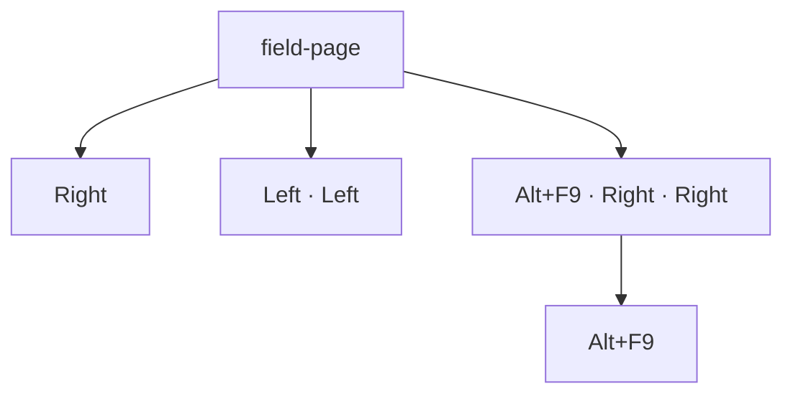

#### N-03 · Left and Right over a hyperlink, one step at a time

`hyperlink`

steps `select({from})` · `{key}` · `{key}` · `{key}` · `{key}` · `{key}` · `{key}` · `{key}` · `{key}` · `{key}` · `{key}`

| from | key | selection | observed |
| --- | --- | --- | --- |
| P1:3 | Right | IP 49–49 | `[See ]<[bu:the site]>[ ‸today.] ↓0<br>[Second paragraph.] ↓0` |
| P1:3 | Left | IP 0–0 | `[‸See ]<[bu:the site]>[ today.] ↓0<br>[Second paragraph.] ↓0` |
| P1:end | Right | IP 65–65 | `[See ]<[bu:the site]>[ today.] ↓0<br>[Second pa‸ragraph.] ↓0` |
| P1:end | Left | IP 44–44 | `[See ]<[bu:the s‸ite]>[ today.] ↓0<br>[Second paragraph.] ↓0` |

Notes: P1:3 is after 'See'; the link's hidden HYPERLINK code occupies positions before its display text, so the trace
shows whether the caret visits them.

#### N-04 · Left and Right over another author's tracked deletion, per markup view

`tracked`

Expected before the run: (a) the collapsed views skip deleted text and Start jumps past it; (b) deleted text is
stepped through in every view.

steps `view({view})` · `select(P1:5)` · `{key}` · `{key}`

| view | key | selection | observed |
| --- | --- | --- | --- |
| all | Right | IP 7–7 · Revisions 2 | `[Kept ]{+[ad‸ded ]+}{-[gone ]-}[text stays.] ↓0<br>[Second paragraph.] ↓0` |
| all | Left | IP 3–3 · Revisions 2 | `[Kep‸t ]{+[added ]+}{-[gone ]-}[text stays.] ↓0<br>[Second paragraph.] ↓0` |
| all | Ctrl+Right | IP 16–16 · Revisions 2 | `[Kept ]{+[added ]+}{-[gone ]-}[‸text stays.] ↓0<br>[Second paragraph.] ↓0` |
| all | Shift+Right | Normal 5–7 end-active · Revisions 2 | `[Kept ]{+[⟦ad‸⟧ded ]+}{-[gone ]-}[text stays.] ↓0<br>[Second paragraph.] ↓0` |
| simple | Right | IP 7–7 · Revisions 2 | `[Kept ]{+[ad‸ded ]+}{-[]-}[text stays.] ↓0<br>[Second paragraph.] ↓0` |
| simple | Left | IP 3–3 · Revisions 2 | `[Kep‸t ]{+[added ]+}{-[]-}[text stays.] ↓0<br>[Second paragraph.] ↓0` |
| simple | Ctrl+Right | IP 21–21 · Revisions 2 | `[Kept ]{+[added ]+}{-[]-}[text ‸stays.] ↓0<br>[Second paragraph.] ↓0` |
| simple | Shift+Right | Normal 5–7 end-active · Revisions 2 | `[Kept ]{+[⟦ad‸⟧ded ]+}{-[]-}[text stays.] ↓0<br>[Second paragraph.] ↓0` |
| none | Right | IP 7–7 · Revisions 2 | `[Kept ]{+[ad‸ded ]+}{-[]-}[text stays.] ↓0<br>[Second paragraph.] ↓0` |
| none | Left | IP 3–3 · Revisions 2 | `[Kep‸t ]{+[added ]+}{-[]-}[text stays.] ↓0<br>[Second paragraph.] ↓0` |
| none | Ctrl+Right | IP 21–21 · Revisions 2 | `[Kept ]{+[added ]+}{-[]-}[text ‸stays.] ↓0<br>[Second paragraph.] ↓0` |
| none | Shift+Right | Normal 5–7 end-active · Revisions 2 | `[Kept ]{+[⟦ad‸⟧ded ]+}{-[]-}[text stays.] ↓0<br>[Second paragraph.] ↓0` |

#### N-05 · Left and Right over hidden text with marks hidden

`special`

Expected before the run: Hidden text is skipped when marks are off (the harness's view), stepped through when shown.

1. `select(P1:find(" hidden"))`
2. `Right`
3. `Right`
4. `Right`
5. `Right`
6. `Right`
7. `Right`
8. `Right`
9. `Right`
10. `Left`
11. `Left`
12. `Left`

| step | selection | where |
| --- | --- | --- |
| `Right` | IP 16–16 | `[a⍽b soft⁃hyphen ‸hidden words dash—end.]` |
| `Right` | IP 23–23 | `[a⍽b soft⁃hyphen hidden ‸words dash—end.]` |
| `Right` | IP 24–24 | `[a⍽b soft⁃hyphen hidden w‸ords dash—end.]` |
| `Right` | IP 25–25 | `[a⍽b soft⁃hyphen hidden wo‸rds dash—end.]` |
| `Right` | IP 26–26 | `[a⍽b soft⁃hyphen hidden wor‸ds dash—end.]` |
| `Right` | IP 27–27 | `[a⍽b soft⁃hyphen hidden word‸s dash—end.]` |
| `Right` | IP 28–28 | `[a⍽b soft⁃hyphen hidden words‸ dash—end.]` |
| `Right` | IP 29–29 | `[a⍽b soft⁃hyphen hidden words ‸dash—end.]` |
| `Left` | IP 28–28 | `[a⍽b soft⁃hyphen hidden words‸ dash—end.]` |
| `Left` | IP 27–27 | `[a⍽b soft⁃hyphen hidden word‸s dash—end.]` |
| `Left` | IP 26–26 | `[a⍽b soft⁃hyphen hidden wor‸ds dash—end.]` |

```text
[a⍽b soft⁃hyphen hidden wor‸ds dash—end.] ↓0
```

Selection: IP 26–26

#### N-06 · Left and Right at content control and bookmark edges

`{fixture}`

Expected before the run: (a) a content control has an inside-start and a before-start position, so one Right stays in
place visually; (b) no extra positions. Bookmark edges add none.

steps `select({from})` · `{key}`

| fixture | from | key | selection | observed |
| --- | --- | --- | --- | --- |
| content-control | P1:5 | Right | IP 6–6 | `[Rich: ‸(\|content here\|) end.] ↓0<br>[Plain: (\|plain here\|) end.] ↓0<br>[Check: (\|☐\|) end.] ↓0<br>[Pick: (\|choice\|) end.] ↓0` |
| content-control | P1:5 | Left | IP 4–4 | `[Rich‸: (\|content here\|) end.] ↓0<br>[Plain: (\|plain here\|) end.] ↓0<br>[Check: (\|☐\|) end.] ↓0<br>[Pick: (\|choice\|) end.] ↓0` |
| content-control | P1:6 | Right | IP 7–7 | `[Rich: (\|‸content here\|) end.] ↓0<br>[Plain: (\|plain here\|) end.] ↓0<br>[Check: (\|☐\|) end.] ↓0<br>[Pick: (\|choice\|) end.] ↓0` |
| content-control | P1:6 | Left | IP 5–5 | `[Rich:‸ (\|content here\|) end.] ↓0<br>[Plain: (\|plain here\|) end.] ↓0<br>[Check: (\|☐\|) end.] ↓0<br>[Pick: (\|choice\|) end.] ↓0` |
| content-control | P1:find(" end") | Right | IP 21–21 | `[Rich: (\|content here\|) ‸end.] ↓0<br>[Plain: (\|plain here\|) end.] ↓0<br>[Check: (\|☐\|) end.] ↓0<br>[Pick: (\|choice\|) end.] ↓0` |
| content-control | P1:find(" end") | Left | IP 19–19 | `[Rich: (\|content here‸\|) end.] ↓0<br>[Plain: (\|plain here\|) end.] ↓0<br>[Check: (\|☐\|) end.] ↓0<br>[Pick: (\|choice\|) end.] ↓0` |
| content-control | P1:find(" end"):end | Right | IP 25–25 | `[Rich: (\|content here\|) end.‸] ↓0<br>[Plain: (\|plain here\|) end.] ↓0<br>[Check: (\|☐\|) end.] ↓0<br>[Pick: (\|choice\|) end.] ↓0` |
| content-control | P1:find(" end"):end | Left | IP 23–23 | `[Rich: (\|content here\|) en‸d.] ↓0<br>[Plain: (\|plain here\|) end.] ↓0<br>[Check: (\|☐\|) end.] ↓0<br>[Pick: (\|choice\|) end.] ↓0` |
| bookmark | P1:5 | Right | IP 6–6 | `[The qu‸ick brown fox jumps over the lazy dog.] ↓0<br>[Second paragraph.] ↓0` |
| bookmark | P1:5 | Left | IP 4–4 | `[The ‸quick brown fox jumps over the lazy dog.] ↓0<br>[Second paragraph.] ↓0` |
| bookmark | P1:6 | Right | IP 7–7 | `[The qui‸ck brown fox jumps over the lazy dog.] ↓0<br>[Second paragraph.] ↓0` |
| bookmark | P1:6 | Left | IP 5–5 | `[The q‸uick brown fox jumps over the lazy dog.] ↓0<br>[Second paragraph.] ↓0` |

_4 combination(s) whose set-up does not apply to the fixture are left out._

#### N-07 · Up and Down keep the remembered x across short, empty and larger lines

`{fixture}`

Expected before the run: The x of the first caret is kept over a shorter line and re-applied on the next long one;
Left/Right/Home/End/typing reset it.

steps before the branches `select({from})` · `Down` · `Down`

**fixture=long-paragraph,from=P1:5**

- `Down` → `[Short first.] ↓0 / [A long second paragraph that runs on past the right margin so that it wraps to a second and t‸hen a third line of text on the page, giving Up and Down keys lines to move between before it finally ends here.] ↓0 / [Short third.] ↓0` · IP 106–106
- `Up · Up` → `[Short‸ first.] ↓0 / [A long second paragraph that runs on past the right margin so that it wraps to a second and then a third line of text on the page, giving Up and Down keys lines to move between before it finally ends here.] ↓0 / [Short third.] ↓0` · IP 5–5
- `Left · Down` → `[Short first.] ↓0 / [A long second paragraph that runs on past the right margin so that it wraps to a second and then a third line of text on the page, giving Up and Down keys lines to move between befo‸re it finally ends here.] ↓0 / [Short third.] ↓0` · IP 194–194

**fixture=long-paragraph,from=P1:end**

- `Down` → `[Short first.] ↓0 / [A long second paragraph that runs on past the right margin so that it wraps to a second and then a‸ third line of text on the page, giving Up and Down keys lines to move between before it finally ends here.] ↓0 / [Short third.] ↓0` · IP 111–111
- `Up · Up` → `[Short first.‸] ↓0 / [A long second paragraph that runs on past the right margin so that it wraps to a second and then a third line of text on the page, giving Up and Down keys lines to move between before it finally ends here.] ↓0 / [Short third.] ↓0` · IP 12–12
- `Left · Down` → `[Short first.] ↓0 / [A long second paragraph that runs on past the right margin so that it wraps to a second and then a third line of text on the page, giving Up and Down keys lines to move between before it f‸inally ends here.] ↓0 / [Short third.] ↓0` · IP 201–201

**fixture=empty-paragraphs,from=P1:5**

- `Down` → `[Above] ↓0 /  ↓0 / ‸ ↓0 / [Below] ↓0` · IP 7–7
- `Up · Up` → `[Above‸] ↓0 /  ↓0 /  ↓0 / [Below] ↓0` · IP 5–5
- `Left · Down` → `[Above] ↓0 /  ↓0 / ‸ ↓0 / [Below] ↓0` · IP 7–7

**fixture=empty-paragraphs,from=P1:end**

- `Down` → `[Above] ↓0 /  ↓0 / ‸ ↓0 / [Below] ↓0` · IP 7–7
- `Up · Up` → `[Above‸] ↓0 /  ↓0 /  ↓0 / [Below] ↓0` · IP 5–5
- `Left · Down` → `[Above] ↓0 /  ↓0 / ‸ ↓0 / [Below] ↓0` · IP 7–7

**fixture=bullets,from=P1:5**

- `Down` → `[Alpha] #ListParagraph •1.0 ● ⇥36,-18 / [Beta] #ListParagraph •1.0 ● ⇥36,-18 / [Gam‸ma] #ListParagraph •1.0 ● ⇥36,-18` · IP 14–14
- `Up · Up` → `[Alpha‸] #ListParagraph •1.0 ● ⇥36,-18 / [Beta] #ListParagraph •1.0 ● ⇥36,-18 / [Gamma] #ListParagraph •1.0 ● ⇥36,-18` · IP 5–5
- `Left · Down` → `[Alpha] #ListParagraph •1.0 ● ⇥36,-18 / [Beta] #ListParagraph •1.0 ● ⇥36,-18 / [Ga‸mma] #ListParagraph •1.0 ● ⇥36,-18` · IP 13–13

**fixture=bullets,from=P1:end**

- `Down` → `[Alpha] #ListParagraph •1.0 ● ⇥36,-18 / [Beta] #ListParagraph •1.0 ● ⇥36,-18 / [Gam‸ma] #ListParagraph •1.0 ● ⇥36,-18` · IP 14–14
- `Up · Up` → `[Alpha‸] #ListParagraph •1.0 ● ⇥36,-18 / [Beta] #ListParagraph •1.0 ● ⇥36,-18 / [Gamma] #ListParagraph •1.0 ● ⇥36,-18` · IP 5–5
- `Left · Down` → `[Alpha] #ListParagraph •1.0 ● ⇥36,-18 / [Beta] #ListParagraph •1.0 ● ⇥36,-18 / [Ga‸mma] #ListParagraph •1.0 ● ⇥36,-18` · IP 13–13

**fixture=kinds,from=P1:5**

- `Down` → `[Normal kind.] ↓0 / [Heading kind] #Heading1 / [‸Bullet kind.] #ListParagraph •1.0 ● ⇥36,-18 / [Centred kind.] (center) ↓0 / [Bordered kind.] ↓0 / [Indented kind.] ⇥36,0 ↓0 /  ↓0 / [Keep with next kind.] ↓0 / [Last plain kind.] ↓0` · IP 26–26
- `Up · Up` → `[Norma‸l kind.] ↓0 / [Heading kind] #Heading1 / [Bullet kind.] #ListParagraph •1.0 ● ⇥36,-18 / [Centred kind.] (center) ↓0 / [Bordered kind.] ↓0 / [Indented kind.] ⇥36,0 ↓0 /  ↓0 / [Keep with next kind.] ↓0 / [Last plain kind.] ↓0` · IP 5–5
- `Left · Down` → `[Normal kind.] ↓0 / [Heading kind] #Heading1 / [Bullet kind.] #ListParagraph •1.0 ● ⇥36,-18 / [‸Centred kind.] (center) ↓0 / [Bordered kind.] ↓0 / [Indented kind.] ⇥36,0 ↓0 /  ↓0 / [Keep with next kind.] ↓0 / [Last plain kind.] ↓0` · IP 39–39

**fixture=kinds,from=P1:end**

- `Down` → `[Normal kind.] ↓0 / [Heading kind] #Heading1 / [Bullet‸ kind.] #ListParagraph •1.0 ● ⇥36,-18 / [Centred kind.] (center) ↓0 / [Bordered kind.] ↓0 / [Indented kind.] ⇥36,0 ↓0 /  ↓0 / [Keep with next kind.] ↓0 / [Last plain kind.] ↓0` · IP 32–32
- `Up · Up` → `[Normal kind.‸] ↓0 / [Heading kind] #Heading1 / [Bullet kind.] #ListParagraph •1.0 ● ⇥36,-18 / [Centred kind.] (center) ↓0 / [Bordered kind.] ↓0 / [Indented kind.] ⇥36,0 ↓0 /  ↓0 / [Keep with next kind.] ↓0 / [Last plain kind.] ↓0` · IP 12–12
- `Left · Down` → `[Normal kind.] ↓0 / [Heading kind] #Heading1 / [Bullet kind.] #ListParagraph •1.0 ● ⇥36,-18 / [‸Centred kind.] (center) ↓0 / [Bordered kind.] ↓0 / [Indented kind.] ⇥36,0 ↓0 /  ↓0 / [Keep with next kind.] ↓0 / [Last plain kind.] ↓0` · IP 39–39

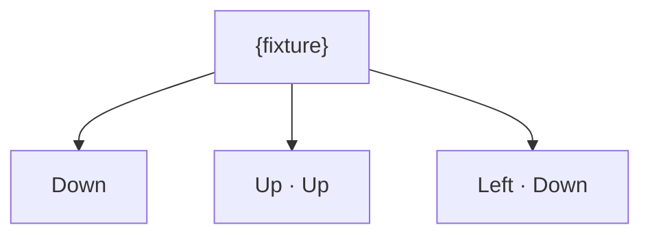

#### N-08 · Up and Down into, through and out of a table

`{fixture}`

Expected before the run: Down enters the cell under the caret's x, keeps the column row by row, exits to the
paragraph after; a two-line cell takes two presses; a vertically merged cell is one stop.

steps before the branches `select({from})` · `Down` · `Down` · `Down` · `Down`

**fixture=table-3x3,from=P1:3**

- `Down` → `[Before the table.] ↓0 / T1 R1 ║[a1¤]║[b1¤]║[c1¤]║¤ / T1 R2 ║[a2¤]║[b2¤]║[c2¤]║¤ / T1 R3 ║[a3¤]║[b3¤]║[c3¤]║¤ / [Aft‸er the table.] ↓0` · IP 51–51
- `Up · Up · Up · Up · Up` → `[Bef‸ore the table.] ↓0 / T1 R1 ║[a1¤]║[b1¤]║[c1¤]║¤ / T1 R2 ║[a2¤]║[b2¤]║[c2¤]║¤ / T1 R3 ║[a3¤]║[b3¤]║[c3¤]║¤ / [After the table.] ↓0` · IP 3–3

**fixture=table-3x3,from=P1:end**

- `Down` → `[Before the table.] ↓0 / T1 R1 ║[a1¤]║[b1¤]║[c1¤]║¤ / T1 R2 ║[a2¤]║[b2¤]║[c2¤]║¤ / T1 R3 ║[a3¤]║[b3¤]║[c3¤]║¤ / [After the table.‸] ↓0` · IP 64–64
- `Up · Up · Up · Up · Up` → `[Before the table.‸] ↓0 / T1 R1 ║[a1¤]║[b1¤]║[c1¤]║¤ / T1 R2 ║[a2¤]║[b2¤]║[c2¤]║¤ / T1 R3 ║[a3¤]║[b3¤]║[c3¤]║¤ / [After the table.] ↓0` · IP 17–17

**fixture=table-merged,from=P1:3**

- `Down` → `[Before the table.] ↓0 / T1 R1 ║[a1] ¶ [b1¤]║[c1¤]║¤ / T1 R2 ║[a2¤]║[b2¤]║[c2] ¶ [c3¤]║¤ / T1 R3 ║[‸a3¤]║[b3¤]║¤ / [After the table.] ↓0` · IP 41–41 · Cells 1 (R3C1–R3C1)
- `Up · Up · Up · Up · Up` → `[Bef‸ore the table.] ↓0 / T1 R1 ║[a1] ¶ [b1¤]║[c1¤]║¤ / T1 R2 ║[a2¤]║[b2¤]║[c2] ¶ [c3¤]║¤ / T1 R3 ║[a3¤]║[b3¤]║¤ / [After the table.] ↓0` · IP 3–3

**fixture=table-merged,from=P1:end**

- `Down` → `[Before the table.] ↓0 / T1 R1 ║[a1] ¶ [b1¤]║[c1¤]║¤ / T1 R2 ║[a2¤]║[b2¤]║[c2] ¶ [c3¤]║¤ / T1 R3 ║[a3‸¤]║[b3¤]║¤ / [After the table.] ↓0` · IP 43–43 · Cells 1 (R3C1–R3C1)
- `Up · Up · Up · Up · Up` → `[Before the table.‸] ↓0 / T1 R1 ║[a1] ¶ [b1¤]║[c1¤]║¤ / T1 R2 ║[a2¤]║[b2¤]║[c2] ¶ [c3¤]║¤ / T1 R3 ║[a3¤]║[b3¤]║¤ / [After the table.] ↓0` · IP 17–17

**fixture=table-at-end,from=P1:3**

- `Down` → `[Before the table.] ↓0 / T1 R1 ║[One¤]║[Two¤]║¤ / T1 R2 ║[Three¤]║[Four¤]║¤ / ‸ ↓0` · IP 39–39
- `Up · Up · Up · Up · Up` → `[Bef‸ore the table.] ↓0 / T1 R1 ║[One¤]║[Two¤]║¤ / T1 R2 ║[Three¤]║[Four¤]║¤ /  ↓0` · IP 3–3

**fixture=table-at-end,from=P1:end**

- `Down` → `[Before the table.] ↓0 / T1 R1 ║[One¤]║[Two¤]║¤ / T1 R2 ║[Three¤]║[Four¤]║¤ / ‸ ↓0` · IP 39–39
- `Up · Up · Up · Up · Up` → `[Before the table.‸] ↓0 / T1 R1 ║[One¤]║[Two¤]║¤ / T1 R2 ║[Three¤]║[Four¤]║¤ /  ↓0` · IP 17–17

**fixture=table-multi,from=P1:3**

- `Down` → `[Before the table.] ↓0 / T1 R1 ║[first] ¶ [second¤]║[b1¤]║¤ / T1 R2 ║[a2¤]║[item one] #ListParagraph •1.0 ● ⇥36,-18 ¶ [item two¤] #ListParagraph •1.0 ● ⇥36,-18║¤ / [Aft‸er the table.] ↓0` · IP 60–60
- `Up · Up · Up · Up · Up` → `[Bef‸ore the table.] ↓0 / T1 R1 ║[first] ¶ [second¤]║[b1¤]║¤ / T1 R2 ║[a2¤]║[item one] #ListParagraph •1.0 ● ⇥36,-18 ¶ [item two¤] #ListParagraph •1.0 ● ⇥36,-18║¤ / [After the table.] ↓0` · IP 3–3

**fixture=table-multi,from=P1:end**

- `Down` → `[Before the table.] ↓0 / T1 R1 ║[first] ¶ [second¤]║[b1¤]║¤ / T1 R2 ║[a2¤]║[item one] #ListParagraph •1.0 ● ⇥36,-18 ¶ [item two¤] #ListParagraph •1.0 ● ⇥36,-18║¤ / [After the table.‸] ↓0` · IP 73–73
- `Up · Up · Up · Up · Up` → `[Before the table.‸] ↓0 / T1 R1 ║[First] ¶ [second¤]║[b1¤]║¤ / T1 R2 ║[a2¤]║[item one] #ListParagraph •1.0 ● ⇥36,-18 ¶ [item two¤] #ListParagraph •1.0 ● ⇥36,-18║¤ / [After the table.] ↓0` · IP 17–17

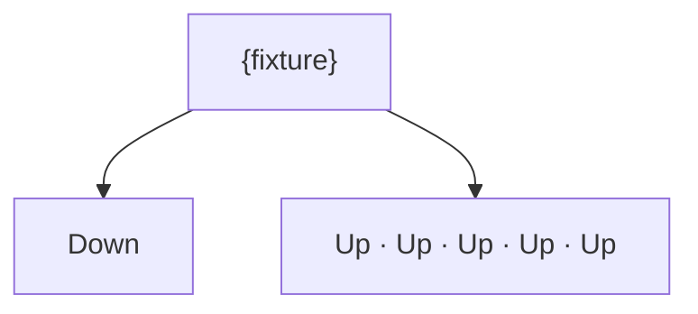

#### N-09 · Up on the first line and Down on the last line of a document

`plain`

Expected before the run: Up on the only line goes to the paragraph start; Down to its end.

steps `select(P1:5)` · `{key}`

| key | selection | observed |
| --- | --- | --- |
| Up | IP 5–5 | `[The q‸uick brown fox jumps over the lazy dog.] ↓0` |
| Down | IP 5–5 | `[The q‸uick brown fox jumps over the lazy dog.] ↓0` |

#### N-10 · Home and End on wrapped, tabbed, broken, empty and trailing-space lines

`{fixture}`

Expected before the run: End on a wrapped line lands (a) before the wrap space (b) after it; End on the last line
lands before the mark; in a cell before the cell mark.

steps `select({from})` · `{key}`

| fixture | from | key | selection | observed |
| --- | --- | --- | --- | --- |
| wrap | P1:3 | End | IP 40–40 | `[Alpha beta gamma delta epsilon zeta eta ‸theta iota kappa lambda mu nu xi omicron pi rho sigma tau upsilon phi chi psi omega alpha beta gamma delta epsilon zeta.] ↓0` |
| wrap | P1:3 | Home | IP 0–0 | `[‸Alpha beta gamma delta epsilon zeta eta theta iota kappa lambda mu nu xi omicron pi rho sigma tau upsilon phi chi psi omega alpha beta gamma delta epsilon zeta.] ↓0` |
| wrap | P1:30 | End | IP 40–40 | `[Alpha beta gamma delta epsilon zeta eta ‸theta iota kappa lambda mu nu xi omicron pi rho sigma tau upsilon phi chi psi omega alpha beta gamma delta epsilon zeta.] ↓0` |
| wrap | P1:30 | Home | IP 0–0 | `[‸Alpha beta gamma delta epsilon zeta eta theta iota kappa lambda mu nu xi omicron pi rho sigma tau upsilon phi chi psi omega alpha beta gamma delta epsilon zeta.] ↓0` |
| tabs-breaks | P1:3 | End | IP 15–15 | `[Left\tright side‸] ↓0<br>[Line one \nline two] ↓0<br>[Two  spaces here.] ↓0` |
| tabs-breaks | P1:3 | Home | IP 0–0 | `[‸Left\tright side] ↓0<br>[Line one \nline two] ↓0<br>[Two  spaces here.] ↓0` |
| tabs-breaks | P1:30 | End | IP 34–34 | `[Left\tright side] ↓0<br>[Line one \nline two‸] ↓0<br>[Two  spaces here.] ↓0` |
| tabs-breaks | P1:30 | Home | IP 26–26 | `[Left\tright side] ↓0<br>[Line one \n‸line two] ↓0<br>[Two  spaces here.] ↓0` |
| tabs-breaks | P2:3 | End | IP 25–25 | `[Left\tright side] ↓0<br>[Line one ‸\nline two] ↓0<br>[Two  spaces here.] ↓0` |
| tabs-breaks | P2:3 | Home | IP 16–16 | `[Left\tright side] ↓0<br>[‸Line one \nline two] ↓0<br>[Two  spaces here.] ↓0` |
| empty-paragraphs | P1:3 | End | IP 5–5 | `[Above‸] ↓0<br> ↓0<br> ↓0<br>[Below] ↓0` |
| empty-paragraphs | P1:3 | Home | IP 0–0 | `[‸Above] ↓0<br> ↓0<br> ↓0<br>[Below] ↓0` |
| empty-paragraphs | P1:30 | End | IP 13–13 | `[Above] ↓0<br> ↓0<br> ↓0<br>[Below‸] ↓0` |
| empty-paragraphs | P1:30 | Home | IP 8–8 | `[Above] ↓0<br> ↓0<br> ↓0<br>[‸Below] ↓0` |
| empty-paragraphs | P2:3 | End | IP 13–13 | `[Above] ↓0<br> ↓0<br> ↓0<br>[Below‸] ↓0` |
| empty-paragraphs | P2:3 | Home | IP 8–8 | `[Above] ↓0<br> ↓0<br> ↓0<br>[‸Below] ↓0` |
| table-2x2 | P1:3 | End | IP 17–17 | `[Before the table.‸] ↓0<br>T1 R1 ║[One¤]║[Two¤]║¤<br>T1 R2 ║[Three¤]║[Four¤]║¤<br>[After the table.] ↓0` |
| table-2x2 | P1:3 | Home | IP 0–0 | `[‸Before the table.] ↓0<br>T1 R1 ║[One¤]║[Two¤]║¤<br>T1 R2 ║[Three¤]║[Four¤]║¤<br>[After the table.] ↓0` |
| table-2x2 | P1:30 | End | IP 32–32 · Cells 1 (R2C1–R2C1) | `[Before the table.] ↓0<br>T1 R1 ║[One¤]║[Two¤]║¤<br>T1 R2 ║[Three‸¤]║[Four¤]║¤<br>[After the table.] ↓0` |
| table-2x2 | P1:30 | Home | IP 27–27 · Cells 1 (R2C1–R2C1) | `[Before the table.] ↓0<br>T1 R1 ║[One¤]║[Two¤]║¤<br>T1 R2 ║[‸Three¤]║[Four¤]║¤<br>[After the table.] ↓0` |
| table-2x2 | P2:3 | End | IP 21–21 · Cells 1 (R1C1–R1C1) | `[Before the table.] ↓0<br>T1 R1 ║[One‸¤]║[Two¤]║¤<br>T1 R2 ║[Three¤]║[Four¤]║¤<br>[After the table.] ↓0` |
| table-2x2 | P2:3 | Home | IP 18–18 · Cells 1 (R1C1–R1C1) | `[Before the table.] ↓0<br>T1 R1 ║[‸One¤]║[Two¤]║¤<br>T1 R2 ║[Three¤]║[Four¤]║¤<br>[After the table.] ↓0` |
| table-2x2 | C(1,1):1 | End | IP 21–21 · Cells 1 (R1C1–R1C1) | `[Before the table.] ↓0<br>T1 R1 ║[One‸¤]║[Two¤]║¤<br>T1 R2 ║[Three¤]║[Four¤]║¤<br>[After the table.] ↓0` |
| table-2x2 | C(1,1):1 | Home | IP 18–18 · Cells 1 (R1C1–R1C1) | `[Before the table.] ↓0<br>T1 R1 ║[‸One¤]║[Two¤]║¤<br>T1 R2 ║[Three¤]║[Four¤]║¤<br>[After the table.] ↓0` |

_8 combination(s) whose set-up does not apply to the fixture are left out._

#### N-11 · Ctrl+Home and Ctrl+End from body, cell, header and text box

`{fixture}`

steps `{setup}` · `{key}`

| fixture | setup | key | selection | observed |
| --- | --- | --- | --- | --- |
| table-2x2 | select(P1:3) | Ctrl+End | IP 55–55 | `[Before the table.] ↓0<br>T1 R1 ║[One¤]║[Two¤]║¤<br>T1 R2 ║[Three¤]║[Four¤]║¤<br>[After the table.‸] ↓0` |
| table-2x2 | select(P1:3) | Ctrl+Home | IP 0–0 | `[‸Before the table.] ↓0<br>T1 R1 ║[One¤]║[Two¤]║¤<br>T1 R2 ║[Three¤]║[Four¤]║¤<br>[After the table.] ↓0` |
| table-2x2 | select(C(1,1):1) | Ctrl+End | IP 55–55 | `[Before the table.] ↓0<br>T1 R1 ║[One¤]║[Two¤]║¤<br>T1 R2 ║[Three¤]║[Four¤]║¤<br>[After the table.‸] ↓0` |
| table-2x2 | select(C(1,1):1) | Ctrl+Home | IP 0–0 | `[‸Before the table.] ↓0<br>T1 R1 ║[One¤]║[Two¤]║¤<br>T1 R2 ║[Three¤]║[Four¤]║¤<br>[After the table.] ↓0` |
| table-2x2 | seek(header) | Ctrl+End | IP 0–0 · Story PrimaryHeader | `[Before the table.] ↓0<br>T1 R1 ║[One¤]║[Two¤]║¤<br>T1 R2 ║[Three¤]║[Four¤]║¤<br>[After the table.] ↓0<br>HDR: ‸ #Header` |
| table-2x2 | seek(header) | Ctrl+Home | IP 0–0 · Story PrimaryHeader | `[Before the table.] ↓0<br>T1 R1 ║[One¤]║[Two¤]║¤<br>T1 R2 ║[Three¤]║[Four¤]║¤<br>[After the table.] ↓0<br>HDR: ‸ #Header` |
| header-footer | select(P1:3) | Ctrl+End | IP 38–38 | `[Body paragraph.] ↓0<br>[Second body paragraph.‸] ↓0` |
| header-footer | select(P1:3) | Ctrl+Home | IP 0–0 | `[‸Body paragraph.] ↓0<br>[Second body paragraph.] ↓0` |
| header-footer | seek(header) | Ctrl+End | IP 11–11 · Story PrimaryHeader | `[Body paragraph.] ↓0<br>[Second body paragraph.] ↓0<br>HDR: [Header text‸] #Header` |
| header-footer | seek(header) | Ctrl+Home | IP 0–0 · Story PrimaryHeader | `[Body paragraph.] ↓0<br>[Second body paragraph.] ↓0<br>HDR: [‸Header text] #Header` |
| text-box | select(P1:3) | Ctrl+End | IP 91–91 | `[⚓1First paragraph of text here.] ↓0<br>[Second paragraph of text here.] ↓0<br>[Third paragraph of text here.‸] ↓0<br>SHP1 ⌖P1 textbox 160x80pt square @228,0` |
| text-box | select(P1:3) | Ctrl+Home | IP 0–0 | `[‸⚓1First paragraph of text here.] ↓0<br>[Second paragraph of text here.] ↓0<br>[Third paragraph of text here.] ↓0<br>SHP1 ⌖P1 textbox 160x80pt square @228,0` |
| text-box | seek(header) | Ctrl+End | IP 0–0 · Story PrimaryHeader | `[⚓1First paragraph of text here.] ↓0<br>[Second paragraph of text here.] ↓0<br>[Third paragraph of text here.] ↓0<br>SHP1 ⌖P1 textbox 160x80pt square @228,0<br>HDR: ‸ #Header` |
| text-box | seek(header) | Ctrl+Home | IP 0–0 · Story PrimaryHeader | `[⚓1First paragraph of text here.] ↓0<br>[Second paragraph of text here.] ↓0<br>[Third paragraph of text here.] ↓0<br>SHP1 ⌖P1 textbox 160x80pt square @228,0<br>HDR: ‸ #Header` |
| text-box | select(TB1:P1:2) | Ctrl+End | IP 91–91 | `[⚓1First paragraph of text here.] ↓0<br>[Second paragraph of text here.] ↓0<br>[Third paragraph of text here.‸] ↓0<br>SHP1 ⌖P1 textbox 160x80pt square @228,0` |
| text-box | select(TB1:P1:2) | Ctrl+Home | IP 0–0 | `[‸⚓1First paragraph of text here.] ↓0<br>[Second paragraph of text here.] ↓0<br>[Third paragraph of text here.] ↓0<br>SHP1 ⌖P1 textbox 160x80pt square @228,0` |
| footnote | select(P1:3) | Ctrl+End | IP 43–43 | `[Text†1 more words.] ↓0<br>[Second with an end note.‡1‸] ↓0` |
| footnote | select(P1:3) | Ctrl+Home | IP 0–0 | `[‸Text†1 more words.] ↓0<br>[Second with an end note.‡1] ↓0` |
| footnote | seek(header) | Ctrl+End | IP 0–0 · Story PrimaryHeader | `[Text†1 more words.] ↓0<br>[Second with an end note.‡1] ↓0<br>HDR: ‸ #Header` |
| footnote | seek(header) | Ctrl+Home | IP 0–0 · Story PrimaryHeader | `[Text†1 more words.] ↓0<br>[Second with an end note.‡1] ↓0<br>HDR: ‸ #Header` |
| footnote | seek(footnotes) | Ctrl+End | IP 43–43 | `[Text†1 more words.] ↓0<br>[Second with an end note.‡1‸] ↓0` |
| footnote | seek(footnotes) | Ctrl+Home | IP 0–0 | `[‸Text†1 more words.] ↓0<br>[Second with an end note.‡1] ↓0` |

_18 combination(s) whose set-up does not apply to the fixture are left out._

Notes: Setups that do not apply to a fixture (a cell in a document without a table) fail and are recorded as such.

#### N-12 · Ctrl+Right and Ctrl+Left word stops, one press at a time

`{fixture}`

Expected before the run: A stop is the start of the next word after its trailing spaces; punctuation is its own word;
a hyphen splits, an apostrophe does not; 3.14 and 1,000 are single words; the last word of a paragraph stops before
the mark, then at the next paragraph's start; Ctrl+Left at a paragraph start lands at the previous paragraph's end.

steps `select({from})` · `{key}` · `{key}` · `{key}` · `{key}` · `{key}` · `{key}` · `{key}` · `{key}` · `{key}` · `{key}` · `{key}` · `{key}` · `{key}` · `{key}`

| fixture | from | key | selection | observed |
| --- | --- | --- | --- | --- |
| words | P1:start | Ctrl+Right | IP 43–43 | `[alpha beta,  gamma-delta 3.14 don't (eps) 1‸,000 10:30 end.] ↓0` |
| words | P1:start | Ctrl+Left | IP 0–0 | `[‸alpha beta,  gamma-delta 3.14 don't (eps) 1,000 10:30 end.] ↓0` |
| words | DOC:end | Ctrl+Right | IP 58–58 | `[alpha beta,  gamma-delta 3.14 don't (eps) 1,000 10:30 end.‸] ↓0` |
| words | DOC:end | Ctrl+Left | IP 26–26 | `[alpha beta,  gamma-delta 3‸.14 don't (eps) 1,000 10:30 end.] ↓0` |
| image-inline | P1:start | Ctrl+Right | IP 42–42 | `[Text before ▣ after end.] ↓0<br>[Second paragraph.‸] ↓0` |
| image-inline | P1:start | Ctrl+Left | IP 0–0 | `[‸Text before ▣ after end.] ↓0<br>[Second paragraph.] ↓0` |
| image-inline | DOC:end | Ctrl+Right | IP 42–42 | `[Text before ▣ after end.] ↓0<br>[Second paragraph.‸] ↓0` |
| image-inline | DOC:end | Ctrl+Left | IP 0–0 | `[‸Text before ▣ after end.] ↓0<br>[Second paragraph.] ↓0` |
| hyperlink | P1:start | Ctrl+Right | IP 73–73 | `[See ]<[the site]>[ today.] ↓0<br>[Second paragraph.‸] ↓0` |
| hyperlink | P1:start | Ctrl+Left | IP 0–0 | `[‸See ]<[the site]>[ today.] ↓0<br>[Second paragraph.] ↓0` |
| hyperlink | DOC:end | Ctrl+Right | IP 73–73 | `[See ]<[the site]>[ today.] ↓0<br>[Second paragraph.‸] ↓0` |
| hyperlink | DOC:end | Ctrl+Left | IP 0–0 | `[‸See ]<[the site]>[ today.] ↓0<br>[Second paragraph.] ↓0` |
| field-page | P1:start | Ctrl+Right | IP 80–80 | `[Page ][«][ PAGE ][\|][1][»][ of ][«][ NUMPAGES ][\|][1][»][ end.] ↓0<br>[Date: ][«][ DATE \@ "d/MM/yyyy" ][\|][25/10/2026][»][ ‸end.] ↓0` |
| field-page | P1:start | Ctrl+Left | IP 0–0 | `[‸Page ][«][ PAGE ][\|][1][»][ of ][«][ NUMPAGES ][\|][1][»][ end.] ↓0<br>[Date: ][«][ DATE \@ "d/MM/yyyy" ][\|][25/10/2026][»][ end.] ↓0` |
| field-page | DOC:end | Ctrl+Right | IP 84–84 | `[Page ][«][ PAGE ][\|][1][»][ of ][«][ NUMPAGES ][\|][1][»][ end.] ↓0<br>[Date: ][«][ DATE \@ "d/MM/yyyy" ][\|][25/10/2026][»][ end.‸] ↓0` |
| field-page | DOC:end | Ctrl+Left | IP 16–16 | `[Page ][«][ PAGE ][\|][1][»][ ‸of ][«][ NUMPAGES ][\|][1][»][ end.] ↓0<br>[Date: ][«][ DATE \@ "d/MM/yyyy" ][\|][25/10/2026][»][ end.] ↓0` |
| tabs-breaks | P1:start | Ctrl+Right | IP 51–51 | `[Left\tright side] ↓0<br>[Line one \nline two] ↓0<br>[Two  spaces here‸.] ↓0` |
| tabs-breaks | P1:start | Ctrl+Left | IP 0–0 | `[‸Left\tright side] ↓0<br>[Line one \nline two] ↓0<br>[Two  spaces here.] ↓0` |
| tabs-breaks | DOC:end | Ctrl+Right | IP 52–52 | `[Left\tright side] ↓0<br>[Line one \nline two] ↓0<br>[Two  spaces here.‸] ↓0` |
| tabs-breaks | DOC:end | Ctrl+Left | IP 4–4 | `[Left‸\tright side] ↓0<br>[Line one \nline two] ↓0<br>[Two  spaces here.] ↓0` |
| table-2x2 | P1:start | Ctrl+Right | IP 38–38 · Cells 1 (R2C3–R2C3) at-row-end | `[Before the table.] ↓0<br>T1 R1 ║[One¤]║[Two¤]║¤<br>T1 R2 ║[Three¤]║[Four¤]║‸¤<br>[After the table.] ↓0` |
| table-2x2 | P1:start | Ctrl+Left | IP 0–0 | `[‸Before the table.] ↓0<br>T1 R1 ║[One¤]║[Two¤]║¤<br>T1 R2 ║[Three¤]║[Four¤]║¤<br>[After the table.] ↓0` |
| table-2x2 | DOC:end | Ctrl+Right | IP 55–55 | `[Before the table.] ↓0<br>T1 R1 ║[One¤]║[Two¤]║¤<br>T1 R2 ║[Three¤]║[Four¤]║¤<br>[After the table.‸] ↓0` |
| table-2x2 | DOC:end | Ctrl+Left | IP 18–18 · Cells 1 (R1C1–R1C1) | `[Before the table.] ↓0<br>T1 R1 ║[‸One¤]║[Two¤]║¤<br>T1 R2 ║[Three¤]║[Four¤]║¤<br>[After the table.] ↓0` |

#### N-13 · Ctrl+Up and Ctrl+Down between paragraphs, in cells and over a table

`{fixture}`

Expected before the run: Ctrl+Up goes to the paragraph start, then the previous start; Ctrl+Down to the next
paragraph start; in a cell (a) the next paragraph of the cell, then the next cell (b) straight to the next cell.

steps `select({from})` · `{key}` · `{key}`

| fixture | from | key | selection | observed |
| --- | --- | --- | --- | --- |
| three-paragraphs | P2:4 | Ctrl+Up | IP 0–0 | `[‸First paragraph here.] ↓0<br>[Second bold one.] (center) ↓0<br>[Third and last.] ↓0` |
| three-paragraphs | P2:4 | Ctrl+Down | IP 54–54 | `[First paragraph here.] ↓0<br>[Second bold one.] (center) ↓0<br>[Third and last.‸] ↓0` |
| three-paragraphs | P1:end | Ctrl+Up | IP 0–0 | `[‸First paragraph here.] ↓0<br>[Second bold one.] (center) ↓0<br>[Third and last.] ↓0` |
| three-paragraphs | P1:end | Ctrl+Down | IP 39–39 | `[First paragraph here.] ↓0<br>[Second bold one.] (center) ↓0<br>[‸Third and last.] ↓0` |
| table-2x2 | P2:4 | Ctrl+Up | IP 0–0 | `[‸Before the table.] ↓0<br>T1 R1 ║[One¤]║[Two¤]║¤<br>T1 R2 ║[Three¤]║[Four¤]║¤<br>[After the table.] ↓0` |
| table-2x2 | P2:4 | Ctrl+Down | IP 27–27 · Cells 1 (R2C1–R2C1) | `[Before the table.] ↓0<br>T1 R1 ║[One¤]║[Two¤]║¤<br>T1 R2 ║[‸Three¤]║[Four¤]║¤<br>[After the table.] ↓0` |
| table-2x2 | P1:end | Ctrl+Up | IP 0–0 | `[‸Before the table.] ↓0<br>T1 R1 ║[One¤]║[Two¤]║¤<br>T1 R2 ║[Three¤]║[Four¤]║¤<br>[After the table.] ↓0` |
| table-2x2 | P1:end | Ctrl+Down | IP 22–22 · Cells 1 (R1C2–R1C2) | `[Before the table.] ↓0<br>T1 R1 ║[One¤]║[‸Two¤]║¤<br>T1 R2 ║[Three¤]║[Four¤]║¤<br>[After the table.] ↓0` |
| table-2x2 | C(1,1):1 | Ctrl+Up | IP 0–0 | `[‸Before the table.] ↓0<br>T1 R1 ║[One¤]║[Two¤]║¤<br>T1 R2 ║[Three¤]║[Four¤]║¤<br>[After the table.] ↓0` |
| table-2x2 | C(1,1):1 | Ctrl+Down | IP 26–26 · Cells 1 (R1C3–R1C3) at-row-end | `[Before the table.] ↓0<br>T1 R1 ║[One¤]║[Two¤]║‸¤<br>T1 R2 ║[Three¤]║[Four¤]║¤<br>[After the table.] ↓0` |
| table-multi | P2:4 | Ctrl+Up | IP 0–0 | `[‸Before the table.] ↓0<br>T1 R1 ║[first] ¶ [second¤]║[b1¤]║¤<br>T1 R2 ║[a2¤]║[item one] #ListParagraph •1.0 ● ⇥36,-18 ¶ [item two¤] #ListParagraph •1.0 ● ⇥36,-18║¤<br>[After the table.] ↓0` |
| table-multi | P2:4 | Ctrl+Down | IP 31–31 · Cells 1 (R1C2–R1C2) | `[Before the table.] ↓0<br>T1 R1 ║[first] ¶ [second¤]║[‸b1¤]║¤<br>T1 R2 ║[a2¤]║[item one] #ListParagraph •1.0 ● ⇥36,-18 ¶ [item two¤] #ListParagraph •1.0 ● ⇥36,-18║¤<br>[After the table.] ↓0` |
| table-multi | P1:end | Ctrl+Up | IP 0–0 | `[‸Before the table.] ↓0<br>T1 R1 ║[first] ¶ [second¤]║[b1¤]║¤<br>T1 R2 ║[a2¤]║[item one] #ListParagraph •1.0 ● ⇥36,-18 ¶ [item two¤] #ListParagraph •1.0 ● ⇥36,-18║¤<br>[After the table.] ↓0` |
| table-multi | P1:end | Ctrl+Down | IP 24–24 · Cells 1 (R1C1–R1C1) | `[Before the table.] ↓0<br>T1 R1 ║[first] ¶ [‸second¤]║[b1¤]║¤<br>T1 R2 ║[a2¤]║[item one] #ListParagraph •1.0 ● ⇥36,-18 ¶ [item two¤] #ListParagraph •1.0 ● ⇥36,-18║¤<br>[After the table.] ↓0` |
| table-multi | C(1,1):1 | Ctrl+Up | IP 0–0 | `[‸Before the table.] ↓0<br>T1 R1 ║[first] ¶ [second¤]║[b1¤]║¤<br>T1 R2 ║[a2¤]║[item one] #ListParagraph •1.0 ● ⇥36,-18 ¶ [item two¤] #ListParagraph •1.0 ● ⇥36,-18║¤<br>[After the table.] ↓0` |
| table-multi | C(1,1):1 | Ctrl+Down | IP 31–31 · Cells 1 (R1C2–R1C2) | `[Before the table.] ↓0<br>T1 R1 ║[first] ¶ [second¤]║[‸b1¤]║¤<br>T1 R2 ║[a2¤]║[item one] #ListParagraph •1.0 ● ⇥36,-18 ¶ [item two¤] #ListParagraph •1.0 ● ⇥36,-18║¤<br>[After the table.] ↓0` |

_2 combination(s) whose set-up does not apply to the fixture are left out._

#### N-14 · PgUp, PgDn, Ctrl+PgUp and Ctrl+PgDn over three pages

`three-pages`

steps `select({from})` · `{key}` · `{key}`

| from | key | selection | observed |
| --- | --- | --- | --- |
| P1:3 | PgDn | IP 918–918 | `see below` |
| P1:3 | PgUp | IP 0–0 | `see below` |
| P1:3 | Ctrl+PgDn | IP 915–915 | `see below` |
| P1:3 | Ctrl+PgUp | IP 0–0 | `see below` |
| P1:3 | Ctrl+Alt+PgDn | IP 453–453 | `see below` |
| P1:3 | Ctrl+Alt+PgUp | IP 0–0 | `see below` |
| P15:3 | PgDn | IP 1332–1332 | `see below` |
| P15:3 | PgUp | IP 225–225 | `see below` |
| P15:3 | Ctrl+PgDn | IP 915–915 | `see below` |
| P15:3 | Ctrl+PgUp | IP 0–0 | `see below` |
| P15:3 | Ctrl+Alt+PgDn | IP 682–682 | `see below` |
| P15:3 | Ctrl+Alt+PgUp | IP 315–315 | `see below` |

`N-14[from=P1:3,key=PgDn]`

```text
[Paragraph 1 of thirty on one of three pages.] ↓0
[Paragraph 2 of thirty on one of three pages.] ↓0
[Paragraph 3 of thirty on one of three pages.] ↓0
[Paragraph 4 of thirty on one of three pages.] ↓0
[Paragraph 5 of thirty on one of three pages.] ↓0
[Paragraph 6 of thirty on one of three pages.] ↓0
[Paragraph 7 of thirty on one of three pages.] ↓0
[Paragraph 8 of thirty on one of three pages.] ↓0
[Paragraph 9 of thirty on one of three pages.] ↓0
[Paragraph 10 of thirty on one of three pages.] ↓0
[⤓] ↓0
[Paragraph 11 of thirty on one of three pages.] ↓0
[Paragraph 12 of thirty on one of three pages.] ↓0
[Paragraph 13 of thirty on one of three pages.] ↓0
[Paragraph 14 of thirty on one of three pages.] ↓0
[Paragraph 15 of thirty on one of three pages.] ↓0
[Paragraph 16 of thirty on one of three pages.] ↓0
[Paragraph 17 of thirty on one of three pages.] ↓0
[Paragraph 18 of thirty on one of three pages.] ↓0
[Paragraph 19 of thirty on one of three pages.] ↓0
[Paragraph 20 of thirty on one of three pages.] ↓0
[⤓] ↓0
[Par‸agraph 21 of thirty on one of three pages.] ↓0
[Paragraph 22 of thirty on one of three pages.] ↓0
[Paragraph 23 of thirty on one of three pages.] ↓0
[Paragraph 24 of thirty on one of three pages.] ↓0
[Paragraph 25 of thirty on one of three pages.] ↓0
[Paragraph 26 of thirty on one of three pages.] ↓0
[Paragraph 27 of thirty on one of three pages.] ↓0
[Paragraph 28 of thirty on one of three pages.] ↓0
[Paragraph 29 of thirty on one of three pages.] ↓0
[Paragraph 30 of thirty on one of three pages.] ↓0
```

Selection: IP 918–918

`N-14[from=P1:3,key=PgUp]`

```text
[‸Paragraph 1 of thirty on one of three pages.] ↓0
[Paragraph 2 of thirty on one of three pages.] ↓0
[Paragraph 3 of thirty on one of three pages.] ↓0
[Paragraph 4 of thirty on one of three pages.] ↓0
[Paragraph 5 of thirty on one of three pages.] ↓0
[Paragraph 6 of thirty on one of three pages.] ↓0
[Paragraph 7 of thirty on one of three pages.] ↓0
[Paragraph 8 of thirty on one of three pages.] ↓0
[Paragraph 9 of thirty on one of three pages.] ↓0
[Paragraph 10 of thirty on one of three pages.] ↓0
[⤓] ↓0
[Paragraph 11 of thirty on one of three pages.] ↓0
[Paragraph 12 of thirty on one of three pages.] ↓0
[Paragraph 13 of thirty on one of three pages.] ↓0
[Paragraph 14 of thirty on one of three pages.] ↓0
[Paragraph 15 of thirty on one of three pages.] ↓0
[Paragraph 16 of thirty on one of three pages.] ↓0
[Paragraph 17 of thirty on one of three pages.] ↓0
[Paragraph 18 of thirty on one of three pages.] ↓0
[Paragraph 19 of thirty on one of three pages.] ↓0
[Paragraph 20 of thirty on one of three pages.] ↓0
[⤓] ↓0
[Paragraph 21 of thirty on one of three pages.] ↓0
[Paragraph 22 of thirty on one of three pages.] ↓0
[Paragraph 23 of thirty on one of three pages.] ↓0
[Paragraph 24 of thirty on one of three pages.] ↓0
[Paragraph 25 of thirty on one of three pages.] ↓0
[Paragraph 26 of thirty on one of three pages.] ↓0
[Paragraph 27 of thirty on one of three pages.] ↓0
[Paragraph 28 of thirty on one of three pages.] ↓0
[Paragraph 29 of thirty on one of three pages.] ↓0
[Paragraph 30 of thirty on one of three pages.] ↓0
```

Selection: IP 0–0

`N-14[from=P1:3,key=Ctrl+PgDn]`

```text
[Paragraph 1 of thirty on one of three pages.] ↓0
[Paragraph 2 of thirty on one of three pages.] ↓0
[Paragraph 3 of thirty on one of three pages.] ↓0
[Paragraph 4 of thirty on one of three pages.] ↓0
[Paragraph 5 of thirty on one of three pages.] ↓0
[Paragraph 6 of thirty on one of three pages.] ↓0
[Paragraph 7 of thirty on one of three pages.] ↓0
[Paragraph 8 of thirty on one of three pages.] ↓0
[Paragraph 9 of thirty on one of three pages.] ↓0
[Paragraph 10 of thirty on one of three pages.] ↓0
[⤓] ↓0
[Paragraph 11 of thirty on one of three pages.] ↓0
[Paragraph 12 of thirty on one of three pages.] ↓0
[Paragraph 13 of thirty on one of three pages.] ↓0
[Paragraph 14 of thirty on one of three pages.] ↓0
[Paragraph 15 of thirty on one of three pages.] ↓0
[Paragraph 16 of thirty on one of three pages.] ↓0
[Paragraph 17 of thirty on one of three pages.] ↓0
[Paragraph 18 of thirty on one of three pages.] ↓0
[Paragraph 19 of thirty on one of three pages.] ↓0
[Paragraph 20 of thirty on one of three pages.] ↓0
[⤓] ↓0
[‸Paragraph 21 of thirty on one of three pages.] ↓0
[Paragraph 22 of thirty on one of three pages.] ↓0
[Paragraph 23 of thirty on one of three pages.] ↓0
[Paragraph 24 of thirty on one of three pages.] ↓0
[Paragraph 25 of thirty on one of three pages.] ↓0
[Paragraph 26 of thirty on one of three pages.] ↓0
[Paragraph 27 of thirty on one of three pages.] ↓0
[Paragraph 28 of thirty on one of three pages.] ↓0
[Paragraph 29 of thirty on one of three pages.] ↓0
[Paragraph 30 of thirty on one of three pages.] ↓0
```

Selection: IP 915–915

`N-14[from=P1:3,key=Ctrl+PgUp]`

```text
[‸Paragraph 1 of thirty on one of three pages.] ↓0
[Paragraph 2 of thirty on one of three pages.] ↓0
[Paragraph 3 of thirty on one of three pages.] ↓0
[Paragraph 4 of thirty on one of three pages.] ↓0
[Paragraph 5 of thirty on one of three pages.] ↓0
[Paragraph 6 of thirty on one of three pages.] ↓0
[Paragraph 7 of thirty on one of three pages.] ↓0
[Paragraph 8 of thirty on one of three pages.] ↓0
[Paragraph 9 of thirty on one of three pages.] ↓0
[Paragraph 10 of thirty on one of three pages.] ↓0
[⤓] ↓0
[Paragraph 11 of thirty on one of three pages.] ↓0
[Paragraph 12 of thirty on one of three pages.] ↓0
[Paragraph 13 of thirty on one of three pages.] ↓0
[Paragraph 14 of thirty on one of three pages.] ↓0
[Paragraph 15 of thirty on one of three pages.] ↓0
[Paragraph 16 of thirty on one of three pages.] ↓0
[Paragraph 17 of thirty on one of three pages.] ↓0
[Paragraph 18 of thirty on one of three pages.] ↓0
[Paragraph 19 of thirty on one of three pages.] ↓0
[Paragraph 20 of thirty on one of three pages.] ↓0
[⤓] ↓0
[Paragraph 21 of thirty on one of three pages.] ↓0
[Paragraph 22 of thirty on one of three pages.] ↓0
[Paragraph 23 of thirty on one of three pages.] ↓0
[Paragraph 24 of thirty on one of three pages.] ↓0
[Paragraph 25 of thirty on one of three pages.] ↓0
[Paragraph 26 of thirty on one of three pages.] ↓0
[Paragraph 27 of thirty on one of three pages.] ↓0
[Paragraph 28 of thirty on one of three pages.] ↓0
[Paragraph 29 of thirty on one of three pages.] ↓0
[Paragraph 30 of thirty on one of three pages.] ↓0
```

Selection: IP 0–0

`N-14[from=P1:3,key=Ctrl+Alt+PgDn]`

```text
[Paragraph 1 of thirty on one of three pages.] ↓0
[Paragraph 2 of thirty on one of three pages.] ↓0
[Paragraph 3 of thirty on one of three pages.] ↓0
[Paragraph 4 of thirty on one of three pages.] ↓0
[Paragraph 5 of thirty on one of three pages.] ↓0
[Paragraph 6 of thirty on one of three pages.] ↓0
[Paragraph 7 of thirty on one of three pages.] ↓0
[Paragraph 8 of thirty on one of three pages.] ↓0
[Paragraph 9 of thirty on one of three pages.] ↓0
[Paragraph 10 of thirty on one of three pages.] ↓0
[⤓] ↓0
[‸Paragraph 11 of thirty on one of three pages.] ↓0
[Paragraph 12 of thirty on one of three pages.] ↓0
[Paragraph 13 of thirty on one of three pages.] ↓0
[Paragraph 14 of thirty on one of three pages.] ↓0
[Paragraph 15 of thirty on one of three pages.] ↓0
[Paragraph 16 of thirty on one of three pages.] ↓0
[Paragraph 17 of thirty on one of three pages.] ↓0
[Paragraph 18 of thirty on one of three pages.] ↓0
[Paragraph 19 of thirty on one of three pages.] ↓0
[Paragraph 20 of thirty on one of three pages.] ↓0
[⤓] ↓0
[Paragraph 21 of thirty on one of three pages.] ↓0
[Paragraph 22 of thirty on one of three pages.] ↓0
[Paragraph 23 of thirty on one of three pages.] ↓0
[Paragraph 24 of thirty on one of three pages.] ↓0
[Paragraph 25 of thirty on one of three pages.] ↓0
[Paragraph 26 of thirty on one of three pages.] ↓0
[Paragraph 27 of thirty on one of three pages.] ↓0
[Paragraph 28 of thirty on one of three pages.] ↓0
[Paragraph 29 of thirty on one of three pages.] ↓0
[Paragraph 30 of thirty on one of three pages.] ↓0
```

Selection: IP 453–453

`N-14[from=P1:3,key=Ctrl+Alt+PgUp]`

```text
[‸Paragraph 1 of thirty on one of three pages.] ↓0
[Paragraph 2 of thirty on one of three pages.] ↓0
[Paragraph 3 of thirty on one of three pages.] ↓0
[Paragraph 4 of thirty on one of three pages.] ↓0
[Paragraph 5 of thirty on one of three pages.] ↓0
[Paragraph 6 of thirty on one of three pages.] ↓0
[Paragraph 7 of thirty on one of three pages.] ↓0
[Paragraph 8 of thirty on one of three pages.] ↓0
[Paragraph 9 of thirty on one of three pages.] ↓0
[Paragraph 10 of thirty on one of three pages.] ↓0
[⤓] ↓0
[Paragraph 11 of thirty on one of three pages.] ↓0
[Paragraph 12 of thirty on one of three pages.] ↓0
[Paragraph 13 of thirty on one of three pages.] ↓0
[Paragraph 14 of thirty on one of three pages.] ↓0
[Paragraph 15 of thirty on one of three pages.] ↓0
[Paragraph 16 of thirty on one of three pages.] ↓0
[Paragraph 17 of thirty on one of three pages.] ↓0
[Paragraph 18 of thirty on one of three pages.] ↓0
[Paragraph 19 of thirty on one of three pages.] ↓0
[Paragraph 20 of thirty on one of three pages.] ↓0
[⤓] ↓0
[Paragraph 21 of thirty on one of three pages.] ↓0
[Paragraph 22 of thirty on one of three pages.] ↓0
[Paragraph 23 of thirty on one of three pages.] ↓0
[Paragraph 24 of thirty on one of three pages.] ↓0
[Paragraph 25 of thirty on one of three pages.] ↓0
[Paragraph 26 of thirty on one of three pages.] ↓0
[Paragraph 27 of thirty on one of three pages.] ↓0
[Paragraph 28 of thirty on one of three pages.] ↓0
[Paragraph 29 of thirty on one of three pages.] ↓0
[Paragraph 30 of thirty on one of three pages.] ↓0
```

Selection: IP 0–0

`N-14[from=P15:3,key=PgDn]`

```text
[Paragraph 1 of thirty on one of three pages.] ↓0
[Paragraph 2 of thirty on one of three pages.] ↓0
[Paragraph 3 of thirty on one of three pages.] ↓0
[Paragraph 4 of thirty on one of three pages.] ↓0
[Paragraph 5 of thirty on one of three pages.] ↓0
[Paragraph 6 of thirty on one of three pages.] ↓0
[Paragraph 7 of thirty on one of three pages.] ↓0
[Paragraph 8 of thirty on one of three pages.] ↓0
[Paragraph 9 of thirty on one of three pages.] ↓0
[Paragraph 10 of thirty on one of three pages.] ↓0
[⤓] ↓0
[Paragraph 11 of thirty on one of three pages.] ↓0
[Paragraph 12 of thirty on one of three pages.] ↓0
[Paragraph 13 of thirty on one of three pages.] ↓0
[Paragraph 14 of thirty on one of three pages.] ↓0
[Paragraph 15 of thirty on one of three pages.] ↓0
[Paragraph 16 of thirty on one of three pages.] ↓0
[Paragraph 17 of thirty on one of three pages.] ↓0
[Paragraph 18 of thirty on one of three pages.] ↓0
[Paragraph 19 of thirty on one of three pages.] ↓0
[Paragraph 20 of thirty on one of three pages.] ↓0
[⤓] ↓0
[Paragraph 21 of thirty on one of three pages.] ↓0
[Paragraph 22 of thirty on one of three pages.] ↓0
[Paragraph 23 of thirty on one of three pages.] ↓0
[Paragraph 24 of thirty on one of three pages.] ↓0
[Paragraph 25 of thirty on one of three pages.] ↓0
[Paragraph 26 of thirty on one of three pages.] ↓0
[Paragraph 27 of thirty on one of three pages.] ↓0
[Paragraph 28 of thirty on one of three pages.] ↓0
[Paragraph 29 of thirty on one of three pages.] ↓0
[Par‸agraph 30 of thirty on one of three pages.] ↓0
```

Selection: IP 1332–1332

`N-14[from=P15:3,key=PgUp]`

```text
[Paragraph 1 of thirty on one of three pages.] ↓0
[Paragraph 2 of thirty on one of three pages.] ↓0
[Paragraph 3 of thirty on one of three pages.] ↓0
[Paragraph 4 of thirty on one of three pages.] ↓0
[Paragraph 5 of thirty on one of three pages.] ↓0
[‸Paragraph 6 of thirty on one of three pages.] ↓0
[Paragraph 7 of thirty on one of three pages.] ↓0
[Paragraph 8 of thirty on one of three pages.] ↓0
[Paragraph 9 of thirty on one of three pages.] ↓0
[Paragraph 10 of thirty on one of three pages.] ↓0
[⤓] ↓0
[Paragraph 11 of thirty on one of three pages.] ↓0
[Paragraph 12 of thirty on one of three pages.] ↓0
[Paragraph 13 of thirty on one of three pages.] ↓0
[Paragraph 14 of thirty on one of three pages.] ↓0
[Paragraph 15 of thirty on one of three pages.] ↓0
[Paragraph 16 of thirty on one of three pages.] ↓0
[Paragraph 17 of thirty on one of three pages.] ↓0
[Paragraph 18 of thirty on one of three pages.] ↓0
[Paragraph 19 of thirty on one of three pages.] ↓0
[Paragraph 20 of thirty on one of three pages.] ↓0
[⤓] ↓0
[Paragraph 21 of thirty on one of three pages.] ↓0
[Paragraph 22 of thirty on one of three pages.] ↓0
[Paragraph 23 of thirty on one of three pages.] ↓0
[Paragraph 24 of thirty on one of three pages.] ↓0
[Paragraph 25 of thirty on one of three pages.] ↓0
[Paragraph 26 of thirty on one of three pages.] ↓0
[Paragraph 27 of thirty on one of three pages.] ↓0
[Paragraph 28 of thirty on one of three pages.] ↓0
[Paragraph 29 of thirty on one of three pages.] ↓0
[Paragraph 30 of thirty on one of three pages.] ↓0
```

Selection: IP 225–225

`N-14[from=P15:3,key=Ctrl+PgDn]`

```text
[Paragraph 1 of thirty on one of three pages.] ↓0
[Paragraph 2 of thirty on one of three pages.] ↓0
[Paragraph 3 of thirty on one of three pages.] ↓0
[Paragraph 4 of thirty on one of three pages.] ↓0
[Paragraph 5 of thirty on one of three pages.] ↓0
[Paragraph 6 of thirty on one of three pages.] ↓0
[Paragraph 7 of thirty on one of three pages.] ↓0
[Paragraph 8 of thirty on one of three pages.] ↓0
[Paragraph 9 of thirty on one of three pages.] ↓0
[Paragraph 10 of thirty on one of three pages.] ↓0
[⤓] ↓0
[Paragraph 11 of thirty on one of three pages.] ↓0
[Paragraph 12 of thirty on one of three pages.] ↓0
[Paragraph 13 of thirty on one of three pages.] ↓0
[Paragraph 14 of thirty on one of three pages.] ↓0
[Paragraph 15 of thirty on one of three pages.] ↓0
[Paragraph 16 of thirty on one of three pages.] ↓0
[Paragraph 17 of thirty on one of three pages.] ↓0
[Paragraph 18 of thirty on one of three pages.] ↓0
[Paragraph 19 of thirty on one of three pages.] ↓0
[Paragraph 20 of thirty on one of three pages.] ↓0
[⤓] ↓0
[‸Paragraph 21 of thirty on one of three pages.] ↓0
[Paragraph 22 of thirty on one of three pages.] ↓0
[Paragraph 23 of thirty on one of three pages.] ↓0
[Paragraph 24 of thirty on one of three pages.] ↓0
[Paragraph 25 of thirty on one of three pages.] ↓0
[Paragraph 26 of thirty on one of three pages.] ↓0
[Paragraph 27 of thirty on one of three pages.] ↓0
[Paragraph 28 of thirty on one of three pages.] ↓0
[Paragraph 29 of thirty on one of three pages.] ↓0
[Paragraph 30 of thirty on one of three pages.] ↓0
```

Selection: IP 915–915

`N-14[from=P15:3,key=Ctrl+PgUp]`

```text
[‸Paragraph 1 of thirty on one of three pages.] ↓0
[Paragraph 2 of thirty on one of three pages.] ↓0
[Paragraph 3 of thirty on one of three pages.] ↓0
[Paragraph 4 of thirty on one of three pages.] ↓0
[Paragraph 5 of thirty on one of three pages.] ↓0
[Paragraph 6 of thirty on one of three pages.] ↓0
[Paragraph 7 of thirty on one of three pages.] ↓0
[Paragraph 8 of thirty on one of three pages.] ↓0
[Paragraph 9 of thirty on one of three pages.] ↓0
[Paragraph 10 of thirty on one of three pages.] ↓0
[⤓] ↓0
[Paragraph 11 of thirty on one of three pages.] ↓0
[Paragraph 12 of thirty on one of three pages.] ↓0
[Paragraph 13 of thirty on one of three pages.] ↓0
[Paragraph 14 of thirty on one of three pages.] ↓0
[Paragraph 15 of thirty on one of three pages.] ↓0
[Paragraph 16 of thirty on one of three pages.] ↓0
[Paragraph 17 of thirty on one of three pages.] ↓0
[Paragraph 18 of thirty on one of three pages.] ↓0
[Paragraph 19 of thirty on one of three pages.] ↓0
[Paragraph 20 of thirty on one of three pages.] ↓0
[⤓] ↓0
[Paragraph 21 of thirty on one of three pages.] ↓0
[Paragraph 22 of thirty on one of three pages.] ↓0
[Paragraph 23 of thirty on one of three pages.] ↓0
[Paragraph 24 of thirty on one of three pages.] ↓0
[Paragraph 25 of thirty on one of three pages.] ↓0
[Paragraph 26 of thirty on one of three pages.] ↓0
[Paragraph 27 of thirty on one of three pages.] ↓0
[Paragraph 28 of thirty on one of three pages.] ↓0
[Paragraph 29 of thirty on one of three pages.] ↓0
[Paragraph 30 of thirty on one of three pages.] ↓0
```

Selection: IP 0–0

`N-14[from=P15:3,key=Ctrl+Alt+PgDn]`

```text
[Paragraph 1 of thirty on one of three pages.] ↓0
[Paragraph 2 of thirty on one of three pages.] ↓0
[Paragraph 3 of thirty on one of three pages.] ↓0
[Paragraph 4 of thirty on one of three pages.] ↓0
[Paragraph 5 of thirty on one of three pages.] ↓0
[Paragraph 6 of thirty on one of three pages.] ↓0
[Paragraph 7 of thirty on one of three pages.] ↓0
[Paragraph 8 of thirty on one of three pages.] ↓0
[Paragraph 9 of thirty on one of three pages.] ↓0
[Paragraph 10 of thirty on one of three pages.] ↓0
[⤓] ↓0
[Paragraph 11 of thirty on one of three pages.] ↓0
[Paragraph 12 of thirty on one of three pages.] ↓0
[Paragraph 13 of thirty on one of three pages.] ↓0
[Paragraph 14 of thirty on one of three pages.] ↓0
[Paragraph 15 of thirty on one of three pages.‸] ↓0
[Paragraph 16 of thirty on one of three pages.] ↓0
[Paragraph 17 of thirty on one of three pages.] ↓0
[Paragraph 18 of thirty on one of three pages.] ↓0
[Paragraph 19 of thirty on one of three pages.] ↓0
[Paragraph 20 of thirty on one of three pages.] ↓0
[⤓] ↓0
[Paragraph 21 of thirty on one of three pages.] ↓0
[Paragraph 22 of thirty on one of three pages.] ↓0
[Paragraph 23 of thirty on one of three pages.] ↓0
[Paragraph 24 of thirty on one of three pages.] ↓0
[Paragraph 25 of thirty on one of three pages.] ↓0
[Paragraph 26 of thirty on one of three pages.] ↓0
[Paragraph 27 of thirty on one of three pages.] ↓0
[Paragraph 28 of thirty on one of three pages.] ↓0
[Paragraph 29 of thirty on one of three pages.] ↓0
[Paragraph 30 of thirty on one of three pages.] ↓0
```

Selection: IP 682–682

`N-14[from=P15:3,key=Ctrl+Alt+PgUp]`

```text
[Paragraph 1 of thirty on one of three pages.] ↓0
[Paragraph 2 of thirty on one of three pages.] ↓0
[Paragraph 3 of thirty on one of three pages.] ↓0
[Paragraph 4 of thirty on one of three pages.] ↓0
[Paragraph 5 of thirty on one of three pages.] ↓0
[Paragraph 6 of thirty on one of three pages.] ↓0
[Paragraph 7 of thirty on one of three pages.] ↓0
[‸Paragraph 8 of thirty on one of three pages.] ↓0
[Paragraph 9 of thirty on one of three pages.] ↓0
[Paragraph 10 of thirty on one of three pages.] ↓0
[⤓] ↓0
[Paragraph 11 of thirty on one of three pages.] ↓0
[Paragraph 12 of thirty on one of three pages.] ↓0
[Paragraph 13 of thirty on one of three pages.] ↓0
[Paragraph 14 of thirty on one of three pages.] ↓0
[Paragraph 15 of thirty on one of three pages.] ↓0
[Paragraph 16 of thirty on one of three pages.] ↓0
[Paragraph 17 of thirty on one of three pages.] ↓0
[Paragraph 18 of thirty on one of three pages.] ↓0
[Paragraph 19 of thirty on one of three pages.] ↓0
[Paragraph 20 of thirty on one of three pages.] ↓0
[⤓] ↓0
[Paragraph 21 of thirty on one of three pages.] ↓0
[Paragraph 22 of thirty on one of three pages.] ↓0
[Paragraph 23 of thirty on one of three pages.] ↓0
[Paragraph 24 of thirty on one of three pages.] ↓0
[Paragraph 25 of thirty on one of three pages.] ↓0
[Paragraph 26 of thirty on one of three pages.] ↓0
[Paragraph 27 of thirty on one of three pages.] ↓0
[Paragraph 28 of thirty on one of three pages.] ↓0
[Paragraph 29 of thirty on one of three pages.] ↓0
[Paragraph 30 of thirty on one of three pages.] ↓0
```

Selection: IP 315–315

#### N-15 · Alt+Home, Alt+End, Alt+PgUp and Alt+PgDn inside tables

`{fixture}`

Expected before the run: First/last cell in the row, top/bottom cell in the column, with the cell contents selected.

steps `select(C(2,2):1)` · `{key}`

| fixture | key | selection | observed |
| --- | --- | --- | --- |
| table-3x3 | Alt+Home | IP 28–28 · Cells 1 (R2C1–R2C1) | `[Before the table.] ↓0<br>T1 R1 ║[a1¤]║[b1¤]║[c1¤]║¤<br>T1 R2 ║[‸a2¤]║[b2¤]║[c2¤]║¤<br>T1 R3 ║[a3¤]║[b3¤]║[c3¤]║¤<br>[After the table.] ↓0` |
| table-3x3 | Alt+End | IP 34–34 · Cells 1 (R2C3–R2C3) | `[Before the table.] ↓0<br>T1 R1 ║[a1¤]║[b1¤]║[c1¤]║¤<br>T1 R2 ║[a2¤]║[b2¤]║[‸c2¤]║¤<br>T1 R3 ║[a3¤]║[b3¤]║[c3¤]║¤<br>[After the table.] ↓0` |
| table-3x3 | Alt+PgUp | IP 21–21 · Cells 1 (R1C2–R1C2) | `[Before the table.] ↓0<br>T1 R1 ║[a1¤]║[‸b1¤]║[c1¤]║¤<br>T1 R2 ║[a2¤]║[b2¤]║[c2¤]║¤<br>T1 R3 ║[a3¤]║[b3¤]║[c3¤]║¤<br>[After the table.] ↓0` |
| table-3x3 | Alt+PgDn | IP 41–41 · Cells 1 (R3C2–R3C2) | `[Before the table.] ↓0<br>T1 R1 ║[a1¤]║[b1¤]║[c1¤]║¤<br>T1 R2 ║[a2¤]║[b2¤]║[c2¤]║¤<br>T1 R3 ║[a3¤]║[‸b3¤]║[c3¤]║¤<br>[After the table.] ↓0` |
| table-merged | Alt+Home | IP 28–28 · Cells 1 (R2C1–R2C1) | `[Before the table.] ↓0<br>T1 R1 ║[a1] ¶ [b1¤]║[c1¤]║¤<br>T1 R2 ║[‸a2¤]║[b2¤]║[c2] ¶ [c3¤]║¤<br>T1 R3 ║[a3¤]║[b3¤]║¤<br>[After the table.] ↓0` |
| table-merged | Alt+End | IP 34–34 · Cells 1 (R2C3–R2C3) | `[Before the table.] ↓0<br>T1 R1 ║[a1] ¶ [b1¤]║[c1¤]║¤<br>T1 R2 ║[a2¤]║[b2¤]║[‸c2] ¶ [c3¤]║¤<br>T1 R3 ║[a3¤]║[b3¤]║¤<br>[After the table.] ↓0` |
| table-merged | Alt+PgUp | IP 24–24 · Cells 1 (R1C2–R1C2) | `[Before the table.] ↓0<br>T1 R1 ║[a1] ¶ [b1¤]║[‸c1¤]║¤<br>T1 R2 ║[a2¤]║[b2¤]║[c2] ¶ [c3¤]║¤<br>T1 R3 ║[a3¤]║[b3¤]║¤<br>[After the table.] ↓0` |
| table-merged | Alt+PgDn | IP 44–44 · Cells 1 (R3C2–R3C2) | `[Before the table.] ↓0<br>T1 R1 ║[a1] ¶ [b1¤]║[c1¤]║¤<br>T1 R2 ║[a2¤]║[b2¤]║[c2] ¶ [c3¤]║¤<br>T1 R3 ║[a3¤]║[‸b3¤]║¤<br>[After the table.] ↓0` |
| table-nested | Alt+Home | IP 48–48 · Cells 1 (R2C1–R2C1) | `[Before the table.] ↓0<br>T1 R1 ║[a1¤]║⊞[i1¤] ¶ ⊞[i2¤] ¶ ⊞[i3¤] ¶ ⊞[i4¤] ¶ [inner after¤]║¤<br>T1 R2 ║[‸a2¤]║[b2¤]║¤<br>[After the table.] ↓0` |
| table-nested | Alt+End | IP 51–51 · Cells 1 (R2C2–R2C2) | `[Before the table.] ↓0<br>T1 R1 ║[a1¤]║⊞[i1¤] ¶ ⊞[i2¤] ¶ ⊞[i3¤] ¶ ⊞[i4¤] ¶ [inner after¤]║¤<br>T1 R2 ║[a2¤]║[‸b2¤]║¤<br>[After the table.] ↓0` |
| table-nested | Alt+PgUp | IP 21–21 · Cells 1 (R1C1–R1C1) | `[Before the table.] ↓0<br>T1 R1 ║[a1¤]║⊞[‸i1¤] ¶ ⊞[i2¤] ¶ ⊞[i3¤] ¶ ⊞[i4¤] ¶ [inner after¤]║¤<br>T1 R2 ║[a2¤]║[b2¤]║¤<br>[After the table.] ↓0` |
| table-nested | Alt+PgDn | IP 51–51 · Cells 1 (R2C2–R2C2) | `[Before the table.] ↓0<br>T1 R1 ║[a1¤]║⊞[i1¤] ¶ ⊞[i2¤] ¶ ⊞[i3¤] ¶ ⊞[i4¤] ¶ [inner after¤]║¤<br>T1 R2 ║[a2¤]║[‸b2¤]║¤<br>[After the table.] ↓0` |

#### N-16 · Tab and Shift+Tab between cells, including empty and merged cells

`{fixture}`

Expected before the run: Tab selects the next cell's contents (an IP in an empty cell); Shift+Tab at (1,1) (a) does
nothing (b) leaves the table.

steps `select({from})` · `{key}` · `{key}` · `{key}` · `{key}`

| fixture | from | key | selection | observed |
| --- | --- | --- | --- | --- |
| table-2x2 | C(1,1):0 | Tab | IP 39–39 · Cells 1 (R3C1–R3C1) | `[Before the table.] ↓0<br>T1 R1 ║[One¤]║[Two¤]║¤<br>T1 R2 ║[Three¤]║[Four¤]║¤<br>T1 R3 ║‸¤║¤║¤<br>[After the table.] ↓0` |
| table-2x2 | C(1,1):0 | Shift+Tab | IP 18–18 · Cells 1 (R1C1–R1C1) | `[Before the table.] ↓0<br>T1 R1 ║[‸One¤]║[Two¤]║¤<br>T1 R2 ║[Three¤]║[Four¤]║¤<br>[After the table.] ↓0` |
| table-2x2 | C(2,2):0 | Tab | IP 43–43 · Cells 1 (R4C2–R4C2) | `[Before the table.] ↓0<br>T1 R1 ║[One¤]║[Two¤]║¤<br>T1 R2 ║[Three¤]║[Four¤]║¤<br>T1 R3 ║¤║¤║¤<br>T1 R4 ║¤║‸¤║¤<br>[After the table.] ↓0` |
| table-2x2 | C(2,2):0 | Shift+Tab | Normal 18–21 end-active · Cells 1 (R1C1–R1C1) | `[Before the table.] ↓0<br>T1 R1 ║[⟦One‸⟧¤]║[Two¤]║¤<br>T1 R2 ║[Three¤]║[Four¤]║¤<br>[After the table.] ↓0` |
| table-2x2-empty | C(1,1):0 | Tab | IP 24–24 · Cells 1 (R3C1–R3C1) | `[Before the table.] ↓0<br>T1 R1 ║¤║¤║¤<br>T1 R2 ║¤║¤║¤<br>T1 R3 ║‸¤║¤║¤<br>[After the table.] ↓0` |
| table-2x2-empty | C(1,1):0 | Shift+Tab | IP 18–18 · Cells 1 (R1C1–R1C1) | `[Before the table.] ↓0<br>T1 R1 ║‸¤║¤║¤<br>T1 R2 ║¤║¤║¤<br>[After the table.] ↓0` |
| table-2x2-empty | C(2,2):0 | Tab | IP 28–28 · Cells 1 (R4C2–R4C2) | `[Before the table.] ↓0<br>T1 R1 ║¤║¤║¤<br>T1 R2 ║¤║¤║¤<br>T1 R3 ║¤║¤║¤<br>T1 R4 ║¤║‸¤║¤<br>[After the table.] ↓0` |
| table-2x2-empty | C(2,2):0 | Shift+Tab | IP 18–18 · Cells 1 (R1C1–R1C1) | `[Before the table.] ↓0<br>T1 R1 ║‸¤║¤║¤<br>T1 R2 ║¤║¤║¤<br>[After the table.] ↓0` |
| table-merged | C(1,1):0 | Tab | Normal 34–39 end-active · Cells 1 (R2C3–R2C3) | `[Before the table.] ↓0<br>T1 R1 ║[a1] ¶ [b1¤]║[c1¤]║¤<br>T1 R2 ║[a2¤]║[b2¤]║[⟦c2¶⟧] ¶ ⟦[c3‸⟧¤]║¤<br>T1 R3 ║[a3¤]║[b3¤]║¤<br>[After the table.] ↓0` |
| table-merged | C(1,1):0 | Shift+Tab | IP 18–18 · Cells 1 (R1C1–R1C1) | `[Before the table.] ↓0<br>T1 R1 ║[‸a1] ¶ [b1¤]║[c1¤]║¤<br>T1 R2 ║[a2¤]║[b2¤]║[c2] ¶ [c3¤]║¤<br>T1 R3 ║[a3¤]║[b3¤]║¤<br>[After the table.] ↓0` |
| table-merged | C(2,2):0 | Tab | Normal 34–39 end-active · Cells 1 (R2C3–R2C3) | `[Before the table.] ↓0<br>T1 R1 ║[a1] ¶ [b1¤]║[c1¤]║¤<br>T1 R2 ║[a2¤]║[b2¤]║[⟦c2¶⟧] ¶ ⟦[c3‸⟧¤]║¤<br>T1 R3 ║[a3¤]║[b3¤]║¤<br>[After the table.] ↓0` |
| table-merged | C(2,2):0 | Shift+Tab | Normal 18–23 end-active · Cells 1 (R1C1–R1C1) | `[Before the table.] ↓0<br>T1 R1 ║[⟦a1¶⟧] ¶ ⟦[b1‸⟧¤]║[c1¤]║¤<br>T1 R2 ║[a2¤]║[b2¤]║[c2] ¶ [c3¤]║¤<br>T1 R3 ║[a3¤]║[b3¤]║¤<br>[After the table.] ↓0` |

#### N-17 · Shift+F5 and Ctrl+Alt+Z cycle the last edit positions

`three-paragraphs`

steps `select(P1:2)` · `type("a")` · `select(P3:2)` · `type("b")` · `select(P2:2)` · `type("c")` · `select(P1:end)` · `{key}` · `{key}` · `{key}` · `{key}` · `{key}`

| key | selection | observed |
| --- | --- | --- |
| Shift+F5 | IP 26–26 | `[Fiarst paragraph here.] ↓0<br>[Sec‸cond bold one.] (center) ↓0<br>[Thbird and last.] ↓0` |
| Ctrl+Alt+Z | IP 26–26 | `[Fiarst paragraph here.] ↓0<br>[Sec‸cond bold one.] (center) ↓0<br>[Thbird and last.] ↓0` |

#### N-18 · Arrows with a floating picture selected nudge it

`image-floating`

Expected before the run: (a) one grid step (0.13 inch) per press, Ctrl a fine step, the caret unchanged; (b) 1pt per
press. Shift+Right (a) nothing (b) grows the width.

steps `click(SHP1)` · `{key}`

| key | selection | observed |
| --- | --- | --- |
| Right | Shape 0–1 end-active · Shapes 1 · Undo: Draw Nudge Right | `[⟦⚓1‸⟧First paragraph of text here.] ↓0<br>[Second paragraph carries the anchor of the picture.] ↓0<br>[Third paragraph after it.] ↓0<br>SHP1 ⌖P1 picture 72x72pt square @300.6,0 ⟦selected⟧` |
| Right x3 | Shape 0–1 end-active · Shapes 1 · Undo: Draw Nudge Right, Draw Nudge Right, Draw Nudge Right | `[⟦⚓1‸⟧First paragraph of text here.] ↓0<br>[Second paragraph carries the anchor of the picture.] ↓0<br>[Third paragraph after it.] ↓0<br>SHP1 ⌖P1 picture 72x72pt square @301.8,0 ⟦selected⟧` |
| Left | Shape 0–1 end-active · Shapes 1 · Undo: Draw Nudge Left | `[⟦⚓1‸⟧First paragraph of text here.] ↓0<br>[Second paragraph carries the anchor of the picture.] ↓0<br>[Third paragraph after it.] ↓0<br>SHP1 ⌖P1 picture 72x72pt square @299.4,0 ⟦selected⟧` |
| Down | Shape 0–1 end-active · Shapes 1 · Undo: Draw Nudge Down | `[⟦⚓1‸⟧First paragraph of text here.] ↓0<br>[Second paragraph carries the anchor of the picture.] ↓0<br>[Third paragraph after it.] ↓0<br>SHP1 ⌖P1 picture 72x72pt square @300,0.6 ⟦selected⟧` |
| Up | Shape 0–1 end-active · Shapes 1 · Undo: Draw Nudge Up | `[⟦⚓1‸⟧First paragraph of text here.] ↓0<br>[Second paragraph carries the anchor of the picture.] ↓0<br>[Third paragraph after it.] ↓0<br>SHP1 ⌖P1 picture 72x72pt square @300,0 ⟦selected⟧` |
| Ctrl+Right | Shape 0–1 end-active · Shapes 1 · Undo: Draw Nudge Right Pixel | `[⟦⚓1‸⟧First paragraph of text here.] ↓0<br>[Second paragraph carries the anchor of the picture.] ↓0<br>[Third paragraph after it.] ↓0<br>SHP1 ⌖P1 picture 72x72pt square @300.6,0 ⟦selected⟧` |
| Shift+Right | Shape 0–1 end-active · Shapes 1 · Undo: Resize Object | `[⟦⚓1‸⟧First paragraph of text here.] ↓0<br>[Second paragraph carries the anchor of the picture.] ↓0<br>[Third paragraph after it.] ↓0<br>SHP1 ⌖P1 picture 79.2x72pt square @296.4,0 ⟦selected⟧` |

#### N-19 · Arrows with an inline picture selected

`image-inline`

Expected before the run: Right leaves an IP after the picture, Left before it, Down the line below.

steps `click(IMG1)` · `{key}`

| key | selection | observed |
| --- | --- | --- |
| Right | InlineShape 12–13 end-active · InlineShapes 1 | `[Text before ⟦▣‸⟧ after end.] ↓0<br>[Second paragraph.] ↓0` |
| Left | InlineShape 12–13 end-active · InlineShapes 1 | `[Text before ⟦▣‸⟧ after end.] ↓0<br>[Second paragraph.] ↓0` |
| Down | InlineShape 12–13 end-active · InlineShapes 1 | `[Text before ⟦▣‸⟧ after end.] ↓0<br>[Second paragraph.] ↓0` |
| Up | InlineShape 12–13 end-active · InlineShapes 1 | `[Text before ⟦▣‸⟧ after end.] ↓0<br>[Second paragraph.] ↓0` |

#### N-20 · An arrow with a text selection collapses it: to the end, or one step further

`words`

Expected before the run: (a) Right collapses to the selection end without moving, Left to its start; (b) collapses
and moves one step.

steps `select(P1:6-12)` · `{key}`

| key | selection | observed |
| --- | --- | --- |
| Right | IP 12–12 | `[alpha beta, ‸ gamma-delta 3.14 don't (eps) 1,000 10:30 end.] ↓0` |
| Left | IP 6–6 | `[alpha ‸beta,  gamma-delta 3.14 don't (eps) 1,000 10:30 end.] ↓0` |
| Down | IP 53–53 | `[alpha beta,  gamma-delta 3.14 don't (eps) 1,000 10:30‸ end.] ↓0` |
| Up | IP 6–6 | `[alpha ‸beta,  gamma-delta 3.14 don't (eps) 1,000 10:30 end.] ↓0` |
| Home | IP 0–0 | `[‸alpha beta,  gamma-delta 3.14 don't (eps) 1,000 10:30 end.] ↓0` |
| End | IP 42–42 | `[alpha beta,  gamma-delta 3.14 don't (eps) ‸1,000 10:30 end.] ↓0` |

#### N-21 · Esc with a selection

`words`

Expected before the run: The selection is kept.

1. `select(P1:6-12)`
2. `Esc`

```text
[alpha ⟦beta, ‸⟧ gamma-delta 3.14 don't (eps) 1,000 10:30 end.] ↓0
```

Selection: Normal 6–12 end-active

#### N-22 · Left and Right at a page break and a section break

`{fixture}`

steps `select({from})` · `{key}`

| fixture | from | key | selection | observed |
| --- | --- | --- | --- | --- |
| page-break | P1:end | Right | IP 18–18 | `[Before the break.] ↓0<br>[‸⤓] ↓0<br>[After the break.] ↓0` |
| page-break | P1:end | Left | IP 16–16 | `[Before the break‸.] ↓0<br>[⤓] ↓0<br>[After the break.] ↓0` |
| page-break | P2:start | Right | IP 19–19 | `[Before the break.] ↓0<br>[⤓‸] ↓0<br>[After the break.] ↓0` |
| page-break | P2:start | Left | IP 17–17 | `[Before the break.‸] ↓0<br>[⤓] ↓0<br>[After the break.] ↓0` |
| page-break | P2:1 | Right | IP 20–20 | `[Before the break.] ↓0<br>[⤓] ↓0<br>[‸After the break.] ↓0` |
| page-break | P2:1 | Left | IP 18–18 | `[Before the break.] ↓0<br>[‸⤓] ↓0<br>[After the break.] ↓0` |
| section-break | P1:end | Right | IP 18–18 | `[Section one text.] ↓0<br>[‸§] ↓0<br>[Section two text.] ↓0` |
| section-break | P1:end | Left | IP 16–16 | `[Section one text‸.] ↓0<br>[§] ↓0<br>[Section two text.] ↓0` |
| section-break | P2:start | Right | IP 19–19 | `[Section one text.] ↓0<br>[§] ↓0<br>[‸Section two text.] ↓0` |
| section-break | P2:start | Left | IP 17–17 | `[Section one text.‸] ↓0<br>[§] ↓0<br>[Section two text.] ↓0` |
| section-break | P2:1 | Right | IP 20–20 | `[Section one text.] ↓0<br>[§] ↓0<br>[S‸ection two text.] ↓0` |
| section-break | P2:1 | Left | IP 18–18 | `[Section one text.] ↓0<br>[‸§] ↓0<br>[Section two text.] ↓0` |

#### N-23 · Down at the bottom of column 1 of a two-column section

`columns`

1. `select(P3:end)`
2. `Up x3`
3. `Down x4`

```text
[Column text one with enough words to fill a few lines of a narrow column so the break lands inside it.] ↓0
[Column text two with enough words to fill a few more lines of a narrow column and run on further.] ↓0
[Column text three closes the section with a final short line.‸] ↓0
```

Selection: IP 262–262

#### N-24 · A click seeds the remembered x for Up and Down

`long-paragraph`

1. `click(P2:40)`
2. `Up`
3. `Down`
4. `Down`

```text
[Short first.] ↓0
[A long second paragraph that runs on past the right margin so that it wraps to a second and then a third line of text on the page, giv‸ing Up and Down keys lines to move between before it finally ends here.] ↓0
[Short third.] ↓0
```

Selection: IP 147–147 · click(P2:40) → Range 54-54, IBeam

#### N-25 · Smart cursoring: a caret scrolled off screen moves to the viewed page

`three-pages`

Expected before the run: With smart cursoring the caret jumps to the viewed page on the first key; without it moves
one character at P1.

**SmartCursoring true**

1. `select(P1:5)`
2. `PgDn`
3. `PgDn`
4. `Right`

```text
[Paragraph 1 of thirty on one of three pages.] ↓0
[Paragraph 2 of thirty on one of three pages.] ↓0
[Paragraph 3 of thirty on one of three pages.] ↓0
[Paragraph 4 of thirty on one of three pages.] ↓0
[Paragraph 5 of thirty on one of three pages.] ↓0
[Paragraph 6 of thirty on one of three pages.] ↓0
[Paragraph 7 of thirty on one of three pages.] ↓0
[Paragraph 8 of thirty on one of three pages.] ↓0
[Paragraph 9 of thirty on one of three pages.] ↓0
[Paragraph 10 of thirty on one of three pages.] ↓0
[⤓] ↓0
[Paragraph 11 of thirty on one of three pages.] ↓0
[Paragraph 12 of thirty on one of three pages.] ↓0
[Paragraph 13 of thirty on one of three pages.] ↓0
[Paragraph 14 of thirty on one of three pages.] ↓0
[Paragraph 15 of thirty on one of three pages.] ↓0
[Paragraph 16 of thirty on one of three pages.] ↓0
[Paragraph 17 of thirty on one of three pages.] ↓0
[Paragraph 18 of thirty on one of three pages.] ↓0
[Paragraph 19 of thirty on one of three pages.] ↓0
[Paragraph 20 of thirty on one of three pages.] ↓0
[⤓] ↓0
[Paragr‸aph 21 of thirty on one of three pages.] ↓0
[Paragraph 22 of thirty on one of three pages.] ↓0
[Paragraph 23 of thirty on one of three pages.] ↓0
[Paragraph 24 of thirty on one of three pages.] ↓0
[Paragraph 25 of thirty on one of three pages.] ↓0
[Paragraph 26 of thirty on one of three pages.] ↓0
[Paragraph 27 of thirty on one of three pages.] ↓0
[Paragraph 28 of thirty on one of three pages.] ↓0
[Paragraph 29 of thirty on one of three pages.] ↓0
[Paragraph 30 of thirty on one of three pages.] ↓0
```

Selection: IP 921–921

**SmartCursoring false**

1. `select(P1:5)`
2. `PgDn`
3. `PgDn`
4. `Right`

```text
[Paragraph 1 of thirty on one of three pages.] ↓0
[Paragraph 2 of thirty on one of three pages.] ↓0
[Paragraph 3 of thirty on one of three pages.] ↓0
[Paragraph 4 of thirty on one of three pages.] ↓0
[Paragraph 5 of thirty on one of three pages.] ↓0
[Paragraph 6 of thirty on one of three pages.] ↓0
[Paragraph 7 of thirty on one of three pages.] ↓0
[Paragraph 8 of thirty on one of three pages.] ↓0
[Paragraph 9 of thirty on one of three pages.] ↓0
[Paragraph 10 of thirty on one of three pages.] ↓0
[⤓] ↓0
[Paragraph 11 of thirty on one of three pages.] ↓0
[Paragraph 12 of thirty on one of three pages.] ↓0
[Paragraph 13 of thirty on one of three pages.] ↓0
[Paragraph 14 of thirty on one of three pages.] ↓0
[Paragraph 15 of thirty on one of three pages.] ↓0
[Paragraph 16 of thirty on one of three pages.] ↓0
[Paragraph 17 of thirty on one of three pages.] ↓0
[Paragraph 18 of thirty on one of three pages.] ↓0
[Paragraph 19 of thirty on one of three pages.] ↓0
[Paragraph 20 of thirty on one of three pages.] ↓0
[⤓] ↓0
[Paragr‸aph 21 of thirty on one of three pages.] ↓0
[Paragraph 22 of thirty on one of three pages.] ↓0
[Paragraph 23 of thirty on one of three pages.] ↓0
[Paragraph 24 of thirty on one of three pages.] ↓0
[Paragraph 25 of thirty on one of three pages.] ↓0
[Paragraph 26 of thirty on one of three pages.] ↓0
[Paragraph 27 of thirty on one of three pages.] ↓0
[Paragraph 28 of thirty on one of three pages.] ↓0
[Paragraph 29 of thirty on one of three pages.] ↓0
[Paragraph 30 of thirty on one of three pages.] ↓0
```

Selection: IP 921–921
<!-- probe:end navigation -->

## Selection by keyboard

Shift with every navigation key, Ctrl+A, F8, column mode, anchors and what a selection does to typing.

### Rules

- **R-S-1 Shift+Arrow extends by the same positions the arrow alone visits.** Shift+Right at a paragraph's
  end selects its mark (`⟦¶‸⟧`) and the next press continues into the next paragraph; at the document's end
  it selects the final mark and stops. Shift+Left at a paragraph's start takes the previous mark first. A
  page-break paragraph (break plus its mark) is taken in one press; a section break's character and its
  mark are two (S-01). The active end is the one the key moves; `StartIsActive` says which (S-14). — Morph:
  PARTIAL (native inside the open paragraph; nothing crosses the paragraph by keyboard).
- **R-S-2 Shift+Right past a cell's end selects whole cells.** From a cell's last position Shift+Right
  selects the cell (`Selection.Type` reports `Column` for one cell), then adds the next cell, then the
  end-of-row mark; Shift+Down from a cell selection adds the row below as a rectangle (6 cells R1C1–R2C3).
  Shift+Down from the paragraph above a table first takes that paragraph's mark, then whole rows one per
  press, then leaves the table into the paragraph after it as a Normal selection; Shift+Up from a cell into
  the paragraph above becomes a Normal selection from that paragraph's start through the row. From the last
  cell, Shift+Right takes the cell, the end-of-row mark, then runs into the paragraph after the table as a
  Normal selection; with nothing after the table it takes the final mark (S-02, S-03, S-18, S-04c). —
  Morph: TODO (no cell selection by keyboard).
- **R-S-3 Shift+End takes the line's trailing space; Smart paragraph selection adds the mark.** Shift+End on
  a wrapped line selects to the next line's first character; on the last line to before the mark; with
  `SmartParaSelection` on, selecting a whole paragraph's text from its start (Shift+End) or to its start
  (Shift+Home) adds the mark, off it does not (S-04, S-04b, S-15). Shift+Home on a wrapped line stops at the
  line's start (S-23). — Morph: PARTIAL.
- **R-S-4 Ctrl+Shift+Right selects by Ctrl+Right's word stops**: a word with its trailing spaces, a
  punctuation run with its trailing spaces as one unit, a hyphen on its own, the parts of `3.14` and
  `1,000` split at the punctuation, `don't` as one word; at the paragraph's end the mark, then whole table
  rows while the selection crosses a table, then the words after it. Ctrl+Shift+Left mirrors the stops
  (S-05). Ctrl+Shift+Down selects to the paragraph's end including its mark, then the next paragraph; in a
  cell it takes the cell's paragraph, then the whole cell (S-06). Ctrl+Shift+Home/End from a cell run to the
  document's ends as a Normal selection; in a header to the header's ends (S-07). — Morph: TODO.
- **R-S-5 F8 extends in steps: word, sentence, paragraph, document; Shift+F8 steps back; Esc keeps the
  selection.** The first F8 turns extend mode on without selecting; the second selects the word with its
  trailing space; the third the sentence; the fourth the paragraph with its mark; the fifth the whole
  document (the section step did not appear in a one-section document). In extend mode an arrow key extends
  and a typed letter extends to that letter's next occurrence. In a cell the steps are word, cell, then the
  whole document; in a list item word, paragraph, document (S-10). — Morph: DONE within the open paragraph
  (`ParagraphEditor.onExtendKey`; the document step selects every page's text, as Ctrl+A does).
- **R-S-6 Column mode (Ctrl+Shift+F8) selects a block; typing into it does nothing, Delete removes every
  segment, Esc leaves an insertion point at the block's start** (S-11). Alt+Num5 (Num Lock off) selects the
  whole table from inside it and nothing outside one (S-12). — Morph: TODO.
- **R-S-7 The anchor stays where the selection began.** Shift+click after a keyboard selection extends from
  the original anchor; Shift+Left past the anchor flips the active end; a plain click collapses and a
  Shift+click then extends from the click (S-13, S-14, S-22). Shift+Up on the first line extends to the
  line's start (S-14 `up`). — Morph: PARTIAL.
- **R-S-8 With `ReplaceSelection` off a typed character goes in before the selection and the selection is
  dropped; Backspace collapses without deleting; Delete removes the selection together with the space before
  it; Enter splits at the selection's start; Tab inserts a tab there** (S-16). With the option on (the
  default) every one of these replaces the selection (see Typing). — Morph: n/a (option not modelled).
- **R-S-9 Tab with a selection: in a cell it moves to the next cell and selects its contents; in body text
  it replaces the selection with a tab; on a list item it changes the item's level** (S-17). — Morph:
  PARTIAL (list level DONE, cell move TODO).
- **R-S-10 An inline picture reached by Shift+Arrow is a Normal selection; a clicked picture is an
  InlineShape selection whose anchor is at its start**, so Shift+Left collapses it and Shift+Right grows it
  into the text after (S-01b, S-19). A floating shape stays selected under Shift+Arrow (S-20). — Morph:
  PARTIAL.
- **R-S-11 Deleting a selection that reaches the final mark leaves the mark** (S-21). — Morph: PARTIAL
  (the box cannot remove its own mark; no test cites the case).
- **R-S-12 Shift+Right from before a content control walks its edge positions**: one press for the space,
  one for the start marker (no visible change), then the content (S-26). — Morph: UNKNOWN.

### State machines

F8 extend mode (R-S-5; S-10):

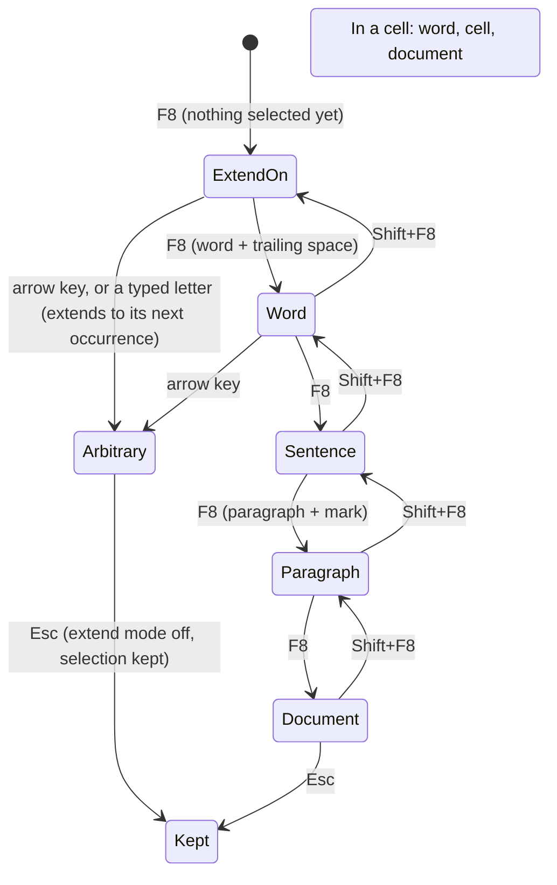

### Observations

<!-- probe:begin selection -->
#### S-01 · Shift+Right and Shift+Left across every boundary, three presses at a time

`{fixture}` · Morph: **PARTIAL**

Expected before the run: The paragraph mark is selected as one character (Text ends in \r) and the selection then
runs into the next paragraph; a field, a picture and a note reference are each one press; a cell end grows into the
next cell rather than selecting a character; the document ends do not move.

steps `select({from})` · `{key}` · `{key}` · `{key}`

| fixture | from | key | selection | observed |
| --- | --- | --- | --- | --- |
| three-paragraphs | P1:start | Shift+Right | Normal 0–3 end-active | `[⟦Fir‸⟧st paragraph here.] ↓0<br>[Second bold one.] (center) ↓0<br>[Third and last.] ↓0` |
| three-paragraphs | P1:start | Shift+Left | IP 0–0 | `[‸First paragraph here.] ↓0<br>[Second bold one.] (center) ↓0<br>[Third and last.] ↓0` |
| three-paragraphs | P1:end | Shift+Right | Normal 21–24 end-active | `[First paragraph here.⟦¶⟧] ↓0<br>⟦[Se‸⟧cond bold one.] (center) ↓0<br>[Third and last.] ↓0` |
| three-paragraphs | P1:end | Shift+Left | Normal 18–21 start-active | `[First paragraph he⟦‸re.⟧] ↓0<br>[Second bold one.] (center) ↓0<br>[Third and last.] ↓0` |
| three-paragraphs | P2:start | Shift+Right | Normal 22–25 end-active | `[First paragraph here.] ↓0<br>[⟦Sec‸⟧ond bold one.] (center) ↓0<br>[Third and last.] ↓0` |
| three-paragraphs | P2:start | Shift+Left | Normal 19–22 start-active | `[First paragraph her⟦‸e.¶⟧] ↓0<br>[Second bold one.] (center) ↓0<br>[Third and last.] ↓0` |
| three-paragraphs | DOC:end | Shift+Right | Normal 54–55 end-active | `[First paragraph here.] ↓0<br>[Second bold one.] (center) ↓0<br>[Third and last.⟦¶‸⟧] ↓0` |
| three-paragraphs | DOC:end | Shift+Left | Normal 51–54 start-active | `[First paragraph here.] ↓0<br>[Second bold one.] (center) ↓0<br>[Third and la⟦‸st.⟧] ↓0` |
| tabs-breaks | P1:start | Shift+Right | Normal 0–3 end-active | `[⟦Lef‸⟧t\tright side] ↓0<br>[Line one \nline two] ↓0<br>[Two  spaces here.] ↓0` |
| tabs-breaks | P1:start | Shift+Left | IP 0–0 | `[‸Left\tright side] ↓0<br>[Line one \nline two] ↓0<br>[Two  spaces here.] ↓0` |
| tabs-breaks | P1:end | Shift+Right | Normal 15–18 end-active | `[Left\tright side⟦¶⟧] ↓0<br>⟦[Li‸⟧ne one \nline two] ↓0<br>[Two  spaces here.] ↓0` |
| tabs-breaks | P1:end | Shift+Left | Normal 12–15 start-active | `[Left\tright s⟦‸ide⟧] ↓0<br>[Line one \nline two] ↓0<br>[Two  spaces here.] ↓0` |
| tabs-breaks | P2:start | Shift+Right | Normal 16–19 end-active | `[Left\tright side] ↓0<br>[⟦Lin‸⟧e one \nline two] ↓0<br>[Two  spaces here.] ↓0` |
| tabs-breaks | P2:start | Shift+Left | Normal 13–16 start-active | `[Left\tright si⟦‸de¶⟧] ↓0<br>[Line one \nline two] ↓0<br>[Two  spaces here.] ↓0` |
| tabs-breaks | DOC:end | Shift+Right | Normal 52–53 end-active | `[Left\tright side] ↓0<br>[Line one \nline two] ↓0<br>[Two  spaces here.⟦¶‸⟧] ↓0` |
| tabs-breaks | DOC:end | Shift+Left | Normal 49–52 start-active | `[Left\tright side] ↓0<br>[Line one \nline two] ↓0<br>[Two  spaces he⟦‸re.⟧] ↓0` |
| image-inline | P1:start | Shift+Right | Normal 0–3 end-active | `[⟦Tex‸⟧t before ▣ after end.] ↓0<br>[Second paragraph.] ↓0` |
| image-inline | P1:start | Shift+Left | IP 0–0 | `[‸Text before ▣ after end.] ↓0<br>[Second paragraph.] ↓0` |
| image-inline | P1:end | Shift+Right | Normal 24–27 end-active | `[Text before ▣ after end.⟦¶⟧] ↓0<br>⟦[Se‸⟧cond paragraph.] ↓0` |
| image-inline | P1:end | Shift+Left | Normal 21–24 start-active | `[Text before ▣ after e⟦‸nd.⟧] ↓0<br>[Second paragraph.] ↓0` |
| image-inline | P2:start | Shift+Right | Normal 25–28 end-active | `[Text before ▣ after end.] ↓0<br>[⟦Sec‸⟧ond paragraph.] ↓0` |
| image-inline | P2:start | Shift+Left | Normal 22–25 start-active | `[Text before ▣ after en⟦‸d.¶⟧] ↓0<br>[Second paragraph.] ↓0` |
| image-inline | DOC:end | Shift+Right | Normal 42–43 end-active | `[Text before ▣ after end.] ↓0<br>[Second paragraph.⟦¶‸⟧] ↓0` |
| image-inline | DOC:end | Shift+Left | Normal 39–42 start-active | `[Text before ▣ after end.] ↓0<br>[Second paragra⟦‸ph.⟧] ↓0` |
| field-page | P1:start | Shift+Right | Normal 0–3 end-active | `[⟦Pag‸⟧e ][«][ PAGE ][\|][1][»][ of ][«][ NUMPAGES ][\|][1][»][ end.] ↓0<br>[Date: ][«][ DATE \@ "d/MM/yyyy" ][\|][25/10/2026][»][ end.] ↓0` |
| field-page | P1:start | Shift+Left | IP 0–0 | `[‸Page ][«][ PAGE ][\|][1][»][ of ][«][ NUMPAGES ][\|][1][»][ end.] ↓0<br>[Date: ][«][ DATE \@ "d/MM/yyyy" ][\|][25/10/2026][»][ end.] ↓0` |
| field-page | P1:end | Shift+Right | Normal 38–41 end-active | `[Page ][«][ PAGE ][\|][1][»][ of ][«][ NUMPAGES ][\|][1][»][ end.⟦¶⟧] ↓0<br>⟦[Da‸⟧te: ][«][ DATE \@ "d/MM/yyyy" ][\|][25/10/2026][»][ end.] ↓0` |
| field-page | P1:end | Shift+Left | Normal 35–38 start-active | `[Page ][«][ PAGE ][\|][1][»][ of ][«][ NUMPAGES ][\|][1][»][ e⟦‸nd.⟧] ↓0<br>[Date: ][«][ DATE \@ "d/MM/yyyy" ][\|][25/10/2026][»][ end.] ↓0` |
| field-page | P2:start | Shift+Right | Normal 39–42 end-active | `[Page ][«][ PAGE ][\|][1][»][ of ][«][ NUMPAGES ][\|][1][»][ end.] ↓0<br>[⟦Dat‸⟧e: ][«][ DATE \@ "d/MM/yyyy" ][\|][25/10/2026][»][ end.] ↓0` |
| field-page | P2:start | Shift+Left | Normal 36–39 start-active | `[Page ][«][ PAGE ][\|][1][»][ of ][«][ NUMPAGES ][\|][1][»][ en⟦‸d.¶⟧] ↓0<br>[Date: ][«][ DATE \@ "d/MM/yyyy" ][\|][25/10/2026][»][ end.] ↓0` |
| field-page | DOC:end | Shift+Right | Normal 84–85 end-active | `[Page ][«][ PAGE ][\|][1][»][ of ][«][ NUMPAGES ][\|][1][»][ end.] ↓0<br>[Date: ][«][ DATE \@ "d/MM/yyyy" ][\|][25/10/2026][»][ end.⟦¶‸⟧] ↓0` |
| field-page | DOC:end | Shift+Left | Normal 81–84 start-active | `[Page ][«][ PAGE ][\|][1][»][ of ][«][ NUMPAGES ][\|][1][»][ end.] ↓0<br>[Date: ][«][ DATE \@ "d/MM/yyyy" ][\|][25/10/2026][»][ e⟦‸nd.⟧] ↓0` |
| hyperlink | P1:start | Shift+Right | Normal 0–3 end-active | `[⟦See‸⟧ ]<[the site]>[ today.] ↓0<br>[Second paragraph.] ↓0` |
| hyperlink | P1:start | Shift+Left | IP 0–0 | `[‸See ]<[the site]>[ today.] ↓0<br>[Second paragraph.] ↓0` |
| hyperlink | P1:end | Shift+Right | Normal 55–58 end-active | `[See ]<[the site]>[ today.⟦¶⟧] ↓0<br>⟦[Se‸⟧cond paragraph.] ↓0` |
| hyperlink | P1:end | Shift+Left | Normal 52–55 start-active | `[See ]<[the site]>[ tod⟦‸ay.⟧] ↓0<br>[Second paragraph.] ↓0` |
| hyperlink | P2:start | Shift+Right | Normal 56–59 end-active | `[See ]<[the site]>[ today.] ↓0<br>[⟦Sec‸⟧ond paragraph.] ↓0` |
| hyperlink | P2:start | Shift+Left | Normal 53–56 start-active | `[See ]<[the site]>[ toda⟦‸y.¶⟧] ↓0<br>[Second paragraph.] ↓0` |
| hyperlink | DOC:end | Shift+Right | Normal 73–74 end-active | `[See ]<[the site]>[ today.] ↓0<br>[Second paragraph.⟦¶‸⟧] ↓0` |
| hyperlink | DOC:end | Shift+Left | Normal 70–73 start-active | `[See ]<[the site]>[ today.] ↓0<br>[Second paragra⟦‸ph.⟧] ↓0` |
| footnote | P1:start | Shift+Right | Normal 0–3 end-active | `[⟦Tex‸⟧t†1 more words.] ↓0<br>[Second with an end note.‡1] ↓0` |
| footnote | P1:start | Shift+Left | IP 0–0 | `[‸Text†1 more words.] ↓0<br>[Second with an end note.‡1] ↓0` |
| footnote | P1:end | Shift+Right | Normal 17–20 end-active | `[Text†1 more words.⟦¶⟧] ↓0<br>⟦[Se‸⟧cond with an end note.‡1] ↓0` |
| footnote | P1:end | Shift+Left | Normal 14–17 start-active | `[Text†1 more wor⟦‸ds.⟧] ↓0<br>[Second with an end note.‡1] ↓0` |
| footnote | P2:start | Shift+Right | Normal 18–21 end-active | `[Text†1 more words.] ↓0<br>[⟦Sec‸⟧ond with an end note.‡1] ↓0` |
| footnote | P2:start | Shift+Left | Normal 15–18 start-active | `[Text†1 more word⟦‸s.¶⟧] ↓0<br>[Second with an end note.‡1] ↓0` |
| footnote | DOC:end | Shift+Right | Normal 43–44 end-active | `[Text†1 more words.] ↓0<br>[Second with an end note.‡1⟦¶‸⟧] ↓0` |
| footnote | DOC:end | Shift+Left | Normal 40–43 start-active | `[Text†1 more words.] ↓0<br>[Second with an end not⟦‸e.‡1⟧] ↓0` |
| special | P1:start | Shift+Right | Normal 0–3 end-active | `[⟦a⍽b‸⟧ soft⁃hyphen hidden words dash—end.] ↓0` |
| special | P1:start | Shift+Left | IP 0–0 | `[‸a⍽b soft⁃hyphen hidden words dash—end.] ↓0` |
| special | P1:end | Shift+Right | Normal 38–39 end-active | `[a⍽b soft⁃hyphen hidden words dash—end.⟦¶‸⟧] ↓0` |
| special | P1:end | Shift+Left | Normal 35–38 start-active | `[a⍽b soft⁃hyphen hidden words dash—e⟦‸nd.⟧] ↓0` |
| special | DOC:end | Shift+Right | Normal 38–39 end-active | `[a⍽b soft⁃hyphen hidden words dash—end.⟦¶‸⟧] ↓0` |
| special | DOC:end | Shift+Left | Normal 35–38 start-active | `[a⍽b soft⁃hyphen hidden words dash—e⟦‸nd.⟧] ↓0` |
| page-break | P1:start | Shift+Right | Normal 0–3 end-active | `[⟦Bef‸⟧ore the break.] ↓0<br>[⤓] ↓0<br>[After the break.] ↓0` |
| page-break | P1:start | Shift+Left | IP 0–0 | `[‸Before the break.] ↓0<br>[⤓] ↓0<br>[After the break.] ↓0` |
| page-break | P1:end | Shift+Right | Normal 17–21 end-active | `[Before the break.⟦¶⟧] ↓0<br>⟦[⤓¶⟧] ↓0<br>⟦[A‸⟧fter the break.] ↓0` |
| page-break | P1:end | Shift+Left | Normal 14–17 start-active | `[Before the bre⟦‸ak.⟧] ↓0<br>[⤓] ↓0<br>[After the break.] ↓0` |
| page-break | P2:start | Shift+Right | Normal 18–22 end-active | `[Before the break.] ↓0<br>[⟦⤓¶⟧] ↓0<br>⟦[Af‸⟧ter the break.] ↓0` |
| page-break | P2:start | Shift+Left | Normal 15–18 start-active | `[Before the brea⟦‸k.¶⟧] ↓0<br>[⤓] ↓0<br>[After the break.] ↓0` |
| page-break | DOC:end | Shift+Right | Normal 36–37 end-active | `[Before the break.] ↓0<br>[⤓] ↓0<br>[After the break.⟦¶‸⟧] ↓0` |
| page-break | DOC:end | Shift+Left | Normal 33–36 start-active | `[Before the break.] ↓0<br>[⤓] ↓0<br>[After the bre⟦‸ak.⟧] ↓0` |
| section-break | P1:start | Shift+Right | Normal 0–3 end-active | `[⟦Sec‸⟧tion one text.] ↓0<br>[§] ↓0<br>[Section two text.] ↓0` |
| section-break | P1:start | Shift+Left | IP 0–0 | `[‸Section one text.] ↓0<br>[§] ↓0<br>[Section two text.] ↓0` |
| section-break | P1:end | Shift+Right | Normal 17–20 end-active | `[Section one text.⟦¶⟧] ↓0<br>⟦[§⟧] ↓0<br>⟦[S‸⟧ection two text.] ↓0` |
| section-break | P1:end | Shift+Left | Normal 14–17 start-active | `[Section one te⟦‸xt.⟧] ↓0<br>[§] ↓0<br>[Section two text.] ↓0` |
| section-break | P2:start | Shift+Right | Normal 18–21 end-active | `[Section one text.] ↓0<br>[⟦§⟧] ↓0<br>⟦[Se‸⟧ction two text.] ↓0` |
| section-break | P2:start | Shift+Left | Normal 15–18 start-active | `[Section one tex⟦‸t.¶⟧] ↓0<br>[§] ↓0<br>[Section two text.] ↓0` |
| section-break | DOC:end | Shift+Right | Normal 36–37 end-active | `[Section one text.] ↓0<br>[§] ↓0<br>[Section two text.⟦¶‸⟧] ↓0` |
| section-break | DOC:end | Shift+Left | Normal 33–36 start-active | `[Section one text.] ↓0<br>[§] ↓0<br>[Section two te⟦‸xt.⟧] ↓0` |
| table-2x2 | P1:start | Shift+Right | Normal 0–3 end-active | `[⟦Bef‸⟧ore the table.] ↓0<br>T1 R1 ║[One¤]║[Two¤]║¤<br>T1 R2 ║[Three¤]║[Four¤]║¤<br>[After the table.] ↓0` |
| table-2x2 | P1:start | Shift+Left | IP 0–0 | `[‸Before the table.] ↓0<br>T1 R1 ║[One¤]║[Two¤]║¤<br>T1 R2 ║[Three¤]║[Four¤]║¤<br>[After the table.] ↓0` |
| table-2x2 | P1:end | Shift+Right | Normal 17–39 end-active | `[Before the table.⟦¶⟧] ↓0<br>T1 R1 ║⟦[One¤⟧]║⟦[Two¤⟧]║¤<br>T1 R2 ║⟦[Three¤⟧]║⟦[Four¤⟧]║¤‸⟧<br>[After the table.] ↓0` |
| table-2x2 | P1:end | Shift+Left | Normal 14–17 start-active | `[Before the tab⟦‸le.⟧] ↓0<br>T1 R1 ║[One¤]║[Two¤]║¤<br>T1 R2 ║[Three¤]║[Four¤]║¤<br>[After the table.] ↓0` |
| table-2x2 | P2:start | Shift+Right | Normal 18–21 end-active · Cells 1 (R1C1–R1C1) | `[Before the table.] ↓0<br>T1 R1 ║[⟦One‸⟧¤]║[Two¤]║¤<br>T1 R2 ║[Three¤]║[Four¤]║¤<br>[After the table.] ↓0` |
| table-2x2 | P2:start | Shift+Left | Normal 15–27 start-active | `[Before the tabl⟦‸e.¶⟧] ↓0<br>T1 R1 ║⟦[One¤⟧]║⟦[Two¤⟧]║¤⟧<br>T1 R2 ║[Three¤]║[Four¤]║¤<br>[After the table.] ↓0` |
| table-2x2 | DOC:end | Shift+Right | Normal 55–56 end-active | `[Before the table.] ↓0<br>T1 R1 ║[One¤]║[Two¤]║¤<br>T1 R2 ║[Three¤]║[Four¤]║¤<br>[After the table.⟦¶‸⟧] ↓0` |
| table-2x2 | DOC:end | Shift+Left | Normal 52–55 start-active | `[Before the table.] ↓0<br>T1 R1 ║[One¤]║[Two¤]║¤<br>T1 R2 ║[Three¤]║[Four¤]║¤<br>[After the tab⟦‸le.⟧] ↓0` |

_2 combination(s) whose set-up does not apply to the fixture are left out._

#### S-01b · Shift+Right and Shift+Left over an inline picture alone

`image-inline` · Morph: **PARTIAL**

Expected before the run: (a) the picture alone is Type InlineShape, with the picture's handles shown; (b) Type
Normal, the picture highlighted like a character. The second press makes it Normal either way.

steps `select({from})` · `{key}` · `{key}`

| from | key | selection | observed |
| --- | --- | --- | --- |
| P1:12 | Shift+Right | Normal 12–14 end-active · InlineShapes 1 | `[Text before ⟦▣ ‸⟧after end.] ↓0<br>[Second paragraph.] ↓0` |
| P1:12 | Shift+Left | Normal 10–12 start-active | `[Text befor⟦‸e ⟧▣ after end.] ↓0<br>[Second paragraph.] ↓0` |
| P1:13 | Shift+Right | Normal 13–15 end-active | `[Text before ▣⟦ a‸⟧fter end.] ↓0<br>[Second paragraph.] ↓0` |
| P1:13 | Shift+Left | IP 12–12 | `[Text before ‸▣ after end.] ↓0<br>[Second paragraph.] ↓0` |

Notes: P1:12 is before the picture, P1:13 after it; the first press from P1:12 covers the picture and nothing else.

#### S-02 · Shift+Right from a cell end grows by cells, and what an edit then does

`table-3x3` · Morph: **TODO**

Expected before the run: (a) the first press selects the cell, the next ones the cells to its right one at a time,
then the whole row, then rows; (b) a rectangle that grows by one cell per press. Shift+Down with cells selected adds
the row under them. With one cell selected: typing replaces the cell's text; Delete clears the contents and keeps the
cell; Backspace (a) clears like Delete (b) deletes the cell; Ctrl+X cuts the contents only; Tab moves on to the next
cell.

steps before the branches `select(C(1,1):end)` · `Shift+Right`

- `Shift+Right` → `[Before the table.] ↓0 / T1 R1 ║[⟦a1¤‸⟧]║[b1¤]║[c1¤]║¤ / T1 R2 ║[a2¤]║[b2¤]║[c2¤]║¤ / T1 R3 ║[a3¤]║[b3¤]║[c3¤]║¤ / [After the table.] ↓0` · Column 18–21 end-active · Cells 1 (R1C1–R1C1) · Undo —
- `Shift+Right · Shift+Right · Shift+Right · Shift+Down` → `[Before the table.] ↓0 / T1 R1 ║[⟦a1¤⟧]║⟦[b1¤⟧]║⟦[c1¤⟧]║¤ / T1 R2 ║⟦[a2¤⟧]║⟦[b2¤⟧]║⟦[c2¤‸⟧]║¤ / T1 R3 ║[a3¤]║[b3¤]║[c3¤]║¤ / [After the table.] ↓0` · Column 18–37 end-active · Cells 6 (R1C1–R2C3) · Undo —
- `type("x")` → `[Before the table.] ↓0 / T1 R1 ║[x‸¤]║[b1¤]║[c1¤]║¤ / T1 R2 ║[a2¤]║[b2¤]║[c2¤]║¤ / T1 R3 ║[a3¤]║[b3¤]║[c3¤]║¤ / [After the table.] ↓0` · IP 19–19 · Cells 1 (R1C1–R1C1) · Undo depth 1
  - `undo` → `[Before the table.] ↓0 / T1 R1 ║[⟦a1¤‸⟧]║[b1¤]║[c1¤]║¤ / T1 R2 ║[a2¤]║[b2¤]║[c2¤]║¤ / T1 R3 ║[a3¤]║[b3¤]║[c3¤]║¤ / [After the table.] ↓0` · Column 18–21 end-active · Cells 1 (R1C1–R1C1) · Undo —
- `Delete` → `[Before the table.] ↓0 / T1 R1 ║‸¤║[b1¤]║[c1¤]║¤ / T1 R2 ║[a2¤]║[b2¤]║[c2¤]║¤ / T1 R3 ║[a3¤]║[b3¤]║[c3¤]║¤ / [After the table.] ↓0` · IP 18–18 · Cells 1 (R1C1–R1C1) · Undo depth 1
  - `undo` → `[Before the table.] ↓0 / T1 R1 ║[⟦a1¤‸⟧]║[b1¤]║[c1¤]║¤ / T1 R2 ║[a2¤]║[b2¤]║[c2¤]║¤ / T1 R3 ║[a3¤]║[b3¤]║[c3¤]║¤ / [After the table.] ↓0` · Column 18–21 end-active · Cells 1 (R1C1–R1C1) · Undo —
- `Backspace` → `[Before the table.] ↓0 / T1 R1 ║[⟦a1¤‸⟧]║[b1¤]║[c1¤]║¤ / T1 R2 ║[a2¤]║[b2¤]║[c2¤]║¤ / T1 R3 ║[a3¤]║[b3¤]║[c3¤]║¤ / [After the table.] ↓0` · Column 18–21 end-active · Cells 1 (R1C1–R1C1) · Undo —
  - `undo` → `[Before the table.] ↓0 / T1 R1 ║[⟦a1¤‸⟧]║[b1¤]║[c1¤]║¤ / T1 R2 ║[a2¤]║[b2¤]║[c2¤]║¤ / T1 R3 ║[a3¤]║[b3¤]║[c3¤]║¤ / [After the table.] ↓0` · Column 18–21 end-active · Cells 1 (R1C1–R1C1) · Undo —
- `Ctrl+X` → `[Before the table.] ↓0 / T1 R1 ║‸¤║[b1¤]║[c1¤]║¤ / T1 R2 ║[a2¤]║[b2¤]║[c2¤]║¤ / T1 R3 ║[a3¤]║[b3¤]║[c3¤]║¤ / [After the table.] ↓0` · IP 18–18 · Cells 1 (R1C1–R1C1) · Undo depth 1
  - `undo` → `[Before the table.] ↓0 / T1 R1 ║[⟦a1¤‸⟧]║[b1¤]║[c1¤]║¤ / T1 R2 ║[a2¤]║[b2¤]║[c2¤]║¤ / T1 R3 ║[a3¤]║[b3¤]║[c3¤]║¤ / [After the table.] ↓0` · Column 18–21 end-active · Cells 1 (R1C1–R1C1) · Undo —
- `Tab` → `[Before the table.] ↓0 / T1 R1 ║[a1¤]║[⟦b1‸⟧¤]║[c1¤]║¤ / T1 R2 ║[a2¤]║[b2¤]║[c2¤]║¤ / T1 R3 ║[a3¤]║[b3¤]║[c3¤]║¤ / [After the table.] ↓0` · Normal 21–23 end-active · Cells 1 (R1C2–R1C2) · Undo —
  - `undo` → `[Before the table.] ↓0 / T1 R1 ║[a1¤]║[⟦b1‸⟧¤]║[c1¤]║¤ / T1 R2 ║[a2¤]║[b2¤]║[c2¤]║¤ / T1 R3 ║[a3¤]║[b3¤]║[c3¤]║¤ / [After the table.] ↓0` · Normal 21–23 end-active · Cells 1 (R1C2–R1C2) · Undo —

**Track Changes on**

- `Shift+Right` → `[Before the table.] ↓0 / T1 R1 ║[⟦a1¤‸⟧]║[b1¤]║[c1¤]║¤ / T1 R2 ║[a2¤]║[b2¤]║[c2¤]║¤ / T1 R3 ║[a3¤]║[b3¤]║[c3¤]║¤ / [After the table.] ↓0` · Column 18–21 end-active · Cells 1 (R1C1–R1C1) · Tracking · Revisions 0 · Undo —
- `Shift+Right · Shift+Right · Shift+Right · Shift+Down` → `[Before the table.] ↓0 / T1 R1 ║[⟦a1¤⟧]║⟦[b1¤⟧]║⟦[c1¤⟧]║¤ / T1 R2 ║⟦[a2¤⟧]║⟦[b2¤⟧]║⟦[c2¤‸⟧]║¤ / T1 R3 ║[a3¤]║[b3¤]║[c3¤]║¤ / [After the table.] ↓0` · Column 18–37 end-active · Cells 6 (R1C1–R2C3) · Tracking · Revisions 0 · Undo —
- `type("x")` → `[Before the table.] ↓0 / T1 R1 ║{-[a1]-}{+[x]+}‸¤║[b1¤]║[c1¤]║¤ / T1 R2 ║[a2¤]║[b2¤]║[c2¤]║¤ / T1 R3 ║[a3¤]║[b3¤]║[c3¤]║¤ / [After the table.] ↓0` · IP 21–21 · Cells 1 (R1C1–R1C1) · Tracking · Revisions 2 · Undo depth 1
  - `undo` → `[Before the table.] ↓0 / T1 R1 ║[⟦a1¤‸⟧]║[b1¤]║[c1¤]║¤ / T1 R2 ║[a2¤]║[b2¤]║[c2¤]║¤ / T1 R3 ║[a3¤]║[b3¤]║[c3¤]║¤ / [After the table.] ↓0` · Column 18–21 end-active · Cells 1 (R1C1–R1C1) · Tracking · Revisions 0 · Undo —
- `Delete` → `[Before the table.] ↓0 / T1 R1 ║{-[‸a1]-}¤║[b1¤]║[c1¤]║¤ / T1 R2 ║[a2¤]║[b2¤]║[c2¤]║¤ / T1 R3 ║[a3¤]║[b3¤]║[c3¤]║¤ / [After the table.] ↓0` · IP 18–18 · Cells 1 (R1C1–R1C1) · Tracking · Revisions 1 · Undo depth 1
  - `undo` → `[Before the table.] ↓0 / T1 R1 ║[⟦a1¤‸⟧]║[b1¤]║[c1¤]║¤ / T1 R2 ║[a2¤]║[b2¤]║[c2¤]║¤ / T1 R3 ║[a3¤]║[b3¤]║[c3¤]║¤ / [After the table.] ↓0` · Column 18–21 end-active · Cells 1 (R1C1–R1C1) · Tracking · Revisions 0 · Undo —
- `Backspace` → `[Before the table.] ↓0 / T1 R1 ║[⟦a1¤‸⟧]║[b1¤]║[c1¤]║¤ / T1 R2 ║[a2¤]║[b2¤]║[c2¤]║¤ / T1 R3 ║[a3¤]║[b3¤]║[c3¤]║¤ / [After the table.] ↓0` · Column 18–21 end-active · Cells 1 (R1C1–R1C1) · Tracking · Revisions 0 · Undo —
  - `undo` → `[Before the table.] ↓0 / T1 R1 ║[⟦a1¤‸⟧]║[b1¤]║[c1¤]║¤ / T1 R2 ║[a2¤]║[b2¤]║[c2¤]║¤ / T1 R3 ║[a3¤]║[b3¤]║[c3¤]║¤ / [After the table.] ↓0` · Column 18–21 end-active · Cells 1 (R1C1–R1C1) · Tracking · Revisions 0 · Undo —
- `Ctrl+X` → `[Before the table.] ↓0 / T1 R1 ║{-[‸a1]-}¤║[b1¤]║[c1¤]║¤ / T1 R2 ║[a2¤]║[b2¤]║[c2¤]║¤ / T1 R3 ║[a3¤]║[b3¤]║[c3¤]║¤ / [After the table.] ↓0` · IP 18–18 · Cells 1 (R1C1–R1C1) · Tracking · Revisions 1 · Undo depth 1
  - `undo` → `[Before the table.] ↓0 / T1 R1 ║[⟦a1¤‸⟧]║[b1¤]║[c1¤]║¤ / T1 R2 ║[a2¤]║[b2¤]║[c2¤]║¤ / T1 R3 ║[a3¤]║[b3¤]║[c3¤]║¤ / [After the table.] ↓0` · Column 18–21 end-active · Cells 1 (R1C1–R1C1) · Tracking · Revisions 0 · Undo —
- `Tab` → `[Before the table.] ↓0 / T1 R1 ║[a1¤]║[⟦b1‸⟧¤]║[c1¤]║¤ / T1 R2 ║[a2¤]║[b2¤]║[c2¤]║¤ / T1 R3 ║[a3¤]║[b3¤]║[c3¤]║¤ / [After the table.] ↓0` · Normal 21–23 end-active · Cells 1 (R1C2–R1C2) · Tracking · Revisions 0 · Undo —
  - `undo` → `[Before the table.] ↓0 / T1 R1 ║[a1¤]║[⟦b1‸⟧¤]║[c1¤]║¤ / T1 R2 ║[a2¤]║[b2¤]║[c2¤]║¤ / T1 R3 ║[a3¤]║[b3¤]║[c3¤]║¤ / [After the table.] ↓0` · Normal 21–23 end-active · Cells 1 (R1C2–R1C2) · Tracking · Revisions 0 · Undo —

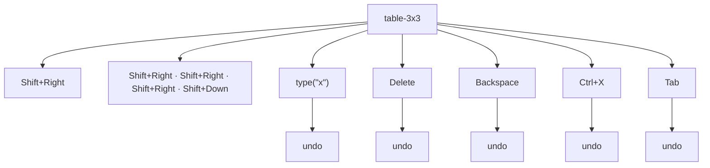

#### S-03 · Shift+Down and Shift+Up into, through and out of a table

`table-3x3` · Morph: **TODO**

Expected before the run: (a) Shift+Down from text above the table selects to the table and then whole rows, one per
press, then runs on into the paragraph after; (b) it selects cells in the caret's column; (c) it selects text through
the cells as if they were paragraphs. From inside a cell the first press (a) selects the rest of the cell and the
cell under it (b) selects the whole row.

steps `select({from})` · `{key}` · `{key}` · `{key}` · `{key}`

| from | key | selection | observed |
| --- | --- | --- | --- |
| P1:3 | Shift+Down | Normal 3–48 end-active | `[Bef⟦ore the table.¶⟧] ↓0<br>T1 R1 ║⟦[a1¤⟧]║⟦[b1¤⟧]║⟦[c1¤⟧]║¤<br>T1 R2 ║⟦[a2¤⟧]║⟦[b2¤⟧]║⟦[c2¤⟧]║¤<br>T1 R3 ║⟦[a3¤⟧]║⟦[b3¤⟧]║⟦[c3¤⟧]║¤‸⟧<br>[After the table.] ↓0` |
| P1:3 | Shift+Up | Normal 0–3 start-active | `[⟦‸Bef⟧ore the table.] ↓0<br>T1 R1 ║[a1¤]║[b1¤]║[c1¤]║¤<br>T1 R2 ║[a2¤]║[b2¤]║[c2¤]║¤<br>T1 R3 ║[a3¤]║[b3¤]║[c3¤]║¤<br>[After the table.] ↓0` |
| C(1,1):1 | Shift+Down | Normal 18–65 end-active | `[Before the table.] ↓0<br>T1 R1 ║[⟦a1¤⟧]║⟦[b1¤⟧]║⟦[c1¤⟧]║¤<br>T1 R2 ║⟦[a2¤⟧]║⟦[b2¤⟧]║⟦[c2¤⟧]║¤<br>T1 R3 ║⟦[a3¤⟧]║⟦[b3¤⟧]║⟦[c3¤⟧]║¤<br>⟦[After the table.¶‸⟧] ↓0` |
| C(1,1):1 | Shift+Up | Normal 0–28 start-active | `[⟦‸Before the table.¶⟧] ↓0<br>T1 R1 ║⟦[a1¤⟧]║⟦[b1¤⟧]║⟦[c1¤⟧]║¤⟧<br>T1 R2 ║[a2¤]║[b2¤]║[c2¤]║¤<br>T1 R3 ║[a3¤]║[b3¤]║[c3¤]║¤<br>[After the table.] ↓0` |
| C(3,3):1 | Shift+Down | Normal 38–65 end-active | `[Before the table.] ↓0<br>T1 R1 ║[a1¤]║[b1¤]║[c1¤]║¤<br>T1 R2 ║[a2¤]║[b2¤]║[c2¤]║¤<br>T1 R3 ║[⟦a3¤⟧]║⟦[b3¤⟧]║⟦[c3¤⟧]║¤<br>⟦[After the table.¶‸⟧] ↓0` |
| C(3,3):1 | Shift+Up | IP 24–24 · Cells 1 (R1C3–R1C3) | `[Before the table.] ↓0<br>T1 R1 ║[a1¤]║[b1¤]║[‸c1¤]║¤<br>T1 R2 ║[a2¤]║[b2¤]║[c2¤]║¤<br>T1 R3 ║[a3¤]║[b3¤]║[c3¤]║¤<br>[After the table.] ↓0` |

Notes: P1:3 is above the table, C(1,1):1 inside its first cell, C(3,3):1 inside its last; Shift+Up from P1:3 and
Shift+Down from C(3,3):1 leave the table at once.

#### S-04 · Shift+End twice from a paragraph start

`{fixture}` · Morph: **PARTIAL**

Expected before the run: (a) Shift+End never includes the mark, so the second press changes nothing; (b) the mark is
included once the whole text is covered, with smart paragraph selection on only. On the wrapped paragraph the first
press stops at the line end.

steps `select(P1:0)` · `Shift+End` · `Shift+End`

| fixture | options | selection | observed |
| --- | --- | --- | --- |
| wrap | SmartParaSelection=true | Normal 0–40 end-active | `[⟦Alpha beta gamma delta epsilon zeta eta ‸⟧theta iota kappa lambda mu nu xi omicron pi rho sigma tau upsilon phi chi psi omega alpha beta gamma delta epsilon zeta.] ↓0` |
| wrap | SmartParaSelection=false | Normal 0–40 end-active | `[⟦Alpha beta gamma delta epsilon zeta eta ‸⟧theta iota kappa lambda mu nu xi omicron pi rho sigma tau upsilon phi chi psi omega alpha beta gamma delta epsilon zeta.] ↓0` |
| three-paragraphs | SmartParaSelection=true | Normal 0–22 end-active | `[⟦First paragraph here.¶‸⟧] ↓0<br>[Second bold one.] (center) ↓0<br>[Third and last.] ↓0` |
| three-paragraphs | SmartParaSelection=false | Normal 0–22 end-active | `[⟦First paragraph here.¶‸⟧] ↓0<br>[Second bold one.] (center) ↓0<br>[Third and last.] ↓0` |
| table-2x2 | SmartParaSelection=true | Normal 0–27 end-active | `[⟦Before the table.¶⟧] ↓0<br>T1 R1 ║⟦[One¤⟧]║⟦[Two¤⟧]║¤‸⟧<br>T1 R2 ║[Three¤]║[Four¤]║¤<br>[After the table.] ↓0` |
| table-2x2 | SmartParaSelection=false | Normal 0–27 end-active | `[⟦Before the table.¶⟧] ↓0<br>T1 R1 ║⟦[One¤⟧]║⟦[Two¤⟧]║¤‸⟧<br>T1 R2 ║[Three¤]║[Four¤]║¤<br>[After the table.] ↓0` |

#### S-04b · Shift+Home twice from a paragraph end

`{fixture}` · Morph: **PARTIAL**

Expected before the run: The first press selects back to the line start, the second changes nothing; on the wrapped
paragraph the first press stops at the last line's start and never reaches P1:0.

steps `select(P1:end)` · `Shift+Home` · `Shift+Home`

| fixture | options | selection | observed |
| --- | --- | --- | --- |
| wrap | SmartParaSelection=true | Normal 124–160 start-active | `[Alpha beta gamma delta epsilon zeta eta theta iota kappa lambda mu nu xi omicron pi rho sigma tau upsilon phi chi psi omega ⟦‸alpha beta gamma delta epsilon zeta.⟧] ↓0` |
| wrap | SmartParaSelection=false | Normal 124–160 start-active | `[Alpha beta gamma delta epsilon zeta eta theta iota kappa lambda mu nu xi omicron pi rho sigma tau upsilon phi chi psi omega ⟦‸alpha beta gamma delta epsilon zeta.⟧] ↓0` |
| three-paragraphs | SmartParaSelection=true | Normal 0–22 start-active | `[⟦‸First paragraph here.¶⟧] ↓0<br>[Second bold one.] (center) ↓0<br>[Third and last.] ↓0` |
| three-paragraphs | SmartParaSelection=false | Normal 0–21 start-active | `[⟦‸First paragraph here.⟧] ↓0<br>[Second bold one.] (center) ↓0<br>[Third and last.] ↓0` |
| table-2x2 | SmartParaSelection=true | Normal 0–18 start-active | `[⟦‸Before the table.¶⟧] ↓0<br>T1 R1 ║[One¤]║[Two¤]║¤<br>T1 R2 ║[Three¤]║[Four¤]║¤<br>[After the table.] ↓0` |
| table-2x2 | SmartParaSelection=false | Normal 0–17 start-active | `[⟦‸Before the table.⟧] ↓0<br>T1 R1 ║[One¤]║[Two¤]║¤<br>T1 R2 ║[Three¤]║[Four¤]║¤<br>[After the table.] ↓0` |

#### S-04c · Shift+End twice from a cell start

`table-2x2` · Morph: **TODO**

Expected before the run: (a) the cell's text to before the cell mark, and the second press changes nothing; (b) the
second press selects the whole cell.

**SmartParaSelection true**

1. `select(C(1,1):0)`
2. `Shift+End`
3. `Shift+End`

| step | selection | where |
| --- | --- | --- |
| `Shift+End` | Column 18–22 end-active | `[⟦One¤‸⟧]` |
| `Shift+End` | Column 18–26 end-active | `[Two¤] …` |

```text
[Before the table.] ↓0
T1 R1 ║[⟦One¤⟧]║⟦[Two¤‸⟧]║¤
T1 R2 ║[Three¤]║[Four¤]║¤
[After the table.] ↓0
```

Selection: Column 18–26 end-active · Cells 2 (R1C1–R1C2)

**SmartParaSelection false**

1. `select(C(1,1):0)`
2. `Shift+End`
3. `Shift+End`

| step | selection | where |
| --- | --- | --- |
| `Shift+End` | Column 18–22 end-active | `[⟦One¤‸⟧]` |
| `Shift+End` | Column 18–26 end-active | `[Two¤] …` |

```text
[Before the table.] ↓0
T1 R1 ║[⟦One¤⟧]║⟦[Two¤‸⟧]║¤
T1 R2 ║[Three¤]║[Four¤]║¤
[After the table.] ↓0
```

Selection: Column 18–26 end-active · Cells 2 (R1C1–R1C2)

#### S-05 · Ctrl+Shift+Right and Ctrl+Shift+Left word by word, twelve presses

`{fixture}` · Morph: **PARTIAL**

Expected before the run: A press adds the word and its trailing spaces; punctuation alone is a word; the last word of
a paragraph is added without its mark, then the mark alone, then the next paragraph's first word. From the paragraph
before the table the presses (a) run into the cells word by word (b) select the table whole once they reach it.
Ctrl+Shift+Left from a word's middle takes the start of that word first.

steps `select({from})` · `{key}` · `{key}` · `{key}` · `{key}` · `{key}` · `{key}` · `{key}` · `{key}` · `{key}` · `{key}` · `{key}` · `{key}`

| fixture | from | key | selection | observed |
| --- | --- | --- | --- | --- |
| words | P1:start | Ctrl+Shift+Right | Normal 0–40 end-active | `[⟦alpha beta,  gamma-delta 3.14 don't (eps‸⟧) 1,000 10:30 end.] ↓0` |
| words | P1:start | Ctrl+Shift+Left | IP 0–0 | `[‸alpha beta,  gamma-delta 3.14 don't (eps) 1,000 10:30 end.] ↓0` |
| words | P1:end | Ctrl+Shift+Right | Normal 58–59 end-active | `[alpha beta,  gamma-delta 3.14 don't (eps) 1,000 10:30 end.⟦¶‸⟧] ↓0` |
| words | P1:end | Ctrl+Shift+Left | Normal 30–58 start-active | `[alpha beta,  gamma-delta 3.14 ⟦‸don't (eps) 1,000 10:30 end.⟧] ↓0` |
| table-2x2 | P1:start | Ctrl+Shift+Right | Normal 0–56 end-active | `[⟦Before the table.¶⟧] ↓0<br>T1 R1 ║⟦[One¤⟧]║⟦[Two¤⟧]║¤<br>T1 R2 ║⟦[Three¤⟧]║⟦[Four¤⟧]║¤<br>⟦[After the table.¶‸⟧] ↓0` |
| table-2x2 | P1:start | Ctrl+Shift+Left | IP 0–0 | `[‸Before the table.] ↓0<br>T1 R1 ║[One¤]║[Two¤]║¤<br>T1 R2 ║[Three¤]║[Four¤]║¤<br>[After the table.] ↓0` |
| table-2x2 | P1:end | Ctrl+Shift+Right | Normal 17–56 end-active | `[Before the table.⟦¶⟧] ↓0<br>T1 R1 ║⟦[One¤⟧]║⟦[Two¤⟧]║¤<br>T1 R2 ║⟦[Three¤⟧]║⟦[Four¤⟧]║¤<br>⟦[After the table.¶‸⟧] ↓0` |
| table-2x2 | P1:end | Ctrl+Shift+Left | Normal 0–18 start-active | `[⟦‸Before the table.¶⟧] ↓0<br>T1 R1 ║[One¤]║[Two¤]║¤<br>T1 R2 ║[Three¤]║[Four¤]║¤<br>[After the table.] ↓0` |

#### S-06 · Ctrl+Shift+Down and Ctrl+Shift+Up between paragraphs

`{fixture}` · Morph: **TODO**

Expected before the run: Ctrl+Shift+Down selects to the paragraph's end including its mark, then the next paragraph
whole; Ctrl+Shift+Up selects back to the paragraph's start, then the paragraph before, whole. P1:end in table-multi
is before the table, so the second press reaches it.

steps `select({from})` · `{key}` · `{key}`

| fixture | from | key | selection | observed |
| --- | --- | --- | --- | --- |
| three-paragraphs | P2:3 | Ctrl+Shift+Down | Normal 25–55 end-active | `[First paragraph here.] ↓0<br>[Sec⟦ond bold one.¶⟧] (center) ↓0<br>⟦[Third and last.¶‸⟧] ↓0` |
| three-paragraphs | P2:3 | Ctrl+Shift+Up | Normal 0–25 start-active | `[⟦‸First paragraph here.¶⟧] ↓0<br>⟦[Sec⟧ond bold one.] (center) ↓0<br>[Third and last.] ↓0` |
| three-paragraphs | P1:end | Ctrl+Shift+Down | Normal 21–39 end-active | `[First paragraph here.⟦¶⟧] ↓0<br>⟦[Second bold one.¶‸⟧] (center) ↓0<br>[Third and last.] ↓0` |
| three-paragraphs | P1:end | Ctrl+Shift+Up | Normal 0–22 start-active | `[⟦‸First paragraph here.¶⟧] ↓0<br>[Second bold one.] (center) ↓0<br>[Third and last.] ↓0` |
| table-multi | P2:3 | Ctrl+Shift+Down | Column 18–31 end-active · Cells 1 (R1C1–R1C1) | `[Before the table.] ↓0<br>T1 R1 ║[⟦first¶⟧] ¶ ⟦[second¤‸⟧]║[b1¤]║¤<br>T1 R2 ║[a2¤]║[item one] #ListParagraph •1.0 ● ⇥36,-18 ¶ [item two¤] #ListParagraph •1.0 ● ⇥36,-18║¤<br>[After the table.] ↓0` |
| table-multi | P2:3 | Ctrl+Shift+Up | Normal 0–35 start-active | `[⟦‸Before the table.¶⟧] ↓0<br>T1 R1 ║⟦[first¶⟧] ¶ ⟦[second¤⟧]║⟦[b1¤⟧]║¤⟧<br>T1 R2 ║[a2¤]║[item one] #ListParagraph •1.0 ● ⇥36,-18 ¶ [item two¤] #ListParagraph •1.0 ● ⇥36,-18║¤<br>[After the table.] ↓0` |
| table-multi | P1:end | Ctrl+Shift+Down | Normal 17–35 end-active | `[Before the table.⟦¶⟧] ↓0<br>T1 R1 ║⟦[first¶⟧] ¶ ⟦[second¤⟧]║⟦[b1¤⟧]║¤‸⟧<br>T1 R2 ║[a2¤]║[item one] #ListParagraph •1.0 ● ⇥36,-18 ¶ [item two¤] #ListParagraph •1.0 ● ⇥36,-18║¤<br>[After the table.] ↓0` |
| table-multi | P1:end | Ctrl+Shift+Up | Normal 0–18 start-active | `[⟦‸Before the table.¶⟧] ↓0<br>T1 R1 ║[first] ¶ [second¤]║[b1¤]║¤<br>T1 R2 ║[a2¤]║[item one] #ListParagraph •1.0 ● ⇥36,-18 ¶ [item two¤] #ListParagraph •1.0 ● ⇥36,-18║¤<br>[After the table.] ↓0` |

#### S-06b · Ctrl+Shift+Down and Ctrl+Shift+Up inside a two-paragraph cell

`table-multi` · Morph: **TODO**

Expected before the run: (a) the cell's first paragraph to its mark, then the cell's second paragraph, staying inside
the cell; (b) the second press selects the whole cell; (c) the second press leaves the cell for the next one.

steps `select(C(1,1):1)` · `{key}` · `{key}`

| key | selection | observed |
| --- | --- | --- |
| Ctrl+Shift+Down | Column 18–31 end-active · Cells 1 (R1C1–R1C1) | `[Before the table.] ↓0<br>T1 R1 ║[⟦first¶⟧] ¶ ⟦[second¤‸⟧]║[b1¤]║¤<br>T1 R2 ║[a2¤]║[item one] #ListParagraph •1.0 ● ⇥36,-18 ¶ [item two¤] #ListParagraph •1.0 ● ⇥36,-18║¤<br>[After the table.] ↓0` |
| Ctrl+Shift+Up | Normal 0–35 start-active | `[⟦‸Before the table.¶⟧] ↓0<br>T1 R1 ║⟦[first¶⟧] ¶ ⟦[second¤⟧]║⟦[b1¤⟧]║¤⟧<br>T1 R2 ║[a2¤]║[item one] #ListParagraph •1.0 ● ⇥36,-18 ¶ [item two¤] #ListParagraph •1.0 ● ⇥36,-18║¤<br>[After the table.] ↓0` |

#### S-07 · Ctrl+Shift+End and Ctrl+Shift+Home from inside a cell

`table-2x2` · Morph: **TODO**

Expected before the run: (a) to the document's end or start, through the cells and the paragraphs outside the table;
(b) to the table's last or first cell only; (c) to the cell's end or start only.

steps `select(C(1,1):1)` · `{key}`

| key | selection | observed |
| --- | --- | --- |
| Ctrl+Shift+End | Normal 18–56 end-active | `[Before the table.] ↓0<br>T1 R1 ║[⟦One¤⟧]║⟦[Two¤⟧]║¤<br>T1 R2 ║⟦[Three¤⟧]║⟦[Four¤⟧]║¤<br>⟦[After the table.¶‸⟧] ↓0` |
| Ctrl+Shift+Home | Normal 0–27 start-active | `[⟦‸Before the table.¶⟧] ↓0<br>T1 R1 ║⟦[One¤⟧]║⟦[Two¤⟧]║¤⟧<br>T1 R2 ║[Three¤]║[Four¤]║¤<br>[After the table.] ↓0` |

#### S-07b · Ctrl+Shift+End and Ctrl+Shift+Home from the header

`header-footer` · Morph: **TODO**

Expected before the run: (a) the selection stays in the header story and reaches its end or start; (b) it leaves for
the main document.

steps `seek(header)` · `select(HDR:P1:3)` · `{key}`

| key | selection | observed |
| --- | --- | --- |
| Ctrl+Shift+End | Normal 3–12 end-active · Story PrimaryHeader | `[Body paragraph.] ↓0<br>[Second body paragraph.] ↓0<br>HDR: [Hea⟦der text¶‸⟧] #Header` |
| Ctrl+Shift+Home | Normal 0–3 start-active · Story PrimaryHeader | `[Body paragraph.] ↓0<br>[Second body paragraph.] ↓0<br>HDR: [⟦‸Hea⟧der text] #Header` |

#### S-08 · The paragraph mark selected alone, then Delete, a typed letter, Backspace or Enter

`three-paragraphs` · Morph: **TODO**

Expected before the run: Delete and Backspace join the two paragraphs, and the joined paragraph keeps (a) the first
paragraph's properties (b) the second's (centred); a typed letter replaces the mark, joining them with the letter
between; Enter replaces the mark with a new one, so nothing changes but the formatting of the mark. Tracked, the mark
is struck through and the paragraphs stay apart.

steps before the branches `select(P1:end)` · `Shift+Right`

- `Shift+Right` → `[First paragraph here.⟦¶‸⟧] ↓0 / [Second ][b:bold ][one.] (center) ↓0 / [Third and last.] ↓0` · Normal 21–22 end-active · Undo —
- `Delete` → `[First paragraph here.‸Second ][b:bold ][one.] ↓0 / [Third and last.] ↓0` · IP 21–21 · Undo depth 1
  - `undo` → `[First paragraph here.⟦¶‸⟧] ↓0 / [Second ][b:bold ][one.] (center) ↓0 / [Third and last.] ↓0` · Normal 21–22 end-active · Undo —
- `type("x")` → `[First paragraph here.x‸] ↓0 / [Second ][b:bold ][one.] (center) ↓0 / [Third and last.] ↓0` · IP 22–22 · Undo depth 1
  - `undo` → `[First paragraph here.⟦¶‸⟧] ↓0 / [Second ][b:bold ][one.] (center) ↓0 / [Third and last.] ↓0` · Normal 21–22 end-active · Undo —
- `Backspace` → `[First paragraph here.‸Second ][b:bold ][one.] ↓0 / [Third and last.] ↓0` · IP 21–21 · Undo depth 1
  - `undo` → `[First paragraph here.⟦¶‸⟧] ↓0 / [Second ][b:bold ][one.] (center) ↓0 / [Third and last.] ↓0` · Normal 21–22 end-active · Undo —
- `Enter` → `[First paragraph here.] ↓0 / [‸Second ][b:bold ][one.] ↓0 / [Third and last.] ↓0` · IP 22–22 · Undo depth 1
  - `undo` → `[First paragraph here.⟦¶‸⟧] ↓0 / [Second ][b:bold ][one.] (center) ↓0 / [Third and last.] ↓0` · Normal 21–22 end-active · Undo —

**Track Changes on**

- `Shift+Right` → `[First paragraph here.⟦¶‸⟧] ↓0 / [Second ][b:bold ][one.] (center) ↓0 / [Third and last.] ↓0` · Normal 21–22 end-active · Tracking · Revisions 0 · Undo —
- `Delete` → `[First paragraph here.]{--} ↓0 / {~[‸Second ][b:bold ][one.]~} ↓0 / [Third and last.] ↓0` · IP 22–22 · Tracking · Revisions 2 · Undo depth 1
  - `undo` → `[First paragraph here.⟦¶‸⟧] ↓0 / [Second ][b:bold ][one.] (center) ↓0 / [Third and last.] ↓0` · Normal 21–22 end-active · Tracking · Revisions 0 · Undo —
- `type("x")` → `[First paragraph here.]{+[x]+}‸ ↓0 / [Second ][b:bold ][one.] (center) ↓0 / [Third and last.] ↓0` · IP 22–22 · Tracking · Revisions 1 · Undo depth 1
  - `undo` → `[First paragraph here.⟦¶‸⟧] ↓0 / [Second ][b:bold ][one.] (center) ↓0 / [Third and last.] ↓0` · Normal 21–22 end-active · Tracking · Revisions 0 · Undo —
- `Backspace` → `[First paragraph here.]{-‸-} ↓0 / {~[Second ][b:bold ][one.]~} ↓0 / [Third and last.] ↓0` · IP 21–21 · Tracking · Revisions 2 · Undo depth 1
  - `undo` → `[First paragraph here.⟦¶‸⟧] ↓0 / [Second ][b:bold ][one.] (center) ↓0 / [Third and last.] ↓0` · Normal 21–22 end-active · Tracking · Revisions 0 · Undo —
- `Enter` → `[First paragraph here.]{--} ↓0 / {++} ↓0 / {~[‸Second ][b:bold ][one.]~} ↓0 / [Third and last.] ↓0` · IP 23–23 · Tracking · Revisions 3 · Undo depth 1
  - `undo` → `[First paragraph here.⟦¶‸⟧] ↓0 / [Second ][b:bold ][one.] (center) ↓0 / [Third and last.] ↓0` · Normal 21–22 end-active · Tracking · Revisions 0 · Undo —

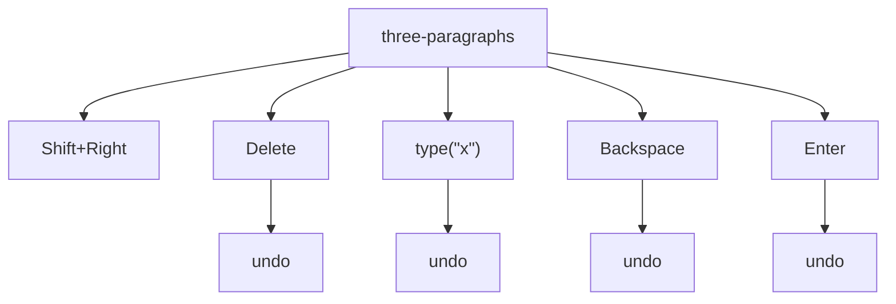

#### S-09 · Ctrl+A in the body of documents with tables, floating pictures, a text box and notes

`{fixture}` · Morph: **TODO**

Expected before the run: The whole main story including the table and the final mark; the header, the footnote text
and the text box's text are other stories and are not included; the floating picture (a) is included as an anchored
shape (b) is not part of the selection.

steps `select(P1:1)` · `Ctrl+A`

| fixture | selection | observed |
| --- | --- | --- |
| table-2x2 | Normal 0–56 end-active | `[⟦Before the table.¶⟧] ↓0<br>T1 R1 ║⟦[One¤⟧]║⟦[Two¤⟧]║¤<br>T1 R2 ║⟦[Three¤⟧]║⟦[Four¤⟧]║¤<br>⟦[After the table.¶‸⟧] ↓0` |
| header-footer | Normal 0–39 end-active | `[⟦Body paragraph.¶⟧] ↓0<br>⟦[Second body paragraph.¶‸⟧] ↓0` |
| text-box | Normal 0–92 end-active | `[⟦⚓1First paragraph of text here.¶⟧] ↓0<br>⟦[Second paragraph of text here.¶⟧] ↓0<br>⟦[Third paragraph of text here.¶‸⟧] ↓0<br>SHP1 ⌖P1 textbox 160x80pt square @228,0` |
| footnote | Normal 0–44 end-active | `[⟦Text†1 more words.¶⟧] ↓0<br>⟦[Second with an end note.‡1¶‸⟧] ↓0` |
| image-floating | Normal 0–109 end-active | `[⟦⚓1First paragraph of text here.¶⟧] ↓0<br>⟦[Second paragraph carries the anchor of the picture.¶⟧] ↓0<br>⟦[Third paragraph after it.¶‸⟧] ↓0<br>SHP1 ⌖P1 picture 72x72pt square @300,0` |
| table-nested | Normal 0–72 end-active | `[⟦Before the table.¶⟧] ↓0<br>T1 R1 ║⟦[a1¤⟧]║⊞⟦[i1¤⟧] ¶ ⊞⟦[i2¤⟧] ¶ ⊞⟦[i3¤⟧] ¶ ⊞⟦[i4¤⟧] ¶ ⟦[inner after¤⟧]║¤<br>T1 R2 ║⟦[a2¤⟧]║⟦[b2¤⟧]║¤<br>⟦[After the table.¶‸⟧] ↓0` |

#### S-09b · Ctrl+A from inside a cell, and from inside a nested table

`{fixture}` · Morph: **TODO**

Expected before the run: (a) the whole document, as from the body; (b) the table only, with a second Ctrl+A needed
for the document; (c) the cell only.

steps `select(C(1,1):1)` · `Ctrl+A`

| fixture | selection | observed |
| --- | --- | --- |
| table-2x2 | Normal 0–56 end-active | `[⟦Before the table.¶⟧] ↓0<br>T1 R1 ║⟦[One¤⟧]║⟦[Two¤⟧]║¤<br>T1 R2 ║⟦[Three¤⟧]║⟦[Four¤⟧]║¤<br>⟦[After the table.¶‸⟧] ↓0` |
| table-nested | Normal 0–72 end-active | `[⟦Before the table.¶⟧] ↓0<br>T1 R1 ║⟦[a1¤⟧]║⊞⟦[i1¤⟧] ¶ ⊞⟦[i2¤⟧] ¶ ⊞⟦[i3¤⟧] ¶ ⊞⟦[i4¤⟧] ¶ ⟦[inner after¤⟧]║¤<br>T1 R2 ║⟦[a2¤⟧]║⟦[b2¤⟧]║¤<br>⟦[After the table.¶‸⟧] ↓0` |

#### S-09c · Ctrl+A in the header

`header-footer` · Morph: **TODO**

Expected before the run: The header story only, the selection's StoryType staying the header's.

1. `seek(header)`
2. `Ctrl+A`

```text
[Body paragraph.] ↓0
[Second body paragraph.] ↓0
HDR: [⟦Header text¶‸⟧] #Header
```

Selection: Normal 0–12 end-active · Story PrimaryHeader

#### S-09d · Ctrl+A in a text box

`text-box` · Morph: **TODO**

Expected before the run: (a) the text box's two paragraphs only; (b) the body, with the text box deselected.

1. `select(TB1:P1:1)`
2. `Ctrl+A`

```text
[⚓1First paragraph of text here.] ↓0
[Second paragraph of text here.] ↓0
[Third paragraph of text here.] ↓0
SHP1 ⌖P1 textbox 160x80pt square @228,0
TB: [⟦Box line one¶⟧] ↓0
TB: ⟦[Box line two¶‸⟧] ↓0
```

Selection: Normal 0–26 end-active · Story TextFrame

#### S-09e · Ctrl+A in the footnotes

`footnote` · Morph: **TODO**

Expected before the run: The footnote story only, every note's text in one selection.

1. `seek(footnotes)`
2. `Ctrl+A`

```text
[Text†1 more words.] ↓0
[Second with an end note.‡1] ↓0
FN: [⟦† Note text.¶‸⟧] #FootnoteText
```

Selection: Normal 0–13 end-active · Story Footnotes

#### S-09f · Ctrl+A then Delete: which paragraph's properties the one left keeps

`{fixture}` · Morph: **TODO**

Expected before the run: One empty paragraph is left and it carries (a) the last paragraph's properties (the final
mark survives) (b) the first paragraph's (c) Normal with no direct formatting; the table goes with the text; the
floating picture (a) goes with its anchor paragraph (b) stays. Tracked, every paragraph is struck and nothing is
removed.

steps before the branches `select(P1:1)` · `Ctrl+A` · `Delete`

**fixture=kinds**

- `Delete` → `‸ ↓0` · IP 0–0 · Undo depth 1
- `undo` → `[⟦Normal kind.¶⟧] ↓0 / ⟦[Heading kind¶⟧] #Heading1 / ⟦[Bullet kind.¶⟧] #ListParagraph •1.0 ● ⇥36,-18 / ⟦[Centred kind.¶⟧] (center) ↓0 / ⟦[Bordered kind.¶⟧] ↓0 / ⟦[Indented kind.¶⟧] ⇥36,0 ↓0 / ⟦¶⟧ ↓0 / ⟦[Keep with next kind.¶⟧] ↓0 / ⟦[Last plain kind.¶‸⟧] ↓0` · Normal 0–122 end-active · Undo depth 1

**fixture=kinds · Track Changes on**

- `Delete` → `{-[Normal kind.] ↓0 / [Heading kind] #Heading1 / [Bullet kind.] #ListParagraph •1.0 ● ⇥36,-18 / [Centred kind.] (center) ↓0 / [Bordered kind.] ↓0 / [Indented kind.] ⇥36,0 ↓0 /  ↓0 / [Keep with next kind.] ↓0 / [Last plain kind.]-}‸ ↓0` · IP 121–121 · Tracking · Revisions 1 · Undo depth 2
- `undo` → `[⟦Normal kind.¶⟧] ↓0 / ⟦[Heading kind¶⟧] #Heading1 / ⟦[Bullet kind.¶⟧] #ListParagraph •1.0 ● ⇥36,-18 / ⟦[Centred kind.¶⟧] (center) ↓0 / ⟦[Bordered kind.¶⟧] ↓0 / ⟦[Indented kind.¶⟧] ⇥36,0 ↓0 / ⟦¶⟧ ↓0 / ⟦[Keep with next kind.¶⟧] ↓0 / ⟦[Last plain kind.¶‸⟧] ↓0` · Normal 0–122 end-active · Tracking · Revisions 0 · Undo depth 1

**fixture=table-2x2**

- `Delete` → `‸ ↓0` · IP 0–0 · Undo depth 1
- `undo` → `[⟦Before the table.¶⟧] ↓0 / T1 R1 ║⟦[One¤⟧]║⟦[Two¤⟧]║¤ / T1 R2 ║⟦[Three¤⟧]║⟦[Four¤⟧]║¤ / ⟦[After the table.¶‸⟧] ↓0` · Normal 0–56 end-active · Undo —

**fixture=table-2x2 · Track Changes on**

- `Delete` → `{-[Before the table.] ↓0 / T1 R1 ║[One¤]║[Two¤]║¤ / T1 R2 ║[Three¤]║[Four¤]║¤ / [After the table.]-}‸ ↓0` · IP 55–55 · Tracking · Revisions 1 · Undo depth 1
- `undo` → `[⟦Before the table.¶⟧] ↓0 / T1 R1 ║⟦[One¤⟧]║⟦[Two¤⟧]║¤ / T1 R2 ║⟦[Three¤⟧]║⟦[Four¤⟧]║¤ / ⟦[After the table.¶‸⟧] ↓0` · Normal 0–56 end-active · Tracking · Revisions 0 · Undo —

**fixture=image-floating**

- `Delete` → `‸ ↓0` · IP 0–0 · Undo depth 1
- `undo` → `[⟦⚓1First paragraph of text here.¶⟧] ↓0 / ⟦[Second paragraph carries the anchor of the picture.¶⟧] ↓0 / ⟦[Third paragraph after it.¶‸⟧] ↓0 / SHP1 ⌖P1 picture 72x72pt square @300,0` · Normal 0–109 end-active · Undo —

**fixture=image-floating · Track Changes on**

- `Delete` → `{-[⚓1First paragraph of text here.] ↓0 / [Second paragraph carries the anchor of the picture.] ↓0 / [Third paragraph after it.]-}‸ ↓0 / SHP1 ⌖P1 picture 72x72pt square @300,0` · IP 108–108 · Tracking · Revisions 1 · Undo depth 1
- `undo` → `[⟦⚓1First paragraph of text here.¶⟧] ↓0 / ⟦[Second paragraph carries the anchor of the picture.¶⟧] ↓0 / ⟦[Third paragraph after it.¶‸⟧] ↓0 / SHP1 ⌖P1 picture 72x72pt square @300,0` · Normal 0–109 end-active · Tracking · Revisions 0 · Undo —

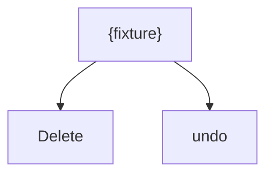

#### S-10 · F8 cascade from a word, then Shift+F8 back, Right, or a typed letter

`sentences` · Morph: **TODO**

Expected before the run: The first F8 turns extend mode on with nothing selected; then word, sentence, paragraph, (a)
section, (b) document with the section step skipped; Shift+F8 steps back down the same ladder; Esc ends the mode and
keeps the selection. In extend mode Right extends by a character and a typed letter extends to the next occurrence of
that letter rather than replacing the selection.

steps before the branches `select(P1:find("Two"))` · `F8`

- `F8` → `[One is first. ‸Two is next? Three uses e.g. four here. Five ends it.] ↓0 / [Second line starts. It ends here.] ↓0` · IP 14–14 · extend-mode
- `F8 · F8 · F8 · F8 · F8 · Shift+F8 · Shift+F8 · Shift+F8 · Esc` → `[One is first. ⟦Two ‸⟧is next? Three uses e.g. four here. Five ends it.] ↓0 / [Second line starts. It ends here.] ↓0` · Normal 14–18 end-active
- `Right x3 · Esc` → `[One is first. ⟦Two‸⟧ is next? Three uses e.g. four here. Five ends it.] ↓0 / [Second line starts. It ends here.] ↓0` · Normal 14–17 end-active
- `type("f") · Esc` → `[One is first. ⟦Two is next? Three uses e.g. f‸⟧our here. Five ends it.] ↓0 / [Second line starts. It ends here.] ↓0` · Normal 14–44 end-active
- `Esc` → `[One is first. ‸Two is next? Three uses e.g. four here. Five ends it.] ↓0 / [Second line starts. It ends here.] ↓0` · IP 14–14

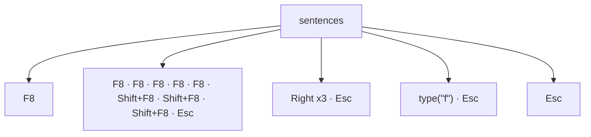

#### S-10b · F8 cascade from inside a table cell

`table-3x3` · Morph: **TODO**

Expected before the run: (a) word, cell, row, table, document; (b) word, sentence, paragraph (the cell), then the
document, with no row or table step; (c) column before row.

1. `select(C(2,2):1)`
2. `F8`
3. `F8`
4. `F8`
5. `F8`
6. `F8`
7. `F8`
8. `Esc`

| step | selection | where |
| --- | --- | --- |
| `F8` | IP 32–32 | `[b‸2¤]` |
| `F8` | Normal 31–33 end-active | `[⟦b2‸⟧¤]` |
| `F8` | Column 31–34 end-active | `[⟦b2¤‸⟧]` |
| `F8` | Normal 0–65 end-active | `[After the table.¶] …` |
| `F8` | Normal 0–65 end-active | `[After the table.¶] …` |
| `F8` | Normal 0–65 end-active | `[After the table.¶] …` |
| `Esc` | Normal 0–65 end-active | `[After the table.¶] …` |

```text
[⟦Before the table.¶⟧] ↓0
T1 R1 ║⟦[a1¤⟧]║⟦[b1¤⟧]║⟦[c1¤⟧]║¤
T1 R2 ║⟦[a2¤⟧]║⟦[b2¤⟧]║⟦[c2¤⟧]║¤
T1 R3 ║⟦[a3¤⟧]║⟦[b3¤⟧]║⟦[c3¤⟧]║¤
⟦[After the table.¶‸⟧] ↓0
```

Selection: Normal 0–65 end-active

#### S-10c · F8 cascade from inside a numbered item

`numbers` · Morph: **TODO**

Expected before the run: Word, sentence and paragraph coincide for a one-word item, so the presses (a) stop at the
item for three presses before the document (b) climb once per press regardless; the list itself is never a step.

1. `select(P2:1)`
2. `F8`
3. `F8`
4. `F8`
5. `F8`
6. `F8`
7. `Esc`

| step | selection | where |
| --- | --- | --- |
| `F8` | IP 5–5 | `[T‸wo]` |
| `F8` | Normal 4–7 end-active | `[⟦Two‸⟧]` |
| `F8` | Normal 4–8 end-active | `[⟦Two¶‸⟧]` |
| `F8` | Normal 0–14 end-active | `[Three¶] …` |
| `F8` | Normal 0–14 end-active | `[Three¶] …` |
| `Esc` | Normal 0–14 end-active | `[Three¶] …` |

```text
[⟦One¶⟧] #ListParagraph •1.0 1. ⇥36,-18
⟦[Two¶⟧] #ListParagraph •1.0 2. ⇥36,-18
⟦[Three¶‸⟧] #ListParagraph •1.0 3. ⇥36,-18
```

Selection: Normal 0–14 end-active

#### S-11 · Ctrl+Shift+F8 column mode over a wrapped paragraph, then typing or Delete

`long-paragraph` · Morph: **TODO**

Expected before the run: Type is Block, one segment per line, three characters wide on each of three lines; Esc ends
column mode and keeps the block. A typed letter (a) replaces every segment with one copy of the letter each (b)
replaces only the first; Delete removes every segment.

steps before the branches `select(P2:2)` · `Ctrl+Shift+F8` · `Down` · `Down` · `Right x3`

- `Right x3` → `[Short first.] ↓0 / [A ⟦long second paragraph that runs on past the right margin so that it wraps to a second and then a third line of text on the page, giving Up and Down keys lines to move between befor‸⟧e it finally ends here.] ↓0 / [Short third.] ↓0` · Block 15–195 end-active · column-mode · Undo —
- `Esc · type("x")` → `[Short first.] ↓0 / [A x‸long second paragraph that runs on past the right margin so that it wraps to a second and then a third line of text on the page, giving Up and Down keys lines to move between before it finally ends here.] ↓0 / [Short third.] ↓0` · IP 16–16 · Undo depth 1
- `type("x")` → `[Short first.] ↓0 / [A ⟦long second paragraph that runs on past the right margin so that it wraps to a second and then a third line of text on the page, giving Up and Down keys lines to move between befor‸⟧e it finally ends here.] ↓0 / [Short third.] ↓0` · Block 15–195 end-active · column-mode · Undo —
- `Delete` → `[Short first.] ↓0 / [A ‸g second paragraph that runs on past the right margin so that it wraps to a second ahen a third line of text on the page, giving Up and Down keys lines to move between be it finally ends here.] ↓0 / [Short third.] ↓0` · IP 15–15 · Undo depth 1

**Track Changes on**

- `Right x3` → `[Short first.] ↓0 / [A ⟦long second paragraph that runs on past the right margin so that it wraps to a second and then a third line of text on the page, giving Up and Down keys lines to move between befor‸⟧e it finally ends here.] ↓0 / [Short third.] ↓0` · Block 15–195 end-active · column-mode · Tracking · Revisions 0 · Undo —
- `Esc · type("x")` → `[Short first.] ↓0 / [A ]{+[x]+}[‸long second paragraph that runs on past the right margin so that it wraps to a second and then a third line of text on the page, giving Up and Down keys lines to move between before it finally ends here.] ↓0 / [Short third.] ↓0` · IP 16–16 · Tracking · Revisions 1 · Undo depth 1
- `type("x")` → `[Short first.] ↓0 / [A ⟦long second paragraph that runs on past the right margin so that it wraps to a second and then a third line of text on the page, giving Up and Down keys lines to move between befor‸⟧e it finally ends here.] ↓0 / [Short third.] ↓0` · Block 15–195 end-active · column-mode · Tracking · Revisions 0 · Undo —
- `Delete` → `[Short first.] ↓0 / [A ]{-[‸lon]-}[g second paragraph that runs on past the right margin so that it wraps to a second a]{-[nd t]-}[hen a third line of text on the page, giving Up and Down keys lines to move between b]{-[efor]-}[e it finally ends here.] ↓0 / [Short third.] ↓0` · IP 15–15 · Tracking · Revisions 3 · Undo depth 1

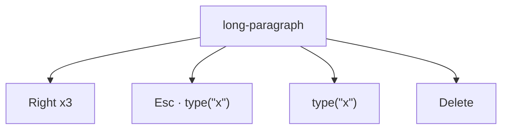

#### S-12 · Alt+Num5 inside and outside a table

`table-2x2` · Morph: **TODO**

Expected before the run: Inside a table the whole table is selected; outside it nothing changes.

steps `select({from})` · `Alt+Num5`

| from | selection | observed |
| --- | --- | --- |
| C(1,1):1 | Row 18–39 end-active · Cells 4 (R1C1–R2C2) | `[Before the table.] ↓0<br>T1 R1 ║[⟦One¤⟧]║⟦[Two¤⟧]║¤<br>T1 R2 ║⟦[Three¤⟧]║⟦[Four¤⟧]║¤‸⟧<br>[After the table.] ↓0` |
| P1:1 | IP 1–1 | `[B‸efore the table.] ↓0<br>T1 R1 ║[One¤]║[Two¤]║¤<br>T1 R2 ║[Three¤]║[Four¤]║¤<br>[After the table.] ↓0` |

Notes: Num5 is the numeric keypad's 5 with Num Lock off (the Clear key); with Num Lock on the chord is a different
key and does nothing.

#### S-13 · Shift+click after a keyboard selection moves the active end, not the anchor

`words` · Morph: **PARTIAL**

Expected before the run: The anchor stays at 10, so the result is 5-10 with the start active; the three characters to
its right drop out.

1. `click(P1:10)`
2. `Shift+Right`
3. `Shift+Right`
4. `Shift+Right`
5. `shift+click(P1:5)`

| step | selection | where |
| --- | --- | --- |
| `click(P1:10)` | IP 11–11 | `[alpha beta,‸  gamma-delta 3.14 don't (eps) 1,000 10:30 end.]` |
| `Shift+Right` | Normal 11–12 end-active | `[alpha beta,⟦ ‸⟧ gamma-delta 3.14 don't (eps) 1,000 10:30 end.]` |
| `Shift+Right` | Normal 11–13 end-active | `[alpha beta,⟦  ‸⟧gamma-delta 3.14 don't (eps) 1,000 10:30 end.]` |
| `Shift+Right` | Normal 11–14 end-active | `[alpha beta,⟦  g‸⟧amma-delta 3.14 don't (eps) 1,000 10:30 end.]` |
| `shift+click(P1:5)` | Normal 5–13 start-active | `[alpha⟦‸ beta,  ⟧gamma-delta 3.14 don't (eps) 1,000 10:30 end.]` |

```text
[alpha⟦‸ beta,  ⟧gamma-delta 3.14 don't (eps) 1,000 10:30 end.] ↓0
```

Selection: Normal 5–13 start-active · click(P1:10) → Range 11-11, IBeam · shift+click(P1:5) → Range 5-5, IBeam

#### S-14 · The anchor stays put when Shift+Left passes back over it, and over a Shift+Up

`words` · Morph: **DONE**

Expected before the run: Five Shift+Left presses after three Shift+Right give 8-10 with StartIsActive true: the
selection passes through empty and reverses; Shift+Up on the only line selects back to the paragraph start, from the
anchor at 10.

steps before the branches `select(P1:10)` · `Shift+Right` · `Shift+Right` · `Shift+Right`

- `Shift+Right` → `[alpha beta⟦,  ‸⟧gamma-delta 3.14 don't (eps) 1,000 10:30 end.] ↓0` · Normal 10–13 end-active
- `Shift+Left · Shift+Left · Shift+Left · Shift+Left · Shift+Left` → `[alpha be⟦‸ta⟧,  gamma-delta 3.14 don't (eps) 1,000 10:30 end.] ↓0` · Normal 8–10 start-active
- `Shift+Up` → `[⟦‸alpha beta⟧,  gamma-delta 3.14 don't (eps) 1,000 10:30 end.] ↓0` · Normal 0–10 start-active

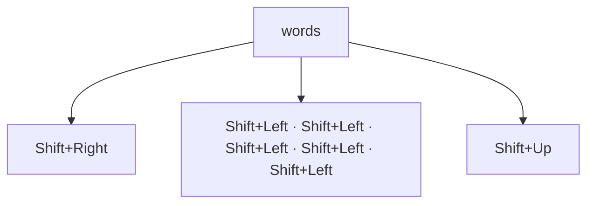

#### S-15 · Smart paragraph selection on a drag that reaches a paragraph's end

`three-paragraphs` · Morph: **TODO**

Expected before the run: With the option on, a drag from a paragraph's start to its end takes the mark too; from
inside a paragraph to another's end it (a) takes that mark (b) stops before it. With the option off the mark is never
added. A drag that ends mid-paragraph is unchanged either way.

steps `{drag}`

| drag | options | selection | observed |
| --- | --- | --- | --- |
| drag(P1:0→P1:end) | SmartParaSelection=true | Normal 0–22 end-active | `[⟦First paragraph here.¶‸⟧] ↓0<br>[Second bold one.] (center) ↓0<br>[Third and last.] ↓0` |
| drag(P1:0→P1:end) | SmartParaSelection=false | Normal 0–21 end-active | `[⟦First paragraph here.‸⟧] ↓0<br>[Second bold one.] (center) ↓0<br>[Third and last.] ↓0` |
| drag(P1:4→P2:end) | SmartParaSelection=true | Normal 0–39 end-active | `[⟦First paragraph here.¶⟧] ↓0<br>⟦[Second bold one.¶‸⟧] (center) ↓0<br>[Third and last.] ↓0` |
| drag(P1:4→P2:end) | SmartParaSelection=false | Normal 0–38 end-active | `[⟦First paragraph here.¶⟧] ↓0<br>⟦[Second bold one.‸⟧] (center) ↓0<br>[Third and last.] ↓0` |
| drag(P1:0→P2:3) | SmartParaSelection=true | Normal 0–29 end-active | `[⟦First paragraph here.¶⟧] ↓0<br>⟦[Second ‸⟧bold one.] (center) ↓0<br>[Third and last.] ↓0` |
| drag(P1:0→P2:3) | SmartParaSelection=false | Normal 0–29 end-active | `[⟦First paragraph here.¶⟧] ↓0<br>⟦[Second ‸⟧bold one.] (center) ↓0<br>[Third and last.] ↓0` |

#### S-16 · Typing over a selection with ReplaceSelection off

`words` · Morph: **TODO**

Expected before the run: (a) the typed character, Enter and Tab are inserted at the selection's start and the
selection collapses there; (b) at its end. Backspace and Delete still remove the selected text.

steps before the branches `option(Options.ReplaceSelection=false)` · `select(P1:6-10)`

- `select(P1:6-10)` → `[alpha ⟦beta‸⟧,  gamma-delta 3.14 don't (eps) 1,000 10:30 end.] ↓0` · Normal 6–10 end-active · Undo —
- `type("x")` → `[alpha x‸beta,  gamma-delta 3.14 don't (eps) 1,000 10:30 end.] ↓0` · IP 7–7 · Undo depth 1
- `Enter` → `[alpha ] ↓0 / [‸beta,  gamma-delta 3.14 don't (eps) 1,000 10:30 end.] ↓0` · IP 7–7 · Undo depth 1
- `Tab` → `[alpha \t‸beta,  gamma-delta 3.14 don't (eps) 1,000 10:30 end.] ↓0` · IP 7–7 · Undo depth 1
- `Backspace` → `[alpha ‸beta,  gamma-delta 3.14 don't (eps) 1,000 10:30 end.] ↓0` · IP 6–6 · Undo —
- `Delete` → `[alpha‸,  gamma-delta 3.14 don't (eps) 1,000 10:30 end.] ↓0` · IP 5–5 · Undo depth 1

**Track Changes on**

- `select(P1:6-10)` → `[alpha ⟦beta‸⟧,  gamma-delta 3.14 don't (eps) 1,000 10:30 end.] ↓0` · Normal 6–10 end-active · Tracking · Revisions 0 · Undo —
- `type("x")` → `[alpha ]{+[x]+}[‸beta,  gamma-delta 3.14 don't (eps) 1,000 10:30 end.] ↓0` · IP 7–7 · Tracking · Revisions 1 · Undo depth 1
- `Enter` → `[alpha ]{++} ↓0 / [‸beta,  gamma-delta 3.14 don't (eps) 1,000 10:30 end.] ↓0` · IP 7–7 · Tracking · Revisions 1 · Undo depth 1
- `Tab` → `[alpha ]{+[\t]+}[‸beta,  gamma-delta 3.14 don't (eps) 1,000 10:30 end.] ↓0` · IP 7–7 · Tracking · Revisions 1 · Undo depth 1
- `Backspace` → `[alpha ‸beta,  gamma-delta 3.14 don't (eps) 1,000 10:30 end.] ↓0` · IP 6–6 · Tracking · Revisions 0 · Undo —
- `Delete` → `[alpha]{-[ beta]-}[‸,  gamma-delta 3.14 don't (eps) 1,000 10:30 end.] ↓0` · IP 10–10 · Tracking · Revisions 1 · Undo depth 1

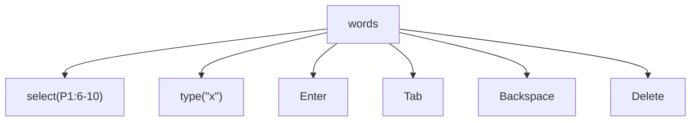

#### S-17 · Tab and Shift+Tab with a cell's contents selected

`table-2x2` · Morph: **UNKNOWN**

Expected before the run: Tab moves to the next cell and selects its contents, inserting nothing; Shift+Tab in the
first cell (a) does nothing (b) leaves the table.

steps `select(C(1,1):0-C(1,1):end)` · `{key}`

| key | tracked | selection | observed |
| --- | --- | --- | --- |
| Tab | off | Normal 22–25 end-active · Cells 1 (R1C2–R1C2) · Undo — | `[Before the table.] ↓0<br>T1 R1 ║[One¤]║[⟦Two‸⟧¤]║¤<br>T1 R2 ║[Three¤]║[Four¤]║¤<br>[After the table.] ↓0` |
| Tab | on | Normal 22–25 end-active · Cells 1 (R1C2–R1C2) · Tracking · Revisions 0 · Undo — | `[Before the table.] ↓0<br>T1 R1 ║[One¤]║[⟦Two‸⟧¤]║¤<br>T1 R2 ║[Three¤]║[Four¤]║¤<br>[After the table.] ↓0` |
| Shift+Tab | off | Normal 18–21 end-active · Cells 1 (R1C1–R1C1) · Undo — | `[Before the table.] ↓0<br>T1 R1 ║[⟦One‸⟧¤]║[Two¤]║¤<br>T1 R2 ║[Three¤]║[Four¤]║¤<br>[After the table.] ↓0` |
| Shift+Tab | on | Normal 18–21 end-active · Cells 1 (R1C1–R1C1) · Tracking · Revisions 0 · Undo — | `[Before the table.] ↓0<br>T1 R1 ║[⟦One‸⟧¤]║[Two¤]║¤<br>T1 R2 ║[Three¤]║[Four¤]║¤<br>[After the table.] ↓0` |

#### S-17b · Tab and Shift+Tab with a word selected in plain text

`words` · Morph: **UNKNOWN**

Expected before the run: Tab replaces the selection with a tab character; Shift+Tab (a) does nothing (b) also
replaces it (c) outdents the paragraph.

steps `select(P1:6-10)` · `{key}`

| key | tracked | selection | observed |
| --- | --- | --- | --- |
| Tab | off | IP 7–7 · Undo depth 1 | `[alpha \t‸beta,  gamma-delta 3.14 don't (eps) 1,000 10:30 end.] ↓0` |
| Tab | on | IP 7–7 · Tracking · Revisions 1 · Undo depth 1 | `[alpha ]{+[\t]+}[‸beta,  gamma-delta 3.14 don't (eps) 1,000 10:30 end.] ↓0` |
| Shift+Tab | off | IP 7–7 · Undo depth 1 | `[alpha \t‸beta,  gamma-delta 3.14 don't (eps) 1,000 10:30 end.] ↓0` |
| Shift+Tab | on | IP 7–7 · Tracking · Revisions 1 · Undo depth 1 | `[alpha ]{+[\t]+}[‸beta,  gamma-delta 3.14 don't (eps) 1,000 10:30 end.] ↓0` |

#### S-17c · Tab and Shift+Tab with a numbered item's text selected

`numbers` · Morph: **UNKNOWN**

Expected before the run: (a) Tab changes the item's level as it does with the caret at the item's start, and
Shift+Tab at level 1 does nothing; (b) with text selected Tab replaces the text with a tab character.

steps `select(P2:0-P2:3)` · `{key}`

| key | tracked | selection | observed |
| --- | --- | --- | --- |
| Tab | off | Normal 4–7 end-active · Undo depth 2 | `[One] #ListParagraph •1.0 1. ⇥36,-18<br>[⟦Two‸⟧] #ListParagraph •1.0 2. ⇥54,-18<br>[Three] #ListParagraph •1.0 3. ⇥36,-18` |
| Tab | on | Normal 4–7 end-active · Tracking · Revisions 1 · Undo depth 2 | `[One] #ListParagraph •1.0 1. ⇥36,-18<br>{~[⟦Two‸⟧]~} #ListParagraph •1.0 2. ⇥54,-18<br>[Three] #ListParagraph •1.0 3. ⇥36,-18` |
| Shift+Tab | off | Normal 4–7 end-active · Undo depth 2 | `[One] #ListParagraph •1.0 1. ⇥36,-18<br>[⟦Two‸⟧] #ListParagraph •1.0 2. ⇥18,-18<br>[Three] #ListParagraph •1.0 3. ⇥36,-18` |
| Shift+Tab | on | Normal 4–7 end-active · Tracking · Revisions 1 · Undo depth 2 | `[One] #ListParagraph •1.0 1. ⇥36,-18<br>{~[⟦Two‸⟧]~} #ListParagraph •1.0 2. ⇥18,-18<br>[Three] #ListParagraph •1.0 3. ⇥36,-18` |

#### S-18 · Shift+Right from the last cell's end: cell, row mark, table, then what follows

`{fixture}` · Morph: **TODO**

Expected before the run: (a) the cell, then the row (its end-of-row mark), then the whole table, then the paragraph
after; (b) the cell, then straight to the paragraph after. With only the final mark after the table the last press
(a) selects that mark (b) changes nothing.

steps `select(C(2,2):end)` · `Shift+Right` · `Shift+Right` · `Shift+Right`

| fixture | selection | observed |
| --- | --- | --- |
| table-2x2 | Normal 27–40 end-active | `[Before the table.] ↓0<br>T1 R1 ║[One¤]║[Two¤]║¤<br>T1 R2 ║[⟦Three¤⟧]║⟦[Four¤⟧]║¤<br>⟦[A‸⟧fter the table.] ↓0` |
| table-at-end | Normal 27–40 end-active | `[Before the table.] ↓0<br>T1 R1 ║[One¤]║[Two¤]║¤<br>T1 R2 ║[⟦Three¤⟧]║⟦[Four¤⟧]║¤<br>⟦¶‸⟧ ↓0` |

#### S-19 · Shift+Right and Shift+Left from a clicked inline picture

`image-inline` · Morph: **PARTIAL**

Expected before the run: The picture stays selected and a character is added on the pressed side: Shift+Right anchors
before the picture and takes the space after it; Shift+Left anchors after it and takes the space before.

steps `click(IMG1)` · `{key}`

| key | selection | observed |
| --- | --- | --- |
| Shift+Right | Normal 12–14 end-active · InlineShapes 1 | `[Text before ⟦▣ ‸⟧after end.] ↓0<br>[Second paragraph.] ↓0` |
| Shift+Left | IP 12–12 | `[Text before ‸▣ after end.] ↓0<br>[Second paragraph.] ↓0` |

#### S-20 · Shift+Right with a floating picture selected

`image-floating` · Morph: **TODO**

Expected before the run: (a) nothing changes and the shape stays selected; (b) the shape grows wider by a nudge step;
(c) the selection falls back to text at the anchor.

1. `click(SHP1)`
2. `Shift+Right`

```text
[⟦⚓1‸⟧First paragraph of text here.] ↓0
[Second paragraph carries the anchor of the picture.] ↓0
[Third paragraph after it.] ↓0
SHP1 ⌖P1 picture 79.2x72pt square @296.4,0 ⟦selected⟧
```

Selection: Shape 0–1 end-active · Shapes 1 · click(SHP1) → Shape Picture 1, WordOwn

#### S-21 · A selection to the document's end then Delete keeps the final mark

`three-paragraphs` · Morph: **TODO**

Expected before the run: The text from P3:2 is removed and the final paragraph mark survives, so the document still
ends with P3's mark and its properties; the selection collapses at P3:2.

steps before the branches `select(P3:2)` · `Ctrl+Shift+End` · `Delete`

- `Delete` → `[First paragraph here.] ↓0 / [Second ][b:bold ][one.] (center) ↓0 / [Th‸] ↓0` · IP 41–41 · Undo depth 1
- `undo` → `[First paragraph here.] ↓0 / [Second ][b:bold ][one.] (center) ↓0 / [Th⟦ird and last.¶‸⟧] ↓0` · Normal 41–55 end-active · Undo —

**Track Changes on**

- `Delete` → `[First paragraph here.] ↓0 / [Second ][b:bold ][one.] (center) ↓0 / [Th]{-[ird and last.]-}‸ ↓0` · IP 54–54 · Tracking · Revisions 1 · Undo depth 1
- `undo` → `[First paragraph here.] ↓0 / [Second ][b:bold ][one.] (center) ↓0 / [Th⟦ird and last.¶‸⟧] ↓0` · Normal 41–55 end-active · Tracking · Revisions 0 · Undo —

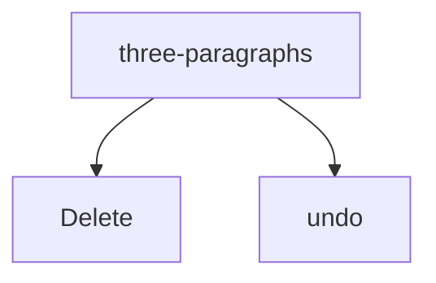

#### S-22 · A keyboard selection, a click, then a Shift+click

`words` · Morph: **PARTIAL**

Expected before the run: The click collapses the selection at 20 and becomes the new anchor; the Shift+click then
selects 20-25, with no memory of the first selection.

1. `select(P1:0)`
2. `Shift+Right x4`
3. `click(P1:20)`
4. `shift+click(P1:25)`

| step | selection | where |
| --- | --- | --- |
| `Shift+Right x4` | Normal 0–4 end-active | `[⟦alph‸⟧a beta,  gamma-delta 3.14 don't (eps) 1,000 10:30 end.]` |
| `click(P1:20)` | IP 20–20 | `[alpha beta,  gamma-d‸elta 3.14 don't (eps) 1,000 10:30 end.]` |
| `shift+click(P1:25)` | Normal 20–25 end-active | `[alpha beta,  gamma-d⟦elta ‸⟧3.14 don't (eps) 1,000 10:30 end.]` |

```text
[alpha beta,  gamma-d⟦elta ‸⟧3.14 don't (eps) 1,000 10:30 end.] ↓0
```

Selection: Normal 20–25 end-active · click(P1:20) → Range 20-20, IBeam · shift+click(P1:25) → Range 25-25, IBeam

#### S-23 · Shift+Home and Shift+End on a wrapped line stop at the line's edges

`wrap` · Morph: **DONE**

Expected before the run: Shift+Home selects back to the start of the line P1:60 sits on, not to P1:0; Shift+End to
that line's end, (a) before the wrap space (b) after it.

steps `select(P1:60)` · `{key}`

| key | selection | observed |
| --- | --- | --- |
| Shift+Home | Normal 40–60 start-active | `[Alpha beta gamma delta epsilon zeta eta ⟦‸theta iota kappa lam⟧bda mu nu xi omicron pi rho sigma tau upsilon phi chi psi omega alpha beta gamma delta epsilon zeta.] ↓0` |
| Shift+End | Normal 60–81 end-active | `[Alpha beta gamma delta epsilon zeta eta theta iota kappa lam⟦bda mu nu xi omicron ‸⟧pi rho sigma tau upsilon phi chi psi omega alpha beta gamma delta epsilon zeta.] ↓0` |

#### S-25 · Shift+Right into another author's tracked deletion, per markup view

`tracked` · Morph: **UNKNOWN**

Expected before the run: (a) with all markup the deleted text is stepped through and Selection.Text includes it; in
the collapsed views the first press jumps past the deletion, and Text omits it; (b) the deleted text is selected in
every view and Text includes it in every view.

steps `view({view})` · `select(P1:5)` · `Shift+Right` · `Shift+Right` · `Shift+Right`

| view | selection | observed |
| --- | --- | --- |
| all | Normal 5–8 end-active · Revisions 2 | `[Kept ]{+[⟦add‸⟧ed ]+}{-[gone ]-}[text stays.] ↓0<br>[Second paragraph.] ↓0` |
| simple | Normal 5–8 end-active · Revisions 2 | `[Kept ]{+[⟦add‸⟧ed ]+}{-[]-}[text stays.] ↓0<br>[Second paragraph.] ↓0` |
| none | Normal 5–8 end-active · Revisions 2 | `[Kept ]{+[⟦add‸⟧ed ]+}{-[]-}[text stays.] ↓0<br>[Second paragraph.] ↓0` |

Notes: P1:5 is where the deleted 'gone ' begins.

#### S-26 · Shift+Right and Shift+Left at a rich text content control's edges

`content-control` · Morph: **UNKNOWN**

Expected before the run: (a) the control's edges add a position each, so one press at an edge changes the selection's
Start or End by nothing while the trace shows the step; (b) no extra positions and the selection crosses the edge
like plain text. The selection's Text never includes a control boundary character.

steps `select({from})` · `{key}` · `{key}` · `{key}` · `{key}`

| from | key | selection | observed |
| --- | --- | --- | --- |
| P1:5 | Shift+Right | Normal 5–9 end-active | `[Rich:⟦ (\|co‸⟧ntent here\|) end.] ↓0<br>[Plain: (\|plain here\|) end.] ↓0<br>[Check: (\|☐\|) end.] ↓0<br>[Pick: (\|choice\|) end.] ↓0` |
| P1:5 | Shift+Left | Normal 1–5 start-active | `[R⟦‸ich:⟧ (\|content here\|) end.] ↓0<br>[Plain: (\|plain here\|) end.] ↓0<br>[Check: (\|☐\|) end.] ↓0<br>[Pick: (\|choice\|) end.] ↓0` |
| P1:find(" end") | Shift+Right | Normal 20–24 end-active | `[Rich: (\|content here\|)⟦ end‸⟧.] ↓0<br>[Plain: (\|plain here\|) end.] ↓0<br>[Check: (\|☐\|) end.] ↓0<br>[Pick: (\|choice\|) end.] ↓0` |
| P1:find(" end") | Shift+Left | Normal 16–20 start-active | `[Rich: (\|content h⟦‸ere\|)⟧ end.] ↓0<br>[Plain: (\|plain here\|) end.] ↓0<br>[Check: (\|☐\|) end.] ↓0<br>[Pick: (\|choice\|) end.] ↓0` |

Notes: P1 reads 'Rich: content here end.' with the control on 'content here'; P1:5 is the space before it, P1:find("
end") the position right after it.

#### S-27 · Shift+Up and Shift+Down keep the remembered x across a short paragraph

`long-paragraph` · Morph: **DONE**

Expected before the run: Shift+Up from the second line of P2 selects to the point above on its first line; Shift+Down
returns to P2:40 (an empty selection, the anchor unchanged); the second Shift+Down lands on the third line at the
same x, the x being kept through the empty selection.

1. `select(P2:40)`
2. `Shift+Up`
3. `Shift+Down`
4. `Shift+Down`

| step | selection | where |
| --- | --- | --- |
| `Shift+Up` | Normal 12–53 start-active | `[Short first.⟦‸¶⟧] …` |
| `Shift+Down` | Normal 23–53 start-active | `[A long sec⟦‸ond paragraph that runs on pas⟧t the right margin so that it wraps to a second and then a third line of text on the page, giving Up and Down keys lines to move between before it finally ends here.]` |
| `Shift+Down` | Normal 53–111 end-active | `[A long second paragraph that runs on pas⟦t the right margin so that it wraps to a second and then a‸⟧ third line of text on the page, giving Up and Down keys lines to move between before it finally ends here.]` |

```text
[Short first.] ↓0
[A long second paragraph that runs on pas⟦t the right margin so that it wraps to a second and then a‸⟧ third line of text on the page, giving Up and Down keys lines to move between before it finally ends here.] ↓0
[Short third.] ↓0
```

Selection: Normal 53–111 end-active

#### S-28 · Shift+PgDn and Shift+PgUp over three pages

`three-pages` · Morph: **TODO**

Expected before the run: Each Shift+PgDn extends by one screen of lines at the same x, not by a page of the document;
Shift+PgUp takes the last screen back and the anchor stays at P1:3 throughout.

1. `select(P1:3)`
2. `Shift+PgDn`
3. `Shift+PgDn`
4. `Shift+PgUp`

| step | selection | where |
| --- | --- | --- |
| `Shift+PgDn` | Normal 3–456 end-active | `[Paragraph 11 of thirty on one of three pages.] …` |
| `Shift+PgDn` | Normal 3–918 end-active | `[Paragraph 21 of thirty on one of three pages.] …` |
| `Shift+PgUp` | Normal 3–914 end-active | `[⤓] …` |

```text
[Par⟦agraph 1 of thirty on one of three pages.¶⟧] ↓0
⟦[Paragraph 2 of thirty on one of three pages.¶⟧] ↓0
⟦[Paragraph 3 of thirty on one of three pages.¶⟧] ↓0
⟦[Paragraph 4 of thirty on one of three pages.¶⟧] ↓0
⟦[Paragraph 5 of thirty on one of three pages.¶⟧] ↓0
⟦[Paragraph 6 of thirty on one of three pages.¶⟧] ↓0
⟦[Paragraph 7 of thirty on one of three pages.¶⟧] ↓0
⟦[Paragraph 8 of thirty on one of three pages.¶⟧] ↓0
⟦[Paragraph 9 of thirty on one of three pages.¶⟧] ↓0
⟦[Paragraph 10 of thirty on one of three pages.¶⟧] ↓0
⟦[⤓¶⟧] ↓0
⟦[Paragraph 11 of thirty on one of three pages.¶⟧] ↓0
⟦[Paragraph 12 of thirty on one of three pages.¶⟧] ↓0
⟦[Paragraph 13 of thirty on one of three pages.¶⟧] ↓0
⟦[Paragraph 14 of thirty on one of three pages.¶⟧] ↓0
⟦[Paragraph 15 of thirty on one of three pages.¶⟧] ↓0
⟦[Paragraph 16 of thirty on one of three pages.¶⟧] ↓0
⟦[Paragraph 17 of thirty on one of three pages.¶⟧] ↓0
⟦[Paragraph 18 of thirty on one of three pages.¶⟧] ↓0
⟦[Paragraph 19 of thirty on one of three pages.¶⟧] ↓0
⟦[Paragraph 20 of thirty on one of three pages.¶⟧] ↓0
⟦[⤓‸⟧] ↓0
[Paragraph 21 of thirty on one of three pages.] ↓0
[Paragraph 22 of thirty on one of three pages.] ↓0
[Paragraph 23 of thirty on one of three pages.] ↓0
[Paragraph 24 of thirty on one of three pages.] ↓0
[Paragraph 25 of thirty on one of three pages.] ↓0
[Paragraph 26 of thirty on one of three pages.] ↓0
[Paragraph 27 of thirty on one of three pages.] ↓0
[Paragraph 28 of thirty on one of three pages.] ↓0
[Paragraph 29 of thirty on one of three pages.] ↓0
[Paragraph 30 of thirty on one of three pages.] ↓0
```

Selection: Normal 3–914 end-active
<!-- probe:end selection -->

## Mouse

Click placement, double and triple click, Ctrl and Shift clicks, drags, the selection bar, table and
picture targets, drag and drop.

### Rules

- **R-M-1 A click lands on the nearer edge of the glyph under the pointer**: the left half of a glyph
  puts the caret before it, the right half after it, for letters, punctuation, a tab (a click anywhere in
  the tab's expanse goes by the same halves), a non-breaking space and the display text of a hyperlink,
  which a plain click never follows whatever `CtrlClickHyperlinkToOpen` says (M-01, M-01b, M-01d, M-01e,
  M-01h, M-06, M-26). A click on a paragraph mark, past the end of a line or on an end-of-cell mark puts
  the caret before the mark (M-02b, M-02c, M-05); a click left of a line's first glyph puts it at the
  paragraph's start, in a list item too (M-03, M-03b). — Morph: PARTIAL (the page opens the paragraph at
  the nearest character; the half-glyph rule is not confirmed by a test).
- **R-M-2 A field, a note reference and a content control edge are not glyphs**: the left half of a
  one-character field result lands before the field's begin and the right half after its end, so the
  field is one caret position from the mouse as from the keyboard, while a click inside a longer result
  lands between the result's characters like plain text (M-01f, M-70). Either half of a footnote or
  endnote reference lands before the reference (M-01g, M-73). A click in a content control's text lands
  at the character; a click on a check box content control put the caret before the box and did not
  toggle it (M-74). — Morph: UNKNOWN.
- **R-M-3 A click below the last line is a click on that line** at the pointer's x; with
  `AllowClickAndTypeMouse` on (the default) a double-click there adds empty paragraphs down to the
  pointer and aligns the new paragraph by the zone the pointer is in (left, centre, right), one undo
  entry named "Click and Type Formatting"; below a list the added paragraphs are plain, not list items.
  With the option off the double-click selects the word of the last line under the x (M-04, M-04b). —
  Morph: TODO.
- **R-M-4 Double-click selects the word with every space after it**, end-active: `Two  ` takes both
  spaces, `don't` is one word, a word before a tab, a hyphen or a picture is taken without a space, a
  hyphen is a word of its own, `3.14` and `1,000` and `10:30` split into their digit runs and the
  punctuation between them, a run of punctuation is taken with its trailing spaces (`,  ` and `) `), and
  the final `.` or the paragraph mark alone when the pointer is on it (M-10, M-10c, M-10d, M-11, M-13,
  M-15, M-15b). When the pointer is on the boundary before a word (the right half of the space before it
  or the left edge of its first glyph) the following word is selected start-active (M-12, M-14; the
  start-active cases of M-11 and M-13 are of the same kind). In a cell the word is taken without the
  cell mark (M-18); an inline picture is selected as an InlineShape (M-16); a one-character field
  result is selected with its whole field and trailing space, and in a date result the token under the
  pointer ran from the result's start to the hit (`25/10/` of `25/10/2026`) (M-17b). ❓ A double-click
  inside a hyperlink's display text did not select the word under the pointer: on its first word it left
  an insertion point, on its second it selected the first word (M-17). — Morph: TODO (no double-click
  handling of its own; the browser's word selection is confined to the open box).
- **R-M-5 Triple-click selects the paragraph with its mark**, end-active, for every paragraph kind
  including an empty one (`⟦¶‸⟧`), in the body, a text box, a footnote and a header alike (M-20,
  M-20b, M-22, M-22b, M-22c). In a cell it selects the whole cell (`Column`, with the cell mark) when
  the pointer is on the cell's only or last paragraph, and only that paragraph with its mark when the cell
  holds more paragraphs after it (M-21, M-21b). — Morph: TODO.
- **R-M-6 Ctrl+click selects the sentence**: from after the previous terminator and its spaces to after
  its own terminator and trailing spaces; `?` ends a sentence and so does `e.g.` (`Three uses e.g. ` was
  one sentence and `four here. ` the next); the paragraph's last sentence is taken without the mark
  (M-24). With a selection already made, Ctrl+click changes nothing (M-25). — Morph: TODO.
- **R-M-7 Shift+click extends from the anchor**: from an insertion point the anchor is that point; after
  a double-click the anchor is the word's start, so with `AutoWordSelection` off a Shift+click before the
  word selects from the click to the word's start and drops the word (M-28 leftward). With
  `AutoWordSelection` on (the default) the anchor end snaps outward to the start of its word (the end
  of `Second` became the start of `Second`), a double-clicked word is kept whole, and the clicked end
  snaps outward only when the pointer is past the middle of its word (`Firs|t` snapped to the start of
  `First`; `o|ne` and `3.|14` did not snap) (M-27, M-28). ❓ The exact threshold of that snap was not
  varied. — Morph: PARTIAL (the text layer's own Shift+click; no word snapping).
- **R-M-8 Shift+click across a table edge selects rows or a rectangle of cells**: from body text before a
  table into a cell the selection is `Normal` from the anchor through every row up to and including the
  clicked cell's row, end-of-row mark included; from a cell into another cell it is the rectangle of
  cells between the two (`Column`, `Cells n`), merged cells widening it to cover them; within one cell it
  is text (M-29, M-31, M-31b). ❓ From a cell to the paragraph before the table the selection stayed inside
  the cell, running from the anchor back to the cell's start (M-30). From body text into a text box the
  shape is selected with its text; from a text box into the body nothing changes (M-32). — Morph: TODO.
- **R-M-9 Drag selects from the press to the release**, the pressed end the anchor; with
  `AutoWordSelection` on both ends snap to words once the drag leaves the first word (7→15 became
  `beta,  gamma`; 7→8 inside a word stayed two characters), with it off the selection is exact (M-34).
  A drag that crosses a paragraph mark snaps to the paragraph's start and takes its mark; a drag over a
  whole paragraph's text from its start takes the mark with `SmartParaSelection` on and leaves it with
  the option off (M-35). Inside a table a drag within one cell selects text, across cells the rectangle
  of cells (`Column`), and from the paragraph before a table into a cell the `Normal` row selection of
  R-M-8 (M-36). Alt+drag selects a block (`Block`): typing into it does nothing, Delete removes each
  line's segment, and a copy of it pastes the segments as separate paragraphs (M-33). — Morph: PARTIAL
  (the text layer's drag selection; no snapping, no cell rectangles, no block).
- **R-M-10 The selection bar (left of the text) selects lines**: a click selects the line under the
  pointer with its mark (a wrapped paragraph's one line only: `Alpha … eta ` without the mark), an empty
  paragraph as `⟦¶‸⟧`, and beside a table a whole row (`Row`, end-of-row mark included); a double-click
  selects the paragraph with its mark, the whole wrapped paragraph included, and beside a row still the
  row; a triple-click or a Ctrl+click selects the whole document, from beside a cell too (M-40, M-40b,
  M-40c, M-41, M-42). Shift+click in the bar extends by whole lines, and after a bar selection a
  Shift+click in the text or Shift+Down/Up extends by whole paragraphs (M-37, M-43, M-44). — Morph:
  TODO.
- **R-M-11 Table hot spots select structure**: the cell's left edge selects the cell (`Column`, 1 cell),
  the top of a column the column (a merged cell counts in whichever column it starts in and widens the
  count: 5 cells for the first column of `table-merged`), the row's left edge inside the table the row
  (`Row`, end-of-row mark included), the move handle the whole table (`Row`, every cell) (M-07, M-50,
  M-51, M-52, M-53). The end-of-row mark could not be hit: a click right of the last cell lands at the
  end of that cell's text (M-54). — Morph: TODO.
- **R-M-12 With one cell selected**: Delete clears its text and leaves the caret at the cell's start
  (tracked, the text is struck); Enter replaces the text with a paragraph break, so the cell holds an
  empty paragraph and the caret in a second; typing replaces the text; Tab moves to the next cell and
  selects its text without the cell mark; undo after each restores the cell selection. Backspace brings
  up Word's Delete Cells dialog (dismissed here; a probe with the dialog recorded is open) (M-50). —
  Morph: TODO.
- **R-M-13 Pictures under the mouse**: either half of an inline picture, a double-click and a right-click
  select it as an `InlineShape`; a Shift+click after that collapses to an insertion point at the click
  instead of extending (M-01c, M-16, M-60, M-76b). Dragging the picture moves it to the drop point, where
  it stays selected, Ctrl+drag copies it, one undo entry each; tracked, the move is a deletion and an
  insertion of the picture, the copy one insertion (M-62). A click on a floating picture or shape selects
  it (`Shape`; the selection's range is its anchor), a click in a text box puts the caret in its text
  (M-61). Dragging a floating picture changes only its offsets, the anchor paragraph stays, and nothing
  is tracked; Ctrl+drag makes a second picture anchored in the same paragraph, tracked as one insertion
  (M-63). — Morph: PARTIAL (select and resize; no move by drag, no copy).
- **R-M-14 Right-click inside a selection keeps it and outside collapses to the click**; on an inline
  picture it selects the picture; in a selected cell it keeps the cell selected (M-76, M-76b, M-76c).
  — Morph: PARTIAL (the context menu selects what is under it; a right-click inside the open paragraph
  keeps its place).
- **R-M-15 Drag and drop moves the selection to the drop point and leaves it selected there**, one undo
  entry; with `SmartCutPaste` on (the default) the space left behind is removed and one is added at the
  destination as needed (`alpha,  gamma` after `beta` left; `end. beta` at the end), with it off the
  text moves exactly; Ctrl+drag copies with the same spacing (M-80, M-82). A drop on or inside the
  dragged selection changes nothing and leaves the caret at the selection's start, a drop at its end
  the caret there (M-83). A paragraph dragged with its mark into the middle of another splits that
  paragraph; dragged without its mark it leaves an empty paragraph behind (M-81). Text moves from cell to
  cell, from the body into a cell, into an empty paragraph, into a text box, and dropped past the last
  paragraph joins it with a space (M-84, M-85, M-87). Tracked, a dragged sentence or more is a move
  (`{<…<}` `{>…>}`); a shorter drag is a deletion plus an insertion, and Ctrl+drag one insertion (M-80,
  M-81, M-82). — Morph: TODO.

### State machines

Click count to selection unit (R-M-1, R-M-4 to R-M-6, R-M-10; M-01, M-10, M-20, M-24, M-40 to M-42):

```mermaid
stateDiagram-v2
    [*] --> Caret: click (nearer glyph edge)
    Caret --> Word: double-click (word + trailing spaces)
    Word --> Paragraph: third click (paragraph + mark)
    Caret --> Sentence: Ctrl+click
    Sentence --> Sentence: Ctrl+click again (no change)
    [*] --> Line: selection bar click (line + mark; a row beside a table)
    Line --> ParagraphBar: selection bar double-click (whole paragraph)
    ParagraphBar --> Document: selection bar triple-click or Ctrl+click
    Caret --> Picture: click on an inline picture (InlineShape)
    Caret --> Shape: click on a floating picture or shape (Shape)
    Word --> Extended: Shift+click (anchor = word start; AutoWordSelection keeps the word whole)
    Caret --> Extended: Shift+click (anchor = caret)
```

### Observations

<!-- probe:begin mouse -->
#### M-01 · Click places the caret at the nearer glyph edge

`words` · Morph: **PARTIAL**

Expected before the run: The left half of a glyph places the caret before it and the right half after it, for
letters, punctuation and spaces alike.

steps `click({at}, side={side})`

| at | side | selection | observed |
| --- | --- | --- | --- |
| P1:find("beta") | left | IP 6–6 | `[alpha ‸beta,  gamma-delta 3.14 don't (eps) 1,000 10:30 end.] ↓0` |
| P1:find("beta") | right | IP 7–7 | `[alpha b‸eta,  gamma-delta 3.14 don't (eps) 1,000 10:30 end.] ↓0` |
| P1:15 | left | IP 15–15 | `[alpha beta,  ga‸mma-delta 3.14 don't (eps) 1,000 10:30 end.] ↓0` |
| P1:15 | right | IP 16–16 | `[alpha beta,  gam‸ma-delta 3.14 don't (eps) 1,000 10:30 end.] ↓0` |
| P1:find(",") | left | IP 10–10 | `[alpha beta‸,  gamma-delta 3.14 don't (eps) 1,000 10:30 end.] ↓0` |
| P1:find(",") | right | IP 11–11 | `[alpha beta,‸  gamma-delta 3.14 don't (eps) 1,000 10:30 end.] ↓0` |
| P1:5 | left | IP 5–5 | `[alpha‸ beta,  gamma-delta 3.14 don't (eps) 1,000 10:30 end.] ↓0` |
| P1:5 | right | IP 6–6 | `[alpha ‸beta,  gamma-delta 3.14 don't (eps) 1,000 10:30 end.] ↓0` |
| P1:12 | left | IP 12–12 | `[alpha beta, ‸ gamma-delta 3.14 don't (eps) 1,000 10:30 end.] ↓0` |
| P1:12 | right | IP 13–13 | `[alpha beta,  ‸gamma-delta 3.14 don't (eps) 1,000 10:30 end.] ↓0` |
| P1:57 | left | IP 57–57 | `[alpha beta,  gamma-delta 3.14 don't (eps) 1,000 10:30 end‸.] ↓0` |
| P1:57 | right | IP 58–58 | `[alpha beta,  gamma-delta 3.14 don't (eps) 1,000 10:30 end.‸] ↓0` |

Notes: P1:15 is the middle of gamma, P1:5 the single space after alpha, P1:12 the second of the two spaces, P1:57 the
final period. The 24pt face makes a glyph half many pixels wide.

#### M-01b · Click at glyph halves in a centred paragraph and at a paragraph's end

`three-paragraphs` · Morph: **PARTIAL**

Expected before the run: The half rule holds at a paragraph's first glyph and inside a bold run; P2:end, side=right
lands before the mark, not in the next paragraph.

steps `click({at}, side={side})`

| at | side | selection | observed |
| --- | --- | --- | --- |
| P1:0 | left | IP 0–0 | `[‸First paragraph here.] ↓0<br>[Second ][b:bold ][one.] (center) ↓0<br>[Third and last.] ↓0` |
| P1:0 | right | IP 1–1 | `[F‸irst paragraph here.] ↓0<br>[Second ][b:bold ][one.] (center) ↓0<br>[Third and last.] ↓0` |
| P2:find("bold") | left | IP 29–29 | `[First paragraph here.] ↓0<br>[Second ][b:‸bold ][one.] (center) ↓0<br>[Third and last.] ↓0` |
| P2:find("bold") | right | IP 30–30 | `[First paragraph here.] ↓0<br>[Second ][b:b‸old ][one.] (center) ↓0<br>[Third and last.] ↓0` |
| P2:end | left | IP 38–38 | `[First paragraph here.] ↓0<br>[Second ][b:bold ][one.‸] (center) ↓0<br>[Third and last.] ↓0` |
| P2:end | right | IP 38–38 | `[First paragraph here.] ↓0<br>[Second ][b:bold ][one.‸] (center) ↓0<br>[Third and last.] ↓0` |

#### M-01c · Click on either half of an inline picture

`image-inline` · Morph: **PARTIAL**

Expected before the run: (a) either half selects the picture; (b) the left half places an IP before it and the right
half after it.

steps `click(P1:12, side={side})`

| side | selection | observed |
| --- | --- | --- |
| left | InlineShape 12–13 end-active · InlineShapes 1 | `[Text before ⟦▣‸⟧ after end.] ↓0<br>[Second paragraph.] ↓0` |
| right | InlineShape 12–13 end-active · InlineShapes 1 | `[Text before ⟦▣‸⟧ after end.] ↓0<br>[Second paragraph.] ↓0` |

#### M-01d · Click on either half of a tab's expanse

`tabs-breaks` · Morph: **PARTIAL**

Expected before the run: The tab is one glyph: its left half places the caret before it, its right half after it.

steps `click(P1:4, side={side})`

| side | selection | observed |
| --- | --- | --- |
| left | IP 4–4 | `[Left‸\tright side] ↓0<br>[Line one \nline two] ↓0<br>[Two  spaces here.] ↓0` |
| right | IP 5–5 | `[Left\t‸right side] ↓0<br>[Line one \nline two] ↓0<br>[Two  spaces here.] ↓0` |

#### M-01e · Click inside a hyperlink's display text

`hyperlink` · Morph: **PARTIAL**

Expected before the run: An IP is placed at the glyph edge inside the link; the link is not followed with Ctrl+click
set to open.

steps `click(P1:find("site"), side={side})`

| side | selection | observed |
| --- | --- | --- |
| left | IP 43–43 | `[See ]<[bu:the ‸site]>[ today.] ↓0<br>[Second paragraph.] ↓0` |
| right | IP 44–44 | `[See ]<[bu:the s‸ite]>[ today.] ↓0<br>[Second paragraph.] ↓0` |

#### M-01f · Click inside a field result

`field-page` · Morph: **PARTIAL**

Expected before the run: (a) the IP lands at the result glyph's edge; (b) the whole field is selected; (c) the IP
snaps to the field's start or end.

steps `click(P1:find("1"), side={side})`

| side | selection | observed |
| --- | --- | --- |
| left | IP 5–5 | `[Page ][‸«][ PAGE ][\|][1][»][ of ][«][ NUMPAGES ][\|][1][»][ end.] ↓0<br>[Date: ][«][ DATE \@ "d/MM/yyyy" ][\|][25/10/2026][»][ end.] ↓0` |
| right | IP 15–15 | `[Page ][«][ PAGE ][\|][1][»][‸ of ][«][ NUMPAGES ][\|][1][»][ end.] ↓0<br>[Date: ][«][ DATE \@ "d/MM/yyyy" ][\|][25/10/2026][»][ end.] ↓0` |

Notes: find("1") is the PAGE field's result; the field codes hold no digit.

#### M-01g · Click on either half of a footnote reference

`footnote` · Morph: **PARTIAL**

Expected before the run: The reference is one glyph with the half rule; neither half enters the note.

steps `click(P1:4, side={side})`

| side | selection | observed |
| --- | --- | --- |
| left | IP 4–4 | `[Text‸†1 more words.] ↓0<br>[Second with an end note.‡1] ↓0` |
| right | IP 4–4 | `[Text‸†1 more words.] ↓0<br>[Second with an end note.‡1] ↓0` |

#### M-01h · Click on either half of a non-breaking space

`special` · Morph: **PARTIAL**

Expected before the run: The non-breaking space behaves as any space: left half before, right half after.

steps `click(P1:1, side={side})`

| side | selection | observed |
| --- | --- | --- |
| left | IP 1–1 | `[a‸⍽b soft⁃hyphen hidden words dash—end.] ↓0` |
| right | IP 2–2 | `[a⍽‸b soft⁃hyphen hidden words dash—end.] ↓0` |

#### M-02 · Click past the end of a wrapped line

`wrap` · Morph: **UNKNOWN**

Expected before the run: (a) the caret lands before the wrap space; (b) after it, which draws at the next line's
start; (c) at the last glyph.

steps `click(P1:find("{word}"):end, side={side})`

| word | side | selection | observed |
| --- | --- | --- | --- |
| zeta | left | IP 35–35 | `[Alpha beta gamma delta epsilon zeta‸ eta theta iota kappa lambda mu nu xi omicron pi rho sigma tau upsilon phi chi psi omega alpha beta gamma delta epsilon zeta.] ↓0` |
| zeta | right | IP 36–36 | `[Alpha beta gamma delta epsilon zeta ‸eta theta iota kappa lambda mu nu xi omicron pi rho sigma tau upsilon phi chi psi omega alpha beta gamma delta epsilon zeta.] ↓0` |
| eta | left | IP 10–10 | `[Alpha beta‸ gamma delta epsilon zeta eta theta iota kappa lambda mu nu xi omicron pi rho sigma tau upsilon phi chi psi omega alpha beta gamma delta epsilon zeta.] ↓0` |
| eta | right | IP 11–11 | `[Alpha beta ‸gamma delta epsilon zeta eta theta iota kappa lambda mu nu xi omicron pi rho sigma tau upsilon phi chi psi omega alpha beta gamma delta epsilon zeta.] ↓0` |

Notes: At 24pt the first line ends near zeta or eta; the word that ends the line is the one whose trailing space
hangs in the margin, the other is a mid-line control. The DSL has no target in the margin itself, so the right half
of the wrap space stands for it.

#### M-02b · Click past the last glyph of an unwrapped line

`{fixture}` · Morph: **UNKNOWN**

Expected before the run: The caret lands before the paragraph mark, never in the next paragraph.

steps `click({at}, side=right)`

| fixture | at | selection | observed |
| --- | --- | --- | --- |
| three-paragraphs | P1:end | IP 21–21 | `[First paragraph here.‸] ↓0<br>[Second bold one.] (center) ↓0<br>[Third and last.] ↓0` |
| three-paragraphs | P2:end | IP 38–38 | `[First paragraph here.] ↓0<br>[Second bold one.‸] (center) ↓0<br>[Third and last.] ↓0` |
| tabs-breaks | P1:end | IP 15–15 | `[Left\tright side‸] ↓0<br>[Line one \nline two] ↓0<br>[Two  spaces here.] ↓0` |
| tabs-breaks | P2:end | IP 34–34 | `[Left\tright side] ↓0<br>[Line one \nline two‸] ↓0<br>[Two  spaces here.] ↓0` |

#### M-02c · Click past the end of a line that ends in a manual line break

`tabs-breaks` · Morph: **UNKNOWN**

Expected before the run: (a) the caret lands before the break; (b) the right half of the break glyph lands after it,
at the next line's start.

steps `click({at}, side={side})`

| at | side | selection | observed |
| --- | --- | --- | --- |
| P2:8 | left | IP 24–24 | `[Left\tright side] ↓0<br>[Line one‸ \nline two] ↓0<br>[Two  spaces here.] ↓0` |
| P2:8 | right | IP 25–25 | `[Left\tright side] ↓0<br>[Line one ‸\nline two] ↓0<br>[Two  spaces here.] ↓0` |
| P2:9 | left | IP 25–25 | `[Left\tright side] ↓0<br>[Line one ‸\nline two] ↓0<br>[Two  spaces here.] ↓0` |
| P2:9 | right | IP 25–25 | `[Left\tright side] ↓0<br>[Line one ‸\nline two] ↓0<br>[Two  spaces here.] ↓0` |

Notes: P2 is 'Line one ' then the break: P2:8 is the trailing space, P2:9 the break glyph.

#### M-03 · Click left of a line's first glyph, inside the text area

`{fixture}` · Morph: **DONE**

Expected before the run: The caret lands at the line start; in a list the number is not selected.

steps `click(P1:0, side=left)`

| fixture | selection | observed |
| --- | --- | --- |
| wrap | IP 0–0 | `[‸Alpha beta gamma delta epsilon zeta eta theta iota kappa lambda mu nu xi omicron pi rho sigma tau upsilon phi chi psi omega alpha beta gamma delta epsilon zeta.] ↓0` |
| numbers | IP 0–0 | `[‸One] #ListParagraph •1.0 1. ⇥36,-18<br>[Two] #ListParagraph •1.0 2. ⇥36,-18<br>[Three] #ListParagraph •1.0 3. ⇥36,-18` |
| bullets | IP 0–0 | `[‸Alpha] #ListParagraph •1.0 ● ⇥36,-18<br>[Beta] #ListParagraph •1.0 ● ⇥36,-18<br>[Gamma] #ListParagraph •1.0 ● ⇥36,-18` |
| three-paragraphs | IP 0–0 | `[‸First paragraph here.] ↓0<br>[Second bold one.] (center) ↓0<br>[Third and last.] ↓0` |

#### M-03b · Click left of the first glyph of a bulleted, centred and indented paragraph

`kinds` · Morph: **DONE**

Expected before the run: The caret lands at the paragraph start in each kind.

steps `click({at}, side=left)`

| at | selection | observed |
| --- | --- | --- |
| P3:0 | IP 26–26 | `see below` |
| P4:0 | IP 39–39 | `see below` |
| P6:0 | IP 68–68 | `see below` |

`M-03b[at=P3:0]`

```text
[Normal kind.] ↓0
[Heading kind] #Heading1
[‸Bullet kind.] #ListParagraph •1.0 ● ⇥36,-18
[Centred kind.] (center) ↓0
[Bordered kind.] ↓0
[Indented kind.] ⇥36,0 ↓0
 ↓0
[Keep with next kind.] ↓0
[Last plain kind.] ↓0
```

Selection: IP 26–26 · click(P3:0, side=left) → Range 26-26, IBeam

`M-03b[at=P4:0]`

```text
[Normal kind.] ↓0
[Heading kind] #Heading1
[Bullet kind.] #ListParagraph •1.0 ● ⇥36,-18
[‸Centred kind.] (center) ↓0
[Bordered kind.] ↓0
[Indented kind.] ⇥36,0 ↓0
 ↓0
[Keep with next kind.] ↓0
[Last plain kind.] ↓0
```

Selection: IP 39–39 · click(P4:0, side=left) → Range 39-39, IBeam

`M-03b[at=P6:0]`

```text
[Normal kind.] ↓0
[Heading kind] #Heading1
[Bullet kind.] #ListParagraph •1.0 ● ⇥36,-18
[Centred kind.] (center) ↓0
[Bordered kind.] ↓0
[‸Indented kind.] ⇥36,0 ↓0
 ↓0
[Keep with next kind.] ↓0
[Last plain kind.] ↓0
```

Selection: IP 68–68 · click(P6:0, side=left) → Range 68-68, IBeam

#### M-04 · Click and double-click below the last line (Click and Type)

`plain` · Morph: **TODO**

Expected before the run: (a) with the option on, a double-click inserts empty paragraphs down to the point and sets
the alignment by zone: left, centred, right; (b) with it off the double-click selects the last word of the last line;
(c) a single click lands at the end of the last line either way.

steps before the branches `click(below P1)`

**Options.AllowClickAndTypeMouse=true**

- `click(below P1)` → `[The quick brown fox jumps over the lazy dog‸.] ↓0` · IP 43–43 · Undo —
- `dblclick(below P1, side=left)` → `[The quick brown fox jumps over the lazy dog.] ↓0 /  ↓0 /  ↓0 /  ↓0 / ‸ ↓0` · IP 48–48 · Undo: Click and Type Formatting
- `dblclick(below P1, side=centre)` → `[The quick brown fox jumps over the lazy dog.] ↓0 /  ↓0 /  ↓0 /  ↓0 / ‸ (center) ↓0` · IP 48–48 · Undo depth 1
- `dblclick(below P1, side=right)` → `[The quick brown fox jumps over the lazy dog.] ↓0 /  ↓0 /  ↓0 /  ↓0 / ‸ (right) ↓0` · IP 48–48 · Undo depth 1

**Options.AllowClickAndTypeMouse=false**

- `click(below P1)` → `[The quick brown fox jumps over the lazy dog‸.] ↓0` · IP 43–43 · Undo —
- `dblclick(below P1, side=left)` → `[⟦The ‸⟧quick brown fox jumps over the lazy dog.] ↓0` · Normal 0–4 end-active · Undo —
- `dblclick(below P1, side=centre)` → `[The quick brown fox jumps over the lazy dog⟦‸.⟧] ↓0` · Normal 43–44 start-active · Undo —
- `dblclick(below P1, side=right)` → `[The quick brown fox jumps over the lazy dog.⟦‸¶⟧] ↓0` · Normal 44–45 start-active · Undo —

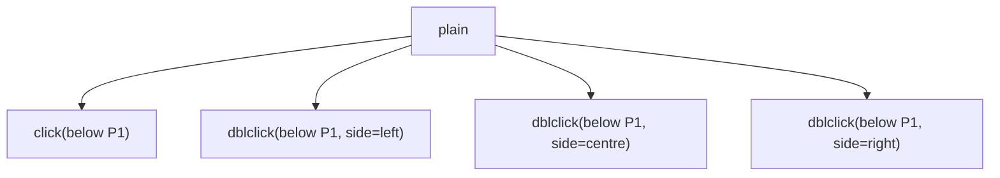

#### M-04b · Click and double-click below the last item of a list

`numbers` · Morph: **TODO**

Expected before the run: (a) the paragraphs Click and Type inserts continue the list; (b) they are Normal paragraphs;
(c) Click and Type does not act under a list.

steps before the branches `click(below P3)`

**Options.AllowClickAndTypeMouse=true**

- `click(below P3)` → `[One] #ListParagraph •1.0 1. ⇥36,-18 / [Two] #ListParagraph •1.0 2. ⇥36,-18 / [Three‸] #ListParagraph •1.0 3. ⇥36,-18` · IP 13–13 · Undo depth 1
- `dblclick(below P3, side=centre)` → `[One] #ListParagraph •1.0 1. ⇥36,-18 / [Two] #ListParagraph •1.0 2. ⇥36,-18 / [Three] #ListParagraph •1.0 3. ⇥36,-18 /  ↓0 /  ↓0 / ‸ (center) ↓0` · IP 16–16 · Undo depth 2
  - `undo` → `[One] #ListParagraph •1.0 1. ⇥36,-18 / [Two] #ListParagraph •1.0 2. ⇥36,-18 / [Three‸] #ListParagraph •1.0 3. ⇥36,-18` · IP 13–13 · Undo depth 1

**Options.AllowClickAndTypeMouse=false**

- `click(below P3)` → `[One] #ListParagraph •1.0 1. ⇥36,-18 / [Two] #ListParagraph •1.0 2. ⇥36,-18 / [Three‸] #ListParagraph •1.0 3. ⇥36,-18` · IP 13–13 · Undo depth 1
- `dblclick(below P3, side=centre)` → `[One] #ListParagraph •1.0 1. ⇥36,-18 / [Two] #ListParagraph •1.0 2. ⇥36,-18 / [Three⟦‸¶⟧] #ListParagraph •1.0 3. ⇥36,-18` · Normal 13–14 start-active · Undo depth 1
  - `undo` → `[One] #ListParagraph •1.0 1. ⇥36,-18 / [Two] #ListParagraph •1.0 2. ⇥36,-18 / [Three⟦‸¶⟧] #ListParagraph •1.0 3. ⇥36,-18` · Normal 13–14 start-active · Undo depth 1

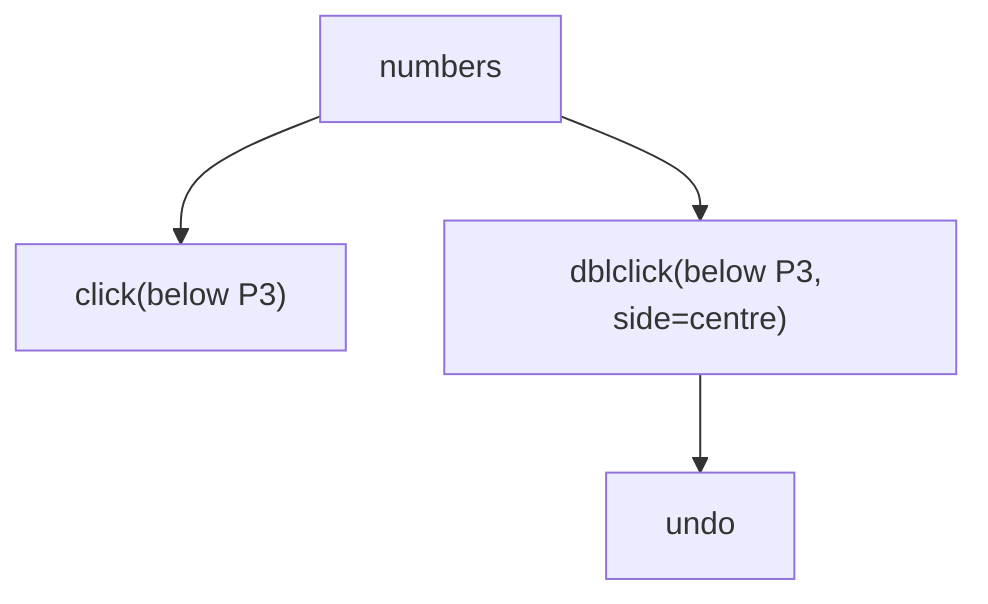

#### M-05 · Click on a paragraph mark and on an end-of-cell mark

`table-2x2` · Morph: **DONE**

Expected before the run: An IP before the mark; a click on a cell mark places the IP at the cell's end rather than
selecting the cell.

steps `click({at})`

| at | selection | observed |
| --- | --- | --- |
| P1:mark | IP 17–17 | `[Before the table.‸] ↓0<br>T1 R1 ║[One¤]║[Two¤]║¤<br>T1 R2 ║[Three¤]║[Four¤]║¤<br>[After the table.] ↓0` |
| P2:mark | IP 21–21 · Cells 1 (R1C1–R1C1) | `[Before the table.] ↓0<br>T1 R1 ║[One‸¤]║[Two¤]║¤<br>T1 R2 ║[Three¤]║[Four¤]║¤<br>[After the table.] ↓0` |
| C(1,1):mark | IP 21–21 · Cells 1 (R1C1–R1C1) | `[Before the table.] ↓0<br>T1 R1 ║[One‸¤]║[Two¤]║¤<br>T1 R2 ║[Three¤]║[Four¤]║¤<br>[After the table.] ↓0` |
| C(2,2):mark | IP 37–37 · Cells 1 (R2C2–R2C2) | `[Before the table.] ↓0<br>T1 R1 ║[One¤]║[Two¤]║¤<br>T1 R2 ║[Three¤]║[Four‸¤]║¤<br>[After the table.] ↓0` |

Notes: Formatting marks are hidden in the harness view, so this is a click at the mark's position; P2 is the
document's last paragraph.

#### M-06 · Click inside a tab's expanse and at its edges

`tabs-breaks` · Morph: **PARTIAL**

Expected before the run: The tab's expanse splits at its middle: the left part places the caret before the tab, the
right part after it; the glyphs beside it keep their own halves.

steps `click({at})`

| at | selection | observed |
| --- | --- | --- |
| P1:3, side=right | IP 4–4 | `[Left‸\tright side] ↓0<br>[Line one \nline two] ↓0<br>[Two  spaces here.] ↓0` |
| P1:4, side=left | IP 4–4 | `[Left‸\tright side] ↓0<br>[Line one \nline two] ↓0<br>[Two  spaces here.] ↓0` |
| P1:4, side=right | IP 5–5 | `[Left\t‸right side] ↓0<br>[Line one \nline two] ↓0<br>[Two  spaces here.] ↓0` |
| P1:5, side=left | IP 5–5 | `[Left\t‸right side] ↓0<br>[Line one \nline two] ↓0<br>[Two  spaces here.] ↓0` |

#### M-07 · Cell padding versus the cell's left edge

`table-2x2` · Morph: **TODO**

Expected before the run: The text-start click is an IP; the edge click selects the whole cell (Cells 1).

steps `{target}`

| target | selection | observed |
| --- | --- | --- |
| click(C(1,1):0, side=left) | IP 18–18 · Cells 1 (R1C1–R1C1) | `[Before the table.] ↓0<br>T1 R1 ║[‸One¤]║[Two¤]║¤<br>T1 R2 ║[Three¤]║[Four¤]║¤<br>[After the table.] ↓0` |
| click(cellLeftEdge C(1,1)) | Column 18–22 end-active · Cells 1 (R1C1–R1C1) | `[Before the table.] ↓0<br>T1 R1 ║[⟦One¤‸⟧]║[Two¤]║¤<br>T1 R2 ║[Three¤]║[Four¤]║¤<br>[After the table.] ↓0` |
| click(C(2,2):0, side=left) | IP 33–33 · Cells 1 (R2C2–R2C2) | `[Before the table.] ↓0<br>T1 R1 ║[One¤]║[Two¤]║¤<br>T1 R2 ║[Three¤]║[‸Four¤]║¤<br>[After the table.] ↓0` |
| click(cellLeftEdge C(2,2)) | Column 33–38 end-active · Cells 1 (R2C2–R2C2) | `[Before the table.] ↓0<br>T1 R1 ║[One¤]║[Two¤]║¤<br>T1 R2 ║[Three¤]║[⟦Four¤‸⟧]║¤<br>[After the table.] ↓0` |

Notes: The 0.5in cell margin makes the padding a wide target: a click in it is a click in the cell, a click on the
edge selects the cell.

#### M-10 · Double-click a word, by what follows it

`words` · Morph: **TODO**

Expected before the run: The word plus its trailing spaces; a word before punctuation is selected without the
punctuation; a hyphen splits gamma-delta into words.

steps `dblclick(P1:{at})`

| at | selection | observed |
| --- | --- | --- |
| 2 | Normal 0–6 end-active | `[⟦alpha ‸⟧beta,  gamma-delta 3.14 don't (eps) 1,000 10:30 end.] ↓0` |
| 7 | Normal 6–10 end-active | `[alpha ⟦beta‸⟧,  gamma-delta 3.14 don't (eps) 1,000 10:30 end.] ↓0` |
| 15 | Normal 13–18 end-active | `[alpha beta,  ⟦gamma‸⟧-delta 3.14 don't (eps) 1,000 10:30 end.] ↓0` |
| 21 | Normal 19–25 end-active | `[alpha beta,  gamma-⟦delta ‸⟧3.14 don't (eps) 1,000 10:30 end.] ↓0` |
| 38 | Normal 37–40 end-active | `[alpha beta,  gamma-delta 3.14 don't (⟦eps‸⟧) 1,000 10:30 end.] ↓0` |
| 55 | Normal 54–57 end-active | `[alpha beta,  gamma-delta 3.14 don't (eps) 1,000 10:30 ⟦end‸⟧.] ↓0` |

Notes: alpha (one space follows), beta (a comma), gamma (a hyphen), delta (a space), eps (a closing parenthesis), end
(a period then the mark).

#### M-10b · Double-click a word in each of three plain paragraphs

`three-paragraphs` · Morph: **TODO**

Expected before the run: The word and its trailing space; a last word before a period takes neither the period nor
the mark.

steps `dblclick({at})`

| at | selection | observed |
| --- | --- | --- |
| P1:2 | Normal 0–6 end-active | `[⟦First ‸⟧paragraph here.] ↓0<br>[Second ][b:bold ][one.] (center) ↓0<br>[Third and last.] ↓0` |
| P1:17 | Normal 16–20 end-active | `[First paragraph ⟦here‸⟧.] ↓0<br>[Second ][b:bold ][one.] (center) ↓0<br>[Third and last.] ↓0` |
| P2:find("bold") | Normal 29–34 end-active | `[First paragraph here.] ↓0<br>[Second ][b:⟦bold ‸⟧][one.] (center) ↓0<br>[Third and last.] ↓0` |
| P3:11 | Normal 49–53 end-active | `[First paragraph here.] ↓0<br>[Second ][b:bold ][one.] (center) ↓0<br>[Third and ⟦last‸⟧.] ↓0` |

Notes: P1:17 is 'here' before the period, P3:11 'last' before the final period of the document.

#### M-10c · Double-click a word before a tab, a line break and two spaces

`tabs-breaks` · Morph: **TODO**

Expected before the run: (a) the tab is taken as the word's trailing whitespace; (b) it is not. Both spaces after Two
are taken; the line break is not.

steps `dblclick({at})`

| at | selection | observed |
| --- | --- | --- |
| P1:2 | Normal 0–4 end-active | `[⟦Left‸⟧\tright side] ↓0<br>[Line one \nline two] ↓0<br>[Two  spaces here.] ↓0` |
| P1:7 | Normal 5–11 end-active | `[Left\t⟦right ‸⟧side] ↓0<br>[Line one \nline two] ↓0<br>[Two  spaces here.] ↓0` |
| P2:6 | Normal 21–25 end-active | `[Left\tright side] ↓0<br>[Line ⟦one ‸⟧\nline two] ↓0<br>[Two  spaces here.] ↓0` |
| P3:1 | Normal 35–40 end-active | `[Left\tright side] ↓0<br>[Line one \nline two] ↓0<br>[⟦Two  ‸⟧spaces here.] ↓0` |
| P3:7 | Normal 40–47 end-active | `[Left\tright side] ↓0<br>[Line one \nline two] ↓0<br>[Two  ⟦spaces ‸⟧here.] ↓0` |

Notes: P1:2 is Left before the tab, P1:7 right after it, P2:6 'one' before the space and line break, P3:1 Two before
two spaces, P3:7 spaces after them.

#### M-10d · Double-click the words either side of an inline picture

`image-inline` · Morph: **TODO**

Expected before the run: 'before ' stops at the picture; 'after ' starts after it; the picture is never part of a
word.

steps `dblclick({at})`

| at | selection | observed |
| --- | --- | --- |
| P1:7 | Normal 5–12 end-active | `[Text ⟦before ‸⟧▣ after end.] ↓0<br>[Second paragraph.] ↓0` |
| P1:16 | Normal 14–20 end-active | `[Text before ▣ ⟦after ‸⟧end.] ↓0<br>[Second paragraph.] ↓0` |

#### M-11 · Double-click a punctuation glyph

`words` · Morph: **TODO**

Expected before the run: The punctuation alone, with its trailing spaces where there are any; the apostrophe inside
don't selects the whole word; the hyphen is its own word.

steps `dblclick({at})`

| at | selection | observed |
| --- | --- | --- |
| P1:find(",") | Normal 10–13 end-active | `[alpha beta⟦,  ‸⟧gamma-delta 3.14 don't (eps) 1,000 10:30 end.] ↓0` |
| P1:find("-") | Normal 18–19 start-active | `[alpha beta,  gamma⟦‸-⟧delta 3.14 don't (eps) 1,000 10:30 end.] ↓0` |
| P1:find("'") | Normal 30–36 end-active | `[alpha beta,  gamma-delta 3.14 ⟦don't ‸⟧(eps) 1,000 10:30 end.] ↓0` |
| P1:find("(") | Normal 37–40 start-active | `[alpha beta,  gamma-delta 3.14 don't (⟦‸eps⟧) 1,000 10:30 end.] ↓0` |
| P1:find(")") | Normal 40–42 end-active | `[alpha beta,  gamma-delta 3.14 don't (eps⟦) ‸⟧1,000 10:30 end.] ↓0` |
| P1:57 | Normal 58–59 start-active | `[alpha beta,  gamma-delta 3.14 don't (eps) 1,000 10:30 end.⟦‸¶⟧] ↓0` |

#### M-12 · Double-click on an inter-word space

`words` · Morph: **TODO**

Expected before the run: (a) the spaces alone are selected; (b) the previous word with its spaces; (c) the next word.

steps `dblclick({at})`

| at | selection | observed |
| --- | --- | --- |
| P1:5 | Normal 0–6 end-active | `[⟦alpha ‸⟧beta,  gamma-delta 3.14 don't (eps) 1,000 10:30 end.] ↓0` |
| P1:11 | Normal 10–13 end-active | `[alpha beta⟦,  ‸⟧gamma-delta 3.14 don't (eps) 1,000 10:30 end.] ↓0` |
| P1:12 | Normal 13–18 start-active | `[alpha beta,  ⟦‸gamma⟧-delta 3.14 don't (eps) 1,000 10:30 end.] ↓0` |

#### M-13 · Double-click a number token with inner punctuation

`words` · Morph: **TODO**

Expected before the run: 3.14 and 1,000 are one word each; 10:30 (a) one word (b) splits at the colon.

steps `dblclick({at})`

| at | selection | observed |
| --- | --- | --- |
| P1:27 | Normal 27–30 start-active | `[alpha beta,  gamma-delta 3.⟦‸14 ⟧don't (eps) 1,000 10:30 end.] ↓0` |
| P1:44 | Normal 44–48 start-active | `[alpha beta,  gamma-delta 3.14 don't (eps) 1,⟦‸000 ⟧10:30 end.] ↓0` |
| P1:50 | Normal 50–51 start-active | `[alpha beta,  gamma-delta 3.14 don't (eps) 1,000 10⟦‸:⟧30 end.] ↓0` |
| P1:51 | Normal 51–54 end-active | `[alpha beta,  gamma-delta 3.14 don't (eps) 1,000 10:⟦30 ‸⟧end.] ↓0` |

Notes: P1:27 is inside 3.14, P1:44 inside 1,000, P1:50 the colon of 10:30 and P1:51 its 3.

#### M-14 · Double-click exactly at a word boundary

`words` · Morph: **TODO**

Expected before the run: The glyph under the pointer decides: the space's right half selects alpha with its space,
beta's left half selects beta.

steps `dblclick({at})`

| at | selection | observed |
| --- | --- | --- |
| P1:5, side=right | Normal 6–10 start-active | `[alpha ⟦‸beta⟧,  gamma-delta 3.14 don't (eps) 1,000 10:30 end.] ↓0` |
| P1:6, side=left | Normal 6–10 start-active | `[alpha ⟦‸beta⟧,  gamma-delta 3.14 don't (eps) 1,000 10:30 end.] ↓0` |
| P1:17, side=right | Normal 18–19 start-active | `[alpha beta,  gamma⟦‸-⟧delta 3.14 don't (eps) 1,000 10:30 end.] ↓0` |
| P1:18, side=left | Normal 18–19 start-active | `[alpha beta,  gamma⟦‸-⟧delta 3.14 don't (eps) 1,000 10:30 end.] ↓0` |

Notes: The boundary between alpha's space and beta, and between gamma and its hyphen, approached from either side.

#### M-15 · Double-click the last word of the document and its period

`three-paragraphs` · Morph: **TODO**

Expected before the run: The word excludes the period and the mark; the period alone excludes the mark; a
double-click at the mark (a) selects the mark (b) selects the period (c) leaves an IP.

steps `dblclick({at})`

| at | selection | observed |
| --- | --- | --- |
| P3:13 | Normal 49–53 end-active | `[First paragraph here.] ↓0<br>[Second bold one.] (center) ↓0<br>[Third and ⟦last‸⟧.] ↓0` |
| P3:14 | Normal 53–54 start-active | `[First paragraph here.] ↓0<br>[Second bold one.] (center) ↓0<br>[Third and last⟦‸.⟧] ↓0` |
| P3:mark | Normal 54–55 start-active | `[First paragraph here.] ↓0<br>[Second bold one.] (center) ↓0<br>[Third and last.⟦‸¶⟧] ↓0` |

#### M-15b · Double-click in an empty paragraph

`empty-paragraphs` · Morph: **TODO**

Expected before the run: (a) the paragraph mark is selected; (b) an IP is left in the empty paragraph.

steps `dblclick({at})`

| at | selection | observed |
| --- | --- | --- |
| P2:0 | Normal 6–7 start-active | `[Above] ↓0<br>⟦‸¶⟧ ↓0<br> ↓0<br>[Below] ↓0` |
| P2:mark | Normal 6–7 start-active | `[Above] ↓0<br>⟦‸¶⟧ ↓0<br> ↓0<br>[Below] ↓0` |
| P3:0 | Normal 7–8 start-active | `[Above] ↓0<br> ↓0<br>⟦‸¶⟧ ↓0<br>[Below] ↓0` |

#### M-16 · Double-click an inline picture

`image-inline` · Morph: **TODO**

Expected before the run: The picture is selected and the document and undo list are unchanged.

1. `dblclick(IMG1)`

```text
[Text before ⟦▣‸⟧ after end.] ↓0
[Second paragraph.] ↓0
```

Selection: InlineShape 12–13 end-active · InlineShapes 1 · Undo — · dblclick(IMG1) → Shape Picture 1, WordOwn

Notes: Current Word shows the Picture Format tab rather than a dialog; the record shows whether anything opened.

#### M-17 · Double-click inside a hyperlink

`hyperlink` · Morph: **TODO**

Expected before the run: (a) the word under the pointer only; (b) the whole link's display text.

steps `dblclick({at})`

| at | selection | observed |
| --- | --- | --- |
| P1:find("the") | IP 39–39 | `[See ]<[bu:‸the site]>[ today.] ↓0<br>[Second paragraph.] ↓0` |
| P1:find("site") | Normal 39–43 end-active | `[See ]<[bu:⟦the ‸⟧site]>[ today.] ↓0<br>[Second paragraph.] ↓0` |

#### M-17b · Double-click inside a field result

`field-page` · Morph: **TODO**

Expected before the run: (a) the whole field is selected as one word; (b) the word of the result under the pointer,
in the date the day or the month alone.

steps `dblclick({at})`

| at | selection | observed |
| --- | --- | --- |
| P1:find("1") | Normal 5–16 end-active | `[Page ][⟦«][ PAGE ][\|][1][»][ ‸⟧of ][«][ NUMPAGES ][\|][1][»][ end.] ↓0<br>[Date: ][«][ DATE \@ "d/MM/yyyy" ][\|][25/10/2026][»][ end.] ↓0` |
| P2:find("/20") | Normal 68–74 end-active | `[Page ][«][ PAGE ][\|][1][»][ of ][«][ NUMPAGES ][\|][1][»][ end.] ↓0<br>[Date: ][«][ DATE \@ "d/MM/yyyy" ][\|][⟦25/10/‸⟧2026][»][ end.] ↓0` |

Notes: find("/20") lands in the DATE result, past the code's own d/MM/yyyy switch.

#### M-18 · Double-click a cell's only word

`table-2x2` · Morph: **TODO**

Expected before the run: (a) the word alone, the cell mark excluded; (b) the whole cell.

steps `dblclick({at})`

| at | selection | observed |
| --- | --- | --- |
| C(1,1):1 | Normal 18–21 end-active · Cells 1 (R1C1–R1C1) | `[Before the table.] ↓0<br>T1 R1 ║[⟦One‸⟧¤]║[Two¤]║¤<br>T1 R2 ║[Three¤]║[Four¤]║¤<br>[After the table.] ↓0` |
| C(2,2):2 | Normal 33–37 end-active · Cells 1 (R2C2–R2C2) | `[Before the table.] ↓0<br>T1 R1 ║[One¤]║[Two¤]║¤<br>T1 R2 ║[Three¤]║[⟦Four‸⟧¤]║¤<br>[After the table.] ↓0` |

#### M-20 · Triple-click a paragraph

`{fixture}` · Morph: **TODO**

Expected before the run: The whole paragraph with its mark; a list number is not in Text; the document's last
paragraph is selected with its final mark.

steps `tripleclick({at})`

| fixture | at | selection | observed |
| --- | --- | --- | --- |
| three-paragraphs | P1:2 | Normal 0–22 end-active | `[⟦First paragraph here.¶‸⟧] ↓0<br>[Second bold one.] (center) ↓0<br>[Third and last.] ↓0` |
| three-paragraphs | P2:1 | Normal 22–39 end-active | `[First paragraph here.] ↓0<br>[⟦Second bold one.¶‸⟧] (center) ↓0<br>[Third and last.] ↓0` |
| numbers | P1:2 | Normal 0–4 end-active | `[⟦One¶‸⟧] #ListParagraph •1.0 1. ⇥36,-18<br>[Two] #ListParagraph •1.0 2. ⇥36,-18<br>[Three] #ListParagraph •1.0 3. ⇥36,-18` |
| numbers | P2:1 | Normal 4–8 end-active | `[One] #ListParagraph •1.0 1. ⇥36,-18<br>[⟦Two¶‸⟧] #ListParagraph •1.0 2. ⇥36,-18<br>[Three] #ListParagraph •1.0 3. ⇥36,-18` |
| kinds | P1:2 | Normal 0–13 end-active | `see below` |
| kinds | P2:1 | Normal 13–26 end-active | `see below` |
| table-2x2 | P1:2 | Normal 0–18 end-active | `[⟦Before the table.¶‸⟧] ↓0<br>T1 R1 ║[One¤]║[Two¤]║¤<br>T1 R2 ║[Three¤]║[Four¤]║¤<br>[After the table.] ↓0` |
| table-2x2 | P2:1 | Column 18–22 end-active · Cells 1 (R1C1–R1C1) | `[Before the table.] ↓0<br>T1 R1 ║[⟦One¤‸⟧]║[Two¤]║¤<br>T1 R2 ║[Three¤]║[Four¤]║¤<br>[After the table.] ↓0` |

`M-20[fixture=kinds,at=P1:2]`

```text
[⟦Normal kind.¶‸⟧] ↓0
[Heading kind] #Heading1
[Bullet kind.] #ListParagraph •1.0 ● ⇥36,-18
[Centred kind.] (center) ↓0
[Bordered kind.] ↓0
[Indented kind.] ⇥36,0 ↓0
 ↓0
[Keep with next kind.] ↓0
[Last plain kind.] ↓0
```

Selection: Normal 0–13 end-active · tripleclick(P1:2) → Range 3-3, IBeam

`M-20[fixture=kinds,at=P2:1]`

```text
[Normal kind.] ↓0
[⟦Heading kind¶‸⟧] #Heading1
[Bullet kind.] #ListParagraph •1.0 ● ⇥36,-18
[Centred kind.] (center) ↓0
[Bordered kind.] ↓0
[Indented kind.] ⇥36,0 ↓0
 ↓0
[Keep with next kind.] ↓0
[Last plain kind.] ↓0
```

Selection: Normal 13–26 end-active · tripleclick(P2:1) → Range 14-14, IBeam

Notes: kinds P2 is a heading, numbers P2 a list item, table-2x2 P2 the last paragraph of the document.

#### M-20b · Triple-click a bulleted, an empty and the last paragraph

`kinds` · Morph: **TODO**

Expected before the run: An empty paragraph's triple-click selects its mark alone; the last paragraph is selected
with the final mark.

steps `tripleclick({at})`

| at | selection | observed |
| --- | --- | --- |
| P3:2 | Normal 26–39 end-active | `see below` |
| P7:0 | Normal 83–84 end-active | `see below` |
| P9:4 | Normal 105–122 end-active | `see below` |

`M-20b[at=P3:2]`

```text
[Normal kind.] ↓0
[Heading kind] #Heading1
[⟦Bullet kind.¶‸⟧] #ListParagraph •1.0 ● ⇥36,-18
[Centred kind.] (center) ↓0
[Bordered kind.] ↓0
[Indented kind.] ⇥36,0 ↓0
 ↓0
[Keep with next kind.] ↓0
[Last plain kind.] ↓0
```

Selection: Normal 26–39 end-active · tripleclick(P3:2) → Range 28-28, IBeam

`M-20b[at=P7:0]`

```text
[Normal kind.] ↓0
[Heading kind] #Heading1
[Bullet kind.] #ListParagraph •1.0 ● ⇥36,-18
[Centred kind.] (center) ↓0
[Bordered kind.] ↓0
[Indented kind.] ⇥36,0 ↓0
⟦¶‸⟧ ↓0
[Keep with next kind.] ↓0
[Last plain kind.] ↓0
```

Selection: Normal 83–84 end-active · tripleclick(P7:0) → Range 84-84, IBeam

`M-20b[at=P9:4]`

```text
[Normal kind.] ↓0
[Heading kind] #Heading1
[Bullet kind.] #ListParagraph •1.0 ● ⇥36,-18
[Centred kind.] (center) ↓0
[Bordered kind.] ↓0
[Indented kind.] ⇥36,0 ↓0
 ↓0
[Keep with next kind.] ↓0
[⟦Last plain kind.¶‸⟧] ↓0
```

Selection: Normal 105–122 end-active · tripleclick(P9:4) → Range 110-110, IBeam

#### M-21 · Triple-click in a cell

`{fixture}` · Morph: **TODO**

Expected before the run: (a) the clicked paragraph; (b) the whole cell; (c) in a two-paragraph cell only the clicked
paragraph, in a one-paragraph cell the cell.

steps `tripleclick({at})`

| fixture | at | selection | observed |
| --- | --- | --- | --- |
| table-2x2 | C(1,1):1 | Column 18–22 end-active · Cells 1 (R1C1–R1C1) | `[Before the table.] ↓0<br>T1 R1 ║[⟦One¤‸⟧]║[Two¤]║¤<br>T1 R2 ║[Three¤]║[Four¤]║¤<br>[After the table.] ↓0` |
| table-2x2 | C(2,2):1 | Column 33–38 end-active · Cells 1 (R2C2–R2C2) | `[Before the table.] ↓0<br>T1 R1 ║[One¤]║[Two¤]║¤<br>T1 R2 ║[Three¤]║[⟦Four¤‸⟧]║¤<br>[After the table.] ↓0` |
| table-multi | C(1,1):1 | Normal 18–24 end-active · Cells 1 (R1C1–R1C1) | `[Before the table.] ↓0<br>T1 R1 ║[⟦first¶‸⟧] ¶ [second¤]║[b1¤]║¤<br>T1 R2 ║[a2¤]║[item one] #ListParagraph •1.0 ● ⇥36,-18 ¶ [item two¤] #ListParagraph •1.0 ● ⇥36,-18║¤<br>[After the table.] ↓0` |
| table-multi | C(2,2):1 | Normal 38–47 end-active · Cells 1 (R2C2–R2C2) | `[Before the table.] ↓0<br>T1 R1 ║[first] ¶ [second¤]║[b1¤]║¤<br>T1 R2 ║[a2¤]║[⟦item one¶‸⟧] #ListParagraph •1.0 ● ⇥36,-18 ¶ [item two¤] #ListParagraph •1.0 ● ⇥36,-18║¤<br>[After the table.] ↓0` |

Notes: table-multi's (1,1) holds two paragraphs and its (2,2) a two-item bullet list.

#### M-21b · Triple-click the second paragraph of a cell

`table-multi` · Morph: **TODO**

Expected before the run: The second paragraph alone, its end being the cell mark, which is (a) included (b) excluded.

steps `tripleclick({at})`

| at | selection | observed |
| --- | --- | --- |
| C(1,1):7 | Column 18–31 end-active · Cells 1 (R1C1–R1C1) | `[Before the table.] ↓0<br>T1 R1 ║[⟦first¶⟧] ¶ ⟦[second¤‸⟧]║[b1¤]║¤<br>T1 R2 ║[a2¤]║[item one] #ListParagraph •1.0 ● ⇥36,-18 ¶ [item two¤] #ListParagraph •1.0 ● ⇥36,-18║¤<br>[After the table.] ↓0` |
| C(2,2):10 | Column 38–56 end-active · Cells 1 (R2C2–R2C2) | `[Before the table.] ↓0<br>T1 R1 ║[first] ¶ [second¤]║[b1¤]║¤<br>T1 R2 ║[a2¤]║[⟦item one¶⟧] #ListParagraph •1.0 ● ⇥36,-18 ¶ ⟦[item two¤‸⟧] #ListParagraph •1.0 ● ⇥36,-18║¤<br>[After the table.] ↓0` |

#### M-22 · Triple-click in a text box

`text-box` · Morph: **TODO**

Expected before the run: The first paragraph of the text box story, not the box itself.

1. `tripleclick(TB1:P1:2)`

```text
[⚓1First paragraph of text here.] ↓0
[Second paragraph of text here.] ↓0
[Third paragraph of text here.] ↓0
SHP1 ⌖P1 textbox 160x80pt square @228,0
TB: [⟦Box line one¶‸⟧] ↓0
TB: [Box line two] ↓0
```

Selection: Normal 0–13 end-active · Story TextFrame · tripleclick(TB1:P1:2) → Range 2-2, IBeam

#### M-22b · Triple-click in a footnote

`footnote` · Morph: **TODO**

Expected before the run: The note's paragraph, with its reference mark (a) included (b) excluded.

1. `seek(footnotes)`
2. `tripleclick(FN1:P1:2)`

```text
[Text†1 more words.] ↓0
[Second with an end note.‡1] ↓0
FN: [⟦† Note text.¶‸⟧] #FootnoteText
```

Selection: Normal 0–13 end-active · Story Footnotes · tripleclick(FN1:P1:2) → Range 3-3, IBeam

#### M-22c · Triple-click in a header

`header-footer` · Morph: **TODO**

Expected before the run: The header paragraph with its mark; the body is untouched.

1. `seek(header)`
2. `tripleclick(HDR:P1:2)`

```text
[Body paragraph.] ↓0
[Second body paragraph.] ↓0
HDR: [⟦Header text¶‸⟧] #Header
```

Selection: Normal 0–12 end-active · Story PrimaryHeader · tripleclick(HDR:P1:2) → Range 3-3, IBeam

#### M-24 · Ctrl+click selects a sentence

`sentences` · Morph: **TODO**

Expected before the run: The sentence with its trailing space; a question mark terminates; e.g. (a) ends a sentence
(b) is skipped as an abbreviation; the last sentence of a paragraph takes no mark.

steps `ctrl+click({at})`

| at | selection | observed |
| --- | --- | --- |
| P1:find("first") | Normal 0–14 end-active | `[⟦One is first. ‸⟧Two is next? Three uses e.g. four here. Five ends it.] ↓0<br>[Second line starts. It ends here.] ↓0` |
| P1:find("Two") | Normal 14–27 start-active | `[One is first. ⟦‸Two is next? ⟧Three uses e.g. four here. Five ends it.] ↓0<br>[Second line starts. It ends here.] ↓0` |
| P1:find("Three") | Normal 27–43 start-active | `[One is first. Two is next? ⟦‸Three uses e.g. ⟧four here. Five ends it.] ↓0<br>[Second line starts. It ends here.] ↓0` |
| P1:find("four") | Normal 43–54 end-active | `[One is first. Two is next? Three uses e.g. ⟦four here. ‸⟧Five ends it.] ↓0<br>[Second line starts. It ends here.] ↓0` |
| P1:find("Five") | Normal 54–67 start-active | `[One is first. Two is next? Three uses e.g. four here. ⟦‸Five ends it.⟧] ↓0<br>[Second line starts. It ends here.] ↓0` |
| P2:find("ends") | Normal 88–101 end-active | `[One is first. Two is next? Three uses e.g. four here. Five ends it.] ↓0<br>[Second line starts. ⟦It ends here.‸⟧] ↓0` |

Notes: Terminators: a period, a question mark, the e.g. abbreviation, a period before the paragraph mark.

#### M-25 · Ctrl+click with an existing selection

`sentences` · Morph: **TODO**

Expected before the run: (a) the sentence replaces the word; (b) a second range is added (a multi-range selection);
(c) the selection extends to cover both.

steps before the branches `dblclick(P1:find("One"))` · `ctrl+click(P1:find("Two"))`

- `ctrl+click(P1:find("Two"))` → `[⟦One ‸⟧is first. Two is next? Three uses e.g. four here. Five ends it.] ↓0 / [Second line starts. It ends here.] ↓0` · Normal 0–4 end-active
- `ctrl+click(P1:find("Five"))` → `[⟦One ‸⟧is first. Two is next? Three uses e.g. four here. Five ends it.] ↓0 / [Second line starts. It ends here.] ↓0` · Normal 0–4 end-active

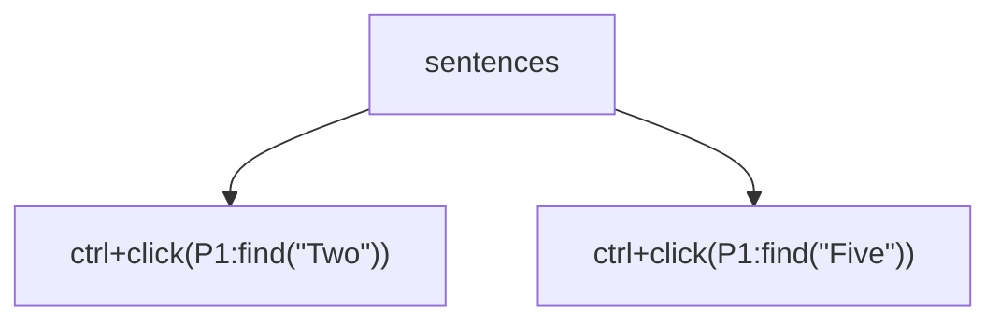

#### M-26 · Click on a hyperlink, with Ctrl+click set to open and not

`hyperlink` · Morph: **TODO**

Expected before the run: With the option on an IP is placed in the link text; with it off the link is followed and
the selection stays where it was.

steps `click({at})`

| at | options | selection | observed |
| --- | --- | --- | --- |
| P1:find("See") | CtrlClickHyperlinkToOpen=true | IP 1–1 | `[S‸ee ]<[bu:the site]>[ today.] ↓0<br>[Second paragraph.] ↓0` |
| P1:find("See") | CtrlClickHyperlinkToOpen=false | IP 1–1 | `[S‸ee ]<[bu:the site]>[ today.] ↓0<br>[Second paragraph.] ↓0` |
| P1:find("site") | CtrlClickHyperlinkToOpen=true | IP 43–43 | `[See ]<[bu:the ‸site]>[ today.] ↓0<br>[Second paragraph.] ↓0` |
| P1:find("site") | CtrlClickHyperlinkToOpen=false | IP 43–43 | `[See ]<[bu:the ‸site]>[ today.] ↓0<br>[Second paragraph.] ↓0` |

Notes: With the option off a plain click on the link follows it and a browser may open; Ctrl+click is not sent for
the same reason. The See click is the control off the link.

#### M-27 · Shift+click extends from the anchor, within and across paragraphs

`three-paragraphs` · Morph: **TODO**

Expected before the run: The anchor at P2:5 stays through every Shift+click; a selection crossing a paragraph
includes its mark; no word snapping on a Shift+click.

**AutoWordSelection true**

1. `click(P2:5)`
2. `shift+click(P2:12)`
3. `shift+click(P1:3)`
4. `shift+click(P3:4)`

| step | selection | where |
| --- | --- | --- |
| `click(P2:5)` | IP 28–28 | `[Second‸ bold one.]` |
| `shift+click(P2:12)` | Normal 22–35 end-active | `[⟦Second bold o‸⟧ne.]` |
| `shift+click(P1:3)` | Normal 0–29 start-active | `[⟦‸First paragraph here.¶⟧] …` |
| `shift+click(P3:4)` | Normal 22–45 end-active | `[Third and last.] …` |

```text
[First paragraph here.] ↓0
[⟦Second bold one.¶⟧] (center) ↓0
⟦[Third ‸⟧and last.] ↓0
```

Selection: Normal 22–45 end-active · click(P2:5) → Range 28-28, IBeam · shift+click(P2:12) → Range 35-35, IBeam · shift+click(P1:3) → Range 4-4, IBeam · shift+click(P3:4) → Range 44-44, IBeam

**AutoWordSelection false**

1. `click(P2:5)`
2. `shift+click(P2:12)`
3. `shift+click(P1:3)`
4. `shift+click(P3:4)`

| step | selection | where |
| --- | --- | --- |
| `click(P2:5)` | IP 28–28 | `[Second‸ bold one.]` |
| `shift+click(P2:12)` | Normal 28–35 end-active | `[Second⟦ bold o‸⟧ne.]` |
| `shift+click(P1:3)` | Normal 4–28 start-active | `[Firs⟦‸t paragraph here.¶⟧] …` |
| `shift+click(P3:4)` | Normal 28–43 end-active | `[Third and last.] …` |

```text
[First paragraph here.] ↓0
[Second⟦ bold one.¶⟧] (center) ↓0
⟦[Thir‸⟧d and last.] ↓0
```

Selection: Normal 28–43 end-active · click(P2:5) → Range 28-28, IBeam · shift+click(P2:12) → Range 35-35, IBeam · shift+click(P1:3) → Range 4-4, IBeam · shift+click(P3:4) → Range 44-44, IBeam

#### M-28 · Shift+click after a double-click

`words` · Morph: **TODO**

Expected before the run: (a) the extension snaps to the end of 3.14 while automatic word selection is on; (b) it
extends by character; leftward the anchor is beta's end and the start snaps to alpha's start or not.

steps before the branches `dblclick(P1:find("beta"))` · `shift+click(P1:27)`

**Options.AutoWordSelection=true**

- `shift+click(P1:27)` → `[alpha ⟦beta,  gamma-delta 3.‸⟧14 don't (eps) 1,000 10:30 end.] ↓0` · Normal 6–27 end-active
- `shift+click(P1:2)` → `[⟦‸alpha beta⟧,  gamma-delta 3.14 don't (eps) 1,000 10:30 end.] ↓0` · Normal 0–10 start-active

**Options.AutoWordSelection=false**

- `shift+click(P1:27)` → `[alpha ⟦beta,  gamma-delta 3.‸⟧14 don't (eps) 1,000 10:30 end.] ↓0` · Normal 6–27 end-active
- `shift+click(P1:2)` → `[al⟦‸pha ⟧beta,  gamma-delta 3.14 don't (eps) 1,000 10:30 end.] ↓0` · Normal 2–6 start-active

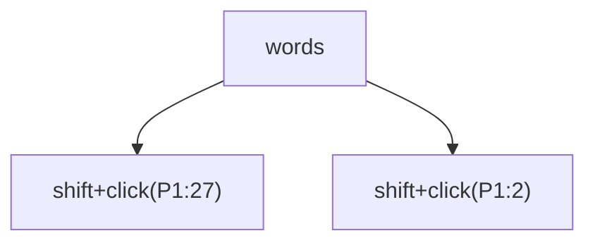

Notes: P1:27 is inside 3.14, P1:2 inside alpha.

#### M-29 · Shift+click from the body into a table

`table-3x3` · Morph: **TODO**

Expected before the run: (a) whole rows 1 and 2 (from P2: rows 2 and 3) join the text; (b) the cells up to (2,2); (c)
a plain text run ending inside b2.

steps `click({from})` · `shift+click(C(2,2):1)`

| from | selection | observed |
| --- | --- | --- |
| P1:2 | Normal 0–38 end-active | `[⟦Before the table.¶⟧] ↓0<br>T1 R1 ║⟦[a1¤⟧]║⟦[b1¤⟧]║⟦[c1¤⟧]║¤<br>T1 R2 ║⟦[a2¤⟧]║⟦[b2¤⟧]║⟦[c2¤⟧]║¤‸⟧<br>T1 R3 ║[a3¤]║[b3¤]║[c3¤]║¤<br>[After the table.] ↓0` |
| P2:3 | Column 21–34 end-active · Cells 2 (R1C2–R2C2) | `[Before the table.] ↓0<br>T1 R1 ║[a1¤]║[⟦b1¤⟧]║⟦[c1¤⟧]║¤<br>T1 R2 ║⟦[a2¤⟧]║⟦[b2¤‸⟧]║[c2¤]║¤<br>T1 R3 ║[a3¤]║[b3¤]║[c3¤]║¤<br>[After the table.] ↓0` |

#### M-30 · Shift+click from a cell into the body

`table-3x3` · Morph: **TODO**

Expected before the run: (a) the rows from the anchor's row to the table edge plus the text; (b) the anchor cell's
text run to the click.

steps `click(C(2,2):1)` · `shift+click({to})`

| to | selection | observed |
| --- | --- | --- |
| P2:3 | Column 21–34 end-active · Cells 2 (R1C2–R2C2) | `[Before the table.] ↓0<br>T1 R1 ║[a1¤]║[⟦b1¤⟧]║⟦[c1¤⟧]║¤<br>T1 R2 ║⟦[a2¤⟧]║⟦[b2¤‸⟧]║[c2¤]║¤<br>T1 R3 ║[a3¤]║[b3¤]║[c3¤]║¤<br>[After the table.] ↓0` |
| P1:2 | Normal 31–33 start-active · Cells 1 (R2C2–R2C2) | `[Before the table.] ↓0<br>T1 R1 ║[a1¤]║[b1¤]║[c1¤]║¤<br>T1 R2 ║[a2¤]║[⟦‸b2⟧¤]║[c2¤]║¤<br>T1 R3 ║[a3¤]║[b3¤]║[c3¤]║¤<br>[After the table.] ↓0` |

#### M-31 · Shift+click from cell to cell: same row, same column, diagonal, same cell

`table-3x3` · Morph: **TODO**

Expected before the run: Across cells the selection is the rectangle of cells spanned (Cells); inside one cell it is
a text run.

steps `click(C(1,1):1)` · `shift+click({to})`

| to | selection | observed |
| --- | --- | --- |
| C(1,3):1 | Column 18–27 end-active · Cells 3 (R1C1–R1C3) | `[Before the table.] ↓0<br>T1 R1 ║[⟦a1¤⟧]║⟦[b1¤⟧]║⟦[c1¤‸⟧]║¤<br>T1 R2 ║[a2¤]║[b2¤]║[c2¤]║¤<br>T1 R3 ║[a3¤]║[b3¤]║[c3¤]║¤<br>[After the table.] ↓0` |
| C(3,1):1 | Column 18–41 end-active · Cells 3 (R1C1–R3C1) | `[Before the table.] ↓0<br>T1 R1 ║[⟦a1¤⟧]║⟦[b1¤⟧]║⟦[c1¤⟧]║¤<br>T1 R2 ║⟦[a2¤⟧]║⟦[b2¤⟧]║⟦[c2¤⟧]║¤<br>T1 R3 ║⟦[a3¤‸⟧]║[b3¤]║[c3¤]║¤<br>[After the table.] ↓0` |
| C(3,3):1 | Column 18–47 end-active · Cells 9 (R1C1–R3C3) | `[Before the table.] ↓0<br>T1 R1 ║[⟦a1¤⟧]║⟦[b1¤⟧]║⟦[c1¤⟧]║¤<br>T1 R2 ║⟦[a2¤⟧]║⟦[b2¤⟧]║⟦[c2¤⟧]║¤<br>T1 R3 ║⟦[a3¤⟧]║⟦[b3¤⟧]║⟦[c3¤‸⟧]║¤<br>[After the table.] ↓0` |
| C(1,1):end | Normal 19–20 end-active · Cells 1 (R1C1–R1C1) | `[Before the table.] ↓0<br>T1 R1 ║[a⟦1‸⟧¤]║[b1¤]║[c1¤]║¤<br>T1 R2 ║[a2¤]║[b2¤]║[c2¤]║¤<br>T1 R3 ║[a3¤]║[b3¤]║[c3¤]║¤<br>[After the table.] ↓0` |

#### M-31b · Shift+click across merged cells

`table-merged` · Morph: **TODO**

Expected before the run: (a) the rectangle grows to hold every merged cell whole; (b) merged cells are counted by
their top-left position only.

steps `{first}` · `shift+click(C(2,3):1)`

| first | selection | observed |
| --- | --- | --- |
| click(C(1,1):1) | Column 18–40 end-active · Cells 5 (R1C1–R2C3) | `[Before the table.] ↓0<br>T1 R1 ║[⟦a1¶⟧] ¶ ⟦[b1¤⟧]║⟦[c1¤⟧]║¤<br>T1 R2 ║⟦[a2¤⟧]║⟦[b2¤⟧]║⟦[c2¶⟧] ¶ ⟦[c3¤‸⟧]║¤<br>T1 R3 ║[a3¤]║[b3¤]║¤<br>[After the table.] ↓0` |
| click(C(3,2):1) | Column 31–48 end-active · Cells 3 (R2C2–R3C3) | `[Before the table.] ↓0<br>T1 R1 ║[a1] ¶ [b1¤]║[c1¤]║¤<br>T1 R2 ║[a2¤]║[⟦b2¤⟧]║⟦[c2¶⟧] ¶ ⟦[c3¤⟧]║¤<br>T1 R3 ║⟦[a3¤⟧]║⟦[b3¤⟧]║¤‸⟧<br>[After the table.] ↓0` |
| click(C(1,2):1) | Column 24–40 end-active · Cells 2 (R1C2–R2C3) | `[Before the table.] ↓0<br>T1 R1 ║[a1] ¶ [b1¤]║[⟦c1¤⟧]║¤<br>T1 R2 ║⟦[a2¤⟧]║⟦[b2¤⟧]║⟦[c2¶⟧] ¶ ⟦[c3¤‸⟧]║¤<br>T1 R3 ║[a3¤]║[b3¤]║¤<br>[After the table.] ↓0` |

Notes: (1,1) spans two columns and (2,3) two rows; (3,2) is the cell left of the vertical merge's lower half.

#### M-32 · Shift+click between a text box and the body

`text-box` · Morph: **TODO**

Expected before the run: A Shift+click into another story (a) is refused and the selection stays; (b) places a new IP
there; (c) selects the box.

steps `{first}` · `{second}`

| first | second | selection | observed |
| --- | --- | --- | --- |
| click(TB1:P1:2) | shift+click(P2:2) | IP 2–2 · Story TextFrame | `[⚓1First paragraph of text here.] ↓0<br>[Second paragraph of text here.] ↓0<br>[Third paragraph of text here.] ↓0<br>SHP1 ⌖P1 textbox 160x80pt square @228,0<br>TB: [Bo‸x line one] ↓0<br>TB: [Box line two] ↓0` |
| click(TB1:P1:2) | shift+click(TB1:P1:2) | IP 2–2 · Story TextFrame | `[⚓1First paragraph of text here.] ↓0<br>[Second paragraph of text here.] ↓0<br>[Third paragraph of text here.] ↓0<br>SHP1 ⌖P1 textbox 160x80pt square @228,0<br>TB: [Bo‸x line one] ↓0<br>TB: [Box line two] ↓0` |
| click(P2:2) | shift+click(P2:2) | IP 34–34 | `[⚓1First paragraph of text here.] ↓0<br>[Sec‸ond paragraph of text here.] ↓0<br>[Third paragraph of text here.] ↓0<br>SHP1 ⌖P1 textbox 160x80pt square @228,0` |
| click(P2:2) | shift+click(TB1:P1:2) | Shape 0–26 end-active · Story TextFrame · Shapes 1 | `see below` |

`M-32[first=click(P2:2),second=shift+click(TB1:P1:2)]`

```text
[⚓1First paragraph of text here.] ↓0
[Second paragraph of text here.] ↓0
[Third paragraph of text here.] ↓0
SHP1 ⌖P1 textbox 160x80pt square @228,0 ⟦selected⟧
TB: [⟦Box line one¶⟧] ↓0
TB: ⟦[Box line two¶‸⟧] ↓0
```

Selection: Shape 0–26 end-active · Story TextFrame · Shapes 1 · click(P2:2) → Range 34-34, IBeam · shift+click(TB1:P1:2) → Range 2-2, IBeam

#### M-33 · Alt+drag block selection, then typing, Delete and copy

`long-paragraph` · Morph: **TODO**

Expected before the run: Type Block; typing (a) replaces each line's segment with the character (b) replaces only the
first and deletes the rest; Delete removes every segment; the paste puts one segment per paragraph.

steps before the branches `alt+drag(P2:2→{to})`

**to=P2:110**

- `alt+drag(P2:2→P2:110)` → `[Short first.] ↓0 / [A ⟦long second paragraph that runs on past the right margin so that it wraps to a second and then a third line ‸⟧of text on the page, giving Up and Down keys lines to move between before it finally ends here.] ↓0 / [Short third.] ↓0` · Block 15–123 end-active · Undo —
- `type("x")` → `[Short first.] ↓0 / [A ⟦long second paragraph that runs on past the right margin so that it wraps to a second and then a third line ‸⟧of text on the page, giving Up and Down keys lines to move between before it finally ends here.] ↓0 / [Short third.] ↓0` · Block 15–123 end-active · Undo —
- `Delete` → `[Short first.] ↓0 / [A ‸aph that runs on past the right margin so that it wraps to a second aof text on the page, giving Up and Down keys lines to move between before it finally ends here.] ↓0 / [Short third.] ↓0` · IP 15–15 · Undo depth 1
- `Ctrl+C · click(P3:0) · Ctrl+V` → `[Short first.] ↓0 / [A long second paragraph that runs on past the right margin so that it wraps to a second and then a third line of text on the page, giving Up and Down keys lines to move between before it finally ends here.] ↓0 / [S‸long second paragrhort third.] ↓0 / [nd then a third line ] ↓0` · IP 220–220 · Undo depth 1

**to=P2:110 · Track Changes on**

- `alt+drag(P2:2→P2:110)` → `[Short first.] ↓0 / [A ⟦long second paragraph that runs on past the right margin so that it wraps to a second and then a third line ‸⟧of text on the page, giving Up and Down keys lines to move between before it finally ends here.] ↓0 / [Short third.] ↓0` · Block 15–123 end-active · Tracking · Revisions 0 · Undo —
- `type("x")` → `[Short first.] ↓0 / [A ⟦long second paragraph that runs on past the right margin so that it wraps to a second and then a third line ‸⟧of text on the page, giving Up and Down keys lines to move between before it finally ends here.] ↓0 / [Short third.] ↓0` · Block 15–123 end-active · Tracking · Revisions 0 · Undo —
- `Delete` → `[Short first.] ↓0 / [A ]{-[‸long second paragr]-}[aph that runs on past the right margin so that it wraps to a second a]{-[nd then a third line ]-}[of text on the page, giving Up and Down keys lines to move between before it finally ends here.] ↓0 / [Short third.] ↓0` · IP 15–15 · Tracking · Revisions 2 · Undo depth 1
- `Ctrl+C · click(P3:0) · Ctrl+V` → `[Short first.] ↓0 / [A long second paragraph that runs on past the right margin so that it wraps to a second and then a third line of text on the page, giving Up and Down keys lines to move between before it finally ends here.] ↓0 / [S]{+[‸long second paragr]+}[hort third.] ↓0 / {+[nd then a third line ]+} ↓0` · IP 220–220 · Tracking · Revisions 2 · Undo depth 1

**to=P2:195**

- `alt+drag(P2:2→P2:195)` → `[Short first.] ↓0 / [A ⟦long second paragraph that runs on past the right margin so that it wraps to a second and then a third line of text on the page, giving Up and Down keys lines to move between before it finally ‸⟧ends here.] ↓0 / [Short third.] ↓0` · Block 15–208 end-active · Undo —
- `type("x")` → `[Short first.] ↓0 / [A ⟦long second paragraph that runs on past the right margin so that it wraps to a second and then a third line of text on the page, giving Up and Down keys lines to move between before it finally ‸⟧ends here.] ↓0 / [Short third.] ↓0` · Block 15–208 end-active · Undo —
- `Delete` → `[Short first.] ↓0 / [A ‸aragraph that runs on past the right margin so that it wraps to a second a line of text on the page, giving Up and Down keys lines to move between bends here.] ↓0 / [Short third.] ↓0` · IP 15–15 · Undo depth 1
- `Ctrl+C · click(P3:0) · Ctrl+V` → `[Short first.] ↓0 / [A long second paragraph that runs on past the right margin so that it wraps to a second and then a third line of text on the page, giving Up and Down keys lines to move between before it finally ends here.] ↓0 / [S‸long second phort third.] ↓0 / [nd then a third] ↓0 / [efore it finally ] ↓0` · IP 220–220 · Undo depth 1

**to=P2:195 · Track Changes on**

- `alt+drag(P2:2→P2:195)` → `[Short first.] ↓0 / [A ⟦long second paragraph that runs on past the right margin so that it wraps to a second and then a third line of text on the page, giving Up and Down keys lines to move between before it finally ‸⟧ends here.] ↓0 / [Short third.] ↓0` · Block 15–208 end-active · Tracking · Revisions 0 · Undo —
- `type("x")` → `[Short first.] ↓0 / [A ⟦long second paragraph that runs on past the right margin so that it wraps to a second and then a third line of text on the page, giving Up and Down keys lines to move between before it finally ‸⟧ends here.] ↓0 / [Short third.] ↓0` · Block 15–208 end-active · Tracking · Revisions 0 · Undo —
- `Delete` → `[Short first.] ↓0 / [A ]{-[‸long second p]-}[aragraph that runs on past the right margin so that it wraps to a second a]{-[nd then a third]-}[ line of text on the page, giving Up and Down keys lines to move between b]{-[efore it finally ]-}[ends here.] ↓0 / [Short third.] ↓0` · IP 15–15 · Tracking · Revisions 3 · Undo depth 1
- `Ctrl+C · click(P3:0) · Ctrl+V` → `[Short first.] ↓0 / [A long second paragraph that runs on past the right margin so that it wraps to a second and then a third line of text on the page, giving Up and Down keys lines to move between before it finally ends here.] ↓0 / [S]{+[‸long second p]+}[hort third.] ↓0 / {+[nd then a third] ↓0 / [efore it finally ]+} ↓0` · IP 220–220 · Tracking · Revisions 2 · Undo depth 1

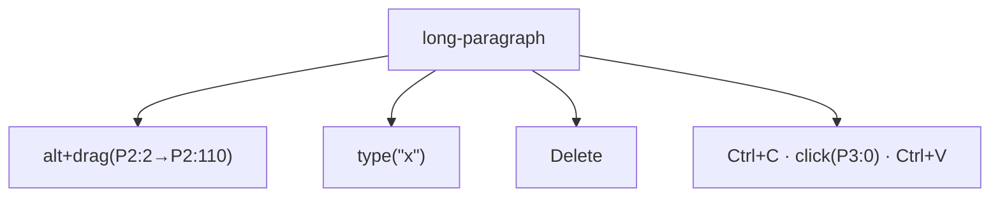

Notes: P2 wraps to three lines at the default size; P2:110 is on its second line and P2:195 on its third, so the
block spans two or three lines.

#### M-34 · A drag selection snaps to words

`words` · Morph: **TODO**

Expected before the run: With automatic word selection a drag that leaves its first word snaps both ends to word
boundaries and takes the trailing space; within one word it stays by character; off, every drag is by character.

steps `drag({path})`

| path | options | selection | observed |
| --- | --- | --- | --- |
| P1:7→P1:8 | AutoWordSelection=true | Normal 7–8 end-active | `[alpha b⟦e‸⟧ta,  gamma-delta 3.14 don't (eps) 1,000 10:30 end.] ↓0` |
| P1:7→P1:8 | AutoWordSelection=false | Normal 7–8 end-active | `[alpha b⟦e‸⟧ta,  gamma-delta 3.14 don't (eps) 1,000 10:30 end.] ↓0` |
| P1:7→P1:15 | AutoWordSelection=true | Normal 6–18 end-active | `[alpha ⟦beta,  gamma‸⟧-delta 3.14 don't (eps) 1,000 10:30 end.] ↓0` |
| P1:7→P1:15 | AutoWordSelection=false | Normal 7–15 end-active | `[alpha b⟦eta,  ga‸⟧mma-delta 3.14 don't (eps) 1,000 10:30 end.] ↓0` |
| P1:15→P1:7 | AutoWordSelection=true | Normal 6–18 start-active | `[alpha ⟦‸beta,  gamma⟧-delta 3.14 don't (eps) 1,000 10:30 end.] ↓0` |
| P1:15→P1:7 | AutoWordSelection=false | Normal 7–15 start-active | `[alpha b⟦‸eta,  ga⟧mma-delta 3.14 don't (eps) 1,000 10:30 end.] ↓0` |
| P1:2→P1:21 | AutoWordSelection=true | Normal 0–25 end-active | `[⟦alpha beta,  gamma-delta ‸⟧3.14 don't (eps) 1,000 10:30 end.] ↓0` |
| P1:2→P1:21 | AutoWordSelection=false | Normal 2–21 end-active | `[al⟦pha beta,  gamma-de‸⟧lta 3.14 don't (eps) 1,000 10:30 end.] ↓0` |

Notes: Within beta; from beta into gamma; the same leftwards; from alpha to delta.

#### M-35 · A drag across a paragraph boundary and to a paragraph's end

`three-paragraphs` · Morph: **PARTIAL**

Expected before the run: A drag crossing a mark includes it; a drag from a paragraph's start to its end (a) takes the
mark with smart paragraph selection (b) stops before it.

steps `drag({path})`

| path | options | selection | observed |
| --- | --- | --- | --- |
| P1:3→P2:4 | SmartParaSelection=true | Normal 0–29 end-active | `[⟦First paragraph here.¶⟧] ↓0<br>⟦[Second ‸⟧bold one.] (center) ↓0<br>[Third and last.] ↓0` |
| P1:3→P2:4 | SmartParaSelection=false | Normal 0–29 end-active | `[⟦First paragraph here.¶⟧] ↓0<br>⟦[Second ‸⟧bold one.] (center) ↓0<br>[Third and last.] ↓0` |
| P1:0→P1:end | SmartParaSelection=true | Normal 0–22 end-active | `[⟦First paragraph here.¶‸⟧] ↓0<br>[Second bold one.] (center) ↓0<br>[Third and last.] ↓0` |
| P1:0→P1:end | SmartParaSelection=false | Normal 0–21 end-active | `[⟦First paragraph here.‸⟧] ↓0<br>[Second bold one.] (center) ↓0<br>[Third and last.] ↓0` |
| P2:4→P1:3 | SmartParaSelection=true | Normal 0–29 start-active | `[⟦‸First paragraph here.¶⟧] ↓0<br>⟦[Second ⟧bold one.] (center) ↓0<br>[Third and last.] ↓0` |
| P2:4→P1:3 | SmartParaSelection=false | Normal 0–29 start-active | `[⟦‸First paragraph here.¶⟧] ↓0<br>⟦[Second ⟧bold one.] (center) ↓0<br>[Third and last.] ↓0` |
| P1:3→P3:end | SmartParaSelection=true | Normal 0–54 end-active | `[⟦First paragraph here.¶⟧] ↓0<br>⟦[Second bold one.¶⟧] (center) ↓0<br>⟦[Third and last.‸⟧] ↓0` |
| P1:3→P3:end | SmartParaSelection=false | Normal 0–54 end-active | `[⟦First paragraph here.¶⟧] ↓0<br>⟦[Second bold one.¶⟧] (center) ↓0<br>⟦[Third and last.‸⟧] ↓0` |

#### M-36 · A drag into, within and out of a table

`table-3x3` · Morph: **TODO**

Expected before the run: Into the table: whole rows; cell to cell: the rectangle of cells; inside a cell: text; out
of the table: the rows to the table's end plus the paragraph.

steps `drag({path})`

| path | selection | observed |
| --- | --- | --- |
| P1:2→C(2,2):1 | Normal 0–38 end-active | `[⟦Before the table.¶⟧] ↓0<br>T1 R1 ║⟦[a1¤⟧]║⟦[b1¤⟧]║⟦[c1¤⟧]║¤<br>T1 R2 ║⟦[a2¤⟧]║⟦[b2¤⟧]║⟦[c2¤⟧]║¤‸⟧<br>T1 R3 ║[a3¤]║[b3¤]║[c3¤]║¤<br>[After the table.] ↓0` |
| C(1,1):1→C(2,2):1 | Column 18–34 end-active · Cells 4 (R1C1–R2C2) | `[Before the table.] ↓0<br>T1 R1 ║[⟦a1¤⟧]║⟦[b1¤⟧]║⟦[c1¤⟧]║¤<br>T1 R2 ║⟦[a2¤⟧]║⟦[b2¤‸⟧]║[c2¤]║¤<br>T1 R3 ║[a3¤]║[b3¤]║[c3¤]║¤<br>[After the table.] ↓0` |
| C(1,1):0→C(1,1):end | Normal 19–20 end-active · Cells 1 (R1C1–R1C1) | `[Before the table.] ↓0<br>T1 R1 ║[a⟦1‸⟧¤]║[b1¤]║[c1¤]║¤<br>T1 R2 ║[a2¤]║[b2¤]║[c2¤]║¤<br>T1 R3 ║[a3¤]║[b3¤]║[c3¤]║¤<br>[After the table.] ↓0` |
| C(3,3):1→P2:2 | Column 18–47 start-active · Cells 9 (R1C1–R3C3) | `[Before the table.] ↓0<br>T1 R1 ║[⟦‸a1¤⟧]║⟦[b1¤⟧]║⟦[c1¤⟧]║¤<br>T1 R2 ║⟦[a2¤⟧]║⟦[b2¤⟧]║⟦[c2¤⟧]║¤<br>T1 R3 ║⟦[a3¤⟧]║⟦[b3¤⟧]║⟦[c3¤⟧]║¤<br>[After the table.] ↓0` |
| C(1,1):1→C(1,3):1 | Column 18–27 end-active · Cells 3 (R1C1–R1C3) | `[Before the table.] ↓0<br>T1 R1 ║[⟦a1¤⟧]║⟦[b1¤⟧]║⟦[c1¤‸⟧]║¤<br>T1 R2 ║[a2¤]║[b2¤]║[c2¤]║¤<br>T1 R3 ║[a3¤]║[b3¤]║[c3¤]║¤<br>[After the table.] ↓0` |
| C(2,2):1→C(1,1):1 | Column 18–34 start-active · Cells 4 (R1C1–R2C2) | `[Before the table.] ↓0<br>T1 R1 ║[⟦‸a1¤⟧]║⟦[b1¤⟧]║⟦[c1¤⟧]║¤<br>T1 R2 ║⟦[a2¤⟧]║⟦[b2¤⟧]║[c2¤]║¤<br>T1 R3 ║[a3¤]║[b3¤]║[c3¤]║¤<br>[After the table.] ↓0` |

#### M-37 · Down the selection bar: click then Shift+click lower

`three-paragraphs` · Morph: **TODO**

Expected before the run: Each Shift+click extends the line selection down by whole lines with their marks.

1. `click(selectionbar P1)`
2. `shift+click(selectionbar P2)`
3. `shift+click(selectionbar P3)`

| step | selection | where |
| --- | --- | --- |
| `click(selectionbar P1)` | Normal 0–22 end-active | `[⟦First paragraph here.¶‸⟧]` |
| `shift+click(selectionbar P2)` | Normal 0–39 end-active | `[Second bold one.¶] …` |
| `shift+click(selectionbar P3)` | Normal 0–55 end-active | `[Third and last.¶] …` |

```text
[⟦First paragraph here.¶⟧] ↓0
⟦[Second bold one.¶⟧] (center) ↓0
⟦[Third and last.¶‸⟧] ↓0
```

Selection: Normal 0–55 end-active · click(selectionbar P1) → Range 0-0, WordOwn · shift+click(selectionbar P2) → Range 22-22, WordOwn · shift+click(selectionbar P3) → Range 39-39, WordOwn

Notes: The DSL's drag takes text positions, not hot spots, so a drag down the bar is stood in for by a click and
Shift+clicks on the bar.

#### M-40 · Selection bar click beside a line

`{fixture}` · Morph: **TODO**

Expected before the run: (a) the line with its mark; (b) beside a list item the number is not in Text; beside the
anchor paragraph the picture is not selected; an empty line is its mark.

steps `click(selectionbar {line})`

| fixture | line | selection | observed |
| --- | --- | --- | --- |
| three-paragraphs | P1 | Normal 0–22 end-active | `[⟦First paragraph here.¶‸⟧] ↓0<br>[Second bold one.] (center) ↓0<br>[Third and last.] ↓0` |
| three-paragraphs | P2 | Normal 22–39 end-active | `[First paragraph here.] ↓0<br>[⟦Second bold one.¶‸⟧] (center) ↓0<br>[Third and last.] ↓0` |
| numbers | P1 | Normal 0–4 end-active | `[⟦One¶‸⟧] #ListParagraph •1.0 1. ⇥36,-18<br>[Two] #ListParagraph •1.0 2. ⇥36,-18<br>[Three] #ListParagraph •1.0 3. ⇥36,-18` |
| numbers | P2 | Normal 4–8 end-active | `[One] #ListParagraph •1.0 1. ⇥36,-18<br>[⟦Two¶‸⟧] #ListParagraph •1.0 2. ⇥36,-18<br>[Three] #ListParagraph •1.0 3. ⇥36,-18` |
| image-floating | P1 | Normal 0–31 end-active | `[⟦⚓1First paragraph of text here.¶‸⟧] ↓0<br>[Second paragraph carries the anchor of the picture.] ↓0<br>[Third paragraph after it.] ↓0<br>SHP1 ⌖P1 picture 72x72pt square @300,0` |
| image-floating | P2 | Normal 31–83 end-active | `[⚓1First paragraph of text here.] ↓0<br>[⟦Second paragraph carries the anchor of the picture.¶‸⟧] ↓0<br>[Third paragraph after it.] ↓0<br>SHP1 ⌖P1 picture 72x72pt square @300,0` |
| empty-paragraphs | P1 | Normal 0–6 end-active | `[⟦Above¶‸⟧] ↓0<br> ↓0<br> ↓0<br>[Below] ↓0` |
| empty-paragraphs | P2 | Normal 6–7 end-active | `[Above] ↓0<br>⟦¶‸⟧ ↓0<br> ↓0<br>[Below] ↓0` |

Notes: numbers P1 is a list item; image-floating P2 carries the picture's anchor; empty-paragraphs P2 is empty.

#### M-40b · Selection bar click beside the first line of a wrapped paragraph

`wrap` · Morph: **TODO**

Expected before the run: (a) the first line only, ending at the wrap space, no mark; (b) the whole paragraph.

1. `click(selectionbar P1)`

```text
[⟦Alpha beta gamma delta epsilon zeta eta ‸⟧theta iota kappa lambda mu nu xi omicron pi rho sigma tau upsilon phi chi psi omega alpha beta gamma delta epsilon zeta.] ↓0
```

Selection: Normal 0–40 end-active · click(selectionbar P1) → Range 0-0, WordOwn

#### M-40c · Selection bar beside a table row

`table-2x2` · Morph: **TODO**

Expected before the run: (a) a click beside a row selects the row (Type Row); (b) the line in the first cell; a
double-click beside a row (a) the row (b) the table.

steps `{step}`

| step | selection | observed |
| --- | --- | --- |
| click(selectionbar C(1,1):0) | Row 18–27 end-active · Cells 2 (R1C1–R1C2) | `[Before the table.] ↓0<br>T1 R1 ║[⟦One¤⟧]║⟦[Two¤⟧]║¤‸⟧<br>T1 R2 ║[Three¤]║[Four¤]║¤<br>[After the table.] ↓0` |
| click(selectionbar C(2,2):0) | Row 27–39 end-active · Cells 2 (R2C1–R2C2) | `[Before the table.] ↓0<br>T1 R1 ║[One¤]║[Two¤]║¤<br>T1 R2 ║[⟦Three¤⟧]║⟦[Four¤⟧]║¤‸⟧<br>[After the table.] ↓0` |
| click(selectionbar P2) | Row 18–27 end-active · Cells 2 (R1C1–R1C2) | `[Before the table.] ↓0<br>T1 R1 ║[⟦One¤⟧]║⟦[Two¤⟧]║¤‸⟧<br>T1 R2 ║[Three¤]║[Four¤]║¤<br>[After the table.] ↓0` |
| dblclick(selectionbar C(1,1):0) | Row 18–27 end-active · Cells 2 (R1C1–R1C2) | `[Before the table.] ↓0<br>T1 R1 ║[⟦One¤⟧]║⟦[Two¤⟧]║¤‸⟧<br>T1 R2 ║[Three¤]║[Four¤]║¤<br>[After the table.] ↓0` |

#### M-41 · Selection bar double-click

`{fixture}` · Morph: **TODO**

Expected before the run: The whole paragraph with its mark, every line of a wrapped one.

steps `dblclick(selectionbar P1)`

| fixture | selection | observed |
| --- | --- | --- |
| three-paragraphs | Normal 0–22 end-active | `[⟦First paragraph here.¶‸⟧] ↓0<br>[Second bold one.] (center) ↓0<br>[Third and last.] ↓0` |
| wrap | Normal 0–161 end-active | `[⟦Alpha beta gamma delta epsilon zeta eta theta iota kappa lambda mu nu xi omicron pi rho sigma tau upsilon phi chi psi omega alpha beta gamma delta epsilon zeta.¶‸⟧] ↓0` |
| table-2x2 | Normal 0–18 end-active | `[⟦Before the table.¶‸⟧] ↓0<br>T1 R1 ║[One¤]║[Two¤]║¤<br>T1 R2 ║[Three¤]║[Four¤]║¤<br>[After the table.] ↓0` |

#### M-42 · Selection bar triple-click and Ctrl+click

`table-2x2` · Morph: **TODO**

Expected before the run: Both select the whole document, table included, from beside a paragraph and from beside a
row alike.

steps `{step}`

| step | selection | observed |
| --- | --- | --- |
| tripleclick(selectionbar P1) | Normal 0–56 end-active | `[⟦Before the table.¶⟧] ↓0<br>T1 R1 ║⟦[One¤⟧]║⟦[Two¤⟧]║¤<br>T1 R2 ║⟦[Three¤⟧]║⟦[Four¤⟧]║¤<br>⟦[After the table.¶‸⟧] ↓0` |
| ctrl+click(selectionbar P1) | Normal 0–56 end-active | `[⟦Before the table.¶⟧] ↓0<br>T1 R1 ║⟦[One¤⟧]║⟦[Two¤⟧]║¤<br>T1 R2 ║⟦[Three¤⟧]║⟦[Four¤⟧]║¤<br>⟦[After the table.¶‸⟧] ↓0` |
| tripleclick(selectionbar C(1,1):0) | Normal 0–56 end-active | `[⟦Before the table.¶⟧] ↓0<br>T1 R1 ║⟦[One¤⟧]║⟦[Two¤⟧]║¤<br>T1 R2 ║⟦[Three¤⟧]║⟦[Four¤⟧]║¤<br>⟦[After the table.¶‸⟧] ↓0` |
| ctrl+click(selectionbar C(2,1):0) | Normal 0–56 end-active | `[⟦Before the table.¶⟧] ↓0<br>T1 R1 ║⟦[One¤⟧]║⟦[Two¤⟧]║¤<br>T1 R2 ║⟦[Three¤⟧]║⟦[Four¤⟧]║¤<br>⟦[After the table.¶‸⟧] ↓0` |

#### M-43 · Shift+click into text from a selection bar anchor

`three-paragraphs` · Morph: **TODO**

Expected before the run: (a) the line anchor holds and the extension is by whole lines; (b) the extension is by
character from the line's start.

1. `click(selectionbar P2)`
2. `shift+click(P3:4)`
3. `shift+click(P1:3)`

| step | selection | where |
| --- | --- | --- |
| `click(selectionbar P2)` | Normal 22–39 end-active | `[⟦Second bold one.¶‸⟧]` |
| `shift+click(P3:4)` | Normal 22–55 end-active | `[Third and last.¶] …` |
| `shift+click(P1:3)` | Normal 0–39 start-active | `[⟦‸First paragraph here.¶⟧] …` |

```text
[⟦‸First paragraph here.¶⟧] ↓0
⟦[Second bold one.¶⟧] (center) ↓0
[Third and last.] ↓0
```

Selection: Normal 0–39 start-active · click(selectionbar P2) → Range 22-22, WordOwn · shift+click(P3:4) → Range 44-44, IBeam · shift+click(P1:3) → Range 4-4, IBeam

#### M-44 · Shift+Down and Shift+Up from a selection bar anchor

`three-paragraphs` · Morph: **TODO**

Expected before the run: (a) the selection grows by whole lines; (b) the keys extend from the line's start by the
usual Down and Up positions.

steps `click(selectionbar P2)` · `{key}` · `{key}`

| key | selection | observed |
| --- | --- | --- |
| Shift+Down | Normal 22–55 end-active | `[First paragraph here.] ↓0<br>[⟦Second bold one.¶⟧] (center) ↓0<br>⟦[Third and last.¶‸⟧] ↓0` |
| Shift+Up | Normal 0–39 start-active | `[⟦‸First paragraph here.¶⟧] ↓0<br>⟦[Second bold one.¶⟧] (center) ↓0<br>[Third and last.] ↓0` |

#### M-50 · Cell edge click, then Delete, Backspace, typing, Tab and Enter

`table-3x3` · Morph: **TODO**

Expected before the run: The cell is selected (Cells 1); Delete clears its contents and leaves the cell; Backspace
(a) the same (b) deletes the cell and asks how to shift; typing replaces the contents; Tab moves to the next cell;
Enter (a) adds a paragraph in the cell (b) replaces the contents.

steps before the branches `click(cellLeftEdge C(2,2))`

- `click(cellLeftEdge C(2,2))` → `[Before the table.] ↓0 / T1 R1 ║[a1¤]║[b1¤]║[c1¤]║¤ / T1 R2 ║[a2¤]║[⟦b2¤‸⟧]║[c2¤]║¤ / T1 R3 ║[a3¤]║[b3¤]║[c3¤]║¤ / [After the table.] ↓0` · Column 31–34 end-active · Cells 1 (R2C2–R2C2) · Undo —
- `Delete` → `[Before the table.] ↓0 / T1 R1 ║[a1¤]║[b1¤]║[c1¤]║¤ / T1 R2 ║[a2¤]║‸¤║[c2¤]║¤ / T1 R3 ║[a3¤]║[b3¤]║[c3¤]║¤ / [After the table.] ↓0` · IP 31–31 · Cells 1 (R2C2–R2C2) · Undo depth 1
  - `undo` → `[Before the table.] ↓0 / T1 R1 ║[a1¤]║[b1¤]║[c1¤]║¤ / T1 R2 ║[a2¤]║[⟦b2¤‸⟧]║[c2¤]║¤ / T1 R3 ║[a3¤]║[b3¤]║[c3¤]║¤ / [After the table.] ↓0` · Column 31–34 end-active · Cells 1 (R2C2–R2C2) · Undo —
- `Backspace` → `[Before the table.] ↓0 / T1 R1 ║[a1¤]║[b1¤]║[c1¤]║¤ / T1 R2 ║[a2¤]║[⟦b2¤‸⟧]║[c2¤]║¤ / T1 R3 ║[a3¤]║[b3¤]║[c3¤]║¤ / [After the table.] ↓0` · Column 31–34 end-active · Cells 1 (R2C2–R2C2) · Undo —
  - `undo` → `[Before the table.] ↓0 / T1 R1 ║[a1¤]║[b1¤]║[c1¤]║¤ / T1 R2 ║[a2¤]║[⟦b2¤‸⟧]║[c2¤]║¤ / T1 R3 ║[a3¤]║[b3¤]║[c3¤]║¤ / [After the table.] ↓0` · Column 31–34 end-active · Cells 1 (R2C2–R2C2) · Undo —
- `type("x")` → `[Before the table.] ↓0 / T1 R1 ║[a1¤]║[b1¤]║[c1¤]║¤ / T1 R2 ║[a2¤]║[x‸¤]║[c2¤]║¤ / T1 R3 ║[a3¤]║[b3¤]║[c3¤]║¤ / [After the table.] ↓0` · IP 32–32 · Cells 1 (R2C2–R2C2) · Undo depth 1
  - `undo` → `[Before the table.] ↓0 / T1 R1 ║[a1¤]║[b1¤]║[c1¤]║¤ / T1 R2 ║[a2¤]║[⟦b2¤‸⟧]║[c2¤]║¤ / T1 R3 ║[a3¤]║[b3¤]║[c3¤]║¤ / [After the table.] ↓0` · Column 31–34 end-active · Cells 1 (R2C2–R2C2) · Undo —
- `Tab` → `[Before the table.] ↓0 / T1 R1 ║[a1¤]║[b1¤]║[c1¤]║¤ / T1 R2 ║[a2¤]║[b2¤]║[⟦c2‸⟧¤]║¤ / T1 R3 ║[a3¤]║[b3¤]║[c3¤]║¤ / [After the table.] ↓0` · Normal 34–36 end-active · Cells 1 (R2C3–R2C3) · Undo —
  - `undo` → `[Before the table.] ↓0 / T1 R1 ║[a1¤]║[b1¤]║[c1¤]║¤ / T1 R2 ║[a2¤]║[b2¤]║[⟦c2‸⟧¤]║¤ / T1 R3 ║[a3¤]║[b3¤]║[c3¤]║¤ / [After the table.] ↓0` · Normal 34–36 end-active · Cells 1 (R2C3–R2C3) · Undo —
- `Enter` → `[Before the table.] ↓0 / T1 R1 ║[a1¤]║[b1¤]║[c1¤]║¤ / T1 R2 ║[a2¤]║ ¶ ‸¤║[c2¤]║¤ / T1 R3 ║[a3¤]║[b3¤]║[c3¤]║¤ / [After the table.] ↓0` · IP 32–32 · Cells 1 (R2C2–R2C2) · Undo depth 1
  - `undo` → `[Before the table.] ↓0 / T1 R1 ║[a1¤]║[b1¤]║[c1¤]║¤ / T1 R2 ║[a2¤]║[⟦b2¤‸⟧]║[c2¤]║¤ / T1 R3 ║[a3¤]║[b3¤]║[c3¤]║¤ / [After the table.] ↓0` · Column 31–34 end-active · Cells 1 (R2C2–R2C2) · Undo —

**Track Changes on**

- `click(cellLeftEdge C(2,2))` → `[Before the table.] ↓0 / T1 R1 ║[a1¤]║[b1¤]║[c1¤]║¤ / T1 R2 ║[a2¤]║[⟦b2¤‸⟧]║[c2¤]║¤ / T1 R3 ║[a3¤]║[b3¤]║[c3¤]║¤ / [After the table.] ↓0` · Column 31–34 end-active · Cells 1 (R2C2–R2C2) · Tracking · Revisions 0 · Undo —
- `Delete` → `[Before the table.] ↓0 / T1 R1 ║[a1¤]║[b1¤]║[c1¤]║¤ / T1 R2 ║[a2¤]║{-[‸b2]-}¤║[c2¤]║¤ / T1 R3 ║[a3¤]║[b3¤]║[c3¤]║¤ / [After the table.] ↓0` · IP 31–31 · Cells 1 (R2C2–R2C2) · Tracking · Revisions 1 · Undo depth 1
  - `undo` → `[Before the table.] ↓0 / T1 R1 ║[a1¤]║[b1¤]║[c1¤]║¤ / T1 R2 ║[a2¤]║[⟦b2¤‸⟧]║[c2¤]║¤ / T1 R3 ║[a3¤]║[b3¤]║[c3¤]║¤ / [After the table.] ↓0` · Column 31–34 end-active · Cells 1 (R2C2–R2C2) · Tracking · Revisions 0 · Undo —
- `Backspace` → `[Before the table.] ↓0 / T1 R1 ║[a1¤]║[b1¤]║[c1¤]║¤ / T1 R2 ║[a2¤]║[⟦b2¤‸⟧]║[c2¤]║¤ / T1 R3 ║[a3¤]║[b3¤]║[c3¤]║¤ / [After the table.] ↓0` · Column 31–34 end-active · Cells 1 (R2C2–R2C2) · Tracking · Revisions 0 · Undo —
  - `undo` → `[Before the table.] ↓0 / T1 R1 ║[a1¤]║[b1¤]║[c1¤]║¤ / T1 R2 ║[a2¤]║[⟦b2¤‸⟧]║[c2¤]║¤ / T1 R3 ║[a3¤]║[b3¤]║[c3¤]║¤ / [After the table.] ↓0` · Column 31–34 end-active · Cells 1 (R2C2–R2C2) · Tracking · Revisions 0 · Undo —
- `type("x")` → `[Before the table.] ↓0 / T1 R1 ║[a1¤]║[b1¤]║[c1¤]║¤ / T1 R2 ║[a2¤]║{-[b2]-}{+[x]+}‸¤║[c2¤]║¤ / T1 R3 ║[a3¤]║[b3¤]║[c3¤]║¤ / [After the table.] ↓0` · IP 34–34 · Cells 1 (R2C2–R2C2) · Tracking · Revisions 2 · Undo depth 1
  - `undo` → `[Before the table.] ↓0 / T1 R1 ║[a1¤]║[b1¤]║[c1¤]║¤ / T1 R2 ║[a2¤]║[⟦b2¤‸⟧]║[c2¤]║¤ / T1 R3 ║[a3¤]║[b3¤]║[c3¤]║¤ / [After the table.] ↓0` · Column 31–34 end-active · Cells 1 (R2C2–R2C2) · Tracking · Revisions 0 · Undo —
- `Tab` → `[Before the table.] ↓0 / T1 R1 ║[a1¤]║[b1¤]║[c1¤]║¤ / T1 R2 ║[a2¤]║[b2¤]║[⟦c2‸⟧¤]║¤ / T1 R3 ║[a3¤]║[b3¤]║[c3¤]║¤ / [After the table.] ↓0` · Normal 34–36 end-active · Cells 1 (R2C3–R2C3) · Tracking · Revisions 0 · Undo —
  - `undo` → `[Before the table.] ↓0 / T1 R1 ║[a1¤]║[b1¤]║[c1¤]║¤ / T1 R2 ║[a2¤]║[b2¤]║[⟦c2‸⟧¤]║¤ / T1 R3 ║[a3¤]║[b3¤]║[c3¤]║¤ / [After the table.] ↓0` · Normal 34–36 end-active · Cells 1 (R2C3–R2C3) · Tracking · Revisions 0 · Undo —
- `Enter` → `[Before the table.] ↓0 / T1 R1 ║[a1¤]║[b1¤]║[c1¤]║¤ / T1 R2 ║[a2¤]║{-[b2]-}{++} ¶ ‸¤║[c2¤]║¤ / T1 R3 ║[a3¤]║[b3¤]║[c3¤]║¤ / [After the table.] ↓0` · IP 34–34 · Cells 1 (R2C2–R2C2) · Tracking · Revisions 2 · Undo depth 1
  - `undo` → `[Before the table.] ↓0 / T1 R1 ║[a1¤]║[b1¤]║[c1¤]║¤ / T1 R2 ║[a2¤]║[⟦b2¤‸⟧]║[c2¤]║¤ / T1 R3 ║[a3¤]║[b3¤]║[c3¤]║¤ / [After the table.] ↓0` · Column 31–34 end-active · Cells 1 (R2C2–R2C2) · Tracking · Revisions 0 · Undo —

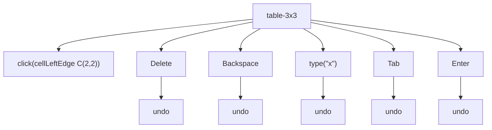

#### M-51 · Column top click

`{fixture}` · Morph: **TODO**

Expected before the run: Type Column; in the merged table a column under a merged cell (a) takes the merged cell
whole (b) takes the cells of one grid column.

steps `click(columnTop {cell})`

| fixture | cell | selection | observed |
| --- | --- | --- | --- |
| table-3x3 | C(1,1) | Column 18–41 end-active · Cells 3 (R1C1–R3C1) | `[Before the table.] ↓0<br>T1 R1 ║[⟦a1¤⟧]║⟦[b1¤⟧]║⟦[c1¤⟧]║¤<br>T1 R2 ║⟦[a2¤⟧]║⟦[b2¤⟧]║⟦[c2¤⟧]║¤<br>T1 R3 ║⟦[a3¤‸⟧]║[b3¤]║[c3¤]║¤<br>[After the table.] ↓0` |
| table-3x3 | C(1,2) | Column 21–44 end-active · Cells 3 (R1C2–R3C2) | `[Before the table.] ↓0<br>T1 R1 ║[a1¤]║[⟦b1¤⟧]║⟦[c1¤⟧]║¤<br>T1 R2 ║⟦[a2¤⟧]║⟦[b2¤⟧]║⟦[c2¤⟧]║¤<br>T1 R3 ║⟦[a3¤⟧]║⟦[b3¤‸⟧]║[c3¤]║¤<br>[After the table.] ↓0` |
| table-merged | C(1,1) | Column 18–47 end-active · Cells 5 (R1C1–R3C1) | `[Before the table.] ↓0<br>T1 R1 ║[⟦a1¶⟧] ¶ ⟦[b1¤⟧]║⟦[c1¤⟧]║¤<br>T1 R2 ║⟦[a2¤⟧]║⟦[b2¤⟧]║⟦[c2¶⟧] ¶ ⟦[c3¤⟧]║¤<br>T1 R3 ║⟦[a3¤⟧]║⟦[b3¤‸⟧]║¤<br>[After the table.] ↓0` |
| table-merged | C(1,2) | Column 24–48 end-active · Cells 2 (R1C2–R3C2) | `[Before the table.] ↓0<br>T1 R1 ║[a1] ¶ [b1¤]║[⟦c1¤⟧]║¤<br>T1 R2 ║⟦[a2¤⟧]║⟦[b2¤⟧]║⟦[c2¶⟧] ¶ ⟦[c3¤⟧]║¤<br>T1 R3 ║⟦[a3¤⟧]║⟦[b3¤⟧]║¤‸⟧<br>[After the table.] ↓0` |

#### M-52 · Row bar click

`{fixture}` · Morph: **TODO**

Expected before the run: Type Row with every cell of the row; a row holding the upper half of a vertical merge takes
the merged cell.

steps `click(rowBar {row})`

| fixture | row | selection | observed |
| --- | --- | --- | --- |
| table-3x3 | R1 | Row 18–28 end-active · Cells 3 (R1C1–R1C3) | `[Before the table.] ↓0<br>T1 R1 ║[⟦a1¤⟧]║⟦[b1¤⟧]║⟦[c1¤⟧]║¤‸⟧<br>T1 R2 ║[a2¤]║[b2¤]║[c2¤]║¤<br>T1 R3 ║[a3¤]║[b3¤]║[c3¤]║¤<br>[After the table.] ↓0` |
| table-3x3 | R2 | Row 28–38 end-active · Cells 3 (R2C1–R2C3) | `[Before the table.] ↓0<br>T1 R1 ║[a1¤]║[b1¤]║[c1¤]║¤<br>T1 R2 ║[⟦a2¤⟧]║⟦[b2¤⟧]║⟦[c2¤⟧]║¤‸⟧<br>T1 R3 ║[a3¤]║[b3¤]║[c3¤]║¤<br>[After the table.] ↓0` |
| table-merged | R1 | Row 18–28 end-active · Cells 2 (R1C1–R1C2) | `[Before the table.] ↓0<br>T1 R1 ║[⟦a1¶⟧] ¶ ⟦[b1¤⟧]║⟦[c1¤⟧]║¤‸⟧<br>T1 R2 ║[a2¤]║[b2¤]║[c2] ¶ [c3¤]║¤<br>T1 R3 ║[a3¤]║[b3¤]║¤<br>[After the table.] ↓0` |
| table-merged | R2 | Row 28–41 end-active · Cells 3 (R2C1–R2C3) | `[Before the table.] ↓0<br>T1 R1 ║[a1] ¶ [b1¤]║[c1¤]║¤<br>T1 R2 ║[⟦a2¤⟧]║⟦[b2¤⟧]║⟦[c2¶⟧] ¶ ⟦[c3¤⟧]║¤‸⟧<br>T1 R3 ║[a3¤]║[b3¤]║¤<br>[After the table.] ↓0` |

#### M-53 · Table move handle click

`table-2x2` · Morph: **TODO**

Expected before the run: (a) the whole table is selected (Type Table); (b) only the handle is shown and the selection
stays.

1. `click(tableHandle T1)`

```text
[Before the table.] ↓0
T1 R1 ║[⟦One¤⟧]║⟦[Two¤⟧]║¤
T1 R2 ║⟦[Three¤⟧]║⟦[Four¤⟧]║¤‸⟧
[After the table.] ↓0
```

Selection: Row 18–39 end-active · Cells 4 (R1C1–R2C2) · click(tableHandle T1) → none, WordOwn

Notes: A drag of the handle is not expressible: drag takes text positions. Only the click is recorded.

#### M-54 · End-of-row mark click, then Delete, Backspace and typing

`table-2x2` · Morph: **TODO**

Expected before the run: (a) the whole row is selected; (b) the mark alone; (c) an IP at the cell's end. Delete on a
row (a) clears the cells (b) nothing; typing (a) replaces the row's contents (b) nothing.

steps before the branches `click(C(1,2):mark, side=right)`

- `click(C(1,2):mark, side=right)` → `[Before the table.] ↓0 / T1 R1 ║[One¤]║[Two‸¤]║¤ / T1 R2 ║[Three¤]║[Four¤]║¤ / [After the table.] ↓0` · IP 25–25 · Cells 1 (R1C2–R1C2) · Undo —
- `Delete` → `[Before the table.] ↓0 / T1 R1 ║[One¤]║[Two‸¤]║¤ / T1 R2 ║[Three¤]║[Four¤]║¤ / [After the table.] ↓0` · IP 25–25 · Cells 1 (R1C2–R1C2) · Undo —
- `Backspace` → `[Before the table.] ↓0 / T1 R1 ║[One¤]║[Tw‸¤]║¤ / T1 R2 ║[Three¤]║[Four¤]║¤ / [After the table.] ↓0` · IP 24–24 · Cells 1 (R1C2–R1C2) · Undo depth 1
- `type("x")` → `[Before the table.] ↓0 / T1 R1 ║[One¤]║[Twox‸¤]║¤ / T1 R2 ║[Three¤]║[Four¤]║¤ / [After the table.] ↓0` · IP 26–26 · Cells 1 (R1C2–R1C2) · Undo depth 1

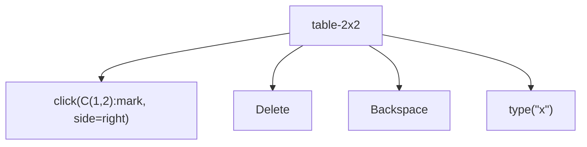

Notes: The end-of-row mark sits right of the last cell; the click is at the right half of the last cell's mark
position, the nearest the DSL comes to it.

#### M-60 · Click an inline picture, then Shift+click

`image-inline` · Morph: **DONE**

Expected before the run: The click selects the picture (InlineShapes 1); the Shift+click turns it into a text
selection from the picture's edge to the click, with the picture in it.

steps `click(IMG1)` · `shift+click({to})`

| to | selection | observed |
| --- | --- | --- |
| P1:end | IP 24–24 | `[Text before ▣ after end.‸] ↓0<br>[Second paragraph.] ↓0` |
| P1:0 | IP 0–0 | `[‸Text before ▣ after end.] ↓0<br>[Second paragraph.] ↓0` |
| P2:3 | IP 28–28 | `[Text before ▣ after end.] ↓0<br>[Sec‸ond paragraph.] ↓0` |

#### M-61 · Click a floating picture, a shape and a text box

`{fixture}` · Morph: **DONE**

Expected before the run: The picture and the shape are selected (Type Shape); the text box click lands an IP in its
story rather than selecting the box.

steps `click(SHP1)`

| fixture | selection | observed |
| --- | --- | --- |
| image-floating | Shape 0–1 end-active · Shapes 1 | `[⟦⚓1‸⟧First paragraph of text here.] ↓0<br>[Second paragraph carries the anchor of the picture.] ↓0<br>[Third paragraph after it.] ↓0<br>SHP1 ⌖P1 picture 72x72pt square @300,0 ⟦selected⟧` |
| shape | Shape 0–1 end-active · Shapes 1 | `[⟦⚓1‸⟧Paragraph beside a shape.] ↓0<br>[Second paragraph.] ↓0<br>SHP1 ⌖P1 autoshape 90x60pt square @228,0 ⟦selected⟧` |
| text-box | IP 25–25 · Story TextFrame | `[⚓1First paragraph of text here.] ↓0<br>[Second paragraph of text here.] ↓0<br>[Third paragraph of text here.] ↓0<br>SHP1 ⌖P1 textbox 160x80pt square @228,0<br>TB: [Box line one] ↓0<br>TB: [Box line two‸] ↓0` |

#### M-62 · Drag an inline picture, moving and copying

`image-inline` · Morph: **TODO**

Expected before the run: The picture is moved (copied with Ctrl) and stays inline at the drop; the undo entry is
Move; tracked, the source shows as deleted and the drop as inserted.

steps `{drag}`

| drag | tracked | selection | observed |
| --- | --- | --- | --- |
| drag(IMG1→P2:3) | off | InlineShape 27–28 end-active · InlineShapes 1 · Undo depth 1 | `[Text before  after end.] ↓0<br>[Sec⟦▣‸⟧ond paragraph.] ↓0` |
| drag(IMG1→P2:3) | on | InlineShape 28–29 end-active · InlineShapes 1 · Tracking · Revisions 2 · Undo depth 1 | `[Text before ]{-[▣]-}[ after end.] ↓0<br>[Sec]{+[⟦▣‸⟧]+}[ond paragraph.] ↓0` |
| ctrl+drag(IMG1→P2:3) | off | InlineShape 28–29 end-active · InlineShapes 1 · Undo depth 1 | `[Text before ▣ after end.] ↓0<br>[Sec⟦▣‸⟧ond paragraph.] ↓0` |
| ctrl+drag(IMG1→P2:3) | on | InlineShape 28–29 end-active · InlineShapes 1 · Tracking · Revisions 1 · Undo depth 1 | `[Text before ▣ after end.] ↓0<br>[Sec]{+[⟦▣‸⟧]+}[ond paragraph.] ↓0` |
| drag(IMG1→P1:0) | off | InlineShape 0–1 end-active · InlineShapes 1 · Undo depth 1 | `[⟦▣‸⟧Text before  after end.] ↓0<br>[Second paragraph.] ↓0` |
| drag(IMG1→P1:0) | on | InlineShape 0–1 end-active · InlineShapes 1 · Tracking · Revisions 2 · Undo depth 1 | `{+[⟦▣‸⟧]+}[Text before ]{-[▣]-}[ after end.] ↓0<br>[Second paragraph.] ↓0` |

#### M-63 · Drag a floating picture

`image-floating` · Morph: **TODO**

Expected before the run: Left and Top change by the drag; the anchor (a) moves to the paragraph under the drop (b)
stays on P2; Ctrl makes a copy with its own anchor.

steps `{drag}`

| drag | tracked | selection | observed |
| --- | --- | --- | --- |
| drag(SHP1→P3:2) | off | Shape 0–1 end-active · Shapes 1 · Undo depth 1 | `[⟦⚓1‸⟧First paragraph of text here.] ↓0<br>[Second paragraph carries the anchor of the picture.] ↓0<br>[Third paragraph after it.] ↓0<br>SHP1 ⌖P1 picture 72x72pt square @-23.4,25.8 ⟦selected⟧` |
| drag(SHP1→P3:2) | on | Shape 0–1 end-active · Shapes 1 · Tracking · Revisions 0 · Undo depth 1 | `[⟦⚓1‸⟧First paragraph of text here.] ↓0<br>[Second paragraph carries the anchor of the picture.] ↓0<br>[Third paragraph after it.] ↓0<br>SHP1 ⌖P1 picture 72x72pt square @-23.4,25.8 ⟦selected⟧` |
| ctrl+drag(SHP1→P3:2) | off | Shape 0–1 end-active · Shapes 1 · Undo depth 1 | `see below` |
| ctrl+drag(SHP1→P3:2) | on | Shape 0–1 end-active · Shapes 1 · Tracking · Revisions 1 · Undo depth 1 | `see below` |

`M-63[drag=ctrl+drag(SHP1→P3:2)]`

```text
[⟦⚓2‸⟧⚓1First paragraph of text here.] ↓0
[Second paragraph carries the anchor of the picture.] ↓0
[Third paragraph after it.] ↓0
SHP1 ⌖P1 picture 72x72pt square @300,0 ⟦selected⟧
SHP2 ⌖P1 picture 72x72pt square @-55.8,25.8 ⟦selected⟧
```

Selection: Shape 0–1 end-active · Shapes 1 · Undo depth 1 · ctrl+drag(SHP1→P3:2) from → Shape Picture 1, WordOwn · ctrl+drag(SHP1→P3:2) to → Range 85-85, IBeam

`M-63[drag=ctrl+drag(SHP1→P3:2)]~tracked`

```text
{+[⟦⚓2‸⟧]+}[⚓1First paragraph of text here.] ↓0
[Second paragraph carries the anchor of the picture.] ↓0
[Third paragraph after it.] ↓0
SHP1 ⌖P1 picture 72x72pt square @300,0 ⟦selected⟧
SHP2 ⌖P1 picture 72x72pt square @-55.8,25.8 ⟦selected⟧
```

Selection: Shape 0–1 end-active · Shapes 1 · Tracking · Revisions 1 · Undo depth 1 · ctrl+drag(SHP1→P3:2) from → Shape Picture 1, WordOwn · ctrl+drag(SHP1→P3:2) to → Range 85-85, IBeam

#### M-70 · Click a field result and its edges

`field-page` · Morph: **UNKNOWN**

Expected before the run: (a) an IP inside the result at the glyph edge; (b) the whole field is selected on any click
in it; (c) the IP snaps to the field's edges.

steps `click({at})`

| at | selection | observed |
| --- | --- | --- |
| P1:find("Page "):end, side=left | IP 5–5 | `[Page ][‸«][ PAGE ][\|][1][»][ of ][«][ NUMPAGES ][\|][1][»][ end.] ↓0<br>[Date: ][«][ DATE \@ "d/MM/yyyy" ][\|][25/10/2026][»][ end.] ↓0` |
| P1:find("1"), side=left | IP 5–5 | `[Page ][‸«][ PAGE ][\|][1][»][ of ][«][ NUMPAGES ][\|][1][»][ end.] ↓0<br>[Date: ][«][ DATE \@ "d/MM/yyyy" ][\|][25/10/2026][»][ end.] ↓0` |
| P1:find("1"), side=right | IP 15–15 | `[Page ][«][ PAGE ][\|][1][»][‸ of ][«][ NUMPAGES ][\|][1][»][ end.] ↓0<br>[Date: ][«][ DATE \@ "d/MM/yyyy" ][\|][25/10/2026][»][ end.] ↓0` |
| P2:find("/20"), side=left | IP 73–73 | `[Page ][«][ PAGE ][\|][1][»][ of ][«][ NUMPAGES ][\|][1][»][ end.] ↓0<br>[Date: ][«][ DATE \@ "d/MM/yyyy" ][\|][25/10‸/2026][»][ end.] ↓0` |

Notes: find("Page "):end is the PAGE field's start; find("/20") is inside the DATE result.

#### M-72 · Click a list number, then Ctrl+B and typing

`numbers-two-lists` · Morph: **TODO**

Expected before the run: On the number itself Word selects every number of the list at that level, Ctrl+B then bolds
them and typing does nothing; (a) this click reaches the number (b) it is an IP at the text start and typing inserts.

steps before the branches `click({at}, side=left)`

**at=P1:start**

- `click(P1:start, side=left)` → `[‸One] #ListParagraph •2.0 1. ⇥36,-18 / [Two] #ListParagraph •2.0 2. ⇥36,-18 / [Between the lists.] ↓0 / [Alpha] #ListParagraph •1.0 1. ⇥36,-18 / [Beta] #ListParagraph •1.0 2. ⇥36,-18` · IP 0–0 · Undo depth 2
- `Ctrl+B` → `[‸One] #ListParagraph •2.0 1. ⇥36,-18 / [Two] #ListParagraph •2.0 2. ⇥36,-18 / [Between the lists.] ↓0 / [Alpha] #ListParagraph •1.0 1. ⇥36,-18 / [Beta] #ListParagraph •1.0 2. ⇥36,-18` · IP 0–0 · Undo depth 2
- `type("x")` → `[x‸One] #ListParagraph •2.0 1. ⇥36,-18 / [Two] #ListParagraph •2.0 2. ⇥36,-18 / [Between the lists.] ↓0 / [Alpha] #ListParagraph •1.0 1. ⇥36,-18 / [Beta] #ListParagraph •1.0 2. ⇥36,-18` · IP 1–1 · Undo depth 3

**at=P4:start**

- `click(P4:start, side=left)` → `[One] #ListParagraph •2.0 1. ⇥36,-18 / [Two] #ListParagraph •2.0 2. ⇥36,-18 / [Between the lists.] ↓0 / [‸Alpha] #ListParagraph •1.0 1. ⇥36,-18 / [Beta] #ListParagraph •1.0 2. ⇥36,-18` · IP 27–27 · Undo depth 2
- `Ctrl+B` → `[One] #ListParagraph •2.0 1. ⇥36,-18 / [Two] #ListParagraph •2.0 2. ⇥36,-18 / [Between the lists.] ↓0 / [‸Alpha] #ListParagraph •1.0 1. ⇥36,-18 / [Beta] #ListParagraph •1.0 2. ⇥36,-18` · IP 27–27 · Undo depth 2
- `type("x")` → `[One] #ListParagraph •2.0 1. ⇥36,-18 / [Two] #ListParagraph •2.0 2. ⇥36,-18 / [Between the lists.] ↓0 / [x‸Alpha] #ListParagraph •1.0 1. ⇥36,-18 / [Beta] #ListParagraph •1.0 2. ⇥36,-18` · IP 28–28 · Undo depth 3

```mermaid
flowchart TD
  root["numbers-two-lists"]
  root --> n_["click(P1:start, side=left)"]
  root --> n_bold["Ctrl+B"]
  root --> n_type["type(#quot;x#quot;)"]
```

Notes: The number is not a text position; the click lands at the left half of the item's first glyph, the nearest the
DSL comes to the number. P4 starts the second list.

#### M-73 · Click and double-click a footnote reference

`footnote` · Morph: **TODO**

Expected before the run: The halves place the IP before and after the reference; a double-click (a) selects the
reference (b) jumps to the note's text.

steps `{step}`

| step | selection | observed |
| --- | --- | --- |
| click(P1:4, side=left) | IP 4–4 | `[Text‸†1 more words.] ↓0<br>[Second with an end note.‡1] ↓0` |
| click(P1:4, side=right) | IP 4–4 | `[Text‸†1 more words.] ↓0<br>[Second with an end note.‡1] ↓0` |
| dblclick(P1:4) | IP 0–0 · Story Footnotes | `[Text†1 more words.] ↓0<br>[Second with an end note.‡1] ↓0<br>FN: [‸† Note text.] #FootnoteText` |

#### M-74 · Click a content control's text, checkbox and dropdown

`content-control` · Morph: **TODO**

Expected before the run: An IP inside the rich and plain controls; the checkbox toggles on the click with an undo
entry; the dropdown places an IP and shows its arrow without opening.

steps `click({at})`

| at | selection | observed |
| --- | --- | --- |
| P1:find("content") | IP 7–7 · Undo — | `[Rich: (\|‸content here\|) end.] ↓0<br>[Plain: (\|plain here\|) end.] ↓0<br>[Check: (\|☐\|) end.] ↓0<br>[Pick: (\|choice\|) end.] ↓0` |
| P2:find("plain") | IP 34–34 · Undo — | `[Rich: (\|content here\|) end.] ↓0<br>[Plain: (\|‸plain here\|) end.] ↓0<br>[Check: (\|☐\|) end.] ↓0<br>[Pick: (\|choice\|) end.] ↓0` |
| P3:7 | IP 59–59 · Undo — | `[Rich: (\|content here\|) end.] ↓0<br>[Plain: (\|plain here\|) end.] ↓0<br>[Check: (\|‸☐\|) end.] ↓0<br>[Pick: (\|choice\|) end.] ↓0` |
| P4:find("choice") | IP 75–75 · Undo — | `[Rich: (\|content here\|) end.] ↓0<br>[Plain: (\|plain here\|) end.] ↓0<br>[Check: (\|☐\|) end.] ↓0<br>[Pick: (\|c‸hoice\|) end.] ↓0` |

#### M-76 · Right-click inside and outside a selection

`words` · Morph: **PARTIAL**

Expected before the run: Inside the selection it is kept; outside the IP moves to the click.

steps `dblclick(P1:find("beta"))` · `rightclick({at})`

| at | selection | observed |
| --- | --- | --- |
| P1:find("beta") | Normal 6–10 start-active | `[alpha ⟦‸beta⟧,  gamma-delta 3.14 don't (eps) 1,000 10:30 end.] ↓0` |
| P1:find("3.14") | IP 25–25 | `[alpha beta,  gamma-delta ‸3.14 don't (eps) 1,000 10:30 end.] ↓0` |

Notes: The context menu is dismissed by the harness after the step.

#### M-76b · Right-click an inline picture

`image-inline` · Morph: **PARTIAL**

Expected before the run: The picture is selected before the menu opens.

1. `rightclick(IMG1)`

```text
[Text before ⟦▣‸⟧ after end.] ↓0
[Second paragraph.] ↓0
```

Selection: InlineShape 12–13 end-active · InlineShapes 1 · rightclick(IMG1) → Shape Picture 1, WordOwn

#### M-76c · Right-click in a cell, as text and with the cell selected

`table-2x2` · Morph: **PARTIAL**

Expected before the run: From the body the IP moves into the cell; with the cell selected the selection is kept.

steps `{first}` · `rightclick(C(1,1):1)`

| first | selection | observed |
| --- | --- | --- |
| click(P1:2) | IP 19–19 · Cells 1 (R1C1–R1C1) | `[Before the table.] ↓0<br>T1 R1 ║[O‸ne¤]║[Two¤]║¤<br>T1 R2 ║[Three¤]║[Four¤]║¤<br>[After the table.] ↓0` |
| click(cellLeftEdge C(1,1)) | Column 18–22 end-active · Cells 1 (R1C1–R1C1) | `[Before the table.] ↓0<br>T1 R1 ║[⟦One¤‸⟧]║[Two¤]║¤<br>T1 R2 ║[Three¤]║[Four¤]║¤<br>[After the table.] ↓0` |

#### M-80 · Drag and drop a word within its paragraph

`words` · Morph: **TODO**

Expected before the run: The word moves and stays selected at the drop; smart cut and paste adds and removes the
spaces so words stay separated, off it does not; the undo entry is Move.

steps `drag(P1:find("beta")-P1:find("beta"):end→{to})`

| to | options | tracked | selection | observed |
| --- | --- | --- | --- | --- |
| P1:find("1,000") | SmartCutPaste=true | off | Normal 37–42 end-active · Undo depth 1 | `[alpha,  gamma-delta 3.14 don't (eps) ⟦beta ‸⟧1,000 10:30 end.] ↓0` |
| P1:find("1,000") | SmartCutPaste=true | on | Normal 42–47 end-active · Tracking · Revisions 2 · Undo depth 1 | `[alpha]{-[ beta]-}[,  gamma-delta 3.14 don't (eps) ]{+[⟦beta ‸⟧]+}[1,000 10:30 end.] ↓0` |
| P1:find("1,000") | SmartCutPaste=false | off | Normal 38–42 end-active · Undo depth 1 | `[alpha ,  gamma-delta 3.14 don't (eps) ⟦beta‸⟧1,000 10:30 end.] ↓0` |
| P1:find("1,000") | SmartCutPaste=false | on | Normal 42–46 end-active · Tracking · Revisions 2 · Undo depth 1 | `[alpha ]{-[beta]-}[,  gamma-delta 3.14 don't (eps) ]{+[⟦beta‸⟧]+}[1,000 10:30 end.] ↓0` |
| P1:15 | SmartCutPaste=true | off | Normal 8–13 end-active · Undo depth 1 | `[alpha,  ⟦beta ‸⟧gamma-delta 3.14 don't (eps) 1,000 10:30 end.] ↓0` |
| P1:15 | SmartCutPaste=true | on | Normal 13–18 end-active · Tracking · Revisions 2 · Undo depth 1 | `[alpha]{-[ beta]-}[,  ]{+[⟦beta ‸⟧]+}[gamma-delta 3.14 don't (eps) 1,000 10:30 end.] ↓0` |
| P1:15 | SmartCutPaste=false | off | Normal 9–13 end-active · Undo depth 1 | `[alpha ,  ⟦beta‸⟧gamma-delta 3.14 don't (eps) 1,000 10:30 end.] ↓0` |
| P1:15 | SmartCutPaste=false | on | Normal 13–17 end-active · Tracking · Revisions 2 · Undo depth 1 | `[alpha ]{-[beta]-}[,  ]{+[⟦beta‸⟧]+}[gamma-delta 3.14 don't (eps) 1,000 10:30 end.] ↓0` |
| P1:end | SmartCutPaste=true | off | Normal 54–58 end-active · Undo depth 1 | `[alpha,  gamma-delta 3.14 don't (eps) 1,000 10:30 end. ⟦beta‸⟧] ↓0` |
| P1:end | SmartCutPaste=true | on | Normal 59–63 end-active · Tracking · Revisions 2 · Undo depth 1 | `[alpha]{-[ beta]-}[,  gamma-delta 3.14 don't (eps) 1,000 10:30 end.]{+[ ⟦beta‸⟧]+} ↓0` |
| P1:end | SmartCutPaste=false | off | Normal 54–58 end-active · Undo depth 1 | `[alpha ,  gamma-delta 3.14 don't (eps) 1,000 10:30 end.⟦beta‸⟧] ↓0` |
| P1:end | SmartCutPaste=false | on | Normal 58–62 end-active · Tracking · Revisions 2 · Undo depth 1 | `[alpha ]{-[beta]-}[,  gamma-delta 3.14 don't (eps) 1,000 10:30 end.]{+[⟦beta‸⟧]+} ↓0` |
| P1:0 | SmartCutPaste=true | off | Normal 0–5 end-active · Undo depth 1 | `[⟦beta ‸⟧alpha,  gamma-delta 3.14 don't (eps) 1,000 10:30 end.] ↓0` |
| P1:0 | SmartCutPaste=true | on | Normal 0–5 end-active · Tracking · Revisions 2 · Undo depth 1 | `{+[⟦beta ‸⟧]+}[alpha]{-[ beta]-}[,  gamma-delta 3.14 don't (eps) 1,000 10:30 end.] ↓0` |
| P1:0 | SmartCutPaste=false | off | Normal 0–4 end-active · Undo depth 1 | `[⟦beta‸⟧alpha ,  gamma-delta 3.14 don't (eps) 1,000 10:30 end.] ↓0` |
| P1:0 | SmartCutPaste=false | on | Normal 0–4 end-active · Tracking · Revisions 2 · Undo depth 1 | `{+[⟦beta‸⟧]+}[alpha ]{-[beta]-}[,  gamma-delta 3.14 don't (eps) 1,000 10:30 end.] ↓0` |

Notes: Drops after a space, mid-word in gamma, before the mark and at the paragraph start; the dragged range is beta
without its comma.

#### M-81 · Drag and drop across paragraphs, with and without the mark

`three-paragraphs` · Morph: **TODO**

Expected before the run: With the mark the paragraph is moved whole and P3 is split at the drop; without it the text
joins P3's paragraph; a drop at P2:0 puts the text before Second.

steps `drag({path})`

| path | tracked | selection | observed |
| --- | --- | --- | --- |
| P1:0-P2:0→P3:4 | off | Normal 23–45 end-active · Undo depth 1 | `[Second bold one.] (center) ↓0<br>[Third ⟦First paragraph here.¶‸⟧] ↓0<br>[and last.] ↓0` |
| P1:0-P2:0→P3:4 | on | Normal 45–67 end-active · Tracking · Revisions 2 · Undo depth 1 | `{<[First paragraph here.]<} ↓0<br>[Second ][b:bold ][one.] (center) ↓0<br>[Third ]{>[⟦First paragraph here.¶‸⟧]>} ↓0<br>[and last.] ↓0` |
| P1:0-P1:end→P3:4 | off | Normal 24–45 end-active · Undo depth 1 | ` ↓0<br>[Second bold one.] (center) ↓0<br>[Third ⟦First paragraph here.‸⟧and last.] ↓0` |
| P1:0-P1:end→P3:4 | on | Normal 45–66 end-active · Tracking · Revisions 2 · Undo depth 1 | `{<[First paragraph here.]<} ↓0<br>[Second ][b:bold ][one.] (center) ↓0<br>[Third ]{>[⟦First paragraph here.‸⟧]>}[and last.] ↓0` |
| P1:0-P2:0→P3:end | off | Normal 33–55 end-active · Undo depth 1 | `[Second bold one.] (center) ↓0<br>[Third and last. ⟦First paragraph here.¶‸⟧] ↓0<br> ↓0` |
| P1:0-P2:0→P3:end | on | Normal 55–77 end-active · Tracking · Revisions 3 · Undo depth 1 | `{<[First paragraph here.]<} ↓0<br>[Second ][b:bold ][one.] (center) ↓0<br>[Third and last.]{+[ ]+}{>[⟦First paragraph here.¶‸⟧]>} ↓0<br> ↓0` |
| P1:6-P1:end→P2:0 | off | Normal 7–22 end-active · Undo depth 1 | `[First ] ↓0<br>[⟦paragraph here.‸⟧Second bold one.] (center) ↓0<br>[Third and last.] ↓0` |
| P1:6-P1:end→P2:0 | on | Normal 22–37 end-active · Tracking · Revisions 2 · Undo depth 1 | `[First ]{-[paragraph here.]-} ↓0<br>{+[⟦paragraph here.‸⟧]+}[Second ][b:bold ][one.] (center) ↓0<br>[Third and last.] ↓0` |

#### M-82 · Ctrl+drag copies

`words` · Morph: **TODO**

Expected before the run: The source stays and a copy is inserted at the drop and selected; the undo entry names a
copy or a paste.

steps `ctrl+drag(P1:find("beta")-P1:find("beta"):end→{to})`

| to | tracked | selection | observed |
| --- | --- | --- | --- |
| P1:find("1,000") | off | Normal 42–47 end-active · Undo depth 1 | `[alpha beta,  gamma-delta 3.14 don't (eps) ⟦beta ‸⟧1,000 10:30 end.] ↓0` |
| P1:find("1,000") | on | Normal 42–47 end-active · Tracking · Revisions 1 · Undo depth 1 | `[alpha beta,  gamma-delta 3.14 don't (eps) ]{+[⟦beta ‸⟧]+}[1,000 10:30 end.] ↓0` |
| P1:end | off | Normal 59–63 end-active · Undo depth 1 | `[alpha beta,  gamma-delta 3.14 don't (eps) 1,000 10:30 end. ⟦beta‸⟧] ↓0` |
| P1:end | on | Normal 59–63 end-active · Tracking · Revisions 1 · Undo depth 1 | `[alpha beta,  gamma-delta 3.14 don't (eps) 1,000 10:30 end.]{+[ ⟦beta‸⟧]+} ↓0` |

#### M-83 · Drop onto the selection itself and next to it

`words` · Morph: **TODO**

Expected before the run: A drop inside or at either end of the selection changes nothing and adds no undo entry; the
selection is kept.

steps `drag(P1:find("beta")-P1:find("beta"):end→{to})`

| to | selection | observed |
| --- | --- | --- |
| P1:find("beta"):end | IP 10–10 · Undo — | `[alpha beta‸,  gamma-delta 3.14 don't (eps) 1,000 10:30 end.] ↓0` |
| P1:find("eta") | IP 6–6 · Undo — | `[alpha ‸beta,  gamma-delta 3.14 don't (eps) 1,000 10:30 end.] ↓0` |
| P1:find("beta") | IP 6–6 · Undo — | `[alpha ‸beta,  gamma-delta 3.14 don't (eps) 1,000 10:30 end.] ↓0` |

#### M-84 · Drop into and out of a cell

`table-2x2` · Morph: **TODO**

Expected before the run: Text dropped into a cell is inserted at the drop (a) as text (b) replacing the cell; a
cell's contents dropped into the body arrive as text; cell to cell (a) inserts (b) replaces.

steps `drag({path})`

| path | tracked | selection | observed |
| --- | --- | --- | --- |
| P1:0-P1:6→C(1,2):1 | off | Normal 15–22 end-active · Cells 1 (R1C2–R1C2) · Undo depth 1 | `[the table.] ↓0<br>T1 R1 ║[One¤]║[⟦Before ‸⟧Two¤]║¤<br>T1 R2 ║[Three¤]║[Four¤]║¤<br>[After the table.] ↓0` |
| P1:0-P1:6→C(1,2):1 | on | Normal 22–29 end-active · Cells 1 (R1C2–R1C2) · Tracking · Revisions 2 · Undo depth 1 | `{-[Before ]-}[the table.] ↓0<br>T1 R1 ║[One¤]║{+[⟦Before ‸⟧]+}[Two¤]║¤<br>T1 R2 ║[Three¤]║[Four¤]║¤<br>[After the table.] ↓0` |
| C(1,1):0-C(1,1):end→P2:2 | off | IP 21–21 · Cells 1 (R1C1–R1C1) · Undo — | `[Before the table.] ↓0<br>T1 R1 ║[One‸¤]║[Two¤]║¤<br>T1 R2 ║[Three¤]║[Four¤]║¤<br>[After the table.] ↓0` |
| C(1,1):0-C(1,1):end→P2:2 | on | IP 21–21 · Cells 1 (R1C1–R1C1) · Tracking · Revisions 0 · Undo — | `[Before the table.] ↓0<br>T1 R1 ║[One‸¤]║[Two¤]║¤<br>T1 R2 ║[Three¤]║[Four¤]║¤<br>[After the table.] ↓0` |
| C(1,1):0-C(1,1):end→C(2,2):1 | off | Normal 30–34 end-active · Cells 1 (R2C2–R2C2) · Undo depth 1 | `[Before the table.] ↓0<br>T1 R1 ║¤║[Two¤]║¤<br>T1 R2 ║[Three¤]║[⟦One ‸⟧Four¤]║¤<br>[After the table.] ↓0` |
| C(1,1):0-C(1,1):end→C(2,2):1 | on | Normal 33–37 end-active · Cells 1 (R2C2–R2C2) · Tracking · Revisions 2 · Undo depth 1 | `[Before the table.] ↓0<br>T1 R1 ║{-[One]-}¤║[Two¤]║¤<br>T1 R2 ║[Three¤]║{+[⟦One ‸⟧]+}[Four¤]║¤<br>[After the table.] ↓0` |

#### M-85 · Drop at an empty paragraph, at a mark and past the final mark

`empty-paragraphs` · Morph: **TODO**

Expected before the run: Above moves into the empty paragraph, leaving P1 empty; at P4's mark it lands before the
mark; past the final mark (a) it is refused (b) it lands before the final mark.

steps `drag(P1:0-P1:5→{to})`

| to | tracked | selection | observed |
| --- | --- | --- | --- |
| P2:0 | off | Normal 1–6 end-active · Undo depth 1 | ` ↓0<br>[⟦Above‸⟧] ↓0<br> ↓0<br>[Below] ↓0` |
| P2:0 | on | Normal 6–11 end-active · Tracking · Revisions 2 · Undo depth 1 | `{<[Above]<} ↓0<br>{>[⟦Above‸⟧]>} ↓0<br> ↓0<br>[Below] ↓0` |
| P4:mark | off | Normal 9–14 end-active · Undo depth 1 | ` ↓0<br> ↓0<br> ↓0<br>[Below ⟦Above‸⟧] ↓0` |
| P4:mark | on | Normal 14–19 end-active · Tracking · Revisions 3 · Undo depth 1 | `{<[Above]<} ↓0<br> ↓0<br> ↓0<br>[Below]{+[ ]+}{>[⟦Above‸⟧]>} ↓0` |
| DOC:end | off | Normal 9–14 end-active · Undo depth 1 | ` ↓0<br> ↓0<br> ↓0<br>[Below ⟦Above‸⟧] ↓0` |
| DOC:end | on | Normal 14–19 end-active · Tracking · Revisions 3 · Undo depth 1 | `{<[Above]<} ↓0<br> ↓0<br> ↓0<br>[Below]{+[ ]+}{>[⟦Above‸⟧]>} ↓0` |

#### M-87 · Drag text between the body and a text box

`text-box` · Morph: **TODO**

Expected before the run: (a) the text moves into the other story; (b) the drop is refused and the selection is kept.

steps `drag({path})`

| path | tracked | selection | observed |
| --- | --- | --- | --- |
| P2:0-P2:6→TB1:P1:2 | off | Normal 0–7 end-active · Story TextFrame · Undo depth 1 | `[⚓1First paragraph of text here.] ↓0<br>[paragraph of text here.] ↓0<br>[Third paragraph of text here.] ↓0<br>SHP1 ⌖P1 textbox 160x80pt square @228,0<br>TB: [⟦Second ‸⟧Box line one] ↓0<br>TB: [Box line two] ↓0` |
| P2:0-P2:6→TB1:P1:2 | on | Normal 0–7 end-active · Story TextFrame · Tracking · Revisions 1 · Undo depth 1 | `see below` |
| TB1:P1:0-TB1:P1:3→P2:2 | off | Normal 0–33 end-active · Undo — | `[⟦⚓1First paragraph of text here.¶⟧] ↓0<br>⟦[Se‸⟧cond paragraph of text here.] ↓0<br>[Third paragraph of text here.] ↓0<br>SHP1 ⌖P1 textbox 160x80pt square @228,0` |
| TB1:P1:0-TB1:P1:3→P2:2 | on | Normal 0–33 end-active · Tracking · Revisions 0 · Undo — | `[⟦⚓1First paragraph of text here.¶⟧] ↓0<br>⟦[Se‸⟧cond paragraph of text here.] ↓0<br>[Third paragraph of text here.] ↓0<br>SHP1 ⌖P1 textbox 160x80pt square @228,0` |

`M-87[path=P2:0-P2:6→TB1:P1:2]~tracked`

```text
[⚓1First paragraph of text here.] ↓0
{-[Second ]-}[paragraph of text here.] ↓0
[Third paragraph of text here.] ↓0
SHP1 ⌖P1 textbox 160x80pt square @228,0
TB: [⟦Second ‸⟧Box line one] ↓0
TB: [Box line tw]{-[o] ↓0
```

Selection: Normal 0–7 end-active · Story TextFrame · Tracking · Revisions 1 · Undo depth 1 · drag(P2:0-P2:6→TB1:P1:2) from → Range 34-34, Arrow · drag(P2:0-P2:6→TB1:P1:2) to → Range 2-2, IBeam
<!-- probe:end mouse -->

## Typing, Enter, Backspace, Delete and direct formatting

What a typed character inherits, what Enter splits and what Backspace and Delete merge, and every
formatting key.

### Rules

Typing and inheritance

- **R-E-1 A typed character takes the formatting of the character before the caret**; at a paragraph's
  start it takes the first character's, and in an empty paragraph the mark's (E-01, E-02, E-02b). After an
  inline picture, a tab, a line break, a page break, a non-breaking space, a soft hyphen, a footnote
  reference, a comment's end or a bookmark's end the character is plain text in the same place; a
  bookmark or comment scope ending at the caret does not grow (E-03, E-03b, E-06, E-06b, E-06c, E-08,
  E-08b). Typed right after a tracked deletion the insertion goes after the deletion, never inside it
  (E-08c). — Morph: PARTIAL (`faceAt` inherits the run; the mark's formatting in an empty paragraph
  and the atom cases are not confirmed by tests).
- **R-E-2 Hyperlink edges**: typing at the end of a hyperlink's display text extends the link with the
  link's formatting; typing at its start puts the character inside the field result but without the
  Hyperlink character formatting; typing over the whole display text replaces it and keeps the link
  (E-05, E-05b). Typing right after a field's end is plain text after the field; typing right before a
  field's begin is plain text before it (E-04). Typing inside a field result is possible and the next F9
  throws the typed text away with the old result (E-04b). — Morph: PARTIAL (LinkEdgeTests cover the
  edges without citing a case).
- **R-E-3 Ctrl+B, Ctrl+I, Ctrl+U or a size key at an insertion point inside or beside a word formats the
  whole word** (with its trailing space), and the word's new look is what later typing inherits (E-09).
  At an insertion point with no word adjacent (between two spaces) the format is PENDING: the next
  characters typed take it (`x` bold, ` x` bold with its space, 24pt → 26pt for Ctrl+Shift+>), and an
  arrow key or a click before typing drops it, so `y` and `z` came out plain (E-09b). — Morph: PARTIAL
  (Ctrl+B/I/U in the open paragraph take the word with its trailing space and leave the caret; between
  spaces the look is pending, but an arrow key does not drop it; the size keys format the word through
  .NET).
- **R-E-4 Typing over a selection replaces it**; over a selection that spans paragraphs the survivor is
  one paragraph with the FIRST paragraph's properties (`Firsx‸d bold one.` lost P2's centring); over the
  whole document one paragraph remains (E-10, E-10b, E-10c). Typing over a selected cell, column, row or
  whole table replaces the text of the FIRST cell only and leaves every other cell as it was; typing over
  a selection that runs from body text into a table does nothing (E-10d). Typing with an inline picture
  selected inserts before the picture and keeps it; with a floating shape selected the character goes at
  the anchor paragraph's start (E-10e, E-10f). Tracked, the replaced text is struck and the typed text
  inserted after it, the caret after the insertion (E-10 tracked variants). — Morph: PARTIAL (the box
  replaces a selection inside one paragraph; nothing types over a cross-paragraph or table selection).
- **R-E-5 Overtype** (`Options.Overtype`, toggled by Insert only with `INSKeyForOvertype` on) overwrites
  the character after the caret, a tab, an inline picture and a whole field alike, appends at a
  paragraph's end and before a cell mark, and Backspace deletes without restoring; under Track Changes
  overtype inserts and overwrites nothing (E-11, E-11b, E-11c, E-11d, E-11e, E-105). — Morph: DONE (Insert
  toggles it as with `INSKeyForOvertype` on, shown in the status bar; `ParagraphEditor.overtyped`).

Enter and breaks

- **R-E-6 Enter splits a paragraph and both halves keep its properties** (style, alignment, indents,
  list membership and level), except that Enter at the END of a paragraph whose style names a next style
  starts that style (Heading 1/2/3 → Normal); at the end of a list item the new item continues the list;
  at the start of a paragraph an empty paragraph of the same kind is inserted above and the caret stays
  on the text (E-20, E-21, E-23). ❓ Enter at the start of a numbered item or a numbered heading inserted
  a paragraph above that kept the indent but not the number or the heading style (E-21 `numbered-heading`
  P1:0, E-23 P1:0), where a bulleted paragraph kept its bullet (E-20 P3:0). Tracked, the new mark is one
  insertion (E-20 tracked). — Morph: PARTIAL (split with pPr copy and heading follow-on; the
  insert-above case and the numbered exception are not confirmed).
- **R-E-7 Enter at a cell's start inserts an empty paragraph above the text in the cell; at a cell's end
  it adds an empty paragraph below; in the first cell of a table that starts the document Enter inserts
  a paragraph before the table** (E-24, E-24b, E-24c). Enter with a selection deletes it and splits at
  its start (E-25, E-25b). Enter before a page-break character splits before it; after it, the break stays
  on its own paragraph; before a table it inserts a paragraph between text and table (E-26, E-26b). —
  Morph: PARTIAL.
- **R-E-8 Shift+Enter inserts a line break** everywhere, including in a list item, a cell and a heading,
  and replaces a selection (E-27, E-27b, E-27c, E-27d). — Morph: PARTIAL.
- **R-E-9 Ctrl+Enter puts the page break on a paragraph of its own**: mid-paragraph the text after the
  caret becomes a new paragraph after the break paragraph, both keeping the paragraph's properties
  (centring, list numbering); at a paragraph's end the break paragraph is followed by an empty paragraph
  of the same kind; at a paragraph's start the break paragraph goes above; over a selection the selection
  is deleted first; before a table the break paragraph goes between text and table (E-28, E-28b, E-28c,
  E-28d). Ctrl+Shift+Enter inserts a column break character (`\u000E`) the same way without a
  paragraph of its own; in a table it splits the table at the row and leaves an empty paragraph between
  the halves (E-29, E-29b). — Morph: TODO.

Tab

- **R-E-10 Tab at a paragraph's start sets the first-line indent (36pt) when `TabIndentKey` is on**, on a
  hanging-indented paragraph it moves the first line to the left indent (`⇥36,-36` → `⇥36,0`), at the
  start of a WRAPPED line it sets the paragraph's left indent instead, and Backspace right after undoes
  the indent; mid-paragraph, in an empty paragraph, or with the option off Tab inserts a tab character
  (E-30, E-30b, E-30c, E-30d). Tab and Shift+Tab mid-item insert tab characters even in a list (E-31).
  Tracked, the indent is a paragraph property change (`{~…~}`). — Morph: TODO (Tab in a list item
  changes its level; elsewhere a tab character).

Backspace and Delete

- **R-E-11 Backspace at a paragraph's start first strips what Word can strip, then merges**: a list
  item loses its number, then its indent, then merges (E-42; recorded by `ListKeyTests`); a left or
  first-line indent is removed first (E-42b, E-41 P6:0); centring is removed first (E-41 P4:0); an empty
  paragraph is removed in one press, the caret landing at the end of the paragraph above (E-41 P7:0); a
  paragraph after an EMPTY paragraph removes that empty paragraph and keeps its own properties (E-41
  P8:0). Otherwise the paragraphs merge and the survivor keeps the FIRST paragraph's properties (Heading
  after Normal → Normal; Bordered after Centred → centred) (E-41 P2:0, P5:0, P9:0). With the two
  paragraphs differing in one property only (fixture `merge-pairs`) the rule held for every pair: a
  plain paragraph merged into a centred, indented, bordered, spaced-after, Heading 1 or bulleted one took
  that property, and a property paragraph merged into a plain one lost it; the strip-first step came
  before the merge for the indent (one press) and the bullet (two presses, bullet then indent) and not
  for a border, space after or a heading, which merged on the first press (E-41b). Undo restores and
  redo repeats each (E-41 branches). Tracked, the merge is the first mark struck and the second
  paragraph's properties marked changed (`{~…~}`). — Morph: PARTIAL (the join keeps the first
  paragraph; the strip-first steps exist for lists, indents and centring or right alignment).
- **R-E-12 Delete at a paragraph's end merges with the next and the survivor keeps the FIRST
  paragraph's properties** (Normal + Heading → Normal; Heading + Bullet → Heading without a bullet), in
  every single-property pair of `merge-pairs` in both orders (centred, indented, bordered, spaced after,
  Heading 1, bulleted; E-60b), with two exceptions: Delete in an empty paragraph removes it and the next
  paragraph keeps its own properties (E-60 P7:0), and **when the first paragraph is a list item the
  survivor keeps its list but takes the SECOND paragraph's indent and alignment**: a bullet at 36pt
  swallowing a bullet at 72pt came out at `⇥72` (E-60c P1:end), a level-1 item swallowing a level-2 one
  at `⇥54` (E-60c P7:end; L-20), and a bullet swallowing a centred plain paragraph kept its bullet and
  was centred (E-60c P4:end; E-60 P3:end), while a centred plain paragraph swallowing a bullet stayed as
  it was (E-60c P10:end) and the single-property grid's plain paragraphs had nothing to give (E-60b).
  The Backspace merge of the same pairs keeps the first paragraph's properties, since the strip-first
  presses have taken the second's bullet, indent and centring off before the merge (E-41c). Typing after
  the merge continues in the survivor; undo splits them again (E-60 branches). Tracked, the mark is
  struck and the second paragraph marked changed (`{~…~}`), the two still shown apart (E-60b tracked).
  — Morph: PARTIAL (the list-item exception is not matched).
- **R-E-13 Backspace and Delete do nothing at a cell's edges, at the start of the paragraph after a
  table, at the document's ends, and Backspace at a document's first paragraph** (E-47, E-48, E-48b,
  E-49, E-61 cells, E-62). Delete at the end of the paragraph BEFORE a table pulls that paragraph into the
  first cell (`Before the table.‸One`), as does Ctrl+Backspace at the first cell's start; under Track
  Changes Delete there only selects the mark (E-61 P1:end, E-70c). Delete at the end of a cell's first
  paragraph merges the cell's paragraphs (E-61d). — Morph: PARTIAL (nothing at cell edges and after a
  table matches; the pull-into-cell is TODO).
- **R-E-14 Atoms are selected first, deleted second**: Backspace after an inline picture, a field or a
  footnote reference, and Delete before any of them or before a whole hyperlink, select it (the field as a
  `Normal` selection, the picture as an `InlineShape`); the next Backspace or Delete removes it, typing
  replaces it (and swallows the space after a field), and Esc leaves it selected (E-43, E-44, E-51b, E-61b,
  E-61c, E-63). A tab, a line break, a page break, a non-breaking space and a soft hyphen are deleted in
  one press by either key (E-46, E-46b, E-46c, E-63, E-63b, E-63c, E-63d). Backspace through a
  hyperlink deletes character by character and the link is gone with its last character (E-45). A
  content control's text is selected by Backspace at its end or Delete at its start, then removed, the
  control staying with its placeholder (E-51c, E-63e). Tracked, each atom is struck in place (E-43,
  E-44, E-61c tracked). — Morph: PARTIAL (`ParagraphEditor.selectAtom` selects a field, a picture or
  a note's reference first and the next press deletes it; Esc does not keep it selected, and a whole
  hyperlink is not selected by Delete).
- **R-E-15 Backspace, Delete and Ctrl+X on a selection delete it but never merge paragraphs; only typing
  over the selection merges them.** A selection from the middle of one paragraph to the middle of the
  next leaves two paragraphs (`Firs` and `d bold one.`, each with its own properties) under Backspace,
  Delete and Ctrl+X alike, while a typed character joins them into one paragraph with the first's
  properties (E-50, E-50b, E-10c; L-13 and C-17 show the same). The mark alone selected merges the
  paragraphs with the first's properties (E-50 `P1:end-P2:0`). Delete over a selection that reaches
  from a cell into the paragraph after a table clears the cells' text and keeps the structure; from body
  text into a table it removed the first row and joined the leading text into the next row's first cell
  (E-64) ❓. — Morph: PARTIAL (the text layer's Delete over paragraphs joins them, which Word does not).
- **R-E-16 Section breaks**: Backspace at the start of the paragraph that carries a section break, or
  Delete at the end of the one before it, merges those two paragraphs and keeps the break; Delete before
  the break character removes the break and joins the sections (E-52). Backspace at the start of a TOC
  entry merges TOC lines rather than selecting the PAGEREF field before the mark (E-44b). — Morph:
  TODO.
- **R-E-17 Ctrl+Backspace deletes to the previous word start, Ctrl+Delete to the next**: a word with its
  trailing spaces is one unit, a punctuation run with its spaces another, a hyphen its own; a space left
  before punctuation is removed with the word (`alpha ,` → `alpha,`); at a list item's start
  Ctrl+Backspace merges with the previous item in one press (no number cascade); after a line break it
  deletes the break first; Ctrl+Delete deletes a whole field in one press, nothing before an inline
  picture, nothing at a cell's or the document's end (E-70, E-70b, E-70c, E-70d, E-71, E-71b, E-71c,
  E-71d). Tracked, the words are struck and the caret moves to the deletion's start (E-70 tracked). —
  Morph: PARTIAL (`ParagraphEditor.wordRange` takes Word's units and a whole field; the space before
  punctuation and the stop before a picture are not matched).

Character formatting keys

- **R-E-18 Shift+F3 cycles a selection UPPER → lower → Title Case ("Change Case"); at an insertion
  point inside a word it cycles that word's case, at a word's end it does nothing** (E-80, E-80b).
  Ctrl+Space ("Reset Char") clears direct character formatting — bold, italic, underline, size and face —
  from the selection and from the whole word around an insertion point, and removes the Hyperlink
  character style from a link's text (E-81, E-81b, E-81c, E-81d). Ctrl+Q ("Paragraph Formatting") resets
  paragraph formatting (list, centring, indents, space after off) and Ctrl+Shift+N ("Normal Style")
  applies Normal, removing the heading or list style (E-82, E-82b, E-83, E-83b). — Morph: PARTIAL
  (Ctrl+Space clears the run's look; Shift+F3 cycles case in the open paragraph; Ctrl+Shift+N applies
  Normal, though a browser tab keeps that key for itself; Ctrl+Q takes the paragraph's own formatting off,
  `DocumentEditor.ResetParagraphs`).
- **R-E-19 Ctrl+B/I/U on a mixed selection sets the attribute everywhere first, then clears it everywhere**
  (bold+plain → all bold → all plain; a second press on an all-underlined selection removes the
  underline) (E-84, E-84b). Ctrl+Shift+A (all caps) and Ctrl+Shift+K (small caps) exclude each other;
  Ctrl+Shift+D (double underline) is removed by Ctrl+U; Ctrl+Shift+W (word underline) toggles; the undo
  entries are "All Caps", "Small Caps", "Double Underline", "Word Underline" (E-85). Ctrl+Shift+=
  toggles superscript ("Superscript"); ❓ Ctrl+= changed nothing and left no undo entry in either order,
  so subscript by key is unconfirmed (E-86). Ctrl+] and Ctrl+[ step the size by one point from any start
  (`1` → `2`, `10.5` → `11.5`, `72` → `73`, `100` → `101`; "Grow Font One Point", "Shrink Font One
  Point"), Ctrl+Shift+> and Ctrl+Shift+< ("Grow Font", "Shrink Font") step along Word's size ladder — by
  one point up to 8, then 8, 9, 10, 11, 12, 14, 16, 18, 20, 22, 24, 26, 28, 36, 48, 72, then by tens (80,
  90, 100, 110) — with `10.5` joining the ladder at 11 and 1 the floor; a selection with mixed sizes
  steps each run on its own (E-87, E-87b, E-88). ❓ The 11pt and 14pt rows came back at the style's size
  after the keys (E-87 P8, E-88 P11). Ctrl+Shift+H hides the selection ("Hidden") and leaves the caret
  at its start, Ctrl+Shift+Q puts it in the Symbol font ("Symbol Font"), Ctrl+Shift+Z clears direct
  formatting like Ctrl+Space ("Reset Char") (E-110). Tracked, each is a formatting revision on the run
  (`{~…~}`). — Morph: PARTIAL (Ctrl+] and Ctrl+[ step a point, Ctrl+Shift+> and < the ladder;
  Ctrl+Shift+A/K/D/W/H/Q and Ctrl+Shift+Z are bound, each toggled by the run at the caret; Ctrl+Shift+W
  is a browser tab's own; the mixed-selection rule is not matched).

Paragraph formatting keys

- **R-E-20 The alignment keys toggle against Left**: Ctrl+E, Ctrl+R and Ctrl+J set centre, right and
  justify and a second press returns to left; Ctrl+L on a left-aligned paragraph sets justify and a
  second press returns to left; on a selection spanning paragraphs with mixed alignment the first press
  sets them all (E-89, E-89b, E-89c). Ctrl+1, Ctrl+2, Ctrl+5 set single, double and 1.5 line spacing (row
  keys; Ctrl+0 toggles 12pt before, noted as a paragraph property revision) (E-90, E-90b). Ctrl+M indents
  by 36pt and Ctrl+Shift+M outdents, never below zero (a 36pt-indented paragraph outdented once is
  at 0 and further presses do nothing; a list item's indent steps by 18pt (`⇥36,-18` → `⇥18,-18`) and
  Ctrl+Shift+M on a heading does nothing) (E-91, E-91b, E-91c, E-91d). Ctrl+T and Ctrl+Shift+T set and
  remove a hanging indent of 36pt and leave a list item alone (E-92, E-92b, E-92c). — Morph: PARTIAL
  (in the open paragraph the alignment keys toggle against Left and Ctrl+L justifies; Ctrl+1/2/5, Ctrl+0,
  Ctrl+M/Ctrl+Shift+M and Ctrl+T/Ctrl+Shift+T are bound — Ctrl+T and Ctrl+Shift+T only where a browser
  lets a page have them, as in an installed app; a list item's Ctrl+M changes its level rather than
  stepping its indent 18pt).
- **R-E-21 Ctrl+Shift+L applies the List Bullet style** (its own list, `⇥18,-18`) to the paragraph,
  replacing a numbered or bulleted List Paragraph, and a second press leaves it (E-93). Ctrl+Alt+1/2/3
  apply Heading 1/2/3 and remove the paragraph's list numbering; in a cell too; a heading changes level
  with the key (E-94, E-94b, E-94c). With a selection inside a paragraph Ctrl+Alt+1 applied the LINKED
  character style instead: the selected word took Heading 1's face and size (`20 Aptos Display`) and the
  paragraph stayed Normal (U-02a `Ctrl+Alt+1`; the undo entry is "Style" either way). **Alt+Shift+Left
  and Alt+Shift+Right are the outline keys**: on a heading they move it one level up or down (Heading 1
  stays Heading 1 under Alt+Shift+Left; Heading 3 goes to Heading 4; "Outline Promote" / "Outline
  Demote"); on a body paragraph Alt+Shift+Left makes it a heading at the level of the heading before it
  (Heading 3 under a Heading 3, Heading 1 with no heading above) and Alt+Shift+Right a heading one level
  deeper than that (Heading 4, Heading 2), both logged as "Outline Demote" (E-95d, E-95e; the pairs in
  E-95, E-95b and E-95c were each key undoing the other). A list item is body text to these keys: its
  bullet or number goes and it becomes Heading 1 or Heading 2 whatever its level, the rest of the list
  renumbering (L-05b). Alt+Shift+Down and
  Alt+Shift+Up move a paragraph (with its mark) past the next or previous one, a list item within its
  list keeping the numbering order, and a table row past the next row; on the paragraph before a table
  Alt+Shift+Down moved it into the first cell and reordered the rows (E-96, E-96b, E-96c, E-96d) ❓.
  Tracked, a row moved is a row inserted plus the old one marked. — Morph: PARTIAL (Ctrl+Alt+1-3,
  Ctrl+Shift+L and Alt+Shift+Left/Right apply styles; a list item keeps its numbering under the outline
  keys; the moves and the linked character style are TODO).
- **R-E-22 Keys that insert characters**: Ctrl+Shift+Space a non-breaking space, Alt+Ctrl+Minus (numeric
  pad) an optional hyphen, Ctrl+NumMinus an en dash, Alt+Ctrl+. an ellipsis, Alt+Ctrl+E/R/T the euro,
  registered and trade marks; Ctrl+- and Ctrl+Shift+- on the main row and Alt+Ctrl+C did nothing here
  (E-98, E-99). Alt+Shift+D, Alt+Shift+P, Alt+Shift+T insert DATE, PAGE and TIME fields at the caret
  with the caret after them; Ctrl+Alt+L inserts a LISTNUM field, which numbers the paragraph (E-100).
  Ctrl+Shift+E toggles Track Changes, so text typed after it is an insertion (E-101). — Morph: PARTIAL
  (the characters, the three fields and Ctrl+Shift+E are bound; the optional hyphen and LISTNUM are not).
- **R-E-23 Field keys**: Ctrl+F9 inserts `{ }` field braces with the caret inside; typing a code and F9
  evaluates the field, the caret moving before its begin; Shift+F9 toggles the one field's code and
  Alt+F9 every field's; Ctrl+Shift+F9 unlinks a field to its result text and a hyperlink to its display
  text keeping the bold the link had (E-102, E-102b, E-102c, E-102d). — Morph: TODO.
- **R-E-24 Ctrl+Alt+F and Ctrl+Alt+D insert a footnote or endnote reference at the caret (over a
  selection, after it) and move the caret into the note story**, in a cell too; in a header the keys are
  refused and the typed text lands in the header (E-103, E-103b, E-103c). Ctrl+Alt+M opens a draft
  comment card that takes the keys; R-H-4 has the rule (H-16, H-17; E-104's letter landed in the body
  because it was sent before the card had focus). Ctrl+Shift+C then Ctrl+Shift+V pasted the system clipboard's text
  rather than copying formatting: in this Word build Ctrl+Shift+V is Paste Text Only, not Paste Format
  (E-97) ❓. — Morph: PARTIAL (Ctrl+Alt+F, Ctrl+Alt+D and Ctrl+Alt+M are bound, refused where their
  buttons are greyed out; the comment is written in the review pane, not a draft card).
- **R-E-25 Content controls**: typing inside one grows it; typing right before its start is outside;
  typing over a selected placeholder or content replaces the content and keeps the control; Space on a
  check box content control did not toggle it (the caret sat before the box and a space was inserted) ❓;
  Enter in a plain-text control split the paragraph before the control (E-107, E-107b, E-108, E-108b,
  E-108c). — Morph: UNKNOWN.
- **R-E-26 A paragraph key on a multi-paragraph selection formats every paragraph it touches**
  (Ctrl+Alt+1, Ctrl+E, Ctrl+M, Ctrl+Shift+L on a selection from P1's middle to P3's start formatted all
  three) (E-109). — Morph: PARTIAL.

### Observations

<!-- probe:begin editing -->
#### E-01 · A typed character takes the formatting of the run before the caret

`mixed` · Morph: **DONE**

Expected before the run: (a) the character takes the run before the caret everywhere, and the run after only at a
paragraph start; (b) at a run boundary the character takes the run after.

steps `select({at})` · `type("x")`

| at | tracked | selection | observed |
| --- | --- | --- | --- |
| P1:6 | off | IP 7–7 · Undo: Typing "x" | `[b:Strongx‸ ][i:soft ][plain words.]<br>[14 Times New Roman:Serif face ][10 Arial:sans face][.]` |
| P1:6 | on | IP 7–7 · Tracking · Revisions 1 · Undo: Typing "x" | `[b:Strong]{+[b:x]+}[b:‸ ][i:soft ][plain words.]<br>[14 Times New Roman:Serif face ][10 Arial:sans face][.]` |
| P1:0 | off | IP 1–1 · Undo: Typing "x" | `[b:x‸Strong ][i:soft ][plain words.]<br>[14 Times New Roman:Serif face ][10 Arial:sans face][.]` |
| P1:0 | on | IP 1–1 · Tracking · Revisions 1 · Undo: Typing "x" | `{+[b:x]+}[b:‸Strong ][i:soft ][plain words.]<br>[14 Times New Roman:Serif face ][10 Arial:sans face][.]` |
| P1:3 | off | IP 4–4 · Undo: Typing "x" | `[b:Strx‸ong ][i:soft ][plain words.]<br>[14 Times New Roman:Serif face ][10 Arial:sans face][.]` |
| P1:3 | on | IP 4–4 · Tracking · Revisions 1 · Undo: Typing "x" | `[b:Str]{+[b:x]+}[b:‸ong ][i:soft ][plain words.]<br>[14 Times New Roman:Serif face ][10 Arial:sans face][.]` |
| P1:11 | off | IP 12–12 · Undo: Typing "x" | `[b:Strong ][i:softx‸ ][plain words.]<br>[14 Times New Roman:Serif face ][10 Arial:sans face][.]` |
| P1:11 | on | IP 12–12 · Tracking · Revisions 1 · Undo: Typing "x" | `[b:Strong ][i:soft]{+[i:x]+}[i:‸ ][plain words.]<br>[14 Times New Roman:Serif face ][10 Arial:sans face][.]` |
| P1:end | off | IP 25–25 · Undo: Typing "x" | `[b:Strong ][i:soft ][plain words.x‸]<br>[14 Times New Roman:Serif face ][10 Arial:sans face][.]` |
| P1:end | on | IP 25–25 · Tracking · Revisions 1 · Undo: Typing "x" | `[b:Strong ][i:soft ][plain words.]{+[x]+}‸<br>[14 Times New Roman:Serif face ][10 Arial:sans face][.]` |
| P2:10 | off | IP 36–36 · Undo: Typing "x" | `[b:Strong ][i:soft ][plain words.]<br>[14 Times New Roman:Serif facex‸ ][10 Arial:sans face][.]` |
| P2:10 | on | IP 36–36 · Tracking · Revisions 1 · Undo: Typing "x" | `[b:Strong ][i:soft ][plain words.]<br>[14 Times New Roman:Serif face]{+[14 Times New Roman:x]+}[14 Times New Roman:‸ ][10 Arial:sans face][.]` |

Notes: P1:6 is after the bold run, P1:0 before it at the paragraph start, P1:3 inside it, P1:11 after the italic run,
P2:10 at the boundary between the two fonts.

#### E-02 · Typing into an empty paragraph takes the mark's formatting

`empty-paragraphs` · Morph: **DONE**

steps `select({at})` · `type("x")`

| at | tracked | selection | observed |
| --- | --- | --- | --- |
| P2:0 | off | IP 7–7 · Undo: Typing "x" | `[Above] ↓0<br>[x‸] ↓0<br> ↓0<br>[Below] ↓0` |
| P2:0 | on | IP 7–7 · Tracking · Revisions 1 · Undo: Typing "x" | `[Above] ↓0<br>{+[x]+}‸ ↓0<br> ↓0<br>[Below] ↓0` |
| P3:0 | off | IP 8–8 · Undo: Typing "x" | `[Above] ↓0<br> ↓0<br>[x‸] ↓0<br>[Below] ↓0` |
| P3:0 | on | IP 8–8 · Tracking · Revisions 1 · Undo: Typing "x" | `[Above] ↓0<br> ↓0<br>{+[x]+}‸ ↓0<br>[Below] ↓0` |

#### E-02b · Typing into the empty paragraph among the kinds

`kinds` · Morph: **DONE**

1. `select(P7:0)`
2. `type("x")`

```text
[Normal kind.] ↓0
[Heading kind] #Heading1
[Bullet kind.] #ListParagraph •1.0 ● ⇥36,-18
[Centred kind.] (center) ↓0
[Bordered kind.] ↓0
[Indented kind.] ⇥36,0 ↓0
[x‸] ↓0
[Keep with next kind.] ↓0
[Last plain kind.] ↓0
```

Selection: IP 84–84 · Undo: Bullets and Numbering, Typing "x"

**Track Changes on**

1. `select(P7:0)`
2. `type("x")`

```text
[Normal kind.] ↓0
[Heading kind] #Heading1
[Bullet kind.] #ListParagraph •1.0 ● ⇥36,-18
[Centred kind.] (center) ↓0
[Bordered kind.] ↓0
[Indented kind.] ⇥36,0 ↓0
{+[x]+}‸ ↓0
[Keep with next kind.] ↓0
[Last plain kind.] ↓0
```

Selection: IP 84–84 · Tracking · Revisions 1 · Undo: Bullets and Numbering, Typing "x"

#### E-03 · Typing before and after an inline picture in the middle of a line

`image-inline` · Morph: **UNKNOWN**

Expected before the run: (a) the character takes the picture run's own rPr; (b) the text run before the picture; (c)
the text run after it.

steps `select({at})` · `type("x")`

| at | tracked | selection | observed |
| --- | --- | --- | --- |
| P1:12 | off | IP 13–13 · Undo: Typing "x" | `[Text before x‸▣ after end.] ↓0<br>[Second paragraph.] ↓0` |
| P1:12 | on | IP 13–13 · Tracking · Revisions 1 · Undo: Typing "x" | `[Text before ]{+[x]+}[‸▣ after end.] ↓0<br>[Second paragraph.] ↓0` |
| P1:13 | off | IP 14–14 · Undo: Typing "x" | `[Text before ▣x‸ after end.] ↓0<br>[Second paragraph.] ↓0` |
| P1:13 | on | IP 14–14 · Tracking · Revisions 1 · Undo: Typing "x" | `[Text before ▣]{+[x]+}[‸ after end.] ↓0<br>[Second paragraph.] ↓0` |

Notes: The picture is at P1:12, after 'Text before '.

#### E-03b · Typing at a paragraph that starts with a picture and one that ends with one

`image-edges` · Morph: **UNKNOWN**

Expected before the run: (a) the picture run's rPr; (b) the nearest text run; (c) the paragraph mark's rPr when no
text run is adjacent.

steps `select({at})` · `type("x")`

| at | tracked | selection | observed |
| --- | --- | --- | --- |
| P1:0 | off | IP 1–1 · Undo: Typing "x" | `[x‸▣ starts with a picture.] ↓0<br>[Ends with a picture ▣] ↓0` |
| P1:0 | on | IP 1–1 · Tracking · Revisions 1 · Undo: Typing "x" | `{+[x]+}[‸▣ starts with a picture.] ↓0<br>[Ends with a picture ▣] ↓0` |
| P1:1 | off | IP 2–2 · Undo: Typing "x" | `[▣x‸ starts with a picture.] ↓0<br>[Ends with a picture ▣] ↓0` |
| P1:1 | on | IP 2–2 · Tracking · Revisions 1 · Undo: Typing "x" | `[▣]{+[x]+}[‸ starts with a picture.] ↓0<br>[Ends with a picture ▣] ↓0` |
| P2:end | off | IP 47–47 · Undo: Typing "x" | `[▣ starts with a picture.] ↓0<br>[Ends with a picture ▣x‸] ↓0` |
| P2:end | on | IP 47–47 · Tracking · Revisions 1 · Undo: Typing "x" | `[▣ starts with a picture.] ↓0<br>[Ends with a picture ▣]{+[x]+}‸ ↓0` |

Notes: P1:0 is before the leading picture, P1:1 after it; P2:end is after the trailing picture and before the mark.

#### E-04 · Typing before and after a DATE field whose label is bold

`field-page` · Morph: **PARTIAL**

steps `select({at})` · `type("x")`

| at | tracked | selection | observed |
| --- | --- | --- | --- |
| P2:find(" end.") | off | IP 80–80 · Undo: Typing "x" | `[Page ][«][ PAGE ][\|][1][»][ of ][«][ NUMPAGES ][\|][1][»][ end.] ↓0<br>[b:Date: ][«][ DATE \@ "d/MM/yyyy" ][\|][25/10/2026][»][x‸ end.] ↓0` |
| P2:find(" end.") | on | IP 80–80 · Tracking · Revisions 1 · Undo: Typing "x" | `[Page ][«][ PAGE ][\|][1][»][ of ][«][ NUMPAGES ][\|][1][»][ end.] ↓0<br>[b:Date: ][«][ DATE \@ "d/MM/yyyy" ][\|][25/10/2026][»]{+[x]+}[‸ end.] ↓0` |
| P2:find("Date: "):end | off | IP 46–46 · Undo: Typing "x" | `[Page ][«][ PAGE ][\|][1][»][ of ][«][ NUMPAGES ][\|][1][»][ end.] ↓0<br>[b:Date: ][x][‸«][ DATE \@ "d/MM/yyyy" ][\|][25/10/2026][»][ end.] ↓0` |
| P2:find("Date: "):end | on | IP 46–46 · Tracking · Revisions 1 · Undo: Typing "x" | `[Page ][«][ PAGE ][\|][1][»][ of ][«][ NUMPAGES ][\|][1][»][ end.] ↓0<br>[b:Date: ]{+[x]+}[‸«][ DATE \@ "d/MM/yyyy" ][\|][25/10/2026][»][ end.] ↓0` |

Notes: P2 reads 'Date: <DATE> end.' with 'Date:' bold; the first position is after the field result, the second
between the bold label and the field.

#### E-04b · Typing inside a field result, then updating the field

`field-page` · Morph: **PARTIAL**

Expected before the run: (a) Left steps over the whole field and the x lands before it, surviving F9; (b) Left enters
the result, the x is typed into it and F9 discards it.

1. `select(P2:find(" end."))`
2. `Left`
3. `type("x")`
4. `F9`

| step | selection | where |
| --- | --- | --- |
| `Left` | IP 77–77 | `[Date: « DATE \@ "d/MM/yyyy" 25/10/202‸6» end.]` |
| `type("x")` | IP 78–78 | `[Date: « DATE \@ "d/MM/yyyy" 25/10/202x‸6» end.]` |
| `F9` | IP 79–79 | `[Date: « DATE \@ "d/MM/yyyy" 25/10/2026»‸ end.]` |

```text
[Page ][«][ PAGE ][|][1][»][ of ][«][ NUMPAGES ][|][1][»][ end.] ↓0
[b:Date: ][«][ DATE \@ "d/MM/yyyy" ][|][25/10/2026][»][‸ end.] ↓0
```

Selection: IP 79–79 · Undo: Update Fields, Typing "x"

**Track Changes on**

1. `select(P2:find(" end."))`
2. `Left`
3. `type("x")`
4. `F9`

| step | selection | where |
| --- | --- | --- |
| `Left` | IP 77–77 | `[Date: « DATE \@ "d/MM/yyyy" 25/10/202‸6» end.]` |
| `type("x")` | IP 78–78 | `[Date: « DATE \@ "d/MM/yyyy" 25/10/202x‸6» end.]` |
| `F9` | IP 87–87 | `[Date: « DATE \@ "d/MM/yyyy" 25/10/202625/10/202‸6» end.]` |

```text
[Page ][«][ PAGE ][|][1][»][ of ][«][ NUMPAGES ][|][1][»][ end.] ↓0
[b:Date: ][«][ DATE \@ "d/MM/yyyy" ][|]{+[25/10/2026]+}{-[25/10/202‸6]-}[»][ end.] ↓0
```

Selection: IP 87–87 · Tracking · Revisions 2 · Undo: Update Fields, Typing "x"

Markup diff: `WordProbe/Results/markup/E-04b_tracked.diff`

#### E-05 · Typing at a hyperlink's end, start and inside it

`hyperlink` · Morph: **DONE**

steps `select({at})` · `type("x")`

| at | tracked | selection | observed |
| --- | --- | --- | --- |
| P1:find("site"):end | off | IP 48–48 · Undo: Typing "x" | `[See ]<[bu:the sitex‸]>[ today.] ↓0<br>[Second paragraph.] ↓0` |
| P1:find("site"):end | on | IP 48–48 · Tracking · Revisions 1 · Undo: Typing "x" | `[See ]<[bu:the site]{+[bu:x]+}‸>[ today.] ↓0<br>[Second paragraph.] ↓0` |
| P1:find("the site") | off | IP 40–40 · Undo: Typing "x" | `[See ]<[x][bu:‸the site]>[ today.] ↓0<br>[Second paragraph.] ↓0` |
| P1:find("the site") | on | IP 40–40 · Tracking · Revisions 1 · Undo: Typing "x" | `[See ]<[]{+x+}[bu:‸the site]>[ today.] ↓0<br>[Second paragraph.] ↓0` |
| P1:find("site") | off | IP 44–44 · Undo: Typing "x" | `[See ]<[bu:the x‸site]>[ today.] ↓0<br>[Second paragraph.] ↓0` |
| P1:find("site") | on | IP 44–44 · Tracking · Revisions 1 · Undo: Typing "x" | `[See ]<[bu:the ]{+[bu:x]+}[bu:‸site]>[ today.] ↓0<br>[Second paragraph.] ↓0` |

Notes: Regression row for the editor's hyperlink edges: a character typed at the link's end stays outside it, one at
its start goes before it, one inside extends it.

#### E-05b · Typing over the whole text of a hyperlink

`hyperlink` · Morph: **DONE**

Expected before the run: (a) the link survives with x as its text; (b) the link is removed and x is plain bold text.

1. `select(P1:find("the site")-find("the site"):end)`
2. `type("x")`

```text
[See ]<[bu:x‸]>[ today.] ↓0
[Second paragraph.] ↓0
```

Selection: IP 40–40 · Undo: Typing "x"

Markup diff: `WordProbe/Results/markup/E-05b.diff`

**Track Changes on**

1. `select(P1:find("the site")-find("the site"):end)`
2. `type("x")`

```text
[See ]{-<[bu:the site]>-}{+<[bu:x‸]>+}[ today.] ↓0
[Second paragraph.] ↓0
```

Selection: IP 84–84 · Tracking · Revisions 2 · Undo: Typing "x"

Markup diff: `WordProbe/Results/markup/E-05b_tracked.diff`

#### E-06 · Typing after a tab and after a manual line break

`tabs-breaks` · Morph: **DONE**

steps `select({at})` · `type("x")`

| at | tracked | selection | observed |
| --- | --- | --- | --- |
| P1:5 | off | IP 6–6 · Undo: Typing "x" | `[Left\tx‸right side] ↓0<br>[Line one \nline two] ↓0<br>[Two  spaces here.] ↓0` |
| P1:5 | on | IP 6–6 · Tracking · Revisions 1 · Undo: Typing "x" | `[Left\t]{+[x]+}[‸right side] ↓0<br>[Line one \nline two] ↓0<br>[Two  spaces here.] ↓0` |
| P2:10 | off | IP 27–27 · Undo: Typing "x" | `[Left\tright side] ↓0<br>[Line one \nx‸line two] ↓0<br>[Two  spaces here.] ↓0` |
| P2:10 | on | IP 27–27 · Tracking · Revisions 1 · Undo: Typing "x" | `[Left\tright side] ↓0<br>[Line one \n]{+[x]+}[‸line two] ↓0<br>[Two  spaces here.] ↓0` |

Notes: P1:5 is after the tab, P2:10 after the line break.

#### E-06b · Typing after a page break

`page-break` · Morph: **DONE**

1. `select(P2:1)`
2. `type("x")`

```text
[Before the break.] ↓0
[⤓x‸] ↓0
[After the break.] ↓0
```

Selection: IP 20–20 · Undo: Typing "x"

Markup diff: `WordProbe/Results/markup/E-06b.diff`

**Track Changes on**

1. `select(P2:1)`
2. `type("x")`

```text
[Before the break.] ↓0
[⤓]{+[x]+}‸ ↓0
[After the break.] ↓0
```

Selection: IP 20–20 · Tracking · Revisions 1 · Undo: Typing "x"

Markup diff: `WordProbe/Results/markup/E-06b_tracked.diff`

Notes: The break is the first character of P2, so P2:1 is right after it on the new page.

#### E-06c · Typing after a non-breaking space, a soft hyphen and hidden text

`special` · Morph: **DONE**

Expected before the run: After hidden text (a) the character is hidden too, as the run before it; (b) it is visible.

steps `select({at})` · `type("x")`

| at | tracked | selection | observed |
| --- | --- | --- | --- |
| P1:2 | off | IP 3–3 · Undo: Typing "x" | `[a⍽x‸b soft⁃hyphen hidden words dash—end.] ↓0` |
| P1:2 | on | IP 3–3 · Tracking · Revisions 1 · Undo: Typing "x" | `[a⍽]{+[x]+}[‸b soft⁃hyphen hidden words dash—end.] ↓0` |
| P1:9 | off | IP 10–10 · Undo: Typing "x" | `[a⍽b soft⁃x‸hyphen hidden words dash—end.] ↓0` |
| P1:9 | on | IP 10–10 · Tracking · Revisions 1 · Undo: Typing "x" | `[a⍽b soft⁃]{+[x]+}[‸hyphen hidden words dash—end.] ↓0` |
| P1:find("hidden"):end | off | IP 23–23 · Undo: Typing "x" | `[a⍽b soft⁃hyphen hiddenx‸ words dash—end.] ↓0` |
| P1:find("hidden"):end | on | IP 23–23 · Tracking · Revisions 1 · Undo: Typing "x" | `[a⍽b soft⁃hyphen hidden]{+[x]+}[‸ words dash—end.] ↓0` |

#### E-07 · Typing at a cell start and into an empty cell

`{fixture}` · Morph: **DONE**

steps `select({at})` · `type("x")`

| fixture | at | tracked | selection | observed |
| --- | --- | --- | --- | --- |
| table-2x2 | C(1,1):0 | off | IP 19–19 · Cells 1 (R1C1–R1C1) · Undo: Typing "x" | `[Before the table.] ↓0<br>T1 R1 ║[x‸One¤]║[Two¤]║¤<br>T1 R2 ║[Three¤]║[Four¤]║¤<br>[After the table.] ↓0` |
| table-2x2 | C(1,1):0 | on | IP 19–19 · Cells 1 (R1C1–R1C1) · Tracking · Revisions 1 · Undo: Typing "x" | `[Before the table.] ↓0<br>T1 R1 ║{+[x]+}[‸One¤]║[Two¤]║¤<br>T1 R2 ║[Three¤]║[Four¤]║¤<br>[After the table.] ↓0` |
| table-2x2 | C(2,2):0 | off | IP 34–34 · Cells 1 (R2C2–R2C2) · Undo: Typing "x" | `[Before the table.] ↓0<br>T1 R1 ║[One¤]║[Two¤]║¤<br>T1 R2 ║[Three¤]║[x‸Four¤]║¤<br>[After the table.] ↓0` |
| table-2x2 | C(2,2):0 | on | IP 34–34 · Cells 1 (R2C2–R2C2) · Tracking · Revisions 1 · Undo: Typing "x" | `[Before the table.] ↓0<br>T1 R1 ║[One¤]║[Two¤]║¤<br>T1 R2 ║[Three¤]║{+[x]+}[‸Four¤]║¤<br>[After the table.] ↓0` |
| table-2x2-empty | C(1,1):0 | off | IP 19–19 · Cells 1 (R1C1–R1C1) · Undo: Typing "x" | `[Before the table.] ↓0<br>T1 R1 ║[x‸¤]║¤║¤<br>T1 R2 ║¤║¤║¤<br>[After the table.] ↓0` |
| table-2x2-empty | C(1,1):0 | on | IP 19–19 · Cells 1 (R1C1–R1C1) · Tracking · Revisions 1 · Undo: Typing "x" | `[Before the table.] ↓0<br>T1 R1 ║{+[x]+}‸¤║¤║¤<br>T1 R2 ║¤║¤║¤<br>[After the table.] ↓0` |
| table-2x2-empty | C(2,2):0 | off | IP 23–23 · Cells 1 (R2C2–R2C2) · Undo: Typing "x" | `[Before the table.] ↓0<br>T1 R1 ║¤║¤║¤<br>T1 R2 ║¤║[x‸¤]║¤<br>[After the table.] ↓0` |
| table-2x2-empty | C(2,2):0 | on | IP 23–23 · Cells 1 (R2C2–R2C2) · Tracking · Revisions 1 · Undo: Typing "x" | `[Before the table.] ↓0<br>T1 R1 ║¤║¤║¤<br>T1 R2 ║¤║{+[x]+}‸¤║¤<br>[After the table.] ↓0` |

#### E-08 · Typing at the end of a commented and a bookmarked span

`{fixture}` · Morph: **UNKNOWN**

Expected before the run: (a) the character falls outside the span, which keeps its end; (b) the span grows to include
it.

steps `select(P1:find("brown fox"):end)` · `type("x")`

| fixture | tracked | selection | observed |
| --- | --- | --- | --- |
| comment | off | IP 20–20 · Undo: Typing "x" | `[The quick ⟪brown fox⟫1x‸ jumps over the lazy dog.] ↓0<br>[Second paragraph.] ↓0` |
| comment | on | IP 20–20 · Tracking · Revisions 1 · Undo: Typing "x" | `[The quick ⟪brown fox⟫1]{+[x]+}[‸ jumps over the lazy dog.] ↓0<br>[Second paragraph.] ↓0` |
| bookmark | off | IP 20–20 · Undo: Typing "x" | `[The quick brown foxx‸ jumps over the lazy dog.] ↓0<br>[Second paragraph.] ↓0` |
| bookmark | on | IP 20–20 · Tracking · Revisions 1 · Undo: Typing "x" | `[The quick brown fox]{+[x]+}[‸ jumps over the lazy dog.] ↓0<br>[Second paragraph.] ↓0` |

#### E-08b · Typing after a footnote reference

`footnote` · Morph: **UNKNOWN**

Expected before the run: (a) the character takes the reference run's superscript style; (b) it takes the text before
the reference.

1. `select(P1:5)`
2. `type("x")`

```text
[Text†1x‸ more words.] ↓0
[Second with an end note.‡1] ↓0
```

Selection: IP 6–6 · Undo: Typing "x"

**Track Changes on**

1. `select(P1:5)`
2. `type("x")`

```text
[Text†1]{+[x]+}[‸ more words.] ↓0
[Second with an end note.‡1] ↓0
```

Selection: IP 6–6 · Tracking · Revisions 1 · Undo: Typing "x"

Notes: The reference is at P1:4, after 'Text'.

#### E-08c · Typing after another author's tracked deletion

`tracked` · Morph: **UNKNOWN**

Expected before the run: (a) the character is plain and takes the deleted run's formatting; (b) it takes the live
text before the deletion; with tracking on it is a new insertion by the probe author either way.

1. `select(P1:find("gone "):end)`
2. `type("x")`

```text
[Kept ]{+[added ]+}{-[gone ]-}[x‸text stays.] ↓0
[Second paragraph.] ↓0
```

Selection: IP 17–17 · Revisions 2 · Undo: Typing "x"

**Track Changes on**

1. `select(P1:find("gone "):end)`
2. `type("x")`

```text
[Kept ]{+[added ]+}{-[gone ]-}{+[x]+}[‸text stays.] ↓0
[Second paragraph.] ↓0
```

Selection: IP 17–17 · Tracking · Revisions 3 · Undo: Typing "x"

#### E-09 · Formatting pressed at an insertion point: pending until typed, cleared by a move

`plain` · Morph: **PARTIAL**

Expected before the run: (a) an arrow or a click clears the pending format, so y and z are plain; (b) the pending
format survives a move and is applied to the next character typed anywhere.

steps before the branches `select(P1:5)` · `{key}`

**key=Ctrl+B**

- `Ctrl+B` → `[The ][b:q‸uick ][brown fox jumps over the lazy dog.]` · IP 5–5 · Undo: Bold
- `type("x")` → `[The ][b:qx‸uick ][brown fox jumps over the lazy dog.]` · IP 6–6 · Undo: Typing "x", Bold
- `Right · type("y")` → `[The ][b:quy‸ick ][brown fox jumps over the lazy dog.]` · IP 7–7 · Undo: Typing "y", Bold
- `click(P1:5) · type("z")` → `[The ][b:qz‸uick ][brown fox jumps over the lazy dog.]` · IP 6–6 · Undo: Typing "z", Bold

**key=Ctrl+B · Track Changes on**

- `Ctrl+B` → `[The ]{~[b:q‸uick]~}[b: ][brown fox jumps over the lazy dog.]` · IP 5–5 · Tracking · Revisions 1 · Undo: Bold
- `type("x")` → `[The ]{~[b:q]~}{+[b:x]+}{~[b:‸uick]~}[b: ][brown fox jumps over the lazy dog.]` · IP 6–6 · Tracking · Revisions 3 · Undo: Typing "x", Bold
- `Right · type("y")` → `[The ]{~[b:qu]~}{+[b:y]+}{~[b:‸ick]~}[b: ][brown fox jumps over the lazy dog.]` · IP 7–7 · Tracking · Revisions 3 · Undo: Typing "y", Bold
- `click(P1:5) · type("z")` → `[The ]{~[b:q]~}{+[b:z]+}{~[b:‸uick]~}[b: ][brown fox jumps over the lazy dog.]` · IP 6–6 · Tracking · Revisions 3 · Undo: Typing "z", Bold

**key=Ctrl+I**

- `Ctrl+I` → `[The ][i:q‸uick ][brown fox jumps over the lazy dog.]` · IP 5–5 · Undo: Italic
- `type("x")` → `[The ][i:qx‸uick ][brown fox jumps over the lazy dog.]` · IP 6–6 · Undo: Typing "x", Italic
- `Right · type("y")` → `[The ][i:quy‸ick ][brown fox jumps over the lazy dog.]` · IP 7–7 · Undo: Typing "y", Italic
- `click(P1:5) · type("z")` → `[The ][i:qz‸uick ][brown fox jumps over the lazy dog.]` · IP 6–6 · Undo: Typing "z", Italic

**key=Ctrl+I · Track Changes on**

- `Ctrl+I` → `[The ]{~[i:q‸uick]~}[i: ][brown fox jumps over the lazy dog.]` · IP 5–5 · Tracking · Revisions 1 · Undo: Italic
- `type("x")` → `[The ]{~[i:q]~}{+[i:x]+}{~[i:‸uick]~}[i: ][brown fox jumps over the lazy dog.]` · IP 6–6 · Tracking · Revisions 3 · Undo: Typing "x", Italic
- `Right · type("y")` → `[The ]{~[i:qu]~}{+[i:y]+}{~[i:‸ick]~}[i: ][brown fox jumps over the lazy dog.]` · IP 7–7 · Tracking · Revisions 3 · Undo: Typing "y", Italic
- `click(P1:5) · type("z")` → `[The ]{~[i:q]~}{+[i:z]+}{~[i:‸uick]~}[i: ][brown fox jumps over the lazy dog.]` · IP 6–6 · Tracking · Revisions 3 · Undo: Typing "z", Italic

**key=Ctrl+U**

- `Ctrl+U` → `[The ][u:q‸uick ][brown fox jumps over the lazy dog.]` · IP 5–5 · Undo: Underline
- `type("x")` → `[The ][u:qx‸uick ][brown fox jumps over the lazy dog.]` · IP 6–6 · Undo: Typing "x", Underline
- `Right · type("y")` → `[The ][u:quy‸ick ][brown fox jumps over the lazy dog.]` · IP 7–7 · Undo: Typing "y", Underline
- `click(P1:5) · type("z")` → `[The ][u:quz‸ick ][brown fox jumps over the lazy dog.]` · IP 7–7 · Undo: Typing "z", Underline

**key=Ctrl+U · Track Changes on**

- `Ctrl+U` → `[The ]{~[u:q‸uick]~}[u: ][brown fox jumps over the lazy dog.]` · IP 5–5 · Tracking · Revisions 1 · Undo: Underline
- `type("x")` → `[The ]{~[u:q]~}{+[u:x]+}{~[u:‸uick]~}[u: ][brown fox jumps over the lazy dog.]` · IP 6–6 · Tracking · Revisions 3 · Undo: Typing "x", Underline
- `Right · type("y")` → `[The ]{~[u:qu]~}{+[u:y]+}{~[u:‸ick]~}[u: ][brown fox jumps over the lazy dog.]` · IP 7–7 · Tracking · Revisions 3 · Undo: Typing "y", Underline
- `click(P1:5) · type("z")` → `[The ]{~[u:qu]~}{+[u:z]+}{~[u:‸ick]~}[u: ][brown fox jumps over the lazy dog.]` · IP 7–7 · Tracking · Revisions 3 · Undo: Typing "z", Underline

**key=Ctrl+Shift+>**

- `Ctrl+Shift+>` → `[The ][14:q‸uick ][brown fox jumps over the lazy dog.]` · IP 5–5 · Undo: Grow Font
- `type("x")` → `[The ][14:qx‸uick ][brown fox jumps over the lazy dog.]` · IP 6–6 · Undo: Typing "x", Grow Font
- `Right · type("y")` → `[The ][14:quy‸ick ][brown fox jumps over the lazy dog.]` · IP 7–7 · Undo: Typing "y", Grow Font
- `click(P1:5) · type("z")` → `[The ][14:qz‸uick ][brown fox jumps over the lazy dog.]` · IP 6–6 · Undo: Typing "z", Grow Font

**key=Ctrl+Shift+> · Track Changes on**

- `Ctrl+Shift+>` → `[The ]{~[14:q‸uick]~}[14: ][brown fox jumps over the lazy dog.]` · IP 5–5 · Tracking · Revisions 1 · Undo: Grow Font
- `type("x")` → `[The ]{~[14:q]~}{+[14:x]+}{~[14:‸uick]~}[14: ][brown fox jumps over the lazy dog.]` · IP 6–6 · Tracking · Revisions 3 · Undo: Typing "x", Grow Font
- `Right · type("y")` → `[The ]{~[14:qu]~}{+[14:y]+}{~[14:‸ick]~}[14: ][brown fox jumps over the lazy dog.]` · IP 7–7 · Tracking · Revisions 3 · Undo: Typing "y", Grow Font
- `click(P1:5) · type("z")` → `[The ]{~[14:q]~}{+[14:z]+}{~[14:‸uick]~}[14: ][brown fox jumps over the lazy dog.]` · IP 6–6 · Tracking · Revisions 3 · Undo: Typing "z", Grow Font

```mermaid
flowchart TD
  root["plain"]
  root --> n_["Ctrl+B"]
  root --> n_type["type(#quot;x#quot;)"]
  root --> n_move_then_type["Right · type(#quot;y#quot;)"]
  root --> n_click_then_type["click(P1:5) · type(#quot;z#quot;)"]
```

#### E-09b · Formatting pressed between two spaces, where no word is adjacent: pending until typed, cleared by a move

`words` · Morph: **PARTIAL**

Expected before the run: E-09 put the caret inside a word and Word formatted the word; here the caret is between the
two spaces of `beta,  gamma`, so nothing is adjacent. (a) the format is pending: x is bold, y and z are plain; (b)
the format survives a move and y is bold too.

steps before the branches `select(P1:12)` · `{key}`

**key=Ctrl+B**

- `Ctrl+B` → `[24:alpha beta, ‸ gamma-delta 3.14 don't (eps) 1,000 10:30 end.]` · IP 12–12 · Undo —
- `type("x")` → `[24:alpha beta, ][b 24:x‸ ][24:gamma-delta 3.14 don't (eps) 1,000 10:30 end.]` · IP 13–13 · Undo: Typing "x"
- `Right · type("y")` → `[24:alpha beta,  y‸gamma-delta 3.14 don't (eps) 1,000 10:30 end.]` · IP 14–14 · Undo: Typing "y"
- `click(P1:12) · type("z")` → `[24:alpha beta,  z‸gamma-delta 3.14 don't (eps) 1,000 10:30 end.]` · IP 14–14 · Undo: Typing "z"
- `type(" x")` → `[24:alpha beta,  ][b 24:x‸ ][24:gamma-delta 3.14 don't (eps) 1,000 10:30 end.]` · IP 14–14 · Undo: Typing " x"

**key=Ctrl+B · Track Changes on**

- `Ctrl+B` → `[24:alpha beta, ‸ gamma-delta 3.14 don't (eps) 1,000 10:30 end.]` · IP 12–12 · Tracking · Revisions 0 · Undo —
- `type("x")` → `[24:alpha beta, ]{+[b 24:x]+}[b 24:‸ ][24:gamma-delta 3.14 don't (eps) 1,000 10:30 end.]` · IP 13–13 · Tracking · Revisions 1 · Undo: Typing "x"
- `Right · type("y")` → `[24:alpha beta,  ]{+[24:y]+}[24:‸gamma-delta 3.14 don't (eps) 1,000 10:30 end.]` · IP 14–14 · Tracking · Revisions 1 · Undo: Typing "y"
- `click(P1:12) · type("z")` → `[24:alpha beta,  ]{+[24:z]+}[24:‸gamma-delta 3.14 don't (eps) 1,000 10:30 end.]` · IP 14–14 · Tracking · Revisions 1 · Undo: Typing "z"
- `type(" x")` → `[24:alpha beta, ]{+[24: ][b 24:x]+}[b 24:‸ ][24:gamma-delta 3.14 don't (eps) 1,000 10:30 end.]` · IP 14–14 · Tracking · Revisions 1 · Undo: Typing " x"

**key=Ctrl+I**

- `Ctrl+I` → `[24:alpha beta, ‸ gamma-delta 3.14 don't (eps) 1,000 10:30 end.]` · IP 12–12 · Undo —
- `type("x")` → `[24:alpha beta, ][i 24:x‸ ][24:gamma-delta 3.14 don't (eps) 1,000 10:30 end.]` · IP 13–13 · Undo: Typing "x"
- `Right · type("y")` → `[24:alpha beta,  y‸gamma-delta 3.14 don't (eps) 1,000 10:30 end.]` · IP 14–14 · Undo: Typing "y"
- `click(P1:12) · type("z")` → `[24:alpha beta,  z‸gamma-delta 3.14 don't (eps) 1,000 10:30 end.]` · IP 14–14 · Undo: Typing "z"
- `type(" x")` → `[24:alpha beta,  ][i 24:x‸ ][24:gamma-delta 3.14 don't (eps) 1,000 10:30 end.]` · IP 14–14 · Undo: Typing " x"

**key=Ctrl+I · Track Changes on**

- `Ctrl+I` → `[24:alpha beta, ‸ gamma-delta 3.14 don't (eps) 1,000 10:30 end.]` · IP 12–12 · Tracking · Revisions 0 · Undo —
- `type("x")` → `[24:alpha beta, ]{+[i 24:x]+}[i 24:‸ ][24:gamma-delta 3.14 don't (eps) 1,000 10:30 end.]` · IP 13–13 · Tracking · Revisions 1 · Undo: Typing "x"
- `Right · type("y")` → `[24:alpha beta,  ]{+[24:y]+}[24:‸gamma-delta 3.14 don't (eps) 1,000 10:30 end.]` · IP 14–14 · Tracking · Revisions 1 · Undo: Typing "y"
- `click(P1:12) · type("z")` → `[24:alpha beta,  ]{+[24:z]+}[24:‸gamma-delta 3.14 don't (eps) 1,000 10:30 end.]` · IP 14–14 · Tracking · Revisions 1 · Undo: Typing "z"
- `type(" x")` → `[24:alpha beta, ]{+[24: ][i 24:x]+}[i 24:‸ ][24:gamma-delta 3.14 don't (eps) 1,000 10:30 end.]` · IP 14–14 · Tracking · Revisions 1 · Undo: Typing " x"

**key=Ctrl+U**

- `Ctrl+U` → `[24:alpha beta, ‸ gamma-delta 3.14 don't (eps) 1,000 10:30 end.]` · IP 12–12 · Undo —
- `type("x")` → `[24:alpha beta, ][u 24:x‸ ][24:gamma-delta 3.14 don't (eps) 1,000 10:30 end.]` · IP 13–13 · Undo: Typing "x"
- `Right · type("y")` → `[24:alpha beta,  y‸gamma-delta 3.14 don't (eps) 1,000 10:30 end.]` · IP 14–14 · Undo: Typing "y"
- `click(P1:12) · type("z")` → `[24:alpha beta,  z‸gamma-delta 3.14 don't (eps) 1,000 10:30 end.]` · IP 14–14 · Undo: Typing "z"
- `type(" x")` → `[24:alpha beta,  ][u 24:x‸ ][24:gamma-delta 3.14 don't (eps) 1,000 10:30 end.]` · IP 14–14 · Undo: Typing " x"

**key=Ctrl+U · Track Changes on**

- `Ctrl+U` → `[24:alpha beta, ‸ gamma-delta 3.14 don't (eps) 1,000 10:30 end.]` · IP 12–12 · Tracking · Revisions 0 · Undo —
- `type("x")` → `[24:alpha beta, ]{+[u 24:x]+}[u 24:‸ ][24:gamma-delta 3.14 don't (eps) 1,000 10:30 end.]` · IP 13–13 · Tracking · Revisions 1 · Undo: Typing "x"
- `Right · type("y")` → `[24:alpha beta,  ]{+[24:y]+}[24:‸gamma-delta 3.14 don't (eps) 1,000 10:30 end.]` · IP 14–14 · Tracking · Revisions 1 · Undo: Typing "y"
- `click(P1:12) · type("z")` → `[24:alpha beta,  ]{+[24:z]+}[24:‸gamma-delta 3.14 don't (eps) 1,000 10:30 end.]` · IP 14–14 · Tracking · Revisions 1 · Undo: Typing "z"
- `type(" x")` → `[24:alpha beta, ]{+[24: ][u 24:x]+}[u 24:‸ ][24:gamma-delta 3.14 don't (eps) 1,000 10:30 end.]` · IP 14–14 · Tracking · Revisions 1 · Undo: Typing " x"

**key=Ctrl+Shift+>**

- `Ctrl+Shift+>` → `[24:alpha beta, ‸ gamma-delta 3.14 don't (eps) 1,000 10:30 end.]` · IP 12–12 · Undo —
- `type("x")` → `[24:alpha beta, ][26:x‸ ][24:gamma-delta 3.14 don't (eps) 1,000 10:30 end.]` · IP 13–13 · Undo: Typing "x"
- `Right · type("y")` → `[24:alpha beta,  y‸gamma-delta 3.14 don't (eps) 1,000 10:30 end.]` · IP 14–14 · Undo: Typing "y"
- `click(P1:12) · type("z")` → `[24:alpha beta,  z‸gamma-delta 3.14 don't (eps) 1,000 10:30 end.]` · IP 14–14 · Undo: Typing "z"
- `type(" x")` → `[24:alpha beta,  ][26:x‸ ][24:gamma-delta 3.14 don't (eps) 1,000 10:30 end.]` · IP 14–14 · Undo: Typing " x"

**key=Ctrl+Shift+> · Track Changes on**

- `Ctrl+Shift+>` → `[24:alpha beta, ‸ gamma-delta 3.14 don't (eps) 1,000 10:30 end.]` · IP 12–12 · Tracking · Revisions 0 · Undo —
- `type("x")` → `[24:alpha beta, ]{+[26:x]+}[26:‸ ][24:gamma-delta 3.14 don't (eps) 1,000 10:30 end.]` · IP 13–13 · Tracking · Revisions 1 · Undo: Typing "x"
- `Right · type("y")` → `[24:alpha beta,  ]{+[24:y]+}[24:‸gamma-delta 3.14 don't (eps) 1,000 10:30 end.]` · IP 14–14 · Tracking · Revisions 1 · Undo: Typing "y"
- `click(P1:12) · type("z")` → `[24:alpha beta,  ]{+[24:z]+}[24:‸gamma-delta 3.14 don't (eps) 1,000 10:30 end.]` · IP 14–14 · Tracking · Revisions 1 · Undo: Typing "z"
- `type(" x")` → `[24:alpha beta, ]{+[24: ][26:x]+}[26:‸ ][24:gamma-delta 3.14 don't (eps) 1,000 10:30 end.]` · IP 14–14 · Tracking · Revisions 1 · Undo: Typing " x"

```mermaid
flowchart TD
  root["words"]
  root --> n_["Ctrl+B"]
  root --> n_type["type(#quot;x#quot;)"]
  root --> n_move_then_type["Right · type(#quot;y#quot;)"]
  root --> n_click_then_type["click(P1:12) · type(#quot;z#quot;)"]
  root --> n_space_then_type["type(#quot; x#quot;)"]
```

#### E-10 · Typing over a selected word

`words` · Morph: **DONE**

1. `select(P1:6-10)`
2. `type("x")`

```text
[alpha x‸,  gamma-delta 3.14 don't (eps) 1,000 10:30 end.] ↓0
```

Selection: IP 7–7 · Undo: Typing "x"

**Track Changes on**

1. `select(P1:6-10)`
2. `type("x")`

```text
[alpha ]{-[beta]-}{+[x]+}[‸,  gamma-delta 3.14 don't (eps) 1,000 10:30 end.] ↓0
```

Selection: IP 11–11 · Tracking · Revisions 2 · Undo: Typing "x"

Notes: P1:6-10 is 'beta'.

#### E-10b · Typing over a selection that spans runs

`mixed` · Morph: **DONE**

Expected before the run: (a) the character takes the first run of the selection; (b) the run before the selection.

1. `select(P1:3-12)`
2. `type("x")`

```text
[b:Strx][‸plain words.] ↓0
[Serif face sans face.] ↓0
```

Selection: IP 4–4 · Undo: Typing "x"

**Track Changes on**

1. `select(P1:3-12)`
2. `type("x")`

```text
[b:Str]{-[b:ong ][i:soft ]-}{+[b:x]+}[‸plain words.] ↓0
[Serif face sans face.] ↓0
```

Selection: IP 13–13 · Tracking · Revisions 2 · Undo: Typing "x"

#### E-10c · Typing over selections that reach a paragraph mark, cross one, or cover everything

`three-paragraphs` · Morph: **TODO**

Expected before the run: A selection ending at P2:0 includes P1's mark, so the paragraphs join; which paragraph's
properties the survivor keeps is the merge question of E-41. Over the whole document one paragraph remains with (a)
the first paragraph's (b) the last paragraph's properties.

steps `select({range})` · `type("x")`

| range | tracked | selection | observed |
| --- | --- | --- | --- |
| P1:4-P1:end | off | IP 5–5 · Undo: Typing "x" | `[Firsx‸] ↓0<br>[Second ][b:bold ][one.] (center) ↓0<br>[Third and last.] ↓0` |
| P1:4-P1:end | on | IP 22–22 · Tracking · Revisions 2 · Undo: Typing "x" | `[Firs]{-[t paragraph here.]-}{+[x]+}‸ ↓0<br>[Second ][b:bold ][one.] (center) ↓0<br>[Third and last.] ↓0` |
| P1:4-P2:0 | off | IP 5–5 · Undo: Typing "x" | `[Firsx‸] ↓0<br>[Second ][b:bold ][one.] (center) ↓0<br>[Third and last.] ↓0` |
| P1:4-P2:0 | on | IP 22–22 · Tracking · Revisions 2 · Undo: Typing "x" | `[Firs]{-[t paragraph here.]-}{+[x]+}‸ ↓0<br>[Second ][b:bold ][one.] (center) ↓0<br>[Third and last.] ↓0` |
| P1:4-P2:5 | off | IP 5–5 · Undo: Typing "x" | `[Firsx‸d ][b:bold ][one.] ↓0<br>[Third and last.] ↓0` |
| P1:4-P2:5 | on | IP 28–28 · Tracking · Revisions 3 · Undo: Typing "x" | `[Firs]{-[t paragraph here.] ↓0<br>{~[Secon]-}{+[x]+}[‸d ][b:bold ][one.]~} ↓0<br>[Third and last.] ↓0` |
| P1:0-P2:0 | off | IP 1–1 · Undo: Typing "x" | `[x‸] ↓0<br>[Second ][b:bold ][one.] (center) ↓0<br>[Third and last.] ↓0` |
| P1:0-P2:0 | on | IP 22–22 · Tracking · Revisions 2 · Undo: Typing "x" | `{-[First paragraph here.]-}{+[x]+}‸ ↓0<br>[Second ][b:bold ][one.] (center) ↓0<br>[Third and last.] ↓0` |
| DOC:start-DOC:end | off | IP 1–1 · Undo: Typing "x" | `[x‸] ↓0` |
| DOC:start-DOC:end | on | IP 55–55 · Tracking · Revisions 2 · Undo: Typing "x" | `{-[First paragraph here.] ↓0<br>[Second ][b:bold ][one.] (center) ↓0<br>[Third and last.]-}{+[x]+}‸ ↓0` |

#### E-10d · Typing over a cell, a row, a column, the whole table, and a range that spans the table

`table-3x3` · Morph: **TODO**

Expected before the run: Over a cell the text is replaced. Over a row, a column or the table (a) every selected cell
is emptied and x goes into the first; (b) the structure is removed. A range from the paragraph before to the
paragraph after (a) deletes the table and joins the text; (b) is refused.

steps `select({range})` · `type("x")`

| range | tracked | selection | observed |
| --- | --- | --- | --- |
| C(1,1):0-C(1,1):end | off | IP 19–19 · Cells 1 (R1C1–R1C1) · Undo: Typing "x" | `[Before the table.] ↓0<br>T1 R1 ║[x‸¤]║[b1¤]║[c1¤]║¤<br>T1 R2 ║[a2¤]║[b2¤]║[c2¤]║¤<br>T1 R3 ║[a3¤]║[b3¤]║[c3¤]║¤<br>[After the table.] ↓0` |
| C(1,1):0-C(1,1):end | on | IP 21–21 · Cells 1 (R1C1–R1C1) · Tracking · Revisions 2 · Undo: Typing "x" | `[Before the table.] ↓0<br>T1 R1 ║{-[a1]-}{+[x]+}‸¤║[b1¤]║[c1¤]║¤<br>T1 R2 ║[a2¤]║[b2¤]║[c2¤]║¤<br>T1 R3 ║[a3¤]║[b3¤]║[c3¤]║¤<br>[After the table.] ↓0` |
| R1 | off | IP 19–19 · Cells 1 (R1C1–R1C1) · Undo: Typing "x" | `[Before the table.] ↓0<br>T1 R1 ║[x‸¤]║[b1¤]║[c1¤]║¤<br>T1 R2 ║[a2¤]║[b2¤]║[c2¤]║¤<br>T1 R3 ║[a3¤]║[b3¤]║[c3¤]║¤<br>[After the table.] ↓0` |
| R1 | on | IP 21–21 · Cells 1 (R1C1–R1C1) · Tracking · Revisions 2 · Undo: Typing "x" | `[Before the table.] ↓0<br>T1 R1 ║{-[a1]-}{+[x]+}‸¤║[b1¤]║[c1¤]║¤<br>T1 R2 ║[a2¤]║[b2¤]║[c2¤]║¤<br>T1 R3 ║[a3¤]║[b3¤]║[c3¤]║¤<br>[After the table.] ↓0` |
| COL1 | off | IP 19–19 · Cells 1 (R1C1–R1C1) · Undo: Typing "x" | `[Before the table.] ↓0<br>T1 R1 ║[x‸¤]║[b1¤]║[c1¤]║¤<br>T1 R2 ║[a2¤]║[b2¤]║[c2¤]║¤<br>T1 R3 ║[a3¤]║[b3¤]║[c3¤]║¤<br>[After the table.] ↓0` |
| COL1 | on | IP 21–21 · Cells 1 (R1C1–R1C1) · Tracking · Revisions 2 · Undo: Typing "x" | `[Before the table.] ↓0<br>T1 R1 ║{-[a1]-}{+[x]+}‸¤║[b1¤]║[c1¤]║¤<br>T1 R2 ║[a2¤]║[b2¤]║[c2¤]║¤<br>T1 R3 ║[a3¤]║[b3¤]║[c3¤]║¤<br>[After the table.] ↓0` |
| T1 | off | IP 19–19 · Cells 1 (R1C1–R1C1) · Undo: Typing "x" | `[Before the table.] ↓0<br>T1 R1 ║[x‸¤]║[b1¤]║[c1¤]║¤<br>T1 R2 ║[a2¤]║[b2¤]║[c2¤]║¤<br>T1 R3 ║[a3¤]║[b3¤]║[c3¤]║¤<br>[After the table.] ↓0` |
| T1 | on | IP 21–21 · Cells 1 (R1C1–R1C1) · Tracking · Revisions 2 · Undo: Typing "x" | `[Before the table.] ↓0<br>T1 R1 ║{-[a1]-}{+[x]+}‸¤║[b1¤]║[c1¤]║¤<br>T1 R2 ║[a2¤]║[b2¤]║[c2¤]║¤<br>T1 R3 ║[a3¤]║[b3¤]║[c3¤]║¤<br>[After the table.] ↓0` |
| P1:5-P2:3 | off | IP 5–5 · Undo — | `[Befor‸e the table.] ↓0<br>T1 R1 ║[a1¤]║[b1¤]║[c1¤]║¤<br>T1 R2 ║[a2¤]║[b2¤]║[c2¤]║¤<br>T1 R3 ║[a3¤]║[b3¤]║[c3¤]║¤<br>[After the table.] ↓0` |
| P1:5-P2:3 | on | IP 5–5 · Tracking · Revisions 0 · Undo — | `[Befor‸e the table.] ↓0<br>T1 R1 ║[a1¤]║[b1¤]║[c1¤]║¤<br>T1 R2 ║[a2¤]║[b2¤]║[c2¤]║¤<br>T1 R3 ║[a3¤]║[b3¤]║[c3¤]║¤<br>[After the table.] ↓0` |

#### E-10e · Typing with an inline picture selected

`image-inline` · Morph: **TODO**

1. `select(IMG1)`
2. `type("x")`

```text
[Text before x‸▣ after end.] ↓0
[Second paragraph.] ↓0
```

Selection: IP 13–13 · Undo depth 1

**Track Changes on**

1. `select(IMG1)`
2. `type("x")`

```text
[Text before ]{+[x]+}[‸▣ after end.] ↓0
[Second paragraph.] ↓0
```

Selection: IP 13–13 · Tracking · Revisions 1 · Undo depth 1

#### E-10f · Typing with a floating picture selected

`image-floating` · Morph: **TODO**

Expected before the run: (a) the picture is replaced by x at its anchor; (b) x is typed at the anchor and the picture
stays; (c) nothing is typed.

1. `select(SHP1)`
2. `type("x")`

```text
[⚓1x‸First paragraph of text here.] ↓0
[Second paragraph carries the anchor of the picture.] ↓0
[Third paragraph after it.] ↓0
SHP1 ⌖P1 picture 72x72pt square @300,0
```

Selection: IP 2–2 · Undo depth 1

**Track Changes on**

1. `select(SHP1)`
2. `type("x")`

```text
[⚓1]{+[x]+}[‸First paragraph of text here.] ↓0
[Second paragraph carries the anchor of the picture.] ↓0
[Third paragraph after it.] ↓0
SHP1 ⌖P1 picture 72x72pt square @300,0
```

Selection: IP 2–2 · Tracking · Revisions 1 · Undo depth 1

#### E-11 · Overtype mode: typing replaces characters, and what Backspace then does

`words` · Morph: **TODO**

Expected before the run: At P1:end the mark is not overtyped: xy is inserted. Backspace in Overtype (a) deletes the
character before the caret; (b) only moves the caret back. The Insert key leaves Overtype only when INSKeyForOvertype
is on.

steps before the branches `option(Options.Overtype=true)` · `select({at})` · `type("xy")` · `Backspace`

**at=P1:6 · Options.INSKeyForOvertype=true**

- `Backspace` → `[alpha x‸ta,  gamma-delta 3.14 don't (eps) 1,000 10:30 end.] ↓0` · IP 7–7 · overtype · Undo depth 3
- `Insert · type("z")` → `[alpha xz‸ta,  gamma-delta 3.14 don't (eps) 1,000 10:30 end.] ↓0` · IP 8–8 · Undo depth 4

**at=P1:6 · Options.INSKeyForOvertype=true · Track Changes on**

- `Backspace` → `[alpha ]{+[x]+}[‸beta,  gamma-delta 3.14 don't (eps) 1,000 10:30 end.] ↓0` · IP 7–7 · overtype · Tracking · Revisions 1 · Undo depth 2
- `Insert · type("z")` → `[alpha ]{+[xz]+}[‸beta,  gamma-delta 3.14 don't (eps) 1,000 10:30 end.] ↓0` · IP 8–8 · Tracking · Revisions 1 · Undo depth 3

**at=P1:6 · Options.INSKeyForOvertype=false**

- `Backspace` → `[alpha x‸ta,  gamma-delta 3.14 don't (eps) 1,000 10:30 end.] ↓0` · IP 7–7 · overtype · Undo depth 3
- `Insert · type("z")` → `[alpha xz‸a,  gamma-delta 3.14 don't (eps) 1,000 10:30 end.] ↓0` · IP 8–8 · overtype · Undo depth 4

**at=P1:6 · Options.INSKeyForOvertype=false · Track Changes on**

- `Backspace` → `[alpha ]{+[x]+}[‸beta,  gamma-delta 3.14 don't (eps) 1,000 10:30 end.] ↓0` · IP 7–7 · overtype · Tracking · Revisions 1 · Undo depth 2
- `Insert · type("z")` → `[alpha ]{+[xz]+}[‸beta,  gamma-delta 3.14 don't (eps) 1,000 10:30 end.] ↓0` · IP 8–8 · overtype · Tracking · Revisions 1 · Undo depth 3

**at=P1:end · Options.INSKeyForOvertype=true**

- `Backspace` → `[alpha beta,  gamma-delta 3.14 don't (eps) 1,000 10:30 end.x‸] ↓0` · IP 59–59 · overtype · Undo depth 2
- `Insert · type("z")` → `[alpha beta,  gamma-delta 3.14 don't (eps) 1,000 10:30 end.xz‸] ↓0` · IP 60–60 · Undo depth 3

**at=P1:end · Options.INSKeyForOvertype=true · Track Changes on**

- `Backspace` → `[alpha beta,  gamma-delta 3.14 don't (eps) 1,000 10:30 end.]{+[x]+}‸ ↓0` · IP 59–59 · overtype · Tracking · Revisions 1 · Undo depth 2
- `Insert · type("z")` → `[alpha beta,  gamma-delta 3.14 don't (eps) 1,000 10:30 end.]{+[xz]+}‸ ↓0` · IP 60–60 · Tracking · Revisions 1 · Undo depth 3

**at=P1:end · Options.INSKeyForOvertype=false**

- `Backspace` → `[alpha beta,  gamma-delta 3.14 don't (eps) 1,000 10:30 end.x‸] ↓0` · IP 59–59 · overtype · Undo depth 2
- `Insert · type("z")` → `[alpha beta,  gamma-delta 3.14 don't (eps) 1,000 10:30 end.xz‸] ↓0` · IP 60–60 · overtype · Undo depth 3

**at=P1:end · Options.INSKeyForOvertype=false · Track Changes on**

- `Backspace` → `[alpha beta,  gamma-delta 3.14 don't (eps) 1,000 10:30 end.]{+[x]+}‸ ↓0` · IP 59–59 · overtype · Tracking · Revisions 1 · Undo depth 2
- `Insert · type("z")` → `[alpha beta,  gamma-delta 3.14 don't (eps) 1,000 10:30 end.]{+[xz]+}‸ ↓0` · IP 60–60 · overtype · Tracking · Revisions 1 · Undo depth 3

```mermaid
flowchart TD
  root["words"]
  root --> n_["Backspace"]
  root --> n_insert_key["Insert · type(#quot;z#quot;)"]
```

#### E-11b · Overtype over a tab

`tabs-breaks` · Morph: **TODO**

Expected before the run: (a) the tab is overtyped like any character; (b) the tab is kept and y is inserted before
it.

1. `option(Options.Overtype=true)`
2. `select(P1:3)`
3. `type("xy")`

| step | selection | where |
| --- | --- | --- |
| `type("xy")` | IP 5–5 | `[Lefxy‸right side]` |

```text
[Lefxy‸right side] ↓0
[Line one \nline two] ↓0
[Two  spaces here.] ↓0
```

Selection: IP 5–5 · overtype · Undo depth 2

**Track Changes on**

1. `option(Options.Overtype=true)`
2. `select(P1:3)`
3. `type("xy")`

| step | selection | where |
| --- | --- | --- |
| `type("xy")` | IP 5–5 | `[Lefxy‸t\tright side]` |

```text
[Lef]{+[xy]+}[‸t\tright side] ↓0
[Line one \nline two] ↓0
[Two  spaces here.] ↓0
```

Selection: IP 5–5 · overtype · Tracking · Revisions 1 · Undo depth 1

#### E-11c · Overtype into an inline picture

`image-inline` · Morph: **TODO**

Expected before the run: (a) y overtypes the picture; (b) the picture is kept and y is inserted before it.

1. `option(Options.Overtype=true)`
2. `select(P1:11)`
3. `type("xy")`

| step | selection | where |
| --- | --- | --- |
| `type("xy")` | IP 13–13 | `[Text beforexy‸ after end.]` |

```text
[Text beforexy‸ after end.] ↓0
[Second paragraph.] ↓0
```

Selection: IP 13–13 · overtype · Undo depth 2

**Track Changes on**

1. `option(Options.Overtype=true)`
2. `select(P1:11)`
3. `type("xy")`

| step | selection | where |
| --- | --- | --- |
| `type("xy")` | IP 13–13 | `[Text beforexy‸ / after end.]` |

```text
[Text before]{+[xy]+}[‸ ▣ after end.] ↓0
[Second paragraph.] ↓0
```

Selection: IP 13–13 · overtype · Tracking · Revisions 1 · Undo depth 1

#### E-11d · Overtype at a cell's end

`table-2x2` · Morph: **TODO**

Expected before the run: x overtypes the e of One; y is inserted before the cell mark rather than crossing into the
next cell.

1. `option(Options.Overtype=true)`
2. `select(C(1,1):2)`
3. `type("xy")`

| step | selection | where |
| --- | --- | --- |
| `type("xy")` | IP 22–22 | `[Onxy‸¤]` |

```text
[Before the table.] ↓0
T1 R1 ║[Onxy‸¤]║[Two¤]║¤
T1 R2 ║[Three¤]║[Four¤]║¤
[After the table.] ↓0
```

Selection: IP 22–22 · Cells 1 (R1C1–R1C1) · overtype · Undo depth 1

**Track Changes on**

1. `option(Options.Overtype=true)`
2. `select(C(1,1):2)`
3. `type("xy")`

| step | selection | where |
| --- | --- | --- |
| `type("xy")` | IP 22–22 | `[Onxy‸e¤]` |

```text
[Before the table.] ↓0
T1 R1 ║[On]{+[xy]+}[‸e¤]║[Two¤]║¤
T1 R2 ║[Three¤]║[Four¤]║¤
[After the table.] ↓0
```

Selection: IP 22–22 · Cells 1 (R1C1–R1C1) · overtype · Tracking · Revisions 1 · Undo depth 1

#### E-11e · Overtype into a field

`field-page` · Morph: **TODO**

Expected before the run: x overtypes the space before the PAGE field; y (a) overtypes the whole field as one
character; (b) is inserted before it; (c) overtypes the first result character.

1. `option(Options.Overtype=true)`
2. `select(P1:4)`
3. `type("xy")`

| step | selection | where |
| --- | --- | --- |
| `type("xy")` | IP 6–6 | `[Pagexy‸ of « NUMPAGES 1» end.]` |

```text
[Pagexy‸ of ][«][ NUMPAGES ][|][1][»][ end.] ↓0
[Date: ][«][ DATE \@ "d/MM/yyyy" ][|][25/10/2026][»][ end.] ↓0
```

Selection: IP 6–6 · overtype · Undo depth 2

Markup diff: `WordProbe/Results/markup/E-11e.diff`

**Track Changes on**

1. `option(Options.Overtype=true)`
2. `select(P1:4)`
3. `type("xy")`

| step | selection | where |
| --- | --- | --- |
| `type("xy")` | IP 6–6 | `[Pagexy‸ « PAGE 1» of « NUMPAGES 1» end.]` |

```text
[Page]{+[xy]+}[‸ ][«][ PAGE ][|][1][»][ of ][«][ NUMPAGES ][|][1][»][ end.] ↓0
[b:Date: ][«][ DATE \@ "d/MM/yyyy" ][|][25/10/2026][»][ end.] ↓0
```

Selection: IP 6–6 · overtype · Tracking · Revisions 1 · Undo depth 1

Markup diff: `WordProbe/Results/markup/E-11e_tracked.diff`

#### E-20 · Enter in each kind of paragraph: which half keeps which property

`kinds` · Morph: **PARTIAL**

Expected before the run: (a) both halves copy the whole pPr, except that Enter at a heading's end gives the new
paragraph the style's next style, and a bordered paragraph split in the middle draws one border round both halves;
(b) Enter at a paragraph's start leaves an empty paragraph above with the same properties, so the heading's
next-style rule applies only at the end; (c) a split bordered paragraph gets a border per half.

steps `select({at})` · `Enter`

| at | tracked | selection | observed |
| --- | --- | --- | --- |
| P1:0 | off | IP 1–1 · Undo: Typing | `see below` |
| P1:0 | on | IP 1–1 · Tracking · Revisions 1 · Undo: Typing | `see below` |
| P1:6 | off | IP 7–7 · Undo: Typing | `see below` |
| P1:6 | on | IP 7–7 · Tracking · Revisions 1 · Undo: Typing | `see below` |
| P1:end | off | IP 13–13 · Undo: Typing | `see below` |
| P1:end | on | IP 13–13 · Tracking · Revisions 1 · Undo: Typing | `see below` |
| P2:0 | off | IP 14–14 · Undo: Typing | `see below` |
| P2:0 | on | IP 14–14 · Tracking · Revisions 1 · Undo: Typing | `see below` |
| P2:4 | off | IP 18–18 · Undo: Typing | `see below` |
| P2:4 | on | IP 18–18 · Tracking · Revisions 1 · Undo: Typing | `see below` |
| P2:end | off | IP 26–26 · Undo: Typing | `see below` |
| P2:end | on | IP 26–26 · Tracking · Revisions 2 · Undo: Typing | `see below` |
| P3:0 | off | IP 27–27 · Undo: Typing | `see below` |
| P3:0 | on | IP 27–27 · Tracking · Revisions 1 · Undo: Typing | `see below` |
| P3:4 | off | IP 31–31 · Undo: Typing | `see below` |
| P3:4 | on | IP 31–31 · Tracking · Revisions 1 · Undo: Typing | `see below` |
| P3:end | off | IP 39–39 · Undo: Typing | `see below` |
| P3:end | on | IP 39–39 · Tracking · Revisions 1 · Undo: Typing | `see below` |
| P4:3 | off | IP 43–43 · Undo: Typing | `see below` |
| P4:3 | on | IP 43–43 · Tracking · Revisions 1 · Undo: Typing | `see below` |
| P5:3 | off | IP 57–57 · Undo: Typing | `see below` |
| P5:3 | on | IP 57–57 · Tracking · Revisions 1 · Undo: Typing | `see below` |
| P6:3 | off | IP 72–72 · Undo: Typing | `see below` |
| P6:3 | on | IP 72–72 · Tracking · Revisions 1 · Undo: Typing | `see below` |
| P7:0 | off | IP 84–84 · Undo: Typing | `see below` |
| P7:0 | on | IP 84–84 · Tracking · Revisions 1 · Undo: Typing | `see below` |
| P8:0 | off | IP 85–85 · Undo: Typing | `see below` |
| P8:0 | on | IP 85–85 · Tracking · Revisions 1 · Undo: Typing | `see below` |
| P8:3 | off | IP 88–88 · Undo: Typing | `see below` |
| P8:3 | on | IP 88–88 · Tracking · Revisions 1 · Undo: Typing | `see below` |
| P8:end | off | IP 105–105 · Undo: Typing | `see below` |
| P8:end | on | IP 105–105 · Tracking · Revisions 1 · Undo: Typing | `see below` |

`E-20[at=P1:0]`

```text

[‸Normal kind.]
[Heading kind] #Heading1
[Bullet kind.] #ListParagraph •1.0 ● ⇥36,-18
[Centred kind.] (center)
[Bordered kind.] ▭
[Indented kind.] ⇥36,0

[Keep with next kind.] ⇊
[Last plain kind.]
```

Selection: IP 1–1 · Undo: Typing

`E-20[at=P1:0]~tracked`

```text
{++}
[‸Normal kind.]
[Heading kind] #Heading1
[Bullet kind.] #ListParagraph •1.0 ● ⇥36,-18
[Centred kind.] (center)
[Bordered kind.] ▭
[Indented kind.] ⇥36,0

[Keep with next kind.] ⇊
[Last plain kind.]
```

Selection: IP 1–1 · Tracking · Revisions 1 · Undo: Typing

`E-20[at=P1:6]`

```text
[Normal]
[‸ kind.]
[Heading kind] #Heading1
[Bullet kind.] #ListParagraph •1.0 ● ⇥36,-18
[Centred kind.] (center)
[Bordered kind.] ▭
[Indented kind.] ⇥36,0

[Keep with next kind.] ⇊
[Last plain kind.]
```

Selection: IP 7–7 · Undo: Typing

`E-20[at=P1:6]~tracked`

```text
[Normal]{++}
[‸ kind.]
[Heading kind] #Heading1
[Bullet kind.] #ListParagraph •1.0 ● ⇥36,-18
[Centred kind.] (center)
[Bordered kind.] ▭
[Indented kind.] ⇥36,0

[Keep with next kind.] ⇊
[Last plain kind.]
```

Selection: IP 7–7 · Tracking · Revisions 1 · Undo: Typing

`E-20[at=P1:end]`

```text
[Normal kind.]
‸
[Heading kind] #Heading1
[Bullet kind.] #ListParagraph •1.0 ● ⇥36,-18
[Centred kind.] (center)
[Bordered kind.] ▭
[Indented kind.] ⇥36,0

[Keep with next kind.] ⇊
[Last plain kind.]
```

Selection: IP 13–13 · Undo: Typing

`E-20[at=P1:end]~tracked`

```text
[Normal kind.]{++}
‸
[Heading kind] #Heading1
[Bullet kind.] #ListParagraph •1.0 ● ⇥36,-18
[Centred kind.] (center)
[Bordered kind.] ▭
[Indented kind.] ⇥36,0

[Keep with next kind.] ⇊
[Last plain kind.]
```

Selection: IP 13–13 · Tracking · Revisions 1 · Undo: Typing

`E-20[at=P2:0]`

```text
[Normal kind.]
 #Heading1
[‸Heading kind] #Heading1
[Bullet kind.] #ListParagraph •1.0 ● ⇥36,-18
[Centred kind.] (center)
[Bordered kind.] ▭
[Indented kind.] ⇥36,0

[Keep with next kind.] ⇊
[Last plain kind.]
```

Selection: IP 14–14 · Undo: Typing

`E-20[at=P2:0]~tracked`

```text
[Normal kind.]
{++} #Heading1
[‸Heading kind] #Heading1
[Bullet kind.] #ListParagraph •1.0 ● ⇥36,-18
[Centred kind.] (center)
[Bordered kind.] ▭
[Indented kind.] ⇥36,0

[Keep with next kind.] ⇊
[Last plain kind.]
```

Selection: IP 14–14 · Tracking · Revisions 1 · Undo: Typing

`E-20[at=P2:4]`

```text
[Normal kind.]
[Head] #Heading1
[‸ing kind] #Heading1
[Bullet kind.] #ListParagraph •1.0 ● ⇥36,-18
[Centred kind.] (center)
[Bordered kind.] ▭
[Indented kind.] ⇥36,0

[Keep with next kind.] ⇊
[Last plain kind.]
```

Selection: IP 18–18 · Undo: Typing

`E-20[at=P2:4]~tracked`

```text
[Normal kind.]
[Head]{++} #Heading1
[‸ing kind] #Heading1
[Bullet kind.] #ListParagraph •1.0 ● ⇥36,-18
[Centred kind.] (center)
[Bordered kind.] ▭
[Indented kind.] ⇥36,0

[Keep with next kind.] ⇊
[Last plain kind.]
```

Selection: IP 18–18 · Tracking · Revisions 1 · Undo: Typing

`E-20[at=P2:end]`

```text
[Normal kind.]
[Heading kind] #Heading1
‸
[Bullet kind.] #ListParagraph •1.0 ● ⇥36,-18
[Centred kind.] (center)
[Bordered kind.] ▭
[Indented kind.] ⇥36,0

[Keep with next kind.] ⇊
[Last plain kind.]
```

Selection: IP 26–26 · Undo: Typing

`E-20[at=P2:end]~tracked`

```text
[Normal kind.]
[Heading kind]{++} #Heading1
{~‸~}
[Bullet kind.] #ListParagraph •1.0 ● ⇥36,-18
[Centred kind.] (center)
[Bordered kind.] ▭
[Indented kind.] ⇥36,0

[Keep with next kind.] ⇊
[Last plain kind.]
```

Selection: IP 26–26 · Tracking · Revisions 2 · Undo: Typing

`E-20[at=P3:0]`

```text
[Normal kind.]
[Heading kind] #Heading1
 #ListParagraph •1.0 ● ⇥36,-18
[‸Bullet kind.] #ListParagraph •1.0 ● ⇥36,-18
[Centred kind.] (center)
[Bordered kind.] ▭
[Indented kind.] ⇥36,0

[Keep with next kind.] ⇊
[Last plain kind.]
```

Selection: IP 27–27 · Undo: Typing

`E-20[at=P3:0]~tracked`

```text
[Normal kind.]
[Heading kind] #Heading1
{++} #ListParagraph •1.0 ● ⇥36,-18
[‸Bullet kind.] #ListParagraph •1.0 ● ⇥36,-18
[Centred kind.] (center)
[Bordered kind.] ▭
[Indented kind.] ⇥36,0

[Keep with next kind.] ⇊
[Last plain kind.]
```

Selection: IP 27–27 · Tracking · Revisions 1 · Undo: Typing

`E-20[at=P3:4]`

```text
[Normal kind.]
[Heading kind] #Heading1
[Bull] #ListParagraph •1.0 ● ⇥36,-18
[‸et kind.] #ListParagraph •1.0 ● ⇥36,-18
[Centred kind.] (center)
[Bordered kind.] ▭
[Indented kind.] ⇥36,0

[Keep with next kind.] ⇊
[Last plain kind.]
```

Selection: IP 31–31 · Undo: Typing

`E-20[at=P3:4]~tracked`

```text
[Normal kind.]
[Heading kind] #Heading1
[Bull]{++} #ListParagraph •1.0 ● ⇥36,-18
[‸et kind.] #ListParagraph •1.0 ● ⇥36,-18
[Centred kind.] (center)
[Bordered kind.] ▭
[Indented kind.] ⇥36,0

[Keep with next kind.] ⇊
[Last plain kind.]
```

Selection: IP 31–31 · Tracking · Revisions 1 · Undo: Typing

`E-20[at=P3:end]`

```text
[Normal kind.]
[Heading kind] #Heading1
[Bullet kind.] #ListParagraph •1.0 ● ⇥36,-18
‸ #ListParagraph •1.0 ● ⇥36,-18
[Centred kind.] (center)
[Bordered kind.] ▭
[Indented kind.] ⇥36,0

[Keep with next kind.] ⇊
[Last plain kind.]
```

Selection: IP 39–39 · Undo: Typing

`E-20[at=P3:end]~tracked`

```text
[Normal kind.]
[Heading kind] #Heading1
[Bullet kind.]{++} #ListParagraph •1.0 ● ⇥36,-18
‸ #ListParagraph •1.0 ● ⇥36,-18
[Centred kind.] (center)
[Bordered kind.] ▭
[Indented kind.] ⇥36,0

[Keep with next kind.] ⇊
[Last plain kind.]
```

Selection: IP 39–39 · Tracking · Revisions 1 · Undo: Typing

`E-20[at=P4:3]`

```text
[Normal kind.]
[Heading kind] #Heading1
[Bullet kind.] #ListParagraph •1.0 ● ⇥36,-18
[Cen] (center)
[‸tred kind.] (center)
[Bordered kind.] ▭
[Indented kind.] ⇥36,0

[Keep with next kind.] ⇊
[Last plain kind.]
```

Selection: IP 43–43 · Undo: Typing

`E-20[at=P4:3]~tracked`

```text
[Normal kind.]
[Heading kind] #Heading1
[Bullet kind.] #ListParagraph •1.0 ● ⇥36,-18
[Cen]{++} (center)
[‸tred kind.] (center)
[Bordered kind.] ▭
[Indented kind.] ⇥36,0

[Keep with next kind.] ⇊
[Last plain kind.]
```

Selection: IP 43–43 · Tracking · Revisions 1 · Undo: Typing

`E-20[at=P5:3]`

```text
[Normal kind.]
[Heading kind] #Heading1
[Bullet kind.] #ListParagraph •1.0 ● ⇥36,-18
[Centred kind.] (center)
[Bor] ▭
[‸dered kind.] ▭
[Indented kind.] ⇥36,0

[Keep with next kind.] ⇊
[Last plain kind.]
```

Selection: IP 57–57 · Undo: Typing

`E-20[at=P5:3]~tracked`

```text
[Normal kind.]
[Heading kind] #Heading1
[Bullet kind.] #ListParagraph •1.0 ● ⇥36,-18
[Centred kind.] (center)
[Bor]{++} ▭
[‸dered kind.] ▭
[Indented kind.] ⇥36,0

[Keep with next kind.] ⇊
[Last plain kind.]
```

Selection: IP 57–57 · Tracking · Revisions 1 · Undo: Typing

`E-20[at=P6:3]`

```text
[Normal kind.]
[Heading kind] #Heading1
[Bullet kind.] #ListParagraph •1.0 ● ⇥36,-18
[Centred kind.] (center)
[Bordered kind.] ▭
[Ind] ⇥36,0
[‸ented kind.] ⇥36,0

[Keep with next kind.] ⇊
[Last plain kind.]
```

Selection: IP 72–72 · Undo: Typing

`E-20[at=P6:3]~tracked`

```text
[Normal kind.]
[Heading kind] #Heading1
[Bullet kind.] #ListParagraph •1.0 ● ⇥36,-18
[Centred kind.] (center)
[Bordered kind.] ▭
[Ind]{++} ⇥36,0
[‸ented kind.] ⇥36,0

[Keep with next kind.] ⇊
[Last plain kind.]
```

Selection: IP 72–72 · Tracking · Revisions 1 · Undo: Typing

`E-20[at=P7:0]`

```text
[Normal kind.]
[Heading kind] #Heading1
[Bullet kind.] #ListParagraph •1.0 ● ⇥36,-18
[Centred kind.] (center)
[Bordered kind.] ▭
[Indented kind.] ⇥36,0

‸
[Keep with next kind.] ⇊
[Last plain kind.]
```

Selection: IP 84–84 · Undo: Typing

`E-20[at=P7:0]~tracked`

```text
[Normal kind.]
[Heading kind] #Heading1
[Bullet kind.] #ListParagraph •1.0 ● ⇥36,-18
[Centred kind.] (center)
[Bordered kind.] ▭
[Indented kind.] ⇥36,0
{++}
‸
[Keep with next kind.] ⇊
[Last plain kind.]
```

Selection: IP 84–84 · Tracking · Revisions 1 · Undo: Typing

`E-20[at=P8:0]`

```text
[Normal kind.]
[Heading kind] #Heading1
[Bullet kind.] #ListParagraph •1.0 ● ⇥36,-18
[Centred kind.] (center)
[Bordered kind.] ▭
[Indented kind.] ⇥36,0

 ⇊
[‸Keep with next kind.] ⇊
[Last plain kind.]
```

Selection: IP 85–85 · Undo: Typing

`E-20[at=P8:0]~tracked`

```text
[Normal kind.]
[Heading kind] #Heading1
[Bullet kind.] #ListParagraph •1.0 ● ⇥36,-18
[Centred kind.] (center)
[Bordered kind.] ▭
[Indented kind.] ⇥36,0

{++} ⇊
[‸Keep with next kind.] ⇊
[Last plain kind.]
```

Selection: IP 85–85 · Tracking · Revisions 1 · Undo: Typing

`E-20[at=P8:3]`

```text
[Normal kind.]
[Heading kind] #Heading1
[Bullet kind.] #ListParagraph •1.0 ● ⇥36,-18
[Centred kind.] (center)
[Bordered kind.] ▭
[Indented kind.] ⇥36,0

[Kee] ⇊
[‸p with next kind.] ⇊
[Last plain kind.]
```

Selection: IP 88–88 · Undo: Typing

`E-20[at=P8:3]~tracked`

```text
[Normal kind.]
[Heading kind] #Heading1
[Bullet kind.] #ListParagraph •1.0 ● ⇥36,-18
[Centred kind.] (center)
[Bordered kind.] ▭
[Indented kind.] ⇥36,0

[Kee]{++} ⇊
[‸p with next kind.] ⇊
[Last plain kind.]
```

Selection: IP 88–88 · Tracking · Revisions 1 · Undo: Typing

`E-20[at=P8:end]`

```text
[Normal kind.]
[Heading kind] #Heading1
[Bullet kind.] #ListParagraph •1.0 ● ⇥36,-18
[Centred kind.] (center)
[Bordered kind.] ▭
[Indented kind.] ⇥36,0

[Keep with next kind.] ⇊
‸ ⇊
[Last plain kind.]
```

Selection: IP 105–105 · Undo: Typing

`E-20[at=P8:end]~tracked`

```text
[Normal kind.]
[Heading kind] #Heading1
[Bullet kind.] #ListParagraph •1.0 ● ⇥36,-18
[Centred kind.] (center)
[Bordered kind.] ▭
[Indented kind.] ⇥36,0

[Keep with next kind.]{++} ⇊
‸ ⇊
[Last plain kind.]
```

Selection: IP 105–105 · Tracking · Revisions 1 · Undo: Typing

Notes: P1 Normal, P2 Heading 1, P3 bullet, P4 centred, P5 bordered, P6 left-indented, P7 empty, P8 keep-with-next.

#### E-21 · Enter at a heading's start, middle and end, plain and numbered

`{fixture}` · Morph: **DONE**

Expected before the run: At the end the new paragraph is Normal (the heading's next style); in the middle both halves
are headings; at the start (a) an empty heading is left above; (b) an empty Normal paragraph is left above. A
numbered heading split at the start (a) numbers the empty paragraph; (b) leaves it unnumbered.

steps `select({at})` · `Enter`

| fixture | at | tracked | selection | observed |
| --- | --- | --- | --- | --- |
| headings | P1:0 | off | IP 1–1 · Undo depth 1 | ` #Heading1<br>[‸Level one] #Heading1<br>[Level two] #Heading2<br>[Level three] #Heading3<br>[Body under them.] ↓0` |
| headings | P1:0 | on | IP 1–1 · Tracking · Revisions 1 · Undo depth 1 | `{++} #Heading1<br>[‸Level one] #Heading1<br>[Level two] #Heading2<br>[Level three] #Heading3<br>[Body under them.] ↓0` |
| headings | P1:5 | off | IP 6–6 · Undo depth 1 | `[Level] #Heading1<br>[‸ one] #Heading1<br>[Level two] #Heading2<br>[Level three] #Heading3<br>[Body under them.] ↓0` |
| headings | P1:5 | on | IP 6–6 · Tracking · Revisions 1 · Undo depth 1 | `[Level]{++} #Heading1<br>[‸ one] #Heading1<br>[Level two] #Heading2<br>[Level three] #Heading3<br>[Body under them.] ↓0` |
| headings | P1:end | off | IP 10–10 · Undo depth 1 | `[Level one] #Heading1<br>‸ ↓0<br>[Level two] #Heading2<br>[Level three] #Heading3<br>[Body under them.] ↓0` |
| headings | P1:end | on | IP 10–10 · Tracking · Revisions 2 · Undo depth 1 | `[Level one]{++} #Heading1<br>{~‸~} ↓0<br>[Level two] #Heading2<br>[Level three] #Heading3<br>[Body under them.] ↓0` |
| headings | P2:0 | off | IP 11–11 · Undo depth 1 | `[Level one] #Heading1<br> #Heading2<br>[‸Level two] #Heading2<br>[Level three] #Heading3<br>[Body under them.] ↓0` |
| headings | P2:0 | on | IP 11–11 · Tracking · Revisions 1 · Undo depth 1 | `[Level one] #Heading1<br>{++} #Heading2<br>[‸Level two] #Heading2<br>[Level three] #Heading3<br>[Body under them.] ↓0` |
| headings | P2:end | off | IP 20–20 · Undo depth 1 | `[Level one] #Heading1<br>[Level two] #Heading2<br>‸ ↓0<br>[Level three] #Heading3<br>[Body under them.] ↓0` |
| headings | P2:end | on | IP 20–20 · Tracking · Revisions 2 · Undo depth 1 | `[Level one] #Heading1<br>[Level two]{++} #Heading2<br>{~‸~} ↓0<br>[Level three] #Heading3<br>[Body under them.] ↓0` |
| numbered-heading | P1:0 | off | IP 1–1 · Undo depth 2 | ` ⇥36,-18 ↓0<br>[‸Numbered title] #Heading1 •1.0 1. ⇥36,-18<br>[Sub title] #Heading2<br>[Body text.] ↓0` |
| numbered-heading | P1:0 | on | IP 1–1 · Tracking · Revisions 1 · Undo depth 2 | `{++} ⇥36,-18 ↓0<br>[‸Numbered title] #Heading1 •1.0 1. ⇥36,-18<br>[Sub title] #Heading2<br>[Body text.] ↓0` |
| numbered-heading | P1:5 | off | IP 6–6 · Undo depth 2 | `[Numbe] #Heading1 •1.0 1. ⇥36,-18<br>[‸red title] #Heading1 •1.0 2. ⇥36,-18<br>[Sub title] #Heading2<br>[Body text.] ↓0` |
| numbered-heading | P1:5 | on | IP 6–6 · Tracking · Revisions 1 · Undo depth 2 | `[Numbe]{++} #Heading1 •1.0 1. ⇥36,-18<br>[‸red title] #Heading1 •1.0 2. ⇥36,-18<br>[Sub title] #Heading2<br>[Body text.] ↓0` |
| numbered-heading | P1:end | off | IP 15–15 · Undo depth 2 | `[Numbered title] #Heading1 •1.0 1. ⇥36,-18<br>‸ ↓0<br>[Sub title] #Heading2<br>[Body text.] ↓0` |
| numbered-heading | P1:end | on | IP 15–15 · Tracking · Revisions 2 · Undo depth 2 | `[Numbered title]{++} #Heading1 •1.0 1. ⇥36,-18<br>{~‸~} ↓0<br>[Sub title] #Heading2<br>[Body text.] ↓0` |
| numbered-heading | P2:0 | off | IP 16–16 · Undo depth 2 | `[Numbered title] #Heading1 •1.0 1. ⇥36,-18<br> #Heading2<br>[‸Sub title] #Heading2<br>[Body text.] ↓0` |
| numbered-heading | P2:0 | on | IP 16–16 · Tracking · Revisions 1 · Undo depth 2 | `[Numbered title] #Heading1 •1.0 1. ⇥36,-18<br>{++} #Heading2<br>[‸Sub title] #Heading2<br>[Body text.] ↓0` |
| numbered-heading | P2:end | off | IP 25–25 · Undo depth 2 | `[Numbered title] #Heading1 •1.0 1. ⇥36,-18<br>[Sub title] #Heading2<br>‸ ↓0<br>[Body text.] ↓0` |
| numbered-heading | P2:end | on | IP 25–25 · Tracking · Revisions 2 · Undo depth 2 | `[Numbered title] #Heading1 •1.0 1. ⇥36,-18<br>[Sub title]{++} #Heading2<br>{~‸~} ↓0<br>[Body text.] ↓0` |

#### E-22 · Enter at a paragraph's end carries the mark's run formatting to the new paragraph

`mixed` · Morph: **DONE**

steps `select({at})` · `Enter` · `type("x")`

| at | tracked | selection | observed |
| --- | --- | --- | --- |
| P1:end | off | IP 26–26 · Undo depth 2 | `[b:Strong ][i:soft ][plain words.] ↓0<br>[x‸] ↓0<br>[Serif face sans face.] ↓0` |
| P1:end | on | IP 26–26 · Tracking · Revisions 1 · Undo depth 2 | `[b:Strong ][i:soft ][plain words.]{+ ↓0<br>[x]+}‸ ↓0<br>[Serif face sans face.] ↓0` |
| P2:end | off | IP 48–48 · Undo depth 2 | `[b:Strong ][i:soft ][plain words.] ↓0<br>[Serif face sans face.] ↓0<br>[x‸] ↓0` |
| P2:end | on | IP 48–48 · Tracking · Revisions 1 · Undo depth 2 | `[b:Strong ][i:soft ][plain words.] ↓0<br>[Serif face sans face.]{+ ↓0<br>[x]+}‸ ↓0` |

Notes: P1's mark is plain while its last run is plain; P2's last run is Arial 10, so the new paragraph's x shows
whether the mark or the last run was copied.

#### E-23 · Enter in a list item, then Enter again, Tab, typing, or Backspace

`{fixture}` · Morph: **DONE**

Expected before the run: Enter at an item's end makes a new numbered item at the same level; a second Enter in the
empty item ends the list (a) leaving a Normal paragraph at the margin (b) leaving the indent; Backspace in the empty
item removes the number first; Tab demotes it; Enter at P1:0 (a) numbers the empty item above (b) leaves it
unnumbered.

steps before the branches `select({at})` · `Enter`

**fixture=numbers,at=P1:0**

- `Enter` → ` ⇥36,-18 ↓0 / [‸One] #ListParagraph •1.0 1. ⇥36,-18 / [Two] #ListParagraph •1.0 2. ⇥36,-18 / [Three] #ListParagraph •1.0 3. ⇥36,-18` · IP 1–1 · Undo depth 2
- `Enter` → ` ⇥36,-18 ↓0 /  #ListParagraph •1.0 1. ⇥36,-18 / [‸One] #ListParagraph •1.0 2. ⇥36,-18 / [Two] #ListParagraph •1.0 3. ⇥36,-18 / [Three] #ListParagraph •1.0 4. ⇥36,-18` · IP 2–2 · Undo depth 2
- `Tab` → ` ⇥36,-18 ↓0 / [‸One] #ListParagraph •1.0 1. ⇥54,-18 / [Two] #ListParagraph •1.0 2. ⇥36,-18 / [Three] #ListParagraph •1.0 3. ⇥36,-18` · IP 1–1 · Undo depth 3
- `type("x")` → ` ⇥36,-18 ↓0 / [x‸One] #ListParagraph •1.0 1. ⇥36,-18 / [Two] #ListParagraph •1.0 2. ⇥36,-18 / [Three] #ListParagraph •1.0 3. ⇥36,-18` · IP 2–2 · Undo depth 2
- `Backspace` → ` ⇥36,-18 ↓0 / [‸One] #ListParagraph ⇥36,0 / [Two] #ListParagraph •1.0 1. ⇥36,-18 / [Three] #ListParagraph •1.0 2. ⇥36,-18` · IP 1–1 · Undo depth 3

**fixture=numbers,at=P1:0 · Track Changes on**

- `Enter` → `{++} ⇥36,-18 ↓0 / [‸One] #ListParagraph •1.0 1. ⇥36,-18 / [Two] #ListParagraph •1.0 2. ⇥36,-18 / [Three] #ListParagraph •1.0 3. ⇥36,-18` · IP 1–1 · Tracking · Revisions 1 · Undo depth 2
- `Enter` → `{+ ⇥36,-18 ↓0 / +} #ListParagraph •1.0 1. ⇥36,-18 / [‸One] #ListParagraph •1.0 2. ⇥36,-18 / [Two] #ListParagraph •1.0 3. ⇥36,-18 / [Three] #ListParagraph •1.0 4. ⇥36,-18` · IP 2–2 · Tracking · Revisions 1 · Undo depth 2
- `Tab` → `{++} ⇥36,-18 ↓0 / {~[‸One]~} #ListParagraph •1.0 1. ⇥54,-18 / [Two] #ListParagraph •1.0 2. ⇥36,-18 / [Three] #ListParagraph •1.0 3. ⇥36,-18` · IP 1–1 · Tracking · Revisions 2 · Undo depth 3
- `type("x")` → `{+ ⇥36,-18 ↓0 / [x]+}[‸One] #ListParagraph •1.0 1. ⇥36,-18 / [Two] #ListParagraph •1.0 2. ⇥36,-18 / [Three] #ListParagraph •1.0 3. ⇥36,-18` · IP 2–2 · Tracking · Revisions 1 · Undo depth 2
- `Backspace` → `{++} ⇥36,-18 ↓0 / {~[‸One]~} #ListParagraph ⇥36,0 / [Two] #ListParagraph •1.0 1. ⇥36,-18 / [Three] #ListParagraph •1.0 2. ⇥36,-18` · IP 1–1 · Tracking · Revisions 2 · Undo depth 3

**fixture=numbers,at=P1:2**

- `Enter` → `[On] #ListParagraph •1.0 1. ⇥36,-18 / [‸e] #ListParagraph •1.0 2. ⇥36,-18 / [Two] #ListParagraph •1.0 3. ⇥36,-18 / [Three] #ListParagraph •1.0 4. ⇥36,-18` · IP 3–3 · Undo depth 2
- `Enter` → `[On] #ListParagraph •1.0 1. ⇥36,-18 /  #ListParagraph •1.0 2. ⇥36,-18 / [‸e] #ListParagraph •1.0 3. ⇥36,-18 / [Two] #ListParagraph •1.0 4. ⇥36,-18 / [Three] #ListParagraph •1.0 5. ⇥36,-18` · IP 4–4 · Undo depth 2
- `Tab` → `[On] #ListParagraph •1.0 1. ⇥36,-18 / [‸e] #ListParagraph •1.0 2. ⇥54,-18 / [Two] #ListParagraph •1.0 3. ⇥36,-18 / [Three] #ListParagraph •1.0 4. ⇥36,-18` · IP 3–3 · Undo depth 3
- `type("x")` → `[On] #ListParagraph •1.0 1. ⇥36,-18 / [x‸e] #ListParagraph •1.0 2. ⇥36,-18 / [Two] #ListParagraph •1.0 3. ⇥36,-18 / [Three] #ListParagraph •1.0 4. ⇥36,-18` · IP 4–4 · Undo depth 2
- `Backspace` → `[On] #ListParagraph •1.0 1. ⇥36,-18 / [‸e] #ListParagraph ⇥36,0 / [Two] #ListParagraph •1.0 2. ⇥36,-18 / [Three] #ListParagraph •1.0 3. ⇥36,-18` · IP 3–3 · Undo depth 3

**fixture=numbers,at=P1:2 · Track Changes on**

- `Enter` → `[On]{++} #ListParagraph •1.0 1. ⇥36,-18 / [‸e] #ListParagraph •1.0 2. ⇥36,-18 / [Two] #ListParagraph •1.0 3. ⇥36,-18 / [Three] #ListParagraph •1.0 4. ⇥36,-18` · IP 3–3 · Tracking · Revisions 1 · Undo depth 2
- `Enter` → `[On]{+ #ListParagraph •1.0 1. ⇥36,-18 / +} #ListParagraph •1.0 2. ⇥36,-18 / [‸e] #ListParagraph •1.0 3. ⇥36,-18 / [Two] #ListParagraph •1.0 4. ⇥36,-18 / [Three] #ListParagraph •1.0 5. ⇥36,-18` · IP 4–4 · Tracking · Revisions 1 · Undo depth 2
- `Tab` → `[On]{++} #ListParagraph •1.0 1. ⇥36,-18 / {~[‸e]~} #ListParagraph •1.0 2. ⇥54,-18 / [Two] #ListParagraph •1.0 3. ⇥36,-18 / [Three] #ListParagraph •1.0 4. ⇥36,-18` · IP 3–3 · Tracking · Revisions 2 · Undo depth 3
- `type("x")` → `[On]{+ #ListParagraph •1.0 1. ⇥36,-18 / [x]+}[‸e] #ListParagraph •1.0 2. ⇥36,-18 / [Two] #ListParagraph •1.0 3. ⇥36,-18 / [Three] #ListParagraph •1.0 4. ⇥36,-18` · IP 4–4 · Tracking · Revisions 1 · Undo depth 2
- `Backspace` → `[On]{++} #ListParagraph •1.0 1. ⇥36,-18 / {~[‸e]~} #ListParagraph ⇥36,0 / [Two] #ListParagraph •1.0 2. ⇥36,-18 / [Three] #ListParagraph •1.0 3. ⇥36,-18` · IP 3–3 · Tracking · Revisions 2 · Undo depth 3

**fixture=numbers,at=P1:end**

- `Enter` → `[One] #ListParagraph •1.0 1. ⇥36,-18 / ‸ #ListParagraph •1.0 2. ⇥36,-18 / [Two] #ListParagraph •1.0 3. ⇥36,-18 / [Three] #ListParagraph •1.0 4. ⇥36,-18` · IP 4–4 · Undo depth 2
- `Enter` → `[One] #ListParagraph •1.0 1. ⇥36,-18 / ‸ ↓0 / [Two] #ListParagraph •1.0 2. ⇥36,-18 / [Three] #ListParagraph •1.0 3. ⇥36,-18` · IP 4–4 · Undo depth 3
- `Tab` → `[One] #ListParagraph •1.0 1. ⇥36,-18 / ‸ #ListParagraph •1.0 2. ⇥54,-18 / [Two] #ListParagraph •1.0 3. ⇥36,-18 / [Three] #ListParagraph •1.0 4. ⇥36,-18` · IP 4–4 · Undo depth 3
- `type("x")` → `[One] #ListParagraph •1.0 1. ⇥36,-18 / [x‸] #ListParagraph •1.0 2. ⇥36,-18 / [Two] #ListParagraph •1.0 3. ⇥36,-18 / [Three] #ListParagraph •1.0 4. ⇥36,-18` · IP 5–5 · Undo depth 3
- `Backspace` → `[One] #ListParagraph •1.0 1. ⇥36,-18 / ‸ #ListParagraph ⇥36,0 / [Two] #ListParagraph •1.0 2. ⇥36,-18 / [Three] #ListParagraph •1.0 3. ⇥36,-18` · IP 4–4 · Undo depth 3

**fixture=numbers,at=P1:end · Track Changes on**

- `Enter` → `[One]{++} #ListParagraph •1.0 1. ⇥36,-18 / ‸ #ListParagraph •1.0 2. ⇥36,-18 / [Two] #ListParagraph •1.0 3. ⇥36,-18 / [Three] #ListParagraph •1.0 4. ⇥36,-18` · IP 4–4 · Tracking · Revisions 1 · Undo depth 2
- `Enter` → `[One]{++} #ListParagraph •1.0 1. ⇥36,-18 / {~‸~} ↓0 / [Two] #ListParagraph •1.0 2. ⇥36,-18 / [Three] #ListParagraph •1.0 3. ⇥36,-18` · IP 4–4 · Tracking · Revisions 2 · Undo depth 3
- `Tab` → `[One]{++} #ListParagraph •1.0 1. ⇥36,-18 / {~‸~} #ListParagraph •1.0 2. ⇥54,-18 / [Two] #ListParagraph •1.0 3. ⇥36,-18 / [Three] #ListParagraph •1.0 4. ⇥36,-18` · IP 4–4 · Tracking · Revisions 2 · Undo depth 3
- `type("x")` → `[One]{+ #ListParagraph •1.0 1. ⇥36,-18 / [x]+}‸ #ListParagraph •1.0 2. ⇥36,-18 / [Two] #ListParagraph •1.0 3. ⇥36,-18 / [Three] #ListParagraph •1.0 4. ⇥36,-18` · IP 5–5 · Tracking · Revisions 1 · Undo depth 3
- `Backspace` → `[One]{++} #ListParagraph •1.0 1. ⇥36,-18 / {~‸~} #ListParagraph ⇥36,0 / [Two] #ListParagraph •1.0 2. ⇥36,-18 / [Three] #ListParagraph •1.0 3. ⇥36,-18` · IP 4–4 · Tracking · Revisions 2 · Undo depth 3

**fixture=numbers,at=P3:end**

- `Enter` → `[One] #ListParagraph •1.0 1. ⇥36,-18 / [Two] #ListParagraph •1.0 2. ⇥36,-18 / [Three] #ListParagraph •1.0 3. ⇥36,-18 / ‸ #ListParagraph •1.0 4. ⇥36,-18` · IP 14–14 · Undo depth 2
- `Enter` → `[One] #ListParagraph •1.0 1. ⇥36,-18 / [Two] #ListParagraph •1.0 2. ⇥36,-18 / [Three] #ListParagraph •1.0 3. ⇥36,-18 / ‸ ↓0` · IP 14–14 · Undo depth 3
- `Tab` → `[One] #ListParagraph •1.0 1. ⇥36,-18 / [Two] #ListParagraph •1.0 2. ⇥36,-18 / [Three] #ListParagraph •1.0 3. ⇥36,-18 / ‸ #ListParagraph •1.0 4. ⇥54,-18` · IP 14–14 · Undo depth 3
- `type("x")` → `[One] #ListParagraph •1.0 1. ⇥36,-18 / [Two] #ListParagraph •1.0 2. ⇥36,-18 / [Three] #ListParagraph •1.0 3. ⇥36,-18 / [x‸] #ListParagraph •1.0 4. ⇥36,-18` · IP 15–15 · Undo depth 3
- `Backspace` → `[One] #ListParagraph •1.0 1. ⇥36,-18 / [Two] #ListParagraph •1.0 2. ⇥36,-18 / [Three] #ListParagraph •1.0 3. ⇥36,-18 / ‸ #ListParagraph ⇥36,0` · IP 14–14 · Undo depth 3

**fixture=numbers,at=P3:end · Track Changes on**

- `Enter` → `[One] #ListParagraph •1.0 1. ⇥36,-18 / [Two] #ListParagraph •1.0 2. ⇥36,-18 / [Three]{++} #ListParagraph •1.0 3. ⇥36,-18 / ‸ #ListParagraph •1.0 4. ⇥36,-18` · IP 14–14 · Tracking · Revisions 1 · Undo depth 2
- `Enter` → `[One] #ListParagraph •1.0 1. ⇥36,-18 / [Two] #ListParagraph •1.0 2. ⇥36,-18 / [Three]{++} #ListParagraph •1.0 3. ⇥36,-18 / {~‸~} ↓0` · IP 14–14 · Tracking · Revisions 2 · Undo depth 3
- `Tab` → `[One] #ListParagraph •1.0 1. ⇥36,-18 / [Two] #ListParagraph •1.0 2. ⇥36,-18 / [Three]{++} #ListParagraph •1.0 3. ⇥36,-18 / {~‸~} #ListParagraph •1.0 4. ⇥54,-18` · IP 14–14 · Tracking · Revisions 2 · Undo depth 3
- `type("x")` → `[One] #ListParagraph •1.0 1. ⇥36,-18 / [Two] #ListParagraph •1.0 2. ⇥36,-18 / [Three]{+ #ListParagraph •1.0 3. ⇥36,-18 / [x]+}‸ #ListParagraph •1.0 4. ⇥36,-18` · IP 15–15 · Tracking · Revisions 1 · Undo depth 3
- `Backspace` → `[One] #ListParagraph •1.0 1. ⇥36,-18 / [Two] #ListParagraph •1.0 2. ⇥36,-18 / [Three]{++} #ListParagraph •1.0 3. ⇥36,-18 / {~‸~} #ListParagraph ⇥36,0` · IP 14–14 · Tracking · Revisions 2 · Undo depth 3

**fixture=numbers-nested,at=P1:0**

- `Enter` → ` ⇥36,-18 ↓0 / [‸One] #ListParagraph •1.0 1. ⇥36,-18 / [Two] #ListParagraph •1.0 2. ⇥36,-18 / [Three] #ListParagraph •1.0 3. ⇥54,-18 / [After the list.] ↓0` · IP 1–1 · Undo depth 2
- `Enter` → ` ⇥36,-18 ↓0 /  #ListParagraph •1.0 1. ⇥36,-18 / [‸One] #ListParagraph •1.0 2. ⇥36,-18 / [Two] #ListParagraph •1.0 3. ⇥36,-18 / [Three] #ListParagraph •1.0 4. ⇥54,-18 / [After the list.] ↓0` · IP 2–2 · Undo depth 2
- `Tab` → ` ⇥36,-18 ↓0 / [‸One] #ListParagraph •1.0 1. ⇥54,-18 / [Two] #ListParagraph •1.0 2. ⇥36,-18 / [Three] #ListParagraph •1.0 3. ⇥54,-18 / [After the list.] ↓0` · IP 1–1 · Undo depth 3
- `type("x")` → ` ⇥36,-18 ↓0 / [x‸One] #ListParagraph •1.0 1. ⇥36,-18 / [Two] #ListParagraph •1.0 2. ⇥36,-18 / [Three] #ListParagraph •1.0 3. ⇥54,-18 / [After the list.] ↓0` · IP 2–2 · Undo depth 2
- `Backspace` → ` ⇥36,-18 ↓0 / [‸One] #ListParagraph ⇥36,0 / [Two] #ListParagraph •1.0 1. ⇥36,-18 / [Three] #ListParagraph •1.0 2. ⇥54,-18 / [After the list.] ↓0` · IP 1–1 · Undo depth 3

**fixture=numbers-nested,at=P1:0 · Track Changes on**

- `Enter` → `{++} ⇥36,-18 ↓0 / [‸One] #ListParagraph •1.0 1. ⇥36,-18 / [Two] #ListParagraph •1.0 2. ⇥36,-18 / [Three] #ListParagraph •1.0 3. ⇥54,-18 / [After the list.] ↓0` · IP 1–1 · Tracking · Revisions 1 · Undo depth 2
- `Enter` → `{+ ⇥36,-18 ↓0 / +} #ListParagraph •1.0 1. ⇥36,-18 / [‸One] #ListParagraph •1.0 2. ⇥36,-18 / [Two] #ListParagraph •1.0 3. ⇥36,-18 / [Three] #ListParagraph •1.0 4. ⇥54,-18 / [After the list.] ↓0` · IP 2–2 · Tracking · Revisions 1 · Undo depth 2
- `Tab` → `{++} ⇥36,-18 ↓0 / {~[‸One]~} #ListParagraph •1.0 1. ⇥54,-18 / [Two] #ListParagraph •1.0 2. ⇥36,-18 / [Three] #ListParagraph •1.0 3. ⇥54,-18 / [After the list.] ↓0` · IP 1–1 · Tracking · Revisions 2 · Undo depth 3
- `type("x")` → `{+ ⇥36,-18 ↓0 / [x]+}[‸One] #ListParagraph •1.0 1. ⇥36,-18 / [Two] #ListParagraph •1.0 2. ⇥36,-18 / [Three] #ListParagraph •1.0 3. ⇥54,-18 / [After the list.] ↓0` · IP 2–2 · Tracking · Revisions 1 · Undo depth 2
- `Backspace` → `{++} ⇥36,-18 ↓0 / {~[‸One]~} #ListParagraph ⇥36,0 / [Two] #ListParagraph •1.0 1. ⇥36,-18 / [Three] #ListParagraph •1.0 2. ⇥54,-18 / [After the list.] ↓0` · IP 1–1 · Tracking · Revisions 2 · Undo depth 3

**fixture=numbers-nested,at=P1:2**

- `Enter` → `[On] #ListParagraph •1.0 1. ⇥36,-18 / [‸e] #ListParagraph •1.0 2. ⇥36,-18 / [Two] #ListParagraph •1.0 3. ⇥36,-18 / [Three] #ListParagraph •1.0 4. ⇥54,-18 / [After the list.] ↓0` · IP 3–3 · Undo depth 2
- `Enter` → `[On] #ListParagraph •1.0 1. ⇥36,-18 /  #ListParagraph •1.0 2. ⇥36,-18 / [‸e] #ListParagraph •1.0 3. ⇥36,-18 / [Two] #ListParagraph •1.0 4. ⇥36,-18 / [Three] #ListParagraph •1.0 5. ⇥54,-18 / [After the list.] ↓0` · IP 4–4 · Undo depth 2
- `Tab` → `[On] #ListParagraph •1.0 1. ⇥36,-18 / [‸e] #ListParagraph •1.0 2. ⇥54,-18 / [Two] #ListParagraph •1.0 3. ⇥36,-18 / [Three] #ListParagraph •1.0 4. ⇥54,-18 / [After the list.] ↓0` · IP 3–3 · Undo depth 3
- `type("x")` → `[On] #ListParagraph •1.0 1. ⇥36,-18 / [x‸e] #ListParagraph •1.0 2. ⇥36,-18 / [Two] #ListParagraph •1.0 3. ⇥36,-18 / [Three] #ListParagraph •1.0 4. ⇥54,-18 / [After the list.] ↓0` · IP 4–4 · Undo depth 2
- `Backspace` → `[On] #ListParagraph •1.0 1. ⇥36,-18 / [‸e] #ListParagraph ⇥36,0 / [Two] #ListParagraph •1.0 2. ⇥36,-18 / [Three] #ListParagraph •1.0 3. ⇥54,-18 / [After the list.] ↓0` · IP 3–3 · Undo depth 3

**fixture=numbers-nested,at=P1:2 · Track Changes on**

- `Enter` → `[On]{++} #ListParagraph •1.0 1. ⇥36,-18 / [‸e] #ListParagraph •1.0 2. ⇥36,-18 / [Two] #ListParagraph •1.0 3. ⇥36,-18 / [Three] #ListParagraph •1.0 4. ⇥54,-18 / [After the list.] ↓0` · IP 3–3 · Tracking · Revisions 1 · Undo depth 2
- `Enter` → `[On]{+ #ListParagraph •1.0 1. ⇥36,-18 / +} #ListParagraph •1.0 2. ⇥36,-18 / [‸e] #ListParagraph •1.0 3. ⇥36,-18 / [Two] #ListParagraph •1.0 4. ⇥36,-18 / [Three] #ListParagraph •1.0 5. ⇥54,-18 / [After the list.] ↓0` · IP 4–4 · Tracking · Revisions 1 · Undo depth 2
- `Tab` → `[On]{++} #ListParagraph •1.0 1. ⇥36,-18 / {~[‸e]~} #ListParagraph •1.0 2. ⇥54,-18 / [Two] #ListParagraph •1.0 3. ⇥36,-18 / [Three] #ListParagraph •1.0 4. ⇥54,-18 / [After the list.] ↓0` · IP 3–3 · Tracking · Revisions 2 · Undo depth 3
- `type("x")` → `[On]{+ #ListParagraph •1.0 1. ⇥36,-18 / [x]+}[‸e] #ListParagraph •1.0 2. ⇥36,-18 / [Two] #ListParagraph •1.0 3. ⇥36,-18 / [Three] #ListParagraph •1.0 4. ⇥54,-18 / [After the list.] ↓0` · IP 4–4 · Tracking · Revisions 1 · Undo depth 2
- `Backspace` → `[On]{++} #ListParagraph •1.0 1. ⇥36,-18 / {~[‸e]~} #ListParagraph ⇥36,0 / [Two] #ListParagraph •1.0 2. ⇥36,-18 / [Three] #ListParagraph •1.0 3. ⇥54,-18 / [After the list.] ↓0` · IP 3–3 · Tracking · Revisions 2 · Undo depth 3

**fixture=numbers-nested,at=P1:end**

- `Enter` → `[One] #ListParagraph •1.0 1. ⇥36,-18 / ‸ #ListParagraph •1.0 2. ⇥36,-18 / [Two] #ListParagraph •1.0 3. ⇥36,-18 / [Three] #ListParagraph •1.0 4. ⇥54,-18 / [After the list.] ↓0` · IP 4–4 · Undo depth 2
- `Enter` → `[One] #ListParagraph •1.0 1. ⇥36,-18 / ‸ ↓0 / [Two] #ListParagraph •1.0 2. ⇥36,-18 / [Three] #ListParagraph •1.0 3. ⇥54,-18 / [After the list.] ↓0` · IP 4–4 · Undo depth 3
- `Tab` → `[One] #ListParagraph •1.0 1. ⇥36,-18 / ‸ #ListParagraph •1.0 2. ⇥54,-18 / [Two] #ListParagraph •1.0 3. ⇥36,-18 / [Three] #ListParagraph •1.0 4. ⇥54,-18 / [After the list.] ↓0` · IP 4–4 · Undo depth 3
- `type("x")` → `[One] #ListParagraph •1.0 1. ⇥36,-18 / [x‸] #ListParagraph •1.0 2. ⇥36,-18 / [Two] #ListParagraph •1.0 3. ⇥36,-18 / [Three] #ListParagraph •1.0 4. ⇥54,-18 / [After the list.] ↓0` · IP 5–5 · Undo depth 3
- `Backspace` → `[One] #ListParagraph •1.0 1. ⇥36,-18 / ‸ #ListParagraph ⇥36,0 / [Two] #ListParagraph •1.0 2. ⇥36,-18 / [Three] #ListParagraph •1.0 3. ⇥54,-18 / [After the list.] ↓0` · IP 4–4 · Undo depth 3

**fixture=numbers-nested,at=P1:end · Track Changes on**

- `Enter` → `[One]{++} #ListParagraph •1.0 1. ⇥36,-18 / ‸ #ListParagraph •1.0 2. ⇥36,-18 / [Two] #ListParagraph •1.0 3. ⇥36,-18 / [Three] #ListParagraph •1.0 4. ⇥54,-18 / [After the list.] ↓0` · IP 4–4 · Tracking · Revisions 1 · Undo depth 2
- `Enter` → `[One]{++} #ListParagraph •1.0 1. ⇥36,-18 / {~‸~} ↓0 / [Two] #ListParagraph •1.0 2. ⇥36,-18 / [Three] #ListParagraph •1.0 3. ⇥54,-18 / [After the list.] ↓0` · IP 4–4 · Tracking · Revisions 2 · Undo depth 3
- `Tab` → `[One]{++} #ListParagraph •1.0 1. ⇥36,-18 / {~‸~} #ListParagraph •1.0 2. ⇥54,-18 / [Two] #ListParagraph •1.0 3. ⇥36,-18 / [Three] #ListParagraph •1.0 4. ⇥54,-18 / [After the list.] ↓0` · IP 4–4 · Tracking · Revisions 2 · Undo depth 3
- `type("x")` → `[One]{+ #ListParagraph •1.0 1. ⇥36,-18 / [x]+}‸ #ListParagraph •1.0 2. ⇥36,-18 / [Two] #ListParagraph •1.0 3. ⇥36,-18 / [Three] #ListParagraph •1.0 4. ⇥54,-18 / [After the list.] ↓0` · IP 5–5 · Tracking · Revisions 1 · Undo depth 3
- `Backspace` → `[One]{++} #ListParagraph •1.0 1. ⇥36,-18 / {~‸~} #ListParagraph ⇥36,0 / [Two] #ListParagraph •1.0 2. ⇥36,-18 / [Three] #ListParagraph •1.0 3. ⇥54,-18 / [After the list.] ↓0` · IP 4–4 · Tracking · Revisions 2 · Undo depth 3

**fixture=numbers-nested,at=P3:end**

- `Enter` → `[One] #ListParagraph •1.0 1. ⇥36,-18 / [Two] #ListParagraph •1.0 2. ⇥36,-18 / [Three] #ListParagraph •1.0 3. ⇥54,-18 / ‸ #ListParagraph •1.0 4. ⇥54,-18 / [After the list.] ↓0` · IP 14–14 · Undo depth 2
- `Enter` → `[One] #ListParagraph •1.0 1. ⇥36,-18 / [Two] #ListParagraph •1.0 2. ⇥36,-18 / [Three] #ListParagraph •1.0 3. ⇥54,-18 / ‸ ↓0 / [After the list.] ↓0` · IP 14–14 · Undo depth 3
- `Tab` → `[One] #ListParagraph •1.0 1. ⇥36,-18 / [Two] #ListParagraph •1.0 2. ⇥36,-18 / [Three] #ListParagraph •1.0 3. ⇥54,-18 / ‸ #ListParagraph •1.0 4. ⇥72,-18 / [After the list.] ↓0` · IP 14–14 · Undo depth 3
- `type("x")` → `[One] #ListParagraph •1.0 1. ⇥36,-18 / [Two] #ListParagraph •1.0 2. ⇥36,-18 / [Three] #ListParagraph •1.0 3. ⇥54,-18 / [x‸] #ListParagraph •1.0 4. ⇥54,-18 / [After the list.] ↓0` · IP 15–15 · Undo depth 3
- `Backspace` → `[One] #ListParagraph •1.0 1. ⇥36,-18 / [Two] #ListParagraph •1.0 2. ⇥36,-18 / [Three] #ListParagraph •1.0 3. ⇥54,-18 / ‸ #ListParagraph ⇥54,0 / [After the list.] ↓0` · IP 14–14 · Undo depth 3

**fixture=numbers-nested,at=P3:end · Track Changes on**

- `Enter` → `[One] #ListParagraph •1.0 1. ⇥36,-18 / [Two] #ListParagraph •1.0 2. ⇥36,-18 / [Three]{++} #ListParagraph •1.0 3. ⇥54,-18 / ‸ #ListParagraph •1.0 4. ⇥54,-18 / [After the list.] ↓0` · IP 14–14 · Tracking · Revisions 1 · Undo depth 2
- `Enter` → `[One] #ListParagraph •1.0 1. ⇥36,-18 / [Two] #ListParagraph •1.0 2. ⇥36,-18 / [Three]{++} #ListParagraph •1.0 3. ⇥54,-18 / {~‸~} ↓0 / [After the list.] ↓0` · IP 14–14 · Tracking · Revisions 2 · Undo depth 3
- `Tab` → `[One] #ListParagraph •1.0 1. ⇥36,-18 / [Two] #ListParagraph •1.0 2. ⇥36,-18 / [Three]{++} #ListParagraph •1.0 3. ⇥54,-18 / {~‸~} #ListParagraph •1.0 4. ⇥72,-18 / [After the list.] ↓0` · IP 14–14 · Tracking · Revisions 2 · Undo depth 3
- `type("x")` → `[One] #ListParagraph •1.0 1. ⇥36,-18 / [Two] #ListParagraph •1.0 2. ⇥36,-18 / [Three]{+ #ListParagraph •1.0 3. ⇥54,-18 / [x]+}‸ #ListParagraph •1.0 4. ⇥54,-18 / [After the list.] ↓0` · IP 15–15 · Tracking · Revisions 1 · Undo depth 3
- `Backspace` → `[One] #ListParagraph •1.0 1. ⇥36,-18 / [Two] #ListParagraph •1.0 2. ⇥36,-18 / [Three]{++} #ListParagraph •1.0 3. ⇥54,-18 / {~‸~} #ListParagraph ⇥54,0 / [After the list.] ↓0` · IP 14–14 · Tracking · Revisions 2 · Undo depth 3

```mermaid
flowchart TD
  root["{fixture}"]
  root --> n_["Enter"]
  root --> n_enter_again["Enter"]
  root --> n_tab["Tab"]
  root --> n_type["type(#quot;x#quot;)"]
  root --> n_backspace["Backspace"]
```

Notes: In numbers-nested P3 is a level 2 item, so P3:end splits at the inner level; in numbers it is the last level 1
item.

#### E-24 · Enter at cell starts and ends

`table-2x2` · Morph: **PARTIAL**

Expected before the run: Enter in a cell adds a paragraph inside the cell, never a row; at the start the text moves
down one paragraph.

steps `select({at})` · `Enter`

| at | tracked | selection | observed |
| --- | --- | --- | --- |
| C(1,1):0 | off | IP 19–19 · Cells 1 (R1C1–R1C1) · Undo depth 1 | `[Before the table.] ↓0<br>T1 R1 ║ ¶ [‸One¤]║[Two¤]║¤<br>T1 R2 ║[Three¤]║[Four¤]║¤<br>[After the table.] ↓0` |
| C(1,1):0 | on | IP 19–19 · Cells 1 (R1C1–R1C1) · Tracking · Revisions 1 · Undo depth 1 | `[Before the table.] ↓0<br>T1 R1 ║{++} ¶ [‸One¤]║[Two¤]║¤<br>T1 R2 ║[Three¤]║[Four¤]║¤<br>[After the table.] ↓0` |
| C(1,2):0 | off | IP 23–23 · Cells 1 (R1C2–R1C2) · Undo depth 1 | `[Before the table.] ↓0<br>T1 R1 ║[One¤]║ ¶ [‸Two¤]║¤<br>T1 R2 ║[Three¤]║[Four¤]║¤<br>[After the table.] ↓0` |
| C(1,2):0 | on | IP 23–23 · Cells 1 (R1C2–R1C2) · Tracking · Revisions 1 · Undo depth 1 | `[Before the table.] ↓0<br>T1 R1 ║[One¤]║{++} ¶ [‸Two¤]║¤<br>T1 R2 ║[Three¤]║[Four¤]║¤<br>[After the table.] ↓0` |
| C(2,2):end | off | IP 38–38 · Cells 1 (R2C2–R2C2) · Undo depth 1 | `[Before the table.] ↓0<br>T1 R1 ║[One¤]║[Two¤]║¤<br>T1 R2 ║[Three¤]║[Four] ¶ ‸¤║¤<br>[After the table.] ↓0` |
| C(2,2):end | on | IP 38–38 · Cells 1 (R2C2–R2C2) · Tracking · Revisions 1 · Undo depth 1 | `[Before the table.] ↓0<br>T1 R1 ║[One¤]║[Two¤]║¤<br>T1 R2 ║[Three¤]║[Four]{++} ¶ ‸¤║¤<br>[After the table.] ↓0` |

#### E-24b · Enter at the first cell of a table that starts the document

`table-at-start` · Morph: **PARTIAL**

Expected before the run: (a) a paragraph is added inside the cell, as anywhere else; (b) Word's special case: an
empty paragraph is inserted above the table when the caret is at the start of the first cell of a document-opening
table.

1. `select(C(1,1):0)`
2. `Enter`

```text
‸ ↓0
T1 R1 ║[One¤]║[Two¤]║¤
T1 R2 ║[Three¤]║[Four¤]║¤
[After the table.] ↓0
```

Selection: IP 0–0 · Undo depth 1

Markup diff: `WordProbe/Results/markup/E-24b.diff`

**Track Changes on**

1. `select(C(1,1):0)`
2. `Enter`

```text
{+‸+} ↓0
T1 R1 ║[One¤]║[Two¤]║¤
T1 R2 ║[Three¤]║[Four¤]║¤
[After the table.] ↓0
```

Selection: IP 0–0 · Tracking · Revisions 1 · Undo depth 1

Markup diff: `WordProbe/Results/markup/E-24b_tracked.diff`

#### E-24c · Enter at the start of a cell that holds a nested table

`table-nested` · Morph: **PARTIAL**

Expected before the run: (a) a paragraph is added inside the inner table's first cell; (b) an empty paragraph is
inserted above the inner table, inside the outer cell.

1. `select(C(1,2):0)`
2. `Enter`

```text
[Before the table.] ↓0
T1 R1 ║[a1¤]║‸ ¶ ⊞[i1¤] ¶ ⊞[i2¤] ¶ ⊞[i3¤] ¶ ⊞[i4¤] ¶ [inner after¤]║¤
T1 R2 ║[a2¤]║[b2¤]║¤
[After the table.] ↓0
```

Selection: IP 21–21 · Cells 1 (R1C2–R1C2) · Undo depth 1

Markup diff: `WordProbe/Results/markup/E-24c.diff`

**Track Changes on**

1. `select(C(1,2):0)`
2. `Enter`

```text
[Before the table.] ↓0
T1 R1 ║[a1¤]║{+‸+} ¶ ⊞[i1¤] ¶ ⊞[i2¤] ¶ ⊞[i3¤] ¶ ⊞[i4¤] ¶ [inner after¤]║¤
T1 R2 ║[a2¤]║[b2¤]║¤
[After the table.] ↓0
```

Selection: IP 21–21 · Cells 1 (R1C2–R1C2) · Tracking · Revisions 1 · Undo depth 1

Markup diff: `WordProbe/Results/markup/E-24c_tracked.diff`

Notes: Nested tables are not reachable as a Document.Tables index, so the position is the outer cell's start, which
is the first cell of the inner table in Word's own addressing.

#### E-25 · Enter with a selection: the selection is deleted and the paragraph split

`three-paragraphs` · Morph: **DONE**

Expected before the run: The selection is removed first, then the paragraph splits where it was; over a selection
ending at P2:0 the join and the split cancel, so P1 ends up empty and P2 is left whole with (a) P1's (b) P2's
properties.

steps `select({range})` · `Enter`

| range | tracked | selection | observed |
| --- | --- | --- | --- |
| P1:4-P1:9 | off | IP 5–5 · Undo depth 1 | `[Firs] ↓0<br>[‸agraph here.] ↓0<br>[Second ][b:bold ][one.] (center) ↓0<br>[Third and last.] ↓0` |
| P1:4-P1:9 | on | IP 10–10 · Tracking · Revisions 2 · Undo depth 1 | `[Firs]{-[t par]-}{++} ↓0<br>[‸agraph here.] ↓0<br>[Second ][b:bold ][one.] (center) ↓0<br>[Third and last.] ↓0` |
| P1:4-P2:5 | off | IP 5–5 · Undo depth 1 | `[Firs] ↓0<br>[‸d ][b:bold ][one.] ↓0<br>[Third and last.] ↓0` |
| P1:4-P2:5 | on | IP 28–28 · Tracking · Revisions 3 · Undo depth 1 | `[Firs]{-[t paragraph here.] ↓0<br>[Secon]-}{++} ↓0<br>{~[‸d ][b:bold ][one.]~} ↓0<br>[Third and last.] ↓0` |
| P1:0-P2:0 | off | IP 1–1 · Undo depth 1 | ` (center) ↓0<br>[‸Second ][b:bold ][one.] (center) ↓0<br>[Third and last.] ↓0` |
| P1:0-P2:0 | on | IP 23–23 · Tracking · Revisions 2 · Undo depth 1 | `{-[First paragraph here.]-} ↓0<br>{++} (center) ↓0<br>[‸Second ][b:bold ][one.] (center) ↓0<br>[Third and last.] ↓0` |

#### E-25b · Enter with a whole cell's contents selected

`table-2x2` · Morph: **DONE**

1. `select(C(1,1):0-C(1,1):end)`
2. `Enter`

```text
[Before the table.] ↓0
T1 R1 ║ ¶ ‸¤║[Two¤]║¤
T1 R2 ║[Three¤]║[Four¤]║¤
[After the table.] ↓0
```

Selection: IP 19–19 · Cells 1 (R1C1–R1C1) · Undo depth 1

Markup diff: `WordProbe/Results/markup/E-25b.diff`

**Track Changes on**

1. `select(C(1,1):0-C(1,1):end)`
2. `Enter`

```text
[Before the table.] ↓0
T1 R1 ║{-[One]-}{++} ¶ ‸¤║[Two¤]║¤
T1 R2 ║[Three¤]║[Four¤]║¤
[After the table.] ↓0
```

Selection: IP 22–22 · Cells 1 (R1C1–R1C1) · Tracking · Revisions 2 · Undo depth 1

Markup diff: `WordProbe/Results/markup/E-25b_tracked.diff`

#### E-26 · Enter beside a page break

`page-break` · Morph: **DONE**

Expected before the run: Before the break an empty paragraph is left above it on the first page; after it the break
stays in the first half and the text moves to a new paragraph.

steps `select({at})` · `Enter`

| at | tracked | selection | observed |
| --- | --- | --- | --- |
| P2:0 | off | IP 19–19 · Undo depth 1 | `[Before the break.] ↓0<br> ↓0<br>[‸⤓] ↓0<br>[After the break.] ↓0` |
| P2:0 | on | IP 19–19 · Tracking · Revisions 1 · Undo depth 1 | `[Before the break.] ↓0<br>{++} ↓0<br>[‸⤓] ↓0<br>[After the break.] ↓0` |
| P2:1 | off | IP 20–20 · Undo depth 1 | `[Before the break.] ↓0<br>[⤓] ↓0<br>‸ ↓0<br>[After the break.] ↓0` |
| P2:1 | on | IP 20–20 · Tracking · Revisions 1 · Undo depth 1 | `[Before the break.] ↓0<br>[⤓]{++} ↓0<br>‸ ↓0<br>[After the break.] ↓0` |

Notes: P2:0 is before the break character, P2:1 after it.

#### E-26b · Enter at the end of the paragraph before a table

`table-2x2` · Morph: **DONE**

Expected before the run: A new empty paragraph between the text and the table; the table does not move into a cell or
gain a row.

1. `select(P1:end)`
2. `Enter`

```text
[Before the table.] ↓0
‸ ↓0
T1 R1 ║[One¤]║[Two¤]║¤
T1 R2 ║[Three¤]║[Four¤]║¤
[After the table.] ↓0
```

Selection: IP 18–18 · Undo depth 1

Markup diff: `WordProbe/Results/markup/E-26b.diff`

**Track Changes on**

1. `select(P1:end)`
2. `Enter`

```text
[Before the table.]{++} ↓0
‸ ↓0
T1 R1 ║[One¤]║[Two¤]║¤
T1 R2 ║[Three¤]║[Four¤]║¤
[After the table.] ↓0
```

Selection: IP 18–18 · Tracking · Revisions 1 · Undo depth 1

Markup diff: `WordProbe/Results/markup/E-26b_tracked.diff`

#### E-27 · Shift+Enter in text, before the mark, and over a selection

`words` · Morph: **DONE**

Expected before the run: A w:br is written at the caret, the paragraph is not split; over a selection the selection
is replaced by the break.

steps `select({range})` · `Shift+Enter`

| range | tracked | selection | observed |
| --- | --- | --- | --- |
| P1:6 | off | IP 7–7 · Undo depth 1 | `[alpha \n‸beta,  gamma-delta 3.14 don't (eps) 1,000 10:30 end.] ↓0` |
| P1:6 | on | IP 7–7 · Tracking · Revisions 1 · Undo depth 1 | `[alpha ]{+[\n]+}[‸beta,  gamma-delta 3.14 don't (eps) 1,000 10:30 end.] ↓0` |
| P1:end | off | IP 59–59 · Undo depth 1 | `[alpha beta,  gamma-delta 3.14 don't (eps) 1,000 10:30 end.\n‸] ↓0` |
| P1:end | on | IP 59–59 · Tracking · Revisions 1 · Undo depth 1 | `[alpha beta,  gamma-delta 3.14 don't (eps) 1,000 10:30 end.]{+[\n]+}‸ ↓0` |
| P1:6-10 | off | IP 7–7 · Undo depth 1 | `[alpha \n‸,  gamma-delta 3.14 don't (eps) 1,000 10:30 end.] ↓0` |
| P1:6-10 | on | IP 11–11 · Tracking · Revisions 2 · Undo depth 1 | `[alpha ]{-[beta]-}{+[\n]+}[‸,  gamma-delta 3.14 don't (eps) 1,000 10:30 end.] ↓0` |

#### E-27b · Shift+Enter inside a numbered item

`numbers` · Morph: **DONE**

Expected before the run: The second line is unnumbered and aligns at the item's text indent.

1. `select(P1:2)`
2. `Shift+Enter`

```text
[On\n‸e] #ListParagraph •1.0 1. ⇥36,-18
[Two] #ListParagraph •1.0 2. ⇥36,-18
[Three] #ListParagraph •1.0 3. ⇥36,-18
```

Selection: IP 3–3 · Undo depth 2

Markup diff: `WordProbe/Results/markup/E-27b.diff`

**Track Changes on**

1. `select(P1:2)`
2. `Shift+Enter`

```text
[On]{+[\n]+}[‸e] #ListParagraph •1.0 1. ⇥36,-18
[Two] #ListParagraph •1.0 2. ⇥36,-18
[Three] #ListParagraph •1.0 3. ⇥36,-18
```

Selection: IP 3–3 · Tracking · Revisions 1 · Undo depth 2

Markup diff: `WordProbe/Results/markup/E-27b_tracked.diff`

#### E-27c · Shift+Enter at a cell's end

`table-2x2` · Morph: **DONE**

1. `select(C(1,1):end)`
2. `Shift+Enter`

```text
[Before the table.] ↓0
T1 R1 ║[One\n‸¤]║[Two¤]║¤
T1 R2 ║[Three¤]║[Four¤]║¤
[After the table.] ↓0
```

Selection: IP 22–22 · Cells 1 (R1C1–R1C1) · Undo depth 1

Markup diff: `WordProbe/Results/markup/E-27c.diff`

**Track Changes on**

1. `select(C(1,1):end)`
2. `Shift+Enter`

```text
[Before the table.] ↓0
T1 R1 ║[One]{+[\n]+}‸¤║[Two¤]║¤
T1 R2 ║[Three¤]║[Four¤]║¤
[After the table.] ↓0
```

Selection: IP 22–22 · Cells 1 (R1C1–R1C1) · Tracking · Revisions 1 · Undo depth 1

Markup diff: `WordProbe/Results/markup/E-27c_tracked.diff`

#### E-27d · Shift+Enter inside a heading

`headings` · Morph: **DONE**

Expected before the run: The heading keeps one paragraph of two lines, so the navigation pane and a table of contents
show one entry.

1. `select(P1:5)`
2. `Shift+Enter`

```text
[Level\n‸ one] #Heading1
[Level two] #Heading2
[Level three] #Heading3
[Body under them.] ↓0
```

Selection: IP 6–6 · Undo depth 1

Markup diff: `WordProbe/Results/markup/E-27d.diff`

**Track Changes on**

1. `select(P1:5)`
2. `Shift+Enter`

```text
[Level]{+[\n]+}[‸ one] #Heading1
[Level two] #Heading2
[Level three] #Heading3
[Body under them.] ↓0
```

Selection: IP 6–6 · Tracking · Revisions 1 · Undo depth 1

Markup diff: `WordProbe/Results/markup/E-27d_tracked.diff`

#### E-28 · Ctrl+Enter: where the page break lands and which paragraph is new

`three-paragraphs` · Morph: **TODO**

Expected before the run: (a) the paragraph is split and the break is the last character of the first half, so the
text after the caret starts the next page in a new paragraph; (b) the break is the first character of the second
half; (c) a break alone, in its own paragraph, is inserted between. Over a selection the selection is deleted first.

steps `select({range})` · `Ctrl+Enter`

| range | tracked | selection | observed |
| --- | --- | --- | --- |
| P2:4 | off | IP 29–29 · Undo depth 1 | `[First paragraph here.] ↓0<br>[Seco] (center) ↓0<br>[⤓] ↓0<br>[‸nd bold one.] (center) ↓0<br>[Third and last.] ↓0` |
| P2:4 | on | IP 29–29 · Tracking · Revisions 1 · Undo depth 1 | `[First paragraph here.] ↓0<br>[Seco]{+ (center) ↓0<br>[⤓]+} ↓0<br>[‸nd ][b:bold ][one.] (center) ↓0<br>[Third and last.] ↓0` |
| P2:end | off | IP 41–41 · Undo depth 1 | `[First paragraph here.] ↓0<br>[Second bold one.] (center) ↓0<br>[⤓] ↓0<br>‸ (center) ↓0<br>[Third and last.] ↓0` |
| P2:end | on | IP 41–41 · Tracking · Revisions 1 · Undo depth 1 | `[First paragraph here.] ↓0<br>[Second ][b:bold ][one.]{+ (center) ↓0<br>[⤓]+} ↓0<br>‸ (center) ↓0<br>[Third and last.] ↓0` |
| P2:0 | off | IP 24–24 · Undo depth 1 | `[First paragraph here.] ↓0<br>[⤓] ↓0<br>[‸Second bold one.] (center) ↓0<br>[Third and last.] ↓0` |
| P2:0 | on | IP 24–24 · Tracking · Revisions 1 · Undo depth 1 | `[First paragraph here.] ↓0<br>{+[⤓]+} ↓0<br>[‸Second ][b:bold ][one.] (center) ↓0<br>[Third and last.] ↓0` |
| P1:4-P1:9 | off | IP 7–7 · Undo depth 1 | `[Firs] ↓0<br>[⤓] ↓0<br>[‸agraph here.] ↓0<br>[Second bold one.] (center) ↓0<br>[Third and last.] ↓0` |
| P1:4-P1:9 | on | IP 7–7 · Tracking · Revisions 2 · Undo depth 1 | `[Firs]{+ ↓0<br>[⤓]+} ↓0<br>{-[‸t par]-}[agraph here.] ↓0<br>[Second ][b:bold ][one.] (center) ↓0<br>[Third and last.] ↓0` |

#### E-28b · Ctrl+Enter in an empty paragraph

`empty-paragraphs` · Morph: **TODO**

Expected before the run: (a) the empty paragraph becomes the break's paragraph and a new empty paragraph follows on
the next page; (b) the break is inserted into the paragraph and the caret stays in it.

1. `select(P2:0)`
2. `Ctrl+Enter`

```text
[Above] ↓0
[⤓] ↓0
‸ ↓0
 ↓0
[Below] ↓0
```

Selection: IP 8–8 · Undo depth 1

Markup diff: `WordProbe/Results/markup/E-28b.diff`

**Track Changes on**

1. `select(P2:0)`
2. `Ctrl+Enter`

```text
[Above] ↓0
{+[⤓]+} ↓0
‸ ↓0
 ↓0
[Below] ↓0
```

Selection: IP 8–8 · Tracking · Revisions 1 · Undo depth 1

Markup diff: `WordProbe/Results/markup/E-28b_tracked.diff`

#### E-28c · Ctrl+Enter inside a table cell

`table-2x2` · Morph: **TODO**

Expected before the run: (a) the table is split in two and the break goes between them; (b) a page break is written
inside the cell; (c) nothing happens.

1. `select(C(1,1):2)`
2. `Ctrl+Enter`

```text
[Before the table.] ↓0
[⤓‸] ↓0
T1 R1 ║[One¤]║[Two¤]║¤
T1 R2 ║[Three¤]║[Four¤]║¤
[After the table.] ↓0
```

Selection: IP 19–19 · Undo depth 1

Markup diff: `WordProbe/Results/markup/E-28c.diff`

**Track Changes on**

1. `select(C(1,1):2)`
2. `Ctrl+Enter`

```text
[Before the table.] ↓0
{+[⤓‸]+} ↓0
T1 R1 ║[One¤]║[Two¤]║¤
T1 R2 ║[Three¤]║[Four¤]║¤
[After the table.] ↓0
```

Selection: IP 19–19 · Tracking · Revisions 1 · Undo depth 1

Markup diff: `WordProbe/Results/markup/E-28c_tracked.diff`

#### E-28d · Ctrl+Enter inside a numbered item

`numbers` · Morph: **TODO**

Expected before the run: (a) the item is split and the second half is a new numbered item on the next page; (b) the
break is in a paragraph of its own and that paragraph is numbered too.

1. `select(P2:2)`
2. `Ctrl+Enter`

```text
[One] #ListParagraph •1.0 1. ⇥36,-18
[Tw] #ListParagraph •1.0 2. ⇥36,-18
[⤓] ↓0
[‸o] #ListParagraph •1.0 3. ⇥36,-18
[Three] #ListParagraph •1.0 4. ⇥36,-18
```

Selection: IP 9–9 · Undo depth 2

Markup diff: `WordProbe/Results/markup/E-28d.diff`

**Track Changes on**

1. `select(P2:2)`
2. `Ctrl+Enter`

```text
[One] #ListParagraph •1.0 1. ⇥36,-18
[Tw]{+ #ListParagraph •1.0 2. ⇥36,-18
[⤓]+} ↓0
[‸o] #ListParagraph •1.0 3. ⇥36,-18
[Three] #ListParagraph •1.0 4. ⇥36,-18
```

Selection: IP 9–9 · Tracking · Revisions 1 · Undo depth 2

Markup diff: `WordProbe/Results/markup/E-28d_tracked.diff`

#### E-29 · Ctrl+Shift+Enter in body text

`three-paragraphs` · Morph: **TODO**

Expected before the run: A column break (w:br type=column) is written; in a one-column section it acts as a page
break.

1. `select(P2:4)`
2. `Ctrl+Shift+Enter`

```text
[First paragraph here.] ↓0
[Seco] (center) ↓0
[\u000E‸nd bold one.] (center) ↓0
[Third and last.] ↓0
```

Selection: IP 28–28 · Undo depth 1

Markup diff: `WordProbe/Results/markup/E-29.diff`

**Track Changes on**

1. `select(P2:4)`
2. `Ctrl+Shift+Enter`

```text
[First paragraph here.] ↓0
[Seco]{+ (center) ↓0
[\u000E]+}[‸nd ][b:bold ][one.] (center) ↓0
[Third and last.] ↓0
```

Selection: IP 28–28 · Tracking · Revisions 1 · Undo depth 1

Markup diff: `WordProbe/Results/markup/E-29_tracked.diff`

#### E-29b · Ctrl+Shift+Enter in a table: splitting at row 2, and at row 1

`table-3x3` · Morph: **TODO**

Expected before the run: At row 2 the table splits above the row with an empty paragraph between the halves. At row 1
(a) an empty paragraph is inserted above the table; (b) nothing happens.

steps `select({at})` · `Ctrl+Shift+Enter`

| at | tracked | selection | observed |
| --- | --- | --- | --- |
| C(2,1):0 | off | IP 28–28 · Undo depth 1 | `[Before the table.] ↓0<br>T1 R1 ║[a1¤]║[b1¤]║[c1¤]║¤<br>‸ ↓0<br>T2 R1 ║[a2¤]║[b2¤]║[c2¤]║¤<br>T2 R2 ║[a3¤]║[b3¤]║[c3¤]║¤<br>[After the table.] ↓0` |
| C(2,1):0 | on | IP 28–28 · Tracking · Revisions 1 · Undo depth 1 | `[Before the table.] ↓0<br>T1 R1 ║[a1¤]║[b1¤]║[c1¤]║¤<br>{+‸+} ↓0<br>T2 R1 ║[a2¤]║[b2¤]║[c2¤]║¤<br>T2 R2 ║[a3¤]║[b3¤]║[c3¤]║¤<br>[After the table.] ↓0` |
| C(1,1):0 | off | IP 18–18 · Undo depth 1 | `[Before the table.] ↓0<br>‸ ↓0<br>T1 R1 ║[a1¤]║[b1¤]║[c1¤]║¤<br>T1 R2 ║[a2¤]║[b2¤]║[c2¤]║¤<br>T1 R3 ║[a3¤]║[b3¤]║[c3¤]║¤<br>[After the table.] ↓0` |
| C(1,1):0 | on | IP 18–18 · Tracking · Revisions 1 · Undo depth 1 | `[Before the table.] ↓0<br>{+‸+} ↓0<br>T1 R1 ║[a1¤]║[b1¤]║[c1¤]║¤<br>T1 R2 ║[a2¤]║[b2¤]║[c2¤]║¤<br>T1 R3 ║[a3¤]║[b3¤]║[c3¤]║¤<br>[After the table.] ↓0` |

#### E-30 · Tab at a paragraph's start and in its middle, with the AutoIndent option on and off

`three-paragraphs` · Morph: **TODO**

Expected before the run: With TabIndentKey on, Tab at the start sets a first-line indent (0.5in) instead of writing a
tab character, and Backspace right after removes the indent; with it off a tab character is written. In the middle a
tab character is written either way.

steps before the branches `select({at})` · `Tab`

**at=P2:0 · Options.TabIndentKey=true**

- `Tab` → `[First paragraph here.] ↓0 / [‸Second bold one.] (center) ⇥0,36 ↓0 / [Third and last.] ↓0` · IP 22–22 · Undo depth 1
- `Backspace` → `[First paragraph here.] ↓0 / [‸Second bold one.] (center) ↓0 / [Third and last.] ↓0` · IP 22–22 · Undo depth 2

**at=P2:0 · Options.TabIndentKey=true · Track Changes on**

- `Tab` → `[First paragraph here.] ↓0 / {~[‸Second ][b:bold ][one.]~} (center) ⇥0,36 ↓0 / [Third and last.] ↓0` · IP 22–22 · Tracking · Revisions 1 · Undo depth 1
- `Backspace` → `[First paragraph here.] ↓0 / [‸Second ][b:bold ][one.] (center) ↓0 / [Third and last.] ↓0` · IP 22–22 · Tracking · Revisions 0 · Undo depth 2

**at=P2:0 · Options.TabIndentKey=false**

- `Tab` → `[First paragraph here.] ↓0 / [\t‸Second bold one.] (center) ↓0 / [Third and last.] ↓0` · IP 23–23 · Undo depth 1
- `Backspace` → `[First paragraph here.] ↓0 / [‸Second bold one.] (center) ↓0 / [Third and last.] ↓0` · IP 22–22 · Undo depth 2

**at=P2:0 · Options.TabIndentKey=false · Track Changes on**

- `Tab` → `[First paragraph here.] ↓0 / {+[\t]+}[‸Second ][b:bold ][one.] (center) ↓0 / [Third and last.] ↓0` · IP 23–23 · Tracking · Revisions 1 · Undo depth 1
- `Backspace` → `[First paragraph here.] ↓0 / [‸Second ][b:bold ][one.] (center) ↓0 / [Third and last.] ↓0` · IP 22–22 · Tracking · Revisions 0 · Undo depth 2

**at=P1:5 · Options.TabIndentKey=true**

- `Tab` → `[First\t‸ paragraph here.] ↓0 / [Second bold one.] (center) ↓0 / [Third and last.] ↓0` · IP 6–6 · Undo depth 1
- `Backspace` → `[First‸ paragraph here.] ↓0 / [Second bold one.] (center) ↓0 / [Third and last.] ↓0` · IP 5–5 · Undo depth 2

**at=P1:5 · Options.TabIndentKey=true · Track Changes on**

- `Tab` → `[First]{+[\t]+}[‸ paragraph here.] ↓0 / [Second ][b:bold ][one.] (center) ↓0 / [Third and last.] ↓0` · IP 6–6 · Tracking · Revisions 1 · Undo depth 1
- `Backspace` → `[First‸ paragraph here.] ↓0 / [Second ][b:bold ][one.] (center) ↓0 / [Third and last.] ↓0` · IP 5–5 · Tracking · Revisions 0 · Undo depth 2

**at=P1:5 · Options.TabIndentKey=false**

- `Tab` → `[First\t‸ paragraph here.] ↓0 / [Second bold one.] (center) ↓0 / [Third and last.] ↓0` · IP 6–6 · Undo depth 1
- `Backspace` → `[First‸ paragraph here.] ↓0 / [Second bold one.] (center) ↓0 / [Third and last.] ↓0` · IP 5–5 · Undo depth 2

**at=P1:5 · Options.TabIndentKey=false · Track Changes on**

- `Tab` → `[First]{+[\t]+}[‸ paragraph here.] ↓0 / [Second ][b:bold ][one.] (center) ↓0 / [Third and last.] ↓0` · IP 6–6 · Tracking · Revisions 1 · Undo depth 1
- `Backspace` → `[First‸ paragraph here.] ↓0 / [Second ][b:bold ][one.] (center) ↓0 / [Third and last.] ↓0` · IP 5–5 · Tracking · Revisions 0 · Undo depth 2

```mermaid
flowchart TD
  root["three-paragraphs"]
  root --> n_["Tab"]
  root --> n_backspace["Backspace"]
```

#### E-30b · Tab in an empty paragraph

`empty-paragraphs` · Morph: **TODO**

Expected before the run: (a) the AutoIndent applies in an empty paragraph too; (b) an empty paragraph takes a tab
character, since there is no text to indent.

steps before the branches `select(P2:0)` · `Tab`

**Options.TabIndentKey=true**

- `Tab` → `[Above] ↓0 / [\t‸] ↓0 /  ↓0 / [Below] ↓0` · IP 7–7 · Undo depth 1
- `Backspace` → `[Above] ↓0 / ‸ ↓0 /  ↓0 / [Below] ↓0` · IP 6–6 · Undo depth 2

**Options.TabIndentKey=true · Track Changes on**

- `Tab` → `[Above] ↓0 / {+[\t]+}‸ ↓0 /  ↓0 / [Below] ↓0` · IP 7–7 · Tracking · Revisions 1 · Undo depth 1
- `Backspace` → `[Above] ↓0 / ‸ ↓0 /  ↓0 / [Below] ↓0` · IP 6–6 · Tracking · Revisions 0 · Undo depth 2

**Options.TabIndentKey=false**

- `Tab` → `[Above] ↓0 / [\t‸] ↓0 /  ↓0 / [Below] ↓0` · IP 7–7 · Undo depth 1
- `Backspace` → `[Above] ↓0 / ‸ ↓0 /  ↓0 / [Below] ↓0` · IP 6–6 · Undo depth 2

**Options.TabIndentKey=false · Track Changes on**

- `Tab` → `[Above] ↓0 / {+[\t]+}‸ ↓0 /  ↓0 / [Below] ↓0` · IP 7–7 · Tracking · Revisions 1 · Undo depth 1
- `Backspace` → `[Above] ↓0 / ‸ ↓0 /  ↓0 / [Below] ↓0` · IP 6–6 · Tracking · Revisions 0 · Undo depth 2

```mermaid
flowchart TD
  root["empty-paragraphs"]
  root --> n_["Tab"]
  root --> n_backspace["Backspace"]
```

#### E-30c · Tab at the start of a hanging-indented paragraph

`indents` · Morph: **TODO**

Expected before the run: (a) the first-line indent moves to the left indent, removing the hang; (b) a tab character
is written, which the hanging indent's implicit tab stop takes to the left indent.

steps before the branches `select(P3:0)` · `Tab`

**Options.TabIndentKey=true**

- `Tab` → `[Left indented paragraph.] ⇥36,0 ↓0 / [First line indented paragraph.] ⇥0,36 ↓0 / [‸Hanging indented paragraph.] ⇥36,0 ↓0 / [Space after paragraph.] ↓0 / [Plain closing paragraph.] ↓0` · IP 56–56 · Undo depth 1
- `Backspace` → `[Left indented paragraph.] ⇥36,0 ↓0 / [First line indented paragraph.] ⇥0,36 ↓0 / [‸Hanging indented paragraph.] ⇥36,-36 ↓0 / [Space after paragraph.] ↓0 / [Plain closing paragraph.] ↓0` · IP 56–56 · Undo depth 2

**Options.TabIndentKey=true · Track Changes on**

- `Tab` → `[Left indented paragraph.] ⇥36,0 ↓0 / [First line indented paragraph.] ⇥0,36 ↓0 / {~[‸Hanging indented paragraph.]~} ⇥36,0 ↓0 / [Space after paragraph.] ↓0 / [Plain closing paragraph.] ↓0` · IP 56–56 · Tracking · Revisions 1 · Undo depth 1
- `Backspace` → `[Left indented paragraph.] ⇥36,0 ↓0 / [First line indented paragraph.] ⇥0,36 ↓0 / [‸Hanging indented paragraph.] ⇥36,-36 ↓0 / [Space after paragraph.] ↓0 / [Plain closing paragraph.] ↓0` · IP 56–56 · Tracking · Revisions 0 · Undo depth 2

**Options.TabIndentKey=false**

- `Tab` → `[Left indented paragraph.] ⇥36,0 ↓0 / [First line indented paragraph.] ⇥0,36 ↓0 / [\t‸Hanging indented paragraph.] ⇥36,-36 ↓0 / [Space after paragraph.] ↓0 / [Plain closing paragraph.] ↓0` · IP 57–57 · Undo depth 1
- `Backspace` → `[Left indented paragraph.] ⇥36,0 ↓0 / [First line indented paragraph.] ⇥0,36 ↓0 / [‸Hanging indented paragraph.] ⇥36,-36 ↓0 / [Space after paragraph.] ↓0 / [Plain closing paragraph.] ↓0` · IP 56–56 · Undo depth 2

**Options.TabIndentKey=false · Track Changes on**

- `Tab` → `[Left indented paragraph.] ⇥36,0 ↓0 / [First line indented paragraph.] ⇥0,36 ↓0 / {+[\t]+}[‸Hanging indented paragraph.] ⇥36,-36 ↓0 / [Space after paragraph.] ↓0 / [Plain closing paragraph.] ↓0` · IP 57–57 · Tracking · Revisions 1 · Undo depth 1
- `Backspace` → `[Left indented paragraph.] ⇥36,0 ↓0 / [First line indented paragraph.] ⇥0,36 ↓0 / [‸Hanging indented paragraph.] ⇥36,-36 ↓0 / [Space after paragraph.] ↓0 / [Plain closing paragraph.] ↓0` · IP 56–56 · Tracking · Revisions 0 · Undo depth 2

```mermaid
flowchart TD
  root["indents"]
  root --> n_["Tab"]
  root --> n_backspace["Backspace"]
```

#### E-30d · Tab at the start of a wrapped paragraph's second line

`wrap` · Morph: **TODO**

Expected before the run: (a) Tab at the start of a wrapped line sets the LEFT indent of the paragraph (the
hanging-indent gesture); (b) it writes a tab character.

steps before the branches `select(P1:60)` · `Home` · `Tab`

**Options.TabIndentKey=true**

- `Tab` → `[Alpha beta gamma delta epsilon zeta eta ‸theta iota kappa lambda mu nu xi omicron pi rho sigma tau upsilon phi chi psi omega alpha beta gamma delta epsilon zeta.] ⇥36,0 ↓0` · IP 40–40 · Undo depth 1
- `Backspace` → `[Alpha beta gamma delta epsilon zeta eta ‸theta iota kappa lambda mu nu xi omicron pi rho sigma tau upsilon phi chi psi omega alpha beta gamma delta epsilon zeta.] ↓0` · IP 40–40 · Undo depth 2

**Options.TabIndentKey=true · Track Changes on**

- `Tab` → `{~[Alpha beta gamma delta epsilon zeta eta ‸theta iota kappa lambda mu nu xi omicron pi rho sigma tau upsilon phi chi psi omega alpha beta gamma delta epsilon zeta.]~} ⇥36,0 ↓0` · IP 40–40 · Tracking · Revisions 1 · Undo depth 1
- `Backspace` → `[Alpha beta gamma delta epsilon zeta eta ‸theta iota kappa lambda mu nu xi omicron pi rho sigma tau upsilon phi chi psi omega alpha beta gamma delta epsilon zeta.] ↓0` · IP 40–40 · Tracking · Revisions 0 · Undo depth 2

**Options.TabIndentKey=false**

- `Tab` → `[Alpha beta gamma delta epsilon zeta eta \t‸theta iota kappa lambda mu nu xi omicron pi rho sigma tau upsilon phi chi psi omega alpha beta gamma delta epsilon zeta.] ↓0` · IP 41–41 · Undo depth 1
- `Backspace` → `[Alpha beta gamma delta epsilon zeta eta ‸theta iota kappa lambda mu nu xi omicron pi rho sigma tau upsilon phi chi psi omega alpha beta gamma delta epsilon zeta.] ↓0` · IP 40–40 · Undo depth 2

**Options.TabIndentKey=false · Track Changes on**

- `Tab` → `[Alpha beta gamma delta epsilon zeta eta ]{+[\t]+}[‸theta iota kappa lambda mu nu xi omicron pi rho sigma tau upsilon phi chi psi omega alpha beta gamma delta epsilon zeta.] ↓0` · IP 41–41 · Tracking · Revisions 1 · Undo depth 1
- `Backspace` → `[Alpha beta gamma delta epsilon zeta eta ‸theta iota kappa lambda mu nu xi omicron pi rho sigma tau upsilon phi chi psi omega alpha beta gamma delta epsilon zeta.] ↓0` · IP 40–40 · Tracking · Revisions 0 · Undo depth 2

```mermaid
flowchart TD
  root["wrap"]
  root --> n_["Tab"]
  root --> n_backspace["Backspace"]
```

#### E-31 · Tab and Shift+Tab in a bulleted item: demote, promote, promote again

`bullets` · Morph: **DONE**

Expected before the run: In P1 the first Tab indents every level of the list by 360 twips and the second Shift+Tab
ends up (a) back where it started (b) with the list at the margin minus nothing, since Shift+Tab at level 1 is
refused. In P2 Tab demotes and the first Shift+Tab promotes, the second (a) does nothing (b) ends the list.

steps `select({at})` · `Tab` · `Shift+Tab` · `Shift+Tab`

| at | tracked | selection | observed |
| --- | --- | --- | --- |
| P1:2 | off | IP 5–5 · Undo depth 4 | `[Al\t\t\t‸pha] #ListParagraph •1.0 ● ⇥36,-18<br>[Beta] #ListParagraph •1.0 ● ⇥36,-18<br>[Gamma] #ListParagraph •1.0 ● ⇥36,-18` |
| P1:2 | on | IP 5–5 · Tracking · Revisions 1 · Undo depth 4 | `[Al]{+[\t\t\t]+}[‸pha] #ListParagraph •1.0 ● ⇥36,-18<br>[Beta] #ListParagraph •1.0 ● ⇥36,-18<br>[Gamma] #ListParagraph •1.0 ● ⇥36,-18` |
| P2:2 | off | IP 11–11 · Undo depth 4 | `[Alpha] #ListParagraph •1.0 ● ⇥36,-18<br>[Be\t\t\t‸ta] #ListParagraph •1.0 ● ⇥36,-18<br>[Gamma] #ListParagraph •1.0 ● ⇥36,-18` |
| P2:2 | on | IP 11–11 · Tracking · Revisions 1 · Undo depth 4 | `[Alpha] #ListParagraph •1.0 ● ⇥36,-18<br>[Be]{+[\t\t\t]+}[‸ta] #ListParagraph •1.0 ● ⇥36,-18<br>[Gamma] #ListParagraph •1.0 ● ⇥36,-18` |

Notes: Regression row: Tab in the FIRST item moves the whole list rather than demoting it (ListKeyTests); in a later
item it demotes the item one level.

#### E-40 · Backspace in text, after a single space and between two spaces

`words` · Morph: **DONE**

steps `select({at})` · `Backspace`

| at | tracked | selection | observed |
| --- | --- | --- | --- |
| P1:7 | off | IP 6–6 · Undo depth 1 | `[alpha ‸eta,  gamma-delta 3.14 don't (eps) 1,000 10:30 end.] ↓0` |
| P1:7 | on | IP 6–6 · Tracking · Revisions 1 · Undo depth 1 | `[alpha ]{-[‸b]-}[eta,  gamma-delta 3.14 don't (eps) 1,000 10:30 end.] ↓0` |
| P1:6 | off | IP 5–5 · Undo depth 1 | `[alpha‸beta,  gamma-delta 3.14 don't (eps) 1,000 10:30 end.] ↓0` |
| P1:6 | on | IP 5–5 · Tracking · Revisions 1 · Undo depth 1 | `[alpha]{-[‸ ]-}[beta,  gamma-delta 3.14 don't (eps) 1,000 10:30 end.] ↓0` |
| P1:12 | off | IP 11–11 · Undo depth 1 | `[alpha beta,‸ gamma-delta 3.14 don't (eps) 1,000 10:30 end.] ↓0` |
| P1:12 | on | IP 11–11 · Tracking · Revisions 1 · Undo depth 1 | `[alpha beta,]{-[‸ ]-}[ gamma-delta 3.14 don't (eps) 1,000 10:30 end.] ↓0` |

Notes: P1:7 is inside 'beta', P1:6 after the single space, P1:12 between the two spaces after the comma.

#### E-41 · Backspace at a paragraph's start merges it into the one before: whose properties survive

`kinds` · Morph: **PARTIAL**

Expected before the run: (a) the merged paragraph keeps the FIRST paragraph's properties (the mark that survives is
the second's, but Word copies the first's pPr onto it); (b) it keeps the second paragraph's properties, since its
mark survives; (c) Word keeps the first's unless the first is empty, in which case the second's survive (the empty
paragraph case, P8:0).

steps before the branches `select({at})` · `Backspace`

**at=P2:0**

- `Backspace` → `[Normal kind.‸Heading kind] ↓0 / [Bullet kind.] #ListParagraph •1.0 ● ⇥36,-18 / [Centred kind.] (center) ↓0 / [Bordered kind.] ↓0 / [Indented kind.] ⇥36,0 ↓0 /  ↓0 / [Keep with next kind.] ↓0 / [Last plain kind.] ↓0` · IP 12–12 · Undo depth 2
- `type("y")` → `[Normal kind.y‸Heading kind] ↓0 / [Bullet kind.] #ListParagraph •1.0 ● ⇥36,-18 / [Centred kind.] (center) ↓0 / [Bordered kind.] ↓0 / [Indented kind.] ⇥36,0 ↓0 /  ↓0 / [Keep with next kind.] ↓0 / [Last plain kind.] ↓0` · IP 13–13 · Undo depth 3
- `undo` → `[Normal kind.] ↓0 / [‸Heading kind] #Heading1 / [Bullet kind.] #ListParagraph •1.0 ● ⇥36,-18 / [Centred kind.] (center) ↓0 / [Bordered kind.] ↓0 / [Indented kind.] ⇥36,0 ↓0 /  ↓0 / [Keep with next kind.] ↓0 / [Last plain kind.] ↓0` · IP 13–13 · Undo depth 1
  - `redo` → `[Normal kind.‸Heading kind] ↓0 / [Bullet kind.] #ListParagraph •1.0 ● ⇥36,-18 / [Centred kind.] (center) ↓0 / [Bordered kind.] ↓0 / [Indented kind.] ⇥36,0 ↓0 /  ↓0 / [Keep with next kind.] ↓0 / [Last plain kind.] ↓0` · IP 12–12 · Undo depth 2

**at=P2:0 · Track Changes on**

- `Backspace` → `[Normal kind.]{-‸-} ↓0 / {~[Heading kind]~} ↓0 / [Bullet kind.] #ListParagraph •1.0 ● ⇥36,-18 / [Centred kind.] (center) ↓0 / [Bordered kind.] ↓0 / [Indented kind.] ⇥36,0 ↓0 /  ↓0 / [Keep with next kind.] ↓0 / [Last plain kind.] ↓0` · IP 12–12 · Tracking · Revisions 2 · Undo depth 2
- `type("y")` → `[Normal kind.]{+[y]+}{-‸-} ↓0 / {~[Heading kind]~} ↓0 / [Bullet kind.] #ListParagraph •1.0 ● ⇥36,-18 / [Centred kind.] (center) ↓0 / [Bordered kind.] ↓0 / [Indented kind.] ⇥36,0 ↓0 /  ↓0 / [Keep with next kind.] ↓0 / [Last plain kind.] ↓0` · IP 13–13 · Tracking · Revisions 3 · Undo depth 3
- `undo` → `[Normal kind.] ↓0 / [‸Heading kind] #Heading1 / [Bullet kind.] #ListParagraph •1.0 ● ⇥36,-18 / [Centred kind.] (center) ↓0 / [Bordered kind.] ↓0 / [Indented kind.] ⇥36,0 ↓0 /  ↓0 / [Keep with next kind.] ↓0 / [Last plain kind.] ↓0` · IP 13–13 · Tracking · Revisions 0 · Undo depth 1
  - `redo` → `[Normal kind.]{-‸-} ↓0 / {~[Heading kind]~} ↓0 / [Bullet kind.] #ListParagraph •1.0 ● ⇥36,-18 / [Centred kind.] (center) ↓0 / [Bordered kind.] ↓0 / [Indented kind.] ⇥36,0 ↓0 /  ↓0 / [Keep with next kind.] ↓0 / [Last plain kind.] ↓0` · IP 12–12 · Tracking · Revisions 2 · Undo depth 2

**at=P3:0**

- `Backspace` → `[Normal kind.] ↓0 / [Heading kind] #Heading1 / [‸Bullet kind.] #ListParagraph ⇥36,0 / [Centred kind.] (center) ↓0 / [Bordered kind.] ↓0 / [Indented kind.] ⇥36,0 ↓0 /  ↓0 / [Keep with next kind.] ↓0 / [Last plain kind.] ↓0` · IP 26–26 · Undo depth 1
- `type("y")` → `[Normal kind.] ↓0 / [Heading kind] #Heading1 / [y‸Bullet kind.] #ListParagraph ⇥36,0 / [Centred kind.] (center) ↓0 / [Bordered kind.] ↓0 / [Indented kind.] ⇥36,0 ↓0 /  ↓0 / [Keep with next kind.] ↓0 / [Last plain kind.] ↓0` · IP 27–27 · Undo depth 2
- `undo` → `[Normal kind.] ↓0 / [Heading kind] #Heading1 / [‸Bullet kind.] #ListParagraph •1.0 ● ⇥36,-18 / [Centred kind.] (center) ↓0 / [Bordered kind.] ↓0 / [Indented kind.] ⇥36,0 ↓0 /  ↓0 / [Keep with next kind.] ↓0 / [Last plain kind.] ↓0` · IP 26–26 · Undo depth 1
  - `redo` → `[Normal kind.] ↓0 / [Heading kind] #Heading1 / [‸Bullet kind.] #ListParagraph ⇥36,0 / [Centred kind.] (center) ↓0 / [Bordered kind.] ↓0 / [Indented kind.] ⇥36,0 ↓0 /  ↓0 / [Keep with next kind.] ↓0 / [Last plain kind.] ↓0` · IP 26–26 · Undo depth 1

**at=P3:0 · Track Changes on**

- `Backspace` → `[Normal kind.] ↓0 / [Heading kind] #Heading1 / {~[‸Bullet kind.]~} #ListParagraph ⇥36,0 / [Centred kind.] (center) ↓0 / [Bordered kind.] ↓0 / [Indented kind.] ⇥36,0 ↓0 /  ↓0 / [Keep with next kind.] ↓0 / [Last plain kind.] ↓0` · IP 26–26 · Tracking · Revisions 1 · Undo depth 1
- `type("y")` → `[Normal kind.] ↓0 / [Heading kind] #Heading1 / {+{~[y]+}[‸Bullet kind.]~} #ListParagraph ⇥36,0 / [Centred kind.] (center) ↓0 / [Bordered kind.] ↓0 / [Indented kind.] ⇥36,0 ↓0 /  ↓0 / [Keep with next kind.] ↓0 / [Last plain kind.] ↓0` · IP 27–27 · Tracking · Revisions 2 · Undo depth 2
- `undo` → `[Normal kind.] ↓0 / [Heading kind] #Heading1 / [‸Bullet kind.] #ListParagraph •1.0 ● ⇥36,-18 / [Centred kind.] (center) ↓0 / [Bordered kind.] ↓0 / [Indented kind.] ⇥36,0 ↓0 /  ↓0 / [Keep with next kind.] ↓0 / [Last plain kind.] ↓0` · IP 26–26 · Tracking · Revisions 0 · Undo depth 1
  - `redo` → `[Normal kind.] ↓0 / [Heading kind] #Heading1 / {~[‸Bullet kind.]~} #ListParagraph ⇥36,0 / [Centred kind.] (center) ↓0 / [Bordered kind.] ↓0 / [Indented kind.] ⇥36,0 ↓0 /  ↓0 / [Keep with next kind.] ↓0 / [Last plain kind.] ↓0` · IP 26–26 · Tracking · Revisions 1 · Undo depth 1

**at=P4:0**

- `Backspace` → `[Normal kind.] ↓0 / [Heading kind] #Heading1 / [Bullet kind.] #ListParagraph •1.0 ● ⇥36,-18 / [‸Centred kind.] ↓0 / [Bordered kind.] ↓0 / [Indented kind.] ⇥36,0 ↓0 /  ↓0 / [Keep with next kind.] ↓0 / [Last plain kind.] ↓0` · IP 39–39 · Undo depth 2
- `type("y")` → `[Normal kind.] ↓0 / [Heading kind] #Heading1 / [Bullet kind.] #ListParagraph •1.0 ● ⇥36,-18 / [y‸Centred kind.] ↓0 / [Bordered kind.] ↓0 / [Indented kind.] ⇥36,0 ↓0 /  ↓0 / [Keep with next kind.] ↓0 / [Last plain kind.] ↓0` · IP 40–40 · Undo depth 3
- `undo` → `[Normal kind.] ↓0 / [Heading kind] #Heading1 / [Bullet kind.] #ListParagraph •1.0 ● ⇥36,-18 / [‸Centred kind.] (center) ↓0 / [Bordered kind.] ↓0 / [Indented kind.] ⇥36,0 ↓0 /  ↓0 / [Keep with next kind.] ↓0 / [Last plain kind.] ↓0` · IP 39–39 · Undo depth 1
  - `redo` → `[Normal kind.] ↓0 / [Heading kind] #Heading1 / [Bullet kind.] #ListParagraph •1.0 ● ⇥36,-18 / [‸Centred kind.] ↓0 / [Bordered kind.] ↓0 / [Indented kind.] ⇥36,0 ↓0 /  ↓0 / [Keep with next kind.] ↓0 / [Last plain kind.] ↓0` · IP 39–39 · Undo depth 2

**at=P4:0 · Track Changes on**

- `Backspace` → `[Normal kind.] ↓0 / [Heading kind] #Heading1 / [Bullet kind.] #ListParagraph •1.0 ● ⇥36,-18 / {~[‸Centred kind.]~} ↓0 / [Bordered kind.] ↓0 / [Indented kind.] ⇥36,0 ↓0 /  ↓0 / [Keep with next kind.] ↓0 / [Last plain kind.] ↓0` · IP 39–39 · Tracking · Revisions 1 · Undo depth 2
- `type("y")` → `[Normal kind.] ↓0 / [Heading kind] #Heading1 / [Bullet kind.] #ListParagraph •1.0 ● ⇥36,-18 / {+{~[y]+}[‸Centred kind.]~} ↓0 / [Bordered kind.] ↓0 / [Indented kind.] ⇥36,0 ↓0 /  ↓0 / [Keep with next kind.] ↓0 / [Last plain kind.] ↓0` · IP 40–40 · Tracking · Revisions 2 · Undo depth 3
- `undo` → `[Normal kind.] ↓0 / [Heading kind] #Heading1 / [Bullet kind.] #ListParagraph •1.0 ● ⇥36,-18 / [‸Centred kind.] (center) ↓0 / [Bordered kind.] ↓0 / [Indented kind.] ⇥36,0 ↓0 /  ↓0 / [Keep with next kind.] ↓0 / [Last plain kind.] ↓0` · IP 39–39 · Tracking · Revisions 0 · Undo depth 1
  - `redo` → `[Normal kind.] ↓0 / [Heading kind] #Heading1 / [Bullet kind.] #ListParagraph •1.0 ● ⇥36,-18 / {~[‸Centred kind.]~} ↓0 / [Bordered kind.] ↓0 / [Indented kind.] ⇥36,0 ↓0 /  ↓0 / [Keep with next kind.] ↓0 / [Last plain kind.] ↓0` · IP 39–39 · Tracking · Revisions 1 · Undo depth 2

**at=P5:0**

- `Backspace` → `[Normal kind.] ↓0 / [Heading kind] #Heading1 / [Bullet kind.] #ListParagraph •1.0 ● ⇥36,-18 / [Centred kind.‸Bordered kind.] (center) ↓0 / [Indented kind.] ⇥36,0 ↓0 /  ↓0 / [Keep with next kind.] ↓0 / [Last plain kind.] ↓0` · IP 52–52 · Undo depth 2
- `type("y")` → `[Normal kind.] ↓0 / [Heading kind] #Heading1 / [Bullet kind.] #ListParagraph •1.0 ● ⇥36,-18 / [Centred kind.y‸Bordered kind.] (center) ↓0 / [Indented kind.] ⇥36,0 ↓0 /  ↓0 / [Keep with next kind.] ↓0 / [Last plain kind.] ↓0` · IP 53–53 · Undo depth 3
- `undo` → `[Normal kind.] ↓0 / [Heading kind] #Heading1 / [Bullet kind.] #ListParagraph •1.0 ● ⇥36,-18 / [Centred kind.] (center) ↓0 / [‸Bordered kind.] ↓0 / [Indented kind.] ⇥36,0 ↓0 /  ↓0 / [Keep with next kind.] ↓0 / [Last plain kind.] ↓0` · IP 53–53 · Undo depth 1
  - `redo` → `[Normal kind.] ↓0 / [Heading kind] #Heading1 / [Bullet kind.] #ListParagraph •1.0 ● ⇥36,-18 / [Centred kind.‸Bordered kind.] (center) ↓0 / [Indented kind.] ⇥36,0 ↓0 /  ↓0 / [Keep with next kind.] ↓0 / [Last plain kind.] ↓0` · IP 52–52 · Undo depth 2

**at=P5:0 · Track Changes on**

- `Backspace` → `[Normal kind.] ↓0 / [Heading kind] #Heading1 / [Bullet kind.] #ListParagraph •1.0 ● ⇥36,-18 / [Centred kind.]{-‸-} (center) ↓0 / {~[Bordered kind.]~} (center) ↓0 / [Indented kind.] ⇥36,0 ↓0 /  ↓0 / [Keep with next kind.] ↓0 / [Last plain kind.] ↓0` · IP 52–52 · Tracking · Revisions 2 · Undo depth 2
- `type("y")` → `[Normal kind.] ↓0 / [Heading kind] #Heading1 / [Bullet kind.] #ListParagraph •1.0 ● ⇥36,-18 / [Centred kind.]{+[y]+}{-‸-} (center) ↓0 / {~[Bordered kind.]~} (center) ↓0 / [Indented kind.] ⇥36,0 ↓0 /  ↓0 / [Keep with next kind.] ↓0 / [Last plain kind.] ↓0` · IP 53–53 · Tracking · Revisions 3 · Undo depth 3
- `undo` → `[Normal kind.] ↓0 / [Heading kind] #Heading1 / [Bullet kind.] #ListParagraph •1.0 ● ⇥36,-18 / [Centred kind.] (center) ↓0 / [‸Bordered kind.] ↓0 / [Indented kind.] ⇥36,0 ↓0 /  ↓0 / [Keep with next kind.] ↓0 / [Last plain kind.] ↓0` · IP 53–53 · Tracking · Revisions 0 · Undo depth 1
  - `redo` → `[Normal kind.] ↓0 / [Heading kind] #Heading1 / [Bullet kind.] #ListParagraph •1.0 ● ⇥36,-18 / [Centred kind.]{-‸-} (center) ↓0 / {~[Bordered kind.]~} (center) ↓0 / [Indented kind.] ⇥36,0 ↓0 /  ↓0 / [Keep with next kind.] ↓0 / [Last plain kind.] ↓0` · IP 52–52 · Tracking · Revisions 2 · Undo depth 2

**at=P6:0**

- `Backspace` → `[Normal kind.] ↓0 / [Heading kind] #Heading1 / [Bullet kind.] #ListParagraph •1.0 ● ⇥36,-18 / [Centred kind.] (center) ↓0 / [Bordered kind.] ↓0 / [‸Indented kind.] ↓0 /  ↓0 / [Keep with next kind.] ↓0 / [Last plain kind.] ↓0` · IP 68–68 · Undo depth 2
- `type("y")` → `[Normal kind.] ↓0 / [Heading kind] #Heading1 / [Bullet kind.] #ListParagraph •1.0 ● ⇥36,-18 / [Centred kind.] (center) ↓0 / [Bordered kind.] ↓0 / [y‸Indented kind.] ↓0 /  ↓0 / [Keep with next kind.] ↓0 / [Last plain kind.] ↓0` · IP 69–69 · Undo depth 3
- `undo` → `[Normal kind.] ↓0 / [Heading kind] #Heading1 / [Bullet kind.] #ListParagraph •1.0 ● ⇥36,-18 / [Centred kind.] (center) ↓0 / [Bordered kind.] ↓0 / [‸Indented kind.] ⇥36,0 ↓0 /  ↓0 / [Keep with next kind.] ↓0 / [Last plain kind.] ↓0` · IP 68–68 · Undo depth 1
  - `redo` → `[Normal kind.] ↓0 / [Heading kind] #Heading1 / [Bullet kind.] #ListParagraph •1.0 ● ⇥36,-18 / [Centred kind.] (center) ↓0 / [Bordered kind.] ↓0 / [‸Indented kind.] ↓0 /  ↓0 / [Keep with next kind.] ↓0 / [Last plain kind.] ↓0` · IP 68–68 · Undo depth 2

**at=P6:0 · Track Changes on**

- `Backspace` → `[Normal kind.] ↓0 / [Heading kind] #Heading1 / [Bullet kind.] #ListParagraph •1.0 ● ⇥36,-18 / [Centred kind.] (center) ↓0 / [Bordered kind.] ↓0 / {~[‸Indented kind.]~} ↓0 /  ↓0 / [Keep with next kind.] ↓0 / [Last plain kind.] ↓0` · IP 68–68 · Tracking · Revisions 1 · Undo depth 2
- `type("y")` → `[Normal kind.] ↓0 / [Heading kind] #Heading1 / [Bullet kind.] #ListParagraph •1.0 ● ⇥36,-18 / [Centred kind.] (center) ↓0 / [Bordered kind.] ↓0 / {+{~[y]+}[‸Indented kind.]~} ↓0 /  ↓0 / [Keep with next kind.] ↓0 / [Last plain kind.] ↓0` · IP 69–69 · Tracking · Revisions 2 · Undo depth 3
- `undo` → `[Normal kind.] ↓0 / [Heading kind] #Heading1 / [Bullet kind.] #ListParagraph •1.0 ● ⇥36,-18 / [Centred kind.] (center) ↓0 / [Bordered kind.] ↓0 / [‸Indented kind.] ⇥36,0 ↓0 /  ↓0 / [Keep with next kind.] ↓0 / [Last plain kind.] ↓0` · IP 68–68 · Tracking · Revisions 0 · Undo depth 1
  - `redo` → `[Normal kind.] ↓0 / [Heading kind] #Heading1 / [Bullet kind.] #ListParagraph •1.0 ● ⇥36,-18 / [Centred kind.] (center) ↓0 / [Bordered kind.] ↓0 / {~[‸Indented kind.]~} ↓0 /  ↓0 / [Keep with next kind.] ↓0 / [Last plain kind.] ↓0` · IP 68–68 · Tracking · Revisions 1 · Undo depth 2

**at=P7:0**

- `Backspace` → `[Normal kind.] ↓0 / [Heading kind] #Heading1 / [Bullet kind.] #ListParagraph •1.0 ● ⇥36,-18 / [Centred kind.] (center) ↓0 / [Bordered kind.] ↓0 / [Indented kind.‸] ⇥36,0 ↓0 / [Keep with next kind.] ↓0 / [Last plain kind.] ↓0` · IP 82–82 · Undo depth 2
- `type("y")` → `[Normal kind.] ↓0 / [Heading kind] #Heading1 / [Bullet kind.] #ListParagraph •1.0 ● ⇥36,-18 / [Centred kind.] (center) ↓0 / [Bordered kind.] ↓0 / [Indented kind.y‸] ⇥36,0 ↓0 / [Keep with next kind.] ↓0 / [Last plain kind.] ↓0` · IP 83–83 · Undo depth 3
- `undo` → `[Normal kind.] ↓0 / [Heading kind] #Heading1 / [Bullet kind.] #ListParagraph •1.0 ● ⇥36,-18 / [Centred kind.] (center) ↓0 / [Bordered kind.] ↓0 / [Indented kind.] ⇥36,0 ↓0 / ‸ ↓0 / [Keep with next kind.] ↓0 / [Last plain kind.] ↓0` · IP 83–83 · Undo depth 1
  - `redo` → `[Normal kind.] ↓0 / [Heading kind] #Heading1 / [Bullet kind.] #ListParagraph •1.0 ● ⇥36,-18 / [Centred kind.] (center) ↓0 / [Bordered kind.] ↓0 / [Indented kind.‸] ⇥36,0 ↓0 / [Keep with next kind.] ↓0 / [Last plain kind.] ↓0` · IP 82–82 · Undo depth 2

**at=P7:0 · Track Changes on**

- `Backspace` → `[Normal kind.] ↓0 / [Heading kind] #Heading1 / [Bullet kind.] #ListParagraph •1.0 ● ⇥36,-18 / [Centred kind.] (center) ↓0 / [Bordered kind.] ↓0 / [Indented kind.]{-‸-} ⇥36,0 ↓0 / {~~} ⇥36,0 ↓0 / [Keep with next kind.] ↓0 / [Last plain kind.] ↓0` · IP 82–82 · Tracking · Revisions 2 · Undo depth 2
- `type("y")` → `[Normal kind.] ↓0 / [Heading kind] #Heading1 / [Bullet kind.] #ListParagraph •1.0 ● ⇥36,-18 / [Centred kind.] (center) ↓0 / [Bordered kind.] ↓0 / [Indented kind.]{+[y]+}{-‸-} ⇥36,0 ↓0 / {~~} ⇥36,0 ↓0 / [Keep with next kind.] ↓0 / [Last plain kind.] ↓0` · IP 83–83 · Tracking · Revisions 3 · Undo depth 3
- `undo` → `[Normal kind.] ↓0 / [Heading kind] #Heading1 / [Bullet kind.] #ListParagraph •1.0 ● ⇥36,-18 / [Centred kind.] (center) ↓0 / [Bordered kind.] ↓0 / [Indented kind.] ⇥36,0 ↓0 / ‸ ↓0 / [Keep with next kind.] ↓0 / [Last plain kind.] ↓0` · IP 83–83 · Tracking · Revisions 0 · Undo depth 1
  - `redo` → `[Normal kind.] ↓0 / [Heading kind] #Heading1 / [Bullet kind.] #ListParagraph •1.0 ● ⇥36,-18 / [Centred kind.] (center) ↓0 / [Bordered kind.] ↓0 / [Indented kind.]{-‸-} ⇥36,0 ↓0 / {~~} ⇥36,0 ↓0 / [Keep with next kind.] ↓0 / [Last plain kind.] ↓0` · IP 82–82 · Tracking · Revisions 2 · Undo depth 2

**at=P8:0**

- `Backspace` → `[Normal kind.] ↓0 / [Heading kind] #Heading1 / [Bullet kind.] #ListParagraph •1.0 ● ⇥36,-18 / [Centred kind.] (center) ↓0 / [Bordered kind.] ↓0 / [Indented kind.] ⇥36,0 ↓0 / [‸Keep with next kind.] ↓0 / [Last plain kind.] ↓0` · IP 83–83 · Undo depth 2
- `type("y")` → `[Normal kind.] ↓0 / [Heading kind] #Heading1 / [Bullet kind.] #ListParagraph •1.0 ● ⇥36,-18 / [Centred kind.] (center) ↓0 / [Bordered kind.] ↓0 / [Indented kind.] ⇥36,0 ↓0 / [y‸Keep with next kind.] ↓0 / [Last plain kind.] ↓0` · IP 84–84 · Undo depth 3
- `undo` → `[Normal kind.] ↓0 / [Heading kind] #Heading1 / [Bullet kind.] #ListParagraph •1.0 ● ⇥36,-18 / [Centred kind.] (center) ↓0 / [Bordered kind.] ↓0 / [Indented kind.] ⇥36,0 ↓0 /  ↓0 / [‸Keep with next kind.] ↓0 / [Last plain kind.] ↓0` · IP 84–84 · Undo depth 1
  - `redo` → `[Normal kind.] ↓0 / [Heading kind] #Heading1 / [Bullet kind.] #ListParagraph •1.0 ● ⇥36,-18 / [Centred kind.] (center) ↓0 / [Bordered kind.] ↓0 / [Indented kind.] ⇥36,0 ↓0 / [‸Keep with next kind.] ↓0 / [Last plain kind.] ↓0` · IP 83–83 · Undo depth 2

**at=P8:0 · Track Changes on**

- `Backspace` → `[Normal kind.] ↓0 / [Heading kind] #Heading1 / [Bullet kind.] #ListParagraph •1.0 ● ⇥36,-18 / [Centred kind.] (center) ↓0 / [Bordered kind.] ↓0 / [Indented kind.] ⇥36,0 ↓0 / {-‸-} ↓0 / [Keep with next kind.] ↓0 / [Last plain kind.] ↓0` · IP 83–83 · Tracking · Revisions 1 · Undo depth 2
- `type("y")` → `[Normal kind.] ↓0 / [Heading kind] #Heading1 / [Bullet kind.] #ListParagraph •1.0 ● ⇥36,-18 / [Centred kind.] (center) ↓0 / [Bordered kind.] ↓0 / [Indented kind.] ⇥36,0 ↓0 / {+[y]+}{-‸-} ↓0 / [Keep with next kind.] ↓0 / [Last plain kind.] ↓0` · IP 84–84 · Tracking · Revisions 2 · Undo depth 3
- `undo` → `[Normal kind.] ↓0 / [Heading kind] #Heading1 / [Bullet kind.] #ListParagraph •1.0 ● ⇥36,-18 / [Centred kind.] (center) ↓0 / [Bordered kind.] ↓0 / [Indented kind.] ⇥36,0 ↓0 /  ↓0 / [‸Keep with next kind.] ↓0 / [Last plain kind.] ↓0` · IP 84–84 · Tracking · Revisions 0 · Undo depth 1
  - `redo` → `[Normal kind.] ↓0 / [Heading kind] #Heading1 / [Bullet kind.] #ListParagraph •1.0 ● ⇥36,-18 / [Centred kind.] (center) ↓0 / [Bordered kind.] ↓0 / [Indented kind.] ⇥36,0 ↓0 / {-‸-} ↓0 / [Keep with next kind.] ↓0 / [Last plain kind.] ↓0` · IP 83–83 · Tracking · Revisions 1 · Undo depth 2

**at=P9:0**

- `Backspace` → `[Normal kind.] ↓0 / [Heading kind] #Heading1 / [Bullet kind.] #ListParagraph •1.0 ● ⇥36,-18 / [Centred kind.] (center) ↓0 / [Bordered kind.] ↓0 / [Indented kind.] ⇥36,0 ↓0 /  ↓0 / [Keep with next kind.‸Last plain kind.] ↓0` · IP 104–104 · Undo depth 2
- `type("y")` → `[Normal kind.] ↓0 / [Heading kind] #Heading1 / [Bullet kind.] #ListParagraph •1.0 ● ⇥36,-18 / [Centred kind.] (center) ↓0 / [Bordered kind.] ↓0 / [Indented kind.] ⇥36,0 ↓0 /  ↓0 / [Keep with next kind.y‸Last plain kind.] ↓0` · IP 105–105 · Undo depth 3
- `undo` → `[Normal kind.] ↓0 / [Heading kind] #Heading1 / [Bullet kind.] #ListParagraph •1.0 ● ⇥36,-18 / [Centred kind.] (center) ↓0 / [Bordered kind.] ↓0 / [Indented kind.] ⇥36,0 ↓0 /  ↓0 / [Keep with next kind.] ↓0 / [‸Last plain kind.] ↓0` · IP 105–105 · Undo depth 1
  - `redo` → `[Normal kind.] ↓0 / [Heading kind] #Heading1 / [Bullet kind.] #ListParagraph •1.0 ● ⇥36,-18 / [Centred kind.] (center) ↓0 / [Bordered kind.] ↓0 / [Indented kind.] ⇥36,0 ↓0 /  ↓0 / [Keep with next kind.‸Last plain kind.] ↓0` · IP 104–104 · Undo depth 2

**at=P9:0 · Track Changes on**

- `Backspace` → `[Normal kind.] ↓0 / [Heading kind] #Heading1 / [Bullet kind.] #ListParagraph •1.0 ● ⇥36,-18 / [Centred kind.] (center) ↓0 / [Bordered kind.] ↓0 / [Indented kind.] ⇥36,0 ↓0 /  ↓0 / [Keep with next kind.]{-‸-} ↓0 / {~[Last plain kind.]~} ↓0` · IP 104–104 · Tracking · Revisions 2 · Undo depth 2
- `type("y")` → `[Normal kind.] ↓0 / [Heading kind] #Heading1 / [Bullet kind.] #ListParagraph •1.0 ● ⇥36,-18 / [Centred kind.] (center) ↓0 / [Bordered kind.] ↓0 / [Indented kind.] ⇥36,0 ↓0 /  ↓0 / [Keep with next kind.]{+[y]+}{-‸-} ↓0 / {~[Last plain kind.]~} ↓0` · IP 105–105 · Tracking · Revisions 3 · Undo depth 3
- `undo` → `[Normal kind.] ↓0 / [Heading kind] #Heading1 / [Bullet kind.] #ListParagraph •1.0 ● ⇥36,-18 / [Centred kind.] (center) ↓0 / [Bordered kind.] ↓0 / [Indented kind.] ⇥36,0 ↓0 /  ↓0 / [Keep with next kind.] ↓0 / [‸Last plain kind.] ↓0` · IP 105–105 · Tracking · Revisions 0 · Undo depth 1
  - `redo` → `[Normal kind.] ↓0 / [Heading kind] #Heading1 / [Bullet kind.] #ListParagraph •1.0 ● ⇥36,-18 / [Centred kind.] (center) ↓0 / [Bordered kind.] ↓0 / [Indented kind.] ⇥36,0 ↓0 /  ↓0 / [Keep with next kind.]{-‸-} ↓0 / {~[Last plain kind.]~} ↓0` · IP 104–104 · Tracking · Revisions 2 · Undo depth 2

```mermaid
flowchart TD
  root["kinds"]
  root --> n_["Backspace"]
  root --> n_type["type(#quot;y#quot;)"]
  root --> n_undo["undo"]
  n_undo --> n_undo_redo["redo"]
```

Notes: Each kind appears once as the paragraph before and once as the paragraph after (Heading after Normal, bullet
after heading, centred after bullet, bordered after centred, indented after bordered, empty after indented,
keep-with-next after empty, plain after keep-with-next). A full 8x8 grid needs a fixture per pair, which one document
cannot hold; the eight pairs here cover each kind in each role once.

#### E-42 · Backspace at the start of a level 2 bullet, pressed four times

`bullets-nested` · Morph: **DONE**

Expected before the run: First press: the bullet is removed, the indent kept; second: the indent is removed; third:
the paragraph merges into Alpha; fourth: a character of Alpha is deleted. Or (b) the first press promotes to level 1
before removing the bullet, adding a step.

1. `select(P2:0)`
2. `Backspace`
3. `Backspace`
4. `Backspace`
5. `Backspace`

| step | selection | where |
| --- | --- | --- |
| `Backspace` | IP 6–6 | `[‸Beta]` |
| `Backspace` | IP 6–6 | `[‸Beta]` |
| `Backspace` | IP 5–5 | `[Alpha‸Beta]` |
| `Backspace` | IP 4–4 | `[Alph‸Beta]` |

```text
[Alph‸Beta] #ListParagraph •1.0 ● ⇥36,-18
[Gamma] #ListParagraph •1.0 ● ⇥36,-18
```

Selection: IP 4–4 · Undo depth 5

Markup diff: `WordProbe/Results/markup/E-42.diff`

**Track Changes on**

1. `select(P2:0)`
2. `Backspace`
3. `Backspace`
4. `Backspace`
5. `Backspace`

| step | selection | where |
| --- | --- | --- |
| `Backspace` | IP 6–6 | `[‸Beta]` |
| `Backspace` | IP 6–6 | `[‸Beta]` |
| `Backspace` | IP 5–5 | `[Alpha‸]` |
| `Backspace` | IP 4–4 | `[Alph‸a]` |

```text
[Alph]{-[‸a]-} #ListParagraph •1.0 ● ⇥36,-18
{~[Beta]~} #ListParagraph •1.0 ● ⇥36,-18
[Gamma] #ListParagraph •1.0 ● ⇥36,-18
```

Selection: IP 4–4 · Tracking · Revisions 2 · Undo depth 5

Markup diff: `WordProbe/Results/markup/E-42_tracked.diff`

Notes: Regression row for the Unindent rule: the item steps out of the list before any text is deleted.

#### E-42b · Backspace at the start of a left-indented and a first-line-indented paragraph

`indents` · Morph: **DONE**

Expected before the run: First press removes the indent (left indent to 0; first-line indent to 0), second merges
with the paragraph before; for P1 there is no paragraph before, so the second press does nothing.

steps `select({at})` · `Backspace` · `Backspace`

| at | tracked | selection | observed |
| --- | --- | --- | --- |
| P1:0 | off | IP 0–0 · Undo depth 1 | `[‸Left indented paragraph.] ↓0<br>[First line indented paragraph.] ⇥0,36 ↓0<br>[Hanging indented paragraph.] ⇥36,-36 ↓0<br>[Space after paragraph.] ↓0<br>[Plain closing paragraph.] ↓0` |
| P1:0 | on | IP 0–0 · Tracking · Revisions 1 · Undo depth 1 | `{~[‸Left indented paragraph.]~} ↓0<br>[First line indented paragraph.] ⇥0,36 ↓0<br>[Hanging indented paragraph.] ⇥36,-36 ↓0<br>[Space after paragraph.] ↓0<br>[Plain closing paragraph.] ↓0` |
| P2:0 | off | IP 24–24 · Undo depth 2 | `[Left indented paragraph.‸First line indented paragraph.] ⇥36,0 ↓0<br>[Hanging indented paragraph.] ⇥36,-36 ↓0<br>[Space after paragraph.] ↓0<br>[Plain closing paragraph.] ↓0` |
| P2:0 | on | IP 24–24 · Tracking · Revisions 2 · Undo depth 2 | `[Left indented paragraph.]{-‸-} ⇥36,0 ↓0<br>{~[First line indented paragraph.]~} ⇥36,0 ↓0<br>[Hanging indented paragraph.] ⇥36,-36 ↓0<br>[Space after paragraph.] ↓0<br>[Plain closing paragraph.] ↓0` |

#### E-43 · Backspace after an inline picture, twice

`image-inline` · Morph: **PARTIAL**

Expected before the run: (a) the picture is deleted by the first press and the second deletes the space before it;
(b) the first press selects the picture and the second deletes it.

1. `select(P1:13)`
2. `Backspace`
3. `Backspace`

| step | selection | where |
| --- | --- | --- |
| `Backspace` | InlineShape 12–13 start-active | `[Text before ⟦‸/⟧ after end.]` |
| `Backspace` | IP 12–12 | `[Text before ‸ after end.]` |

```text
[Text before ‸ after end.] ↓0
[Second paragraph.] ↓0
```

Selection: IP 12–12 · Undo depth 1

**Track Changes on**

1. `select(P1:13)`
2. `Backspace`
3. `Backspace`

| step | selection | where |
| --- | --- | --- |
| `Backspace` | InlineShape 12–13 start-active | `[Text before ⟦‸/⟧ after end.]` |
| `Backspace` | IP 13–13 | `[Text before /‸ after end.]` |

```text
[Text before ]{-[▣]-}[‸ after end.] ↓0
[Second paragraph.] ↓0
```

Selection: IP 13–13 · Tracking · Revisions 1 · Undo depth 1

#### E-44 · Backspace after a PAGE field: selected first, or deleted at once

`field-page` · Morph: **PARTIAL**

Expected before the run: (a) the first press selects the whole field, so Esc keeps it and y replaces it while a
second press deletes it; (b) the last character of the result is deleted and the field is marked dirty; (c) the whole
field is deleted in one press.

steps before the branches `select(P1:find(" of"))` · `Backspace`

- `Backspace` → `[Page ][⟦‸«][ PAGE ][\|][1][»⟧][ of ][«][ NUMPAGES ][\|][1][»][ end.] ↓0 / [b:Date: ][«][ DATE \@ "d/MM/yyyy" ][\|][25/10/2026][»][ end.] ↓0` · Normal 5–15 start-active · Undo —
- `Backspace` → `[Page ‸ of ][«][ NUMPAGES ][\|][1][»][ end.] ↓0 / [b:Date: ][«][ DATE \@ "d/MM/yyyy" ][\|][25/10/2026][»][ end.] ↓0` · IP 5–5 · Undo depth 1
- `Esc · type("y")` → `[Page y‸ of ][«][ NUMPAGES ][\|][1][»][ end.] ↓0 / [b:Date: ][«][ DATE \@ "d/MM/yyyy" ][\|][25/10/2026][»][ end.] ↓0` · IP 6–6 · Undo depth 1
- `type("y")` → `[Page y‸ of ][«][ NUMPAGES ][\|][1][»][ end.] ↓0 / [b:Date: ][«][ DATE \@ "d/MM/yyyy" ][\|][25/10/2026][»][ end.] ↓0` · IP 6–6 · Undo depth 1

**Track Changes on**

- `Backspace` → `[Page ][⟦‸«][ PAGE ][\|][1][»⟧][ of ][«][ NUMPAGES ][\|][1][»][ end.] ↓0 / [b:Date: ][«][ DATE \@ "d/MM/yyyy" ][\|][25/10/2026][»][ end.] ↓0` · Normal 5–15 start-active · Tracking · Revisions 0 · Undo —
- `Backspace` → `[Page ]{-[‸«][ PAGE ][\|][1][»]-}[ of ][«][ NUMPAGES ][\|][1][»][ end.] ↓0 / [b:Date: ][«][ DATE \@ "d/MM/yyyy" ][\|][25/10/2026][»][ end.] ↓0` · IP 5–5 · Tracking · Revisions 1 · Undo depth 1
- `Esc · type("y")` → `[Page ]{-[«][ PAGE ][\|][1][»][ ]-}{+[y‸ ]+}[of ][«][ NUMPAGES ][\|][1][»][ end.] ↓0 / [b:Date: ][«][ DATE \@ "d/MM/yyyy" ][\|][25/10/2026][»][ end.] ↓0` · IP 17–17 · Tracking · Revisions 2 · Undo depth 1
- `type("y")` → `[Page ]{-[«][ PAGE ][\|][1][»][ ]-}{+[y‸ ]+}[of ][«][ NUMPAGES ][\|][1][»][ end.] ↓0 / [b:Date: ][«][ DATE \@ "d/MM/yyyy" ][\|][25/10/2026][»][ end.] ↓0` · IP 17–17 · Tracking · Revisions 2 · Undo depth 1

```mermaid
flowchart TD
  root["field-page"]
  root --> n_["Backspace"]
  root --> n_again["Backspace"]
  root --> n_esc["Esc · type(#quot;y#quot;)"]
  root --> n_type["type(#quot;y#quot;)"]
```

#### E-44b · Backspace at the start of the paragraph after a table of contents

`contents` · Morph: **PARTIAL**

Expected before the run: (a) the whole TOC is selected first; (b) the paragraph merges into the TOC's last entry; (c)
nothing happens.

1. `select(P2:0)`
2. `Backspace`

```text
[«][ TOC \o "1-3" ][|][Alpha heading\t][«][ PAGEREF _Toc243828883 \h ][|][1][»][‸Beta heading\t][«][ PAGEREF _Toc243828884 \h ][|][1][»] #TOC1
[»Alpha heading] #Heading1
[Alpha body text.] ↓0
[Beta heading] #Heading1
[Beta body text.] ↓0
```

Selection: IP 61–61 · Undo depth 1

Markup diff: `WordProbe/Results/markup/E-44b.diff`

**Track Changes on**

1. `select(P2:0)`
2. `Backspace`

```text
[«][ TOC \o "1-3" ][|][Alpha heading\t][«][ PAGEREF _Toc243828883 \h ][|][1][»]{-‸-} #TOC1
[Beta heading\t][«][ PAGEREF _Toc243828884 \h ][|][1][»] #TOC1
[»Alpha heading] #Heading1
[Alpha body text.] ↓0
[Beta heading] #Heading1
[Beta body text.] ↓0
```

Selection: IP 61–61 · Tracking · Revisions 1 · Undo depth 1

Markup diff: `WordProbe/Results/markup/E-44b_tracked.diff`

Notes: The TOC field occupies the first paragraphs of the document; P2 is either the TOC's second entry or the
paragraph right after it, which the record shows.

#### E-45 · Backspace through a hyperlink, one character at a time

`hyperlink` · Morph: **DONE**

Expected before the run: The link survives while any of its text remains; when the last character goes (a) the empty
link is removed with it; (b) an empty HYPERLINK field is left, and the ninth press deletes it as one atom.

1. `select(P1:find("site"):end)`
2. `Backspace`
3. `Backspace`
4. `Backspace`
5. `Backspace`
6. `Backspace`
7. `Backspace`
8. `Backspace`
9. `Backspace`
10. `Backspace`
11. `Backspace`

| step | selection | where |
| --- | --- | --- |
| `Backspace` | IP 12–12 | `[See the site‸ today.]` |
| `Backspace` | IP 11–11 | `[See the sit‸ today.]` |
| `Backspace` | IP 10–10 | `[See the si‸ today.]` |
| `Backspace` | IP 9–9 | `[See the s‸ today.]` |
| `Backspace` | IP 8–8 | `[See the ‸ today.]` |
| `Backspace` | IP 7–7 | `[See the‸ today.]` |
| `Backspace` | IP 6–6 | `[See th‸ today.]` |
| `Backspace` | IP 5–5 | `[See t‸ today.]` |
| `Backspace` | IP 4–4 | `[See ‸ today.]` |
| `Backspace` | IP 3–3 | `[See‸ today.]` |

```text
[See‸ today.] ↓0
[Second paragraph.] ↓0
```

Selection: IP 3–3 · Undo depth 10

Markup diff: `WordProbe/Results/markup/E-45.diff`

**Track Changes on**

1. `select(P1:find("site"):end)`
2. `Backspace`
3. `Backspace`
4. `Backspace`
5. `Backspace`
6. `Backspace`
7. `Backspace`
8. `Backspace`
9. `Backspace`
10. `Backspace`
11. `Backspace`

| step | selection | where |
| --- | --- | --- |
| `Backspace` | IP 12–12 | `[See the site‸ today.]` |
| `Backspace` | IP 11–11 | `[See the sit‸e today.]` |
| `Backspace` | IP 10–10 | `[See the si‸te today.]` |
| `Backspace` | IP 9–9 | `[See the s‸ite today.]` |
| `Backspace` | IP 8–8 | `[See the ‸site today.]` |
| `Backspace` | IP 7–7 | `[See the‸ site today.]` |
| `Backspace` | IP 6–6 | `[See th‸e site today.]` |
| `Backspace` | IP 5–5 | `[See t‸he site today.]` |
| `Backspace` | IP 4–4 | `[See ‸the site today.]` |
| `Backspace` | IP 3–3 | `[See‸ the site today.]` |

```text
[See]{-[‸ ]{~[b:the site]-}~}[b: ][today.] ↓0
[Second paragraph.] ↓0
```

Selection: IP 3–3 · Tracking · Revisions 2 · Undo depth 10

Markup diff: `WordProbe/Results/markup/E-45_tracked.diff`

Notes: 'the site' is eight characters; presses nine and ten reach the text before the link.

#### E-46 · Backspace after a tab and after a line break

`tabs-breaks` · Morph: **DONE**

steps `select({at})` · `Backspace`

| at | tracked | selection | observed |
| --- | --- | --- | --- |
| P1:5 | off | IP 4–4 · Undo depth 1 | `[Left‸right side] ↓0<br>[Line one \nline two] ↓0<br>[Two  spaces here.] ↓0` |
| P1:5 | on | IP 4–4 · Tracking · Revisions 1 · Undo depth 1 | `[Left]{-[‸\t]-}[right side] ↓0<br>[Line one \nline two] ↓0<br>[Two  spaces here.] ↓0` |
| P2:10 | off | IP 25–25 · Undo depth 1 | `[Left\tright side] ↓0<br>[Line one ‸line two] ↓0<br>[Two  spaces here.] ↓0` |
| P2:10 | on | IP 25–25 · Tracking · Revisions 1 · Undo depth 1 | `[Left\tright side] ↓0<br>[Line one ]{-[‸\n]-}[line two] ↓0<br>[Two  spaces here.] ↓0` |

#### E-46b · Backspace after a page break

`page-break` · Morph: **DONE**

Expected before the run: The break character is deleted as one character and the text returns to the first page in
the same paragraph.

1. `select(P2:1)`
2. `Backspace`

```text
[Before the break.] ↓0
‸ ↓0
[After the break.] ↓0
```

Selection: IP 18–18 · Undo depth 1

Markup diff: `WordProbe/Results/markup/E-46b.diff`

**Track Changes on**

1. `select(P2:1)`
2. `Backspace`

```text
[Before the break.] ↓0
{-[‸⤓]-} ↓0
[After the break.] ↓0
```

Selection: IP 18–18 · Tracking · Revisions 1 · Undo depth 1

Markup diff: `WordProbe/Results/markup/E-46b_tracked.diff`

#### E-46c · Backspace after a non-breaking space and after a soft hyphen

`special` · Morph: **DONE**

steps `select({at})` · `Backspace`

| at | tracked | selection | observed |
| --- | --- | --- | --- |
| P1:2 | off | IP 1–1 · Undo depth 1 | `[a‸b soft⁃hyphen hidden words dash—end.] ↓0` |
| P1:2 | on | IP 1–1 · Tracking · Revisions 1 · Undo depth 1 | `[a]{-[‸⍽]-}[b soft⁃hyphen hidden words dash—end.] ↓0` |
| P1:9 | off | IP 8–8 · Undo depth 1 | `[a⍽b soft‸hyphen hidden words dash—end.] ↓0` |
| P1:9 | on | IP 8–8 · Tracking · Revisions 1 · Undo depth 1 | `[a⍽b soft]{-[‸⁃]-}[hyphen hidden words dash—end.] ↓0` |

#### E-47 · Backspace at a cell's start

`{fixture}` · Morph: **PARTIAL**

Expected before the run: Nothing is deleted and the caret stays, in a filled cell, an empty cell, a cell after
another cell, and the first cell of a document-opening table alike.

steps `select({at})` · `Backspace`

| fixture | at | tracked | selection | observed |
| --- | --- | --- | --- | --- |
| table-2x2 | C(1,1):0 | off | IP 18–18 · Cells 1 (R1C1–R1C1) · Undo — | `[Before the table.] ↓0<br>T1 R1 ║[‸One¤]║[Two¤]║¤<br>T1 R2 ║[Three¤]║[Four¤]║¤<br>[After the table.] ↓0` |
| table-2x2 | C(1,1):0 | on | IP 18–18 · Cells 1 (R1C1–R1C1) · Tracking · Revisions 0 · Undo — | `[Before the table.] ↓0<br>T1 R1 ║[‸One¤]║[Two¤]║¤<br>T1 R2 ║[Three¤]║[Four¤]║¤<br>[After the table.] ↓0` |
| table-2x2 | C(1,2):0 | off | IP 22–22 · Cells 1 (R1C2–R1C2) · Undo — | `[Before the table.] ↓0<br>T1 R1 ║[One¤]║[‸Two¤]║¤<br>T1 R2 ║[Three¤]║[Four¤]║¤<br>[After the table.] ↓0` |
| table-2x2 | C(1,2):0 | on | IP 22–22 · Cells 1 (R1C2–R1C2) · Tracking · Revisions 0 · Undo — | `[Before the table.] ↓0<br>T1 R1 ║[One¤]║[‸Two¤]║¤<br>T1 R2 ║[Three¤]║[Four¤]║¤<br>[After the table.] ↓0` |
| table-2x2-empty | C(1,1):0 | off | IP 18–18 · Cells 1 (R1C1–R1C1) · Undo — | `[Before the table.] ↓0<br>T1 R1 ║‸¤║¤║¤<br>T1 R2 ║¤║¤║¤<br>[After the table.] ↓0` |
| table-2x2-empty | C(1,1):0 | on | IP 18–18 · Cells 1 (R1C1–R1C1) · Tracking · Revisions 0 · Undo — | `[Before the table.] ↓0<br>T1 R1 ║‸¤║¤║¤<br>T1 R2 ║¤║¤║¤<br>[After the table.] ↓0` |
| table-2x2-empty | C(1,2):0 | off | IP 19–19 · Cells 1 (R1C2–R1C2) · Undo — | `[Before the table.] ↓0<br>T1 R1 ║¤║‸¤║¤<br>T1 R2 ║¤║¤║¤<br>[After the table.] ↓0` |
| table-2x2-empty | C(1,2):0 | on | IP 19–19 · Cells 1 (R1C2–R1C2) · Tracking · Revisions 0 · Undo — | `[Before the table.] ↓0<br>T1 R1 ║¤║‸¤║¤<br>T1 R2 ║¤║¤║¤<br>[After the table.] ↓0` |
| table-at-start | C(1,1):0 | off | IP 0–0 · Cells 1 (R1C1–R1C1) · Undo — | `T1 R1 ║[‸One¤]║[Two¤]║¤<br>T1 R2 ║[Three¤]║[Four¤]║¤<br>[After the table.] ↓0` |
| table-at-start | C(1,1):0 | on | IP 0–0 · Cells 1 (R1C1–R1C1) · Tracking · Revisions 0 · Undo — | `T1 R1 ║[‸One¤]║[Two¤]║¤<br>T1 R2 ║[Three¤]║[Four¤]║¤<br>[After the table.] ↓0` |
| table-at-start | C(1,2):0 | off | IP 4–4 · Cells 1 (R1C2–R1C2) · Undo — | `T1 R1 ║[One¤]║[‸Two¤]║¤<br>T1 R2 ║[Three¤]║[Four¤]║¤<br>[After the table.] ↓0` |
| table-at-start | C(1,2):0 | on | IP 4–4 · Cells 1 (R1C2–R1C2) · Tracking · Revisions 0 · Undo — | `T1 R1 ║[One¤]║[‸Two¤]║¤<br>T1 R2 ║[Three¤]║[Four¤]║¤<br>[After the table.] ↓0` |

#### E-48 · Backspace at the start of the paragraph after a table

`{fixture}` · Morph: **PARTIAL**

Expected before the run: (a) nothing happens; (b) the paragraph merges into the table's last cell; (c) an empty
paragraph between tables is removed, and the tables join.

steps `select(P2:0)` · `Backspace`

| fixture | tracked | selection | observed |
| --- | --- | --- | --- |
| table-2x2 | off | IP 18–18 · Cells 1 (R1C1–R1C1) · Undo — | `[Before the table.] ↓0<br>T1 R1 ║[‸One¤]║[Two¤]║¤<br>T1 R2 ║[Three¤]║[Four¤]║¤<br>[After the table.] ↓0` |
| table-2x2 | on | IP 18–18 · Cells 1 (R1C1–R1C1) · Tracking · Revisions 0 · Undo — | `[Before the table.] ↓0<br>T1 R1 ║[‸One¤]║[Two¤]║¤<br>T1 R2 ║[Three¤]║[Four¤]║¤<br>[After the table.] ↓0` |
| tables-adjacent | off | IP 19–19 · Cells 1 (R1C1–R1C1) · Undo — | `[Before the tables.] ↓0<br>T1 R1 ║[‸a1¤]║[b1¤]║¤<br>T1 R2 ║[a2¤]║[b2¤]║¤<br> ↓0<br> ↓0<br>T2 R1 ║[c1¤]║[d1¤]║¤<br>T2 R2 ║[c2¤]║[d2¤]║¤<br>[After the tables.] ↓0` |
| tables-adjacent | on | IP 19–19 · Cells 1 (R1C1–R1C1) · Tracking · Revisions 0 · Undo — | `[Before the tables.] ↓0<br>T1 R1 ║[‸a1¤]║[b1¤]║¤<br>T1 R2 ║[a2¤]║[b2¤]║¤<br> ↓0<br> ↓0<br>T2 R1 ║[c1¤]║[d1¤]║¤<br>T2 R2 ║[c2¤]║[d2¤]║¤<br>[After the tables.] ↓0` |

Notes: In tables-adjacent P2 is the empty paragraph between the two tables.

#### E-48b · Backspace in the final paragraph mark after a document-ending table

`table-at-end` · Morph: **PARTIAL**

Expected before the run: (a) nothing; (b) the last row is selected; (c) the caret moves into the last cell.

1. `select(DOC:end)`
2. `Backspace`

```text
[Before the table.] ↓0
T1 R1 ║[One¤]║[Two¤]║¤
T1 R2 ║[Three¤]║[Four¤]║¤
‸ ↓0
```

Selection: IP 39–39 · Undo —

**Track Changes on**

1. `select(DOC:end)`
2. `Backspace`

```text
[Before the table.] ↓0
T1 R1 ║[One¤]║[Two¤]║¤
T1 R2 ║[Three¤]║[Four¤]║¤
‸ ↓0
```

Selection: IP 39–39 · Tracking · Revisions 0 · Undo —

#### E-49 · Backspace at the document start, in a filled and in an empty first paragraph

`{fixture}` · Morph: **DONE**

Expected before the run: Nothing is deleted; an indent, had there been one, would be removed first.

steps `select(P1:0)` · `Backspace`

| fixture | tracked | selection | observed |
| --- | --- | --- | --- |
| three-paragraphs | off | IP 0–0 · Undo — | `[‸First paragraph here.] ↓0<br>[Second bold one.] (center) ↓0<br>[Third and last.] ↓0` |
| three-paragraphs | on | IP 0–0 · Tracking · Revisions 0 · Undo — | `[‸First paragraph here.] ↓0<br>[Second ][b:bold ][one.] (center) ↓0<br>[Third and last.] ↓0` |
| empty-paragraphs | off | IP 0–0 · Undo — | `[‸Above] ↓0<br> ↓0<br> ↓0<br>[Below] ↓0` |
| empty-paragraphs | on | IP 0–0 · Tracking · Revisions 0 · Undo — | `[‸Above] ↓0<br> ↓0<br> ↓0<br>[Below] ↓0` |

#### E-50 · Backspace with a selection: inside a paragraph, across two, and the mark alone

`three-paragraphs` · Morph: **DONE**

Expected before the run: The selection is deleted as Delete would; with P1's mark alone selected the paragraphs join
and the survivor's properties follow the E-41 rule (P2 is centred, so the difference shows).

steps `select({range})` · `Backspace`

| range | tracked | selection | observed |
| --- | --- | --- | --- |
| P1:4-P1:9 | off | IP 4–4 · Undo depth 1 | `[Firs‸agraph here.] ↓0<br>[Second ][b:bold ][one.] (center) ↓0<br>[Third and last.] ↓0` |
| P1:4-P1:9 | on | IP 4–4 · Tracking · Revisions 1 · Undo depth 1 | `[Firs]{-[‸t par]-}[agraph here.] ↓0<br>[Second ][b:bold ][one.] (center) ↓0<br>[Third and last.] ↓0` |
| P1:4-P2:5 | off | IP 4–4 · Undo depth 1 | `[Firs‸] ↓0<br>[d ][b:bold ][one.] (center) ↓0<br>[Third and last.] ↓0` |
| P1:4-P2:5 | on | IP 4–4 · Tracking · Revisions 2 · Undo depth 1 | `[Firs]{-[‸t paragraph here.] ↓0<br>{~[Secon]-}[d ][b:bold ][one.]~} ↓0<br>[Third and last.] ↓0` |
| P1:end-P2:0 | off | IP 21–21 · Undo depth 1 | `[First paragraph here.‸Second ][b:bold ][one.] ↓0<br>[Third and last.] ↓0` |
| P1:end-P2:0 | on | IP 21–21 · Tracking · Revisions 2 · Undo depth 1 | `[First paragraph here.]{-‸-} ↓0<br>{~[Second ][b:bold ][one.]~} ↓0<br>[Third and last.] ↓0` |

#### E-50b · A selection from the middle of one paragraph to the middle of the next, removed by each key

`three-paragraphs` · Morph: **PARTIAL**

Expected before the run: E-50 found Backspace left two paragraphs (`Firs` and `d bold one.`) where E-10c found typing
merged them into one. (a) only typing merges, every deleting key keeps the mark; (b) Backspace alone keeps it; (c)
the first run was a settle artefact and every key merges.

steps `select(P1:4-P2:5)` · `{key}`

| key | tracked | selection | observed |
| --- | --- | --- | --- |
| Backspace | off | IP 4–4 · Undo: Typing | `[Firs‸]<br>[d ][b:bold ][one.] (center)<br>[Third and last.]` |
| Backspace | on | IP 4–4 · Tracking · Revisions 2 · Undo: Typing | `[Firs]{-[‸t paragraph here.]<br>{~[Secon]-}[d ][b:bold ][one.]~}<br>[Third and last.]` |
| Delete | off | IP 4–4 · Undo: Clear | `[Firs‸]<br>[d ][b:bold ][one.] (center)<br>[Third and last.]` |
| Delete | on | IP 27–27 · Tracking · Revisions 2 · Undo: Clear | `[Firs]{-[t paragraph here.]<br>{~[Secon]-}[‸d ][b:bold ][one.]~}<br>[Third and last.]` |
| Ctrl+X | off | IP 4–4 · Undo: Cut | `[Firs‸]<br>[d ][b:bold ][one.] (center)<br>[Third and last.]` |
| Ctrl+X | on | IP 27–27 · Tracking · Revisions 2 · Undo: Cut | `[Firs]{-[t paragraph here.]<br>{~[Secon]-}[‸d ][b:bold ][one.]~}<br>[Third and last.]` |
| type("x") | off | IP 5–5 · Undo: Typing "x" | `[Firsx‸d ][b:bold ][one.]<br>[Third and last.]` |
| type("x") | on | IP 28–28 · Tracking · Revisions 3 · Undo: Typing "x" | `[Firs]{-[t paragraph here.]<br>{~[Secon]-}{+[x]+}[‸d ][b:bold ][one.]~}<br>[Third and last.]` |

#### E-51 · Backspace at the end of a commented and of a bookmarked span

`{fixture}` · Morph: **UNKNOWN**

Expected before the run: The x of 'fox' is deleted and the span shrinks; the comment and the bookmark survive. (b)
The comment's reference mark is a character and is deleted first, taking the comment with it.

steps `select(P1:find("brown fox"):end)` · `Backspace`

| fixture | tracked | selection | observed |
| --- | --- | --- | --- |
| comment | off | IP 18–18 · Undo depth 1 | `[The quick ⟪brown fo⟫1‸ jumps over the lazy dog.] ↓0<br>[Second paragraph.] ↓0` |
| comment | on | IP 18–18 · Tracking · Revisions 1 · Undo depth 1 | `[The quick ⟪brown fo]{-[‸x⟫1]-}[ jumps over the lazy dog.] ↓0<br>[Second paragraph.] ↓0` |
| bookmark | off | IP 18–18 · Undo depth 1 | `[The quick brown fo‸ jumps over the lazy dog.] ↓0<br>[Second paragraph.] ↓0` |
| bookmark | on | IP 18–18 · Tracking · Revisions 1 · Undo depth 1 | `[The quick brown fo]{-[‸x]-}[ jumps over the lazy dog.] ↓0<br>[Second paragraph.] ↓0` |

#### E-51b · Backspace after a footnote reference, twice

`footnote` · Morph: **UNKNOWN**

Expected before the run: (a) the reference and its note are deleted by the first press and the second deletes the t
of Text; (b) the reference is selected first and deleted by the second press.

1. `select(P1:5)`
2. `Backspace`
3. `Backspace`

| step | selection | where |
| --- | --- | --- |
| `Backspace` | Normal 4–5 start-active | `[Text⟦‸†⟧ more words.]` |
| `Backspace` | IP 4–4 | `[Text‸ more words.]` |

```text
[Text‸ more words.] ↓0
[Second with an end note.‡1] ↓0
```

Selection: IP 4–4 · Undo depth 1

Markup diff: `WordProbe/Results/markup/E-51b.diff`

**Track Changes on**

1. `select(P1:5)`
2. `Backspace`
3. `Backspace`

| step | selection | where |
| --- | --- | --- |
| `Backspace` | Normal 4–5 start-active | `[Text⟦‸†⟧ more words.]` |
| `Backspace` | IP 4–4 | `[Text‸† more words.]` |

```text
[Text]{-[‸†1]-}[ more words.] ↓0
[Second with an end note.‡1] ↓0
```

Selection: IP 4–4 · Tracking · Revisions 1 · Undo depth 1

Markup diff: `WordProbe/Results/markup/E-51b_tracked.diff`

#### E-51c · Backspace right after a rich text content control

`content-control` · Morph: **UNKNOWN**

Expected before the run: (a) the caret enters the control and deletes its last character; (b) the whole control is
selected first; (c) the control is deleted with its contents in one press.

1. `select(P1:find(" end."))`
2. `Backspace`
3. `Backspace`

| step | selection | where |
| --- | --- | --- |
| `Backspace` | Normal 7–19 end-active | `[Rich: ⟦content here‸⟧ end.]` |
| `Backspace` | IP 7–7 | `[Rich: ‸ end.]` |

```text
[Rich: (|‸|) end.] ↓0
[Plain: (|plain here|) end.] ↓0
[Check: (|☐|) end.] ↓0
[Pick: (|choice|) end.] ↓0
```

Selection: IP 7–7 · Undo depth 1

Markup diff: `WordProbe/Results/markup/E-51c.diff`

**Track Changes on**

1. `select(P1:find(" end."))`
2. `Backspace`
3. `Backspace`

| step | selection | where |
| --- | --- | --- |
| `Backspace` | Normal 7–19 end-active | `[Rich: ⟦content here‸⟧ end.]` |
| `Backspace` | IP 7–7 | `[Rich: ‸content here end.]` |

```text
[Rich: (|]{-[‸content here]-}[|) end.] ↓0
[Plain: (|plain here|) end.] ↓0
[Check: (|☐|) end.] ↓0
[Pick: (|choice|) end.] ↓0
```

Selection: IP 7–7 · Tracking · Revisions 1 · Undo depth 1

Markup diff: `WordProbe/Results/markup/E-51c_tracked.diff`

#### E-52 · Backspace and Delete across a section break: which sectPr survives

`section-break` · Morph: **TODO**

Expected before the run: (a) the joined section takes the SECOND section's sectPr (landscape), since a section's
properties live in the mark that ends it; (b) the first section's survive; (c) the break is deleted and the surviving
section is whichever paragraph mark survived.

steps `select({at})` · `{key}`

| at | key | tracked | selection | observed |
| --- | --- | --- | --- | --- |
| P2:0 | Backspace | off | IP 17–17 · Undo depth 1 | `[Section one text.‸§] ↓0<br>[Section two text.] ↓0` |
| P2:0 | Backspace | on | IP 17–17 · Tracking · Revisions 1 · Undo depth 1 | `[Section one text.]{-‸-} ↓0<br>[§] ↓0<br>[Section two text.] ↓0` |
| P2:0 | Delete | off | IP 18–18 · Undo depth 1 | `[Section one text.] ↓0<br>[‸Section two text.] ↓0` |
| P2:0 | Delete | on | IP 19–19 · Tracking · Revisions 1 · Undo depth 1 | `[Section one text.] ↓0<br>{-[§]-} ↓0<br>[‸Section two text.] ↓0` |
| P1:end | Backspace | off | IP 16–16 · Undo depth 1 | `[Section one text‸] ↓0<br>[§] ↓0<br>[Section two text.] ↓0` |
| P1:end | Backspace | on | IP 16–16 · Tracking · Revisions 1 · Undo depth 1 | `[Section one text]{-[‸.]-} ↓0<br>[§] ↓0<br>[Section two text.] ↓0` |
| P1:end | Delete | off | IP 17–17 · Undo depth 1 | `[Section one text.‸§] ↓0<br>[Section two text.] ↓0` |
| P1:end | Delete | on | IP 18–18 · Tracking · Revisions 1 · Undo depth 1 | `[Section one text.]{--} ↓0<br>[‸§] ↓0<br>[Section two text.] ↓0` |

Notes: P2:0 Backspace and P1:end Delete are the two ways of joining the sections; the other two cases delete a text
character and are controls.

#### E-60 · Delete at a paragraph's end merges the next into it: whose properties survive

`kinds` · Morph: **PARTIAL**

Expected before the run: (a) the result is the same paragraph as the Backspace merge of the same pair; (b) Delete
keeps the FIRST paragraph's properties where Backspace keeps the second's, since the key names which mark goes.

steps before the branches `select({at})` · `Delete`

**at=P1:end**

- `Delete` → `[Normal kind.‸Heading kind] ↓0 / [Bullet kind.] #ListParagraph •1.0 ● ⇥36,-18 / [Centred kind.] (center) ↓0 / [Bordered kind.] ↓0 / [Indented kind.] ⇥36,0 ↓0 /  ↓0 / [Keep with next kind.] ↓0 / [Last plain kind.] ↓0` · IP 12–12 · Undo depth 2
- `type("y")` → `[Normal kind.y‸Heading kind] ↓0 / [Bullet kind.] #ListParagraph •1.0 ● ⇥36,-18 / [Centred kind.] (center) ↓0 / [Bordered kind.] ↓0 / [Indented kind.] ⇥36,0 ↓0 /  ↓0 / [Keep with next kind.] ↓0 / [Last plain kind.] ↓0` · IP 13–13 · Undo depth 3
- `undo` → `[Normal kind.‸] ↓0 / [Heading kind] #Heading1 / [Bullet kind.] #ListParagraph •1.0 ● ⇥36,-18 / [Centred kind.] (center) ↓0 / [Bordered kind.] ↓0 / [Indented kind.] ⇥36,0 ↓0 /  ↓0 / [Keep with next kind.] ↓0 / [Last plain kind.] ↓0` · IP 12–12 · Undo depth 1

**at=P1:end · Track Changes on**

- `Delete` → `[Normal kind.]{--} ↓0 / {~[‸Heading kind]~} ↓0 / [Bullet kind.] #ListParagraph •1.0 ● ⇥36,-18 / [Centred kind.] (center) ↓0 / [Bordered kind.] ↓0 / [Indented kind.] ⇥36,0 ↓0 /  ↓0 / [Keep with next kind.] ↓0 / [Last plain kind.] ↓0` · IP 13–13 · Tracking · Revisions 2 · Undo depth 2
- `type("y")` → `[Normal kind.]{--} ↓0 / {+{~[y]+}[‸Heading kind]~} ↓0 / [Bullet kind.] #ListParagraph •1.0 ● ⇥36,-18 / [Centred kind.] (center) ↓0 / [Bordered kind.] ↓0 / [Indented kind.] ⇥36,0 ↓0 /  ↓0 / [Keep with next kind.] ↓0 / [Last plain kind.] ↓0` · IP 14–14 · Tracking · Revisions 3 · Undo depth 3
- `undo` → `[Normal kind.‸] ↓0 / [Heading kind] #Heading1 / [Bullet kind.] #ListParagraph •1.0 ● ⇥36,-18 / [Centred kind.] (center) ↓0 / [Bordered kind.] ↓0 / [Indented kind.] ⇥36,0 ↓0 /  ↓0 / [Keep with next kind.] ↓0 / [Last plain kind.] ↓0` · IP 12–12 · Tracking · Revisions 0 · Undo depth 1

**at=P2:end**

- `Delete` → `[Normal kind.] ↓0 / [Heading kind‸Bullet kind.] #Heading1 / [Centred kind.] (center) ↓0 / [Bordered kind.] ↓0 / [Indented kind.] ⇥36,0 ↓0 /  ↓0 / [Keep with next kind.] ↓0 / [Last plain kind.] ↓0` · IP 25–25 · Undo depth 1
- `type("y")` → `[Normal kind.] ↓0 / [Heading kindy‸Bullet kind.] #Heading1 / [Centred kind.] (center) ↓0 / [Bordered kind.] ↓0 / [Indented kind.] ⇥36,0 ↓0 /  ↓0 / [Keep with next kind.] ↓0 / [Last plain kind.] ↓0` · IP 26–26 · Undo depth 2
- `undo` → `[Normal kind.] ↓0 / [Heading kind‸] #Heading1 / [Bullet kind.] #ListParagraph •1.0 ● ⇥36,-18 / [Centred kind.] (center) ↓0 / [Bordered kind.] ↓0 / [Indented kind.] ⇥36,0 ↓0 /  ↓0 / [Keep with next kind.] ↓0 / [Last plain kind.] ↓0` · IP 25–25 · Undo depth 1

**at=P2:end · Track Changes on**

- `Delete` → `[Normal kind.] ↓0 / [Heading kind]{--} #Heading1 / {~[‸Bullet kind.]~} #Heading1 / [Centred kind.] (center) ↓0 / [Bordered kind.] ↓0 / [Indented kind.] ⇥36,0 ↓0 /  ↓0 / [Keep with next kind.] ↓0 / [Last plain kind.] ↓0` · IP 26–26 · Tracking · Revisions 2 · Undo depth 1
- `type("y")` → `[Normal kind.] ↓0 / [Heading kind]{--} #Heading1 / {+{~[y]+}[‸Bullet kind.]~} #Heading1 / [Centred kind.] (center) ↓0 / [Bordered kind.] ↓0 / [Indented kind.] ⇥36,0 ↓0 /  ↓0 / [Keep with next kind.] ↓0 / [Last plain kind.] ↓0` · IP 27–27 · Tracking · Revisions 3 · Undo depth 2
- `undo` → `[Normal kind.] ↓0 / [Heading kind‸] #Heading1 / [Bullet kind.] #ListParagraph •1.0 ● ⇥36,-18 / [Centred kind.] (center) ↓0 / [Bordered kind.] ↓0 / [Indented kind.] ⇥36,0 ↓0 /  ↓0 / [Keep with next kind.] ↓0 / [Last plain kind.] ↓0` · IP 25–25 · Tracking · Revisions 0 · Undo depth 1

**at=P3:end**

- `Delete` → `[Normal kind.] ↓0 / [Heading kind] #Heading1 / [Bullet kind.‸Centred kind.] (center) #ListParagraph •1.0 ● ⇥36,-18 / [Bordered kind.] ↓0 / [Indented kind.] ⇥36,0 ↓0 /  ↓0 / [Keep with next kind.] ↓0 / [Last plain kind.] ↓0` · IP 38–38 · Undo depth 2
- `type("y")` → `[Normal kind.] ↓0 / [Heading kind] #Heading1 / [Bullet kind.y‸Centred kind.] (center) #ListParagraph •1.0 ● ⇥36,-18 / [Bordered kind.] ↓0 / [Indented kind.] ⇥36,0 ↓0 /  ↓0 / [Keep with next kind.] ↓0 / [Last plain kind.] ↓0` · IP 39–39 · Undo depth 3
- `undo` → `[Normal kind.] ↓0 / [Heading kind] #Heading1 / [Bullet kind.‸] #ListParagraph •1.0 ● ⇥36,-18 / [Centred kind.] (center) ↓0 / [Bordered kind.] ↓0 / [Indented kind.] ⇥36,0 ↓0 /  ↓0 / [Keep with next kind.] ↓0 / [Last plain kind.] ↓0` · IP 38–38 · Undo depth 1

**at=P3:end · Track Changes on**

- `Delete` → `[Normal kind.] ↓0 / [Heading kind] #Heading1 / {~[Bullet kind.]{-~}-} (center) #ListParagraph •1.0 ● ⇥36,-18 / {~[‸Centred kind.]~} (center) #ListParagraph •1.0 ● ⇥36,-18 / [Bordered kind.] ↓0 / [Indented kind.] ⇥36,0 ↓0 /  ↓0 / [Keep with next kind.] ↓0 / [Last plain kind.] ↓0` · IP 39–39 · Tracking · Revisions 3 · Undo depth 2
- `type("y")` → `[Normal kind.] ↓0 / [Heading kind] #Heading1 / {~[Bullet kind.]{-~}-} (center) #ListParagraph •1.0 ● ⇥36,-18 / {+{~[y]+}[‸Centred kind.]~} (center) #ListParagraph •1.0 ● ⇥36,-18 / [Bordered kind.] ↓0 / [Indented kind.] ⇥36,0 ↓0 /  ↓0 / [Keep with next kind.] ↓0 / [Last plain kind.] ↓0` · IP 40–40 · Tracking · Revisions 4 · Undo depth 3
- `undo` → `[Normal kind.] ↓0 / [Heading kind] #Heading1 / [Bullet kind.‸] #ListParagraph •1.0 ● ⇥36,-18 / [Centred kind.] (center) ↓0 / [Bordered kind.] ↓0 / [Indented kind.] ⇥36,0 ↓0 /  ↓0 / [Keep with next kind.] ↓0 / [Last plain kind.] ↓0` · IP 38–38 · Tracking · Revisions 0 · Undo depth 1

**at=P4:end**

- `Delete` → `[Normal kind.] ↓0 / [Heading kind] #Heading1 / [Bullet kind.] #ListParagraph •1.0 ● ⇥36,-18 / [Centred kind.‸Bordered kind.] (center) ↓0 / [Indented kind.] ⇥36,0 ↓0 /  ↓0 / [Keep with next kind.] ↓0 / [Last plain kind.] ↓0` · IP 52–52 · Undo depth 2
- `type("y")` → `[Normal kind.] ↓0 / [Heading kind] #Heading1 / [Bullet kind.] #ListParagraph •1.0 ● ⇥36,-18 / [Centred kind.y‸Bordered kind.] (center) ↓0 / [Indented kind.] ⇥36,0 ↓0 /  ↓0 / [Keep with next kind.] ↓0 / [Last plain kind.] ↓0` · IP 53–53 · Undo depth 3
- `undo` → `[Normal kind.] ↓0 / [Heading kind] #Heading1 / [Bullet kind.] #ListParagraph •1.0 ● ⇥36,-18 / [Centred kind.‸] (center) ↓0 / [Bordered kind.] ↓0 / [Indented kind.] ⇥36,0 ↓0 /  ↓0 / [Keep with next kind.] ↓0 / [Last plain kind.] ↓0` · IP 52–52 · Undo depth 1

**at=P4:end · Track Changes on**

- `Delete` → `[Normal kind.] ↓0 / [Heading kind] #Heading1 / [Bullet kind.] #ListParagraph •1.0 ● ⇥36,-18 / [Centred kind.]{--} (center) ↓0 / {~[‸Bordered kind.]~} (center) ↓0 / [Indented kind.] ⇥36,0 ↓0 /  ↓0 / [Keep with next kind.] ↓0 / [Last plain kind.] ↓0` · IP 53–53 · Tracking · Revisions 2 · Undo depth 2
- `type("y")` → `[Normal kind.] ↓0 / [Heading kind] #Heading1 / [Bullet kind.] #ListParagraph •1.0 ● ⇥36,-18 / [Centred kind.]{--} (center) ↓0 / {+{~[y]+}[‸Bordered kind.]~} (center) ↓0 / [Indented kind.] ⇥36,0 ↓0 /  ↓0 / [Keep with next kind.] ↓0 / [Last plain kind.] ↓0` · IP 54–54 · Tracking · Revisions 3 · Undo depth 3
- `undo` → `[Normal kind.] ↓0 / [Heading kind] #Heading1 / [Bullet kind.] #ListParagraph •1.0 ● ⇥36,-18 / [Centred kind.‸] (center) ↓0 / [Bordered kind.] ↓0 / [Indented kind.] ⇥36,0 ↓0 /  ↓0 / [Keep with next kind.] ↓0 / [Last plain kind.] ↓0` · IP 52–52 · Tracking · Revisions 0 · Undo depth 1

**at=P5:end**

- `Delete` → `[Normal kind.] ↓0 / [Heading kind] #Heading1 / [Bullet kind.] #ListParagraph •1.0 ● ⇥36,-18 / [Centred kind.] (center) ↓0 / [Bordered kind.‸Indented kind.] ↓0 /  ↓0 / [Keep with next kind.] ↓0 / [Last plain kind.] ↓0` · IP 67–67 · Undo depth 2
- `type("y")` → `[Normal kind.] ↓0 / [Heading kind] #Heading1 / [Bullet kind.] #ListParagraph •1.0 ● ⇥36,-18 / [Centred kind.] (center) ↓0 / [Bordered kind.y‸Indented kind.] ↓0 /  ↓0 / [Keep with next kind.] ↓0 / [Last plain kind.] ↓0` · IP 68–68 · Undo depth 3
- `undo` → `[Normal kind.] ↓0 / [Heading kind] #Heading1 / [Bullet kind.] #ListParagraph •1.0 ● ⇥36,-18 / [Centred kind.] (center) ↓0 / [Bordered kind.‸] ↓0 / [Indented kind.] ⇥36,0 ↓0 /  ↓0 / [Keep with next kind.] ↓0 / [Last plain kind.] ↓0` · IP 67–67 · Undo depth 1

**at=P5:end · Track Changes on**

- `Delete` → `[Normal kind.] ↓0 / [Heading kind] #Heading1 / [Bullet kind.] #ListParagraph •1.0 ● ⇥36,-18 / [Centred kind.] (center) ↓0 / [Bordered kind.]{--} ↓0 / {~[‸Indented kind.]~} ↓0 /  ↓0 / [Keep with next kind.] ↓0 / [Last plain kind.] ↓0` · IP 68–68 · Tracking · Revisions 2 · Undo depth 2
- `type("y")` → `[Normal kind.] ↓0 / [Heading kind] #Heading1 / [Bullet kind.] #ListParagraph •1.0 ● ⇥36,-18 / [Centred kind.] (center) ↓0 / [Bordered kind.]{--} ↓0 / {+{~[y]+}[‸Indented kind.]~} ↓0 /  ↓0 / [Keep with next kind.] ↓0 / [Last plain kind.] ↓0` · IP 69–69 · Tracking · Revisions 3 · Undo depth 3
- `undo` → `[Normal kind.] ↓0 / [Heading kind] #Heading1 / [Bullet kind.] #ListParagraph •1.0 ● ⇥36,-18 / [Centred kind.] (center) ↓0 / [Bordered kind.‸] ↓0 / [Indented kind.] ⇥36,0 ↓0 /  ↓0 / [Keep with next kind.] ↓0 / [Last plain kind.] ↓0` · IP 67–67 · Tracking · Revisions 0 · Undo depth 1

**at=P6:end**

- `Delete` → `[Normal kind.] ↓0 / [Heading kind] #Heading1 / [Bullet kind.] #ListParagraph •1.0 ● ⇥36,-18 / [Centred kind.] (center) ↓0 / [Bordered kind.] ↓0 / [Indented kind.‸] ⇥36,0 ↓0 / [Keep with next kind.] ↓0 / [Last plain kind.] ↓0` · IP 82–82 · Undo depth 2
- `type("y")` → `[Normal kind.] ↓0 / [Heading kind] #Heading1 / [Bullet kind.] #ListParagraph •1.0 ● ⇥36,-18 / [Centred kind.] (center) ↓0 / [Bordered kind.] ↓0 / [Indented kind.y‸] ⇥36,0 ↓0 / [Keep with next kind.] ↓0 / [Last plain kind.] ↓0` · IP 83–83 · Undo depth 3
- `undo` → `[Normal kind.] ↓0 / [Heading kind] #Heading1 / [Bullet kind.] #ListParagraph •1.0 ● ⇥36,-18 / [Centred kind.] (center) ↓0 / [Bordered kind.] ↓0 / [Indented kind.‸] ⇥36,0 ↓0 /  ↓0 / [Keep with next kind.] ↓0 / [Last plain kind.] ↓0` · IP 82–82 · Undo depth 1

**at=P6:end · Track Changes on**

- `Delete` → `[Normal kind.] ↓0 / [Heading kind] #Heading1 / [Bullet kind.] #ListParagraph •1.0 ● ⇥36,-18 / [Centred kind.] (center) ↓0 / [Bordered kind.] ↓0 / [Indented kind.]{--} ⇥36,0 ↓0 / {~‸~} ⇥36,0 ↓0 / [Keep with next kind.] ↓0 / [Last plain kind.] ↓0` · IP 83–83 · Tracking · Revisions 2 · Undo depth 2
- `type("y")` → `[Normal kind.] ↓0 / [Heading kind] #Heading1 / [Bullet kind.] #ListParagraph •1.0 ● ⇥36,-18 / [Centred kind.] (center) ↓0 / [Bordered kind.] ↓0 / [Indented kind.]{--} ⇥36,0 ↓0 / {+{~[y]+}‸~} ⇥36,0 ↓0 / [Keep with next kind.] ↓0 / [Last plain kind.] ↓0` · IP 84–84 · Tracking · Revisions 3 · Undo depth 3
- `undo` → `[Normal kind.] ↓0 / [Heading kind] #Heading1 / [Bullet kind.] #ListParagraph •1.0 ● ⇥36,-18 / [Centred kind.] (center) ↓0 / [Bordered kind.] ↓0 / [Indented kind.‸] ⇥36,0 ↓0 /  ↓0 / [Keep with next kind.] ↓0 / [Last plain kind.] ↓0` · IP 82–82 · Tracking · Revisions 0 · Undo depth 1

**at=P7:0**

- `Delete` → `[Normal kind.] ↓0 / [Heading kind] #Heading1 / [Bullet kind.] #ListParagraph •1.0 ● ⇥36,-18 / [Centred kind.] (center) ↓0 / [Bordered kind.] ↓0 / [Indented kind.] ⇥36,0 ↓0 / [‸Keep with next kind.] ↓0 / [Last plain kind.] ↓0` · IP 83–83 · Undo depth 2
- `type("y")` → `[Normal kind.] ↓0 / [Heading kind] #Heading1 / [Bullet kind.] #ListParagraph •1.0 ● ⇥36,-18 / [Centred kind.] (center) ↓0 / [Bordered kind.] ↓0 / [Indented kind.] ⇥36,0 ↓0 / [y‸Keep with next kind.] ↓0 / [Last plain kind.] ↓0` · IP 84–84 · Undo depth 3
- `undo` → `[Normal kind.] ↓0 / [Heading kind] #Heading1 / [Bullet kind.] #ListParagraph •1.0 ● ⇥36,-18 / [Centred kind.] (center) ↓0 / [Bordered kind.] ↓0 / [Indented kind.] ⇥36,0 ↓0 / ‸ ↓0 / [Keep with next kind.] ↓0 / [Last plain kind.] ↓0` · IP 83–83 · Undo depth 1

**at=P7:0 · Track Changes on**

- `Delete` → `[Normal kind.] ↓0 / [Heading kind] #Heading1 / [Bullet kind.] #ListParagraph •1.0 ● ⇥36,-18 / [Centred kind.] (center) ↓0 / [Bordered kind.] ↓0 / [Indented kind.] ⇥36,0 ↓0 / {--} ↓0 / [‸Keep with next kind.] ↓0 / [Last plain kind.] ↓0` · IP 84–84 · Tracking · Revisions 1 · Undo depth 2
- `type("y")` → `[Normal kind.] ↓0 / [Heading kind] #Heading1 / [Bullet kind.] #ListParagraph •1.0 ● ⇥36,-18 / [Centred kind.] (center) ↓0 / [Bordered kind.] ↓0 / [Indented kind.] ⇥36,0 ↓0 / {--} ↓0 / {+[y]+}[‸Keep with next kind.] ↓0 / [Last plain kind.] ↓0` · IP 85–85 · Tracking · Revisions 2 · Undo depth 3
- `undo` → `[Normal kind.] ↓0 / [Heading kind] #Heading1 / [Bullet kind.] #ListParagraph •1.0 ● ⇥36,-18 / [Centred kind.] (center) ↓0 / [Bordered kind.] ↓0 / [Indented kind.] ⇥36,0 ↓0 / ‸ ↓0 / [Keep with next kind.] ↓0 / [Last plain kind.] ↓0` · IP 83–83 · Tracking · Revisions 0 · Undo depth 1

**at=P8:end**

- `Delete` → `[Normal kind.] ↓0 / [Heading kind] #Heading1 / [Bullet kind.] #ListParagraph •1.0 ● ⇥36,-18 / [Centred kind.] (center) ↓0 / [Bordered kind.] ↓0 / [Indented kind.] ⇥36,0 ↓0 /  ↓0 / [Keep with next kind.‸Last plain kind.] ↓0` · IP 104–104 · Undo depth 2
- `type("y")` → `[Normal kind.] ↓0 / [Heading kind] #Heading1 / [Bullet kind.] #ListParagraph •1.0 ● ⇥36,-18 / [Centred kind.] (center) ↓0 / [Bordered kind.] ↓0 / [Indented kind.] ⇥36,0 ↓0 /  ↓0 / [Keep with next kind.y‸Last plain kind.] ↓0` · IP 105–105 · Undo depth 3
- `undo` → `[Normal kind.] ↓0 / [Heading kind] #Heading1 / [Bullet kind.] #ListParagraph •1.0 ● ⇥36,-18 / [Centred kind.] (center) ↓0 / [Bordered kind.] ↓0 / [Indented kind.] ⇥36,0 ↓0 /  ↓0 / [Keep with next kind.‸] ↓0 / [Last plain kind.] ↓0` · IP 104–104 · Undo depth 1

**at=P8:end · Track Changes on**

- `Delete` → `[Normal kind.] ↓0 / [Heading kind] #Heading1 / [Bullet kind.] #ListParagraph •1.0 ● ⇥36,-18 / [Centred kind.] (center) ↓0 / [Bordered kind.] ↓0 / [Indented kind.] ⇥36,0 ↓0 /  ↓0 / [Keep with next kind.]{--} ↓0 / {~[‸Last plain kind.]~} ↓0` · IP 105–105 · Tracking · Revisions 2 · Undo depth 2
- `type("y")` → `[Normal kind.] ↓0 / [Heading kind] #Heading1 / [Bullet kind.] #ListParagraph •1.0 ● ⇥36,-18 / [Centred kind.] (center) ↓0 / [Bordered kind.] ↓0 / [Indented kind.] ⇥36,0 ↓0 /  ↓0 / [Keep with next kind.]{--} ↓0 / {+{~[y]+}[‸Last plain kind.]~} ↓0` · IP 106–106 · Tracking · Revisions 3 · Undo depth 3
- `undo` → `[Normal kind.] ↓0 / [Heading kind] #Heading1 / [Bullet kind.] #ListParagraph •1.0 ● ⇥36,-18 / [Centred kind.] (center) ↓0 / [Bordered kind.] ↓0 / [Indented kind.] ⇥36,0 ↓0 /  ↓0 / [Keep with next kind.‸] ↓0 / [Last plain kind.] ↓0` · IP 104–104 · Tracking · Revisions 0 · Undo depth 1

```mermaid
flowchart TD
  root["kinds"]
  root --> n_["Delete"]
  root --> n_type["type(#quot;y#quot;)"]
  root --> n_undo["undo"]
```

Notes: The same eight pairs as E-41 reached from the other side: Delete at P1:end joins Heading into Normal, and so
on through P8:end joining plain into keep-with-next. P7:0 is the empty paragraph.

#### E-60b · Delete at a paragraph's end where the two paragraphs differ in ONE property

`merge-pairs` · Morph: **PARTIAL**

Expected before the run: (a) the first paragraph's properties survive every time; (b) the second's survive; (c)
alignment comes from the second paragraph and everything else from the first.

steps `select({at})` · `Delete`

| at | tracked | selection | observed |
| --- | --- | --- | --- |
| P1:end | off | IP 12–12 · Undo: Clear | `see below` |
| P1:end | on | IP 13–13 · Tracking · Revisions 2 · Undo: Clear | `see below` |
| P2:end | off | IP 23–23 · Undo: Clear | `see below` |
| P2:end | on | IP 24–24 · Tracking · Revisions 2 · Undo: Clear | `see below` |
| P3:end | off | IP 39–39 · Undo: Clear | `see below` |
| P3:end | on | IP 40–40 · Tracking · Revisions 2 · Undo: Clear | `see below` |
| P4:end | off | IP 51–51 · Undo: Clear | `see below` |
| P4:end | on | IP 52–52 · Tracking · Revisions 2 · Undo: Clear | `see below` |
| P5:end | off | IP 66–66 · Undo: Clear | `see below` |
| P5:end | on | IP 67–67 · Tracking · Revisions 2 · Undo: Clear | `see below` |
| P6:end | off | IP 77–77 · Undo: Clear | `see below` |
| P6:end | on | IP 78–78 · Tracking · Revisions 2 · Undo: Clear | `see below` |
| P7:end | off | IP 91–91 · Undo: Clear | `see below` |
| P7:end | on | IP 92–92 · Tracking · Revisions 2 · Undo: Clear | `see below` |
| P8:end | off | IP 104–104 · Undo: Clear | `see below` |
| P8:end | on | IP 105–105 · Tracking · Revisions 2 · Undo: Clear | `see below` |
| P9:end | off | IP 117–117 · Undo: Clear | `see below` |
| P9:end | on | IP 118–118 · Tracking · Revisions 2 · Undo: Clear | `see below` |
| P10:end | off | IP 128–128 · Undo: Clear | `see below` |
| P10:end | on | IP 129–129 · Tracking · Revisions 2 · Undo: Clear | `see below` |
| P11:end | off | IP 143–143 · Undo: Clear | `see below` |
| P11:end | on | IP 144–144 · Tracking · Revisions 2 · Undo: Clear | `see below` |

`E-60b[at=P1:end]`

```text
[Centred one.‸Plain two.] (center)
[Indented three.] ⇥36,0
[Plain four.]
[Bordered five.] ▭
[Plain six.]
[Spaced seven.] ↓24
[Plain eight.]
[Heading nine] #Heading1
[Plain ten.]
[Bullet eleven.] #ListParagraph •1.0 ● ⇥36,-18
[Plain twelve.]
```

Selection: IP 12–12 · Undo: Clear

`E-60b[at=P1:end]~tracked`

```text
[Centred one.]{--} (center)
{~[‸Plain two.]~} (center)
[Indented three.] ⇥36,0
[Plain four.]
[Bordered five.] ▭
[Plain six.]
[Spaced seven.] ↓24
[Plain eight.]
[Heading nine] #Heading1
[Plain ten.]
[Bullet eleven.] #ListParagraph •1.0 ● ⇥36,-18
[Plain twelve.]
```

Selection: IP 13–13 · Tracking · Revisions 2 · Undo: Clear

`E-60b[at=P2:end]`

```text
[Centred one.] (center)
[Plain two.‸Indented three.]
[Plain four.]
[Bordered five.] ▭
[Plain six.]
[Spaced seven.] ↓24
[Plain eight.]
[Heading nine] #Heading1
[Plain ten.]
[Bullet eleven.] #ListParagraph •1.0 ● ⇥36,-18
[Plain twelve.]
```

Selection: IP 23–23 · Undo: Clear

`E-60b[at=P2:end]~tracked`

```text
[Centred one.] (center)
[Plain two.]{--}
{~[‸Indented three.]~}
[Plain four.]
[Bordered five.] ▭
[Plain six.]
[Spaced seven.] ↓24
[Plain eight.]
[Heading nine] #Heading1
[Plain ten.]
[Bullet eleven.] #ListParagraph •1.0 ● ⇥36,-18
[Plain twelve.]
```

Selection: IP 24–24 · Tracking · Revisions 2 · Undo: Clear

`E-60b[at=P3:end]`

```text
[Centred one.] (center)
[Plain two.]
[Indented three.‸Plain four.] ⇥36,0
[Bordered five.] ▭
[Plain six.]
[Spaced seven.] ↓24
[Plain eight.]
[Heading nine] #Heading1
[Plain ten.]
[Bullet eleven.] #ListParagraph •1.0 ● ⇥36,-18
[Plain twelve.]
```

Selection: IP 39–39 · Undo: Clear

`E-60b[at=P3:end]~tracked`

```text
[Centred one.] (center)
[Plain two.]
[Indented three.]{--} ⇥36,0
{~[‸Plain four.]~} ⇥36,0
[Bordered five.] ▭
[Plain six.]
[Spaced seven.] ↓24
[Plain eight.]
[Heading nine] #Heading1
[Plain ten.]
[Bullet eleven.] #ListParagraph •1.0 ● ⇥36,-18
[Plain twelve.]
```

Selection: IP 40–40 · Tracking · Revisions 2 · Undo: Clear

`E-60b[at=P4:end]`

```text
[Centred one.] (center)
[Plain two.]
[Indented three.] ⇥36,0
[Plain four.‸Bordered five.]
[Plain six.]
[Spaced seven.] ↓24
[Plain eight.]
[Heading nine] #Heading1
[Plain ten.]
[Bullet eleven.] #ListParagraph •1.0 ● ⇥36,-18
[Plain twelve.]
```

Selection: IP 51–51 · Undo: Clear

`E-60b[at=P4:end]~tracked`

```text
[Centred one.] (center)
[Plain two.]
[Indented three.] ⇥36,0
[Plain four.]{--}
{~[‸Bordered five.]~}
[Plain six.]
[Spaced seven.] ↓24
[Plain eight.]
[Heading nine] #Heading1
[Plain ten.]
[Bullet eleven.] #ListParagraph •1.0 ● ⇥36,-18
[Plain twelve.]
```

Selection: IP 52–52 · Tracking · Revisions 2 · Undo: Clear

`E-60b[at=P5:end]`

```text
[Centred one.] (center)
[Plain two.]
[Indented three.] ⇥36,0
[Plain four.]
[Bordered five.‸Plain six.] ▭
[Spaced seven.] ↓24
[Plain eight.]
[Heading nine] #Heading1
[Plain ten.]
[Bullet eleven.] #ListParagraph •1.0 ● ⇥36,-18
[Plain twelve.]
```

Selection: IP 66–66 · Undo: Clear

`E-60b[at=P5:end]~tracked`

```text
[Centred one.] (center)
[Plain two.]
[Indented three.] ⇥36,0
[Plain four.]
[Bordered five.]{--} ▭
{~[‸Plain six.]~} ▭
[Spaced seven.] ↓24
[Plain eight.]
[Heading nine] #Heading1
[Plain ten.]
[Bullet eleven.] #ListParagraph •1.0 ● ⇥36,-18
[Plain twelve.]
```

Selection: IP 67–67 · Tracking · Revisions 2 · Undo: Clear

`E-60b[at=P6:end]`

```text
[Centred one.] (center)
[Plain two.]
[Indented three.] ⇥36,0
[Plain four.]
[Bordered five.] ▭
[Plain six.‸Spaced seven.]
[Plain eight.]
[Heading nine] #Heading1
[Plain ten.]
[Bullet eleven.] #ListParagraph •1.0 ● ⇥36,-18
[Plain twelve.]
```

Selection: IP 77–77 · Undo: Clear

`E-60b[at=P6:end]~tracked`

```text
[Centred one.] (center)
[Plain two.]
[Indented three.] ⇥36,0
[Plain four.]
[Bordered five.] ▭
[Plain six.]{--}
{~[‸Spaced seven.]~}
[Plain eight.]
[Heading nine] #Heading1
[Plain ten.]
[Bullet eleven.] #ListParagraph •1.0 ● ⇥36,-18
[Plain twelve.]
```

Selection: IP 78–78 · Tracking · Revisions 2 · Undo: Clear

`E-60b[at=P7:end]`

```text
[Centred one.] (center)
[Plain two.]
[Indented three.] ⇥36,0
[Plain four.]
[Bordered five.] ▭
[Plain six.]
[Spaced seven.‸Plain eight.] ↓24
[Heading nine] #Heading1
[Plain ten.]
[Bullet eleven.] #ListParagraph •1.0 ● ⇥36,-18
[Plain twelve.]
```

Selection: IP 91–91 · Undo: Clear

`E-60b[at=P7:end]~tracked`

```text
[Centred one.] (center)
[Plain two.]
[Indented three.] ⇥36,0
[Plain four.]
[Bordered five.] ▭
[Plain six.]
[Spaced seven.]{--} ↓24
{~[‸Plain eight.]~} ↓24
[Heading nine] #Heading1
[Plain ten.]
[Bullet eleven.] #ListParagraph •1.0 ● ⇥36,-18
[Plain twelve.]
```

Selection: IP 92–92 · Tracking · Revisions 2 · Undo: Clear

`E-60b[at=P8:end]`

```text
[Centred one.] (center)
[Plain two.]
[Indented three.] ⇥36,0
[Plain four.]
[Bordered five.] ▭
[Plain six.]
[Spaced seven.] ↓24
[Plain eight.‸Heading nine]
[Plain ten.]
[Bullet eleven.] #ListParagraph •1.0 ● ⇥36,-18
[Plain twelve.]
```

Selection: IP 104–104 · Undo: Clear

`E-60b[at=P8:end]~tracked`

```text
[Centred one.] (center)
[Plain two.]
[Indented three.] ⇥36,0
[Plain four.]
[Bordered five.] ▭
[Plain six.]
[Spaced seven.] ↓24
[Plain eight.]{--}
{~[‸Heading nine]~}
[Plain ten.]
[Bullet eleven.] #ListParagraph •1.0 ● ⇥36,-18
[Plain twelve.]
```

Selection: IP 105–105 · Tracking · Revisions 2 · Undo: Clear

`E-60b[at=P9:end]`

```text
[Centred one.] (center)
[Plain two.]
[Indented three.] ⇥36,0
[Plain four.]
[Bordered five.] ▭
[Plain six.]
[Spaced seven.] ↓24
[Plain eight.]
[Heading nine‸Plain ten.] #Heading1
[Bullet eleven.] #ListParagraph •1.0 ● ⇥36,-18
[Plain twelve.]
```

Selection: IP 117–117 · Undo: Clear

`E-60b[at=P9:end]~tracked`

```text
[Centred one.] (center)
[Plain two.]
[Indented three.] ⇥36,0
[Plain four.]
[Bordered five.] ▭
[Plain six.]
[Spaced seven.] ↓24
[Plain eight.]
[Heading nine]{--} #Heading1
{~[‸Plain ten.]~} #Heading1
[Bullet eleven.] #ListParagraph •1.0 ● ⇥36,-18
[Plain twelve.]
```

Selection: IP 118–118 · Tracking · Revisions 2 · Undo: Clear

`E-60b[at=P10:end]`

```text
[Centred one.] (center)
[Plain two.]
[Indented three.] ⇥36,0
[Plain four.]
[Bordered five.] ▭
[Plain six.]
[Spaced seven.] ↓24
[Plain eight.]
[Heading nine] #Heading1
[Plain ten.‸Bullet eleven.]
[Plain twelve.]
```

Selection: IP 128–128 · Undo: Clear

`E-60b[at=P10:end]~tracked`

```text
[Centred one.] (center)
[Plain two.]
[Indented three.] ⇥36,0
[Plain four.]
[Bordered five.] ▭
[Plain six.]
[Spaced seven.] ↓24
[Plain eight.]
[Heading nine] #Heading1
[Plain ten.]{--}
{~[‸Bullet eleven.]~}
[Plain twelve.]
```

Selection: IP 129–129 · Tracking · Revisions 2 · Undo: Clear

`E-60b[at=P11:end]`

```text
[Centred one.] (center)
[Plain two.]
[Indented three.] ⇥36,0
[Plain four.]
[Bordered five.] ▭
[Plain six.]
[Spaced seven.] ↓24
[Plain eight.]
[Heading nine] #Heading1
[Plain ten.]
[Bullet eleven.‸Plain twelve.] #ListParagraph •1.0 ● ⇥36,-18
```

Selection: IP 143–143 · Undo: Clear

`E-60b[at=P11:end]~tracked`

```text
[Centred one.] (center)
[Plain two.]
[Indented three.] ⇥36,0
[Plain four.]
[Bordered five.] ▭
[Plain six.]
[Spaced seven.] ↓24
[Plain eight.]
[Heading nine] #Heading1
[Plain ten.]
[Bullet eleven.]{--} #ListParagraph •1.0 ● ⇥36,-18
{~[‸Plain twelve.]~} #ListParagraph •1.0 ● ⇥36,-18
```

Selection: IP 144–144 · Tracking · Revisions 2 · Undo: Clear

Notes: Added after the first run: E-60 on `kinds` merged neighbours that differed in several properties at once, and
one pair (bullet before centred) kept the first's list AND took the second's centring, which the eight pairs there
cannot explain. Here each odd paragraph carries one property and the even one after it is plain, so P(odd):end merges
plain INTO the property paragraph and P(even):end merges a property paragraph into a plain one.

#### E-41b · Backspace at a paragraph's start where the two paragraphs differ in ONE property

`merge-pairs` · Morph: **PARTIAL**

Expected before the run: (a) once the first press has stripped, the merge keeps the first paragraph's properties as
E-41 found; (b) a property that is not stripped first (border, space after, heading) comes out as in E-60b's
hypotheses.

steps `select({at})` · `Backspace` · `Backspace`

| at | tracked | selection | observed |
| --- | --- | --- | --- |
| P2:0 | off | IP 11–11 · Undo: Typing, Typing | `see below` |
| P2:0 | on | IP 11–11 · Tracking · Revisions 2 · Undo: Typing, Typing | `see below` |
| P3:0 | off | IP 23–23 · Undo: Typing, AutoFormat | `see below` |
| P3:0 | on | IP 23–23 · Tracking · Revisions 2 · Undo: Typing, AutoFormat | `see below` |
| P4:0 | off | IP 38–38 · Undo: Typing, Typing | `see below` |
| P4:0 | on | IP 38–38 · Tracking · Revisions 2 · Undo: Typing, Typing | `see below` |
| P5:0 | off | IP 50–50 · Undo: Typing, Typing | `see below` |
| P5:0 | on | IP 50–50 · Tracking · Revisions 2 · Undo: Typing, Typing | `see below` |
| P6:0 | off | IP 65–65 · Undo: Typing, Typing | `see below` |
| P6:0 | on | IP 65–65 · Tracking · Revisions 2 · Undo: Typing, Typing | `see below` |
| P7:0 | off | IP 76–76 · Undo: Typing, Typing | `see below` |
| P7:0 | on | IP 76–76 · Tracking · Revisions 2 · Undo: Typing, Typing | `see below` |
| P8:0 | off | IP 90–90 · Undo: Typing, Typing | `see below` |
| P8:0 | on | IP 90–90 · Tracking · Revisions 2 · Undo: Typing, Typing | `see below` |
| P9:0 | off | IP 103–103 · Undo: Typing, Typing | `see below` |
| P9:0 | on | IP 103–103 · Tracking · Revisions 2 · Undo: Typing, Typing | `see below` |
| P10:0 | off | IP 116–116 · Undo: Typing, Typing | `see below` |
| P10:0 | on | IP 116–116 · Tracking · Revisions 2 · Undo: Typing, Typing | `see below` |
| P11:0 | off | IP 129–129 · Undo: AutoFormat, AutoFormat | `see below` |
| P11:0 | on | IP 129–129 · Tracking · Revisions 1 · Undo: AutoFormat, AutoFormat | `see below` |
| P12:0 | off | IP 142–142 · Undo: Typing, Typing | `see below` |
| P12:0 | on | IP 142–142 · Tracking · Revisions 2 · Undo: Typing, Typing | `see below` |

`E-41b[at=P2:0]`

```text
[Centred one‸Plain two.] (center)
[Indented three.] ⇥36,0
[Plain four.]
[Bordered five.] ▭
[Plain six.]
[Spaced seven.] ↓24
[Plain eight.]
[Heading nine] #Heading1
[Plain ten.]
[Bullet eleven.] #ListParagraph •1.0 ● ⇥36,-18
[Plain twelve.]
```

Selection: IP 11–11 · Undo: Typing, Typing

`E-41b[at=P2:0]~tracked`

```text
[Centred one]{-[‸.]-} (center)
{~[Plain two.]~} (center)
[Indented three.] ⇥36,0
[Plain four.]
[Bordered five.] ▭
[Plain six.]
[Spaced seven.] ↓24
[Plain eight.]
[Heading nine] #Heading1
[Plain ten.]
[Bullet eleven.] #ListParagraph •1.0 ● ⇥36,-18
[Plain twelve.]
```

Selection: IP 11–11 · Tracking · Revisions 2 · Undo: Typing, Typing

`E-41b[at=P3:0]`

```text
[Centred one.] (center)
[Plain two.‸Indented three.]
[Plain four.]
[Bordered five.] ▭
[Plain six.]
[Spaced seven.] ↓24
[Plain eight.]
[Heading nine] #Heading1
[Plain ten.]
[Bullet eleven.] #ListParagraph •1.0 ● ⇥36,-18
[Plain twelve.]
```

Selection: IP 23–23 · Undo: Typing, AutoFormat

`E-41b[at=P3:0]~tracked`

```text
[Centred one.] (center)
[Plain two.]{-‸-}
{~[Indented three.]~}
[Plain four.]
[Bordered five.] ▭
[Plain six.]
[Spaced seven.] ↓24
[Plain eight.]
[Heading nine] #Heading1
[Plain ten.]
[Bullet eleven.] #ListParagraph •1.0 ● ⇥36,-18
[Plain twelve.]
```

Selection: IP 23–23 · Tracking · Revisions 2 · Undo: Typing, AutoFormat

`E-41b[at=P4:0]`

```text
[Centred one.] (center)
[Plain two.]
[Indented three‸Plain four.] ⇥36,0
[Bordered five.] ▭
[Plain six.]
[Spaced seven.] ↓24
[Plain eight.]
[Heading nine] #Heading1
[Plain ten.]
[Bullet eleven.] #ListParagraph •1.0 ● ⇥36,-18
[Plain twelve.]
```

Selection: IP 38–38 · Undo: Typing, Typing

`E-41b[at=P4:0]~tracked`

```text
[Centred one.] (center)
[Plain two.]
[Indented three]{-[‸.]-} ⇥36,0
{~[Plain four.]~} ⇥36,0
[Bordered five.] ▭
[Plain six.]
[Spaced seven.] ↓24
[Plain eight.]
[Heading nine] #Heading1
[Plain ten.]
[Bullet eleven.] #ListParagraph •1.0 ● ⇥36,-18
[Plain twelve.]
```

Selection: IP 38–38 · Tracking · Revisions 2 · Undo: Typing, Typing

`E-41b[at=P5:0]`

```text
[Centred one.] (center)
[Plain two.]
[Indented three.] ⇥36,0
[Plain four‸Bordered five.]
[Plain six.]
[Spaced seven.] ↓24
[Plain eight.]
[Heading nine] #Heading1
[Plain ten.]
[Bullet eleven.] #ListParagraph •1.0 ● ⇥36,-18
[Plain twelve.]
```

Selection: IP 50–50 · Undo: Typing, Typing

`E-41b[at=P5:0]~tracked`

```text
[Centred one.] (center)
[Plain two.]
[Indented three.] ⇥36,0
[Plain four]{-[‸.]-}
{~[Bordered five.]~}
[Plain six.]
[Spaced seven.] ↓24
[Plain eight.]
[Heading nine] #Heading1
[Plain ten.]
[Bullet eleven.] #ListParagraph •1.0 ● ⇥36,-18
[Plain twelve.]
```

Selection: IP 50–50 · Tracking · Revisions 2 · Undo: Typing, Typing

`E-41b[at=P6:0]`

```text
[Centred one.] (center)
[Plain two.]
[Indented three.] ⇥36,0
[Plain four.]
[Bordered five‸Plain six.] ▭
[Spaced seven.] ↓24
[Plain eight.]
[Heading nine] #Heading1
[Plain ten.]
[Bullet eleven.] #ListParagraph •1.0 ● ⇥36,-18
[Plain twelve.]
```

Selection: IP 65–65 · Undo: Typing, Typing

`E-41b[at=P6:0]~tracked`

```text
[Centred one.] (center)
[Plain two.]
[Indented three.] ⇥36,0
[Plain four.]
[Bordered five]{-[‸.]-} ▭
{~[Plain six.]~} ▭
[Spaced seven.] ↓24
[Plain eight.]
[Heading nine] #Heading1
[Plain ten.]
[Bullet eleven.] #ListParagraph •1.0 ● ⇥36,-18
[Plain twelve.]
```

Selection: IP 65–65 · Tracking · Revisions 2 · Undo: Typing, Typing

`E-41b[at=P7:0]`

```text
[Centred one.] (center)
[Plain two.]
[Indented three.] ⇥36,0
[Plain four.]
[Bordered five.] ▭
[Plain six‸Spaced seven.]
[Plain eight.]
[Heading nine] #Heading1
[Plain ten.]
[Bullet eleven.] #ListParagraph •1.0 ● ⇥36,-18
[Plain twelve.]
```

Selection: IP 76–76 · Undo: Typing, Typing

`E-41b[at=P7:0]~tracked`

```text
[Centred one.] (center)
[Plain two.]
[Indented three.] ⇥36,0
[Plain four.]
[Bordered five.] ▭
[Plain six]{-[‸.]-}
{~[Spaced seven.]~}
[Plain eight.]
[Heading nine] #Heading1
[Plain ten.]
[Bullet eleven.] #ListParagraph •1.0 ● ⇥36,-18
[Plain twelve.]
```

Selection: IP 76–76 · Tracking · Revisions 2 · Undo: Typing, Typing

`E-41b[at=P8:0]`

```text
[Centred one.] (center)
[Plain two.]
[Indented three.] ⇥36,0
[Plain four.]
[Bordered five.] ▭
[Plain six.]
[Spaced seven‸Plain eight.] ↓24
[Heading nine] #Heading1
[Plain ten.]
[Bullet eleven.] #ListParagraph •1.0 ● ⇥36,-18
[Plain twelve.]
```

Selection: IP 90–90 · Undo: Typing, Typing

`E-41b[at=P8:0]~tracked`

```text
[Centred one.] (center)
[Plain two.]
[Indented three.] ⇥36,0
[Plain four.]
[Bordered five.] ▭
[Plain six.]
[Spaced seven]{-[‸.]-} ↓24
{~[Plain eight.]~} ↓24
[Heading nine] #Heading1
[Plain ten.]
[Bullet eleven.] #ListParagraph •1.0 ● ⇥36,-18
[Plain twelve.]
```

Selection: IP 90–90 · Tracking · Revisions 2 · Undo: Typing, Typing

`E-41b[at=P9:0]`

```text
[Centred one.] (center)
[Plain two.]
[Indented three.] ⇥36,0
[Plain four.]
[Bordered five.] ▭
[Plain six.]
[Spaced seven.] ↓24
[Plain eight‸Heading nine]
[Plain ten.]
[Bullet eleven.] #ListParagraph •1.0 ● ⇥36,-18
[Plain twelve.]
```

Selection: IP 103–103 · Undo: Typing, Typing

`E-41b[at=P9:0]~tracked`

```text
[Centred one.] (center)
[Plain two.]
[Indented three.] ⇥36,0
[Plain four.]
[Bordered five.] ▭
[Plain six.]
[Spaced seven.] ↓24
[Plain eight]{-[‸.]-}
{~[Heading nine]~}
[Plain ten.]
[Bullet eleven.] #ListParagraph •1.0 ● ⇥36,-18
[Plain twelve.]
```

Selection: IP 103–103 · Tracking · Revisions 2 · Undo: Typing, Typing

`E-41b[at=P10:0]`

```text
[Centred one.] (center)
[Plain two.]
[Indented three.] ⇥36,0
[Plain four.]
[Bordered five.] ▭
[Plain six.]
[Spaced seven.] ↓24
[Plain eight.]
[Heading nin‸Plain ten.] #Heading1
[Bullet eleven.] #ListParagraph •1.0 ● ⇥36,-18
[Plain twelve.]
```

Selection: IP 116–116 · Undo: Typing, Typing

`E-41b[at=P10:0]~tracked`

```text
[Centred one.] (center)
[Plain two.]
[Indented three.] ⇥36,0
[Plain four.]
[Bordered five.] ▭
[Plain six.]
[Spaced seven.] ↓24
[Plain eight.]
[Heading nin]{-[‸e]-} #Heading1
{~[Plain ten.]~} #Heading1
[Bullet eleven.] #ListParagraph •1.0 ● ⇥36,-18
[Plain twelve.]
```

Selection: IP 116–116 · Tracking · Revisions 2 · Undo: Typing, Typing

`E-41b[at=P11:0]`

```text
[Centred one.] (center)
[Plain two.]
[Indented three.] ⇥36,0
[Plain four.]
[Bordered five.] ▭
[Plain six.]
[Spaced seven.] ↓24
[Plain eight.]
[Heading nine] #Heading1
[Plain ten.]
[‸Bullet eleven.]
[Plain twelve.]
```

Selection: IP 129–129 · Undo: AutoFormat, AutoFormat

`E-41b[at=P11:0]~tracked`

```text
[Centred one.] (center)
[Plain two.]
[Indented three.] ⇥36,0
[Plain four.]
[Bordered five.] ▭
[Plain six.]
[Spaced seven.] ↓24
[Plain eight.]
[Heading nine] #Heading1
[Plain ten.]
{~[‸Bullet eleven.]~}
[Plain twelve.]
```

Selection: IP 129–129 · Tracking · Revisions 1 · Undo: AutoFormat, AutoFormat

`E-41b[at=P12:0]`

```text
[Centred one.] (center)
[Plain two.]
[Indented three.] ⇥36,0
[Plain four.]
[Bordered five.] ▭
[Plain six.]
[Spaced seven.] ↓24
[Plain eight.]
[Heading nine] #Heading1
[Plain ten.]
[Bullet eleven‸Plain twelve.] #ListParagraph •1.0 ● ⇥36,-18
```

Selection: IP 142–142 · Undo: Typing, Typing

`E-41b[at=P12:0]~tracked`

```text
[Centred one.] (center)
[Plain two.]
[Indented three.] ⇥36,0
[Plain four.]
[Bordered five.] ▭
[Plain six.]
[Spaced seven.] ↓24
[Plain eight.]
[Heading nine] #Heading1
[Plain ten.]
[Bullet eleven]{-[‸.]-} #ListParagraph •1.0 ● ⇥36,-18
{~[Plain twelve.]~} #ListParagraph •1.0 ● ⇥36,-18
```

Selection: IP 142–142 · Tracking · Revisions 2 · Undo: Typing, Typing

Notes: The Backspace side of E-60b, traced so the strip-first step (E-41: centring, indent and a list number go
before any merge) shows apart from the merge; a second press is sent so the merge happens where the first press only
stripped.

#### E-60c · Delete at a list item's end where the pair differs in indent, alignment or level only

`merge-lists` · Morph: **PARTIAL**

Expected before the run: (a) the survivor keeps the first paragraph's properties throughout, so E-60 P3:end and L-20
were confounds of the kinds and numbers-nested fixtures; (b) when the first paragraph is a list item it keeps its
list and level but takes the second paragraph's direct paragraph formatting (indent, alignment), which is what both
open cases showed; (c) the second paragraph's indent and alignment survive whether or not a list is involved, and the
single-property grid missed it because its plain paragraphs carried none.

steps `select({at})` · `Delete`

| at | tracked | selection | observed |
| --- | --- | --- | --- |
| P1:end | off | IP 11–11 · Undo: Clear | `see below` |
| P1:end | on | IP 12–12 · Tracking · Revisions 2 · Undo: Clear | `see below` |
| P4:end | off | IP 56–56 · Undo: Clear | `see below` |
| P4:end | on | IP 57–57 · Tracking · Revisions 3 · Undo: Clear | `see below` |
| P7:end | off | IP 95–95 · Undo: Clear | `see below` |
| P7:end | on | IP 96–96 · Tracking · Revisions 2 · Undo: Clear | `see below` |
| P10:end | off | IP 141–141 · Undo: Clear | `see below` |
| P10:end | on | IP 142–142 · Tracking · Revisions 2 · Undo: Clear | `see below` |

`E-60c[at=P1:end]`

```text
[Bullet one.‸Bullet two deeper.] #ListParagraph •3.0 ● ⇥72,-18
[Plain three.]
[Bullet four.] #ListParagraph •2.0 ● ⇥36,-18
[Centred five.] (center)
[Plain six.]
[Bullet seven.] #ListParagraph •2.0 ● ⇥36,-18
[Bullet eight nested.] #ListParagraph •2.0 ● ⇥54,-18
[Plain nine.]
[Centred ten.] (center)
[Bullet eleven.] #ListParagraph •1.0 ● ⇥36,-18
[Plain twelve.]
```

Selection: IP 11–11 · Undo: Clear

`E-60c[at=P1:end]~tracked`

```text
{~[Bullet one.]{-~}-} #ListParagraph •3.0 ● ⇥72,-18
[‸Bullet two deeper.] #ListParagraph •3.0 ● ⇥72,-18
[Plain three.]
[Bullet four.] #ListParagraph •2.0 ● ⇥36,-18
[Centred five.] (center)
[Plain six.]
[Bullet seven.] #ListParagraph •2.0 ● ⇥36,-18
[Bullet eight nested.] #ListParagraph •2.0 ● ⇥54,-18
[Plain nine.]
[Centred ten.] (center)
[Bullet eleven.] #ListParagraph •1.0 ● ⇥36,-18
[Plain twelve.]
```

Selection: IP 12–12 · Tracking · Revisions 2 · Undo: Clear

`E-60c[at=P4:end]`

```text
[Bullet one.] #ListParagraph •3.0 ● ⇥36,-18
[Bullet two deeper.] #ListParagraph •3.0 ● ⇥72,-18
[Plain three.]
[Bullet four.‸Centred five.] (center) #ListParagraph •2.0 ● ⇥36,-18
[Plain six.]
[Bullet seven.] #ListParagraph •2.0 ● ⇥36,-18
[Bullet eight nested.] #ListParagraph •2.0 ● ⇥54,-18
[Plain nine.]
[Centred ten.] (center)
[Bullet eleven.] #ListParagraph •1.0 ● ⇥36,-18
[Plain twelve.]
```

Selection: IP 56–56 · Undo: Clear

`E-60c[at=P4:end]~tracked`

```text
[Bullet one.] #ListParagraph •3.0 ● ⇥36,-18
[Bullet two deeper.] #ListParagraph •3.0 ● ⇥72,-18
[Plain three.]
{~[Bullet four.]{-~}-} (center) #ListParagraph •2.0 ● ⇥36,-18
{~[‸Centred five.]~} (center) #ListParagraph •2.0 ● ⇥36,-18
[Plain six.]
[Bullet seven.] #ListParagraph •2.0 ● ⇥36,-18
[Bullet eight nested.] #ListParagraph •2.0 ● ⇥54,-18
[Plain nine.]
[Centred ten.] (center)
[Bullet eleven.] #ListParagraph •1.0 ● ⇥36,-18
[Plain twelve.]
```

Selection: IP 57–57 · Tracking · Revisions 3 · Undo: Clear

`E-60c[at=P7:end]`

```text
[Bullet one.] #ListParagraph •3.0 ● ⇥36,-18
[Bullet two deeper.] #ListParagraph •3.0 ● ⇥72,-18
[Plain three.]
[Bullet four.] #ListParagraph •2.0 ● ⇥36,-18
[Centred five.] (center)
[Plain six.]
[Bullet seven.‸Bullet eight nested.] #ListParagraph •2.0 ● ⇥54,-18
[Plain nine.]
[Centred ten.] (center)
[Bullet eleven.] #ListParagraph •1.0 ● ⇥36,-18
[Plain twelve.]
```

Selection: IP 95–95 · Undo: Clear

`E-60c[at=P7:end]~tracked`

```text
[Bullet one.] #ListParagraph •3.0 ● ⇥36,-18
[Bullet two deeper.] #ListParagraph •3.0 ● ⇥72,-18
[Plain three.]
[Bullet four.] #ListParagraph •2.0 ● ⇥36,-18
[Centred five.] (center)
[Plain six.]
{~[Bullet seven.]{-~}-} #ListParagraph •2.0 ● ⇥54,-18
[‸Bullet eight nested.] #ListParagraph •2.0 ● ⇥54,-18
[Plain nine.]
[Centred ten.] (center)
[Bullet eleven.] #ListParagraph •1.0 ● ⇥36,-18
[Plain twelve.]
```

Selection: IP 96–96 · Tracking · Revisions 2 · Undo: Clear

`E-60c[at=P10:end]`

```text
[Bullet one.] #ListParagraph •2.0 ● ⇥36,-18
[Bullet two deeper.] #ListParagraph •2.0 ● ⇥72,-18
[Plain three.]
[Bullet four.] #ListParagraph •1.0 ● ⇥36,-18
[Centred five.] (center)
[Plain six.]
[Bullet seven.] #ListParagraph •1.0 ● ⇥36,-18
[Bullet eight nested.] #ListParagraph •1.0 ● ⇥54,-18
[Plain nine.]
[Centred ten.‸Bullet eleven.] (center)
[Plain twelve.]
```

Selection: IP 141–141 · Undo: Clear

`E-60c[at=P10:end]~tracked`

```text
[Bullet one.] #ListParagraph •2.0 ● ⇥36,-18
[Bullet two deeper.] #ListParagraph •2.0 ● ⇥72,-18
[Plain three.]
[Bullet four.] #ListParagraph •1.0 ● ⇥36,-18
[Centred five.] (center)
[Plain six.]
[Bullet seven.] #ListParagraph •1.0 ● ⇥36,-18
[Bullet eight nested.] #ListParagraph •1.0 ● ⇥54,-18
[Plain nine.]
[Centred ten.]{--} (center)
{~[‸Bullet eleven.]~} (center)
[Plain twelve.]
```

Selection: IP 142–142 · Tracking · Revisions 2 · Undo: Clear

Notes: Added after the first run for the two merges that kept something of the second paragraph (E-60 P3:end, L-20).
P1:end merges a bullet indented 72pt into one at the list's own indent; P4:end merges a centred plain paragraph into
a bullet; P7:end merges a level-2 bullet into a level-1 one; P10:end merges a bullet into a centred plain paragraph.

#### E-41c · Backspace at the start of the second paragraph of the same list pairs, three presses

`merge-lists` · Morph: **PARTIAL**

Expected before the run: The cascade strips the second paragraph's own bullet, indent and centring first; the merge,
when it comes, keeps the first paragraph's properties as E-41b found, so the second's indent or alignment never
reaches the survivor from this side.

steps `select({at})` · `Backspace` · `Backspace` · `Backspace`

| at | tracked | selection | observed |
| --- | --- | --- | --- |
| P2:0 | off | IP 11–11 · Undo: Typing, AutoFormat, AutoFormat | `see below` |
| P2:0 | on | IP 11–11 · Tracking · Revisions 2 · Undo: Typing, AutoFormat, AutoFormat | `see below` |
| P5:0 | off | IP 55–55 · Undo: Typing, Typing, AutoFormat | `see below` |
| P5:0 | on | IP 55–55 · Tracking · Revisions 2 · Undo: Typing, Typing, AutoFormat | `see below` |
| P8:0 | off | IP 95–95 · Undo: Typing, AutoFormat, AutoFormat | `see below` |
| P8:0 | on | IP 95–95 · Tracking · Revisions 2 · Undo: Typing, AutoFormat, AutoFormat | `see below` |
| P11:0 | off | IP 141–141 · Undo: Typing, AutoFormat, AutoFormat | `see below` |
| P11:0 | on | IP 141–141 · Tracking · Revisions 2 · Undo: Typing, AutoFormat, AutoFormat | `see below` |

`E-41c[at=P2:0]`

```text
[Bullet one.‸Bullet two deeper.] #ListParagraph •3.0 ● ⇥36,-18
[Plain three.]
[Bullet four.] #ListParagraph •2.0 ● ⇥36,-18
[Centred five.] (center)
[Plain six.]
[Bullet seven.] #ListParagraph •2.0 ● ⇥36,-18
[Bullet eight nested.] #ListParagraph •2.0 ● ⇥54,-18
[Plain nine.]
[Centred ten.] (center)
[Bullet eleven.] #ListParagraph •1.0 ● ⇥36,-18
[Plain twelve.]
```

Selection: IP 11–11 · Undo: Typing, AutoFormat, AutoFormat

`E-41c[at=P2:0]~tracked`

```text
[Bullet one.]{-‸-} #ListParagraph •3.0 ● ⇥36,-18
{~[Bullet two deeper.]~} #ListParagraph •3.0 ● ⇥36,-18
[Plain three.]
[Bullet four.] #ListParagraph •2.0 ● ⇥36,-18
[Centred five.] (center)
[Plain six.]
[Bullet seven.] #ListParagraph •2.0 ● ⇥36,-18
[Bullet eight nested.] #ListParagraph •2.0 ● ⇥54,-18
[Plain nine.]
[Centred ten.] (center)
[Bullet eleven.] #ListParagraph •1.0 ● ⇥36,-18
[Plain twelve.]
```

Selection: IP 11–11 · Tracking · Revisions 2 · Undo: Typing, AutoFormat, AutoFormat

`E-41c[at=P5:0]`

```text
[Bullet one.] #ListParagraph •3.0 ● ⇥36,-18
[Bullet two deeper.] #ListParagraph •3.0 ● ⇥72,-18
[Plain three.]
[Bullet four‸Centred five.] #ListParagraph •2.0 ● ⇥36,-18
[Plain six.]
[Bullet seven.] #ListParagraph •2.0 ● ⇥36,-18
[Bullet eight nested.] #ListParagraph •2.0 ● ⇥54,-18
[Plain nine.]
[Centred ten.] (center)
[Bullet eleven.] #ListParagraph •1.0 ● ⇥36,-18
[Plain twelve.]
```

Selection: IP 55–55 · Undo: Typing, Typing, AutoFormat

`E-41c[at=P5:0]~tracked`

```text
[Bullet one.] #ListParagraph •3.0 ● ⇥36,-18
[Bullet two deeper.] #ListParagraph •3.0 ● ⇥72,-18
[Plain three.]
[Bullet four]{-[‸.]-} #ListParagraph •2.0 ● ⇥36,-18
{~[Centred five.]~} #ListParagraph •2.0 ● ⇥36,-18
[Plain six.]
[Bullet seven.] #ListParagraph •2.0 ● ⇥36,-18
[Bullet eight nested.] #ListParagraph •2.0 ● ⇥54,-18
[Plain nine.]
[Centred ten.] (center)
[Bullet eleven.] #ListParagraph •1.0 ● ⇥36,-18
[Plain twelve.]
```

Selection: IP 55–55 · Tracking · Revisions 2 · Undo: Typing, Typing, AutoFormat

`E-41c[at=P8:0]`

```text
[Bullet one.] #ListParagraph •3.0 ● ⇥36,-18
[Bullet two deeper.] #ListParagraph •3.0 ● ⇥72,-18
[Plain three.]
[Bullet four.] #ListParagraph •2.0 ● ⇥36,-18
[Centred five.] (center)
[Plain six.]
[Bullet seven.‸Bullet eight nested.] #ListParagraph •2.0 ● ⇥36,-18
[Plain nine.]
[Centred ten.] (center)
[Bullet eleven.] #ListParagraph •1.0 ● ⇥36,-18
[Plain twelve.]
```

Selection: IP 95–95 · Undo: Typing, AutoFormat, AutoFormat

`E-41c[at=P8:0]~tracked`

```text
[Bullet one.] #ListParagraph •3.0 ● ⇥36,-18
[Bullet two deeper.] #ListParagraph •3.0 ● ⇥72,-18
[Plain three.]
[Bullet four.] #ListParagraph •2.0 ● ⇥36,-18
[Centred five.] (center)
[Plain six.]
[Bullet seven.]{-‸-} #ListParagraph •2.0 ● ⇥36,-18
{~[Bullet eight nested.]~} #ListParagraph •2.0 ● ⇥36,-18
[Plain nine.]
[Centred ten.] (center)
[Bullet eleven.] #ListParagraph •1.0 ● ⇥36,-18
[Plain twelve.]
```

Selection: IP 95–95 · Tracking · Revisions 2 · Undo: Typing, AutoFormat, AutoFormat

`E-41c[at=P11:0]`

```text
[Bullet one.] #ListParagraph •2.0 ● ⇥36,-18
[Bullet two deeper.] #ListParagraph •2.0 ● ⇥72,-18
[Plain three.]
[Bullet four.] #ListParagraph •1.0 ● ⇥36,-18
[Centred five.] (center)
[Plain six.]
[Bullet seven.] #ListParagraph •1.0 ● ⇥36,-18
[Bullet eight nested.] #ListParagraph •1.0 ● ⇥54,-18
[Plain nine.]
[Centred ten.‸Bullet eleven.] (center)
[Plain twelve.]
```

Selection: IP 141–141 · Undo: Typing, AutoFormat, AutoFormat

`E-41c[at=P11:0]~tracked`

```text
[Bullet one.] #ListParagraph •2.0 ● ⇥36,-18
[Bullet two deeper.] #ListParagraph •2.0 ● ⇥72,-18
[Plain three.]
[Bullet four.] #ListParagraph •1.0 ● ⇥36,-18
[Centred five.] (center)
[Plain six.]
[Bullet seven.] #ListParagraph •1.0 ● ⇥36,-18
[Bullet eight nested.] #ListParagraph •1.0 ● ⇥54,-18
[Plain nine.]
[Centred ten.]{-‸-} (center)
{~[Bullet eleven.]~} (center)
[Plain twelve.]
```

Selection: IP 141–141 · Tracking · Revisions 2 · Undo: Typing, AutoFormat, AutoFormat

Notes: The Backspace side of E-60c, traced so the strip-first steps (bullet off, indent back, centring off) show
apart from the merge.

#### E-61 · Delete before a table and at cell ends

`table-2x2` · Morph: **PARTIAL**

Expected before the run: Delete at the end of the paragraph before the table (a) does nothing; (b) selects the table;
(c) merges the paragraph into the first cell. At a cell end nothing is deleted, in the last cell too.

steps `select({at})` · `Delete`

| at | tracked | selection | observed |
| --- | --- | --- | --- |
| P1:end | off | IP 17–17 · Cells 1 (R1C1–R1C1) · Undo depth 1 | `T1 R1 ║[Before the table.‸One¤]║[Two¤]║¤<br>T1 R2 ║[Three¤]║[Four¤]║¤<br>[After the table.] ↓0` |
| P1:end | on | Normal 17–18 end-active · Tracking · Revisions 0 · Undo — | `[Before the table.⟦¶‸⟧] ↓0<br>T1 R1 ║[One¤]║[Two¤]║¤<br>T1 R2 ║[Three¤]║[Four¤]║¤<br>[After the table.] ↓0` |
| C(1,1):end | off | IP 21–21 · Cells 1 (R1C1–R1C1) · Undo — | `[Before the table.] ↓0<br>T1 R1 ║[One‸¤]║[Two¤]║¤<br>T1 R2 ║[Three¤]║[Four¤]║¤<br>[After the table.] ↓0` |
| C(1,1):end | on | IP 21–21 · Cells 1 (R1C1–R1C1) · Tracking · Revisions 0 · Undo — | `[Before the table.] ↓0<br>T1 R1 ║[One‸¤]║[Two¤]║¤<br>T1 R2 ║[Three¤]║[Four¤]║¤<br>[After the table.] ↓0` |
| C(2,2):end | off | IP 37–37 · Cells 1 (R2C2–R2C2) · Undo — | `[Before the table.] ↓0<br>T1 R1 ║[One¤]║[Two¤]║¤<br>T1 R2 ║[Three¤]║[Four‸¤]║¤<br>[After the table.] ↓0` |
| C(2,2):end | on | IP 37–37 · Cells 1 (R2C2–R2C2) · Tracking · Revisions 0 · Undo — | `[Before the table.] ↓0<br>T1 R1 ║[One¤]║[Two¤]║¤<br>T1 R2 ║[Three¤]║[Four‸¤]║¤<br>[After the table.] ↓0` |

#### E-61b · Delete before an inline picture

`image-inline` · Morph: **PARTIAL**

Expected before the run: (a) the picture is deleted at once; (b) it is selected first.

1. `select(P1:12)`
2. `Delete`

```text
[Text before ⟦▣‸⟧ after end.] ↓0
[Second paragraph.] ↓0
```

Selection: InlineShape 12–13 end-active · InlineShapes 1 · Undo —

**Track Changes on**

1. `select(P1:12)`
2. `Delete`

```text
[Text before ⟦▣‸⟧ after end.] ↓0
[Second paragraph.] ↓0
```

Selection: InlineShape 12–13 end-active · InlineShapes 1 · Tracking · Revisions 0 · Undo —

#### E-61c · Delete before a PAGE field

`field-page` · Morph: **PARTIAL**

Expected before the run: (a) the first press selects the field and the second deletes it; (b) the field is deleted in
one press; (c) the first result character is deleted.

1. `select(P1:5)`
2. `Delete`
3. `Delete`

| step | selection | where |
| --- | --- | --- |
| `Delete` | Normal 5–15 end-active | `[Page ⟦« PAGE 1»‸⟧ of « NUMPAGES 1» end.]` |
| `Delete` | IP 5–5 | `[Page ‸ of « NUMPAGES 1» end.]` |

```text
[Page ‸ of ][«][ NUMPAGES ][|][1][»][ end.] ↓0
[Date: ][«][ DATE \@ "d/MM/yyyy" ][|][25/10/2026][»][ end.] ↓0
```

Selection: IP 5–5 · Undo depth 1

Markup diff: `WordProbe/Results/markup/E-61c.diff`

**Track Changes on**

1. `select(P1:5)`
2. `Delete`
3. `Delete`

| step | selection | where |
| --- | --- | --- |
| `Delete` | Normal 5–15 end-active | `[Page ⟦« PAGE 1»‸⟧ of « NUMPAGES 1» end.]` |
| `Delete` | IP 15–15 | `[Page « PAGE 1»‸ of « NUMPAGES 1» end.]` |

```text
[Page ]{-[«][ PAGE ][|][1][»]-}[‸ of ][«][ NUMPAGES ][|][1][»][ end.] ↓0
[b:Date: ][«][ DATE \@ "d/MM/yyyy" ][|][25/10/2026][»][ end.] ↓0
```

Selection: IP 15–15 · Tracking · Revisions 1 · Undo depth 1

Markup diff: `WordProbe/Results/markup/E-61c_tracked.diff`

#### E-61d · Delete at the end of a cell's first paragraph

`table-multi` · Morph: **PARTIAL**

Expected before the run: The two paragraphs of the cell join, as in body text.

1. `select(C(1,1):5)`
2. `Delete`

```text
[Before the table.] ↓0
T1 R1 ║[first‸second¤]║[b1¤]║¤
T1 R2 ║[a2¤]║[item one] #ListParagraph •1.0 ● ⇥36,-18 ¶ [item two¤] #ListParagraph •1.0 ● ⇥36,-18║¤
[After the table.] ↓0
```

Selection: IP 23–23 · Cells 1 (R1C1–R1C1) · Undo depth 2

Markup diff: `WordProbe/Results/markup/E-61d.diff`

**Track Changes on**

1. `select(C(1,1):5)`
2. `Delete`

```text
[Before the table.] ↓0
T1 R1 ║[first]{--} ¶ [‸second¤]║[b1¤]║¤
T1 R2 ║[a2¤]║[item one] #ListParagraph •1.0 ● ⇥36,-18 ¶ [item two¤] #ListParagraph •1.0 ● ⇥36,-18║¤
[After the table.] ↓0
```

Selection: IP 24–24 · Cells 1 (R1C1–R1C1) · Tracking · Revisions 1 · Undo depth 2

Markup diff: `WordProbe/Results/markup/E-61d_tracked.diff`

Notes: Cell (1,1) holds 'first' and 'second' as two paragraphs; C(1,1):5 is the end of 'first'.

#### E-62 · Delete at the document's end

`three-paragraphs` · Morph: **DONE**

Expected before the run: Nothing happens.

1. `select(DOC:end)`
2. `Delete`

```text
[First paragraph here.] ↓0
[Second bold one.] (center) ↓0
[Third and last.‸] ↓0
```

Selection: IP 54–54 · Undo —

**Track Changes on**

1. `select(DOC:end)`
2. `Delete`

```text
[First paragraph here.] ↓0
[Second ][b:bold ][one.] (center) ↓0
[Third and last.‸] ↓0
```

Selection: IP 54–54 · Tracking · Revisions 0 · Undo —

#### E-63 · Delete before a tab, a footnote reference and a hyperlink

`{fixture}` · Morph: **PARTIAL**

Expected before the run: The tab is deleted as a character. The reference (a) goes with its note in one press (b) is
selected first. Before the link (a) the whole link is selected; (b) the first display character is deleted and the
link stays; (c) the field is deleted with its text.

steps `select(P1:4)` · `Delete`

| fixture | tracked | selection | observed |
| --- | --- | --- | --- |
| tabs-breaks | off | IP 4–4 · Undo depth 1 | `[Left‸right side] ↓0<br>[Line one \nline two] ↓0<br>[Two  spaces here.] ↓0` |
| tabs-breaks | on | IP 5–5 · Tracking · Revisions 1 · Undo depth 1 | `[Left]{-[\t]-}[‸right side] ↓0<br>[Line one \nline two] ↓0<br>[Two  spaces here.] ↓0` |
| footnote | off | Normal 4–5 end-active · Undo — | `[Text⟦†1‸⟧ more words.] ↓0<br>[Second with an end note.‡1] ↓0` |
| footnote | on | Normal 4–5 end-active · Tracking · Revisions 0 · Undo — | `[Text⟦†1‸⟧ more words.] ↓0<br>[Second with an end note.‡1] ↓0` |
| hyperlink | off | Normal 4–48 end-active · Undo — | `[See ]⟦<[bu:the site]>‸⟧[ today.] ↓0<br>[Second paragraph.] ↓0` |
| hyperlink | on | Normal 4–48 end-active · Tracking · Revisions 0 · Undo — | `[See ]⟦<[bu:the site]>‸⟧[ today.] ↓0<br>[Second paragraph.] ↓0` |

Notes: P1:4 is before the tab in tabs-breaks, before the reference in footnote and at the field start of the link in
hyperlink.

#### E-63b · Delete before a manual line break

`tabs-breaks` · Morph: **DONE**

1. `select(P2:9)`
2. `Delete`

```text
[Left\tright side] ↓0
[Line one ‸line two] ↓0
[Two  spaces here.] ↓0
```

Selection: IP 25–25 · Undo depth 1

Markup diff: `WordProbe/Results/markup/E-63b.diff`

**Track Changes on**

1. `select(P2:9)`
2. `Delete`

```text
[Left\tright side] ↓0
[Line one ]{-[\n]-}[‸line two] ↓0
[Two  spaces here.] ↓0
```

Selection: IP 26–26 · Tracking · Revisions 1 · Undo depth 1

Markup diff: `WordProbe/Results/markup/E-63b_tracked.diff`

#### E-63c · Delete before a page break

`page-break` · Morph: **DONE**

1. `select(P2:0)`
2. `Delete`

```text
[Before the break.] ↓0
‸ ↓0
[After the break.] ↓0
```

Selection: IP 18–18 · Undo depth 1

Markup diff: `WordProbe/Results/markup/E-63c.diff`

**Track Changes on**

1. `select(P2:0)`
2. `Delete`

```text
[Before the break.] ↓0
{-[⤓]-}‸ ↓0
[After the break.] ↓0
```

Selection: IP 19–19 · Tracking · Revisions 1 · Undo depth 1

Markup diff: `WordProbe/Results/markup/E-63c_tracked.diff`

#### E-63d · Delete before a non-breaking space

`special` · Morph: **DONE**

1. `select(P1:1)`
2. `Delete`

```text
[a‸b soft⁃hyphen hidden words dash—end.] ↓0
```

Selection: IP 1–1 · Undo depth 1

Markup diff: `WordProbe/Results/markup/E-63d.diff`

**Track Changes on**

1. `select(P1:1)`
2. `Delete`

```text
[a]{-[⍽]-}[‸b soft⁃hyphen hidden words dash—end.] ↓0
```

Selection: IP 2–2 · Tracking · Revisions 1 · Undo depth 1

Markup diff: `WordProbe/Results/markup/E-63d_tracked.diff`

#### E-63e · Delete before a rich text content control

`content-control` · Morph: **UNKNOWN**

Expected before the run: (a) the caret enters the control and deletes its first character; (b) the control is
selected whole first; (c) the control is removed with its text.

1. `select(P1:6)`
2. `Delete`
3. `Delete`

| step | selection | where |
| --- | --- | --- |
| `Delete` | Normal 7–19 end-active | `[Rich: ⟦content here‸⟧ end.]` |
| `Delete` | IP 7–7 | `[Rich: ‸ end.]` |

```text
[Rich: (|‸|) end.] ↓0
[Plain: (|plain here|) end.] ↓0
[Check: (|☐|) end.] ↓0
[Pick: (|choice|) end.] ↓0
```

Selection: IP 7–7 · Undo depth 1

Markup diff: `WordProbe/Results/markup/E-63e.diff`

**Track Changes on**

1. `select(P1:6)`
2. `Delete`
3. `Delete`

| step | selection | where |
| --- | --- | --- |
| `Delete` | Normal 7–19 end-active | `[Rich: ⟦content here‸⟧ end.]` |
| `Delete` | IP 19–19 | `[Rich: content here‸ end.]` |

```text
[Rich: (|]{-[content here]-}[‸|) end.] ↓0
[Plain: (|plain here|) end.] ↓0
[Check: (|☐|) end.] ↓0
[Pick: (|choice|) end.] ↓0
```

Selection: IP 19–19 · Tracking · Revisions 1 · Undo depth 1

Markup diff: `WordProbe/Results/markup/E-63e_tracked.diff`

#### E-64 · Delete with a selection partly inside a table

`table-2x2` · Morph: **TODO**

Expected before the run: (a) the text outside the table is deleted and the selected cells are emptied, the rows kept;
(b) the selected rows are deleted with the text; (c) the key is refused.

steps `select({range})` · `Delete`

| range | tracked | selection | observed |
| --- | --- | --- | --- |
| P1:2-C(1,2):1 | off | IP 2–2 · Cells 1 (R1C1–R1C1) · Undo depth 1 | `T1 R1 ║[Be‸Three¤]║[Four¤]║¤<br>[After the table.] ↓0` |
| P1:2-C(1,2):1 | on | Normal 2–27 end-active · Tracking · Revisions 0 · Undo — | `[Be⟦fore the table.¶⟧] ↓0<br>T1 R1 ║⟦[One¤⟧]║⟦[Two¤⟧]║¤‸⟧<br>T1 R2 ║[Three¤]║[Four¤]║¤<br>[After the table.] ↓0` |
| C(2,1):1-P2:3 | off | IP 18–18 · Cells 1 (R1C1–R1C1) · Undo depth 1 | `[Before the table.] ↓0<br>T1 R1 ║‸¤║[Two¤]║¤<br>T1 R2 ║¤║[Four¤]║¤<br>[After the table.] ↓0` |
| C(2,1):1-P2:3 | on | IP 18–18 · Cells 1 (R1C1–R1C1) · Tracking · Revisions 2 · Undo depth 1 | `[Before the table.] ↓0<br>T1 R1 ║{-[‸One]-}¤║[Two¤]║¤<br>T1 R2 ║{-[Three]-}¤║[Four¤]║¤<br>[After the table.] ↓0` |

#### E-70 · Ctrl+Backspace word rules, three presses from each start

`words` · Morph: **TODO**

Expected before the run: A press deletes back to the start of the word the caret is in or follows; trailing spaces
belong to the word before them; punctuation is a word of its own; at P1:0 nothing is deleted.

steps `select({at})` · `Ctrl+Backspace` · `Ctrl+Backspace` · `Ctrl+Backspace`

| at | tracked | selection | observed |
| --- | --- | --- | --- |
| P1:10 | off | IP 0–0 · Undo depth 2 | `[‸,  gamma-delta 3.14 don't (eps) 1,000 10:30 end.] ↓0` |
| P1:10 | on | IP 0–0 · Tracking · Revisions 1 · Undo depth 2 | `{-[‸alpha beta]-}[,  gamma-delta 3.14 don't (eps) 1,000 10:30 end.] ↓0` |
| P1:6 | off | IP 0–0 · Undo depth 1 | `[‸beta,  gamma-delta 3.14 don't (eps) 1,000 10:30 end.] ↓0` |
| P1:6 | on | IP 0–0 · Tracking · Revisions 1 · Undo depth 1 | `{-[‸alpha ]-}[beta,  gamma-delta 3.14 don't (eps) 1,000 10:30 end.] ↓0` |
| P1:11 | off | IP 0–0 · Undo depth 3 | `[‸  gamma-delta 3.14 don't (eps) 1,000 10:30 end.] ↓0` |
| P1:11 | on | IP 0–0 · Tracking · Revisions 1 · Undo depth 3 | `{-[‸alpha beta,]-}[  gamma-delta 3.14 don't (eps) 1,000 10:30 end.] ↓0` |
| P1:8 | off | IP 0–0 · Undo depth 2 | `[‸ta,  gamma-delta 3.14 don't (eps) 1,000 10:30 end.] ↓0` |
| P1:8 | on | IP 0–0 · Tracking · Revisions 1 · Undo depth 2 | `{-[‸alpha be]-}[ta,  gamma-delta 3.14 don't (eps) 1,000 10:30 end.] ↓0` |
| P1:0 | off | IP 0–0 · Undo — | `[‸alpha beta,  gamma-delta 3.14 don't (eps) 1,000 10:30 end.] ↓0` |
| P1:0 | on | IP 0–0 · Tracking · Revisions 0 · Undo — | `[‸alpha beta,  gamma-delta 3.14 don't (eps) 1,000 10:30 end.] ↓0` |

Notes: P1:10 is after 'beta', P1:6 after the space that follows 'alpha', P1:11 after the comma, P1:8 inside 'beta',
P1:0 the paragraph start.

#### E-70b · Ctrl+Backspace at the start of a list item

`numbers` · Morph: **TODO**

Expected before the run: (a) the first press removes the number as Backspace would; (b) it joins the item to the one
before; (c) it deletes the previous item's last word across the mark.

1. `select(P2:0)`
2. `Ctrl+Backspace`
3. `Ctrl+Backspace`
4. `Ctrl+Backspace`

| step | selection | where |
| --- | --- | --- |
| `Ctrl+Backspace` | IP 3–3 | `[One‸Two]` |
| `Ctrl+Backspace` | IP 0–0 | `[‸Two]` |
| `Ctrl+Backspace` | IP 0–0 | `[‸Two]` |

```text
[‸Two] #ListParagraph •1.0 1. ⇥36,-18
[Three] #ListParagraph •1.0 2. ⇥36,-18
```

Selection: IP 0–0 · Undo depth 3

**Track Changes on**

1. `select(P2:0)`
2. `Ctrl+Backspace`
3. `Ctrl+Backspace`
4. `Ctrl+Backspace`

| step | selection | where |
| --- | --- | --- |
| `Ctrl+Backspace` | IP 3–3 | `[One‸]` |
| `Ctrl+Backspace` | IP 0–0 | `[‸One]` |
| `Ctrl+Backspace` | IP 0–0 | `[‸One]` |

```text
{-[‸One]-} #ListParagraph •1.0 1. ⇥36,-18
[Two] #ListParagraph •1.0 1. ⇥36,-18
[Three] #ListParagraph •1.0 2. ⇥36,-18
```

Selection: IP 0–0 · Tracking · Revisions 1 · Undo depth 3

#### E-70c · Ctrl+Backspace at a cell's start

`table-2x2` · Morph: **TODO**

Expected before the run: Nothing is deleted.

1. `select(C(1,1):0)`
2. `Ctrl+Backspace`
3. `Ctrl+Backspace`
4. `Ctrl+Backspace`

| step | selection | where |
| --- | --- | --- |
| `Ctrl+Backspace` | IP 17–17 | `[Before the table.‸One¤]` |
| `Ctrl+Backspace` | IP 16–16 | `[Before the table‸One¤]` |
| `Ctrl+Backspace` | IP 11–11 | `[Before the ‸One¤]` |

```text
T1 R1 ║[Before the ‸One¤]║[Two¤]║¤
T1 R2 ║[Three¤]║[Four¤]║¤
[After the table.] ↓0
```

Selection: IP 11–11 · Cells 1 (R1C1–R1C1) · Undo depth 3

**Track Changes on**

1. `select(C(1,1):0)`
2. `Ctrl+Backspace`
3. `Ctrl+Backspace`
4. `Ctrl+Backspace`

| step | selection | where |
| --- | --- | --- |
| `Ctrl+Backspace` | IP 18–18 | `[‸One¤]` |
| `Ctrl+Backspace` | IP 18–18 | `[‸One¤]` |
| `Ctrl+Backspace` | IP 18–18 | `[‸One¤]` |

```text
[Before the table.] ↓0
T1 R1 ║[‸One¤]║[Two¤]║¤
T1 R2 ║[Three¤]║[Four¤]║¤
[After the table.] ↓0
```

Selection: IP 18–18 · Cells 1 (R1C1–R1C1) · Tracking · Revisions 0 · Undo —

#### E-70d · Ctrl+Backspace after a manual line break

`tabs-breaks` · Morph: **TODO**

Expected before the run: (a) the break alone goes first, as its own word; (b) the break and the word before it go
together.

1. `select(P2:10)`
2. `Ctrl+Backspace`
3. `Ctrl+Backspace`
4. `Ctrl+Backspace`

| step | selection | where |
| --- | --- | --- |
| `Ctrl+Backspace` | IP 25–25 | `[Line one ‸line two]` |
| `Ctrl+Backspace` | IP 21–21 | `[Line ‸line two]` |
| `Ctrl+Backspace` | IP 16–16 | `[‸line two]` |

```text
[Left\tright side] ↓0
[‸line two] ↓0
[Two  spaces here.] ↓0
```

Selection: IP 16–16 · Undo depth 3

Markup diff: `WordProbe/Results/markup/E-70d.diff`

**Track Changes on**

1. `select(P2:10)`
2. `Ctrl+Backspace`
3. `Ctrl+Backspace`
4. `Ctrl+Backspace`

| step | selection | where |
| --- | --- | --- |
| `Ctrl+Backspace` | IP 25–25 | `[Line one ‸\nline two]` |
| `Ctrl+Backspace` | IP 21–21 | `[Line ‸one \nline two]` |
| `Ctrl+Backspace` | IP 16–16 | `[‸Line one \nline two]` |

```text
[Left\tright side] ↓0
{-[‸Line one \n]-}[line two] ↓0
[Two  spaces here.] ↓0
```

Selection: IP 16–16 · Tracking · Revisions 1 · Undo depth 3

Markup diff: `WordProbe/Results/markup/E-70d_tracked.diff`

#### E-71 · Ctrl+Delete word rules, three presses from each start

`words` · Morph: **TODO**

Expected before the run: A press deletes to the start of the next word, taking the spaces after the current one; from
before the comma the comma and its two spaces go as one word; at P1:end (a) nothing (b) the mark goes and the
paragraphs join.

steps `select({at})` · `Ctrl+Delete` · `Ctrl+Delete` · `Ctrl+Delete`

| at | tracked | selection | observed |
| --- | --- | --- | --- |
| P1:0 | off | IP 0–0 · Undo depth 3 | `[‸gamma-delta 3.14 don't (eps) 1,000 10:30 end.] ↓0` |
| P1:0 | on | IP 13–13 · Tracking · Revisions 1 · Undo depth 3 | `{-[alpha beta,  ]-}[‸gamma-delta 3.14 don't (eps) 1,000 10:30 end.] ↓0` |
| P1:10 | off | IP 10–10 · Undo depth 3 | `[alpha beta‸delta 3.14 don't (eps) 1,000 10:30 end.] ↓0` |
| P1:10 | on | IP 19–19 · Tracking · Revisions 1 · Undo depth 3 | `[alpha beta]{-[,  gamma-]-}[‸delta 3.14 don't (eps) 1,000 10:30 end.] ↓0` |
| P1:end | off | IP 58–58 · Undo — | `[alpha beta,  gamma-delta 3.14 don't (eps) 1,000 10:30 end.‸] ↓0` |
| P1:end | on | IP 58–58 · Tracking · Revisions 0 · Undo — | `[alpha beta,  gamma-delta 3.14 don't (eps) 1,000 10:30 end.‸] ↓0` |

Notes: P1:10 is before the comma that follows 'beta'.

#### E-71b · Ctrl+Delete at a cell's end

`table-2x2` · Morph: **TODO**

1. `select(C(1,1):end)`
2. `Ctrl+Delete`
3. `Ctrl+Delete`
4. `Ctrl+Delete`

| step | selection | where |
| --- | --- | --- |
| `Ctrl+Delete` | IP 21–21 | `[One‸¤]` |
| `Ctrl+Delete` | IP 21–21 | `[One‸¤]` |
| `Ctrl+Delete` | IP 21–21 | `[One‸¤]` |

```text
[Before the table.] ↓0
T1 R1 ║[One‸¤]║[Two¤]║¤
T1 R2 ║[Three¤]║[Four¤]║¤
[After the table.] ↓0
```

Selection: IP 21–21 · Cells 1 (R1C1–R1C1) · Undo —

**Track Changes on**

1. `select(C(1,1):end)`
2. `Ctrl+Delete`
3. `Ctrl+Delete`
4. `Ctrl+Delete`

| step | selection | where |
| --- | --- | --- |
| `Ctrl+Delete` | IP 21–21 | `[One‸¤]` |
| `Ctrl+Delete` | IP 21–21 | `[One‸¤]` |
| `Ctrl+Delete` | IP 21–21 | `[One‸¤]` |

```text
[Before the table.] ↓0
T1 R1 ║[One‸¤]║[Two¤]║¤
T1 R2 ║[Three¤]║[Four¤]║¤
[After the table.] ↓0
```

Selection: IP 21–21 · Cells 1 (R1C1–R1C1) · Tracking · Revisions 0 · Undo —

#### E-71c · Ctrl+Delete before an inline picture

`image-inline` · Morph: **TODO**

Expected before the run: (a) the picture is one word and goes alone; (b) the picture and the word after it go
together.

1. `select(P1:12)`
2. `Ctrl+Delete`
3. `Ctrl+Delete`
4. `Ctrl+Delete`

| step | selection | where |
| --- | --- | --- |
| `Ctrl+Delete` | IP 12–12 | `[Text before ‸/ after end.]` |
| `Ctrl+Delete` | IP 12–12 | `[Text before ‸/ after end.]` |
| `Ctrl+Delete` | IP 12–12 | `[Text before ‸/ after end.]` |

```text
[Text before ‸▣ after end.] ↓0
[Second paragraph.] ↓0
```

Selection: IP 12–12 · Undo —

**Track Changes on**

1. `select(P1:12)`
2. `Ctrl+Delete`
3. `Ctrl+Delete`
4. `Ctrl+Delete`

| step | selection | where |
| --- | --- | --- |
| `Ctrl+Delete` | IP 12–12 | `[Text before ‸/ after end.]` |
| `Ctrl+Delete` | IP 12–12 | `[Text before ‸/ after end.]` |
| `Ctrl+Delete` | IP 12–12 | `[Text before ‸/ after end.]` |

```text
[Text before ‸▣ after end.] ↓0
[Second paragraph.] ↓0
```

Selection: IP 12–12 · Tracking · Revisions 0 · Undo —

#### E-71d · Ctrl+Delete before a PAGE field

`field-page` · Morph: **TODO**

Expected before the run: (a) the field is one word; (b) it is selected first; (c) the field and ' of' go together.

1. `select(P1:5)`
2. `Ctrl+Delete`
3. `Ctrl+Delete`
4. `Ctrl+Delete`

| step | selection | where |
| --- | --- | --- |
| `Ctrl+Delete` | IP 5–5 | `[Page ‸ of « NUMPAGES 1» end.]` |
| `Ctrl+Delete` | IP 5–5 | `[Page ‸of « NUMPAGES 1» end.]` |
| `Ctrl+Delete` | IP 5–5 | `[Page ‸« NUMPAGES 1» end.]` |

```text
[Page ][‸«][ NUMPAGES ][|][1][»][ end.] ↓0
[Date: ][«][ DATE \@ "d/MM/yyyy" ][|][25/10/2026][»][ end.] ↓0
```

Selection: IP 5–5 · Undo depth 3

Markup diff: `WordProbe/Results/markup/E-71d.diff`

**Track Changes on**

1. `select(P1:5)`
2. `Ctrl+Delete`
3. `Ctrl+Delete`
4. `Ctrl+Delete`

| step | selection | where |
| --- | --- | --- |
| `Ctrl+Delete` | IP 15–15 | `[Page « PAGE 1»‸ of « NUMPAGES 1» end.]` |
| `Ctrl+Delete` | IP 18–18 | `[Page « PAGE 1» of‸ « NUMPAGES 1» end.]` |
| `Ctrl+Delete` | IP 19–19 | `[Page « PAGE 1» of ‸« NUMPAGES 1» end.]` |

```text
[Page ]{-[«][ PAGE ][|][1][»][ of ]-}[‸«][ NUMPAGES ][|][1][»][ end.] ↓0
[b:Date: ][«][ DATE \@ "d/MM/yyyy" ][|][25/10/2026][»][ end.] ↓0
```

Selection: IP 19–19 · Tracking · Revisions 1 · Undo depth 3

Markup diff: `WordProbe/Results/markup/E-71d_tracked.diff`

#### E-80 · Shift+F3 cycles the case of a selection

`sentences` · Morph: **TODO**

Expected before the run: (a) lower, UPPER, Title Case, back to sentence case; (b) lower, UPPER, sentence case, three
steps; the selection is kept throughout and the change is to the text, not to w:caps.

1. `select(P1:0-P1:12)`
2. `Shift+F3`
3. `Shift+F3`
4. `Shift+F3`
5. `Shift+F3`

| step | selection | where |
| --- | --- | --- |
| `Shift+F3` | Normal 0–12 end-active | `[⟦ONE IS FIRST‸⟧. Two is next? Three uses e.g. four here. Five ends it.]` |
| `Shift+F3` | Normal 0–12 end-active | `[⟦one is first‸⟧. Two is next? Three uses e.g. four here. Five ends it.]` |
| `Shift+F3` | Normal 0–12 end-active | `[⟦One Is First‸⟧. Two is next? Three uses e.g. four here. Five ends it.]` |
| `Shift+F3` | Normal 0–12 end-active | `[⟦ONE IS FIRST‸⟧. Two is next? Three uses e.g. four here. Five ends it.]` |

```text
[⟦ONE IS FIRST‸⟧. Two is next? Three uses e.g. four here. Five ends it.]
[Second line starts. It ends here.]
```

Selection: Normal 0–12 end-active · Undo: Change Case, Change Case, Change Case, Change Case

**Track Changes on**

1. `select(P1:0-P1:12)`
2. `Shift+F3`
3. `Shift+F3`
4. `Shift+F3`
5. `Shift+F3`

| step | selection | where |
| --- | --- | --- |
| `Shift+F3` | Normal 0–12 end-active | `[⟦ONE IS FIRST‸⟧. Two is next? Three uses e.g. four here. Five ends it.]` |
| `Shift+F3` | Normal 0–12 end-active | `[⟦one is first‸⟧. Two is next? Three uses e.g. four here. Five ends it.]` |
| `Shift+F3` | Normal 0–12 end-active | `[⟦One Is First‸⟧. Two is next? Three uses e.g. four here. Five ends it.]` |
| `Shift+F3` | Normal 0–12 end-active | `[⟦ONE IS FIRST‸⟧. Two is next? Three uses e.g. four here. Five ends it.]` |

```text
[⟦ONE IS FIRST‸⟧. Two is next? Three uses e.g. four here. Five ends it.]
[Second line starts. It ends here.]
```

Selection: Normal 0–12 end-active · Tracking · Revisions 0 · Undo: Change Case, Change Case, Change Case, Change Case

Notes: 'One is first' starts in sentence case.

#### E-80b · Shift+F3 with the caret inside a word and at a word's end

`words` · Morph: **TODO**

Expected before the run: With no selection the word under the caret is changed, and at a word's end (a) the word
before (b) nothing, since the caret is before punctuation.

steps `select({at})` · `Shift+F3` · `Shift+F3` · `Shift+F3`

| at | tracked | selection | observed |
| --- | --- | --- | --- |
| P1:8 | off | IP 8–8 · Undo: Change Case, Change Case, Change Case | `[alpha be‸ta,  gamma-delta 3.14 don't (eps) 1,000 10:30 end.]` |
| P1:8 | on | IP 8–8 · Tracking · Revisions 0 · Undo: Change Case, Change Case, Change Case | `[24:alpha be‸ta,  gamma-delta 3.14 don't (eps) 1,000 10:30 end.]` |
| P1:10 | off | IP 10–10 · Undo: Change Case, Change Case, Change Case | `[alpha beta‸,  gamma-delta 3.14 don't (eps) 1,000 10:30 end.]` |
| P1:10 | on | IP 10–10 · Tracking · Revisions 0 · Undo: Change Case, Change Case, Change Case | `[24:alpha beta‸,  gamma-delta 3.14 don't (eps) 1,000 10:30 end.]` |

#### E-81 · Ctrl+Space over a bold and an italic run

`mixed` · Morph: **PARTIAL**

Expected before the run: Direct formatting is removed and the runs return to the style's look; a character style
would survive.

1. `select(P1:0-P1:11)`
2. `Ctrl+Space`

```text
[⟦Strong soft‸⟧ plain words.]
[14 Times New Roman:Serif face ][10 Arial:sans face][.]
```

Selection: Normal 0–11 end-active · Undo: Reset Char

Markup diff: `WordProbe/Results/markup/E-81.diff`

**Track Changes on**

1. `select(P1:0-P1:11)`
2. `Ctrl+Space`

```text
{~[⟦Strong]~}[ ]{~[soft‸⟧]~}[ plain words.]
[14 Times New Roman:Serif face ][10 Arial:sans face][.]
```

Selection: Normal 0–11 end-active · Tracking · Revisions 2 · Undo: Reset Char

Markup diff: `WordProbe/Results/markup/E-81_tracked.diff`

#### E-81b · Ctrl+Space over runs with a font and size change

`runs` · Morph: **PARTIAL**

Expected before the run: Bold, italic, underline, Arial and 20pt all go; the paragraph mark's formatting is untouched
since it is not in the selection.

1. `select(P1:0-P1:end)`
2. `Ctrl+Space`

```text
[⟦Plain bold italic under big end.‸⟧]
```

Selection: Normal 0–32 end-active · Undo: Reset Char

Markup diff: `WordProbe/Results/markup/E-81b.diff`

**Track Changes on**

1. `select(P1:0-P1:end)`
2. `Ctrl+Space`

```text
[⟦Plain ]{~[bold]~}[ ]{~[italic]~}[ ]{~[under]~}[ ]{~[big]~}[ end.‸⟧]
```

Selection: Normal 0–32 end-active · Tracking · Revisions 4 · Undo: Reset Char

Markup diff: `WordProbe/Results/markup/E-81b_tracked.diff`

#### E-81c · Ctrl+Space over a hyperlink's text

`hyperlink` · Morph: **PARTIAL**

Expected before the run: (a) the bold goes but the Hyperlink character style stays, so the link keeps its blue
underline; (b) the Hyperlink style is removed too.

1. `select(P1:find("the site")-find("the site"):end)`
2. `Ctrl+Space`

```text
[See ]<[⟦the site‸⟧]>[ today.]
[Second paragraph.]
```

Selection: Normal 39–47 end-active · Undo: Reset Char

Markup diff: `WordProbe/Results/markup/E-81c.diff`

**Track Changes on**

1. `select(P1:find("the site")-find("the site"):end)`
2. `Ctrl+Space`

```text
[See ]<[]{~⟦the site‸⟧~}>[ today.]
[Second paragraph.]
```

Selection: Normal 39–47 end-active · Tracking · Revisions 1 · Undo: Reset Char

Markup diff: `WordProbe/Results/markup/E-81c_tracked.diff`

#### E-81d · Ctrl+Space at an insertion point inside a bold run, then typing

`mixed` · Morph: **PARTIAL**

Expected before the run: (a) the word under the caret is reset to plain; (b) only the next typed character is plain,
the run untouched.

1. `select(P1:3)`
2. `Ctrl+Space`
3. `type("x")`

```text
[Strx‸ong ][i:soft ][plain words.]
[14 Times New Roman:Serif face ][10 Arial:sans face][.]
```

Selection: IP 4–4 · Undo: Typing "x", Reset Char

**Track Changes on**

1. `select(P1:3)`
2. `Ctrl+Space`
3. `type("x")`

```text
{~[Str]~}{+[x]+}{~[‸ong]~}[ ][i:soft ][plain words.]
[14 Times New Roman:Serif face ][10 Arial:sans face][.]
```

Selection: IP 4–4 · Tracking · Revisions 3 · Undo: Typing "x", Reset Char

#### E-82 · Ctrl+Q resets paragraph formatting in each kind

`kinds` · Morph: **TODO**

Expected before the run: Centring, the border, the indent and keep-with-next go, the style stays; a bullet (a) is
removed with the indent, since numbering is paragraph formatting; (b) stays, with its indents reset to the list's.

steps `select({at})` · `Ctrl+Q`

| at | tracked | selection | observed |
| --- | --- | --- | --- |
| P4:3 | off | IP 42–42 · Undo: Paragraph Formatting | `[Normal kind.]<br>[Heading kind] #Heading1<br>[Bullet kind.] #ListParagraph •1.0 ● ⇥36,-18<br>[Cen‸tred kind.]<br>[Bordered kind.] ▭<br>[Indented kind.] ⇥36,0<br><br>[Keep with next kind.] ⇊<br>[Last plain kind.]` |
| P4:3 | on | IP 42–42 · Tracking · Revisions 1 · Undo: Paragraph Formatting | `[Normal kind.]<br>[Heading kind] #Heading1<br>[Bullet kind.] #ListParagraph •1.0 ● ⇥36,-18<br>{~[Cen‸tred kind.]~}<br>[Bordered kind.] ▭<br>[Indented kind.] ⇥36,0<br><br>[Keep with next kind.] ⇊<br>[Last plain kind.]` |
| P5:3 | off | IP 56–56 · Undo: Paragraph Formatting | `[Normal kind.]<br>[Heading kind] #Heading1<br>[Bullet kind.] #ListParagraph •1.0 ● ⇥36,-18<br>[Centred kind.] (center)<br>[Bor‸dered kind.]<br>[Indented kind.] ⇥36,0<br><br>[Keep with next kind.] ⇊<br>[Last plain kind.]` |
| P5:3 | on | IP 56–56 · Tracking · Revisions 1 · Undo: Paragraph Formatting | `see below` |
| P6:3 | off | IP 71–71 · Undo: Paragraph Formatting | `[Normal kind.]<br>[Heading kind] #Heading1<br>[Bullet kind.] #ListParagraph •1.0 ● ⇥36,-18<br>[Centred kind.] (center)<br>[Bordered kind.] ▭<br>[Ind‸ented kind.]<br><br>[Keep with next kind.] ⇊<br>[Last plain kind.]` |
| P6:3 | on | IP 71–71 · Tracking · Revisions 1 · Undo: Paragraph Formatting | `[Normal kind.]<br>[Heading kind] #Heading1<br>[Bullet kind.] #ListParagraph •1.0 ● ⇥36,-18<br>[Centred kind.] (center)<br>[Bordered kind.] ▭<br>{~[Ind‸ented kind.]~}<br><br>[Keep with next kind.] ⇊<br>[Last plain kind.]` |
| P3:3 | off | IP 29–29 · Undo: Paragraph Formatting | `[Normal kind.]<br>[Heading kind] #Heading1<br>[Bul‸let kind.] #ListParagraph ⇥36,0<br>[Centred kind.] (center)<br>[Bordered kind.] ▭<br>[Indented kind.] ⇥36,0<br><br>[Keep with next kind.] ⇊<br>[Last plain kind.]` |
| P3:3 | on | IP 29–29 · Tracking · Revisions 1 · Undo: Paragraph Formatting | `[Normal kind.]<br>[Heading kind] #Heading1<br>{~[Bul‸let kind.]~} #ListParagraph ⇥36,0<br>[Centred kind.] (center)<br>[Bordered kind.] ▭<br>[Indented kind.] ⇥36,0<br><br>[Keep with next kind.] ⇊<br>[Last plain kind.]` |
| P8:3 | off | IP 87–87 · Undo: Paragraph Formatting | `[Normal kind.]<br>[Heading kind] #Heading1<br>[Bullet kind.] #ListParagraph •1.0 ● ⇥36,-18<br>[Centred kind.] (center)<br>[Bordered kind.] ▭<br>[Indented kind.] ⇥36,0<br><br>[Kee‸p with next kind.]<br>[Last plain kind.]` |
| P8:3 | on | IP 87–87 · Tracking · Revisions 1 · Undo: Paragraph Formatting | `see below` |

`E-82[at=P5:3]~tracked`

```text
[Normal kind.]
[Heading kind] #Heading1
[Bullet kind.] #ListParagraph •1.0 ● ⇥36,-18
[Centred kind.] (center)
{~[Bor‸dered kind.]~}
[Indented kind.] ⇥36,0

[Keep with next kind.] ⇊
[Last plain kind.]
```

Selection: IP 56–56 · Tracking · Revisions 1 · Undo: Paragraph Formatting

`E-82[at=P8:3]~tracked`

```text
[Normal kind.]
[Heading kind] #Heading1
[Bullet kind.] #ListParagraph •1.0 ● ⇥36,-18
[Centred kind.] (center)
[Bordered kind.] ▭
[Indented kind.] ⇥36,0

{~[Kee‸p with next kind.]~}
[Last plain kind.]
```

Selection: IP 87–87 · Tracking · Revisions 1 · Undo: Paragraph Formatting

#### E-82b · Ctrl+Q on a paragraph with space after

`indents` · Morph: **TODO**

1. `select(P4:3)`
2. `Ctrl+Q`

```text
[Left indented paragraph.] ⇥36,0
[First line indented paragraph.] ⇥0,36
[Hanging indented paragraph.] ⇥36,-36
[Spa‸ce after paragraph.]
[Plain closing paragraph.]
```

Selection: IP 87–87 · Undo: Paragraph Formatting

Markup diff: `WordProbe/Results/markup/E-82b.diff`

**Track Changes on**

1. `select(P4:3)`
2. `Ctrl+Q`

```text
[Left indented paragraph.] ⇥36,0
[First line indented paragraph.] ⇥0,36
[Hanging indented paragraph.] ⇥36,-36
{~[Spa‸ce after paragraph.]~}
[Plain closing paragraph.]
```

Selection: IP 87–87 · Tracking · Revisions 1 · Undo: Paragraph Formatting

Markup diff: `WordProbe/Results/markup/E-82b_tracked.diff`

#### E-83 · Ctrl+Shift+N returns a heading, a bullet and a centred paragraph to Normal

`kinds` · Morph: **TODO**

Expected before the run: The style becomes Normal; direct formatting such as the centring (a) is kept (b) is removed
with the style; the bullet (a) stays, as direct numbering (b) goes.

steps `select({at})` · `Ctrl+Shift+N`

| at | tracked | selection | observed |
| --- | --- | --- | --- |
| P2:3 | off | IP 16–16 · Undo: Normal Style | `[Normal kind.]<br>[Hea‸ding kind]<br>[Bullet kind.] #ListParagraph •1.0 ● ⇥36,-18<br>[Centred kind.] (center)<br>[Bordered kind.] ▭<br>[Indented kind.] ⇥36,0<br><br>[Keep with next kind.] ⇊<br>[Last plain kind.]` |
| P2:3 | on | IP 16–16 · Tracking · Revisions 1 · Undo: Normal Style | `[Normal kind.]<br>{~[Hea‸ding kind]~}<br>[Bullet kind.] #ListParagraph •1.0 ● ⇥36,-18<br>[Centred kind.] (center)<br>[Bordered kind.] ▭<br>[Indented kind.] ⇥36,0<br><br>[Keep with next kind.] ⇊<br>[Last plain kind.]` |
| P3:3 | off | IP 29–29 · Undo: Normal Style | `[Normal kind.]<br>[Heading kind] #Heading1<br>[Bul‸let kind.]<br>[Centred kind.] (center)<br>[Bordered kind.] ▭<br>[Indented kind.] ⇥36,0<br><br>[Keep with next kind.] ⇊<br>[Last plain kind.]` |
| P3:3 | on | IP 29–29 · Tracking · Revisions 1 · Undo: Normal Style | `[Normal kind.]<br>[Heading kind] #Heading1<br>{~[Bul‸let kind.]~}<br>[Centred kind.] (center)<br>[Bordered kind.] ▭<br>[Indented kind.] ⇥36,0<br><br>[Keep with next kind.] ⇊<br>[Last plain kind.]` |
| P4:3 | off | IP 42–42 · Undo: Normal Style | `[Normal kind.]<br>[Heading kind] #Heading1<br>[Bullet kind.] #ListParagraph •1.0 ● ⇥36,-18<br>[Cen‸tred kind.]<br>[Bordered kind.] ▭<br>[Indented kind.] ⇥36,0<br><br>[Keep with next kind.] ⇊<br>[Last plain kind.]` |
| P4:3 | on | IP 42–42 · Tracking · Revisions 1 · Undo: Normal Style | `[Normal kind.]<br>[Heading kind] #Heading1<br>[Bullet kind.] #ListParagraph •1.0 ● ⇥36,-18<br>{~[Cen‸tred kind.]~}<br>[Bordered kind.] ▭<br>[Indented kind.] ⇥36,0<br><br>[Keep with next kind.] ⇊<br>[Last plain kind.]` |

#### E-83b · Ctrl+Shift+N on a numbered item

`numbers` · Morph: **TODO**

Expected before the run: (a) the item leaves the list and the others renumber; (b) the number stays, since the list
is direct formatting on a paragraph already in List Paragraph style.

1. `select(P1:1)`
2. `Ctrl+Shift+N`

```text
[O‸ne]
[Two] #ListParagraph •1.0 1. ⇥36,-18
[Three] #ListParagraph •1.0 2. ⇥36,-18
```

Selection: IP 1–1 · Undo: Normal Style

Markup diff: `WordProbe/Results/markup/E-83b.diff`

**Track Changes on**

1. `select(P1:1)`
2. `Ctrl+Shift+N`

```text
{~[O‸ne]~}
[Two] #ListParagraph •1.0 1. ⇥36,-18
[Three] #ListParagraph •1.0 2. ⇥36,-18
```

Selection: IP 1–1 · Tracking · Revisions 1 · Undo: Normal Style

Markup diff: `WordProbe/Results/markup/E-83b_tracked.diff`

#### E-84 · A formatting key over a selection that is partly formatted, pressed twice

`mixed` · Morph: **DONE**

Expected before the run: The first press applies the property to the whole selection when the selection's first
character lacks it, or removes it when the first character has it; the second press undoes the first, so the mixed
selection does NOT return to mixed.

steps `select(P1:0-P1:12)` · `{key}` · `{key}`

| key | tracked | selection | observed |
| --- | --- | --- | --- |
| Ctrl+B | off | Normal 0–12 end-active · Undo: Bold, Bold | `[b:⟦Strong ][bi:soft ‸⟧][plain words.]<br>[14 Times New Roman:Serif face ][10 Arial:sans face][.]` |
| Ctrl+B | on | Normal 0–12 end-active · Tracking · Revisions 1 · Undo: Bold, Bold | `[b:⟦Strong]{~[b: ][bi:soft ‸⟧]~}[plain words.]<br>[14 Times New Roman:Serif face ][10 Arial:sans face][.]` |
| Ctrl+I | off | Normal 0–12 end-active · Undo: Italic, Italic | `[b:⟦Strong ][soft ‸⟧plain words.]<br>[14 Times New Roman:Serif face ][10 Arial:sans face][.]` |
| Ctrl+I | on | Normal 0–12 end-active · Tracking · Revisions 1 · Undo: Italic, Italic | `[b:⟦Strong ]{~[soft]~}[ ‸⟧plain words.]<br>[14 Times New Roman:Serif face ][10 Arial:sans face][.]` |
| Ctrl+U | off | Normal 0–12 end-active · Undo: Underline, Underline | `[b:⟦Strong ][i:soft ‸⟧][plain words.]<br>[14 Times New Roman:Serif face ][10 Arial:sans face][.]` |
| Ctrl+U | on | Normal 0–12 end-active · Tracking · Revisions 0 · Undo: Underline, Underline | `[b:⟦Strong ][i:soft ‸⟧][plain words.]<br>[14 Times New Roman:Serif face ][10 Arial:sans face][.]` |

#### E-84b · Ctrl+U twice over runs with one underlined word

`runs` · Morph: **DONE**

1. `select(P1:0-P1:end)`
2. `Ctrl+U`
3. `Ctrl+U`

| step | selection | where |
| --- | --- | --- |
| `Ctrl+U` | Normal 0–32 end-active | `[⟦Plain bold italic under big end.‸⟧]` |
| `Ctrl+U` | Normal 0–32 end-active | `[⟦Plain bold italic under big end.‸⟧]` |

```text
[⟦Plain ][b:bold ][i:italic ][under ][20 Arial:big ][end.‸⟧]
```

Selection: Normal 0–32 end-active · Undo: Underline, Underline

**Track Changes on**

1. `select(P1:0-P1:end)`
2. `Ctrl+U`
3. `Ctrl+U`

| step | selection | where |
| --- | --- | --- |
| `Ctrl+U` | Normal 0–32 end-active | `[⟦Plain bold italic under big end.‸⟧]` |
| `Ctrl+U` | Normal 0–32 end-active | `[⟦Plain bold italic under big end.‸⟧]` |

```text
[⟦Plain ][b:bold ][i:italic ]{~[under]~}[ ][20 Arial:big ][end.‸⟧]
```

Selection: Normal 0–32 end-active · Tracking · Revisions 1 · Undo: Underline, Underline

#### E-85 · Double underline, words-only underline, all caps and small caps interplay

`plain` · Morph: **TODO**

Expected before the run: Ctrl+U after a double underline (a) removes the underline, since any underline counts as on;
(b) changes it to single. Small caps and all caps (a) exclude each other, the later key clearing the earlier; (b)
both are written and caps wins in display.

steps before the branches `select(P1:4-P1:15)`

- `select(P1:4-P1:15)` → `[The ⟦quick brown‸⟧ fox jumps over the lazy dog.]` · Normal 4–15 end-active · Undo —
- `Ctrl+Shift+D · Ctrl+U · Ctrl+U` → `[The ⟦quick brown‸⟧ fox jumps over the lazy dog.]` · Normal 4–15 end-active · Undo: Underline, Underline, Double Underline
- `Ctrl+Shift+W · Ctrl+Shift+W` → `[The ⟦quick brown‸⟧ fox jumps over the lazy dog.]` · Normal 4–15 end-active · Undo: Word Underline, Word Underline
- `Ctrl+Shift+A · Ctrl+Shift+K · Ctrl+Shift+A` → `[The ][K:⟦QUICK BROWN‸⟧ ][fox jumps over the lazy dog.]` · Normal 4–15 end-active · Undo: All Caps, Small Caps, All Caps

**Track Changes on**

- `select(P1:4-P1:15)` → `[The ⟦quick brown‸⟧ fox jumps over the lazy dog.]` · Normal 4–15 end-active · Tracking · Revisions 0 · Undo —
- `Ctrl+Shift+D · Ctrl+U · Ctrl+U` → `[The ⟦quick brown‸⟧ fox jumps over the lazy dog.]` · Normal 4–15 end-active · Tracking · Revisions 0 · Undo: Underline, Underline, Double Underline
- `Ctrl+Shift+W · Ctrl+Shift+W` → `[The ⟦quick brown‸⟧ fox jumps over the lazy dog.]` · Normal 4–15 end-active · Tracking · Revisions 0 · Undo: Word Underline, Word Underline
- `Ctrl+Shift+A · Ctrl+Shift+K · Ctrl+Shift+A` → `[The ]{~[K:⟦QUICK BROWN‸⟧]~}[K: ][fox jumps over the lazy dog.]` · Normal 4–15 end-active · Tracking · Revisions 1 · Undo: All Caps, Small Caps, All Caps

```mermaid
flowchart TD
  root["plain"]
  root --> n_["select(P1:4-P1:15)"]
  root --> n_double_then_single["Ctrl+Shift+D · Ctrl+U · Ctrl+U"]
  root --> n_words_only["Ctrl+Shift+W · Ctrl+Shift+W"]
  root --> n_caps_then_small["Ctrl+Shift+A · Ctrl+Shift+K · Ctrl+Shift+A"]
```

#### E-86 · Subscript and superscript exclude each other

`plain` · Morph: **DONE**

Expected before the run: Ctrl+= writes vertAlign subscript; Ctrl+Shift+= replaces it with superscript rather than
toggling it off; the third press removes superscript, leaving baseline.

steps before the branches `select(P1:4-P1:9)` · `Ctrl+=` · `Ctrl+Shift+=` · `Ctrl+Shift+=`

- `Ctrl+Shift+=` → `[The ⟦quick‸⟧ brown fox jumps over the lazy dog.]` · Normal 4–9 end-active · Undo: Superscript, Superscript
- `Ctrl+Shift+= · Ctrl+=` → `[The ][^:⟦quick‸⟧ ][brown fox jumps over the lazy dog.]` · Normal 4–9 end-active · Undo: Superscript, Superscript, Superscript

**Track Changes on**

- `Ctrl+Shift+=` → `[The ⟦quick‸⟧ brown fox jumps over the lazy dog.]` · Normal 4–9 end-active · Tracking · Revisions 0 · Undo: Superscript, Superscript
- `Ctrl+Shift+= · Ctrl+=` → `[The ]{~[^:⟦quick‸⟧]~}[^: ][brown fox jumps over the lazy dog.]` · Normal 4–9 end-active · Tracking · Revisions 1 · Undo: Superscript, Superscript, Superscript

```mermaid
flowchart TD
  root["plain"]
  root --> n_["Ctrl+Shift+="]
  root --> n_reverse["Ctrl+Shift+= · Ctrl+="]
```

#### E-87 · Ctrl+] and Ctrl+[ step the size by one point from each start

`sizes` · Morph: **DONE**

Expected before the run: One point per press, 10.5 to 11.5 (half points kept), with floors at 1 and ceilings at 1638.

steps `select({p}:0-{p}:end)` · `Ctrl+]` · `Ctrl+]` · `Ctrl+[`

| p | tracked | selection | observed |
| --- | --- | --- | --- |
| P1 | off | Normal 0–6 end-active · Undo: Shrink Font One Point, Grow Font One Point, Grow Font One Point | `see below` |
| P1 | on | Normal 0–6 end-active · Tracking · Revisions 1 · Undo: Shrink Font One Point, Grow Font One Point, Grow Font One Point | `see below` |
| P7 | off | Normal 43–52 end-active · Undo: Shrink Font One Point, Grow Font One Point, Grow Font One Point | `see below` |
| P7 | on | Normal 43–52 end-active · Tracking · Revisions 1 · Undo: Shrink Font One Point, Grow Font One Point, Grow Font One Point | `see below` |
| P8 | off | Normal 53–60 end-active · Undo: Shrink Font One Point, Grow Font One Point, Grow Font One Point | `see below` |
| P8 | on | Normal 53–60 end-active · Tracking · Revisions 1 · Undo: Shrink Font One Point, Grow Font One Point, Grow Font One Point | `see below` |
| P21 | off | Normal 157–164 end-active · Undo: Shrink Font One Point, Grow Font One Point, Grow Font One Point | `see below` |
| P21 | on | Normal 157–164 end-active · Tracking · Revisions 1 · Undo: Shrink Font One Point, Grow Font One Point, Grow Font One Point | `see below` |
| P23 | off | Normal 173–181 end-active · Undo: Shrink Font One Point, Grow Font One Point, Grow Font One Point | `see below` |
| P23 | on | Normal 173–181 end-active · Tracking · Revisions 1 · Undo: Shrink Font One Point, Grow Font One Point, Grow Font One Point | `see below` |

`E-87[p=P1]`

```text
[2:⟦Size 1‸⟧]
[5:Size 5]
[7:Size 7]
[8:Size 8]
[9:Size 9]
[10:Size 10]
[10.5:Size 10.5]
[11:Size 11]
[Size 12]
[13:Size 13]
[14:Size 14]
[16:Size 16]
[18:Size 18]
[20:Size 20]
[22:Size 22]
[24:Size 24]
[26:Size 26]
[28:Size 28]
[36:Size 36]
[48:Size 48]
[72:Size 72]
[80:Size 80]
[100:Size 100]
```

Selection: Normal 0–6 end-active · Undo: Shrink Font One Point, Grow Font One Point, Grow Font One Point

`E-87[p=P1]~tracked`

```text
{~[2:⟦Size 1‸⟧]~}
[5:Size 5]
[7:Size 7]
[8:Size 8]
[9:Size 9]
[10:Size 10]
[10.5:Size 10.5]
[11:Size 11]
[Size 12]
[13:Size 13]
[14:Size 14]
[16:Size 16]
[18:Size 18]
[20:Size 20]
[22:Size 22]
[24:Size 24]
[26:Size 26]
[28:Size 28]
[36:Size 36]
[48:Size 48]
[72:Size 72]
[80:Size 80]
[100:Size 100]
```

Selection: Normal 0–6 end-active · Tracking · Revisions 1 · Undo: Shrink Font One Point, Grow Font One Point, Grow Font One Point

`E-87[p=P7]`

```text
[1:Size 1]
[5:Size 5]
[7:Size 7]
[8:Size 8]
[9:Size 9]
[10:Size 10]
[11.5:⟦Size 10.5‸⟧]
[11:Size 11]
[Size 12]
[13:Size 13]
[14:Size 14]
[16:Size 16]
[18:Size 18]
[20:Size 20]
[22:Size 22]
[24:Size 24]
[26:Size 26]
[28:Size 28]
[36:Size 36]
[48:Size 48]
[72:Size 72]
[80:Size 80]
[100:Size 100]
```

Selection: Normal 43–52 end-active · Undo: Shrink Font One Point, Grow Font One Point, Grow Font One Point

`E-87[p=P7]~tracked`

```text
[1:Size 1]
[5:Size 5]
[7:Size 7]
[8:Size 8]
[9:Size 9]
[10:Size 10]
{~[11.5:⟦Size 10.5‸⟧]~}
[11:Size 11]
[Size 12]
[13:Size 13]
[14:Size 14]
[16:Size 16]
[18:Size 18]
[20:Size 20]
[22:Size 22]
[24:Size 24]
[26:Size 26]
[28:Size 28]
[36:Size 36]
[48:Size 48]
[72:Size 72]
[80:Size 80]
[100:Size 100]
```

Selection: Normal 43–52 end-active · Tracking · Revisions 1 · Undo: Shrink Font One Point, Grow Font One Point, Grow Font One Point

`E-87[p=P8]`

```text
[1:Size 1]
[5:Size 5]
[7:Size 7]
[8:Size 8]
[9:Size 9]
[10:Size 10]
[10.5:Size 10.5]
[⟦Size 11‸⟧]
[Size 12]
[13:Size 13]
[14:Size 14]
[16:Size 16]
[18:Size 18]
[20:Size 20]
[22:Size 22]
[24:Size 24]
[26:Size 26]
[28:Size 28]
[36:Size 36]
[48:Size 48]
[72:Size 72]
[80:Size 80]
[100:Size 100]
```

Selection: Normal 53–60 end-active · Undo: Shrink Font One Point, Grow Font One Point, Grow Font One Point

`E-87[p=P8]~tracked`

```text
[1:Size 1]
[5:Size 5]
[7:Size 7]
[8:Size 8]
[9:Size 9]
[10:Size 10]
[10.5:Size 10.5]
{~[⟦Size 11‸⟧]~}
[Size 12]
[13:Size 13]
[14:Size 14]
[16:Size 16]
[18:Size 18]
[20:Size 20]
[22:Size 22]
[24:Size 24]
[26:Size 26]
[28:Size 28]
[36:Size 36]
[48:Size 48]
[72:Size 72]
[80:Size 80]
[100:Size 100]
```

Selection: Normal 53–60 end-active · Tracking · Revisions 1 · Undo: Shrink Font One Point, Grow Font One Point, Grow Font One Point

`E-87[p=P21]`

```text
[1:Size 1]
[5:Size 5]
[7:Size 7]
[8:Size 8]
[9:Size 9]
[10:Size 10]
[10.5:Size 10.5]
[11:Size 11]
[Size 12]
[13:Size 13]
[14:Size 14]
[16:Size 16]
[18:Size 18]
[20:Size 20]
[22:Size 22]
[24:Size 24]
[26:Size 26]
[28:Size 28]
[36:Size 36]
[48:Size 48]
[73:⟦Size 72‸⟧]
[80:Size 80]
[100:Size 100]
```

Selection: Normal 157–164 end-active · Undo: Shrink Font One Point, Grow Font One Point, Grow Font One Point

`E-87[p=P21]~tracked`

```text
[1:Size 1]
[5:Size 5]
[7:Size 7]
[8:Size 8]
[9:Size 9]
[10:Size 10]
[10.5:Size 10.5]
[11:Size 11]
[Size 12]
[13:Size 13]
[14:Size 14]
[16:Size 16]
[18:Size 18]
[20:Size 20]
[22:Size 22]
[24:Size 24]
[26:Size 26]
[28:Size 28]
[36:Size 36]
[48:Size 48]
{~[73:⟦Size 72‸⟧]~}
[80:Size 80]
[100:Size 100]
```

Selection: Normal 157–164 end-active · Tracking · Revisions 1 · Undo: Shrink Font One Point, Grow Font One Point, Grow Font One Point

`E-87[p=P23]`

```text
[1:Size 1]
[5:Size 5]
[7:Size 7]
[8:Size 8]
[9:Size 9]
[10:Size 10]
[10.5:Size 10.5]
[11:Size 11]
[Size 12]
[13:Size 13]
[14:Size 14]
[16:Size 16]
[18:Size 18]
[20:Size 20]
[22:Size 22]
[24:Size 24]
[26:Size 26]
[28:Size 28]
[36:Size 36]
[48:Size 48]
[72:Size 72]
[80:Size 80]
[101:⟦Size 100‸⟧]
```

Selection: Normal 173–181 end-active · Undo: Shrink Font One Point, Grow Font One Point, Grow Font One Point

`E-87[p=P23]~tracked`

```text
[1:Size 1]
[5:Size 5]
[7:Size 7]
[8:Size 8]
[9:Size 9]
[10:Size 10]
[10.5:Size 10.5]
[11:Size 11]
[Size 12]
[13:Size 13]
[14:Size 14]
[16:Size 16]
[18:Size 18]
[20:Size 20]
[22:Size 22]
[24:Size 24]
[26:Size 26]
[28:Size 28]
[36:Size 36]
[48:Size 48]
[72:Size 72]
[80:Size 80]
{~[101:⟦Size 100‸⟧]~}
```

Selection: Normal 173–181 end-active · Tracking · Revisions 1 · Undo: Shrink Font One Point, Grow Font One Point, Grow Font One Point

Notes: P1 is 1pt, P7 10.5, P8 11, P21 72, P23 100.

#### E-87b · Ctrl+] over a selection of three sizes

`sizes` · Morph: **DONE**

Expected before the run: Each run grows by one point independently (10.5, 11, 12 to 11.5, 12, 13) rather than every
run taking the first's size.

1. `select(P7:0-P9:end)`
2. `Ctrl+]`

```text
[1:Size 1]
[5:Size 5]
[7:Size 7]
[8:Size 8]
[9:Size 9]
[10:Size 10]
[11.5:⟦Size 10.5¶⟧]
⟦[Size 11¶⟧]
⟦[13:Size 12‸⟧]
[13:Size 13]
[14:Size 14]
[16:Size 16]
[18:Size 18]
[20:Size 20]
[22:Size 22]
[24:Size 24]
[26:Size 26]
[28:Size 28]
[36:Size 36]
[48:Size 48]
[72:Size 72]
[80:Size 80]
[100:Size 100]
```

Selection: Normal 43–68 end-active · Undo: Grow Font One Point

Markup diff: `WordProbe/Results/markup/E-87b.diff`

**Track Changes on**

1. `select(P7:0-P9:end)`
2. `Ctrl+]`

```text
[1:Size 1]
[5:Size 5]
[7:Size 7]
[8:Size 8]
[9:Size 9]
[10:Size 10]
{~[11.5:⟦Size 10.5¶]~}⟧
⟦{~[Size 11¶]~}⟧
⟦{~[13:Size 12‸⟧]~}
[13:Size 13]
[14:Size 14]
[16:Size 16]
[18:Size 18]
[20:Size 20]
[22:Size 22]
[24:Size 24]
[26:Size 26]
[28:Size 28]
[36:Size 36]
[48:Size 48]
[72:Size 72]
[80:Size 80]
[100:Size 100]
```

Selection: Normal 43–68 end-active · Tracking · Revisions 3 · Undo: Grow Font One Point

Markup diff: `WordProbe/Results/markup/E-87b_tracked.diff`

#### E-88 · Ctrl+Shift+> and Ctrl+Shift+< walk the size ladder from every starting size

`sizes` · Morph: **TODO**

Expected before the run: (a) a size on the ladder moves to the next rung, and one off the ladder (1, 5, 7, 10.5, 13,
80, 100) snaps to the nearest rung in the direction pressed; (b) below 8 and above 72 the step is one point; (c)
above 72 the step is 10.

steps `select({p}:0-{p}:end)` · `Ctrl+Shift+>` · `Ctrl+Shift+>` · `Ctrl+Shift+<` · `Ctrl+Shift+<` · `Ctrl+Shift+<`

| p | tracked | selection | observed |
| --- | --- | --- | --- |
| P1 | off | Normal 0–6 end-active · Undo: Shrink Font, Shrink Font, Shrink Font, Grow Font, Grow Font | `see below` |
| P1 | on | Normal 0–6 end-active · Tracking · Revisions 0 · Undo: Shrink Font, Shrink Font, Shrink Font, Grow Font, Grow Font | `see below` |
| P2 | off | Normal 7–13 end-active · Undo: Shrink Font, Shrink Font, Shrink Font, Grow Font, Grow Font | `see below` |
| P2 | on | Normal 7–13 end-active · Tracking · Revisions 1 · Undo: Shrink Font, Shrink Font, Shrink Font, Grow Font, Grow Font | `see below` |
| P3 | off | Normal 14–20 end-active · Undo: Shrink Font, Shrink Font, Shrink Font, Grow Font, Grow Font | `see below` |
| P3 | on | Normal 14–20 end-active · Tracking · Revisions 1 · Undo: Shrink Font, Shrink Font, Shrink Font, Grow Font, Grow Font | `see below` |
| P4 | off | Normal 21–27 end-active · Undo: Shrink Font, Shrink Font, Shrink Font, Grow Font, Grow Font | `see below` |
| P4 | on | Normal 21–27 end-active · Tracking · Revisions 1 · Undo: Shrink Font, Shrink Font, Shrink Font, Grow Font, Grow Font | `see below` |
| P5 | off | Normal 28–34 end-active · Undo: Shrink Font, Shrink Font, Shrink Font, Grow Font, Grow Font | `see below` |
| P5 | on | Normal 28–34 end-active · Tracking · Revisions 1 · Undo: Shrink Font, Shrink Font, Shrink Font, Grow Font, Grow Font | `see below` |
| P6 | off | Normal 35–42 end-active · Undo: Shrink Font, Shrink Font, Shrink Font, Grow Font, Grow Font | `see below` |
| P6 | on | Normal 35–42 end-active · Tracking · Revisions 1 · Undo: Shrink Font, Shrink Font, Shrink Font, Grow Font, Grow Font | `see below` |
| P7 | off | Normal 43–52 end-active · Undo: Shrink Font, Shrink Font, Shrink Font, Grow Font, Grow Font | `see below` |
| P7 | on | Normal 43–52 end-active · Tracking · Revisions 1 · Undo: Shrink Font, Shrink Font, Shrink Font, Grow Font, Grow Font | `see below` |
| P8 | off | Normal 53–60 end-active · Undo: Shrink Font, Shrink Font, Shrink Font, Grow Font, Grow Font | `see below` |
| P8 | on | Normal 53–60 end-active · Tracking · Revisions 1 · Undo: Shrink Font, Shrink Font, Shrink Font, Grow Font, Grow Font | `see below` |
| P9 | off | Normal 61–68 end-active · Undo: Shrink Font, Shrink Font, Shrink Font, Grow Font, Grow Font | `see below` |
| P9 | on | Normal 61–68 end-active · Tracking · Revisions 1 · Undo: Shrink Font, Shrink Font, Shrink Font, Grow Font, Grow Font | `see below` |
| P10 | off | Normal 69–76 end-active · Undo: Shrink Font, Shrink Font, Shrink Font, Grow Font, Grow Font | `see below` |
| P10 | on | Normal 69–76 end-active · Tracking · Revisions 1 · Undo: Shrink Font, Shrink Font, Shrink Font, Grow Font, Grow Font | `see below` |
| P11 | off | Normal 77–84 end-active · Undo: Shrink Font, Shrink Font, Shrink Font, Grow Font, Grow Font | `see below` |
| P11 | on | Normal 77–84 end-active · Tracking · Revisions 1 · Undo: Shrink Font, Shrink Font, Shrink Font, Grow Font, Grow Font | `see below` |
| P12 | off | Normal 85–92 end-active · Undo: Shrink Font, Shrink Font, Shrink Font, Grow Font, Grow Font | `see below` |
| P12 | on | Normal 85–92 end-active · Tracking · Revisions 1 · Undo: Shrink Font, Shrink Font, Shrink Font, Grow Font, Grow Font | `see below` |
| P13 | off | Normal 93–100 end-active · Undo: Shrink Font, Shrink Font, Shrink Font, Grow Font, Grow Font | `see below` |
| P13 | on | Normal 93–100 end-active · Tracking · Revisions 1 · Undo: Shrink Font, Shrink Font, Shrink Font, Grow Font, Grow Font | `see below` |
| P14 | off | Normal 101–108 end-active · Undo: Shrink Font, Shrink Font, Shrink Font, Grow Font, Grow Font | `see below` |
| P14 | on | Normal 101–108 end-active · Tracking · Revisions 1 · Undo: Shrink Font, Shrink Font, Shrink Font, Grow Font, Grow Font | `see below` |
| P15 | off | Normal 109–116 end-active · Undo: Shrink Font, Shrink Font, Shrink Font, Grow Font, Grow Font | `see below` |
| P15 | on | Normal 109–116 end-active · Tracking · Revisions 1 · Undo: Shrink Font, Shrink Font, Shrink Font, Grow Font, Grow Font | `see below` |
| P16 | off | Normal 117–124 end-active · Undo: Shrink Font, Shrink Font, Shrink Font, Grow Font, Grow Font | `see below` |
| P16 | on | Normal 117–124 end-active · Tracking · Revisions 1 · Undo: Shrink Font, Shrink Font, Shrink Font, Grow Font, Grow Font | `see below` |
| P17 | off | Normal 125–132 end-active · Undo: Shrink Font, Shrink Font, Shrink Font, Grow Font, Grow Font | `see below` |
| P17 | on | Normal 125–132 end-active · Tracking · Revisions 1 · Undo: Shrink Font, Shrink Font, Shrink Font, Grow Font, Grow Font | `see below` |
| P18 | off | Normal 133–140 end-active · Undo: Shrink Font, Shrink Font, Shrink Font, Grow Font, Grow Font | `see below` |
| P18 | on | Normal 133–140 end-active · Tracking · Revisions 1 · Undo: Shrink Font, Shrink Font, Shrink Font, Grow Font, Grow Font | `see below` |
| P19 | off | Normal 141–148 end-active · Undo: Shrink Font, Shrink Font, Shrink Font, Grow Font, Grow Font | `see below` |
| P19 | on | Normal 141–148 end-active · Tracking · Revisions 1 · Undo: Shrink Font, Shrink Font, Shrink Font, Grow Font, Grow Font | `see below` |
| P20 | off | Normal 149–156 end-active · Undo: Shrink Font, Shrink Font, Shrink Font, Grow Font, Grow Font | `see below` |
| P20 | on | Normal 149–156 end-active · Tracking · Revisions 1 · Undo: Shrink Font, Shrink Font, Shrink Font, Grow Font, Grow Font | `see below` |
| P21 | off | Normal 157–164 end-active · Undo: Shrink Font, Shrink Font, Shrink Font, Grow Font, Grow Font | `see below` |
| P21 | on | Normal 157–164 end-active · Tracking · Revisions 1 · Undo: Shrink Font, Shrink Font, Shrink Font, Grow Font, Grow Font | `see below` |
| P22 | off | Normal 165–172 end-active · Undo: Shrink Font, Shrink Font, Shrink Font, Grow Font, Grow Font | `see below` |
| P22 | on | Normal 165–172 end-active · Tracking · Revisions 1 · Undo: Shrink Font, Shrink Font, Shrink Font, Grow Font, Grow Font | `see below` |
| P23 | off | Normal 173–181 end-active · Undo: Shrink Font, Shrink Font, Shrink Font, Grow Font, Grow Font | `see below` |
| P23 | on | Normal 173–181 end-active · Tracking · Revisions 1 · Undo: Shrink Font, Shrink Font, Shrink Font, Grow Font, Grow Font | `see below` |

`E-88[p=P1]`

```text
[1:⟦Size 1‸⟧]
[5:Size 5]
[7:Size 7]
[8:Size 8]
[9:Size 9]
[10:Size 10]
[10.5:Size 10.5]
[11:Size 11]
[Size 12]
[13:Size 13]
[14:Size 14]
[16:Size 16]
[18:Size 18]
[20:Size 20]
[22:Size 22]
[24:Size 24]
[26:Size 26]
[28:Size 28]
[36:Size 36]
[48:Size 48]
[72:Size 72]
[80:Size 80]
[100:Size 100]
```

Selection: Normal 0–6 end-active · Undo: Shrink Font, Shrink Font, Shrink Font, Grow Font, Grow Font

`E-88[p=P1]~tracked`

```text
[1:⟦Size 1‸⟧]
[5:Size 5]
[7:Size 7]
[8:Size 8]
[9:Size 9]
[10:Size 10]
[10.5:Size 10.5]
[11:Size 11]
[Size 12]
[13:Size 13]
[14:Size 14]
[16:Size 16]
[18:Size 18]
[20:Size 20]
[22:Size 22]
[24:Size 24]
[26:Size 26]
[28:Size 28]
[36:Size 36]
[48:Size 48]
[72:Size 72]
[80:Size 80]
[100:Size 100]
```

Selection: Normal 0–6 end-active · Tracking · Revisions 0 · Undo: Shrink Font, Shrink Font, Shrink Font, Grow Font, Grow Font

`E-88[p=P2]`

```text
[1:Size 1]
[4:⟦Size 5‸⟧]
[7:Size 7]
[8:Size 8]
[9:Size 9]
[10:Size 10]
[10.5:Size 10.5]
[11:Size 11]
[Size 12]
[13:Size 13]
[14:Size 14]
[16:Size 16]
[18:Size 18]
[20:Size 20]
[22:Size 22]
[24:Size 24]
[26:Size 26]
[28:Size 28]
[36:Size 36]
[48:Size 48]
[72:Size 72]
[80:Size 80]
[100:Size 100]
```

Selection: Normal 7–13 end-active · Undo: Shrink Font, Shrink Font, Shrink Font, Grow Font, Grow Font

`E-88[p=P2]~tracked`

```text
[1:Size 1]
{~[4:⟦Size 5‸⟧]~}
[7:Size 7]
[8:Size 8]
[9:Size 9]
[10:Size 10]
[10.5:Size 10.5]
[11:Size 11]
[Size 12]
[13:Size 13]
[14:Size 14]
[16:Size 16]
[18:Size 18]
[20:Size 20]
[22:Size 22]
[24:Size 24]
[26:Size 26]
[28:Size 28]
[36:Size 36]
[48:Size 48]
[72:Size 72]
[80:Size 80]
[100:Size 100]
```

Selection: Normal 7–13 end-active · Tracking · Revisions 1 · Undo: Shrink Font, Shrink Font, Shrink Font, Grow Font, Grow Font

`E-88[p=P3]`

```text
[1:Size 1]
[5:Size 5]
[6:⟦Size 7‸⟧]
[8:Size 8]
[9:Size 9]
[10:Size 10]
[10.5:Size 10.5]
[11:Size 11]
[Size 12]
[13:Size 13]
[14:Size 14]
[16:Size 16]
[18:Size 18]
[20:Size 20]
[22:Size 22]
[24:Size 24]
[26:Size 26]
[28:Size 28]
[36:Size 36]
[48:Size 48]
[72:Size 72]
[80:Size 80]
[100:Size 100]
```

Selection: Normal 14–20 end-active · Undo: Shrink Font, Shrink Font, Shrink Font, Grow Font, Grow Font

`E-88[p=P3]~tracked`

```text
[1:Size 1]
[5:Size 5]
{~[6:⟦Size 7‸⟧]~}
[8:Size 8]
[9:Size 9]
[10:Size 10]
[10.5:Size 10.5]
[11:Size 11]
[Size 12]
[13:Size 13]
[14:Size 14]
[16:Size 16]
[18:Size 18]
[20:Size 20]
[22:Size 22]
[24:Size 24]
[26:Size 26]
[28:Size 28]
[36:Size 36]
[48:Size 48]
[72:Size 72]
[80:Size 80]
[100:Size 100]
```

Selection: Normal 14–20 end-active · Tracking · Revisions 1 · Undo: Shrink Font, Shrink Font, Shrink Font, Grow Font, Grow Font

`E-88[p=P4]`

```text
[1:Size 1]
[5:Size 5]
[7:Size 7]
[7:⟦Size 8‸⟧]
[9:Size 9]
[10:Size 10]
[10.5:Size 10.5]
[11:Size 11]
[Size 12]
[13:Size 13]
[14:Size 14]
[16:Size 16]
[18:Size 18]
[20:Size 20]
[22:Size 22]
[24:Size 24]
[26:Size 26]
[28:Size 28]
[36:Size 36]
[48:Size 48]
[72:Size 72]
[80:Size 80]
[100:Size 100]
```

Selection: Normal 21–27 end-active · Undo: Shrink Font, Shrink Font, Shrink Font, Grow Font, Grow Font

`E-88[p=P4]~tracked`

```text
[1:Size 1]
[5:Size 5]
[7:Size 7]
{~[7:⟦Size 8‸⟧]~}
[9:Size 9]
[10:Size 10]
[10.5:Size 10.5]
[11:Size 11]
[Size 12]
[13:Size 13]
[14:Size 14]
[16:Size 16]
[18:Size 18]
[20:Size 20]
[22:Size 22]
[24:Size 24]
[26:Size 26]
[28:Size 28]
[36:Size 36]
[48:Size 48]
[72:Size 72]
[80:Size 80]
[100:Size 100]
```

Selection: Normal 21–27 end-active · Tracking · Revisions 1 · Undo: Shrink Font, Shrink Font, Shrink Font, Grow Font, Grow Font

`E-88[p=P5]`

```text
[1:Size 1]
[5:Size 5]
[7:Size 7]
[8:Size 8]
[8:⟦Size 9‸⟧]
[10:Size 10]
[10.5:Size 10.5]
[11:Size 11]
[Size 12]
[13:Size 13]
[14:Size 14]
[16:Size 16]
[18:Size 18]
[20:Size 20]
[22:Size 22]
[24:Size 24]
[26:Size 26]
[28:Size 28]
[36:Size 36]
[48:Size 48]
[72:Size 72]
[80:Size 80]
[100:Size 100]
```

Selection: Normal 28–34 end-active · Undo: Shrink Font, Shrink Font, Shrink Font, Grow Font, Grow Font

`E-88[p=P5]~tracked`

```text
[1:Size 1]
[5:Size 5]
[7:Size 7]
[8:Size 8]
{~[8:⟦Size 9‸⟧]~}
[10:Size 10]
[10.5:Size 10.5]
[11:Size 11]
[Size 12]
[13:Size 13]
[14:Size 14]
[16:Size 16]
[18:Size 18]
[20:Size 20]
[22:Size 22]
[24:Size 24]
[26:Size 26]
[28:Size 28]
[36:Size 36]
[48:Size 48]
[72:Size 72]
[80:Size 80]
[100:Size 100]
```

Selection: Normal 28–34 end-active · Tracking · Revisions 1 · Undo: Shrink Font, Shrink Font, Shrink Font, Grow Font, Grow Font

`E-88[p=P6]`

```text
[1:Size 1]
[5:Size 5]
[7:Size 7]
[8:Size 8]
[9:Size 9]
[9:⟦Size 10‸⟧]
[10.5:Size 10.5]
[11:Size 11]
[Size 12]
[13:Size 13]
[14:Size 14]
[16:Size 16]
[18:Size 18]
[20:Size 20]
[22:Size 22]
[24:Size 24]
[26:Size 26]
[28:Size 28]
[36:Size 36]
[48:Size 48]
[72:Size 72]
[80:Size 80]
[100:Size 100]
```

Selection: Normal 35–42 end-active · Undo: Shrink Font, Shrink Font, Shrink Font, Grow Font, Grow Font

`E-88[p=P6]~tracked`

```text
[1:Size 1]
[5:Size 5]
[7:Size 7]
[8:Size 8]
[9:Size 9]
{~[9:⟦Size 10‸⟧]~}
[10.5:Size 10.5]
[11:Size 11]
[Size 12]
[13:Size 13]
[14:Size 14]
[16:Size 16]
[18:Size 18]
[20:Size 20]
[22:Size 22]
[24:Size 24]
[26:Size 26]
[28:Size 28]
[36:Size 36]
[48:Size 48]
[72:Size 72]
[80:Size 80]
[100:Size 100]
```

Selection: Normal 35–42 end-active · Tracking · Revisions 1 · Undo: Shrink Font, Shrink Font, Shrink Font, Grow Font, Grow Font

`E-88[p=P7]`

```text
[1:Size 1]
[5:Size 5]
[7:Size 7]
[8:Size 8]
[9:Size 9]
[10:Size 10]
[9:⟦Size 10.5‸⟧]
[11:Size 11]
[Size 12]
[13:Size 13]
[14:Size 14]
[16:Size 16]
[18:Size 18]
[20:Size 20]
[22:Size 22]
[24:Size 24]
[26:Size 26]
[28:Size 28]
[36:Size 36]
[48:Size 48]
[72:Size 72]
[80:Size 80]
[100:Size 100]
```

Selection: Normal 43–52 end-active · Undo: Shrink Font, Shrink Font, Shrink Font, Grow Font, Grow Font

`E-88[p=P7]~tracked`

```text
[1:Size 1]
[5:Size 5]
[7:Size 7]
[8:Size 8]
[9:Size 9]
[10:Size 10]
{~[9:⟦Size 10.5‸⟧]~}
[11:Size 11]
[Size 12]
[13:Size 13]
[14:Size 14]
[16:Size 16]
[18:Size 18]
[20:Size 20]
[22:Size 22]
[24:Size 24]
[26:Size 26]
[28:Size 28]
[36:Size 36]
[48:Size 48]
[72:Size 72]
[80:Size 80]
[100:Size 100]
```

Selection: Normal 43–52 end-active · Tracking · Revisions 1 · Undo: Shrink Font, Shrink Font, Shrink Font, Grow Font, Grow Font

`E-88[p=P8]`

```text
[1:Size 1]
[5:Size 5]
[7:Size 7]
[8:Size 8]
[9:Size 9]
[10:Size 10]
[10.5:Size 10.5]
[10:⟦Size 11‸⟧]
[Size 12]
[13:Size 13]
[14:Size 14]
[16:Size 16]
[18:Size 18]
[20:Size 20]
[22:Size 22]
[24:Size 24]
[26:Size 26]
[28:Size 28]
[36:Size 36]
[48:Size 48]
[72:Size 72]
[80:Size 80]
[100:Size 100]
```

Selection: Normal 53–60 end-active · Undo: Shrink Font, Shrink Font, Shrink Font, Grow Font, Grow Font

`E-88[p=P8]~tracked`

```text
[1:Size 1]
[5:Size 5]
[7:Size 7]
[8:Size 8]
[9:Size 9]
[10:Size 10]
[10.5:Size 10.5]
{~[10:⟦Size 11‸⟧]~}
[Size 12]
[13:Size 13]
[14:Size 14]
[16:Size 16]
[18:Size 18]
[20:Size 20]
[22:Size 22]
[24:Size 24]
[26:Size 26]
[28:Size 28]
[36:Size 36]
[48:Size 48]
[72:Size 72]
[80:Size 80]
[100:Size 100]
```

Selection: Normal 53–60 end-active · Tracking · Revisions 1 · Undo: Shrink Font, Shrink Font, Shrink Font, Grow Font, Grow Font

`E-88[p=P9]`

```text
[1:Size 1]
[5:Size 5]
[7:Size 7]
[8:Size 8]
[9:Size 9]
[10:Size 10]
[10.5:Size 10.5]
[11:Size 11]
[11:⟦Size 12‸⟧]
[13:Size 13]
[14:Size 14]
[16:Size 16]
[18:Size 18]
[20:Size 20]
[22:Size 22]
[24:Size 24]
[26:Size 26]
[28:Size 28]
[36:Size 36]
[48:Size 48]
[72:Size 72]
[80:Size 80]
[100:Size 100]
```

Selection: Normal 61–68 end-active · Undo: Shrink Font, Shrink Font, Shrink Font, Grow Font, Grow Font

`E-88[p=P9]~tracked`

```text
[1:Size 1]
[5:Size 5]
[7:Size 7]
[8:Size 8]
[9:Size 9]
[10:Size 10]
[10.5:Size 10.5]
[11:Size 11]
{~[11:⟦Size 12‸⟧]~}
[13:Size 13]
[14:Size 14]
[16:Size 16]
[18:Size 18]
[20:Size 20]
[22:Size 22]
[24:Size 24]
[26:Size 26]
[28:Size 28]
[36:Size 36]
[48:Size 48]
[72:Size 72]
[80:Size 80]
[100:Size 100]
```

Selection: Normal 61–68 end-active · Tracking · Revisions 1 · Undo: Shrink Font, Shrink Font, Shrink Font, Grow Font, Grow Font

`E-88[p=P10]`

```text
[1:Size 1]
[5:Size 5]
[7:Size 7]
[8:Size 8]
[9:Size 9]
[10:Size 10]
[10.5:Size 10.5]
[11:Size 11]
[Size 12]
[11:⟦Size 13‸⟧]
[14:Size 14]
[16:Size 16]
[18:Size 18]
[20:Size 20]
[22:Size 22]
[24:Size 24]
[26:Size 26]
[28:Size 28]
[36:Size 36]
[48:Size 48]
[72:Size 72]
[80:Size 80]
[100:Size 100]
```

Selection: Normal 69–76 end-active · Undo: Shrink Font, Shrink Font, Shrink Font, Grow Font, Grow Font

`E-88[p=P10]~tracked`

```text
[1:Size 1]
[5:Size 5]
[7:Size 7]
[8:Size 8]
[9:Size 9]
[10:Size 10]
[10.5:Size 10.5]
[11:Size 11]
[Size 12]
{~[11:⟦Size 13‸⟧]~}
[14:Size 14]
[16:Size 16]
[18:Size 18]
[20:Size 20]
[22:Size 22]
[24:Size 24]
[26:Size 26]
[28:Size 28]
[36:Size 36]
[48:Size 48]
[72:Size 72]
[80:Size 80]
[100:Size 100]
```

Selection: Normal 69–76 end-active · Tracking · Revisions 1 · Undo: Shrink Font, Shrink Font, Shrink Font, Grow Font, Grow Font

`E-88[p=P11]`

```text
[1:Size 1]
[5:Size 5]
[7:Size 7]
[8:Size 8]
[9:Size 9]
[10:Size 10]
[10.5:Size 10.5]
[11:Size 11]
[Size 12]
[13:Size 13]
[⟦Size 14‸⟧]
[16:Size 16]
[18:Size 18]
[20:Size 20]
[22:Size 22]
[24:Size 24]
[26:Size 26]
[28:Size 28]
[36:Size 36]
[48:Size 48]
[72:Size 72]
[80:Size 80]
[100:Size 100]
```

Selection: Normal 77–84 end-active · Undo: Shrink Font, Shrink Font, Shrink Font, Grow Font, Grow Font

`E-88[p=P11]~tracked`

```text
[1:Size 1]
[5:Size 5]
[7:Size 7]
[8:Size 8]
[9:Size 9]
[10:Size 10]
[10.5:Size 10.5]
[11:Size 11]
[Size 12]
[13:Size 13]
{~[⟦Size 14‸⟧]~}
[16:Size 16]
[18:Size 18]
[20:Size 20]
[22:Size 22]
[24:Size 24]
[26:Size 26]
[28:Size 28]
[36:Size 36]
[48:Size 48]
[72:Size 72]
[80:Size 80]
[100:Size 100]
```

Selection: Normal 77–84 end-active · Tracking · Revisions 1 · Undo: Shrink Font, Shrink Font, Shrink Font, Grow Font, Grow Font

`E-88[p=P12]`

```text
[1:Size 1]
[5:Size 5]
[7:Size 7]
[8:Size 8]
[9:Size 9]
[10:Size 10]
[10.5:Size 10.5]
[11:Size 11]
[Size 12]
[13:Size 13]
[14:Size 14]
[14:⟦Size 16‸⟧]
[18:Size 18]
[20:Size 20]
[22:Size 22]
[24:Size 24]
[26:Size 26]
[28:Size 28]
[36:Size 36]
[48:Size 48]
[72:Size 72]
[80:Size 80]
[100:Size 100]
```

Selection: Normal 85–92 end-active · Undo: Shrink Font, Shrink Font, Shrink Font, Grow Font, Grow Font

`E-88[p=P12]~tracked`

```text
[1:Size 1]
[5:Size 5]
[7:Size 7]
[8:Size 8]
[9:Size 9]
[10:Size 10]
[10.5:Size 10.5]
[11:Size 11]
[Size 12]
[13:Size 13]
[14:Size 14]
{~[14:⟦Size 16‸⟧]~}
[18:Size 18]
[20:Size 20]
[22:Size 22]
[24:Size 24]
[26:Size 26]
[28:Size 28]
[36:Size 36]
[48:Size 48]
[72:Size 72]
[80:Size 80]
[100:Size 100]
```

Selection: Normal 85–92 end-active · Tracking · Revisions 1 · Undo: Shrink Font, Shrink Font, Shrink Font, Grow Font, Grow Font

`E-88[p=P13]`

```text
[1:Size 1]
[5:Size 5]
[7:Size 7]
[8:Size 8]
[9:Size 9]
[10:Size 10]
[10.5:Size 10.5]
[11:Size 11]
[Size 12]
[13:Size 13]
[14:Size 14]
[16:Size 16]
[16:⟦Size 18‸⟧]
[20:Size 20]
[22:Size 22]
[24:Size 24]
[26:Size 26]
[28:Size 28]
[36:Size 36]
[48:Size 48]
[72:Size 72]
[80:Size 80]
[100:Size 100]
```

Selection: Normal 93–100 end-active · Undo: Shrink Font, Shrink Font, Shrink Font, Grow Font, Grow Font

`E-88[p=P13]~tracked`

```text
[1:Size 1]
[5:Size 5]
[7:Size 7]
[8:Size 8]
[9:Size 9]
[10:Size 10]
[10.5:Size 10.5]
[11:Size 11]
[Size 12]
[13:Size 13]
[14:Size 14]
[16:Size 16]
{~[16:⟦Size 18‸⟧]~}
[20:Size 20]
[22:Size 22]
[24:Size 24]
[26:Size 26]
[28:Size 28]
[36:Size 36]
[48:Size 48]
[72:Size 72]
[80:Size 80]
[100:Size 100]
```

Selection: Normal 93–100 end-active · Tracking · Revisions 1 · Undo: Shrink Font, Shrink Font, Shrink Font, Grow Font, Grow Font

`E-88[p=P14]`

```text
[1:Size 1]
[5:Size 5]
[7:Size 7]
[8:Size 8]
[9:Size 9]
[10:Size 10]
[10.5:Size 10.5]
[11:Size 11]
[Size 12]
[13:Size 13]
[14:Size 14]
[16:Size 16]
[18:Size 18]
[18:⟦Size 20‸⟧]
[22:Size 22]
[24:Size 24]
[26:Size 26]
[28:Size 28]
[36:Size 36]
[48:Size 48]
[72:Size 72]
[80:Size 80]
[100:Size 100]
```

Selection: Normal 101–108 end-active · Undo: Shrink Font, Shrink Font, Shrink Font, Grow Font, Grow Font

`E-88[p=P14]~tracked`

```text
[1:Size 1]
[5:Size 5]
[7:Size 7]
[8:Size 8]
[9:Size 9]
[10:Size 10]
[10.5:Size 10.5]
[11:Size 11]
[Size 12]
[13:Size 13]
[14:Size 14]
[16:Size 16]
[18:Size 18]
{~[18:⟦Size 20‸⟧]~}
[22:Size 22]
[24:Size 24]
[26:Size 26]
[28:Size 28]
[36:Size 36]
[48:Size 48]
[72:Size 72]
[80:Size 80]
[100:Size 100]
```

Selection: Normal 101–108 end-active · Tracking · Revisions 1 · Undo: Shrink Font, Shrink Font, Shrink Font, Grow Font, Grow Font

`E-88[p=P15]`

```text
[1:Size 1]
[5:Size 5]
[7:Size 7]
[8:Size 8]
[9:Size 9]
[10:Size 10]
[10.5:Size 10.5]
[11:Size 11]
[Size 12]
[13:Size 13]
[14:Size 14]
[16:Size 16]
[18:Size 18]
[20:Size 20]
[20:⟦Size 22‸⟧]
[24:Size 24]
[26:Size 26]
[28:Size 28]
[36:Size 36]
[48:Size 48]
[72:Size 72]
[80:Size 80]
[100:Size 100]
```

Selection: Normal 109–116 end-active · Undo: Shrink Font, Shrink Font, Shrink Font, Grow Font, Grow Font

`E-88[p=P15]~tracked`

```text
[1:Size 1]
[5:Size 5]
[7:Size 7]
[8:Size 8]
[9:Size 9]
[10:Size 10]
[10.5:Size 10.5]
[11:Size 11]
[Size 12]
[13:Size 13]
[14:Size 14]
[16:Size 16]
[18:Size 18]
[20:Size 20]
{~[20:⟦Size 22‸⟧]~}
[24:Size 24]
[26:Size 26]
[28:Size 28]
[36:Size 36]
[48:Size 48]
[72:Size 72]
[80:Size 80]
[100:Size 100]
```

Selection: Normal 109–116 end-active · Tracking · Revisions 1 · Undo: Shrink Font, Shrink Font, Shrink Font, Grow Font, Grow Font

`E-88[p=P16]`

```text
[1:Size 1]
[5:Size 5]
[7:Size 7]
[8:Size 8]
[9:Size 9]
[10:Size 10]
[10.5:Size 10.5]
[11:Size 11]
[Size 12]
[13:Size 13]
[14:Size 14]
[16:Size 16]
[18:Size 18]
[20:Size 20]
[22:Size 22]
[22:⟦Size 24‸⟧]
[26:Size 26]
[28:Size 28]
[36:Size 36]
[48:Size 48]
[72:Size 72]
[80:Size 80]
[100:Size 100]
```

Selection: Normal 117–124 end-active · Undo: Shrink Font, Shrink Font, Shrink Font, Grow Font, Grow Font

`E-88[p=P16]~tracked`

```text
[1:Size 1]
[5:Size 5]
[7:Size 7]
[8:Size 8]
[9:Size 9]
[10:Size 10]
[10.5:Size 10.5]
[11:Size 11]
[Size 12]
[13:Size 13]
[14:Size 14]
[16:Size 16]
[18:Size 18]
[20:Size 20]
[22:Size 22]
{~[22:⟦Size 24‸⟧]~}
[26:Size 26]
[28:Size 28]
[36:Size 36]
[48:Size 48]
[72:Size 72]
[80:Size 80]
[100:Size 100]
```

Selection: Normal 117–124 end-active · Tracking · Revisions 1 · Undo: Shrink Font, Shrink Font, Shrink Font, Grow Font, Grow Font

`E-88[p=P17]`

```text
[1:Size 1]
[5:Size 5]
[7:Size 7]
[8:Size 8]
[9:Size 9]
[10:Size 10]
[10.5:Size 10.5]
[11:Size 11]
[Size 12]
[13:Size 13]
[14:Size 14]
[16:Size 16]
[18:Size 18]
[20:Size 20]
[22:Size 22]
[24:Size 24]
[24:⟦Size 26‸⟧]
[28:Size 28]
[36:Size 36]
[48:Size 48]
[72:Size 72]
[80:Size 80]
[100:Size 100]
```

Selection: Normal 125–132 end-active · Undo: Shrink Font, Shrink Font, Shrink Font, Grow Font, Grow Font

`E-88[p=P17]~tracked`

```text
[1:Size 1]
[5:Size 5]
[7:Size 7]
[8:Size 8]
[9:Size 9]
[10:Size 10]
[10.5:Size 10.5]
[11:Size 11]
[Size 12]
[13:Size 13]
[14:Size 14]
[16:Size 16]
[18:Size 18]
[20:Size 20]
[22:Size 22]
[24:Size 24]
{~[24:⟦Size 26‸⟧]~}
[28:Size 28]
[36:Size 36]
[48:Size 48]
[72:Size 72]
[80:Size 80]
[100:Size 100]
```

Selection: Normal 125–132 end-active · Tracking · Revisions 1 · Undo: Shrink Font, Shrink Font, Shrink Font, Grow Font, Grow Font

`E-88[p=P18]`

```text
[1:Size 1]
[5:Size 5]
[7:Size 7]
[8:Size 8]
[9:Size 9]
[10:Size 10]
[10.5:Size 10.5]
[11:Size 11]
[Size 12]
[13:Size 13]
[14:Size 14]
[16:Size 16]
[18:Size 18]
[20:Size 20]
[22:Size 22]
[24:Size 24]
[26:Size 26]
[26:⟦Size 28‸⟧]
[36:Size 36]
[48:Size 48]
[72:Size 72]
[80:Size 80]
[100:Size 100]
```

Selection: Normal 133–140 end-active · Undo: Shrink Font, Shrink Font, Shrink Font, Grow Font, Grow Font

`E-88[p=P18]~tracked`

```text
[1:Size 1]
[5:Size 5]
[7:Size 7]
[8:Size 8]
[9:Size 9]
[10:Size 10]
[10.5:Size 10.5]
[11:Size 11]
[Size 12]
[13:Size 13]
[14:Size 14]
[16:Size 16]
[18:Size 18]
[20:Size 20]
[22:Size 22]
[24:Size 24]
[26:Size 26]
{~[26:⟦Size 28‸⟧]~}
[36:Size 36]
[48:Size 48]
[72:Size 72]
[80:Size 80]
[100:Size 100]
```

Selection: Normal 133–140 end-active · Tracking · Revisions 1 · Undo: Shrink Font, Shrink Font, Shrink Font, Grow Font, Grow Font

`E-88[p=P19]`

```text
[1:Size 1]
[5:Size 5]
[7:Size 7]
[8:Size 8]
[9:Size 9]
[10:Size 10]
[10.5:Size 10.5]
[11:Size 11]
[Size 12]
[13:Size 13]
[14:Size 14]
[16:Size 16]
[18:Size 18]
[20:Size 20]
[22:Size 22]
[24:Size 24]
[26:Size 26]
[28:Size 28]
[28:⟦Size 36‸⟧]
[48:Size 48]
[72:Size 72]
[80:Size 80]
[100:Size 100]
```

Selection: Normal 141–148 end-active · Undo: Shrink Font, Shrink Font, Shrink Font, Grow Font, Grow Font

`E-88[p=P19]~tracked`

```text
[1:Size 1]
[5:Size 5]
[7:Size 7]
[8:Size 8]
[9:Size 9]
[10:Size 10]
[10.5:Size 10.5]
[11:Size 11]
[Size 12]
[13:Size 13]
[14:Size 14]
[16:Size 16]
[18:Size 18]
[20:Size 20]
[22:Size 22]
[24:Size 24]
[26:Size 26]
[28:Size 28]
{~[28:⟦Size 36‸⟧]~}
[48:Size 48]
[72:Size 72]
[80:Size 80]
[100:Size 100]
```

Selection: Normal 141–148 end-active · Tracking · Revisions 1 · Undo: Shrink Font, Shrink Font, Shrink Font, Grow Font, Grow Font

`E-88[p=P20]`

```text
[1:Size 1]
[5:Size 5]
[7:Size 7]
[8:Size 8]
[9:Size 9]
[10:Size 10]
[10.5:Size 10.5]
[11:Size 11]
[Size 12]
[13:Size 13]
[14:Size 14]
[16:Size 16]
[18:Size 18]
[20:Size 20]
[22:Size 22]
[24:Size 24]
[26:Size 26]
[28:Size 28]
[36:Size 36]
[36:⟦Size 48‸⟧]
[72:Size 72]
[80:Size 80]
[100:Size 100]
```

Selection: Normal 149–156 end-active · Undo: Shrink Font, Shrink Font, Shrink Font, Grow Font, Grow Font

`E-88[p=P20]~tracked`

```text
[1:Size 1]
[5:Size 5]
[7:Size 7]
[8:Size 8]
[9:Size 9]
[10:Size 10]
[10.5:Size 10.5]
[11:Size 11]
[Size 12]
[13:Size 13]
[14:Size 14]
[16:Size 16]
[18:Size 18]
[20:Size 20]
[22:Size 22]
[24:Size 24]
[26:Size 26]
[28:Size 28]
[36:Size 36]
{~[36:⟦Size 48‸⟧]~}
[72:Size 72]
[80:Size 80]
[100:Size 100]
```

Selection: Normal 149–156 end-active · Tracking · Revisions 1 · Undo: Shrink Font, Shrink Font, Shrink Font, Grow Font, Grow Font

`E-88[p=P21]`

```text
[1:Size 1]
[5:Size 5]
[7:Size 7]
[8:Size 8]
[9:Size 9]
[10:Size 10]
[10.5:Size 10.5]
[11:Size 11]
[Size 12]
[13:Size 13]
[14:Size 14]
[16:Size 16]
[18:Size 18]
[20:Size 20]
[22:Size 22]
[24:Size 24]
[26:Size 26]
[28:Size 28]
[36:Size 36]
[48:Size 48]
[48:⟦Size 72‸⟧]
[80:Size 80]
[100:Size 100]
```

Selection: Normal 157–164 end-active · Undo: Shrink Font, Shrink Font, Shrink Font, Grow Font, Grow Font

`E-88[p=P21]~tracked`

```text
[1:Size 1]
[5:Size 5]
[7:Size 7]
[8:Size 8]
[9:Size 9]
[10:Size 10]
[10.5:Size 10.5]
[11:Size 11]
[Size 12]
[13:Size 13]
[14:Size 14]
[16:Size 16]
[18:Size 18]
[20:Size 20]
[22:Size 22]
[24:Size 24]
[26:Size 26]
[28:Size 28]
[36:Size 36]
[48:Size 48]
{~[48:⟦Size 72‸⟧]~}
[80:Size 80]
[100:Size 100]
```

Selection: Normal 157–164 end-active · Tracking · Revisions 1 · Undo: Shrink Font, Shrink Font, Shrink Font, Grow Font, Grow Font

`E-88[p=P22]`

```text
[1:Size 1]
[5:Size 5]
[7:Size 7]
[8:Size 8]
[9:Size 9]
[10:Size 10]
[10.5:Size 10.5]
[11:Size 11]
[Size 12]
[13:Size 13]
[14:Size 14]
[16:Size 16]
[18:Size 18]
[20:Size 20]
[22:Size 22]
[24:Size 24]
[26:Size 26]
[28:Size 28]
[36:Size 36]
[48:Size 48]
[72:Size 72]
[72:⟦Size 80‸⟧]
[100:Size 100]
```

Selection: Normal 165–172 end-active · Undo: Shrink Font, Shrink Font, Shrink Font, Grow Font, Grow Font

`E-88[p=P22]~tracked`

```text
[1:Size 1]
[5:Size 5]
[7:Size 7]
[8:Size 8]
[9:Size 9]
[10:Size 10]
[10.5:Size 10.5]
[11:Size 11]
[Size 12]
[13:Size 13]
[14:Size 14]
[16:Size 16]
[18:Size 18]
[20:Size 20]
[22:Size 22]
[24:Size 24]
[26:Size 26]
[28:Size 28]
[36:Size 36]
[48:Size 48]
[72:Size 72]
{~[72:⟦Size 80‸⟧]~}
[100:Size 100]
```

Selection: Normal 165–172 end-active · Tracking · Revisions 1 · Undo: Shrink Font, Shrink Font, Shrink Font, Grow Font, Grow Font

`E-88[p=P23]`

```text
[1:Size 1]
[5:Size 5]
[7:Size 7]
[8:Size 8]
[9:Size 9]
[10:Size 10]
[10.5:Size 10.5]
[11:Size 11]
[Size 12]
[13:Size 13]
[14:Size 14]
[16:Size 16]
[18:Size 18]
[20:Size 20]
[22:Size 22]
[24:Size 24]
[26:Size 26]
[28:Size 28]
[36:Size 36]
[48:Size 48]
[72:Size 72]
[80:Size 80]
[90:⟦Size 100‸⟧]
```

Selection: Normal 173–181 end-active · Undo: Shrink Font, Shrink Font, Shrink Font, Grow Font, Grow Font

`E-88[p=P23]~tracked`

```text
[1:Size 1]
[5:Size 5]
[7:Size 7]
[8:Size 8]
[9:Size 9]
[10:Size 10]
[10.5:Size 10.5]
[11:Size 11]
[Size 12]
[13:Size 13]
[14:Size 14]
[16:Size 16]
[18:Size 18]
[20:Size 20]
[22:Size 22]
[24:Size 24]
[26:Size 26]
[28:Size 28]
[36:Size 36]
[48:Size 48]
[72:Size 72]
[80:Size 80]
{~[90:⟦Size 100‸⟧]~}
```

Selection: Normal 173–181 end-active · Tracking · Revisions 1 · Undo: Shrink Font, Shrink Font, Shrink Font, Grow Font, Grow Font

Notes: The starting sizes are 1, 5, 7, 8, 9, 10, 10.5, 11, 12, 13, 14, 16, 18, 20, 22, 24, 26, 28, 36, 48, 72, 80,
100 in paragraph order; the ladder in the Font Size box is 8 9 10 11 12 14 16 18 20 22 24 26 28 36 48 72.

#### E-89 · The alignment keys pressed twice: toggle back to left, or to the style's alignment

`{fixture}` · Morph: **DONE**

Expected before the run: (a) a second press of the same key returns to LEFT alignment regardless of the style; (b) it
returns to the style's alignment; Ctrl+L on a left paragraph (a) does nothing (b) writes jc=left explicitly; Ctrl+E
on the centred paragraph goes to left at the first press.

steps `select({at})` · `{key}` · `{key}`

| fixture | at | key | tracked | selection | observed |
| --- | --- | --- | --- | --- | --- |
| kinds | P1:3 | Ctrl+E | off | IP 3–3 · Undo: Paragraph Alignment, Paragraph Alignment | `see below` |
| kinds | P1:3 | Ctrl+E | on | IP 3–3 · Tracking · Revisions 0 · Undo: Paragraph Alignment, Paragraph Alignment | `see below` |
| kinds | P1:3 | Ctrl+R | off | IP 3–3 · Undo: Paragraph Alignment, Paragraph Alignment | `see below` |
| kinds | P1:3 | Ctrl+R | on | IP 3–3 · Tracking · Revisions 0 · Undo: Paragraph Alignment, Paragraph Alignment | `see below` |
| kinds | P1:3 | Ctrl+J | off | IP 3–3 · Undo: Paragraph Alignment, Paragraph Alignment | `see below` |
| kinds | P1:3 | Ctrl+J | on | IP 3–3 · Tracking · Revisions 0 · Undo: Paragraph Alignment, Paragraph Alignment | `see below` |
| kinds | P1:3 | Ctrl+L | off | IP 3–3 · Undo: Paragraph Alignment, Paragraph Alignment | `see below` |
| kinds | P1:3 | Ctrl+L | on | IP 3–3 · Tracking · Revisions 0 · Undo: Paragraph Alignment, Paragraph Alignment | `see below` |
| kinds | P4:3 | Ctrl+E | off | IP 42–42 · Undo: Paragraph Alignment, Paragraph Alignment | `see below` |
| kinds | P4:3 | Ctrl+E | on | IP 42–42 · Tracking · Revisions 0 · Undo: Paragraph Alignment, Paragraph Alignment | `see below` |
| kinds | P4:3 | Ctrl+R | off | IP 42–42 · Undo: Paragraph Alignment, Paragraph Alignment | `[Normal kind.]<br>[Heading kind] #Heading1<br>[Bullet kind.] #ListParagraph •1.0 ● ⇥36,-18<br>[Cen‸tred kind.]<br>[Bordered kind.] ▭<br>[Indented kind.] ⇥36,0<br><br>[Keep with next kind.] ⇊<br>[Last plain kind.]` |
| kinds | P4:3 | Ctrl+R | on | IP 42–42 · Tracking · Revisions 1 · Undo: Paragraph Alignment, Paragraph Alignment | `[Normal kind.]<br>[Heading kind] #Heading1<br>[Bullet kind.] #ListParagraph •1.0 ● ⇥36,-18<br>{~[Cen‸tred kind.]~}<br>[Bordered kind.] ▭<br>[Indented kind.] ⇥36,0<br><br>[Keep with next kind.] ⇊<br>[Last plain kind.]` |
| kinds | P4:3 | Ctrl+J | off | IP 42–42 · Undo: Paragraph Alignment, Paragraph Alignment | `[Normal kind.]<br>[Heading kind] #Heading1<br>[Bullet kind.] #ListParagraph •1.0 ● ⇥36,-18<br>[Cen‸tred kind.]<br>[Bordered kind.] ▭<br>[Indented kind.] ⇥36,0<br><br>[Keep with next kind.] ⇊<br>[Last plain kind.]` |
| kinds | P4:3 | Ctrl+J | on | IP 42–42 · Tracking · Revisions 1 · Undo: Paragraph Alignment, Paragraph Alignment | `[Normal kind.]<br>[Heading kind] #Heading1<br>[Bullet kind.] #ListParagraph •1.0 ● ⇥36,-18<br>{~[Cen‸tred kind.]~}<br>[Bordered kind.] ▭<br>[Indented kind.] ⇥36,0<br><br>[Keep with next kind.] ⇊<br>[Last plain kind.]` |
| kinds | P4:3 | Ctrl+L | off | IP 42–42 · Undo: Paragraph Alignment, Paragraph Alignment | `[Normal kind.]<br>[Heading kind] #Heading1<br>[Bullet kind.] #ListParagraph •1.0 ● ⇥36,-18<br>[Cen‸tred kind.] (both)<br>[Bordered kind.] ▭<br>[Indented kind.] ⇥36,0<br><br>[Keep with next kind.] ⇊<br>[Last plain kind.]` |
| kinds | P4:3 | Ctrl+L | on | IP 42–42 · Tracking · Revisions 1 · Undo: Paragraph Alignment, Paragraph Alignment | `see below` |
| headings | P1:3 | Ctrl+E | off | IP 3–3 · Undo: Paragraph Alignment, Paragraph Alignment | `[Lev‸el one] #Heading1<br>[Level two] #Heading2<br>[Level three] #Heading3<br>[Body under them.]` |
| headings | P1:3 | Ctrl+E | on | IP 3–3 · Tracking · Revisions 0 · Undo: Paragraph Alignment, Paragraph Alignment | `[Lev‸el one] #Heading1<br>[Level two] #Heading2<br>[Level three] #Heading3<br>[Body under them.]` |
| headings | P1:3 | Ctrl+R | off | IP 3–3 · Undo: Paragraph Alignment, Paragraph Alignment | `[Lev‸el one] #Heading1<br>[Level two] #Heading2<br>[Level three] #Heading3<br>[Body under them.]` |
| headings | P1:3 | Ctrl+R | on | IP 3–3 · Tracking · Revisions 0 · Undo: Paragraph Alignment, Paragraph Alignment | `[Lev‸el one] #Heading1<br>[Level two] #Heading2<br>[Level three] #Heading3<br>[Body under them.]` |
| headings | P1:3 | Ctrl+J | off | IP 3–3 · Undo: Paragraph Alignment, Paragraph Alignment | `[Lev‸el one] #Heading1<br>[Level two] #Heading2<br>[Level three] #Heading3<br>[Body under them.]` |
| headings | P1:3 | Ctrl+J | on | IP 3–3 · Tracking · Revisions 0 · Undo: Paragraph Alignment, Paragraph Alignment | `[Lev‸el one] #Heading1<br>[Level two] #Heading2<br>[Level three] #Heading3<br>[Body under them.]` |
| headings | P1:3 | Ctrl+L | off | IP 3–3 · Undo: Paragraph Alignment, Paragraph Alignment | `[Lev‸el one] #Heading1<br>[Level two] #Heading2<br>[Level three] #Heading3<br>[Body under them.]` |
| headings | P1:3 | Ctrl+L | on | IP 3–3 · Tracking · Revisions 0 · Undo: Paragraph Alignment, Paragraph Alignment | `[Lev‸el one] #Heading1<br>[Level two] #Heading2<br>[Level three] #Heading3<br>[Body under them.]` |
| headings | P4:3 | Ctrl+E | off | IP 35–35 · Undo: Paragraph Alignment, Paragraph Alignment | `[Level one] #Heading1<br>[Level two] #Heading2<br>[Level three] #Heading3<br>[Bod‸y under them.]` |
| headings | P4:3 | Ctrl+E | on | IP 35–35 · Tracking · Revisions 0 · Undo: Paragraph Alignment, Paragraph Alignment | `[Level one] #Heading1<br>[Level two] #Heading2<br>[Level three] #Heading3<br>[Bod‸y under them.]` |
| headings | P4:3 | Ctrl+R | off | IP 35–35 · Undo: Paragraph Alignment, Paragraph Alignment | `[Level one] #Heading1<br>[Level two] #Heading2<br>[Level three] #Heading3<br>[Bod‸y under them.]` |
| headings | P4:3 | Ctrl+R | on | IP 35–35 · Tracking · Revisions 0 · Undo: Paragraph Alignment, Paragraph Alignment | `[Level one] #Heading1<br>[Level two] #Heading2<br>[Level three] #Heading3<br>[Bod‸y under them.]` |
| headings | P4:3 | Ctrl+J | off | IP 35–35 · Undo: Paragraph Alignment, Paragraph Alignment | `[Level one] #Heading1<br>[Level two] #Heading2<br>[Level three] #Heading3<br>[Bod‸y under them.]` |
| headings | P4:3 | Ctrl+J | on | IP 35–35 · Tracking · Revisions 0 · Undo: Paragraph Alignment, Paragraph Alignment | `[Level one] #Heading1<br>[Level two] #Heading2<br>[Level three] #Heading3<br>[Bod‸y under them.]` |
| headings | P4:3 | Ctrl+L | off | IP 35–35 · Undo: Paragraph Alignment, Paragraph Alignment | `[Level one] #Heading1<br>[Level two] #Heading2<br>[Level three] #Heading3<br>[Bod‸y under them.]` |
| headings | P4:3 | Ctrl+L | on | IP 35–35 · Tracking · Revisions 0 · Undo: Paragraph Alignment, Paragraph Alignment | `[Level one] #Heading1<br>[Level two] #Heading2<br>[Level three] #Heading3<br>[Bod‸y under them.]` |

`E-89[fixture=kinds,at=P1:3,key=Ctrl+E]`

```text
[Nor‸mal kind.]
[Heading kind] #Heading1
[Bullet kind.] #ListParagraph •1.0 ● ⇥36,-18
[Centred kind.] (center)
[Bordered kind.] ▭
[Indented kind.] ⇥36,0

[Keep with next kind.] ⇊
[Last plain kind.]
```

Selection: IP 3–3 · Undo: Paragraph Alignment, Paragraph Alignment

`E-89[fixture=kinds,at=P1:3,key=Ctrl+E]~tracked`

```text
[Nor‸mal kind.]
[Heading kind] #Heading1
[Bullet kind.] #ListParagraph •1.0 ● ⇥36,-18
[Centred kind.] (center)
[Bordered kind.] ▭
[Indented kind.] ⇥36,0

[Keep with next kind.] ⇊
[Last plain kind.]
```

Selection: IP 3–3 · Tracking · Revisions 0 · Undo: Paragraph Alignment, Paragraph Alignment

`E-89[fixture=kinds,at=P1:3,key=Ctrl+R]`

```text
[Nor‸mal kind.]
[Heading kind] #Heading1
[Bullet kind.] #ListParagraph •1.0 ● ⇥36,-18
[Centred kind.] (center)
[Bordered kind.] ▭
[Indented kind.] ⇥36,0

[Keep with next kind.] ⇊
[Last plain kind.]
```

Selection: IP 3–3 · Undo: Paragraph Alignment, Paragraph Alignment

`E-89[fixture=kinds,at=P1:3,key=Ctrl+R]~tracked`

```text
[Nor‸mal kind.]
[Heading kind] #Heading1
[Bullet kind.] #ListParagraph •1.0 ● ⇥36,-18
[Centred kind.] (center)
[Bordered kind.] ▭
[Indented kind.] ⇥36,0

[Keep with next kind.] ⇊
[Last plain kind.]
```

Selection: IP 3–3 · Tracking · Revisions 0 · Undo: Paragraph Alignment, Paragraph Alignment

`E-89[fixture=kinds,at=P1:3,key=Ctrl+J]`

```text
[Nor‸mal kind.]
[Heading kind] #Heading1
[Bullet kind.] #ListParagraph •1.0 ● ⇥36,-18
[Centred kind.] (center)
[Bordered kind.] ▭
[Indented kind.] ⇥36,0

[Keep with next kind.] ⇊
[Last plain kind.]
```

Selection: IP 3–3 · Undo: Paragraph Alignment, Paragraph Alignment

`E-89[fixture=kinds,at=P1:3,key=Ctrl+J]~tracked`

```text
[Nor‸mal kind.]
[Heading kind] #Heading1
[Bullet kind.] #ListParagraph •1.0 ● ⇥36,-18
[Centred kind.] (center)
[Bordered kind.] ▭
[Indented kind.] ⇥36,0

[Keep with next kind.] ⇊
[Last plain kind.]
```

Selection: IP 3–3 · Tracking · Revisions 0 · Undo: Paragraph Alignment, Paragraph Alignment

`E-89[fixture=kinds,at=P1:3,key=Ctrl+L]`

```text
[Nor‸mal kind.]
[Heading kind] #Heading1
[Bullet kind.] #ListParagraph •1.0 ● ⇥36,-18
[Centred kind.] (center)
[Bordered kind.] ▭
[Indented kind.] ⇥36,0

[Keep with next kind.] ⇊
[Last plain kind.]
```

Selection: IP 3–3 · Undo: Paragraph Alignment, Paragraph Alignment

`E-89[fixture=kinds,at=P1:3,key=Ctrl+L]~tracked`

```text
[Nor‸mal kind.]
[Heading kind] #Heading1
[Bullet kind.] #ListParagraph •1.0 ● ⇥36,-18
[Centred kind.] (center)
[Bordered kind.] ▭
[Indented kind.] ⇥36,0

[Keep with next kind.] ⇊
[Last plain kind.]
```

Selection: IP 3–3 · Tracking · Revisions 0 · Undo: Paragraph Alignment, Paragraph Alignment

`E-89[fixture=kinds,at=P4:3,key=Ctrl+E]`

```text
[Normal kind.]
[Heading kind] #Heading1
[Bullet kind.] #ListParagraph •1.0 ● ⇥36,-18
[Cen‸tred kind.] (center)
[Bordered kind.] ▭
[Indented kind.] ⇥36,0

[Keep with next kind.] ⇊
[Last plain kind.]
```

Selection: IP 42–42 · Undo: Paragraph Alignment, Paragraph Alignment

`E-89[fixture=kinds,at=P4:3,key=Ctrl+E]~tracked`

```text
[Normal kind.]
[Heading kind] #Heading1
[Bullet kind.] #ListParagraph •1.0 ● ⇥36,-18
[Cen‸tred kind.] (center)
[Bordered kind.] ▭
[Indented kind.] ⇥36,0

[Keep with next kind.] ⇊
[Last plain kind.]
```

Selection: IP 42–42 · Tracking · Revisions 0 · Undo: Paragraph Alignment, Paragraph Alignment

`E-89[fixture=kinds,at=P4:3,key=Ctrl+L]~tracked`

```text
[Normal kind.]
[Heading kind] #Heading1
[Bullet kind.] #ListParagraph •1.0 ● ⇥36,-18
{~[Cen‸tred kind.]~} (both)
[Bordered kind.] ▭
[Indented kind.] ⇥36,0

[Keep with next kind.] ⇊
[Last plain kind.]
```

Selection: IP 42–42 · Tracking · Revisions 1 · Undo: Paragraph Alignment, Paragraph Alignment

Notes: kinds P1 is Normal (left) and P4 centred by direct formatting; headings P1 is Heading 1 and P4 Normal.

#### E-89b · The alignment keys over a selection spanning three paragraphs

`three-paragraphs` · Morph: **DONE**

Expected before the run: All three paragraphs take the alignment; the second press (a) sets left on all three; (b) is
decided by the first paragraph's state, as Ctrl+B is.

steps `select(P1:2-P3:2)` · `{key}` · `{key}`

| key | tracked | selection | observed |
| --- | --- | --- | --- |
| Ctrl+E | off | Normal 2–41 end-active · Undo: Paragraph Alignment, Paragraph Alignment | `[Fi⟦rst paragraph here.¶⟧]<br>⟦[Second bold one.¶⟧]<br>⟦[Th‸⟧ird and last.]` |
| Ctrl+E | on | Normal 2–41 end-active · Tracking · Revisions 1 · Undo: Paragraph Alignment, Paragraph Alignment | `[Fi⟦rst paragraph here.¶⟧]<br>⟦{~[Second ][b:bold ][one.¶]~}⟧<br>⟦[Th‸⟧ird and last.]` |
| Ctrl+R | off | Normal 2–41 end-active · Undo: Paragraph Alignment, Paragraph Alignment | `[Fi⟦rst paragraph here.¶⟧]<br>⟦[Second bold one.¶⟧]<br>⟦[Th‸⟧ird and last.]` |
| Ctrl+R | on | Normal 2–41 end-active · Tracking · Revisions 1 · Undo: Paragraph Alignment, Paragraph Alignment | `[Fi⟦rst paragraph here.¶⟧]<br>⟦{~[Second ][b:bold ][one.¶]~}⟧<br>⟦[Th‸⟧ird and last.]` |
| Ctrl+J | off | Normal 2–41 end-active · Undo: Paragraph Alignment, Paragraph Alignment | `[Fi⟦rst paragraph here.¶⟧]<br>⟦[Second bold one.¶⟧]<br>⟦[Th‸⟧ird and last.]` |
| Ctrl+J | on | Normal 2–41 end-active · Tracking · Revisions 1 · Undo: Paragraph Alignment, Paragraph Alignment | `[Fi⟦rst paragraph here.¶⟧]<br>⟦{~[Second ][b:bold ][one.¶]~}⟧<br>⟦[Th‸⟧ird and last.]` |
| Ctrl+L | off | Normal 2–41 end-active · Undo: Paragraph Alignment, Paragraph Alignment | `[Fi⟦rst paragraph here.¶⟧] (both)<br>⟦[Second bold one.¶⟧] (both)<br>⟦[Th‸⟧ird and last.] (both)` |
| Ctrl+L | on | Normal 2–41 end-active · Tracking · Revisions 1 · Undo: Paragraph Alignment, Paragraph Alignment | `{~[Fi⟦rst paragraph here.¶⟧] (both)<br>⟦[Second ][b:bold ][one.¶⟧] (both)<br>⟦[Th‸⟧ird and last.]~} (both)` |

#### E-89c · The alignment keys in a cell

`table-2x2` · Morph: **DONE**

steps `select(C(1,1):1)` · `{key}` · `{key}`

| key | tracked | selection | observed |
| --- | --- | --- | --- |
| Ctrl+E | off | IP 19–19 · Cells 1 (R1C1–R1C1) · Undo: Paragraph Alignment, Paragraph Alignment | `[Before the table.]<br>T1 R1 ║[O‸ne¤]║[Two¤]║¤<br>T1 R2 ║[Three¤]║[Four¤]║¤<br>[After the table.]` |
| Ctrl+E | on | IP 19–19 · Cells 1 (R1C1–R1C1) · Tracking · Revisions 0 · Undo: Paragraph Alignment, Paragraph Alignment | `[Before the table.]<br>T1 R1 ║[O‸ne¤]║[Two¤]║¤<br>T1 R2 ║[Three¤]║[Four¤]║¤<br>[After the table.]` |
| Ctrl+R | off | IP 19–19 · Cells 1 (R1C1–R1C1) · Undo: Paragraph Alignment, Paragraph Alignment | `[Before the table.]<br>T1 R1 ║[O‸ne¤]║[Two¤]║¤<br>T1 R2 ║[Three¤]║[Four¤]║¤<br>[After the table.]` |
| Ctrl+R | on | IP 19–19 · Cells 1 (R1C1–R1C1) · Tracking · Revisions 0 · Undo: Paragraph Alignment, Paragraph Alignment | `[Before the table.]<br>T1 R1 ║[O‸ne¤]║[Two¤]║¤<br>T1 R2 ║[Three¤]║[Four¤]║¤<br>[After the table.]` |
| Ctrl+J | off | IP 19–19 · Cells 1 (R1C1–R1C1) · Undo: Paragraph Alignment, Paragraph Alignment | `[Before the table.]<br>T1 R1 ║[O‸ne¤]║[Two¤]║¤<br>T1 R2 ║[Three¤]║[Four¤]║¤<br>[After the table.]` |
| Ctrl+J | on | IP 19–19 · Cells 1 (R1C1–R1C1) · Tracking · Revisions 0 · Undo: Paragraph Alignment, Paragraph Alignment | `[Before the table.]<br>T1 R1 ║[O‸ne¤]║[Two¤]║¤<br>T1 R2 ║[Three¤]║[Four¤]║¤<br>[After the table.]` |
| Ctrl+L | off | IP 19–19 · Cells 1 (R1C1–R1C1) · Undo: Paragraph Alignment, Paragraph Alignment | `[Before the table.]<br>T1 R1 ║[O‸ne¤]║[Two¤]║¤<br>T1 R2 ║[Three¤]║[Four¤]║¤<br>[After the table.]` |
| Ctrl+L | on | IP 19–19 · Cells 1 (R1C1–R1C1) · Tracking · Revisions 0 · Undo: Paragraph Alignment, Paragraph Alignment | `[Before the table.]<br>T1 R1 ║[O‸ne¤]║[Two¤]║¤<br>T1 R2 ║[Three¤]║[Four¤]║¤<br>[After the table.]` |

#### E-90 · Line spacing and space-before keys

`plain` · Morph: **PARTIAL**

Expected before the run: Ctrl+2 writes line=480 auto, Ctrl+5 line=360, Ctrl+1 line=240; Ctrl+0 adds 12pt before and a
second Ctrl+0 (a) removes it (b) adds nothing more. Where the result equals the style's value the attribute (a) is
still written (b) is omitted.

steps before the branches `select(P1:3)`

- `select(P1:3)` → `[The‸ quick brown fox jumps over the lazy dog.] ↓0` · IP 3–3 · Undo —
- `Ctrl+2` → `[The‸ quick brown fox jumps over the lazy dog.] ↓0` · IP 3–3 · Undo depth 1
- `Ctrl+5` → `[The‸ quick brown fox jumps over the lazy dog.] ↓0` · IP 3–3 · Undo depth 1
- `Ctrl+2 · Ctrl+1` → `[The‸ quick brown fox jumps over the lazy dog.] ↓0` · IP 3–3 · Undo depth 2
- `Ctrl+0 · Ctrl+0` → `[The‸ quick brown fox jumps over the lazy dog.] ↓0` · IP 3–3 · Undo —

**Track Changes on**

- `select(P1:3)` → `[The‸ quick brown fox jumps over the lazy dog.] ↓0` · IP 3–3 · Tracking · Revisions 0 · Undo —
- `Ctrl+2` → `{~[The‸ quick brown fox jumps over the lazy dog.]~} ↓0` · IP 3–3 · Tracking · Revisions 1 · Undo depth 1
- `Ctrl+5` → `{~[The‸ quick brown fox jumps over the lazy dog.]~} ↓0` · IP 3–3 · Tracking · Revisions 1 · Undo depth 1
- `Ctrl+2 · Ctrl+1` → `{~[The‸ quick brown fox jumps over the lazy dog.]~} ↓0` · IP 3–3 · Tracking · Revisions 1 · Undo depth 2
- `Ctrl+0 · Ctrl+0` → `[The‸ quick brown fox jumps over the lazy dog.] ↓0` · IP 3–3 · Tracking · Revisions 0 · Undo —

```mermaid
flowchart TD
  root["plain"]
  root --> n_["select(P1:3)"]
  root --> n_double["Ctrl+2"]
  root --> n_one_and_half["Ctrl+5"]
  root --> n_double_then_single["Ctrl+2 · Ctrl+1"]
  root --> n_space_before["Ctrl+0 · Ctrl+0"]
```

#### E-90b · Line spacing and space-before keys on a paragraph that has space after

`indents` · Morph: **PARTIAL**

steps before the branches `select(P4:3)`

- `select(P4:3)` → `[Left indented paragraph.] ⇥36,0 ↓0 / [First line indented paragraph.] ⇥0,36 ↓0 / [Hanging indented paragraph.] ⇥36,-36 ↓0 / [Spa‸ce after paragraph.] ↓0 / [Plain closing paragraph.] ↓0` · IP 87–87 · Undo —
- `Ctrl+2` → `[Left indented paragraph.] ⇥36,0 ↓0 / [First line indented paragraph.] ⇥0,36 ↓0 / [Hanging indented paragraph.] ⇥36,-36 ↓0 / [Spa‸ce after paragraph.] ↓0 / [Plain closing paragraph.] ↓0` · IP 87–87 · Undo depth 1
- `Ctrl+5` → `[Left indented paragraph.] ⇥36,0 ↓0 / [First line indented paragraph.] ⇥0,36 ↓0 / [Hanging indented paragraph.] ⇥36,-36 ↓0 / [Spa‸ce after paragraph.] ↓0 / [Plain closing paragraph.] ↓0` · IP 87–87 · Undo depth 1
- `Ctrl+2 · Ctrl+1` → `[Left indented paragraph.] ⇥36,0 ↓0 / [First line indented paragraph.] ⇥0,36 ↓0 / [Hanging indented paragraph.] ⇥36,-36 ↓0 / [Spa‸ce after paragraph.] ↓0 / [Plain closing paragraph.] ↓0` · IP 87–87 · Undo depth 2
- `Ctrl+0 · Ctrl+0` → `[Left indented paragraph.] ⇥36,0 ↓0 / [First line indented paragraph.] ⇥0,36 ↓0 / [Hanging indented paragraph.] ⇥36,-36 ↓0 / [Spa‸ce after paragraph.] ↓0 / [Plain closing paragraph.] ↓0` · IP 87–87 · Undo —

**Track Changes on**

- `select(P4:3)` → `[Left indented paragraph.] ⇥36,0 ↓0 / [First line indented paragraph.] ⇥0,36 ↓0 / [Hanging indented paragraph.] ⇥36,-36 ↓0 / [Spa‸ce after paragraph.] ↓0 / [Plain closing paragraph.] ↓0` · IP 87–87 · Tracking · Revisions 0 · Undo —
- `Ctrl+2` → `[Left indented paragraph.] ⇥36,0 ↓0 / [First line indented paragraph.] ⇥0,36 ↓0 / [Hanging indented paragraph.] ⇥36,-36 ↓0 / {~[Spa‸ce after paragraph.]~} ↓0 / [Plain closing paragraph.] ↓0` · IP 87–87 · Tracking · Revisions 1 · Undo depth 1
- `Ctrl+5` → `[Left indented paragraph.] ⇥36,0 ↓0 / [First line indented paragraph.] ⇥0,36 ↓0 / [Hanging indented paragraph.] ⇥36,-36 ↓0 / {~[Spa‸ce after paragraph.]~} ↓0 / [Plain closing paragraph.] ↓0` · IP 87–87 · Tracking · Revisions 1 · Undo depth 1
- `Ctrl+2 · Ctrl+1` → `[Left indented paragraph.] ⇥36,0 ↓0 / [First line indented paragraph.] ⇥0,36 ↓0 / [Hanging indented paragraph.] ⇥36,-36 ↓0 / {~[Spa‸ce after paragraph.]~} ↓0 / [Plain closing paragraph.] ↓0` · IP 87–87 · Tracking · Revisions 1 · Undo depth 2
- `Ctrl+0 · Ctrl+0` → `[Left indented paragraph.] ⇥36,0 ↓0 / [First line indented paragraph.] ⇥0,36 ↓0 / [Hanging indented paragraph.] ⇥36,-36 ↓0 / [Spa‸ce after paragraph.] ↓0 / [Plain closing paragraph.] ↓0` · IP 87–87 · Tracking · Revisions 0 · Undo —

```mermaid
flowchart TD
  root["indents"]
  root --> n_["select(P4:3)"]
  root --> n_double["Ctrl+2"]
  root --> n_one_and_half["Ctrl+5"]
  root --> n_double_then_single["Ctrl+2 · Ctrl+1"]
  root --> n_space_before["Ctrl+0 · Ctrl+0"]
```

#### E-91 · Ctrl+M and Ctrl+Shift+M step the left indent, in Normal and indented paragraphs

`kinds` · Morph: **TODO**

Expected before the run: Each press moves the left indent to the next 0.5in tab stop, so 36pt (0.5in) goes to 1in
rather than 1in plus 36pt; Ctrl+Shift+M below zero (a) stops at 0 (b) does nothing when already at 0.

steps `select({at})` · `Ctrl+M` · `Ctrl+M` · `Ctrl+Shift+M` · `Ctrl+Shift+M` · `Ctrl+Shift+M`

| at | tracked | selection | observed |
| --- | --- | --- | --- |
| P1:3 | off | IP 3–3 · Undo depth 6 | `see below` |
| P1:3 | on | IP 3–3 · Tracking · Revisions 0 · Undo depth 6 | `see below` |
| P6:3 | off | IP 71–71 · Undo depth 6 | `see below` |
| P6:3 | on | IP 71–71 · Tracking · Revisions 1 · Undo depth 6 | `see below` |

`E-91[at=P1:3]`

```text
[Nor‸mal kind.] ↓0
[Heading kind] #Heading1
[Bullet kind.] #ListParagraph •1.0 ● ⇥36,-18
[Centred kind.] (center) ↓0
[Bordered kind.] ↓0
[Indented kind.] ⇥36,0 ↓0
 ↓0
[Keep with next kind.] ↓0
[Last plain kind.] ↓0
```

Selection: IP 3–3 · Undo depth 6

`E-91[at=P1:3]~tracked`

```text
[Nor‸mal kind.] ↓0
[Heading kind] #Heading1
[Bullet kind.] #ListParagraph •1.0 ● ⇥36,-18
[Centred kind.] (center) ↓0
[Bordered kind.] ↓0
[Indented kind.] ⇥36,0 ↓0
 ↓0
[Keep with next kind.] ↓0
[Last plain kind.] ↓0
```

Selection: IP 3–3 · Tracking · Revisions 0 · Undo depth 6

`E-91[at=P6:3]`

```text
[Normal kind.] ↓0
[Heading kind] #Heading1
[Bullet kind.] #ListParagraph •1.0 ● ⇥36,-18
[Centred kind.] (center) ↓0
[Bordered kind.] ↓0
[Ind‸ented kind.] ↓0
 ↓0
[Keep with next kind.] ↓0
[Last plain kind.] ↓0
```

Selection: IP 71–71 · Undo depth 6

`E-91[at=P6:3]~tracked`

```text
[Normal kind.] ↓0
[Heading kind] #Heading1
[Bullet kind.] #ListParagraph •1.0 ● ⇥36,-18
[Centred kind.] (center) ↓0
[Bordered kind.] ↓0
{~[Ind‸ented kind.]~} ↓0
 ↓0
[Keep with next kind.] ↓0
[Last plain kind.] ↓0
```

Selection: IP 71–71 · Tracking · Revisions 1 · Undo depth 6

Notes: P6 starts at a 36pt left indent.

#### E-91b · Ctrl+M and Ctrl+Shift+M on a left-indented and a hanging-indented paragraph

`indents` · Morph: **TODO**

Expected before the run: The hanging indent moves with the left indent, so the first line stays 36pt to its left
throughout; (b) only the left indent moves and the hang shrinks.

steps `select({at})` · `Ctrl+M` · `Ctrl+M` · `Ctrl+Shift+M` · `Ctrl+Shift+M` · `Ctrl+Shift+M`

| at | tracked | selection | observed |
| --- | --- | --- | --- |
| P1:3 | off | IP 3–3 · Undo depth 5 | `[Lef‸t indented paragraph.] ↓0<br>[First line indented paragraph.] ⇥0,36 ↓0<br>[Hanging indented paragraph.] ⇥36,-36 ↓0<br>[Space after paragraph.] ↓0<br>[Plain closing paragraph.] ↓0` |
| P1:3 | on | IP 3–3 · Tracking · Revisions 1 · Undo depth 5 | `{~[Lef‸t indented paragraph.]~} ↓0<br>[First line indented paragraph.] ⇥0,36 ↓0<br>[Hanging indented paragraph.] ⇥36,-36 ↓0<br>[Space after paragraph.] ↓0<br>[Plain closing paragraph.] ↓0` |
| P3:3 | off | IP 59–59 · Undo depth 5 | `[Left indented paragraph.] ⇥36,0 ↓0<br>[First line indented paragraph.] ⇥0,36 ↓0<br>[Han‸ging indented paragraph.] ⇥36,-36 ↓0<br>[Space after paragraph.] ↓0<br>[Plain closing paragraph.] ↓0` |
| P3:3 | on | IP 59–59 · Tracking · Revisions 0 · Undo depth 5 | `[Left indented paragraph.] ⇥36,0 ↓0<br>[First line indented paragraph.] ⇥0,36 ↓0<br>[Han‸ging indented paragraph.] ⇥36,-36 ↓0<br>[Space after paragraph.] ↓0<br>[Plain closing paragraph.] ↓0` |

#### E-91c · Ctrl+M and Ctrl+Shift+M on the first and on a later numbered item

`numbers` · Morph: **TODO**

Expected before the run: (a) Ctrl+M in a list item demotes it, as Tab does, and Ctrl+Shift+M promotes; (b) the keys
move the indent only and the level is unchanged; in the first item (a) the whole list moves (b) the item alone.

steps `select({at})` · `Ctrl+M` · `Ctrl+M` · `Ctrl+Shift+M` · `Ctrl+Shift+M` · `Ctrl+Shift+M`

| at | tracked | selection | observed |
| --- | --- | --- | --- |
| P1:1 | off | IP 1–1 · Undo depth 6 | `[O‸ne] #ListParagraph •1.0 1. ⇥18,-18<br>[Two] #ListParagraph •1.0 2. ⇥36,-18<br>[Three] #ListParagraph •1.0 3. ⇥36,-18` |
| P1:1 | on | IP 1–1 · Tracking · Revisions 1 · Undo depth 6 | `{~[O‸ne]~} #ListParagraph •1.0 1. ⇥18,-18<br>[Two] #ListParagraph •1.0 2. ⇥36,-18<br>[Three] #ListParagraph •1.0 3. ⇥36,-18` |
| P2:1 | off | IP 5–5 · Undo depth 6 | `[One] #ListParagraph •1.0 1. ⇥36,-18<br>[T‸wo] #ListParagraph •1.0 2. ⇥18,-18<br>[Three] #ListParagraph •1.0 3. ⇥36,-18` |
| P2:1 | on | IP 5–5 · Tracking · Revisions 1 · Undo depth 6 | `[One] #ListParagraph •1.0 1. ⇥36,-18<br>{~[T‸wo]~} #ListParagraph •1.0 2. ⇥18,-18<br>[Three] #ListParagraph •1.0 3. ⇥36,-18` |

#### E-91d · Ctrl+M and Ctrl+Shift+M on a heading

`headings` · Morph: **TODO**

1. `select(P1:3)`
2. `Ctrl+M`
3. `Ctrl+M`
4. `Ctrl+Shift+M`
5. `Ctrl+Shift+M`
6. `Ctrl+Shift+M`

| step | selection | where |
| --- | --- | --- |
| `Ctrl+M` | IP 3–3 | `[Lev‸el one]` |
| `Ctrl+M` | IP 3–3 | `[Lev‸el one]` |
| `Ctrl+Shift+M` | IP 3–3 | `[Lev‸el one]` |
| `Ctrl+Shift+M` | IP 3–3 | `[Lev‸el one]` |
| `Ctrl+Shift+M` | IP 3–3 | `[Lev‸el one]` |

```text
[Lev‸el one] #Heading1
[Level two] #Heading2
[Level three] #Heading3
[Body under them.] ↓0
```

Selection: IP 3–3 · Undo depth 5

**Track Changes on**

1. `select(P1:3)`
2. `Ctrl+M`
3. `Ctrl+M`
4. `Ctrl+Shift+M`
5. `Ctrl+Shift+M`
6. `Ctrl+Shift+M`

| step | selection | where |
| --- | --- | --- |
| `Ctrl+M` | IP 3–3 | `[Lev‸el one]` |
| `Ctrl+M` | IP 3–3 | `[Lev‸el one]` |
| `Ctrl+Shift+M` | IP 3–3 | `[Lev‸el one]` |
| `Ctrl+Shift+M` | IP 3–3 | `[Lev‸el one]` |
| `Ctrl+Shift+M` | IP 3–3 | `[Lev‸el one]` |

```text
[Lev‸el one] #Heading1
[Level two] #Heading2
[Level three] #Heading3
[Body under them.] ↓0
```

Selection: IP 3–3 · Tracking · Revisions 0 · Undo depth 5

#### E-92 · Ctrl+T and Ctrl+Shift+T step the hanging indent on a plain paragraph

`plain` · Morph: **TODO**

Expected before the run: Ctrl+T moves the left indent to the next 0.5in stop and sets the first line back to where it
was, so the hang grows by 0.5in per press; Ctrl+Shift+T reverses it and the second reverse (a) stops at 0 (b) does
nothing.

1. `select(P1:3)`
2. `Ctrl+T`
3. `Ctrl+T`
4. `Ctrl+Shift+T`
5. `Ctrl+Shift+T`

| step | selection | where |
| --- | --- | --- |
| `Ctrl+T` | IP 3–3 | `[The‸ quick brown fox jumps over the lazy dog.]` |
| `Ctrl+T` | IP 3–3 | `[The‸ quick brown fox jumps over the lazy dog.]` |
| `Ctrl+Shift+T` | IP 3–3 | `[The‸ quick brown fox jumps over the lazy dog.]` |
| `Ctrl+Shift+T` | IP 3–3 | `[The‸ quick brown fox jumps over the lazy dog.]` |

```text
[The‸ quick brown fox jumps over the lazy dog.] ↓0
```

Selection: IP 3–3 · Undo depth 4

**Track Changes on**

1. `select(P1:3)`
2. `Ctrl+T`
3. `Ctrl+T`
4. `Ctrl+Shift+T`
5. `Ctrl+Shift+T`

| step | selection | where |
| --- | --- | --- |
| `Ctrl+T` | IP 3–3 | `[The‸ quick brown fox jumps over the lazy dog.]` |
| `Ctrl+T` | IP 3–3 | `[The‸ quick brown fox jumps over the lazy dog.]` |
| `Ctrl+Shift+T` | IP 3–3 | `[The‸ quick brown fox jumps over the lazy dog.]` |
| `Ctrl+Shift+T` | IP 3–3 | `[The‸ quick brown fox jumps over the lazy dog.]` |

```text
[The‸ quick brown fox jumps over the lazy dog.] ↓0
```

Selection: IP 3–3 · Tracking · Revisions 0 · Undo depth 4

#### E-92b · Ctrl+T and Ctrl+Shift+T on a paragraph that already hangs

`indents` · Morph: **TODO**

1. `select(P3:3)`
2. `Ctrl+T`
3. `Ctrl+T`
4. `Ctrl+Shift+T`
5. `Ctrl+Shift+T`

| step | selection | where |
| --- | --- | --- |
| `Ctrl+T` | IP 59–59 | `[Han‸ging indented paragraph.]` |
| `Ctrl+T` | IP 59–59 | `[Han‸ging indented paragraph.]` |
| `Ctrl+Shift+T` | IP 59–59 | `[Han‸ging indented paragraph.]` |
| `Ctrl+Shift+T` | IP 59–59 | `[Han‸ging indented paragraph.]` |

```text
[Left indented paragraph.] ⇥36,0 ↓0
[First line indented paragraph.] ⇥0,36 ↓0
[Han‸ging indented paragraph.] ⇥36,-36 ↓0
[Space after paragraph.] ↓0
[Plain closing paragraph.] ↓0
```

Selection: IP 59–59 · Undo depth 4

**Track Changes on**

1. `select(P3:3)`
2. `Ctrl+T`
3. `Ctrl+T`
4. `Ctrl+Shift+T`
5. `Ctrl+Shift+T`

| step | selection | where |
| --- | --- | --- |
| `Ctrl+T` | IP 59–59 | `[Han‸ging indented paragraph.]` |
| `Ctrl+T` | IP 59–59 | `[Han‸ging indented paragraph.]` |
| `Ctrl+Shift+T` | IP 59–59 | `[Han‸ging indented paragraph.]` |
| `Ctrl+Shift+T` | IP 59–59 | `[Han‸ging indented paragraph.]` |

```text
[Left indented paragraph.] ⇥36,0 ↓0
[First line indented paragraph.] ⇥0,36 ↓0
[Han‸ging indented paragraph.] ⇥36,-36 ↓0
[Space after paragraph.] ↓0
[Plain closing paragraph.] ↓0
```

Selection: IP 59–59 · Tracking · Revisions 0 · Undo depth 4

#### E-92c · Ctrl+T and Ctrl+Shift+T on a numbered item

`numbers` · Morph: **TODO**

Expected before the run: (a) the item's own indents are overridden and the list definition untouched; (b) the list
level's indents are changed for every item.

1. `select(P1:1)`
2. `Ctrl+T`
3. `Ctrl+T`
4. `Ctrl+Shift+T`
5. `Ctrl+Shift+T`

| step | selection | where |
| --- | --- | --- |
| `Ctrl+T` | IP 1–1 | `[O‸ne]` |
| `Ctrl+T` | IP 1–1 | `[O‸ne]` |
| `Ctrl+Shift+T` | IP 1–1 | `[O‸ne]` |
| `Ctrl+Shift+T` | IP 1–1 | `[O‸ne]` |

```text
[O‸ne] #ListParagraph •1.0 1. ⇥36,-18
[Two] #ListParagraph •1.0 2. ⇥36,-18
[Three] #ListParagraph •1.0 3. ⇥36,-18
```

Selection: IP 1–1 · Undo depth 5

**Track Changes on**

1. `select(P1:1)`
2. `Ctrl+T`
3. `Ctrl+T`
4. `Ctrl+Shift+T`
5. `Ctrl+Shift+T`

| step | selection | where |
| --- | --- | --- |
| `Ctrl+T` | IP 1–1 | `[O‸ne]` |
| `Ctrl+T` | IP 1–1 | `[O‸ne]` |
| `Ctrl+Shift+T` | IP 1–1 | `[O‸ne]` |
| `Ctrl+Shift+T` | IP 1–1 | `[O‸ne]` |

```text
[O‸ne] #ListParagraph •1.0 1. ⇥36,-18
[Two] #ListParagraph •1.0 2. ⇥36,-18
[Three] #ListParagraph •1.0 3. ⇥36,-18
```

Selection: IP 1–1 · Tracking · Revisions 0 · Undo depth 5

#### E-93 · Ctrl+Shift+L applies the List Bullet style, and again removes it

`{fixture}` · Morph: **DONE**

Expected before the run: On plain text the first press applies List Bullet (the style, not direct numbering) and the
second (a) returns to Normal (b) stays. On a numbered item the first press (a) replaces the number with a bullet (b)
adds List Bullet style over the direct number. On a bullet (a) the first press removes it (b) applies the style over
the direct bullet.

steps `select(P1:1)` · `Ctrl+Shift+L` · `Ctrl+Shift+L`

| fixture | tracked | selection | observed |
| --- | --- | --- | --- |
| plain | off | IP 1–1 · Undo depth 3 | `[T‸he quick brown fox jumps over the lazy dog.] #ListBullet •1.0 ● ⇥18,-18` |
| plain | on | IP 1–1 · Tracking · Revisions 1 · Undo depth 3 | `{~[T‸he quick brown fox jumps over the lazy dog.]~} #ListBullet •1.0 ● ⇥18,-18` |
| numbers | off | IP 1–1 · Undo depth 4 | `[O‸ne] #ListBullet •2.0 ● ⇥18,-18<br>[Two] #ListParagraph •1.0 1. ⇥36,-18<br>[Three] #ListParagraph •1.0 2. ⇥36,-18` |
| numbers | on | IP 1–1 · Tracking · Revisions 1 · Undo depth 4 | `{~[O‸ne]~} #ListBullet •2.0 ● ⇥18,-18<br>[Two] #ListParagraph •1.0 1. ⇥36,-18<br>[Three] #ListParagraph •1.0 2. ⇥36,-18` |
| bullets | off | IP 1–1 · Undo depth 4 | `[A‸lpha] #ListBullet •2.0 ● ⇥18,-18<br>[Beta] #ListParagraph •1.0 ● ⇥36,-18<br>[Gamma] #ListParagraph •1.0 ● ⇥36,-18` |
| bullets | on | IP 1–1 · Tracking · Revisions 1 · Undo depth 4 | `{~[A‸lpha]~} #ListBullet •2.0 ● ⇥18,-18<br>[Beta] #ListParagraph •1.0 ● ⇥36,-18<br>[Gamma] #ListParagraph •1.0 ● ⇥36,-18` |

#### E-94 · Ctrl+Alt+1, 2 and 3 apply Heading 1, 2 and 3

`{fixture}` · Morph: **DONE**

Expected before the run: On a numbered item the heading style (a) keeps the number, now a numbered heading; (b) drops
it.

steps `select(P1:1)` · `{key}`

| fixture | key | tracked | selection | observed |
| --- | --- | --- | --- | --- |
| plain | Ctrl+Alt+1 | off | IP 1–1 · Undo depth 1 | `[T‸he quick brown fox jumps over the lazy dog.] #Heading1` |
| plain | Ctrl+Alt+1 | on | IP 1–1 · Tracking · Revisions 1 · Undo depth 1 | `{~[T‸he quick brown fox jumps over the lazy dog.]~} #Heading1` |
| plain | Ctrl+Alt+2 | off | IP 1–1 · Undo depth 1 | `[T‸he quick brown fox jumps over the lazy dog.] #Heading2` |
| plain | Ctrl+Alt+2 | on | IP 1–1 · Tracking · Revisions 1 · Undo depth 1 | `{~[T‸he quick brown fox jumps over the lazy dog.]~} #Heading2` |
| plain | Ctrl+Alt+3 | off | IP 1–1 · Undo depth 1 | `[T‸he quick brown fox jumps over the lazy dog.] #Heading3` |
| plain | Ctrl+Alt+3 | on | IP 1–1 · Tracking · Revisions 1 · Undo depth 1 | `{~[T‸he quick brown fox jumps over the lazy dog.]~} #Heading3` |
| numbers | Ctrl+Alt+1 | off | IP 1–1 · Undo depth 2 | `[O‸ne] #Heading1<br>[Two] #ListParagraph •1.0 1. ⇥36,-18<br>[Three] #ListParagraph •1.0 2. ⇥36,-18` |
| numbers | Ctrl+Alt+1 | on | IP 1–1 · Tracking · Revisions 1 · Undo depth 2 | `{~[O‸ne]~} #Heading1<br>[Two] #ListParagraph •1.0 1. ⇥36,-18<br>[Three] #ListParagraph •1.0 2. ⇥36,-18` |
| numbers | Ctrl+Alt+2 | off | IP 1–1 · Undo depth 2 | `[O‸ne] #Heading2<br>[Two] #ListParagraph •1.0 1. ⇥36,-18<br>[Three] #ListParagraph •1.0 2. ⇥36,-18` |
| numbers | Ctrl+Alt+2 | on | IP 1–1 · Tracking · Revisions 1 · Undo depth 2 | `{~[O‸ne]~} #Heading2<br>[Two] #ListParagraph •1.0 1. ⇥36,-18<br>[Three] #ListParagraph •1.0 2. ⇥36,-18` |
| numbers | Ctrl+Alt+3 | off | IP 1–1 · Undo depth 2 | `[O‸ne] #Heading3<br>[Two] #ListParagraph •1.0 1. ⇥36,-18<br>[Three] #ListParagraph •1.0 2. ⇥36,-18` |
| numbers | Ctrl+Alt+3 | on | IP 1–1 · Tracking · Revisions 1 · Undo depth 2 | `{~[O‸ne]~} #Heading3<br>[Two] #ListParagraph •1.0 1. ⇥36,-18<br>[Three] #ListParagraph •1.0 2. ⇥36,-18` |

#### E-94b · Ctrl+Alt+1, 2 and 3 on a paragraph that is already Heading 3

`headings` · Morph: **DONE**

Expected before the run: Ctrl+Alt+3 on a Heading 3 (a) leaves it (b) returns it to Normal as a toggle.

steps `select(P3:1)` · `{key}`

| key | tracked | selection | observed |
| --- | --- | --- | --- |
| Ctrl+Alt+1 | off | IP 21–21 · Undo depth 1 | `[Level one] #Heading1<br>[Level two] #Heading2<br>[L‸evel three] #Heading1<br>[Body under them.] ↓0` |
| Ctrl+Alt+1 | on | IP 21–21 · Tracking · Revisions 1 · Undo depth 1 | `[Level one] #Heading1<br>[Level two] #Heading2<br>{~[L‸evel three]~} #Heading1<br>[Body under them.] ↓0` |
| Ctrl+Alt+2 | off | IP 21–21 · Undo depth 1 | `[Level one] #Heading1<br>[Level two] #Heading2<br>[L‸evel three] #Heading2<br>[Body under them.] ↓0` |
| Ctrl+Alt+2 | on | IP 21–21 · Tracking · Revisions 1 · Undo depth 1 | `[Level one] #Heading1<br>[Level two] #Heading2<br>{~[L‸evel three]~} #Heading2<br>[Body under them.] ↓0` |
| Ctrl+Alt+3 | off | IP 21–21 · Undo depth 1 | `[Level one] #Heading1<br>[Level two] #Heading2<br>[L‸evel three] #Heading3<br>[Body under them.] ↓0` |
| Ctrl+Alt+3 | on | IP 21–21 · Tracking · Revisions 0 · Undo depth 1 | `[Level one] #Heading1<br>[Level two] #Heading2<br>[L‸evel three] #Heading3<br>[Body under them.] ↓0` |

#### E-94c · Ctrl+Alt+1, 2 and 3 in a table cell

`table-2x2` · Morph: **DONE**

steps `select(C(1,1):1)` · `{key}`

| key | tracked | selection | observed |
| --- | --- | --- | --- |
| Ctrl+Alt+1 | off | IP 19–19 · Cells 1 (R1C1–R1C1) · Undo depth 1 | `[Before the table.] ↓0<br>T1 R1 ║[O‸ne¤] #Heading1║[Two¤]║¤<br>T1 R2 ║[Three¤]║[Four¤]║¤<br>[After the table.] ↓0` |
| Ctrl+Alt+1 | on | IP 19–19 · Cells 1 (R1C1–R1C1) · Tracking · Revisions 1 · Undo depth 1 | `[Before the table.] ↓0<br>T1 R1 ║{~[O‸ne¤]~} #Heading1║[Two¤]║¤<br>T1 R2 ║[Three¤]║[Four¤]║¤<br>[After the table.] ↓0` |
| Ctrl+Alt+2 | off | IP 19–19 · Cells 1 (R1C1–R1C1) · Undo depth 1 | `[Before the table.] ↓0<br>T1 R1 ║[O‸ne¤] #Heading2║[Two¤]║¤<br>T1 R2 ║[Three¤]║[Four¤]║¤<br>[After the table.] ↓0` |
| Ctrl+Alt+2 | on | IP 19–19 · Cells 1 (R1C1–R1C1) · Tracking · Revisions 1 · Undo depth 1 | `[Before the table.] ↓0<br>T1 R1 ║{~[O‸ne¤]~} #Heading2║[Two¤]║¤<br>T1 R2 ║[Three¤]║[Four¤]║¤<br>[After the table.] ↓0` |
| Ctrl+Alt+3 | off | IP 19–19 · Cells 1 (R1C1–R1C1) · Undo depth 1 | `[Before the table.] ↓0<br>T1 R1 ║[O‸ne¤] #Heading3║[Two¤]║¤<br>T1 R2 ║[Three¤]║[Four¤]║¤<br>[After the table.] ↓0` |
| Ctrl+Alt+3 | on | IP 19–19 · Cells 1 (R1C1–R1C1) · Tracking · Revisions 1 · Undo depth 1 | `[Before the table.] ↓0<br>T1 R1 ║{~[O‸ne¤]~} #Heading3║[Two¤]║¤<br>T1 R2 ║[Three¤]║[Four¤]║¤<br>[After the table.] ↓0` |

#### E-95 · Alt+Shift+Right and Alt+Shift+Left demote and promote headings

`headings` · Morph: **TODO**

Expected before the run: Heading 1 to Heading 2 and back; Alt+Shift+Left on a Heading 1 (a) does nothing (b) stays,
and a Normal paragraph is a body level that Alt+Shift+Left (a) raises to Heading 1 (b) to the lowest heading in use.

steps `select({at})` · `Alt+Shift+Right` · `Alt+Shift+Left`

| at | tracked | selection | observed |
| --- | --- | --- | --- |
| P1:3 | off | IP 3–3 · Undo depth 2 | `[Lev‸el one] #Heading1<br>[Level two] #Heading2<br>[Level three] #Heading3<br>[Body under them.] ↓0` |
| P1:3 | on | IP 3–3 · Tracking · Revisions 0 · Undo depth 2 | `[Lev‸el one] #Heading1<br>[Level two] #Heading2<br>[Level three] #Heading3<br>[Body under them.] ↓0` |
| P2:3 | off | IP 13–13 · Undo depth 2 | `[Level one] #Heading1<br>[Lev‸el two] #Heading2<br>[Level three] #Heading3<br>[Body under them.] ↓0` |
| P2:3 | on | IP 13–13 · Tracking · Revisions 0 · Undo depth 2 | `[Level one] #Heading1<br>[Lev‸el two] #Heading2<br>[Level three] #Heading3<br>[Body under them.] ↓0` |

#### E-95b · Alt+Shift+Right and Alt+Shift+Left on a Normal paragraph

`plain` · Morph: **TODO**

Expected before the run: (a) Alt+Shift+Right on body text does nothing and Alt+Shift+Left makes it Heading 1; (b)
Alt+Shift+Right indents it as Ctrl+M does.

1. `select(P1:3)`
2. `Alt+Shift+Right`
3. `Alt+Shift+Left`

| step | selection | where |
| --- | --- | --- |
| `Alt+Shift+Right` | IP 3–3 | `[The‸ quick brown fox jumps over the lazy dog.]` |
| `Alt+Shift+Left` | IP 3–3 | `[The‸ quick brown fox jumps over the lazy dog.]` |

```text
[The‸ quick brown fox jumps over the lazy dog.] #Heading1
```

Selection: IP 3–3 · Undo depth 2

Markup diff: `WordProbe/Results/markup/E-95b.diff`

**Track Changes on**

1. `select(P1:3)`
2. `Alt+Shift+Right`
3. `Alt+Shift+Left`

| step | selection | where |
| --- | --- | --- |
| `Alt+Shift+Right` | IP 3–3 | `[The‸ quick brown fox jumps over the lazy dog.]` |
| `Alt+Shift+Left` | IP 3–3 | `[The‸ quick brown fox jumps over the lazy dog.]` |

```text
{~[The‸ quick brown fox jumps over the lazy dog.]~} #Heading1
```

Selection: IP 3–3 · Tracking · Revisions 1 · Undo depth 2

Markup diff: `WordProbe/Results/markup/E-95b_tracked.diff`

#### E-95c · Alt+Shift+Right and Alt+Shift+Left in a bulleted list, flat and nested

`{fixture}` · Morph: **TODO**

Expected before the run: In a list the keys change the level as Tab and Shift+Tab do, including Tab's first-item
rule; (b) they act as the outline keys and leave the list alone.

steps `select({at})` · `Alt+Shift+Right` · `Alt+Shift+Left`

| fixture | at | tracked | selection | observed |
| --- | --- | --- | --- | --- |
| bullets | P1:1 | off | IP 1–1 · Undo depth 3 | `[A‸lpha] #Heading1<br>[Beta] #ListParagraph •1.0 ● ⇥36,-18<br>[Gamma] #ListParagraph •1.0 ● ⇥36,-18` |
| bullets | P1:1 | on | IP 1–1 · Tracking · Revisions 1 · Undo depth 3 | `{~[A‸lpha]~} #Heading1<br>[Beta] #ListParagraph •1.0 ● ⇥36,-18<br>[Gamma] #ListParagraph •1.0 ● ⇥36,-18` |
| bullets | P2:1 | off | IP 7–7 · Undo depth 3 | `[Alpha] #ListParagraph •1.0 ● ⇥36,-18<br>[B‸eta] #Heading1<br>[Gamma] #ListParagraph •1.0 ● ⇥36,-18` |
| bullets | P2:1 | on | IP 7–7 · Tracking · Revisions 1 · Undo depth 3 | `[Alpha] #ListParagraph •1.0 ● ⇥36,-18<br>{~[B‸eta]~} #Heading1<br>[Gamma] #ListParagraph •1.0 ● ⇥36,-18` |
| bullets-nested | P1:1 | off | IP 1–1 · Undo depth 3 | `[A‸lpha] #Heading1<br>[Beta] #ListParagraph •1.0 ● ⇥54,-18<br>[Gamma] #ListParagraph •1.0 ● ⇥36,-18` |
| bullets-nested | P1:1 | on | IP 1–1 · Tracking · Revisions 1 · Undo depth 3 | `{~[A‸lpha]~} #Heading1<br>[Beta] #ListParagraph •1.0 ● ⇥54,-18<br>[Gamma] #ListParagraph •1.0 ● ⇥36,-18` |
| bullets-nested | P2:1 | off | IP 7–7 · Undo depth 3 | `[Alpha] #ListParagraph •1.0 ● ⇥36,-18<br>[B‸eta] #Heading1<br>[Gamma] #ListParagraph •1.0 ● ⇥36,-18` |
| bullets-nested | P2:1 | on | IP 7–7 · Tracking · Revisions 1 · Undo depth 3 | `[Alpha] #ListParagraph •1.0 ● ⇥36,-18<br>{~[B‸eta]~} #Heading1<br>[Gamma] #ListParagraph •1.0 ● ⇥36,-18` |

#### E-95d · Alt+Shift+Left or Alt+Shift+Right alone, on each heading level and on the body paragraph under them

`headings` · Morph: **TODO**

Expected before the run: Alt+Shift+Right demotes Heading 1 to Heading 2 and Heading 2 to Heading 3, and on Heading 3
(a) goes to Heading 4 (b) does nothing; Alt+Shift+Left promotes a heading one level and on Heading 1 does nothing. On
the Normal paragraph Alt+Shift+Left makes it (a) Heading 1 (b) Heading 3, the lowest level in use above it;
Alt+Shift+Right on body text (a) does nothing (b) makes it Heading 1.

steps `select({at})` · `{key}`

| at | key | tracked | selection | observed |
| --- | --- | --- | --- | --- |
| P1:3 | Alt+Shift+Left | off | IP 3–3 · Undo: Outline Promote | `[Lev‸el one] #Heading1<br>[Level two] #Heading2<br>[Level three] #Heading3<br>[Body under them.]` |
| P1:3 | Alt+Shift+Left | on | IP 3–3 · Tracking · Revisions 0 · Undo: Outline Promote | `[Lev‸el one] #Heading1<br>[Level two] #Heading2<br>[Level three] #Heading3<br>[Body under them.]` |
| P1:3 | Alt+Shift+Right | off | IP 3–3 · Undo: Outline Demote | `[Lev‸el one] #Heading2<br>[Level two] #Heading2<br>[Level three] #Heading3<br>[Body under them.]` |
| P1:3 | Alt+Shift+Right | on | IP 3–3 · Tracking · Revisions 1 · Undo: Outline Demote | `{~[Lev‸el one]~} #Heading2<br>[Level two] #Heading2<br>[Level three] #Heading3<br>[Body under them.]` |
| P2:3 | Alt+Shift+Left | off | IP 13–13 · Undo: Outline Promote | `[Level one] #Heading1<br>[Lev‸el two] #Heading1<br>[Level three] #Heading3<br>[Body under them.]` |
| P2:3 | Alt+Shift+Left | on | IP 13–13 · Tracking · Revisions 1 · Undo: Outline Promote | `[Level one] #Heading1<br>{~[Lev‸el two]~} #Heading1<br>[Level three] #Heading3<br>[Body under them.]` |
| P2:3 | Alt+Shift+Right | off | IP 13–13 · Undo: Outline Demote | `[Level one] #Heading1<br>[Lev‸el two] #Heading3<br>[Level three] #Heading3<br>[Body under them.]` |
| P2:3 | Alt+Shift+Right | on | IP 13–13 · Tracking · Revisions 1 · Undo: Outline Demote | `[Level one] #Heading1<br>{~[Lev‸el two]~} #Heading3<br>[Level three] #Heading3<br>[Body under them.]` |
| P3:3 | Alt+Shift+Left | off | IP 23–23 · Undo: Outline Promote | `[Level one] #Heading1<br>[Level two] #Heading2<br>[Lev‸el three] #Heading2<br>[Body under them.]` |
| P3:3 | Alt+Shift+Left | on | IP 23–23 · Tracking · Revisions 1 · Undo: Outline Promote | `[Level one] #Heading1<br>[Level two] #Heading2<br>{~[Lev‸el three]~} #Heading2<br>[Body under them.]` |
| P3:3 | Alt+Shift+Right | off | IP 23–23 · Undo: Outline Demote | `[Level one] #Heading1<br>[Level two] #Heading2<br>[Lev‸el three] #Heading4<br>[Body under them.]` |
| P3:3 | Alt+Shift+Right | on | IP 23–23 · Tracking · Revisions 1 · Undo: Outline Demote | `[Level one] #Heading1<br>[Level two] #Heading2<br>{~[i:Lev‸el three]~} #Heading4<br>[Body under them.]` |
| P4:3 | Alt+Shift+Left | off | IP 35–35 · Undo: Outline Demote | `[Level one] #Heading1<br>[Level two] #Heading2<br>[Level three] #Heading3<br>[Bod‸y under them.] #Heading3` |
| P4:3 | Alt+Shift+Left | on | IP 35–35 · Tracking · Revisions 1 · Undo: Outline Demote | `[Level one] #Heading1<br>[Level two] #Heading2<br>[Level three] #Heading3<br>{~[Bod‸y under them.]~} #Heading3` |
| P4:3 | Alt+Shift+Right | off | IP 35–35 · Undo: Outline Demote | `[Level one] #Heading1<br>[Level two] #Heading2<br>[Level three] #Heading3<br>[Bod‸y under them.] #Heading4` |
| P4:3 | Alt+Shift+Right | on | IP 35–35 · Tracking · Revisions 1 · Undo: Outline Demote | `[Level one] #Heading1<br>[Level two] #Heading2<br>[Level three] #Heading3<br>{~[i:Bod‸y under them.]~} #Heading4` |

Notes: E-95 to E-95c sent both keys in one case, so only the pair's net effect was seen; here each case sends one
key.

#### E-95e · Alt+Shift+Left or Alt+Shift+Right alone on a lone Normal paragraph

`plain` · Morph: **TODO**

Expected before the run: Alt+Shift+Left makes the paragraph Heading 1 (the net effect E-95b saw); Alt+Shift+Right
alone (a) does nothing (b) makes it Heading 1 too, so E-95b's result was Alt+Shift+Right's.

steps `select(P1:3)` · `{key}`

| key | tracked | selection | observed |
| --- | --- | --- | --- |
| Alt+Shift+Left | off | IP 3–3 · Undo: Outline Demote | `[The‸ quick brown fox jumps over the lazy dog.] #Heading1` |
| Alt+Shift+Left | on | IP 3–3 · Tracking · Revisions 1 · Undo: Outline Demote | `{~[The‸ quick brown fox jumps over the lazy dog.]~} #Heading1` |
| Alt+Shift+Right | off | IP 3–3 · Undo: Outline Demote | `[The‸ quick brown fox jumps over the lazy dog.] #Heading2` |
| Alt+Shift+Right | on | IP 3–3 · Tracking · Revisions 1 · Undo: Outline Demote | `{~[The‸ quick brown fox jumps over the lazy dog.]~} #Heading2` |

#### E-96 · Alt+Shift+Down and Alt+Shift+Up move a paragraph, and a two-paragraph selection

`three-paragraphs` · Morph: **TODO**

Expected before the run: The paragraph swaps places with the one after it, keeping its properties and the caret; a
selection moves every paragraph it touches as a block; at the last paragraph Alt+Shift+Down does nothing.

steps `select({range})` · `Alt+Shift+Down` · `Alt+Shift+Up`

| range | tracked | selection | observed |
| --- | --- | --- | --- |
| P2:3 | off | Normal 22–39 end-active · Undo depth 2 | `[First paragraph here.] ↓0<br>[⟦Second ][b:bold ][one.¶‸⟧] (center) ↓0<br>[Third and last.] ↓0` |
| P2:3 | on | Normal 39–56 end-active · Tracking · Revisions 2 · Undo depth 2 | `[First paragraph here.] ↓0<br>{<[Second ][b:bold ][one.]<} (center) ↓0<br>{>[⟦Second ][b:bold ][one.¶‸⟧]>} (center) ↓0<br>[Third and last.] ↓0` |
| P1:2-P2:2 | off | Normal 0–39 end-active · Undo depth 2 | `[⟦First paragraph here.¶⟧] ↓0<br>⟦[Second ][b:bold ][one.¶‸⟧] (center) ↓0<br>[Third and last.] ↓0` |
| P1:2-P2:2 | on | Normal 39–78 end-active · Tracking · Revisions 2 · Undo depth 2 | `{<[First paragraph here.] ↓0<br>[Second ][b:bold ][one.]<} (center) ↓0<br>{>[⟦First paragraph here.¶⟧] ↓0<br>⟦[Second ][b:bold ][one.¶‸⟧]>} (center) ↓0<br>[Third and last.] ↓0` |

#### E-96b · Alt+Shift+Down and Alt+Shift+Up on a numbered item

`numbers` · Morph: **TODO**

Expected before the run: The items swap and renumber in place.

1. `select(P2:1)`
2. `Alt+Shift+Down`
3. `Alt+Shift+Up`

| step | selection | where |
| --- | --- | --- |
| `Alt+Shift+Down` | Normal 10–14 end-active | `[⟦Two¶‸⟧]` |
| `Alt+Shift+Up` | Normal 4–8 end-active | `[⟦Two¶‸⟧]` |

```text
[One] #ListParagraph •1.0 1. ⇥36,-18
[⟦Two¶‸⟧] #ListParagraph •1.0 2. ⇥36,-18
[Three] #ListParagraph •1.0 3. ⇥36,-18
```

Selection: Normal 4–8 end-active · Undo depth 3

**Track Changes on**

1. `select(P2:1)`
2. `Alt+Shift+Down`
3. `Alt+Shift+Up`

| step | selection | where |
| --- | --- | --- |
| `Alt+Shift+Down` | Normal 14–18 end-active | `[⟦Two¶‸⟧]` |
| `Alt+Shift+Up` | Normal 8–12 end-active | `[⟦Two¶‸⟧]` |

```text
[One] #ListParagraph •1.0 1. ⇥36,-18
{<[Two]<} #ListParagraph •1.0 1. ⇥36,-18
{>[⟦Two¶‸⟧]>} #ListParagraph •1.0 2. ⇥36,-18
[Three] #ListParagraph •1.0 3. ⇥36,-18
```

Selection: Normal 8–12 end-active · Tracking · Revisions 2 · Undo depth 3

Markup diff: `WordProbe/Results/markup/E-96b_tracked.diff`

#### E-96c · Alt+Shift+Down and Alt+Shift+Up move table rows

`table-3x3` · Morph: **TODO**

Expected before the run: The row moves down one; from the last row (a) nothing (b) the row leaves the table into the
paragraph after it.

steps `select({at})` · `Alt+Shift+Down` · `Alt+Shift+Up`

| at | tracked | selection | observed |
| --- | --- | --- | --- |
| C(1,1):0 | off | Row 18–28 end-active · Cells 3 (R1C1–R1C3) · Undo depth 2 | `[Before the table.] ↓0<br>T1 R1 ║[⟦a1¤⟧]║⟦[b1¤⟧]║⟦[c1¤⟧]║¤‸⟧<br>T1 R2 ║[a2¤]║[b2¤]║[c2¤]║¤<br>T1 R3 ║[a3¤]║[b3¤]║[c3¤]║¤<br>[After the table.] ↓0` |
| C(1,1):0 | on | Row 28–38 end-active · Cells 3 (R2C1–R2C3) · Tracking · Revisions 2 · Undo depth 2 | `[Before the table.] ↓0<br>T1 R1 ║{<[a1¤]║[b1¤]║[c1¤]║¤<br>T1 R2 ║{>[⟦a1¤⟧]║⟦[b1¤⟧]║⟦[c1¤⟧]║¤‸⟧<br>T1 R3 ║[a2¤]║[b2¤]║[c2¤]║¤<br>T1 R4 ║[a3¤]║[b3¤]║[c3¤]║¤<br>[After the table.] ↓0` |
| C(2,1):0 | off | Row 28–38 end-active · Cells 3 (R2C1–R2C3) · Undo depth 2 | `[Before the table.] ↓0<br>T1 R1 ║[a1¤]║[b1¤]║[c1¤]║¤<br>T1 R2 ║[⟦a2¤⟧]║⟦[b2¤⟧]║⟦[c2¤⟧]║¤‸⟧<br>T1 R3 ║[a3¤]║[b3¤]║[c3¤]║¤<br>[After the table.] ↓0` |
| C(2,1):0 | on | Row 38–48 end-active · Cells 3 (R3C1–R3C3) · Tracking · Revisions 2 · Undo depth 2 | `[Before the table.] ↓0<br>T1 R1 ║[a1¤]║[b1¤]║[c1¤]║¤<br>T1 R2 ║{<[a2¤]║[b2¤]║[c2¤]║¤<br>T1 R3 ║{>[⟦a2¤⟧]║⟦[b2¤⟧]║⟦[c2¤⟧]║¤‸⟧<br>T1 R4 ║[a3¤]║[b3¤]║[c3¤]║¤<br>[After the table.] ↓0` |
| C(3,1):0 | off | Row 38–48 end-active · Cells 3 (R3C1–R3C3) · Undo depth 2 | `[Before the table.] ↓0<br>T1 R1 ║[a1¤]║[b1¤]║[c1¤]║¤<br>T1 R2 ║[a2¤]║[b2¤]║[c2¤]║¤<br>T1 R3 ║[⟦a3¤⟧]║⟦[b3¤⟧]║⟦[c3¤⟧]║¤‸⟧<br>[After the table.] ↓0<br> ↓0` |
| C(3,1):0 | on | Row 48–58 end-active · Cells 3 (R4C1–R4C3) · Tracking · Revisions 2 · Undo depth 2 | `[Before the table.] ↓0<br>T1 R1 ║[a1¤]║[b1¤]║[c1¤]║¤<br>T1 R2 ║[a2¤]║[b2¤]║[c2¤]║¤<br>T1 R3 ║{<[a3¤]║[b3¤]║[c3¤]║¤<br>T1 R4 ║{>[⟦a3¤⟧]║⟦[b3¤⟧]║⟦[c3¤⟧]║¤‸⟧<br>[After the table.] ↓0<br> ↓0` |

#### E-96d · Alt+Shift+Down on the paragraph before a table

`table-2x2` · Morph: **TODO**

Expected before the run: (a) the paragraph jumps over the whole table; (b) it moves into the first row as a cell
paragraph; (c) nothing happens.

1. `select(P1:3)`
2. `Alt+Shift+Down`
3. `Alt+Shift+Up`

| step | selection | where |
| --- | --- | --- |
| `Alt+Shift+Down` | Row 9–39 end-active | `¤ …` |
| `Alt+Shift+Up` | Row 0–30 end-active | `¤ …` |

```text
T1 R1 ║[⟦Before the table.¶⟧] ¶ ⟦[Three¤⟧]║⟦[Four¤⟧]║¤‸⟧
T1 R2 ║[One¤]║[Two¤]║¤
[After the table.] ↓0
```

Selection: Row 0–30 end-active · Cells 2 (R1C1–R1C2) · Undo depth 2

Markup diff: `WordProbe/Results/markup/E-96d.diff`

**Track Changes on**

1. `select(P1:3)`
2. `Alt+Shift+Down`
3. `Alt+Shift+Up`

| step | selection | where |
| --- | --- | --- |
| `Alt+Shift+Down` | Row 27–57 end-active | `¤ …` |
| `Alt+Shift+Up` | Row 18–48 end-active | `¤ …` |

```text
{<[Before the table.]<} ↓0
T1 R1 ║{+[⟦Before the table.¶⟧] ¶ ⟦[Three¤⟧]║⟦[Four¤⟧]║¤‸⟧
T1 R2 ║[One¤]║[Two¤]║¤
T1 R3 ║{>{-[Before the table.]>} ¶ [Three¤]║[Four¤]║¤
[After the table.] ↓0
```

Selection: Row 18–48 end-active · Cells 2 (R1C1–R1C2) · Tracking · Revisions 4 · Undo depth 2

Markup diff: `WordProbe/Results/markup/E-96d_tracked.diff`

#### E-97 · Ctrl+Shift+C copies formatting; Ctrl+Shift+V pastes it onto a selection and onto an insertion point

`mixed` · Morph: **TODO**

Expected before the run: Onto a selection 'plain' becomes bold; onto an insertion point (a) the word under the caret
takes the format; (b) only the next typed character does; (c) the whole paragraph's pPr is pasted, since the copied
selection carried no mark.

steps before the branches `select(P1:0-P1:6)` · `Ctrl+Shift+C`

- `Ctrl+Shift+C` → `[b:⟦Strong‸⟧ ][i:soft ][plain words.] ↓0 / [Serif face sans face.] ↓0` · Normal 0–6 end-active · Undo —
- `select(P1:12-P1:17) · Ctrl+Shift+V` → `[b:Strong ][i:soft ][word-behavior.md‸ words.] ↓0 / [Serif face sans face.] ↓0` · IP 28–28 · Undo depth 1
- `select(P2:3) · Ctrl+Shift+V · type("x")` → `[b:Strong ][i:soft ][plain words.] ↓0 / [Serword-behavior.mdx‸if face sans face.] ↓0` · IP 45–45 · Undo depth 2

**Track Changes on**

- `Ctrl+Shift+C` → `[b:⟦Strong‸⟧ ][i:soft ][plain words.] ↓0 / [Serif face sans face.] ↓0` · Normal 0–6 end-active · Tracking · Revisions 0 · Undo —
- `select(P1:12-P1:17) · Ctrl+Shift+V` → `[b:Strong ][i:soft ]{+[word-behavior.md]+}{-[‸plain]-}[ words.] ↓0 / [Serif face sans face.] ↓0` · IP 28–28 · Tracking · Revisions 2 · Undo depth 1
- `select(P2:3) · Ctrl+Shift+V · type("x")` → `[b:Strong ][i:soft ][plain words.] ↓0 / [Ser]{+[word-behavior.mdx]+}[‸if face sans face.] ↓0` · IP 45–45 · Tracking · Revisions 1 · Undo depth 2

```mermaid
flowchart TD
  root["mixed"]
  root --> n_["Ctrl+Shift+C"]
  root --> n_onto_selection["select(P1:12-P1:17) · Ctrl+Shift+V"]
  root --> n_onto_ip["select(P2:3) · Ctrl+Shift+V · type(#quot;x#quot;)"]
```

#### E-98 · Keys that insert a special character

`plain` · Morph: **TODO**

Expected before the run: A non-breaking space (U+00A0), a non-breaking hyphen (U+2011 as w:noBreakHyphen), an
optional hyphen (w:softHyphen), an em dash and an en dash, in that order.

steps `select(P1:4)` · `{key}`

| key | tracked | selection | observed |
| --- | --- | --- | --- |
| Ctrl+Shift+Space | off | IP 5–5 · Undo depth 1 | `[The ⍽‸quick brown fox jumps over the lazy dog.] ↓0` |
| Ctrl+Shift+Space | on | IP 5–5 · Tracking · Revisions 1 · Undo depth 1 | `[The ]{+[⍽]+}[‸quick brown fox jumps over the lazy dog.] ↓0` |
| Ctrl+Shift+- | off | IP 4–4 · Undo — | `[The ‸quick brown fox jumps over the lazy dog.] ↓0` |
| Ctrl+Shift+- | on | IP 4–4 · Tracking · Revisions 0 · Undo — | `[The ‸quick brown fox jumps over the lazy dog.] ↓0` |
| Ctrl+- | off | IP 4–4 · Undo — | `[The ‸quick brown fox jumps over the lazy dog.] ↓0` |
| Ctrl+- | on | IP 4–4 · Tracking · Revisions 0 · Undo — | `[The ‸quick brown fox jumps over the lazy dog.] ↓0` |
| Alt+Ctrl+Minus | off | IP 5–5 · Undo depth 1 | `[The ⁃‸quick brown fox jumps over the lazy dog.] ↓0` |
| Alt+Ctrl+Minus | on | IP 5–5 · Tracking · Revisions 1 · Undo depth 1 | `[The ]{+[⁃]+}[‸quick brown fox jumps over the lazy dog.] ↓0` |
| Ctrl+NumMinus | off | IP 5–5 · Undo depth 1 | `[The –‸quick brown fox jumps over the lazy dog.] ↓0` |
| Ctrl+NumMinus | on | IP 5–5 · Tracking · Revisions 1 · Undo depth 1 | `[The ]{+[–]+}[‸quick brown fox jumps over the lazy dog.] ↓0` |

#### E-99 · Keys that insert a symbol

`plain` · Morph: **TODO**

Expected before the run: Copyright, registered, trademark, euro and ellipsis, each a plain character in the run's own
font; (b) the euro is written as a w:sym.

steps `select(P1:4)` · `{key}`

| key | tracked | selection | observed |
| --- | --- | --- | --- |
| Alt+Ctrl+C | off | IP 4–4 · Undo — | `[The ‸quick brown fox jumps over the lazy dog.] ↓0` |
| Alt+Ctrl+C | on | IP 4–4 · Tracking · Revisions 0 · Undo — | `[The ‸quick brown fox jumps over the lazy dog.] ↓0` |
| Alt+Ctrl+R | off | IP 5–5 · Undo depth 1 | `[The ®‸quick brown fox jumps over the lazy dog.] ↓0` |
| Alt+Ctrl+R | on | IP 5–5 · Tracking · Revisions 1 · Undo depth 1 | `[The ]{+[®]+}[‸quick brown fox jumps over the lazy dog.] ↓0` |
| Alt+Ctrl+T | off | IP 5–5 · Undo depth 1 | `[The ™‸quick brown fox jumps over the lazy dog.] ↓0` |
| Alt+Ctrl+T | on | IP 5–5 · Tracking · Revisions 1 · Undo depth 1 | `[The ]{+[™]+}[‸quick brown fox jumps over the lazy dog.] ↓0` |
| Alt+Ctrl+E | off | IP 5–5 · Undo depth 1 | `[The €‸quick brown fox jumps over the lazy dog.] ↓0` |
| Alt+Ctrl+E | on | IP 5–5 · Tracking · Revisions 1 · Undo depth 1 | `[The ]{+[€]+}[‸quick brown fox jumps over the lazy dog.] ↓0` |
| Alt+Ctrl+. | off | IP 5–5 · Undo depth 1 | `[The …‸quick brown fox jumps over the lazy dog.] ↓0` |
| Alt+Ctrl+. | on | IP 5–5 · Tracking · Revisions 1 · Undo depth 1 | `[The ]{+[…]+}[‸quick brown fox jumps over the lazy dog.] ↓0` |

#### E-100 · Keys that insert a field

`plain` · Morph: **TODO**

Expected before the run: DATE, PAGE, TIME and LISTNUM fields, each as a complex field (fldChar begin, instrText,
separate, result, end) rather than a fldSimple.

steps `select(P1:4)` · `{key}`

| key | tracked | selection | observed |
| --- | --- | --- | --- |
| Alt+Shift+D | off | IP 38–38 · Undo depth 1 | `[The ][«][ DATE \@ "d/MM/yyyy" ][\|][25/10/2026][»][‸quick brown fox jumps over the lazy dog.] ↓0` |
| Alt+Shift+D | on | IP 38–38 · Tracking · Revisions 1 · Undo depth 1 | `[The ]{+[«][ DATE \@ "d/MM/yyyy" ][\|][25/10/2026][»]+}[‸quick brown fox jumps over the lazy dog.] ↓0` |
| Alt+Shift+P | off | IP 14–14 · Undo depth 1 | `[The ][«][ PAGE ][\|][1][»][‸quick brown fox jumps over the lazy dog.] ↓0` |
| Alt+Shift+P | on | IP 14–14 · Tracking · Revisions 1 · Undo depth 1 | `[The ]{+[«][ PAGE ][\|][1][»]+}[‸quick brown fox jumps over the lazy dog.] ↓0` |
| Alt+Shift+T | off | IP 36–36 · Undo depth 1 | `[The ][«][ TIME \@ "h:mm am/pm" ][\|][2:37 PM][»][‸quick brown fox jumps over the lazy dog.] ↓0` |
| Alt+Shift+T | on | IP 36–36 · Tracking · Revisions 1 · Undo depth 1 | `[The ]{+[«][ TIME \@ "h:mm am/pm" ][\|][2:37 PM][»]+}[‸quick brown fox jumps over the lazy dog.] ↓0` |
| Ctrl+Alt+L | off | IP 15–15 · Undo depth 2 | `[The ][«][ LISTNUM ][»][‸q][uick brown fox jumps over the lazy dog.] •1.0 1) ↓0` |
| Ctrl+Alt+L | on | IP 15–15 · Tracking · Revisions 1 · Undo depth 2 | `[The ]{+[«][ LISTNUM ][»]+}[‸q][uick brown fox jumps over the lazy dog.] •1.0 1) ↓0` |

#### E-101 · Ctrl+Shift+E turns tracking on mid-typing

`plain` · Morph: **TODO**

Expected before the run: ab is plain text and cd is a tracked insertion; the two are in separate runs.

1. `select(P1:4)`
2. `type("ab")`
3. `Ctrl+Shift+E`
4. `type("cd")`

```text
[The ab]{+[cd]+}[‸quick brown fox jumps over the lazy dog.] ↓0
```

Selection: IP 8–8 · Tracking · Revisions 1 · Undo depth 1

Markup diff: `WordProbe/Results/markup/E-101.diff`

#### E-102 · Ctrl+F9 inserts field braces; typing the code and F9 evaluates it

`plain` · Morph: **TODO**

Expected before the run: Ctrl+F9 leaves the caret inside the braces with codes shown for that field; F9 evaluates it
to 1 and the field shows its result.

1. `select(P1:4)`
2. `Ctrl+F9`
3. `type("PAGE")`
4. `F9`

| step | selection | where |
| --- | --- | --- |
| `Ctrl+F9` | IP 6–6 | `[The  ‸ quick brown fox jumps over the lazy dog.]` |
| `type("PAGE")` | IP 10–10 | `[The  PAGE‸ quick brown fox jumps over the lazy dog.]` |
| `F9` | IP 4–4 | `[The ‸« PAGE 1»quick brown fox jumps over the lazy dog.]` |

```text
[The ][‸«][ PAGE ][|][1][»][quick brown fox jumps over the lazy dog.] ↓0
```

Selection: IP 4–4 · Undo depth 3

Markup diff: `WordProbe/Results/markup/E-102.diff`

**Track Changes on**

1. `select(P1:4)`
2. `Ctrl+F9`
3. `type("PAGE")`
4. `F9`

| step | selection | where |
| --- | --- | --- |
| `Ctrl+F9` | IP 6–6 | `[The  ‸ quick brown fox jumps over the lazy dog.]` |
| `type("PAGE")` | IP 10–10 | `[The  PAGE‸ quick brown fox jumps over the lazy dog.]` |
| `F9` | IP 4–4 | `[The ‸« PAGE 1»quick brown fox jumps over the lazy dog.]` |

```text
[The ]{+[‸«][ PAGE ][|][1][»]+}[quick brown fox jumps over the lazy dog.] ↓0
```

Selection: IP 4–4 · Tracking · Revisions 1 · Undo depth 3

Markup diff: `WordProbe/Results/markup/E-102_tracked.diff`

#### E-102b · Shift+F9 and Alt+F9 toggle field codes for one field and for all

`field-page` · Morph: **TODO**

Expected before the run: Shift+F9 at a field's start (a) toggles that field (b) the field before the caret, since the
caret is on the boundary; Alt+F9 toggles the view, not the document, so the markup is unchanged and the undo list
too.

steps before the branches `select(P1:5)`

- `select(P1:5)` → `[Page ][‸«][ PAGE ][\|][1][»][ of ][«][ NUMPAGES ][\|][1][»][ end.] ↓0 / [Date: ][«][ DATE \@ "d/MM/yyyy" ][\|][25/10/2026][»][ end.] ↓0` · IP 5–5 · Undo —
- `Shift+F9 · Shift+F9` → `[Page ][‸«][ PAGE ][\|][1][»][ of ][«][ NUMPAGES ][\|][1][»][ end.] ↓0 / [Date: ][«][ DATE \@ "d/MM/yyyy" ][\|][25/10/2026][»][ end.] ↓0` · IP 5–5 · Undo —
- `Alt+F9 · Alt+F9` → `[Page ][‸«][ PAGE ][\|][1][»][ of ][«][ NUMPAGES ][\|][1][»][ end.] ↓0 / [Date: ][«][ DATE \@ "d/MM/yyyy" ][\|][25/10/2026][»][ end.] ↓0` · IP 5–5 · Undo —

**Track Changes on**

- `select(P1:5)` → `[Page ][‸«][ PAGE ][\|][1][»][ of ][«][ NUMPAGES ][\|][1][»][ end.] ↓0 / [b:Date: ][«][ DATE \@ "d/MM/yyyy" ][\|][25/10/2026][»][ end.] ↓0` · IP 5–5 · Tracking · Revisions 0 · Undo —
- `Shift+F9 · Shift+F9` → `[Page ][‸«][ PAGE ][\|][1][»][ of ][«][ NUMPAGES ][\|][1][»][ end.] ↓0 / [b:Date: ][«][ DATE \@ "d/MM/yyyy" ][\|][25/10/2026][»][ end.] ↓0` · IP 5–5 · Tracking · Revisions 0 · Undo —
- `Alt+F9 · Alt+F9` → `[Page ][‸«][ PAGE ][\|][1][»][ of ][«][ NUMPAGES ][\|][1][»][ end.] ↓0 / [b:Date: ][«][ DATE \@ "d/MM/yyyy" ][\|][25/10/2026][»][ end.] ↓0` · IP 5–5 · Tracking · Revisions 0 · Undo —

```mermaid
flowchart TD
  root["field-page"]
  root --> n_["select(P1:5)"]
  root --> n_one_field["Shift+F9 · Shift+F9"]
  root --> n_all_fields["Alt+F9 · Alt+F9"]
```

#### E-102c · Ctrl+Shift+F9 unlinks a PAGE field to its result text

`field-page` · Morph: **TODO**

Expected before the run: The field becomes the plain text 1, keeping the result's formatting.

1. `select(P1:4-P1:8)`
2. `Ctrl+Shift+F9`

```text
[Page⟦ 1‸⟧ of ][«][ NUMPAGES ][|][1][»][ end.] ↓0
[b:Date: ][«][ DATE \@ "d/MM/yyyy" ][|][25/10/2026][»][ end.] ↓0
```

Selection: Normal 4–6 end-active · Undo depth 1

Markup diff: `WordProbe/Results/markup/E-102c.diff`

**Track Changes on**

1. `select(P1:4-P1:8)`
2. `Ctrl+Shift+F9`

```text
[Page⟦ 1‸⟧ of ][«][ NUMPAGES ][|][1][»][ end.] ↓0
[b:Date: ][«][ DATE \@ "d/MM/yyyy" ][|][25/10/2026][»][ end.] ↓0
```

Selection: Normal 4–6 end-active · Tracking · Revisions 0 · Undo depth 1

Markup diff: `WordProbe/Results/markup/E-102c_tracked.diff`

#### E-102d · Ctrl+Shift+F9 unlinks a hyperlink

`hyperlink` · Morph: **TODO**

Expected before the run: (a) the text stays with the Hyperlink character style, so it still looks like a link; (b)
the style is removed too.

1. `select(P1:find("the site")-find("the site"):end)`
2. `Ctrl+Shift+F9`

```text
[See ][b:⟦the site‸⟧ ][today.] ↓0
[Second paragraph.] ↓0
```

Selection: Normal 4–12 end-active · Undo depth 1

Markup diff: `WordProbe/Results/markup/E-102d.diff`

**Track Changes on**

1. `select(P1:find("the site")-find("the site"):end)`
2. `Ctrl+Shift+F9`

```text
[See ]{~[b:⟦the site‸⟧]~}[b: ][today.] ↓0
[Second paragraph.] ↓0
```

Selection: Normal 4–12 end-active · Tracking · Revisions 1 · Undo depth 1

Markup diff: `WordProbe/Results/markup/E-102d_tracked.diff`

#### E-103 · Ctrl+Alt+F and Ctrl+Alt+D insert a footnote or an endnote at a caret and over a selection

`plain` · Morph: **PARTIAL**

Expected before the run: The reference goes at the caret and the selection moves to the note's story, where 'note' is
typed; over a selection (a) the reference goes at the selection's END and the text is kept (b) the selection is
replaced.

steps `select({range})` · `{key}` · `type("note")`

| range | key | tracked | selection | observed |
| --- | --- | --- | --- | --- |
| P1:4 | Ctrl+Alt+F | off | IP 6–6 · Story Footnotes · Undo depth 2 | `[The †1quick brown fox jumps over the lazy dog.] ↓0<br>FN: [† note‸] #FootnoteText` |
| P1:4 | Ctrl+Alt+F | on | IP 6–6 · Story Footnotes · Tracking · Revisions 1 · Undo depth 2 | `[The ]{+[†1]+}[quick brown fox jumps over the lazy dog.] ↓0<br>FN: [† no]{+[t]+}[e‸] #FootnoteText` |
| P1:4 | Ctrl+Alt+D | off | IP 6–6 · Story Endnotes · Undo depth 2 | `[The ‡1quick brown fox jumps over the lazy dog.] ↓0<br>EN: [† note‸] #EndnoteText` |
| P1:4 | Ctrl+Alt+D | on | IP 6–6 · Story Endnotes · Tracking · Revisions 1 · Undo depth 2 | `[The ]{+[‡1]+}[quick brown fox jumps over the lazy dog.] ↓0<br>EN: [† no]{+[t]+}[e‸] #EndnoteText` |
| P1:4-P1:9 | Ctrl+Alt+F | off | IP 6–6 · Story Footnotes · Undo depth 2 | `[The quick†1 brown fox jumps over the lazy dog.] ↓0<br>FN: [† note‸] #FootnoteText` |
| P1:4-P1:9 | Ctrl+Alt+F | on | IP 6–6 · Story Footnotes · Tracking · Revisions 1 · Undo depth 2 | `[The quick]{+[†1]+}[ brown fox jumps over the lazy dog.] ↓0<br>FN: [† note‸] #FootnoteText` |
| P1:4-P1:9 | Ctrl+Alt+D | off | IP 6–6 · Story Endnotes · Undo depth 2 | `[The quick‡1 brown fox jumps over the lazy dog.] ↓0<br>EN: [† note‸] #EndnoteText` |
| P1:4-P1:9 | Ctrl+Alt+D | on | IP 6–6 · Story Endnotes · Tracking · Revisions 1 · Undo depth 2 | `[The quick]{+[‡1]+}[ brown fox jumps over the lazy dog.] ↓0<br>EN: [† note‸] #EndnoteText` |

#### E-103b · Ctrl+Alt+F and Ctrl+Alt+D in a table cell

`table-2x2` · Morph: **PARTIAL**

steps `select(C(1,1):1)` · `{key}` · `type("note")`

| key | tracked | selection | observed |
| --- | --- | --- | --- |
| Ctrl+Alt+F | off | IP 6–6 · Story Footnotes · Undo depth 2 | `[Before the table.] ↓0<br>T1 R1 ║[O†1ne¤]║[Two¤]║¤<br>T1 R2 ║[Three¤]║[Four¤]║¤<br>[After the table.] ↓0<br>FN: [† note‸] #FootnoteText` |
| Ctrl+Alt+F | on | IP 6–6 · Story Footnotes · Tracking · Revisions 1 · Undo depth 2 | `[Before the table.] ↓0<br>T1 R1 ║[O]{+[†1]+}[ne¤]║[Two¤]║¤<br>T1 R2 ║[Three¤]║[Four¤]║¤<br>[After the table.] ↓0<br>FN: [† note‸] #FootnoteText` |
| Ctrl+Alt+D | off | IP 6–6 · Story Endnotes · Undo depth 2 | `[Before the table.] ↓0<br>T1 R1 ║[O‡1ne¤]║[Two¤]║¤<br>T1 R2 ║[Three¤]║[Four¤]║¤<br>[After the table.] ↓0<br>EN: [† note‸] #EndnoteText` |
| Ctrl+Alt+D | on | IP 6–6 · Story Endnotes · Tracking · Revisions 1 · Undo depth 2 | `[Before the table.] ↓0<br>T1 R1 ║[O]{+[‡1]+}[ne¤]║[Two¤]║¤<br>T1 R2 ║[Three¤]║[Four¤]║¤<br>[After the table.] ↓0<br>EN: [† note‸] #EndnoteText` |

#### E-103c · Ctrl+Alt+F and Ctrl+Alt+D in a header

`header-footer` · Morph: **PARTIAL**

Expected before the run: Notes are not allowed in a header: (a) the key is refused and 'note' is typed into the
header; (b) a message is shown and dismissed.

steps `seek(header)` · `{key}` · `type("note")`

| key | tracked | selection | observed |
| --- | --- | --- | --- |
| Ctrl+Alt+F | off | IP 4–4 · Story PrimaryHeader · Undo depth 4 | `[Body paragraph.] ↓0<br>[Second body paragraph.] ↓0<br>HDR: [note‸Header text] #Header` |
| Ctrl+Alt+F | on | IP 4–4 · Story PrimaryHeader · Tracking · Revisions 0 · Undo depth 4 | `[Body paragraph.] ↓0<br>[Second body paragraph.] ↓0<br>HDR: [note‸Header text] #Header` |
| Ctrl+Alt+D | off | IP 4–4 · Story PrimaryHeader · Undo depth 4 | `[Body paragraph.] ↓0<br>[Second body paragraph.] ↓0<br>HDR: [note‸Header text] #Header` |
| Ctrl+Alt+D | on | IP 4–4 · Story PrimaryHeader · Tracking · Revisions 0 · Undo depth 4 | `[Body paragraph.] ↓0<br>[Second body paragraph.] ↓0<br>HDR: [note‸Header text] #Header` |

#### E-104 · Ctrl+Alt+M inserts a comment: at an insertion point mid-word, over a selection and at a paragraph's end

`plain` · Morph: **PARTIAL**

Expected before the run: At an insertion point inside a word the comment's scope is the word; at a paragraph's end
(a) the word before (b) an empty scope at the caret; over a selection the scope is the selection. Esc returns the
caret to the body at the scope's end.

steps `select({range})` · `Ctrl+Alt+M` · `type("c")` · `Esc`

| range | tracked | selection | observed |
| --- | --- | --- | --- |
| P1:6 | off | IP 10–10 · Undo: Typing "c" | `[The qucick‸ brown fox jumps over the lazy dog.]` |
| P1:6 | on | IP 10–10 · Revisions 1 · Undo: Typing "c" | `[The qu]{+[c]+}[ick‸ brown fox jumps over the lazy dog.]` |
| P1:4-P1:9 | off | IP 9–9 · Undo: Typing "c" | `[The quick‸c brown fox jumps over the lazy dog.]` |
| P1:4-P1:9 | on | IP 9–9 · Revisions 1 · Undo: Typing "c" | `[The quick]{+[‸c]+}[ brown fox jumps over the lazy dog.]` |
| P1:end | off | IP 43–43 · Undo: Typing "c" | `[The quick brown fox jumps over the lazy dog‸.c]` |
| P1:end | on | IP 43–43 · Revisions 1 · Undo: Typing "c" | `[The quick brown fox jumps over the lazy dog‸.]{+[c]+}` |

#### E-104b · Ctrl+Alt+M in an empty paragraph

`empty-paragraphs` · Morph: **PARTIAL**

Expected before the run: (a) the scope is the paragraph mark; (b) the scope is empty; (c) the key is refused.

1. `select(P2:0)`
2. `Ctrl+Alt+M`
3. `type("c")`
4. `Esc`

| step | selection | where |
| --- | --- | --- |
| `Ctrl+Alt+M` | IP 6–6 | `‸` |
| `type("c")` | IP 5–5 | `[Above‸]` |
| `Esc` | IP 5–5 | `[Above‸]` |

```text
[Above‸]
[c]

[Below]
```

Selection: IP 5–5 · Undo: Typing "c"

_TrackRevisions unreadable: The TrackRevisions method or property is not available because comment card is selected in pane._

Markup diff: `WordProbe/Results/markup/E-104b.diff`

**Track Changes on**

1. `select(P2:0)`
2. `Ctrl+Alt+M`
3. `type("c")`
4. `Esc`

| step | selection | where |
| --- | --- | --- |
| `Ctrl+Alt+M` | IP 6–6 | `‸` |
| `type("c")` | IP 5–5 | `[Above‸]` |
| `Esc` | IP 5–5 | `[Above‸]` |

```text
[Above‸]
{+[c]+}

[Below]
```

Selection: IP 5–5 · Revisions 1 · Undo: Typing "c"

_TrackRevisions unreadable: The TrackRevisions method or property is not available because comment card is selected in pane._

Markup diff: `WordProbe/Results/markup/E-104b_tracked.diff`

#### E-105 · The Insert key, with and without the option that makes it toggle Overtype

`plain` · Morph: **TODO**

Expected before the run: With the option on xy overtypes 'qu'; with it off Insert (a) does nothing and xy is
inserted; (b) pastes the clipboard (Word's legacy Insert-to-paste option is off by default).

**INSKeyForOvertype true**

1. `select(P1:4)`
2. `Insert`
3. `type("xy")`

```text
[The xy‸ick brown fox jumps over the lazy dog.] ↓0
```

Selection: IP 6–6 · overtype · Undo depth 2

**INSKeyForOvertype true · Track Changes on**

1. `select(P1:4)`
2. `Insert`
3. `type("xy")`

```text
[The ]{+[xy]+}[‸quick brown fox jumps over the lazy dog.] ↓0
```

Selection: IP 6–6 · Tracking · Revisions 1 · Undo depth 1

**INSKeyForOvertype false**

1. `select(P1:4)`
2. `Insert`
3. `type("xy")`

```text
[The xy‸quick brown fox jumps over the lazy dog.] ↓0
```

Selection: IP 6–6 · Undo depth 1

**INSKeyForOvertype false · Track Changes on**

1. `select(P1:4)`
2. `Insert`
3. `type("xy")`

```text
[The ]{+[xy]+}[‸quick brown fox jumps over the lazy dog.] ↓0
```

Selection: IP 6–6 · Tracking · Revisions 1 · Undo depth 1

#### E-107 · Typing at a bookmark's start and end

`bookmark` · Morph: **UNKNOWN**

Expected before the run: At the start the character goes before the bookmarkStart, so the bookmark is unchanged; at
the end (a) the character is outside (b) the bookmark grows to include it.

steps `select({at})` · `type("x")`

| at | tracked | selection | observed |
| --- | --- | --- | --- |
| P1:find("brown fox") | off | IP 11–11 · Undo depth 1 | `[The quick x‸brown fox jumps over the lazy dog.] ↓0<br>[Second paragraph.] ↓0` |
| P1:find("brown fox") | on | IP 11–11 · Tracking · Revisions 1 · Undo depth 1 | `[The quick ]{+[x]+}[‸brown fox jumps over the lazy dog.] ↓0<br>[Second paragraph.] ↓0` |
| P1:find("brown fox"):end | off | IP 20–20 · Undo depth 1 | `[The quick brown foxx‸ jumps over the lazy dog.] ↓0<br>[Second paragraph.] ↓0` |
| P1:find("brown fox"):end | on | IP 20–20 · Tracking · Revisions 1 · Undo depth 1 | `[The quick brown fox]{+[x]+}[‸ jumps over the lazy dog.] ↓0<br>[Second paragraph.] ↓0` |

#### E-107b · Typing at a content control's start and end

`content-control` · Morph: **UNKNOWN**

Expected before the run: (a) the character goes inside the control at both ends, since a collapsed caret on the
boundary is inside; (b) outside at both; (c) inside at the start, outside at the end.

steps `select({at})` · `type("x")`

| at | tracked | selection | observed |
| --- | --- | --- | --- |
| P1:6 | off | IP 7–7 · Undo depth 1 | `[Rich: x‸(\|content here\|) end.] ↓0<br>[Plain: (\|plain here\|) end.] ↓0<br>[Check: (\|☐\|) end.] ↓0<br>[Pick: (\|choice\|) end.] ↓0` |
| P1:6 | on | IP 7–7 · Tracking · Revisions 1 · Undo depth 1 | `[Rich: ]{+[x]+}[‸(\|content here\|) end.] ↓0<br>[Plain: (\|plain here\|) end.] ↓0<br>[Check: (\|☐\|) end.] ↓0<br>[Pick: (\|choice\|) end.] ↓0` |
| P1:18 | off | IP 19–19 · Undo depth 1 | `[Rich: (\|content herx‸e\|) end.] ↓0<br>[Plain: (\|plain here\|) end.] ↓0<br>[Check: (\|☐\|) end.] ↓0<br>[Pick: (\|choice\|) end.] ↓0` |
| P1:18 | on | IP 19–19 · Tracking · Revisions 1 · Undo depth 1 | `[Rich: (\|content her]{+[x]+}[‸e\|) end.] ↓0<br>[Plain: (\|plain here\|) end.] ↓0<br>[Check: (\|☐\|) end.] ↓0<br>[Pick: (\|choice\|) end.] ↓0` |

#### E-108 · Typing over a rich text content control's whole contents

`content-control` · Morph: **TODO**

Expected before the run: (a) the control survives with x as its contents; (b) the control is removed with its
contents; (c) the placeholder returns.

1. `select(P1:6-P1:18)`
2. `type("x")`

```text
[Rich: (|x‸e|) end.] ↓0
[Plain: (|plain here|) end.] ↓0
[Check: (|☐|) end.] ↓0
[Pick: (|choice|) end.] ↓0
```

Selection: IP 8–8 · Undo depth 1

Markup diff: `WordProbe/Results/markup/E-108.diff`

**Track Changes on**

1. `select(P1:6-P1:18)`
2. `type("x")`

```text
[Rich: (|]{-[content her]-}{+[x]+}[‸e|) end.] ↓0
[Plain: (|plain here|) end.] ↓0
[Check: (|☐|) end.] ↓0
[Pick: (|choice|) end.] ↓0
```

Selection: IP 19–19 · Tracking · Revisions 2 · Undo depth 1

Markup diff: `WordProbe/Results/markup/E-108_tracked.diff`

#### E-108b · Space on a checkbox content control

`content-control` · Morph: **TODO**

Expected before the run: (a) the checkbox toggles to checked (w14:checked 1 and the glyph changes); (b) a space is
typed before it.

1. `select(P3:7)`
2. `Space`

```text
[Rich: (|content here|) end.] ↓0
[Plain: (|plain here|) end.] ↓0
[Check:  ‸(|☐|) end.] ↓0
[Pick: (|choice|) end.] ↓0
```

Selection: IP 59–59 · Undo depth 1

Markup diff: `WordProbe/Results/markup/E-108b.diff`

**Track Changes on**

1. `select(P3:7)`
2. `Space`

```text
[Rich: (|content here|) end.] ↓0
[Plain: (|plain here|) end.] ↓0
[Check: ]{+[ ]+}[‸(|☐|) end.] ↓0
[Pick: (|choice|) end.] ↓0
```

Selection: IP 59–59 · Tracking · Revisions 1 · Undo depth 1

Markup diff: `WordProbe/Results/markup/E-108b_tracked.diff`

Notes: P3 reads 'Check: <checkbox> end.' and P3:7 is before the checkbox glyph.

#### E-108c · Enter inside a plain text content control

`content-control` · Morph: **TODO**

Expected before the run: (a) refused, since a plain text control allows no paragraphs unless multiline; (b) the
paragraph splits with the control's halves in both.

1. `select(P2:7)`
2. `Enter`

```text
[Rich: (|content here|) end.] ↓0
[Plain: ] ↓0
[‸(|plain here|) end.] ↓0
[Check: (|☐|) end.] ↓0
[Pick: (|choice|) end.] ↓0
```

Selection: IP 34–34 · Undo depth 1

Markup diff: `WordProbe/Results/markup/E-108c.diff`

**Track Changes on**

1. `select(P2:7)`
2. `Enter`

```text
[Rich: (|content here|) end.] ↓0
[Plain: ]{++} ↓0
[‸(|plain here|) end.] ↓0
[Check: (|☐|) end.] ↓0
[Pick: (|choice|) end.] ↓0
```

Selection: IP 34–34 · Tracking · Revisions 1 · Undo depth 1

Markup diff: `WordProbe/Results/markup/E-108c_tracked.diff`

#### E-109 · Paragraph keys over a selection spanning three paragraphs

`three-paragraphs` · Morph: **PARTIAL**

Expected before the run: Every paragraph the selection touches takes the change, including the third, which is
entered by two characters only; the selection is kept.

steps `select(P1:2-P3:2)` · `{key}`

| key | tracked | selection | observed |
| --- | --- | --- | --- |
| Ctrl+E | off | Normal 2–41 end-active · Undo depth 1 | `[Fi⟦rst paragraph here.¶⟧] (center) ↓0<br>⟦[Second ][b:bold ][one.¶⟧] (center) ↓0<br>⟦[Th‸⟧ird and last.] (center) ↓0` |
| Ctrl+E | on | Normal 2–41 end-active · Tracking · Revisions 2 · Undo depth 1 | `{~[Fi⟦rst paragraph here.¶]~}⟧ (center) ↓0<br>⟦[Second ][b:bold ][one.¶⟧] (center) ↓0<br>⟦{~[Th‸⟧ird and last.]~} (center) ↓0` |
| Ctrl+Alt+1 | off | Normal 2–41 end-active · Undo depth 1 | `[Fi⟦rst paragraph here.¶⟧] #Heading1<br>⟦[Second ][b:bold ][one.¶⟧] #Heading1<br>⟦[Th‸⟧ird and last.] #Heading1` |
| Ctrl+Alt+1 | on | Normal 2–41 end-active · Tracking · Revisions 3 · Undo depth 1 | `{~[Fi⟦rst paragraph here.¶]~}⟧ #Heading1<br>⟦{~[Second ][b:bold ][one.¶]~}⟧ #Heading1<br>⟦{~[Th‸⟧ird and last.]~} #Heading1` |
| Ctrl+M | off | Normal 2–41 end-active · Undo depth 1 | `[Fi⟦rst paragraph here.¶⟧] ⇥36,0 ↓0<br>⟦[Second ][b:bold ][one.¶⟧] (center) ⇥36,0 ↓0<br>⟦[Th‸⟧ird and last.] ⇥36,0 ↓0` |
| Ctrl+M | on | Normal 2–41 end-active · Tracking · Revisions 1 · Undo depth 1 | `{~[Fi⟦rst paragraph here.¶⟧] ⇥36,0 ↓0<br>⟦[Second ][b:bold ][one.¶⟧] (center) ⇥36,0 ↓0<br>⟦[Th‸⟧ird and last.]~} ⇥36,0 ↓0` |
| Ctrl+Shift+L | off | Normal 2–41 end-active · Undo depth 2 | `[Fi⟦rst paragraph here.¶⟧] #ListBullet •1.0 ● ⇥18,-18<br>⟦[Second ][b:bold ][one.¶⟧] #ListBullet •1.0 ● ⇥18,-18<br>⟦[Th‸⟧ird and last.] #ListBullet •1.0 ● ⇥18,-18` |
| Ctrl+Shift+L | on | Normal 2–41 end-active · Tracking · Revisions 3 · Undo depth 2 | `{~[Fi⟦rst paragraph here.¶]~}⟧ #ListBullet •1.0 ● ⇥18,-18<br>⟦{~[Second ][b:bold ][one.¶]~}⟧ #ListBullet •1.0 ● ⇥18,-18<br>⟦{~[Th‸⟧ird and last.]~} #ListBullet •1.0 ● ⇥18,-18` |

#### E-110 · Ctrl+Shift+Q, Ctrl+Shift+H and Ctrl+Shift+Z on a selection

`plain` · Morph: **TODO**

Expected before the run: Ctrl+Shift+Q applies the Symbol font; Ctrl+Shift+H hides the text (w:vanish); Ctrl+Shift+Z
on unformatted text writes nothing.

steps `select(P1:4-P1:9)` · `{key}`

| key | tracked | selection | observed |
| --- | --- | --- | --- |
| Ctrl+Shift+Q | off | Normal 4–9 end-active · Undo: Symbol Font | `[The ][Symbol:⟦quick‸⟧ ][brown fox jumps over the lazy dog.]` |
| Ctrl+Shift+Q | on | Normal 4–9 end-active · Tracking · Revisions 1 · Undo: Symbol Font | `[The ]{~[Symbol:⟦quick‸⟧]~}[Symbol: ][brown fox jumps over the lazy dog.]` |
| Ctrl+Shift+H | off | IP 4–4 · Undo: Hidden | `[The ][h:‸quick ][brown fox jumps over the lazy dog.]` |
| Ctrl+Shift+H | on | IP 4–4 · Tracking · Revisions 1 · Undo: Hidden | `[The ]{~[h:‸quick]~}[h: ][brown fox jumps over the lazy dog.]` |
| Ctrl+Shift+Z | off | Normal 4–9 end-active · Undo: Reset Char | `[The ⟦quick‸⟧ brown fox jumps over the lazy dog.]` |
| Ctrl+Shift+Z | on | Normal 4–9 end-active · Tracking · Revisions 0 · Undo: Reset Char | `[The ⟦quick‸⟧ brown fox jumps over the lazy dog.]` |
<!-- probe:end editing -->

## Tables

Tab across and past the last cell, Enter in cells, structure versus contents on Delete and Backspace,
selection growth across cells.

### Rules

- **R-T-1 Tab moves to the next cell and selects its contents (every paragraph of the cell, without the
  cell mark); Shift+Tab moves back the same way and does nothing in the first cell; Tab in the last cell
  adds a row** whose cells copy the last row's paragraph formatting (a List Paragraph cell continues the
  list in the new row), with the caret in the new row's first cell and the undo entry named "Next Cell";
  Backspace in that new empty row does nothing, and the row bar then Backspace removes the row ("Delete
  Rows") (T-01, T-01b, T-14). Tab in a cell that holds a list item moves to the next cell rather than
  changing the item's level; Ctrl+Tab inserts a tab character (T-02). In a merged table the order runs
  cell by cell along each row, a vertically merged cell taken in the row it starts in, and the row Tab
  adds has the grid's full column count (T-14). Inside a nested table Tab walks the inner cells and adds
  an inner row; Shift+Tab in its first cell does nothing (T-15). — Morph: TODO (Tab in a cell types a
  tab).
- **R-T-2 Enter at a cell's start inserts an empty paragraph above its text, at a cell's end one below;
  in the first cell of a table that starts the document Enter inserts a paragraph before the table**
  (T-03, T-30). Enter twice at the end of a list item in a cell leaves an empty plain paragraph (T-23).
  Ctrl+Enter in a cell puts the page-break paragraph before the table when pressed in the first row and
  splits the table at the row otherwise (T-19). Ctrl+Shift+Enter splits the table above the current row,
  with an empty paragraph between the halves; in the first row it inserts an empty paragraph before the
  table (T-11). — Morph: PARTIAL (no split, no break in a cell).
- **R-T-3 Backspace at a cell's start and Delete at a cell's end do nothing; Backspace at the start of a
  cell's second paragraph merges it with the first** (T-04, T-24, T-26). Delete at the end of the
  paragraph before a table pulls it into the first cell; tracked, it only selects the mark (T-04). —
  Morph: PARTIAL.
- **R-T-4 A structural selection answers Delete and Backspace differently**: with a cell, several cells, a
  row, a column or the whole table selected, Delete and Ctrl+X on cells clear the text and keep the
  structure, while Backspace on a row, a column or the table REMOVES it, Ctrl+X on a row, a column or
  the table cuts the structure, and Backspace on one cell or a block of cells opens the Delete Cells
  dialog (dismissed here). Enter replaces the FIRST selected cell's text with a paragraph break, typing
  replaces the first cell's text, Tab selects the first cell's text; a 1x1 table selected and
  backspaced is removed (T-05, T-13, T-16, T-17, T-21, T-22, T-26). The Delete Cells dialog
  (`bosa_sdm_msword`, "Delete Cells") opens for one cell and for a block of cells alike, whether the
  cell was selected over COM or from its left edge, tracked or not; Esc leaves the table as it was
  (T-31, T-31b). Tracked, a deleted row or table is marked as a deletion, while Backspace or Ctrl+X on a
  column under Track Changes opens a message box (`NUIDialog`, "Microsoft Word") and Esc leaves the
  column (T-32; T-05 COL2 tracked, T-22 tracked). Neither dialog's control text is readable over Win32
  (Word draws both itself), so the wording is not recorded. — Morph: TODO (no structural selection by
  keyboard or mouse; the ribbon deletes rows and columns).
- **R-T-5 A selection that starts in body text and ends inside a table** is deleted by Backspace, Delete
  and Ctrl+X alike: the rows it spans are removed and the text before the selection joins the next
  row's first cell (`Befor‸a2`); Enter, Tab and typing do nothing on such a selection, and under Track
  Changes every one of these keys is refused (T-05 `P1:5-C(1,2):1`, E-64). — Morph: TODO.
- **R-T-6 Shift+Right from a cell's end grows cell by cell, then takes the end-of-row mark; Shift+Down
  grows by rows in the same column and leaves the table as a Normal selection** (T-06, T-06b). A drag
  from body text into a cell is a Normal selection through whole rows; cell to cell a rectangle (T-07).
  Ctrl+A in a cell, nested or not, selects the whole document (T-12). — Morph: PARTIAL (Ctrl+A hands the
  open paragraph in and selects every page's text; no cell selection by keyboard).
- **R-T-7 Down from a cell goes to the next row's cell in the same column, at the START of its text,
  then out of the table into the paragraph after at the remembered x**; in a merged table Down walks the
  paragraphs of a merged cell first; from the last row of a table that ends the document Down lands on
  the final paragraph (T-08, T-08b). Alt+Home and Alt+End go to the row's first and last cell, Alt+PgUp and
  Alt+PgDn to the column's top and bottom cell; from a cell beside a nested table Alt+PgUp landed in the
  nested table's first cell (T-09) ❓. — Morph: PARTIAL (Up/Down leave the box by pixel probing).
- **R-T-8 Alt+Shift+Up and Alt+Shift+Down move the row** past its neighbour; moving the last row down
  pushes it out of the table, where it becomes a table of its own after the following paragraph (T-10
  `C(3,1)`); a row holding a nested table came back reordered after a move down and up (T-10b) ❓; tracked,
  the moved row is an inserted copy with the old row marked (T-10 tracked). — Morph: TODO.
- **R-T-9 Pasting into a selected cell replaces its text; the Insert key does nothing without
  `INSKeyForPaste`** (T-29). Typing over a cell, row or table selection changes the first cell only
  (T-13). — Morph: PARTIAL.
- **R-T-10 Between two adjacent tables the empty paragraph is reached by Right from the first table's
  end-of-row mark** (T-20b); Backspace at the second table's first cell does nothing (T-20). — Morph:
  PARTIAL.

### State machines

Selection growth across cells by Shift+Arrow (R-T-6, R-S-2; T-06, T-06b, S-02, S-03, S-18):

```mermaid
stateDiagram-v2
    [*] --> TextInCell: Shift+Right inside a cell (Normal)
    TextInCell --> Cell: Shift+Right past the cell's end (Column, 1 cell)
    Cell --> Cells: Shift+Right (next cell added)
    Cells --> RowWithMark: Shift+Right (end-of-row mark added)
    RowWithMark --> AfterTable: Shift+Right from the last row (Normal, into the paragraph after)
    Cell --> Rectangle: Shift+Down (row below added, same columns)
    Rectangle --> AfterTableRows: Shift+Down past the last row (Normal through whole rows)
    [*] --> BeforeTable: Shift+Down from the paragraph before a table
    BeforeTable --> Rows: Shift+Down (whole rows, one per press)
    Rows --> AfterTableRows: Shift+Down past the last row
```

Tab by context (R-T-1, R-E-10, R-L-3, R-S-9; T-01, T-02, E-30, E-31, L-04, S-17):

```mermaid
stateDiagram-v2
    state "Tab pressed" as Tab
    Tab --> NextCell: in a table cell (next cell's contents selected; a list item in the cell too)
    NextCell --> NewRow: in the last cell (row added, caret in its first cell)
    Tab --> FirstLineIndent: at a paragraph's start with TabIndentKey on
    Tab --> LeftIndent: at the start of a wrapped line with TabIndentKey on
    Tab --> ItemLevel: at a list item's start (level + 1; whole list moves when it is the first item)
    Tab --> TabCharacter: mid-paragraph, in an empty paragraph, mid-item, or with TabIndentKey off
    Tab --> ReplacedByTab: with a body selection (selection replaced by a tab; across two items they join)
```

### Observations

<!-- probe:begin tables -->
#### T-01 · Tab at the last cell adds a row, and what the new row carries

`{fixture}` · Morph: **TODO**

Expected before the run: In table-multi, (2,2) ends in a bullet item: the new row's cell (a) continues the same list,
with a bullet; (b) carries the paragraph properties but no numbering; (c) is a plain Normal paragraph.

steps before the branches `select(C(2,2):end)` · `Tab`

**fixture=table-2x2**

- `Tab` → `[Before the table.] ↓0 / T1 R1 ║[One¤]║[Two¤]║¤ / T1 R2 ║[Three¤]║[Four¤]║¤ / T1 R3 ║‸¤║¤║¤ / [After the table.] ↓0` · IP 39–39 · Cells 1 (R3C1–R3C1) · Undo: Next Cell
- `type("x")` → `[Before the table.] ↓0 / T1 R1 ║[One¤]║[Two¤]║¤ / T1 R2 ║[Three¤]║[Four¤]║¤ / T1 R3 ║[x‸¤]║¤║¤ / [After the table.] ↓0` · IP 40–40 · Cells 1 (R3C1–R3C1) · Undo: Typing "x", Next Cell
- `Tab · Tab` → `[Before the table.] ↓0 / T1 R1 ║[One¤]║[Two¤]║¤ / T1 R2 ║[Three¤]║[Four¤]║¤ / T1 R3 ║¤║¤║¤ / T1 R4 ║‸¤║¤║¤ / [After the table.] ↓0` · IP 42–42 · Cells 1 (R4C1–R4C1) · Undo: Next Cell, Next Cell
- `Shift+Tab` → `[Before the table.] ↓0 / T1 R1 ║[One¤]║[Two¤]║¤ / T1 R2 ║[Three¤]║[⟦Four‸⟧¤]║¤ / T1 R3 ║¤║¤║¤ / [After the table.] ↓0` · Normal 33–37 end-active · Cells 1 (R2C2–R2C2) · Undo: Next Cell
  - `type("y")` → `[Before the table.] ↓0 / T1 R1 ║[One¤]║[Two¤]║¤ / T1 R2 ║[Three¤]║[y‸¤]║¤ / T1 R3 ║¤║¤║¤ / [After the table.] ↓0` · IP 34–34 · Cells 1 (R2C2–R2C2) · Undo: Typing "y", Next Cell
- `Backspace` → `[Before the table.] ↓0 / T1 R1 ║[One¤]║[Two¤]║¤ / T1 R2 ║[Three¤]║[Four¤]║¤ / T1 R3 ║‸¤║¤║¤ / [After the table.] ↓0` · IP 39–39 · Cells 1 (R3C1–R3C1) · Undo: Next Cell
- `click(rowBar R3) · Backspace` → `[Before the table.] ↓0 / T1 R1 ║[One¤]║[Two¤]║¤ / T1 R2 ║[Three¤]║[Four¤]║¤ / [‸After the table.] ↓0` · IP 39–39 · Undo: Delete Rows, Next Cell
- `undo` → `[Before the table.] ↓0 / T1 R1 ║[One¤]║[Two¤]║¤ / T1 R2 ║[Three¤]║[Four‸¤]║¤ / [After the table.] ↓0` · IP 37–37 · Cells 1 (R2C2–R2C2) · Undo —
  - `redo` → `[Before the table.] ↓0 / T1 R1 ║[One¤]║[Two¤]║¤ / T1 R2 ║[Three¤]║[Four‸¤]║¤ / T1 R3 ║¤║¤║¤ / [After the table.] ↓0` · IP 37–37 · Cells 1 (R2C2–R2C2) · Undo depth 1

**fixture=table-2x2 · Track Changes on**

- `Tab` → `[Before the table.] ↓0 / T1 R1 ║[One¤]║[Two¤]║¤ / T1 R2 ║[Three¤]║[Four¤]║¤ / T1 R3 ║{+‸¤║¤║¤ / [After the table.] ↓0` · IP 39–39 · Cells 1 (R3C1–R3C1) · Tracking · Revisions 1 · Undo: Next Cell
- `type("x")` → `[Before the table.] ↓0 / T1 R1 ║[One¤]║[Two¤]║¤ / T1 R2 ║[Three¤]║[Four¤]║¤ / T1 R3 ║{+[x‸¤]║¤║¤ / [After the table.] ↓0` · IP 40–40 · Cells 1 (R3C1–R3C1) · Tracking · Revisions 1 · Undo: Typing "x", Next Cell
- `Tab · Tab` → `[Before the table.] ↓0 / T1 R1 ║[One¤]║[Two¤]║¤ / T1 R2 ║[Three¤]║[Four¤]║¤ / T1 R3 ║{+¤║¤║¤ / T1 R4 ║‸¤║¤║¤ / [After the table.] ↓0` · IP 42–42 · Cells 1 (R4C1–R4C1) · Tracking · Revisions 1 · Undo: Next Cell, Next Cell
- `Shift+Tab` → `[Before the table.] ↓0 / T1 R1 ║[One¤]║[Two¤]║¤ / T1 R2 ║[Three¤]║[⟦Four‸⟧¤]║¤ / T1 R3 ║{+¤║¤║¤ / [After the table.] ↓0` · Normal 33–37 end-active · Cells 1 (R2C2–R2C2) · Tracking · Revisions 1 · Undo: Next Cell
  - `type("y")` → `[Before the table.] ↓0 / T1 R1 ║[One¤]║[Two¤]║¤ / T1 R2 ║[Three¤]║{-[Four]-}{+[y]+}‸¤║¤ / T1 R3 ║{+¤║¤║¤ / [After the table.] ↓0` · IP 38–38 · Cells 1 (R2C2–R2C2) · Tracking · Revisions 3 · Undo: Typing "y", Next Cell
- `Backspace` → `[Before the table.] ↓0 / T1 R1 ║[One¤]║[Two¤]║¤ / T1 R2 ║[Three¤]║[Four¤]║¤ / T1 R3 ║{+‸¤║¤║¤ / [After the table.] ↓0` · IP 39–39 · Cells 1 (R3C1–R3C1) · Tracking · Revisions 1 · Undo: Next Cell
- `click(rowBar R3) · Backspace` → `[Before the table.] ↓0 / T1 R1 ║[One¤]║[Two¤]║¤ / T1 R2 ║[Three¤]║[Four¤]║¤ / [‸After the table.] ↓0` · IP 39–39 · Tracking · Revisions 0 · Undo: Delete Rows, Next Cell
- `undo` → `[Before the table.] ↓0 / T1 R1 ║[One¤]║[Two¤]║¤ / T1 R2 ║[Three¤]║[Four‸¤]║¤ / [After the table.] ↓0` · IP 37–37 · Cells 1 (R2C2–R2C2) · Tracking · Revisions 0 · Undo —
  - `redo` → `[Before the table.] ↓0 / T1 R1 ║[One¤]║[Two¤]║¤ / T1 R2 ║[Three¤]║[Four‸¤]║¤ / T1 R3 ║{+¤║¤║¤ / [After the table.] ↓0` · IP 37–37 · Cells 1 (R2C2–R2C2) · Tracking · Revisions 1 · Undo depth 1

**fixture=table-multi**

- `Tab` → `[Before the table.] ↓0 / T1 R1 ║[first] ¶ [second¤]║[b1¤]║¤ / T1 R2 ║[a2¤]║[item one] #ListParagraph •1.0 ● ⇥36,-18 ¶ [item two¤] #ListParagraph •1.0 ● ⇥36,-18║¤ / T1 R3 ║‸¤║¤ #ListParagraph •1.0 ● ⇥36,-18║¤ / [After the table.] ↓0` · IP 57–57 · Cells 1 (R3C1–R3C1) · Undo depth 2
- `type("x")` → `[Before the table.] ↓0 / T1 R1 ║[first] ¶ [second¤]║[b1¤]║¤ / T1 R2 ║[a2¤]║[item one] #ListParagraph •1.0 ● ⇥36,-18 ¶ [item two¤] #ListParagraph •1.0 ● ⇥36,-18║¤ / T1 R3 ║[x‸¤]║¤ #ListParagraph •1.0 ● ⇥36,-18║¤ / [After the table.] ↓0` · IP 58–58 · Cells 1 (R3C1–R3C1) · Undo depth 3
- `Tab · Tab` → `[Before the table.] ↓0 / T1 R1 ║[first] ¶ [second¤]║[b1¤]║¤ / T1 R2 ║[a2¤]║[item one] #ListParagraph •1.0 ● ⇥36,-18 ¶ [item two¤] #ListParagraph •1.0 ● ⇥36,-18║¤ / T1 R3 ║¤║¤ #ListParagraph •1.0 ● ⇥36,-18║¤ / T1 R4 ║‸¤║¤ #ListParagraph •1.0 ● ⇥36,-18║¤ / [After the table.] ↓0` · IP 60–60 · Cells 1 (R4C1–R4C1) · Undo depth 3
- `Shift+Tab` → `[Before the table.] ↓0 / T1 R1 ║[first] ¶ [second¤]║[b1¤]║¤ / T1 R2 ║[a2¤]║[⟦item one¶⟧] #ListParagraph •1.0 ● ⇥36,-18 ¶ ⟦[item two‸⟧¤] #ListParagraph •1.0 ● ⇥36,-18║¤ / T1 R3 ║¤║¤ #ListParagraph •1.0 ● ⇥36,-18║¤ / [After the table.] ↓0` · Normal 38–55 end-active · Cells 1 (R2C2–R2C2) · Undo depth 2
  - `type("y")` → `[Before the table.] ↓0 / T1 R1 ║[first] ¶ [second¤]║[b1¤]║¤ / T1 R2 ║[a2¤]║[y‸¤] #ListParagraph •1.0 ● ⇥36,-18║¤ / T1 R3 ║¤║¤ #ListParagraph •1.0 ● ⇥36,-18║¤ / [After the table.] ↓0` · IP 39–39 · Cells 1 (R2C2–R2C2) · Undo depth 3
- `Backspace` → `[Before the table.] ↓0 / T1 R1 ║[first] ¶ [second¤]║[b1¤]║¤ / T1 R2 ║[a2¤]║[item one] #ListParagraph •1.0 ● ⇥36,-18 ¶ [item two¤] #ListParagraph •1.0 ● ⇥36,-18║¤ / T1 R3 ║‸¤║¤ #ListParagraph •1.0 ● ⇥36,-18║¤ / [After the table.] ↓0` · IP 57–57 · Cells 1 (R3C1–R3C1) · Undo depth 2
- `click(rowBar R3) · Backspace` → `[Before the table.] ↓0 / T1 R1 ║[first] ¶ [second¤]║[b1¤]║¤ / T1 R2 ║[a2¤]║[item one] #ListParagraph •1.0 ● ⇥36,-18 ¶ [item two¤] #ListParagraph •1.0 ● ⇥36,-18║¤ / [‸After the table.] ↓0` · IP 57–57 · Undo depth 3
- `undo` → `[Before the table.] ↓0 / T1 R1 ║[first] ¶ [second¤]║[b1¤]║¤ / T1 R2 ║[a2¤]║[item one] #ListParagraph •1.0 ● ⇥36,-18 ¶ [item two‸¤] #ListParagraph •1.0 ● ⇥36,-18║¤ / [After the table.] ↓0` · IP 55–55 · Cells 1 (R2C2–R2C2) · Undo depth 1
  - `redo` → `[Before the table.] ↓0 / T1 R1 ║[first] ¶ [second¤]║[b1¤]║¤ / T1 R2 ║[a2¤]║[item one] #ListParagraph •1.0 ● ⇥36,-18 ¶ [item two‸¤] #ListParagraph •1.0 ● ⇥36,-18║¤ / T1 R3 ║¤║¤ #ListParagraph •1.0 ● ⇥36,-18║¤ / [After the table.] ↓0` · IP 55–55 · Cells 1 (R2C2–R2C2) · Undo depth 2

**fixture=table-multi · Track Changes on**

- `Tab` → `[Before the table.] ↓0 / T1 R1 ║[first] ¶ [second¤]║[b1¤]║¤ / T1 R2 ║[a2¤]║[item one] #ListParagraph •1.0 ● ⇥36,-18 ¶ [item two¤] #ListParagraph •1.0 ● ⇥36,-18║¤ / T1 R3 ║{+‸¤║¤ #ListParagraph •1.0 ● ⇥36,-18║¤ / [After the table.] ↓0` · IP 57–57 · Cells 1 (R3C1–R3C1) · Tracking · Revisions 1 · Undo depth 2
- `type("x")` → `[Before the table.] ↓0 / T1 R1 ║[first] ¶ [second¤]║[b1¤]║¤ / T1 R2 ║[a2¤]║[item one] #ListParagraph •1.0 ● ⇥36,-18 ¶ [item two¤] #ListParagraph •1.0 ● ⇥36,-18║¤ / T1 R3 ║{+[x‸¤]║¤ #ListParagraph •1.0 ● ⇥36,-18║¤ / [After the table.] ↓0` · IP 58–58 · Cells 1 (R3C1–R3C1) · Tracking · Revisions 1 · Undo depth 3
- `Tab · Tab` → `[Before the table.] ↓0 / T1 R1 ║[first] ¶ [second¤]║[b1¤]║¤ / T1 R2 ║[a2¤]║[item one] #ListParagraph •1.0 ● ⇥36,-18 ¶ [item two¤] #ListParagraph •1.0 ● ⇥36,-18║¤ / T1 R3 ║{+¤║¤ #ListParagraph •1.0 ● ⇥36,-18║¤ / T1 R4 ║‸¤║¤ #ListParagraph •1.0 ● ⇥36,-18║¤ / [After the table.] ↓0` · IP 60–60 · Cells 1 (R4C1–R4C1) · Tracking · Revisions 1 · Undo depth 3
- `Shift+Tab` → `[Before the table.] ↓0 / T1 R1 ║[first] ¶ [second¤]║[b1¤]║¤ / T1 R2 ║[a2¤]║[⟦item one¶⟧] #ListParagraph •1.0 ● ⇥36,-18 ¶ ⟦[item two‸⟧¤] #ListParagraph •1.0 ● ⇥36,-18║¤ / T1 R3 ║{+¤║¤ #ListParagraph •1.0 ● ⇥36,-18║¤ / [After the table.] ↓0` · Normal 38–55 end-active · Cells 1 (R2C2–R2C2) · Tracking · Revisions 1 · Undo depth 2
  - `type("y")` → `[Before the table.] ↓0 / T1 R1 ║[first] ¶ [second¤]║[b1¤]║¤ / T1 R2 ║[a2¤]║{-[item one] #ListParagraph •1.0 ● ⇥36,-18 ¶ [item two]-}{+[y]+}‸¤ #ListParagraph •1.0 ● ⇥36,-18║¤ / T1 R3 ║{+¤║¤ #ListParagraph •1.0 ● ⇥36,-18║¤ / [After the table.] ↓0` · IP 56–56 · Cells 1 (R2C2–R2C2) · Tracking · Revisions 3 · Undo depth 3
- `Backspace` → `[Before the table.] ↓0 / T1 R1 ║[first] ¶ [second¤]║[b1¤]║¤ / T1 R2 ║[a2¤]║[item one] #ListParagraph •1.0 ● ⇥36,-18 ¶ [item two¤] #ListParagraph •1.0 ● ⇥36,-18║¤ / T1 R3 ║{+‸¤║¤ #ListParagraph •1.0 ● ⇥36,-18║¤ / [After the table.] ↓0` · IP 57–57 · Cells 1 (R3C1–R3C1) · Tracking · Revisions 1 · Undo depth 2
- `click(rowBar R3) · Backspace` → `[Before the table.] ↓0 / T1 R1 ║[first] ¶ [second¤]║[b1¤]║¤ / T1 R2 ║[a2¤]║[item one] #ListParagraph •1.0 ● ⇥36,-18 ¶ [item two¤] #ListParagraph •1.0 ● ⇥36,-18║¤ / [‸After the table.] ↓0` · IP 57–57 · Tracking · Revisions 0 · Undo depth 3
- `undo` → `[Before the table.] ↓0 / T1 R1 ║[first] ¶ [second¤]║[b1¤]║¤ / T1 R2 ║[a2¤]║[item one] #ListParagraph •1.0 ● ⇥36,-18 ¶ [item two‸¤] #ListParagraph •1.0 ● ⇥36,-18║¤ / [After the table.] ↓0` · IP 55–55 · Cells 1 (R2C2–R2C2) · Tracking · Revisions 0 · Undo depth 1
  - `redo` → `[Before the table.] ↓0 / T1 R1 ║[first] ¶ [second¤]║[b1¤]║¤ / T1 R2 ║[a2¤]║[item one] #ListParagraph •1.0 ● ⇥36,-18 ¶ [item two‸¤] #ListParagraph •1.0 ● ⇥36,-18║¤ / T1 R3 ║{+¤║¤ #ListParagraph •1.0 ● ⇥36,-18║¤ / [After the table.] ↓0` · IP 55–55 · Cells 1 (R2C2–R2C2) · Tracking · Revisions 1 · Undo depth 2

```mermaid
flowchart TD
  root["{fixture}"]
  root --> n_["Tab"]
  root --> n_type["type(#quot;x#quot;)"]
  root --> n_tab_tab["Tab · Tab"]
  root --> n_shift_tab["Shift+Tab"]
  n_shift_tab --> n_shift_tab_type["type(#quot;y#quot;)"]
  root --> n_backspace["Backspace"]
  root --> n_rowbar_backspace["click(rowBar R3) · Backspace"]
  root --> n_undo["undo"]
  n_undo --> n_undo_redo["redo"]
```

Notes: Tab at the last cell is the row-adding key. Backspace right after shows whether an empty new row is removed as
a whole; the rowBar click selects the new row R3 outright.

#### T-01b · Tab at the last cell of a table with merged cells

`table-merged` · Morph: **TODO**

Expected before the run: (a) the new row has three cells, the vertical merge of (2,3)-(3,3) not extended; (b) the new
row copies the last row's cell layout, two cells wide.

steps before the branches `select(C(3,2):end)` · `Tab`

- `Tab` → `[Before the table.] ↓0 / T1 R1 ║[a1] ¶ [b1¤]║[c1¤]║¤ / T1 R2 ║[a2¤]║[b2¤]║[⟦c2¶⟧] ¶ ⟦[c3‸⟧¤]║¤ / T1 R3 ║[a3¤]║[b3¤]║¤ / [After the table.] ↓0` · Normal 34–39 end-active · Cells 1 (R2C3–R2C3) · Undo —
- `type("x")` → `[Before the table.] ↓0 / T1 R1 ║[a1] ¶ [b1¤]║[c1¤]║¤ / T1 R2 ║[a2¤]║[b2¤]║[x‸¤]║¤ / T1 R3 ║[a3¤]║[b3¤]║¤ / [After the table.] ↓0` · IP 35–35 · Cells 1 (R2C3–R2C3) · Undo depth 1
- `Tab · Tab` → `[Before the table.] ↓0 / T1 R1 ║[a1] ¶ [b1¤]║[c1¤]║¤ / T1 R2 ║[a2¤]║[b2¤]║[c2] ¶ [c3¤]║¤ / T1 R3 ║[a3¤]║[b3¤]║¤ / T1 R4 ║¤║‸¤║¤║¤ / [After the table.] ↓0` · IP 50–50 · Cells 1 (R4C2–R4C2) · Undo depth 1
- `undo` → `[Before the table.] ↓0 / T1 R1 ║[a1] ¶ [b1¤]║[c1¤]║¤ / T1 R2 ║[a2¤]║[b2¤]║[⟦c2¶⟧] ¶ ⟦[c3‸⟧¤]║¤ / T1 R3 ║[a3¤]║[b3¤]║¤ / [After the table.] ↓0` · Normal 34–39 end-active · Cells 1 (R2C3–R2C3) · Undo —
  - `redo` → `[Before the table.] ↓0 / T1 R1 ║[a1] ¶ [b1¤]║[c1¤]║¤ / T1 R2 ║[a2¤]║[b2¤]║[⟦c2¶⟧] ¶ ⟦[c3‸⟧¤]║¤ / T1 R3 ║[a3¤]║[b3¤]║¤ / [After the table.] ↓0` · Normal 34–39 end-active · Cells 1 (R2C3–R2C3) · Undo —

**Track Changes on**

- `Tab` → `[Before the table.] ↓0 / T1 R1 ║[a1] ¶ [b1¤]║[c1¤]║¤ / T1 R2 ║[a2¤]║[b2¤]║[⟦c2¶⟧] ¶ ⟦[c3‸⟧¤]║¤ / T1 R3 ║[a3¤]║[b3¤]║¤ / [After the table.] ↓0` · Normal 34–39 end-active · Cells 1 (R2C3–R2C3) · Tracking · Revisions 0 · Undo —
- `type("x")` → `[Before the table.] ↓0 / T1 R1 ║[a1] ¶ [b1¤]║[c1¤]║¤ / T1 R2 ║[a2¤]║[b2¤]║{-[c2] ¶ [c3]-}{+[x]+}‸¤║¤ / T1 R3 ║[a3¤]║[b3¤]║¤ / [After the table.] ↓0` · IP 40–40 · Cells 1 (R2C3–R2C3) · Tracking · Revisions 2 · Undo depth 1
- `Tab · Tab` → `[Before the table.] ↓0 / T1 R1 ║[a1] ¶ [b1¤]║[c1¤]║¤ / T1 R2 ║[a2¤]║[b2¤]║[c2] ¶ [c3¤]║¤ / T1 R3 ║[a3¤]║[b3¤]║¤ / T1 R4 ║{+¤║‸¤║¤║¤ / [After the table.] ↓0` · IP 50–50 · Cells 1 (R4C2–R4C2) · Tracking · Revisions 1 · Undo depth 1
- `undo` → `[Before the table.] ↓0 / T1 R1 ║[a1] ¶ [b1¤]║[c1¤]║¤ / T1 R2 ║[a2¤]║[b2¤]║[⟦c2¶⟧] ¶ ⟦[c3‸⟧¤]║¤ / T1 R3 ║[a3¤]║[b3¤]║¤ / [After the table.] ↓0` · Normal 34–39 end-active · Cells 1 (R2C3–R2C3) · Tracking · Revisions 0 · Undo —
  - `redo` → `[Before the table.] ↓0 / T1 R1 ║[a1] ¶ [b1¤]║[c1¤]║¤ / T1 R2 ║[a2¤]║[b2¤]║[⟦c2¶⟧] ¶ ⟦[c3‸⟧¤]║¤ / T1 R3 ║[a3¤]║[b3¤]║¤ / [After the table.] ↓0` · Normal 34–39 end-active · Cells 1 (R2C3–R2C3) · Tracking · Revisions 0 · Undo —

```mermaid
flowchart TD
  root["table-merged"]
  root --> n_["Tab"]
  root --> n_type["type(#quot;x#quot;)"]
  root --> n_tab_tab["Tab · Tab"]
  root --> n_undo["undo"]
  n_undo --> n_undo_redo["redo"]
```

Notes: (3,2) is the last cell in Tab order: (2,3) and (3,3) are merged down, so row 3 has two cells of its own.

#### T-02 · Tab, Shift+Tab and Ctrl+Tab in a cell that holds a list

`list-in-cell` · Morph: **TODO**

Expected before the run: (a) Tab moves to the next cell even in a list item, and Ctrl+Tab is the only way to type a
tab; (b) Tab at the item's start changes the list level, as it does outside a table; (c) Tab at the item's start
demotes the item and elsewhere moves to the next cell.

steps `select({from})` · `{key}`

| from | key | tracked | selection | observed |
| --- | --- | --- | --- | --- |
| C(1,1):2 | Tab | off | Normal 36–38 end-active · Cells 1 (R1C2–R1C2) · Undo depth 1 | `[Before the table.] ↓0<br>T1 R1 ║[item one] #ListParagraph •1.0 ● ⇥36,-18 ¶ [item two¤] #ListParagraph •1.0 ● ⇥36,-18║[⟦b1‸⟧¤]║¤<br>T1 R2 ║[a2¤]║[b2¤]║¤<br>[After the table.] ↓0` |
| C(1,1):2 | Tab | on | Normal 36–38 end-active · Cells 1 (R1C2–R1C2) · Tracking · Revisions 0 · Undo depth 1 | `[Before the table.] ↓0<br>T1 R1 ║[item one] #ListParagraph •1.0 ● ⇥36,-18 ¶ [item two¤] #ListParagraph •1.0 ● ⇥36,-18║[⟦b1‸⟧¤]║¤<br>T1 R2 ║[a2¤]║[b2¤]║¤<br>[After the table.] ↓0` |
| C(1,1):2 | Shift+Tab | off | IP 20–20 · Cells 1 (R1C1–R1C1) · Undo depth 1 | `[Before the table.] ↓0<br>T1 R1 ║[it‸em one] #ListParagraph •1.0 ● ⇥36,-18 ¶ [item two¤] #ListParagraph •1.0 ● ⇥36,-18║[b1¤]║¤<br>T1 R2 ║[a2¤]║[b2¤]║¤<br>[After the table.] ↓0` |
| C(1,1):2 | Shift+Tab | on | IP 20–20 · Cells 1 (R1C1–R1C1) · Tracking · Revisions 0 · Undo depth 1 | `[Before the table.] ↓0<br>T1 R1 ║[it‸em one] #ListParagraph •1.0 ● ⇥36,-18 ¶ [item two¤] #ListParagraph •1.0 ● ⇥36,-18║[b1¤]║¤<br>T1 R2 ║[a2¤]║[b2¤]║¤<br>[After the table.] ↓0` |
| C(1,1):2 | Ctrl+Tab | off | IP 21–21 · Cells 1 (R1C1–R1C1) · Undo depth 3 | `[Before the table.] ↓0<br>T1 R1 ║[It\t‸em one] #ListParagraph •1.0 ● ⇥36,-18 ¶ [item two¤] #ListParagraph •1.0 ● ⇥36,-18║[b1¤]║¤<br>T1 R2 ║[a2¤]║[b2¤]║¤<br>[After the table.] ↓0` |
| C(1,1):2 | Ctrl+Tab | on | IP 21–21 · Cells 1 (R1C1–R1C1) · Tracking · Revisions 1 · Undo depth 3 | `[Before the table.] ↓0<br>T1 R1 ║[It]{+[\t]+}[‸em one] #ListParagraph •1.0 ● ⇥36,-18 ¶ [item two¤] #ListParagraph •1.0 ● ⇥36,-18║[b1¤]║¤<br>T1 R2 ║[a2¤]║[b2¤]║¤<br>[After the table.] ↓0` |
| C(1,1):0 | Tab | off | Normal 36–38 end-active · Cells 1 (R1C2–R1C2) · Undo depth 1 | `[Before the table.] ↓0<br>T1 R1 ║[item one] #ListParagraph •1.0 ● ⇥36,-18 ¶ [item two¤] #ListParagraph •1.0 ● ⇥36,-18║[⟦b1‸⟧¤]║¤<br>T1 R2 ║[a2¤]║[b2¤]║¤<br>[After the table.] ↓0` |
| C(1,1):0 | Tab | on | Normal 36–38 end-active · Cells 1 (R1C2–R1C2) · Tracking · Revisions 0 · Undo depth 1 | `[Before the table.] ↓0<br>T1 R1 ║[item one] #ListParagraph •1.0 ● ⇥36,-18 ¶ [item two¤] #ListParagraph •1.0 ● ⇥36,-18║[⟦b1‸⟧¤]║¤<br>T1 R2 ║[a2¤]║[b2¤]║¤<br>[After the table.] ↓0` |
| C(1,1):0 | Shift+Tab | off | IP 18–18 · Cells 1 (R1C1–R1C1) · Undo depth 1 | `[Before the table.] ↓0<br>T1 R1 ║[‸item one] #ListParagraph •1.0 ● ⇥36,-18 ¶ [item two¤] #ListParagraph •1.0 ● ⇥36,-18║[b1¤]║¤<br>T1 R2 ║[a2¤]║[b2¤]║¤<br>[After the table.] ↓0` |
| C(1,1):0 | Shift+Tab | on | IP 18–18 · Cells 1 (R1C1–R1C1) · Tracking · Revisions 0 · Undo depth 1 | `[Before the table.] ↓0<br>T1 R1 ║[‸item one] #ListParagraph •1.0 ● ⇥36,-18 ¶ [item two¤] #ListParagraph •1.0 ● ⇥36,-18║[b1¤]║¤<br>T1 R2 ║[a2¤]║[b2¤]║¤<br>[After the table.] ↓0` |
| C(1,1):0 | Ctrl+Tab | off | IP 19–19 · Cells 1 (R1C1–R1C1) · Undo depth 2 | `[Before the table.] ↓0<br>T1 R1 ║[\t‸item one] #ListParagraph •1.0 ● ⇥36,-18 ¶ [item two¤] #ListParagraph •1.0 ● ⇥36,-18║[b1¤]║¤<br>T1 R2 ║[a2¤]║[b2¤]║¤<br>[After the table.] ↓0` |
| C(1,1):0 | Ctrl+Tab | on | IP 19–19 · Cells 1 (R1C1–R1C1) · Tracking · Revisions 1 · Undo depth 2 | `[Before the table.] ↓0<br>T1 R1 ║{+[\t]+}[‸item one] #ListParagraph •1.0 ● ⇥36,-18 ¶ [item two¤] #ListParagraph •1.0 ● ⇥36,-18║[b1¤]║¤<br>T1 R2 ║[a2¤]║[b2¤]║¤<br>[After the table.] ↓0` |

#### T-03 · Enter at a cell's start and end, in a table mid-document and one at the document start

`{fixture}` · Morph: **UNKNOWN**

Expected before the run: (a) Enter adds a paragraph inside the cell everywhere; (b) at the start of the first cell of
a table that opens the document, Enter puts a paragraph above the table instead.

steps `select({from})` · `Enter`

| fixture | from | tracked | selection | observed |
| --- | --- | --- | --- | --- |
| table-2x2 | C(1,1):0 | off | IP 19–19 · Cells 1 (R1C1–R1C1) · Undo depth 1 | `[Before the table.] ↓0<br>T1 R1 ║ ¶ [‸One¤]║[Two¤]║¤<br>T1 R2 ║[Three¤]║[Four¤]║¤<br>[After the table.] ↓0` |
| table-2x2 | C(1,1):0 | on | IP 19–19 · Cells 1 (R1C1–R1C1) · Tracking · Revisions 1 · Undo depth 1 | `[Before the table.] ↓0<br>T1 R1 ║{++} ¶ [‸One¤]║[Two¤]║¤<br>T1 R2 ║[Three¤]║[Four¤]║¤<br>[After the table.] ↓0` |
| table-2x2 | C(1,2):0 | off | IP 23–23 · Cells 1 (R1C2–R1C2) · Undo depth 1 | `[Before the table.] ↓0<br>T1 R1 ║[One¤]║ ¶ [‸Two¤]║¤<br>T1 R2 ║[Three¤]║[Four¤]║¤<br>[After the table.] ↓0` |
| table-2x2 | C(1,2):0 | on | IP 23–23 · Cells 1 (R1C2–R1C2) · Tracking · Revisions 1 · Undo depth 1 | `[Before the table.] ↓0<br>T1 R1 ║[One¤]║{++} ¶ [‸Two¤]║¤<br>T1 R2 ║[Three¤]║[Four¤]║¤<br>[After the table.] ↓0` |
| table-2x2 | C(2,2):end | off | IP 38–38 · Cells 1 (R2C2–R2C2) · Undo depth 1 | `[Before the table.] ↓0<br>T1 R1 ║[One¤]║[Two¤]║¤<br>T1 R2 ║[Three¤]║[Four] ¶ ‸¤║¤<br>[After the table.] ↓0` |
| table-2x2 | C(2,2):end | on | IP 38–38 · Cells 1 (R2C2–R2C2) · Tracking · Revisions 1 · Undo depth 1 | `[Before the table.] ↓0<br>T1 R1 ║[One¤]║[Two¤]║¤<br>T1 R2 ║[Three¤]║[Four]{++} ¶ ‸¤║¤<br>[After the table.] ↓0` |
| table-at-start | C(1,1):0 | off | IP 0–0 · Undo depth 1 | `‸ ↓0<br>T1 R1 ║[One¤]║[Two¤]║¤<br>T1 R2 ║[Three¤]║[Four¤]║¤<br>[After the table.] ↓0` |
| table-at-start | C(1,1):0 | on | IP 0–0 · Tracking · Revisions 1 · Undo depth 1 | `{+‸+} ↓0<br>T1 R1 ║[One¤]║[Two¤]║¤<br>T1 R2 ║[Three¤]║[Four¤]║¤<br>[After the table.] ↓0` |
| table-at-start | C(1,2):0 | off | IP 5–5 · Cells 1 (R1C2–R1C2) · Undo depth 1 | `T1 R1 ║[One¤]║ ¶ [‸Two¤]║¤<br>T1 R2 ║[Three¤]║[Four¤]║¤<br>[After the table.] ↓0` |
| table-at-start | C(1,2):0 | on | IP 5–5 · Cells 1 (R1C2–R1C2) · Tracking · Revisions 1 · Undo depth 1 | `T1 R1 ║[One¤]║{++} ¶ [‸Two¤]║¤<br>T1 R2 ║[Three¤]║[Four¤]║¤<br>[After the table.] ↓0` |
| table-at-start | C(2,2):end | off | IP 20–20 · Cells 1 (R2C2–R2C2) · Undo depth 1 | `T1 R1 ║[One¤]║[Two¤]║¤<br>T1 R2 ║[Three¤]║[Four] ¶ ‸¤║¤<br>[After the table.] ↓0` |
| table-at-start | C(2,2):end | on | IP 20–20 · Cells 1 (R2C2–R2C2) · Tracking · Revisions 1 · Undo depth 1 | `T1 R1 ║[One¤]║[Two¤]║¤<br>T1 R2 ║[Three¤]║[Four]{++} ¶ ‸¤║¤<br>[After the table.] ↓0` |

Notes: header-footer has no table and is not in this axis; a table inside a header is T-25, which has no fixture.

#### T-04 · Backspace and Delete at every cell edge and at the paragraphs on either side

`table-2x2` · Morph: **PARTIAL**

Expected before the run: Backspace at a cell start and Delete at a cell end do nothing; Delete at P1:end (before the
table) does nothing; Backspace at P2:0 (after the table) does nothing. The table at the document end is T-18.

steps `select({from})` · `{key}`

| from | key | tracked | selection | observed |
| --- | --- | --- | --- | --- |
| C(1,1):0 | Backspace | off | IP 18–18 · Cells 1 (R1C1–R1C1) · Undo — | `[Before the table.] ↓0<br>T1 R1 ║[‸One¤]║[Two¤]║¤<br>T1 R2 ║[Three¤]║[Four¤]║¤<br>[After the table.] ↓0` |
| C(1,1):0 | Backspace | on | IP 18–18 · Cells 1 (R1C1–R1C1) · Tracking · Revisions 0 · Undo — | `[Before the table.] ↓0<br>T1 R1 ║[‸One¤]║[Two¤]║¤<br>T1 R2 ║[Three¤]║[Four¤]║¤<br>[After the table.] ↓0` |
| C(1,1):0 | Delete | off | IP 18–18 · Cells 1 (R1C1–R1C1) · Undo depth 1 | `[Before the table.] ↓0<br>T1 R1 ║[‸ne¤]║[Two¤]║¤<br>T1 R2 ║[Three¤]║[Four¤]║¤<br>[After the table.] ↓0` |
| C(1,1):0 | Delete | on | IP 19–19 · Cells 1 (R1C1–R1C1) · Tracking · Revisions 1 · Undo depth 1 | `[Before the table.] ↓0<br>T1 R1 ║{-[O]-}[‸ne¤]║[Two¤]║¤<br>T1 R2 ║[Three¤]║[Four¤]║¤<br>[After the table.] ↓0` |
| C(1,1):end | Backspace | off | IP 20–20 · Cells 1 (R1C1–R1C1) · Undo depth 1 | `[Before the table.] ↓0<br>T1 R1 ║[On‸¤]║[Two¤]║¤<br>T1 R2 ║[Three¤]║[Four¤]║¤<br>[After the table.] ↓0` |
| C(1,1):end | Backspace | on | IP 20–20 · Cells 1 (R1C1–R1C1) · Tracking · Revisions 1 · Undo depth 1 | `[Before the table.] ↓0<br>T1 R1 ║[On]{-[‸e]-}¤║[Two¤]║¤<br>T1 R2 ║[Three¤]║[Four¤]║¤<br>[After the table.] ↓0` |
| C(1,1):end | Delete | off | IP 21–21 · Cells 1 (R1C1–R1C1) · Undo — | `[Before the table.] ↓0<br>T1 R1 ║[One‸¤]║[Two¤]║¤<br>T1 R2 ║[Three¤]║[Four¤]║¤<br>[After the table.] ↓0` |
| C(1,1):end | Delete | on | IP 21–21 · Cells 1 (R1C1–R1C1) · Tracking · Revisions 0 · Undo — | `[Before the table.] ↓0<br>T1 R1 ║[One‸¤]║[Two¤]║¤<br>T1 R2 ║[Three¤]║[Four¤]║¤<br>[After the table.] ↓0` |
| C(2,2):end | Backspace | off | IP 36–36 · Cells 1 (R2C2–R2C2) · Undo depth 1 | `[Before the table.] ↓0<br>T1 R1 ║[One¤]║[Two¤]║¤<br>T1 R2 ║[Three¤]║[Fou‸¤]║¤<br>[After the table.] ↓0` |
| C(2,2):end | Backspace | on | IP 36–36 · Cells 1 (R2C2–R2C2) · Tracking · Revisions 1 · Undo depth 1 | `[Before the table.] ↓0<br>T1 R1 ║[One¤]║[Two¤]║¤<br>T1 R2 ║[Three¤]║[Fou]{-[‸r]-}¤║¤<br>[After the table.] ↓0` |
| C(2,2):end | Delete | off | IP 37–37 · Cells 1 (R2C2–R2C2) · Undo — | `[Before the table.] ↓0<br>T1 R1 ║[One¤]║[Two¤]║¤<br>T1 R2 ║[Three¤]║[Four‸¤]║¤<br>[After the table.] ↓0` |
| C(2,2):end | Delete | on | IP 37–37 · Cells 1 (R2C2–R2C2) · Tracking · Revisions 0 · Undo — | `[Before the table.] ↓0<br>T1 R1 ║[One¤]║[Two¤]║¤<br>T1 R2 ║[Three¤]║[Four‸¤]║¤<br>[After the table.] ↓0` |
| P1:end | Backspace | off | IP 16–16 · Undo depth 1 | `[Before the table‸] ↓0<br>T1 R1 ║[One¤]║[Two¤]║¤<br>T1 R2 ║[Three¤]║[Four¤]║¤<br>[After the table.] ↓0` |
| P1:end | Backspace | on | IP 16–16 · Tracking · Revisions 1 · Undo depth 1 | `[Before the table]{-[‸.]-} ↓0<br>T1 R1 ║[One¤]║[Two¤]║¤<br>T1 R2 ║[Three¤]║[Four¤]║¤<br>[After the table.] ↓0` |
| P1:end | Delete | off | IP 17–17 · Cells 1 (R1C1–R1C1) · Undo depth 1 | `T1 R1 ║[Before the table.‸One¤]║[Two¤]║¤<br>T1 R2 ║[Three¤]║[Four¤]║¤<br>[After the table.] ↓0` |
| P1:end | Delete | on | Normal 17–18 end-active · Tracking · Revisions 0 · Undo — | `[Before the table.⟦¶‸⟧] ↓0<br>T1 R1 ║[One¤]║[Two¤]║¤<br>T1 R2 ║[Three¤]║[Four¤]║¤<br>[After the table.] ↓0` |
| P2:0 | Backspace | off | IP 18–18 · Cells 1 (R1C1–R1C1) · Undo — | `[Before the table.] ↓0<br>T1 R1 ║[‸One¤]║[Two¤]║¤<br>T1 R2 ║[Three¤]║[Four¤]║¤<br>[After the table.] ↓0` |
| P2:0 | Backspace | on | IP 18–18 · Cells 1 (R1C1–R1C1) · Tracking · Revisions 0 · Undo — | `[Before the table.] ↓0<br>T1 R1 ║[‸One¤]║[Two¤]║¤<br>T1 R2 ║[Three¤]║[Four¤]║¤<br>[After the table.] ↓0` |
| P2:0 | Delete | off | IP 18–18 · Cells 1 (R1C1–R1C1) · Undo depth 1 | `[Before the table.] ↓0<br>T1 R1 ║[‸ne¤]║[Two¤]║¤<br>T1 R2 ║[Three¤]║[Four¤]║¤<br>[After the table.] ↓0` |
| P2:0 | Delete | on | IP 19–19 · Cells 1 (R1C1–R1C1) · Tracking · Revisions 1 · Undo depth 1 | `[Before the table.] ↓0<br>T1 R1 ║{-[O]-}[‸ne¤]║[Two¤]║¤<br>T1 R2 ║[Three¤]║[Four¤]║¤<br>[After the table.] ↓0` |

#### T-05 · Structure against contents: every structural selection under every destructive key

`table-3x3` · Morph: **PARTIAL**

Expected before the run: (a) Delete clears the contents and leaves the cells, Backspace removes the cells, rows,
columns or table selected; (b) both clear; (c) Backspace over a partial rectangle of cells opens a Delete Cells
dialog, which the harness records; (d) a selection that straddles the table's edge is cleared and the cells are kept;
(e) Tab over a whole-cell selection moves on without clearing.

steps `select({selection})` · `{key}`

| selection | key | tracked | selection | observed |
| --- | --- | --- | --- | --- |
| C(1,1):0-C(1,1):mark | Delete | off | IP 18–18 · Cells 1 (R1C1–R1C1) · Undo depth 1 | `[Before the table.] ↓0<br>T1 R1 ║‸¤║[b1¤]║[c1¤]║¤<br>T1 R2 ║[a2¤]║[b2¤]║[c2¤]║¤<br>T1 R3 ║[a3¤]║[b3¤]║[c3¤]║¤<br>[After the table.] ↓0` |
| C(1,1):0-C(1,1):mark | Delete | on | IP 18–18 · Cells 1 (R1C1–R1C1) · Tracking · Revisions 1 · Undo depth 1 | `[Before the table.] ↓0<br>T1 R1 ║{-[‸a1]-}¤║[b1¤]║[c1¤]║¤<br>T1 R2 ║[a2¤]║[b2¤]║[c2¤]║¤<br>T1 R3 ║[a3¤]║[b3¤]║[c3¤]║¤<br>[After the table.] ↓0` |
| C(1,1):0-C(1,1):mark | Backspace | off | Column 18–21 end-active · Cells 1 (R1C1–R1C1) · Undo — | `[Before the table.] ↓0<br>T1 R1 ║[⟦a1¤‸⟧]║[b1¤]║[c1¤]║¤<br>T1 R2 ║[a2¤]║[b2¤]║[c2¤]║¤<br>T1 R3 ║[a3¤]║[b3¤]║[c3¤]║¤<br>[After the table.] ↓0` |
| C(1,1):0-C(1,1):mark | Backspace | on | Column 18–21 end-active · Cells 1 (R1C1–R1C1) · Tracking · Revisions 0 · Undo — | `[Before the table.] ↓0<br>T1 R1 ║[⟦a1¤‸⟧]║[b1¤]║[c1¤]║¤<br>T1 R2 ║[a2¤]║[b2¤]║[c2¤]║¤<br>T1 R3 ║[a3¤]║[b3¤]║[c3¤]║¤<br>[After the table.] ↓0` |
| C(1,1):0-C(1,1):mark | Ctrl+X | off | IP 18–18 · Cells 1 (R1C1–R1C1) · Undo depth 1 | `[Before the table.] ↓0<br>T1 R1 ║‸¤║[b1¤]║[c1¤]║¤<br>T1 R2 ║[a2¤]║[b2¤]║[c2¤]║¤<br>T1 R3 ║[a3¤]║[b3¤]║[c3¤]║¤<br>[After the table.] ↓0` |
| C(1,1):0-C(1,1):mark | Ctrl+X | on | IP 18–18 · Cells 1 (R1C1–R1C1) · Tracking · Revisions 1 · Undo depth 1 | `[Before the table.] ↓0<br>T1 R1 ║{-[‸a1]-}¤║[b1¤]║[c1¤]║¤<br>T1 R2 ║[a2¤]║[b2¤]║[c2¤]║¤<br>T1 R3 ║[a3¤]║[b3¤]║[c3¤]║¤<br>[After the table.] ↓0` |
| C(1,1):0-C(1,1):mark | type("x") | off | IP 19–19 · Cells 1 (R1C1–R1C1) · Undo depth 1 | `[Before the table.] ↓0<br>T1 R1 ║[x‸¤]║[b1¤]║[c1¤]║¤<br>T1 R2 ║[a2¤]║[b2¤]║[c2¤]║¤<br>T1 R3 ║[a3¤]║[b3¤]║[c3¤]║¤<br>[After the table.] ↓0` |
| C(1,1):0-C(1,1):mark | type("x") | on | IP 21–21 · Cells 1 (R1C1–R1C1) · Tracking · Revisions 2 · Undo depth 1 | `[Before the table.] ↓0<br>T1 R1 ║{-[a1]-}{+[x]+}‸¤║[b1¤]║[c1¤]║¤<br>T1 R2 ║[a2¤]║[b2¤]║[c2¤]║¤<br>T1 R3 ║[a3¤]║[b3¤]║[c3¤]║¤<br>[After the table.] ↓0` |
| C(1,1):0-C(1,1):mark | Enter | off | IP 21–21 · Cells 1 (R1C1–R1C1) · Undo depth 1 | `[Before the table.] ↓0<br>T1 R1 ║[a1] ¶ ‸¤║[b1¤]║[c1¤]║¤<br>T1 R2 ║[a2¤]║[b2¤]║[c2¤]║¤<br>T1 R3 ║[a3¤]║[b3¤]║[c3¤]║¤<br>[After the table.] ↓0` |
| C(1,1):0-C(1,1):mark | Enter | on | IP 21–21 · Cells 1 (R1C1–R1C1) · Tracking · Revisions 2 · Undo depth 1 | `[Before the table.] ↓0<br>T1 R1 ║{-[a1]-}{++} ¶ ‸¤║[b1¤]║[c1¤]║¤<br>T1 R2 ║[a2¤]║[b2¤]║[c2¤]║¤<br>T1 R3 ║[a3¤]║[b3¤]║[c3¤]║¤<br>[After the table.] ↓0` |
| C(1,1):0-C(1,1):mark | Tab | off | Normal 21–23 end-active · Cells 1 (R1C2–R1C2) · Undo — | `[Before the table.] ↓0<br>T1 R1 ║[a1¤]║[⟦b1‸⟧¤]║[c1¤]║¤<br>T1 R2 ║[a2¤]║[b2¤]║[c2¤]║¤<br>T1 R3 ║[a3¤]║[b3¤]║[c3¤]║¤<br>[After the table.] ↓0` |
| C(1,1):0-C(1,1):mark | Tab | on | Normal 21–23 end-active · Cells 1 (R1C2–R1C2) · Tracking · Revisions 0 · Undo — | `[Before the table.] ↓0<br>T1 R1 ║[a1¤]║[⟦b1‸⟧¤]║[c1¤]║¤<br>T1 R2 ║[a2¤]║[b2¤]║[c2¤]║¤<br>T1 R3 ║[a3¤]║[b3¤]║[c3¤]║¤<br>[After the table.] ↓0` |
| C(1,1):0-C(2,2):0 | Delete | off | IP 18–18 · Cells 1 (R1C1–R1C1) · Undo depth 1 | `[Before the table.] ↓0<br>T1 R1 ║‸¤║[b1¤]║[c1¤]║¤<br>T1 R2 ║¤║[b2¤]║[c2¤]║¤<br>T1 R3 ║[a3¤]║[b3¤]║[c3¤]║¤<br>[After the table.] ↓0` |
| C(1,1):0-C(2,2):0 | Delete | on | IP 18–18 · Cells 1 (R1C1–R1C1) · Tracking · Revisions 2 · Undo depth 1 | `[Before the table.] ↓0<br>T1 R1 ║{-[‸a1]-}¤║[b1¤]║[c1¤]║¤<br>T1 R2 ║{-[a2]-}¤║[b2¤]║[c2¤]║¤<br>T1 R3 ║[a3¤]║[b3¤]║[c3¤]║¤<br>[After the table.] ↓0` |
| C(1,1):0-C(2,2):0 | Backspace | off | Column 18–31 end-active · Cells 2 (R1C1–R2C1) · Undo — | `[Before the table.] ↓0<br>T1 R1 ║[⟦a1¤⟧]║⟦[b1¤⟧]║⟦[c1¤⟧]║¤<br>T1 R2 ║⟦[a2¤‸⟧]║[b2¤]║[c2¤]║¤<br>T1 R3 ║[a3¤]║[b3¤]║[c3¤]║¤<br>[After the table.] ↓0` |
| C(1,1):0-C(2,2):0 | Backspace | on | Column 18–31 end-active · Cells 2 (R1C1–R2C1) · Tracking · Revisions 0 · Undo — | `[Before the table.] ↓0<br>T1 R1 ║[⟦a1¤⟧]║⟦[b1¤⟧]║⟦[c1¤⟧]║¤<br>T1 R2 ║⟦[a2¤‸⟧]║[b2¤]║[c2¤]║¤<br>T1 R3 ║[a3¤]║[b3¤]║[c3¤]║¤<br>[After the table.] ↓0` |
| C(1,1):0-C(2,2):0 | Ctrl+X | off | IP 18–18 · Cells 1 (R1C1–R1C1) · Undo depth 1 | `[Before the table.] ↓0<br>T1 R1 ║‸¤║[b1¤]║[c1¤]║¤<br>T1 R2 ║¤║[b2¤]║[c2¤]║¤<br>T1 R3 ║[a3¤]║[b3¤]║[c3¤]║¤<br>[After the table.] ↓0` |
| C(1,1):0-C(2,2):0 | Ctrl+X | on | IP 18–18 · Cells 1 (R1C1–R1C1) · Tracking · Revisions 2 · Undo depth 1 | `[Before the table.] ↓0<br>T1 R1 ║{-[‸a1]-}¤║[b1¤]║[c1¤]║¤<br>T1 R2 ║{-[a2]-}¤║[b2¤]║[c2¤]║¤<br>T1 R3 ║[a3¤]║[b3¤]║[c3¤]║¤<br>[After the table.] ↓0` |
| C(1,1):0-C(2,2):0 | type("x") | off | IP 19–19 · Cells 1 (R1C1–R1C1) · Undo depth 1 | `[Before the table.] ↓0<br>T1 R1 ║[x‸¤]║[b1¤]║[c1¤]║¤<br>T1 R2 ║[a2¤]║[b2¤]║[c2¤]║¤<br>T1 R3 ║[a3¤]║[b3¤]║[c3¤]║¤<br>[After the table.] ↓0` |
| C(1,1):0-C(2,2):0 | type("x") | on | IP 21–21 · Cells 1 (R1C1–R1C1) · Tracking · Revisions 2 · Undo depth 1 | `[Before the table.] ↓0<br>T1 R1 ║{-[a1]-}{+[x]+}‸¤║[b1¤]║[c1¤]║¤<br>T1 R2 ║[a2¤]║[b2¤]║[c2¤]║¤<br>T1 R3 ║[a3¤]║[b3¤]║[c3¤]║¤<br>[After the table.] ↓0` |
| C(1,1):0-C(2,2):0 | Enter | off | IP 21–21 · Cells 1 (R1C1–R1C1) · Undo depth 1 | `[Before the table.] ↓0<br>T1 R1 ║[a1] ¶ ‸¤║[b1¤]║[c1¤]║¤<br>T1 R2 ║[a2¤]║[b2¤]║[c2¤]║¤<br>T1 R3 ║[a3¤]║[b3¤]║[c3¤]║¤<br>[After the table.] ↓0` |
| C(1,1):0-C(2,2):0 | Enter | on | IP 21–21 · Cells 1 (R1C1–R1C1) · Tracking · Revisions 2 · Undo depth 1 | `[Before the table.] ↓0<br>T1 R1 ║{-[a1]-}{++} ¶ ‸¤║[b1¤]║[c1¤]║¤<br>T1 R2 ║[a2¤]║[b2¤]║[c2¤]║¤<br>T1 R3 ║[a3¤]║[b3¤]║[c3¤]║¤<br>[After the table.] ↓0` |
| C(1,1):0-C(2,2):0 | Tab | off | Normal 18–20 end-active · Cells 1 (R1C1–R1C1) · Undo — | `[Before the table.] ↓0<br>T1 R1 ║[⟦a1‸⟧¤]║[b1¤]║[c1¤]║¤<br>T1 R2 ║[a2¤]║[b2¤]║[c2¤]║¤<br>T1 R3 ║[a3¤]║[b3¤]║[c3¤]║¤<br>[After the table.] ↓0` |
| C(1,1):0-C(2,2):0 | Tab | on | Normal 18–20 end-active · Cells 1 (R1C1–R1C1) · Tracking · Revisions 0 · Undo — | `[Before the table.] ↓0<br>T1 R1 ║[⟦a1‸⟧¤]║[b1¤]║[c1¤]║¤<br>T1 R2 ║[a2¤]║[b2¤]║[c2¤]║¤<br>T1 R3 ║[a3¤]║[b3¤]║[c3¤]║¤<br>[After the table.] ↓0` |
| R2 | Delete | off | IP 28–28 · Cells 1 (R2C1–R2C1) · Undo depth 1 | `[Before the table.] ↓0<br>T1 R1 ║[a1¤]║[b1¤]║[c1¤]║¤<br>T1 R2 ║‸¤║¤║¤║¤<br>T1 R3 ║[a3¤]║[b3¤]║[c3¤]║¤<br>[After the table.] ↓0` |
| R2 | Delete | on | IP 28–28 · Cells 1 (R2C1–R2C1) · Tracking · Revisions 3 · Undo depth 1 | `[Before the table.] ↓0<br>T1 R1 ║[a1¤]║[b1¤]║[c1¤]║¤<br>T1 R2 ║{-[‸a2]-}¤║{-[b2]-}¤║{-[c2]-}¤║¤<br>T1 R3 ║[a3¤]║[b3¤]║[c3¤]║¤<br>[After the table.] ↓0` |
| R2 | Backspace | off | IP 28–28 · Cells 1 (R2C1–R2C1) · Undo depth 1 | `[Before the table.] ↓0<br>T1 R1 ║[a1¤]║[b1¤]║[c1¤]║¤<br>T1 R2 ║[‸a3¤]║[b3¤]║[c3¤]║¤<br>[After the table.] ↓0` |
| R2 | Backspace | on | IP 28–28 · Cells 1 (R2C1–R2C1) · Tracking · Revisions 1 · Undo depth 1 | `[Before the table.] ↓0<br>T1 R1 ║[a1¤]║[b1¤]║[c1¤]║¤<br>T1 R2 ║{-[‸a2¤]║[b2¤]║[c2¤]║¤<br>T1 R3 ║[a3¤]║[b3¤]║[c3¤]║¤<br>[After the table.] ↓0` |
| R2 | Ctrl+X | off | IP 28–28 · Cells 1 (R2C1–R2C1) · Undo depth 1 | `[Before the table.] ↓0<br>T1 R1 ║[a1¤]║[b1¤]║[c1¤]║¤<br>T1 R2 ║[‸a3¤]║[b3¤]║[c3¤]║¤<br>[After the table.] ↓0` |
| R2 | Ctrl+X | on | IP 28–28 · Cells 1 (R2C1–R2C1) · Tracking · Revisions 1 · Undo depth 1 | `[Before the table.] ↓0<br>T1 R1 ║[a1¤]║[b1¤]║[c1¤]║¤<br>T1 R2 ║{-[‸a2¤]║[b2¤]║[c2¤]║¤<br>T1 R3 ║[a3¤]║[b3¤]║[c3¤]║¤<br>[After the table.] ↓0` |
| R2 | type("x") | off | IP 29–29 · Cells 1 (R2C1–R2C1) · Undo depth 1 | `[Before the table.] ↓0<br>T1 R1 ║[a1¤]║[b1¤]║[c1¤]║¤<br>T1 R2 ║[x‸¤]║[b2¤]║[c2¤]║¤<br>T1 R3 ║[a3¤]║[b3¤]║[c3¤]║¤<br>[After the table.] ↓0` |
| R2 | type("x") | on | IP 31–31 · Cells 1 (R2C1–R2C1) · Tracking · Revisions 2 · Undo depth 1 | `[Before the table.] ↓0<br>T1 R1 ║[a1¤]║[b1¤]║[c1¤]║¤<br>T1 R2 ║{-[a2]-}{+[x]+}‸¤║[b2¤]║[c2¤]║¤<br>T1 R3 ║[a3¤]║[b3¤]║[c3¤]║¤<br>[After the table.] ↓0` |
| R2 | Enter | off | IP 31–31 · Cells 1 (R2C1–R2C1) · Undo depth 1 | `[Before the table.] ↓0<br>T1 R1 ║[a1¤]║[b1¤]║[c1¤]║¤<br>T1 R2 ║[a2] ¶ ‸¤║[b2¤]║[c2¤]║¤<br>T1 R3 ║[a3¤]║[b3¤]║[c3¤]║¤<br>[After the table.] ↓0` |
| R2 | Enter | on | IP 31–31 · Cells 1 (R2C1–R2C1) · Tracking · Revisions 2 · Undo depth 1 | `[Before the table.] ↓0<br>T1 R1 ║[a1¤]║[b1¤]║[c1¤]║¤<br>T1 R2 ║{-[a2]-}{++} ¶ ‸¤║[b2¤]║[c2¤]║¤<br>T1 R3 ║[a3¤]║[b3¤]║[c3¤]║¤<br>[After the table.] ↓0` |
| R2 | Tab | off | Normal 28–30 end-active · Cells 1 (R2C1–R2C1) · Undo — | `[Before the table.] ↓0<br>T1 R1 ║[a1¤]║[b1¤]║[c1¤]║¤<br>T1 R2 ║[⟦a2‸⟧¤]║[b2¤]║[c2¤]║¤<br>T1 R3 ║[a3¤]║[b3¤]║[c3¤]║¤<br>[After the table.] ↓0` |
| R2 | Tab | on | Normal 28–30 end-active · Cells 1 (R2C1–R2C1) · Tracking · Revisions 0 · Undo — | `[Before the table.] ↓0<br>T1 R1 ║[a1¤]║[b1¤]║[c1¤]║¤<br>T1 R2 ║[⟦a2‸⟧¤]║[b2¤]║[c2¤]║¤<br>T1 R3 ║[a3¤]║[b3¤]║[c3¤]║¤<br>[After the table.] ↓0` |
| COL2 | Delete | off | IP 21–21 · Cells 1 (R1C2–R1C2) · Undo depth 1 | `[Before the table.] ↓0<br>T1 R1 ║[a1¤]║‸¤║[c1¤]║¤<br>T1 R2 ║[a2¤]║¤║[c2¤]║¤<br>T1 R3 ║[a3¤]║¤║[c3¤]║¤<br>[After the table.] ↓0` |
| COL2 | Delete | on | IP 21–21 · Cells 1 (R1C2–R1C2) · Tracking · Revisions 3 · Undo depth 1 | `[Before the table.] ↓0<br>T1 R1 ║[a1¤]║{-[‸b1]-}¤║[c1¤]║¤<br>T1 R2 ║[a2¤]║{-[b2]-}¤║[c2¤]║¤<br>T1 R3 ║[a3¤]║{-[b3]-}¤║[c3¤]║¤<br>[After the table.] ↓0` |
| COL2 | Backspace | off | IP 21–21 · Cells 1 (R1C2–R1C2) · Undo depth 1 | `[Before the table.] ↓0<br>T1 R1 ║[a1¤]║[‸c1¤]║¤<br>T1 R2 ║[a2¤]║[c2¤]║¤<br>T1 R3 ║[a3¤]║[c3¤]║¤<br>[After the table.] ↓0` |
| COL2 | Backspace | on | Column 21–44 end-active · Cells 3 (R1C2–R3C2) · Tracking · Revisions 0 · Undo — | `[Before the table.] ↓0<br>T1 R1 ║[a1¤]║[⟦b1¤⟧]║⟦[c1¤⟧]║¤<br>T1 R2 ║⟦[a2¤⟧]║⟦[b2¤⟧]║⟦[c2¤⟧]║¤<br>T1 R3 ║⟦[a3¤⟧]║⟦[b3¤‸⟧]║[c3¤]║¤<br>[After the table.] ↓0` |
| COL2 | Ctrl+X | off | IP 21–21 · Cells 1 (R1C2–R1C2) · Undo depth 1 | `[Before the table.] ↓0<br>T1 R1 ║[a1¤]║[‸c1¤]║¤<br>T1 R2 ║[a2¤]║[c2¤]║¤<br>T1 R3 ║[a3¤]║[c3¤]║¤<br>[After the table.] ↓0` |
| COL2 | Ctrl+X | on | Column 21–44 end-active · Cells 3 (R1C2–R3C2) · Tracking · Revisions 0 · Undo — | `[Before the table.] ↓0<br>T1 R1 ║[a1¤]║[⟦b1¤⟧]║⟦[c1¤⟧]║¤<br>T1 R2 ║⟦[a2¤⟧]║⟦[b2¤⟧]║⟦[c2¤⟧]║¤<br>T1 R3 ║⟦[a3¤⟧]║⟦[b3¤‸⟧]║[c3¤]║¤<br>[After the table.] ↓0` |
| COL2 | type("x") | off | IP 22–22 · Cells 1 (R1C2–R1C2) · Undo depth 1 | `[Before the table.] ↓0<br>T1 R1 ║[a1¤]║[x‸¤]║[c1¤]║¤<br>T1 R2 ║[a2¤]║[b2¤]║[c2¤]║¤<br>T1 R3 ║[a3¤]║[b3¤]║[c3¤]║¤<br>[After the table.] ↓0` |
| COL2 | type("x") | on | IP 24–24 · Cells 1 (R1C2–R1C2) · Tracking · Revisions 2 · Undo depth 1 | `[Before the table.] ↓0<br>T1 R1 ║[a1¤]║{-[b1]-}{+[x]+}‸¤║[c1¤]║¤<br>T1 R2 ║[a2¤]║[b2¤]║[c2¤]║¤<br>T1 R3 ║[a3¤]║[b3¤]║[c3¤]║¤<br>[After the table.] ↓0` |
| COL2 | Enter | off | IP 24–24 · Cells 1 (R1C2–R1C2) · Undo depth 1 | `[Before the table.] ↓0<br>T1 R1 ║[a1¤]║[b1] ¶ ‸¤║[c1¤]║¤<br>T1 R2 ║[a2¤]║[b2¤]║[c2¤]║¤<br>T1 R3 ║[a3¤]║[b3¤]║[c3¤]║¤<br>[After the table.] ↓0` |
| COL2 | Enter | on | IP 24–24 · Cells 1 (R1C2–R1C2) · Tracking · Revisions 2 · Undo depth 1 | `[Before the table.] ↓0<br>T1 R1 ║[a1¤]║{-[b1]-}{++} ¶ ‸¤║[c1¤]║¤<br>T1 R2 ║[a2¤]║[b2¤]║[c2¤]║¤<br>T1 R3 ║[a3¤]║[b3¤]║[c3¤]║¤<br>[After the table.] ↓0` |
| COL2 | Tab | off | Normal 21–23 end-active · Cells 1 (R1C2–R1C2) · Undo — | `[Before the table.] ↓0<br>T1 R1 ║[a1¤]║[⟦b1‸⟧¤]║[c1¤]║¤<br>T1 R2 ║[a2¤]║[b2¤]║[c2¤]║¤<br>T1 R3 ║[a3¤]║[b3¤]║[c3¤]║¤<br>[After the table.] ↓0` |
| COL2 | Tab | on | Normal 21–23 end-active · Cells 1 (R1C2–R1C2) · Tracking · Revisions 0 · Undo — | `[Before the table.] ↓0<br>T1 R1 ║[a1¤]║[⟦b1‸⟧¤]║[c1¤]║¤<br>T1 R2 ║[a2¤]║[b2¤]║[c2¤]║¤<br>T1 R3 ║[a3¤]║[b3¤]║[c3¤]║¤<br>[After the table.] ↓0` |
| T1 | Delete | off | IP 18–18 · Cells 1 (R1C1–R1C1) · Undo depth 1 | `[Before the table.] ↓0<br>T1 R1 ║‸¤║¤║¤║¤<br>T1 R2 ║¤║¤║¤║¤<br>T1 R3 ║¤║¤║¤║¤<br>[After the table.] ↓0` |
| T1 | Delete | on | IP 18–18 · Cells 1 (R1C1–R1C1) · Tracking · Revisions 9 · Undo depth 1 | `[Before the table.] ↓0<br>T1 R1 ║{-[‸a1]-}¤║{-[b1]-}¤║{-[c1]-}¤║¤<br>T1 R2 ║{-[a2]-}¤║{-[b2]-}¤║{-[c2]-}¤║¤<br>T1 R3 ║{-[a3]-}¤║{-[b3]-}¤║{-[c3]-}¤║¤<br>[After the table.] ↓0` |
| T1 | Backspace | off | IP 18–18 · Undo depth 1 | `[Before the table.] ↓0<br>[‸After the table.] ↓0` |
| T1 | Backspace | on | IP 18–18 · Cells 1 (R1C1–R1C1) · Tracking · Revisions 1 · Undo depth 1 | `[Before the table.] ↓0<br>T1 R1 ║{-[‸a1¤]║[b1¤]║[c1¤]║¤<br>T1 R2 ║[a2¤]║[b2¤]║[c2¤]║¤<br>T1 R3 ║[a3¤]║[b3¤]║[c3¤]║¤<br>[After the table.] ↓0` |
| T1 | Ctrl+X | off | IP 18–18 · Undo depth 1 | `[Before the table.] ↓0<br>[‸After the table.] ↓0` |
| T1 | Ctrl+X | on | IP 18–18 · Cells 1 (R1C1–R1C1) · Tracking · Revisions 1 · Undo depth 1 | `[Before the table.] ↓0<br>T1 R1 ║{-[‸a1¤]║[b1¤]║[c1¤]║¤<br>T1 R2 ║[a2¤]║[b2¤]║[c2¤]║¤<br>T1 R3 ║[a3¤]║[b3¤]║[c3¤]║¤<br>[After the table.] ↓0` |
| T1 | type("x") | off | IP 19–19 · Cells 1 (R1C1–R1C1) · Undo depth 1 | `[Before the table.] ↓0<br>T1 R1 ║[x‸¤]║[b1¤]║[c1¤]║¤<br>T1 R2 ║[a2¤]║[b2¤]║[c2¤]║¤<br>T1 R3 ║[a3¤]║[b3¤]║[c3¤]║¤<br>[After the table.] ↓0` |
| T1 | type("x") | on | IP 21–21 · Cells 1 (R1C1–R1C1) · Tracking · Revisions 2 · Undo depth 1 | `[Before the table.] ↓0<br>T1 R1 ║{-[a1]-}{+[x]+}‸¤║[b1¤]║[c1¤]║¤<br>T1 R2 ║[a2¤]║[b2¤]║[c2¤]║¤<br>T1 R3 ║[a3¤]║[b3¤]║[c3¤]║¤<br>[After the table.] ↓0` |
| T1 | Enter | off | IP 21–21 · Cells 1 (R1C1–R1C1) · Undo depth 1 | `[Before the table.] ↓0<br>T1 R1 ║[a1] ¶ ‸¤║[b1¤]║[c1¤]║¤<br>T1 R2 ║[a2¤]║[b2¤]║[c2¤]║¤<br>T1 R3 ║[a3¤]║[b3¤]║[c3¤]║¤<br>[After the table.] ↓0` |
| T1 | Enter | on | IP 21–21 · Cells 1 (R1C1–R1C1) · Tracking · Revisions 2 · Undo depth 1 | `[Before the table.] ↓0<br>T1 R1 ║{-[a1]-}{++} ¶ ‸¤║[b1¤]║[c1¤]║¤<br>T1 R2 ║[a2¤]║[b2¤]║[c2¤]║¤<br>T1 R3 ║[a3¤]║[b3¤]║[c3¤]║¤<br>[After the table.] ↓0` |
| T1 | Tab | off | Normal 18–20 end-active · Cells 1 (R1C1–R1C1) · Undo — | `[Before the table.] ↓0<br>T1 R1 ║[⟦a1‸⟧¤]║[b1¤]║[c1¤]║¤<br>T1 R2 ║[a2¤]║[b2¤]║[c2¤]║¤<br>T1 R3 ║[a3¤]║[b3¤]║[c3¤]║¤<br>[After the table.] ↓0` |
| T1 | Tab | on | Normal 18–20 end-active · Cells 1 (R1C1–R1C1) · Tracking · Revisions 0 · Undo — | `[Before the table.] ↓0<br>T1 R1 ║[⟦a1‸⟧¤]║[b1¤]║[c1¤]║¤<br>T1 R2 ║[a2¤]║[b2¤]║[c2¤]║¤<br>T1 R3 ║[a3¤]║[b3¤]║[c3¤]║¤<br>[After the table.] ↓0` |
| P1:5-C(1,2):1 | Delete | off | IP 5–5 · Cells 1 (R1C1–R1C1) · Undo depth 1 | `T1 R1 ║[Befor‸a2¤]║[b2¤]║[c2¤]║¤<br>T1 R2 ║[a3¤]║[b3¤]║[c3¤]║¤<br>[After the table.] ↓0` |
| P1:5-C(1,2):1 | Delete | on | Normal 5–28 end-active · Tracking · Revisions 0 · Undo — | `[Befor⟦e the table.¶⟧] ↓0<br>T1 R1 ║⟦[a1¤⟧]║⟦[b1¤⟧]║⟦[c1¤⟧]║¤‸⟧<br>T1 R2 ║[a2¤]║[b2¤]║[c2¤]║¤<br>T1 R3 ║[a3¤]║[b3¤]║[c3¤]║¤<br>[After the table.] ↓0` |
| P1:5-C(1,2):1 | Backspace | off | IP 5–5 · Cells 1 (R1C1–R1C1) · Undo depth 1 | `T1 R1 ║[Befor‸a2¤]║[b2¤]║[c2¤]║¤<br>T1 R2 ║[a3¤]║[b3¤]║[c3¤]║¤<br>[After the table.] ↓0` |
| P1:5-C(1,2):1 | Backspace | on | Normal 5–28 end-active · Tracking · Revisions 0 · Undo — | `[Befor⟦e the table.¶⟧] ↓0<br>T1 R1 ║⟦[a1¤⟧]║⟦[b1¤⟧]║⟦[c1¤⟧]║¤‸⟧<br>T1 R2 ║[a2¤]║[b2¤]║[c2¤]║¤<br>T1 R3 ║[a3¤]║[b3¤]║[c3¤]║¤<br>[After the table.] ↓0` |
| P1:5-C(1,2):1 | Ctrl+X | off | IP 5–5 · Cells 1 (R1C1–R1C1) · Undo depth 1 | `T1 R1 ║[Befor‸a2¤]║[b2¤]║[c2¤]║¤<br>T1 R2 ║[a3¤]║[b3¤]║[c3¤]║¤<br>[After the table.] ↓0` |
| P1:5-C(1,2):1 | Ctrl+X | on | Normal 5–28 end-active · Tracking · Revisions 0 · Undo — | `[Befor⟦e the table.¶⟧] ↓0<br>T1 R1 ║⟦[a1¤⟧]║⟦[b1¤⟧]║⟦[c1¤⟧]║¤‸⟧<br>T1 R2 ║[a2¤]║[b2¤]║[c2¤]║¤<br>T1 R3 ║[a3¤]║[b3¤]║[c3¤]║¤<br>[After the table.] ↓0` |
| P1:5-C(1,2):1 | type("x") | off | IP 5–5 · Undo — | `[Befor‸e the table.] ↓0<br>T1 R1 ║[a1¤]║[b1¤]║[c1¤]║¤<br>T1 R2 ║[a2¤]║[b2¤]║[c2¤]║¤<br>T1 R3 ║[a3¤]║[b3¤]║[c3¤]║¤<br>[After the table.] ↓0` |
| P1:5-C(1,2):1 | type("x") | on | IP 5–5 · Tracking · Revisions 0 · Undo — | `[Befor‸e the table.] ↓0<br>T1 R1 ║[a1¤]║[b1¤]║[c1¤]║¤<br>T1 R2 ║[a2¤]║[b2¤]║[c2¤]║¤<br>T1 R3 ║[a3¤]║[b3¤]║[c3¤]║¤<br>[After the table.] ↓0` |
| P1:5-C(1,2):1 | Enter | off | IP 5–5 · Undo — | `[Befor‸e the table.] ↓0<br>T1 R1 ║[a1¤]║[b1¤]║[c1¤]║¤<br>T1 R2 ║[a2¤]║[b2¤]║[c2¤]║¤<br>T1 R3 ║[a3¤]║[b3¤]║[c3¤]║¤<br>[After the table.] ↓0` |
| P1:5-C(1,2):1 | Enter | on | IP 5–5 · Tracking · Revisions 0 · Undo — | `[Befor‸e the table.] ↓0<br>T1 R1 ║[a1¤]║[b1¤]║[c1¤]║¤<br>T1 R2 ║[a2¤]║[b2¤]║[c2¤]║¤<br>T1 R3 ║[a3¤]║[b3¤]║[c3¤]║¤<br>[After the table.] ↓0` |
| P1:5-C(1,2):1 | Tab | off | IP 5–5 · Undo — | `[Befor‸e the table.] ↓0<br>T1 R1 ║[a1¤]║[b1¤]║[c1¤]║¤<br>T1 R2 ║[a2¤]║[b2¤]║[c2¤]║¤<br>T1 R3 ║[a3¤]║[b3¤]║[c3¤]║¤<br>[After the table.] ↓0` |
| P1:5-C(1,2):1 | Tab | on | IP 5–5 · Tracking · Revisions 0 · Undo — | `[Befor‸e the table.] ↓0<br>T1 R1 ║[a1¤]║[b1¤]║[c1¤]║¤<br>T1 R2 ║[a2¤]║[b2¤]║[c2¤]║¤<br>T1 R3 ║[a3¤]║[b3¤]║[c3¤]║¤<br>[After the table.] ↓0` |
| C(3,1):1-P2:3 | Delete | off | IP 18–18 · Cells 1 (R1C1–R1C1) · Undo depth 1 | `[Before the table.] ↓0<br>T1 R1 ║‸¤║¤║¤║¤<br>T1 R2 ║¤║¤║¤║¤<br>T1 R3 ║¤║¤║¤║¤<br>[After the table.] ↓0` |
| C(3,1):1-P2:3 | Delete | on | IP 18–18 · Cells 1 (R1C1–R1C1) · Tracking · Revisions 9 · Undo depth 1 | `[Before the table.] ↓0<br>T1 R1 ║{-[‸a1]-}¤║{-[b1]-}¤║{-[c1]-}¤║¤<br>T1 R2 ║{-[a2]-}¤║{-[b2]-}¤║{-[c2]-}¤║¤<br>T1 R3 ║{-[a3]-}¤║{-[b3]-}¤║{-[c3]-}¤║¤<br>[After the table.] ↓0` |
| C(3,1):1-P2:3 | Backspace | off | IP 18–18 · Undo depth 1 | `[Before the table.] ↓0<br>[‸After the table.] ↓0` |
| C(3,1):1-P2:3 | Backspace | on | IP 18–18 · Cells 1 (R1C1–R1C1) · Tracking · Revisions 1 · Undo depth 1 | `[Before the table.] ↓0<br>T1 R1 ║{-[‸a1¤]║[b1¤]║[c1¤]║¤<br>T1 R2 ║[a2¤]║[b2¤]║[c2¤]║¤<br>T1 R3 ║[a3¤]║[b3¤]║[c3¤]║¤<br>[After the table.] ↓0` |
| C(3,1):1-P2:3 | Ctrl+X | off | IP 18–18 · Undo depth 1 | `[Before the table.] ↓0<br>[‸After the table.] ↓0` |
| C(3,1):1-P2:3 | Ctrl+X | on | IP 18–18 · Cells 1 (R1C1–R1C1) · Tracking · Revisions 1 · Undo depth 1 | `[Before the table.] ↓0<br>T1 R1 ║{-[‸a1¤]║[b1¤]║[c1¤]║¤<br>T1 R2 ║[a2¤]║[b2¤]║[c2¤]║¤<br>T1 R3 ║[a3¤]║[b3¤]║[c3¤]║¤<br>[After the table.] ↓0` |
| C(3,1):1-P2:3 | type("x") | off | IP 19–19 · Cells 1 (R1C1–R1C1) · Undo depth 1 | `[Before the table.] ↓0<br>T1 R1 ║[x‸¤]║[b1¤]║[c1¤]║¤<br>T1 R2 ║[a2¤]║[b2¤]║[c2¤]║¤<br>T1 R3 ║[a3¤]║[b3¤]║[c3¤]║¤<br>[After the table.] ↓0` |
| C(3,1):1-P2:3 | type("x") | on | IP 21–21 · Cells 1 (R1C1–R1C1) · Tracking · Revisions 2 · Undo depth 1 | `[Before the table.] ↓0<br>T1 R1 ║{-[a1]-}{+[x]+}‸¤║[b1¤]║[c1¤]║¤<br>T1 R2 ║[a2¤]║[b2¤]║[c2¤]║¤<br>T1 R3 ║[a3¤]║[b3¤]║[c3¤]║¤<br>[After the table.] ↓0` |
| C(3,1):1-P2:3 | Enter | off | IP 19–19 · Cells 1 (R1C1–R1C1) · Undo depth 1 | `[Before the table.] ↓0<br>T1 R1 ║ ¶ ‸¤║[b1¤]║[c1¤]║¤<br>T1 R2 ║[a2¤]║[b2¤]║[c2¤]║¤<br>T1 R3 ║[a3¤]║[b3¤]║[c3¤]║¤<br>[After the table.] ↓0` |
| C(3,1):1-P2:3 | Enter | on | IP 21–21 · Cells 1 (R1C1–R1C1) · Tracking · Revisions 2 · Undo depth 1 | `[Before the table.] ↓0<br>T1 R1 ║{-[a1]-}{++} ¶ ‸¤║[b1¤]║[c1¤]║¤<br>T1 R2 ║[a2¤]║[b2¤]║[c2¤]║¤<br>T1 R3 ║[a3¤]║[b3¤]║[c3¤]║¤<br>[After the table.] ↓0` |
| C(3,1):1-P2:3 | Tab | off | Normal 18–20 end-active · Cells 1 (R1C1–R1C1) · Undo — | `[Before the table.] ↓0<br>T1 R1 ║[⟦a1‸⟧¤]║[b1¤]║[c1¤]║¤<br>T1 R2 ║[a2¤]║[b2¤]║[c2¤]║¤<br>T1 R3 ║[a3¤]║[b3¤]║[c3¤]║¤<br>[After the table.] ↓0` |
| C(3,1):1-P2:3 | Tab | on | Normal 18–20 end-active · Cells 1 (R1C1–R1C1) · Tracking · Revisions 0 · Undo — | `[Before the table.] ↓0<br>T1 R1 ║[⟦a1‸⟧¤]║[b1¤]║[c1¤]║¤<br>T1 R2 ║[a2¤]║[b2¤]║[c2¤]║¤<br>T1 R3 ║[a3¤]║[b3¤]║[c3¤]║¤<br>[After the table.] ↓0` |

Notes: C(1,1):0-C(1,1):mark is one whole cell; C(1,1):0-C(2,2):0 is a 2x2 rectangle of cells; P1:5-C(1,2):1 reaches
into row 1 from the paragraph before; C(3,1):1-P2:3 reaches out of the last row into the paragraph after.

#### T-06 · Shift+Right grows a selection out of a cell

`table-3x3` · Morph: **UNKNOWN**

Expected before the run: (a) the first press takes the cell mark and the selection becomes the whole cell, the next
the next cell, cell by cell; (b) it steps character by character into b1.

1. `select(C(1,1):end)`
2. `Shift+Right`
3. `Shift+Right`
4. `Shift+Right`
5. `Shift+Right`

| step | selection | where |
| --- | --- | --- |
| `Shift+Right` | Column 18–21 end-active | `[⟦a1¤‸⟧]` |
| `Shift+Right` | Column 18–24 end-active | `[b1¤] …` |
| `Shift+Right` | Column 18–27 end-active | `[c1¤] …` |
| `Shift+Right` | Column 18–28 end-active | `¤ …` |

```text
[Before the table.] ↓0
T1 R1 ║[⟦a1¤⟧]║⟦[b1¤⟧]║⟦[c1¤⟧]║¤‸⟧
T1 R2 ║[a2¤]║[b2¤]║[c2¤]║¤
T1 R3 ║[a3¤]║[b3¤]║[c3¤]║¤
[After the table.] ↓0
```

Selection: Column 18–28 end-active · Cells 3 (R1C1–R1C4) · Undo —

#### T-06b · Shift+Down grows a selection down a column

`table-3x3` · Morph: **UNKNOWN**

Expected before the run: (a) the first press selects a1 and a2 as whole cells; (b) it extends from a1:1 to the same x
in a2 as text; the third press leaves the table into the paragraph after.

1. `select(C(1,1):1)`
2. `Shift+Down`
3. `Shift+Down`
4. `Shift+Down`

| step | selection | where |
| --- | --- | --- |
| `Shift+Down` | Column 18–31 end-active | `[a2¤] …` |
| `Shift+Down` | Column 18–41 end-active | `[a3¤] …` |
| `Shift+Down` | Normal 18–56 end-active | `[After the table.] …` |

```text
[Before the table.] ↓0
T1 R1 ║[⟦a1¤⟧]║⟦[b1¤⟧]║⟦[c1¤⟧]║¤
T1 R2 ║⟦[a2¤⟧]║⟦[b2¤⟧]║⟦[c2¤⟧]║¤
T1 R3 ║⟦[a3¤⟧]║⟦[b3¤⟧]║⟦[c3¤⟧]║¤
⟦[After th‸⟧e table.] ↓0
```

Selection: Normal 18–56 end-active · Undo —

#### T-07 · A mouse drag across cells, and one from the paragraph before into a cell

`table-3x3` · Morph: **TODO**

Expected before the run: A drag that leaves its starting cell selects whole cells, a rectangle from (1,1) to (2,2); a
drag from the paragraph before selects into the table as text, row 1 whole and the start of row 2.

steps `{drag}`

| drag | selection | observed |
| --- | --- | --- |
| drag(C(1,1):1→C(2,2):1) | Column 18–34 end-active · Cells 4 (R1C1–R2C2) · Undo — | `[Before the table.] ↓0<br>T1 R1 ║[⟦a1¤⟧]║⟦[b1¤⟧]║⟦[c1¤⟧]║¤<br>T1 R2 ║⟦[a2¤⟧]║⟦[b2¤‸⟧]║[c2¤]║¤<br>T1 R3 ║[a3¤]║[b3¤]║[c3¤]║¤<br>[After the table.] ↓0` |
| drag(P1:2→C(2,2):1) | Normal 0–38 end-active · Undo — | `[⟦Before the table.¶⟧] ↓0<br>T1 R1 ║⟦[a1¤⟧]║⟦[b1¤⟧]║⟦[c1¤⟧]║¤<br>T1 R2 ║⟦[a2¤⟧]║⟦[b2¤⟧]║⟦[c2¤⟧]║¤‸⟧<br>T1 R3 ║[a3¤]║[b3¤]║[c3¤]║¤<br>[After the table.] ↓0` |

#### T-08 · Down through a table, row by row, into the paragraph after

`{fixture}` · Morph: **UNKNOWN**

Expected before the run: Down enters the cell under the caret's x and keeps that column; a cell merged across is one
stop; the last press lands in the paragraph after the table.

steps `select(P1:3)` · `Down` · `Down` · `Down` · `Down` · `Down`

| fixture | selection | observed |
| --- | --- | --- |
| table-3x3 | IP 56–56 · Undo — | `[Before the table.] ↓0<br>T1 R1 ║[a1¤]║[b1¤]║[c1¤]║¤<br>T1 R2 ║[a2¤]║[b2¤]║[c2¤]║¤<br>T1 R3 ║[a3¤]║[b3¤]║[c3¤]║¤<br>[After th‸e table.] ↓0` |
| table-merged | IP 57–57 · Undo — | `[Before the table.] ↓0<br>T1 R1 ║[a1] ¶ [b1¤]║[c1¤]║¤<br>T1 R2 ║[a2¤]║[b2¤]║[c2] ¶ [c3¤]║¤<br>T1 R3 ║[a3¤]║[b3¤]║¤<br>[After th‸e table.] ↓0` |

#### T-08b · Down from the last row of a table that ends the document

`table-at-end` · Morph: **UNKNOWN**

Expected before the run: The first press lands in the final paragraph mark after the table; the second does not move.

1. `select(C(2,1):1)`
2. `Down`
3. `Down`

| step | selection | where |
| --- | --- | --- |
| `Down` | IP 39–39 | `‸` |
| `Down` | IP 39–39 | `‸` |

```text
[Before the table.] ↓0
T1 R1 ║[One¤]║[Two¤]║¤
T1 R2 ║[Three¤]║[Four¤]║¤
‸ ↓0
```

Selection: IP 39–39 · Undo —

#### T-09 · Alt+Home, Alt+End, Alt+PgUp and Alt+PgDn from a middle cell

`{fixture}` · Morph: **TODO**

Expected before the run: First and last cell of the row, top and bottom cell of the column, each with the cell's
contents selected; in table-merged the column's bottom cell is the merged (2,3)-(3,3) when the caret is in column 3,
and column 2's top cell is the merged (1,1)-(1,2).

steps `select(C(2,2):1)` · `{key}`

| fixture | key | selection | observed |
| --- | --- | --- | --- |
| table-3x3 | Alt+Home | IP 28–28 · Cells 1 (R2C1–R2C1) · Undo — | `[Before the table.] ↓0<br>T1 R1 ║[a1¤]║[b1¤]║[c1¤]║¤<br>T1 R2 ║[‸a2¤]║[b2¤]║[c2¤]║¤<br>T1 R3 ║[a3¤]║[b3¤]║[c3¤]║¤<br>[After the table.] ↓0` |
| table-3x3 | Alt+End | IP 34–34 · Cells 1 (R2C3–R2C3) · Undo — | `[Before the table.] ↓0<br>T1 R1 ║[a1¤]║[b1¤]║[c1¤]║¤<br>T1 R2 ║[a2¤]║[b2¤]║[‸c2¤]║¤<br>T1 R3 ║[a3¤]║[b3¤]║[c3¤]║¤<br>[After the table.] ↓0` |
| table-3x3 | Alt+PgUp | IP 21–21 · Cells 1 (R1C2–R1C2) · Undo — | `[Before the table.] ↓0<br>T1 R1 ║[a1¤]║[‸b1¤]║[c1¤]║¤<br>T1 R2 ║[a2¤]║[b2¤]║[c2¤]║¤<br>T1 R3 ║[a3¤]║[b3¤]║[c3¤]║¤<br>[After the table.] ↓0` |
| table-3x3 | Alt+PgDn | IP 41–41 · Cells 1 (R3C2–R3C2) · Undo — | `[Before the table.] ↓0<br>T1 R1 ║[a1¤]║[b1¤]║[c1¤]║¤<br>T1 R2 ║[a2¤]║[b2¤]║[c2¤]║¤<br>T1 R3 ║[a3¤]║[‸b3¤]║[c3¤]║¤<br>[After the table.] ↓0` |
| table-merged | Alt+Home | IP 28–28 · Cells 1 (R2C1–R2C1) · Undo — | `[Before the table.] ↓0<br>T1 R1 ║[a1] ¶ [b1¤]║[c1¤]║¤<br>T1 R2 ║[‸a2¤]║[b2¤]║[c2] ¶ [c3¤]║¤<br>T1 R3 ║[a3¤]║[b3¤]║¤<br>[After the table.] ↓0` |
| table-merged | Alt+End | IP 34–34 · Cells 1 (R2C3–R2C3) · Undo — | `[Before the table.] ↓0<br>T1 R1 ║[a1] ¶ [b1¤]║[c1¤]║¤<br>T1 R2 ║[a2¤]║[b2¤]║[‸c2] ¶ [c3¤]║¤<br>T1 R3 ║[a3¤]║[b3¤]║¤<br>[After the table.] ↓0` |
| table-merged | Alt+PgUp | IP 24–24 · Cells 1 (R1C2–R1C2) · Undo — | `[Before the table.] ↓0<br>T1 R1 ║[a1] ¶ [b1¤]║[‸c1¤]║¤<br>T1 R2 ║[a2¤]║[b2¤]║[c2] ¶ [c3¤]║¤<br>T1 R3 ║[a3¤]║[b3¤]║¤<br>[After the table.] ↓0` |
| table-merged | Alt+PgDn | IP 44–44 · Cells 1 (R3C2–R3C2) · Undo — | `[Before the table.] ↓0<br>T1 R1 ║[a1] ¶ [b1¤]║[c1¤]║¤<br>T1 R2 ║[a2¤]║[b2¤]║[c2] ¶ [c3¤]║¤<br>T1 R3 ║[a3¤]║[‸b3¤]║¤<br>[After the table.] ↓0` |
| table-nested | Alt+Home | IP 48–48 · Cells 1 (R2C1–R2C1) · Undo — | `[Before the table.] ↓0<br>T1 R1 ║[a1¤]║⊞[i1¤] ¶ ⊞[i2¤] ¶ ⊞[i3¤] ¶ ⊞[i4¤] ¶ [inner after¤]║¤<br>T1 R2 ║[‸a2¤]║[b2¤]║¤<br>[After the table.] ↓0` |
| table-nested | Alt+End | IP 51–51 · Cells 1 (R2C2–R2C2) · Undo — | `[Before the table.] ↓0<br>T1 R1 ║[a1¤]║⊞[i1¤] ¶ ⊞[i2¤] ¶ ⊞[i3¤] ¶ ⊞[i4¤] ¶ [inner after¤]║¤<br>T1 R2 ║[a2¤]║[‸b2¤]║¤<br>[After the table.] ↓0` |
| table-nested | Alt+PgUp | IP 21–21 · Cells 1 (R1C1–R1C1) · Undo — | `[Before the table.] ↓0<br>T1 R1 ║[a1¤]║⊞[‸i1¤] ¶ ⊞[i2¤] ¶ ⊞[i3¤] ¶ ⊞[i4¤] ¶ [inner after¤]║¤<br>T1 R2 ║[a2¤]║[b2¤]║¤<br>[After the table.] ↓0` |
| table-nested | Alt+PgDn | IP 51–51 · Cells 1 (R2C2–R2C2) · Undo — | `[Before the table.] ↓0<br>T1 R1 ║[a1¤]║⊞[i1¤] ¶ ⊞[i2¤] ¶ ⊞[i3¤] ¶ ⊞[i4¤] ¶ [inner after¤]║¤<br>T1 R2 ║[a2¤]║[‸b2¤]║¤<br>[After the table.] ↓0` |

#### T-10 · Alt+Shift+Down and Alt+Shift+Up move rows, from each row and a two-row selection

`table-3x3` · Morph: **TODO**

Expected before the run: (a) the caret's row swaps with the one below and the caret stays in the moved row; at the
last row Alt+Shift+Down (b) does nothing, (c) moves the row out of the table as paragraphs; a two-row selection moves
as a block.

steps `select({from})` · `Alt+Shift+Down` · `Alt+Shift+Down` · `Alt+Shift+Up`

| from | tracked | selection | observed |
| --- | --- | --- | --- |
| C(1,1):0 | off | Row 28–38 end-active · Cells 3 (R2C1–R2C3) · Undo depth 3 | `[Before the table.] ↓0<br>T1 R1 ║[a2¤]║[b2¤]║[c2¤]║¤<br>T1 R2 ║[⟦a1¤⟧]║⟦[b1¤⟧]║⟦[c1¤⟧]║¤‸⟧<br>T1 R3 ║[a3¤]║[b3¤]║[c3¤]║¤<br>[After the table.] ↓0` |
| C(1,1):0 | on | Normal 58–68 end-active · Tracking · Revisions 2 · Undo depth 2 | `[Before the table.] ↓0<br>T1 R1 ║{<[a1¤]║[b1¤]║[c1¤]║¤<br>T1 R2 ║[a2¤]║[b2¤]║[c2¤]║¤<br>T1 R3 ║[a3¤]║[b3¤]║[c3¤]║¤<br>T1 R4 ║{>[a1¤]║[b1¤]║[c1¤]║¤<br>[⟦After the ‸⟧table.] ↓0` |
| C(2,1):0 | off | Row 38–48 end-active · Cells 3 (R3C1–R3C3) · Undo depth 3 | `[Before the table.] ↓0<br>T1 R1 ║[a1¤]║[b1¤]║[c1¤]║¤<br>T1 R2 ║[a3¤]║[b3¤]║[c3¤]║¤<br>T1 R3 ║[⟦a2¤⟧]║⟦[b2¤⟧]║⟦[c2¤⟧]║¤‸⟧<br>[After the table.] ↓0<br> ↓0` |
| C(2,1):0 | on | Row 38–48 end-active · Cells 3 (R3C1–R3C3) · Tracking · Revisions 2 · Undo depth 2 | `[Before the table.] ↓0<br>T1 R1 ║[a1¤]║[b1¤]║[c1¤]║¤<br>T1 R2 ║{<[a2¤]║[b2¤]║[c2¤]║¤<br>T1 R3 ║{>[⟦a2¤⟧]║⟦[b2¤⟧]║⟦[c2¤⟧]║¤‸⟧<br>T1 R4 ║[a3¤]║[b3¤]║[c3¤]║¤<br>[After the table.] ↓0` |
| C(3,1):0 | off | Row 55–65 end-active · Cells 3 (R1C1–R1C3) · Undo depth 3 | `[Before the table.] ↓0<br>T1 R1 ║[a1¤]║[b1¤]║[c1¤]║¤<br>T1 R2 ║[a2¤]║[b2¤]║[c2¤]║¤<br>[After the table.] ↓0<br>T2 R1 ║[⟦a3¤⟧]║⟦[b3¤⟧]║⟦[c3¤⟧]║¤‸⟧<br> ↓0<br> ↓0` |
| C(3,1):0 | on | Row 48–58 end-active · Cells 3 (R4C1–R4C3) · Tracking · Revisions 2 · Undo depth 2 | `[Before the table.] ↓0<br>T1 R1 ║[a1¤]║[b1¤]║[c1¤]║¤<br>T1 R2 ║[a2¤]║[b2¤]║[c2¤]║¤<br>T1 R3 ║{<[a3¤]║[b3¤]║[c3¤]║¤<br>T1 R4 ║{>[⟦a3¤⟧]║⟦[b3¤⟧]║⟦[c3¤⟧]║¤‸⟧<br>[After the table.] ↓0<br> ↓0` |
| C(1,1):0-C(2,3):0 | off | Row 28–48 end-active · Cells 6 (R2C1–R3C3) · Undo depth 3 | `[Before the table.] ↓0<br>T1 R1 ║[a3¤]║[b3¤]║[c3¤]║¤<br>T1 R2 ║[⟦a1¤⟧]║⟦[b1¤⟧]║⟦[c1¤⟧]║¤<br>T1 R3 ║⟦[a2¤⟧]║⟦[b2¤⟧]║⟦[c2¤⟧]║¤‸⟧<br>[After the table.] ↓0<br> ↓0` |
| C(1,1):0-C(2,3):0 | on | Row 38–58 end-active · Cells 6 (R3C1–R4C3) · Tracking · Revisions 2 · Undo depth 2 | `[Before the table.] ↓0<br>T1 R1 ║{<[a1¤]║[b1¤]║[c1¤]║¤<br>T1 R2 ║[a2¤]║[b2¤]║[c2¤]║¤<br>T1 R3 ║{>[⟦a1¤⟧]║⟦[b1¤⟧]║⟦[c1¤⟧]║¤<br>T1 R4 ║⟦[a2¤⟧]║⟦[b2¤⟧]║⟦[c2¤⟧]║¤‸⟧<br>T1 R5 ║[a3¤]║[b3¤]║[c3¤]║¤<br>[After the table.] ↓0` |

#### T-10b · Alt+Shift+Down from a cell that holds a nested table

`table-nested` · Morph: **TODO**

Expected before the run: C(1,2):0 lands in the inner table's first cell; (a) the inner row moves within the inner
table; (b) the outer row moves, inner table and all.

1. `select(C(1,2):0)`
2. `Alt+Shift+Down`
3. `Alt+Shift+Down`
4. `Alt+Shift+Up`

| step | selection | where |
| --- | --- | --- |
| `Alt+Shift+Down` | Row 18–48 end-active | `¤ …` |
| `Alt+Shift+Down` | Row 25–55 end-active | `¤ …` |
| `Alt+Shift+Up` | Row 18–48 end-active | `¤ …` |

```text
[Before the table.] ↓0
T1 R1 ║⊞[⟦i3¤⟧] ¶ ⊞⟦[i4¤⟧] ¶ ⟦[a1¤⟧]║⊞⟦[i1¤⟧] ¶ ⊞⟦[i2¤⟧] ¶ ⟦[inner after¤⟧]║¤‸⟧
T1 R2 ║[a2¤]║[b2¤]║¤
[After the table.] ↓0
```

Selection: Row 18–48 end-active · Cells 2 (R1C1–R1C2) · Undo depth 3

**Track Changes on**

1. `select(C(1,2):0)`
2. `Alt+Shift+Down`
3. `Alt+Shift+Down`
4. `Alt+Shift+Up`

| step | selection | where |
| --- | --- | --- |
| `Alt+Shift+Down` | Row 18–58 end-active | `¤ …` |
| `Alt+Shift+Down` | Row 55–95 end-active | `¤ …` |
| `Alt+Shift+Up` | Row 48–88 end-active | `¤ …` |

```text
[Before the table.] ↓0
T1 R1 ║{-[a1¤]║⊞[i1¤] ¶ ⊞[i2¤] ¶ ⊞[i3¤] ¶ ⊞[i4¤] ¶ [inner after¤]║¤
T1 R2 ║{+[⟦a1¤⟧]║⊞⟦[i1¤⟧] ¶ ⊞⟦[i2¤⟧] ¶ ⊞⟦[i3¤⟧] ¶ ⊞⟦[i4¤⟧] ¶ ⟦[a1¤⟧] ¶ ⊞⟦[i1¤⟧] ¶ ⊞⟦[i2¤⟧] ¶ ⟦[inner after¤⟧]║¤‸⟧
T1 R3 ║[a2¤]║[b2¤]║¤
[After the table.] ↓0
```

Selection: Row 48–88 end-active · Cells 2 (R2C1–R2C2) · Tracking · Revisions 2 · Undo depth 3

#### T-11 · Ctrl+Shift+Enter splits a table above the caret's row, and undo rejoins it

`table-3x3` · Morph: **TODO**

Expected before the run: A Normal paragraph is put above the caret's row and the table becomes two; at row 1 (a) a
paragraph is put above the table, (b) nothing; with two rows selected the split is above the first.

steps before the branches `select({from})` · `Ctrl+Shift+Enter`

**from=C(1,1):0**

- `Ctrl+Shift+Enter` → `[Before the table.] ↓0 / ‸ ↓0 / T1 R1 ║[a1¤]║[b1¤]║[c1¤]║¤ / T1 R2 ║[a2¤]║[b2¤]║[c2¤]║¤ / T1 R3 ║[a3¤]║[b3¤]║[c3¤]║¤ / [After the table.] ↓0` · IP 18–18 · Undo depth 1
- `undo` → `[Before the table.] ↓0 / T1 R1 ║[‸a1¤]║[b1¤]║[c1¤]║¤ / T1 R2 ║[a2¤]║[b2¤]║[c2¤]║¤ / T1 R3 ║[a3¤]║[b3¤]║[c3¤]║¤ / [After the table.] ↓0` · IP 18–18 · Cells 1 (R1C1–R1C1) · Undo —

**from=C(1,1):0 · Track Changes on**

- `Ctrl+Shift+Enter` → `[Before the table.] ↓0 / {+‸+} ↓0 / T1 R1 ║[a1¤]║[b1¤]║[c1¤]║¤ / T1 R2 ║[a2¤]║[b2¤]║[c2¤]║¤ / T1 R3 ║[a3¤]║[b3¤]║[c3¤]║¤ / [After the table.] ↓0` · IP 18–18 · Tracking · Revisions 1 · Undo depth 1
- `undo` → `[Before the table.] ↓0 / T1 R1 ║[‸a1¤]║[b1¤]║[c1¤]║¤ / T1 R2 ║[a2¤]║[b2¤]║[c2¤]║¤ / T1 R3 ║[a3¤]║[b3¤]║[c3¤]║¤ / [After the table.] ↓0` · IP 18–18 · Cells 1 (R1C1–R1C1) · Tracking · Revisions 0 · Undo —

**from=C(2,1):0**

- `Ctrl+Shift+Enter` → `[Before the table.] ↓0 / T1 R1 ║[a1¤]║[b1¤]║[c1¤]║¤ / ‸ ↓0 / T2 R1 ║[a2¤]║[b2¤]║[c2¤]║¤ / T2 R2 ║[a3¤]║[b3¤]║[c3¤]║¤ / [After the table.] ↓0` · IP 28–28 · Undo depth 1
- `undo` → `[Before the table.] ↓0 / T1 R1 ║[a1¤]║[b1¤]║[c1¤]║¤ / T1 R2 ║[‸a2¤]║[b2¤]║[c2¤]║¤ / T1 R3 ║[a3¤]║[b3¤]║[c3¤]║¤ / [After the table.] ↓0` · IP 28–28 · Cells 1 (R2C1–R2C1) · Undo —

**from=C(2,1):0 · Track Changes on**

- `Ctrl+Shift+Enter` → `[Before the table.] ↓0 / T1 R1 ║[a1¤]║[b1¤]║[c1¤]║¤ / {+‸+} ↓0 / T2 R1 ║[a2¤]║[b2¤]║[c2¤]║¤ / T2 R2 ║[a3¤]║[b3¤]║[c3¤]║¤ / [After the table.] ↓0` · IP 28–28 · Tracking · Revisions 1 · Undo depth 1
- `undo` → `[Before the table.] ↓0 / T1 R1 ║[a1¤]║[b1¤]║[c1¤]║¤ / T1 R2 ║[‸a2¤]║[b2¤]║[c2¤]║¤ / T1 R3 ║[a3¤]║[b3¤]║[c3¤]║¤ / [After the table.] ↓0` · IP 28–28 · Cells 1 (R2C1–R2C1) · Tracking · Revisions 0 · Undo —

**from=C(3,2):1**

- `Ctrl+Shift+Enter` → `[Before the table.] ↓0 / T1 R1 ║[a1¤]║[b1¤]║[c1¤]║¤ / T1 R2 ║[a2¤]║[b2¤]║[c2¤]║¤ / ‸ ↓0 / T2 R1 ║[a3¤]║[b3¤]║[c3¤]║¤ / [After the table.] ↓0` · IP 38–38 · Undo depth 1
- `undo` → `[Before the table.] ↓0 / T1 R1 ║[a1¤]║[b1¤]║[c1¤]║¤ / T1 R2 ║[a2¤]║[b2¤]║[c2¤]║¤ / T1 R3 ║[a3¤]║[b‸3¤]║[c3¤]║¤ / [After the table.] ↓0` · IP 42–42 · Cells 1 (R3C2–R3C2) · Undo —

**from=C(3,2):1 · Track Changes on**

- `Ctrl+Shift+Enter` → `[Before the table.] ↓0 / T1 R1 ║[a1¤]║[b1¤]║[c1¤]║¤ / T1 R2 ║[a2¤]║[b2¤]║[c2¤]║¤ / {+‸+} ↓0 / T2 R1 ║[a3¤]║[b3¤]║[c3¤]║¤ / [After the table.] ↓0` · IP 38–38 · Tracking · Revisions 1 · Undo depth 1
- `undo` → `[Before the table.] ↓0 / T1 R1 ║[a1¤]║[b1¤]║[c1¤]║¤ / T1 R2 ║[a2¤]║[b2¤]║[c2¤]║¤ / T1 R3 ║[a3¤]║[b‸3¤]║[c3¤]║¤ / [After the table.] ↓0` · IP 42–42 · Cells 1 (R3C2–R3C2) · Tracking · Revisions 0 · Undo —

**from=C(2,1):0-C(3,1):0**

- `Ctrl+Shift+Enter` → `[Before the table.] ↓0 / T1 R1 ║[a1¤]║[b1¤]║[c1¤]║¤ / ‸ ↓0 / T2 R1 ║[a2¤]║[b2¤]║[c2¤]║¤ / T2 R2 ║[a3¤]║[b3¤]║[c3¤]║¤ / [After the table.] ↓0` · IP 28–28 · Undo depth 1
- `undo` → `[Before the table.] ↓0 / T1 R1 ║[a1¤]║[b1¤]║[c1¤]║¤ / T1 R2 ║[⟦a2¤⟧]║⟦[b2¤⟧]║⟦[c2¤⟧]║¤‸⟧ / T1 R3 ║[a3¤]║[b3¤]║[c3¤]║¤ / [After the table.] ↓0` · Row 28–38 end-active · Cells 3 (R2C1–R2C3) · Undo —

**from=C(2,1):0-C(3,1):0 · Track Changes on**

- `Ctrl+Shift+Enter` → `[Before the table.] ↓0 / T1 R1 ║[a1¤]║[b1¤]║[c1¤]║¤ / {+‸+} ↓0 / T2 R1 ║[a2¤]║[b2¤]║[c2¤]║¤ / T2 R2 ║[a3¤]║[b3¤]║[c3¤]║¤ / [After the table.] ↓0` · IP 28–28 · Tracking · Revisions 1 · Undo depth 1
- `undo` → `[Before the table.] ↓0 / T1 R1 ║[a1¤]║[b1¤]║[c1¤]║¤ / T1 R2 ║[⟦a2¤⟧]║⟦[b2¤⟧]║⟦[c2¤⟧]║¤‸⟧ / T1 R3 ║[a3¤]║[b3¤]║[c3¤]║¤ / [After the table.] ↓0` · Row 28–38 end-active · Cells 3 (R2C1–R2C3) · Tracking · Revisions 0 · Undo —

```mermaid
flowchart TD
  root["table-3x3"]
  root --> n_["Ctrl+Shift+Enter"]
  root --> n_undo["undo"]
```

#### T-12 · Ctrl+A from inside a cell, pressed twice

`{fixture}` · Morph: **UNKNOWN**

Expected before the run: (a) the whole document on the first press; (b) the cell first, then the document; (c) the
cell, the table, then the document. In table-nested, C(1,2):0 is inside the inner table.

steps `select({from})` · `Ctrl+A` · `Ctrl+A`

| fixture | from | selection | observed |
| --- | --- | --- | --- |
| table-2x2 | C(1,1):1 | Normal 0–56 end-active · Undo — | `[⟦Before the table.¶⟧] ↓0<br>T1 R1 ║⟦[One¤⟧]║⟦[Two¤⟧]║¤<br>T1 R2 ║⟦[Three¤⟧]║⟦[Four¤⟧]║¤<br>⟦[After the table.¶‸⟧] ↓0` |
| table-2x2 | C(1,2):0 | Normal 0–56 end-active · Undo — | `[⟦Before the table.¶⟧] ↓0<br>T1 R1 ║⟦[One¤⟧]║⟦[Two¤⟧]║¤<br>T1 R2 ║⟦[Three¤⟧]║⟦[Four¤⟧]║¤<br>⟦[After the table.¶‸⟧] ↓0` |
| table-nested | C(1,1):1 | Normal 0–72 end-active · Undo — | `[⟦Before the table.¶⟧] ↓0<br>T1 R1 ║⟦[a1¤⟧]║⊞⟦[i1¤⟧] ¶ ⊞⟦[i2¤⟧] ¶ ⊞⟦[i3¤⟧] ¶ ⊞⟦[i4¤⟧] ¶ ⟦[inner after¤⟧]║¤<br>T1 R2 ║⟦[a2¤⟧]║⟦[b2¤⟧]║¤<br>⟦[After the table.¶‸⟧] ↓0` |
| table-nested | C(1,2):0 | Normal 0–72 end-active · Undo — | `[⟦Before the table.¶⟧] ↓0<br>T1 R1 ║⟦[a1¤⟧]║⊞⟦[i1¤⟧] ¶ ⊞⟦[i2¤⟧] ¶ ⊞⟦[i3¤⟧] ¶ ⊞⟦[i4¤⟧] ¶ ⟦[inner after¤⟧]║¤<br>T1 R2 ║⟦[a2¤⟧]║⟦[b2¤⟧]║¤<br>⟦[After the table.¶‸⟧] ↓0` |

#### T-13 · Typing over a selected cell, row and table

`table-3x3` · Morph: **UNKNOWN**

Expected before the run: (a) the typed text replaces the contents of the first selected cell and clears the rest, the
structure kept; (b) the structure is replaced by one paragraph.

steps `select({selection})` · `type("x")`

| selection | tracked | selection | observed |
| --- | --- | --- | --- |
| C(1,1):0-C(1,1):mark | off | IP 19–19 · Cells 1 (R1C1–R1C1) · Undo depth 1 | `[Before the table.] ↓0<br>T1 R1 ║[x‸¤]║[b1¤]║[c1¤]║¤<br>T1 R2 ║[a2¤]║[b2¤]║[c2¤]║¤<br>T1 R3 ║[a3¤]║[b3¤]║[c3¤]║¤<br>[After the table.] ↓0` |
| C(1,1):0-C(1,1):mark | on | IP 21–21 · Cells 1 (R1C1–R1C1) · Tracking · Revisions 2 · Undo depth 1 | `[Before the table.] ↓0<br>T1 R1 ║{-[a1]-}{+[x]+}‸¤║[b1¤]║[c1¤]║¤<br>T1 R2 ║[a2¤]║[b2¤]║[c2¤]║¤<br>T1 R3 ║[a3¤]║[b3¤]║[c3¤]║¤<br>[After the table.] ↓0` |
| R2 | off | IP 29–29 · Cells 1 (R2C1–R2C1) · Undo depth 1 | `[Before the table.] ↓0<br>T1 R1 ║[a1¤]║[b1¤]║[c1¤]║¤<br>T1 R2 ║[x‸¤]║[b2¤]║[c2¤]║¤<br>T1 R3 ║[a3¤]║[b3¤]║[c3¤]║¤<br>[After the table.] ↓0` |
| R2 | on | IP 31–31 · Cells 1 (R2C1–R2C1) · Tracking · Revisions 2 · Undo depth 1 | `[Before the table.] ↓0<br>T1 R1 ║[a1¤]║[b1¤]║[c1¤]║¤<br>T1 R2 ║{-[a2]-}{+[x]+}‸¤║[b2¤]║[c2¤]║¤<br>T1 R3 ║[a3¤]║[b3¤]║[c3¤]║¤<br>[After the table.] ↓0` |
| T1 | off | IP 19–19 · Cells 1 (R1C1–R1C1) · Undo depth 1 | `[Before the table.] ↓0<br>T1 R1 ║[x‸¤]║[b1¤]║[c1¤]║¤<br>T1 R2 ║[a2¤]║[b2¤]║[c2¤]║¤<br>T1 R3 ║[a3¤]║[b3¤]║[c3¤]║¤<br>[After the table.] ↓0` |
| T1 | on | IP 21–21 · Cells 1 (R1C1–R1C1) · Tracking · Revisions 2 · Undo depth 1 | `[Before the table.] ↓0<br>T1 R1 ║{-[a1]-}{+[x]+}‸¤║[b1¤]║[c1¤]║¤<br>T1 R2 ║[a2¤]║[b2¤]║[c2¤]║¤<br>T1 R3 ║[a3¤]║[b3¤]║[c3¤]║¤<br>[After the table.] ↓0` |

#### T-14 · Tab, Shift+Tab and Right through merged cells, one press at a time

`table-merged` · Morph: **TODO**

Expected before the run: Tab visits (1,1) (1,3) (2,1) (2,2) (2,3) (3,1) (3,2), the merged cells once each, then adds
a row; Shift+Tab walks the same order backwards and stops at (1,1); Right steps the characters and the cell marks in
the same order.

steps `select({from})` · `{key}` · `{key}` · `{key}` · `{key}` · `{key}` · `{key}` · `{key}`

| from | key | selection | observed |
| --- | --- | --- | --- |
| C(1,1):0 | Tab | Normal 34–39 end-active · Cells 1 (R2C3–R2C3) · Undo — | `[Before the table.] ↓0<br>T1 R1 ║[a1] ¶ [b1¤]║[c1¤]║¤<br>T1 R2 ║[a2¤]║[b2¤]║[⟦c2¶⟧] ¶ ⟦[c3‸⟧¤]║¤<br>T1 R3 ║[a3¤]║[b3¤]║¤<br>[After the table.] ↓0` |
| C(1,1):0 | Shift+Tab | IP 18–18 · Cells 1 (R1C1–R1C1) · Undo — | `[Before the table.] ↓0<br>T1 R1 ║[‸a1] ¶ [b1¤]║[c1¤]║¤<br>T1 R2 ║[a2¤]║[b2¤]║[c2] ¶ [c3¤]║¤<br>T1 R3 ║[a3¤]║[b3¤]║¤<br>[After the table.] ↓0` |
| C(1,1):0 | Right | IP 25–25 · Cells 1 (R1C2–R1C2) · Undo — | `[Before the table.] ↓0<br>T1 R1 ║[a1] ¶ [b1¤]║[c‸1¤]║¤<br>T1 R2 ║[a2¤]║[b2¤]║[c2] ¶ [c3¤]║¤<br>T1 R3 ║[a3¤]║[b3¤]║¤<br>[After the table.] ↓0` |
| C(3,2):0 | Tab | IP 55–55 · Cells 1 (R5C3–R5C3) · Undo depth 2 | `[Before the table.] ↓0<br>T1 R1 ║[a1] ¶ [b1¤]║[c1¤]║¤<br>T1 R2 ║[a2¤]║[b2¤]║[c2] ¶ [c3¤]║¤<br>T1 R3 ║[a3¤]║[b3¤]║¤<br>T1 R4 ║¤║¤║¤║¤<br>T1 R5 ║¤║¤║‸¤║¤<br>[After the table.] ↓0` |
| C(3,2):0 | Shift+Tab | Normal 18–23 end-active · Cells 1 (R1C1–R1C1) · Undo — | `[Before the table.] ↓0<br>T1 R1 ║[⟦a1¶⟧] ¶ ⟦[b1‸⟧¤]║[c1¤]║¤<br>T1 R2 ║[a2¤]║[b2¤]║[c2] ¶ [c3¤]║¤<br>T1 R3 ║[a3¤]║[b3¤]║¤<br>[After the table.] ↓0` |
| C(3,2):0 | Right | IP 52–52 · Undo — | `[Before the table.] ↓0<br>T1 R1 ║[a1] ¶ [b1¤]║[c1¤]║¤<br>T1 R2 ║[a2¤]║[b2¤]║[c2] ¶ [c3¤]║¤<br>T1 R3 ║[a3¤]║[b3¤]║¤<br>[Aft‸er the table.] ↓0` |

#### T-14b · Down from the top of column 3 into a vertically merged cell

`table-merged` · Morph: **TODO**

Expected before the run: c1 to the merged (2,3), once, then out to the paragraph after.

_`T-14b`: set-up does not apply (select(C(1,3):0): The requested member of the collection does not exist.)._

#### T-15 · Navigation keys inside a nested table

`table-nested` · Morph: **TODO**

Expected before the run: C(1,2):0 is the start of the outer cell, which opens with the inner table, so the caret
starts in i1. Tab walks i2, i3, i4 and then (a) adds a row to the inner table, (b) leaves it for the outer cell's
text; Shift+Tab from i1 (a) stops, (b) steps to the outer (1,1); Down walks i3 then 'inner after' then b2; Alt+End
goes to the inner row's end, then (a) stays, (b) the outer row's.

steps `select(C(1,2):0)` · `{key}` · `{key}` · `{key}` · `{key}`

| key | tracked | selection | observed |
| --- | --- | --- | --- |
| Tab | off | IP 35–35 · Cells 1 (R3C1–R3C1) · Undo depth 1 | `[Before the table.] ↓0<br>T1 R1 ║[a1¤]║⊞[i1¤] ¶ ⊞[i2¤] ¶ ⊞[i3¤] ¶ ⊞[i4¤] ¶ ⊞‸¤ ¶ ⊞¤ ¶ [inner after¤]║¤<br>T1 R2 ║[a2¤]║[b2¤]║¤<br>[After the table.] ↓0` |
| Tab | on | IP 35–35 · Cells 1 (R3C1–R3C1) · Tracking · Revisions 1 · Undo depth 1 | `[Before the table.] ↓0<br>T1 R1 ║[a1¤]║⊞[i1¤] ¶ ⊞[i2¤] ¶ ⊞[i3¤] ¶ ⊞[i4¤] ¶ ⊞{+‸¤ ¶ ⊞¤ ¶ [inner after¤]║¤<br>T1 R2 ║[a2¤]║[b2¤]║¤<br>[After the table.] ↓0` |
| Shift+Tab | off | IP 21–21 · Cells 1 (R1C1–R1C1) · Undo — | `[Before the table.] ↓0<br>T1 R1 ║[a1¤]║⊞[‸i1¤] ¶ ⊞[i2¤] ¶ ⊞[i3¤] ¶ ⊞[i4¤] ¶ [inner after¤]║¤<br>T1 R2 ║[a2¤]║[b2¤]║¤<br>[After the table.] ↓0` |
| Shift+Tab | on | IP 21–21 · Cells 1 (R1C1–R1C1) · Tracking · Revisions 0 · Undo — | `[Before the table.] ↓0<br>T1 R1 ║[a1¤]║⊞[‸i1¤] ¶ ⊞[i2¤] ¶ ⊞[i3¤] ¶ ⊞[i4¤] ¶ [inner after¤]║¤<br>T1 R2 ║[a2¤]║[b2¤]║¤<br>[After the table.] ↓0` |
| Down | off | IP 71–71 · Undo — | `[Before the table.] ↓0<br>T1 R1 ║[a1¤]║⊞[i1¤] ¶ ⊞[i2¤] ¶ ⊞[i3¤] ¶ ⊞[i4¤] ¶ [inner after¤]║¤<br>T1 R2 ║[a2¤]║[b2¤]║¤<br>[After the table.‸] ↓0` |
| Down | on | IP 71–71 · Tracking · Revisions 0 · Undo — | `[Before the table.] ↓0<br>T1 R1 ║[a1¤]║⊞[i1¤] ¶ ⊞[i2¤] ¶ ⊞[i3¤] ¶ ⊞[i4¤] ¶ [inner after¤]║¤<br>T1 R2 ║[a2¤]║[b2¤]║¤<br>[After the table.‸] ↓0` |
| Alt+End | off | IP 24–24 · Cells 1 (R1C2–R1C2) · Undo — | `[Before the table.] ↓0<br>T1 R1 ║[a1¤]║⊞[i1¤] ¶ ⊞[‸i2¤] ¶ ⊞[i3¤] ¶ ⊞[i4¤] ¶ [inner after¤]║¤<br>T1 R2 ║[a2¤]║[b2¤]║¤<br>[After the table.] ↓0` |
| Alt+End | on | IP 24–24 · Cells 1 (R1C2–R1C2) · Tracking · Revisions 0 · Undo — | `[Before the table.] ↓0<br>T1 R1 ║[a1¤]║⊞[i1¤] ¶ ⊞[‸i2¤] ¶ ⊞[i3¤] ¶ ⊞[i4¤] ¶ [inner after¤]║¤<br>T1 R2 ║[a2¤]║[b2¤]║¤<br>[After the table.] ↓0` |

#### T-16 · Delete clears a selected row, then Backspace

`table-3x3` · Morph: **TODO**

Expected before the run: Delete empties the three cells and keeps the row selected; Backspace then removes the row. A
rowBar click and a COM row selection behave alike.

steps `{pick}` · `Delete` · `Backspace`

| pick | tracked | selection | observed |
| --- | --- | --- | --- |
| click(rowBar R2) | off | IP 28–28 · Cells 1 (R2C1–R2C1) · Undo depth 1 | `[Before the table.] ↓0<br>T1 R1 ║[a1¤]║[b1¤]║[c1¤]║¤<br>T1 R2 ║‸¤║¤║¤║¤<br>T1 R3 ║[a3¤]║[b3¤]║[c3¤]║¤<br>[After the table.] ↓0` |
| click(rowBar R2) | on | IP 28–28 · Cells 1 (R2C1–R2C1) · Tracking · Revisions 3 · Undo depth 1 | `[Before the table.] ↓0<br>T1 R1 ║[a1¤]║[b1¤]║[c1¤]║¤<br>T1 R2 ║{-[‸a2]-}¤║{-[b2]-}¤║{-[c2]-}¤║¤<br>T1 R3 ║[a3¤]║[b3¤]║[c3¤]║¤<br>[After the table.] ↓0` |
| select(R2) | off | IP 28–28 · Cells 1 (R2C1–R2C1) · Undo depth 1 | `[Before the table.] ↓0<br>T1 R1 ║[a1¤]║[b1¤]║[c1¤]║¤<br>T1 R2 ║‸¤║¤║¤║¤<br>T1 R3 ║[a3¤]║[b3¤]║[c3¤]║¤<br>[After the table.] ↓0` |
| select(R2) | on | IP 28–28 · Cells 1 (R2C1–R2C1) · Tracking · Revisions 3 · Undo depth 1 | `[Before the table.] ↓0<br>T1 R1 ║[a1¤]║[b1¤]║[c1¤]║¤<br>T1 R2 ║{-[‸a2]-}¤║{-[b2]-}¤║{-[c2]-}¤║¤<br>T1 R3 ║[a3¤]║[b3¤]║[c3¤]║¤<br>[After the table.] ↓0` |

#### T-17 · The end-of-row mark selected, then Delete, Backspace or typing

`table-2x2` · Morph: **TODO**

Expected before the run: Shift+Right from the last cell's end selects the cell, or the cell and the end-of-row mark;
then (a) Delete clears and Backspace deletes the row, (b) both clear; typing replaces the cell's contents.

steps before the branches `select(C(1,2):end)` · `Shift+Right`

- `Shift+Right` → `[Before the table.] ↓0 / T1 R1 ║[One¤]║[⟦Two¤‸⟧]║¤ / T1 R2 ║[Three¤]║[Four¤]║¤ / [After the table.] ↓0` · Column 22–26 end-active · Cells 1 (R1C2–R1C2) · Undo —
- `Delete` → `[Before the table.] ↓0 / T1 R1 ║[One¤]║‸¤║¤ / T1 R2 ║[Three¤]║[Four¤]║¤ / [After the table.] ↓0` · IP 22–22 · Cells 1 (R1C2–R1C2) · Undo depth 1
- `Backspace` → `[Before the table.] ↓0 / T1 R1 ║[One¤]║[⟦Two¤‸⟧]║¤ / T1 R2 ║[Three¤]║[Four¤]║¤ / [After the table.] ↓0` · Column 22–26 end-active · Cells 1 (R1C2–R1C2) · Undo —
- `type("x")` → `[Before the table.] ↓0 / T1 R1 ║[One¤]║[x‸¤]║¤ / T1 R2 ║[Three¤]║[Four¤]║¤ / [After the table.] ↓0` · IP 23–23 · Cells 1 (R1C2–R1C2) · Undo depth 1

**Track Changes on**

- `Shift+Right` → `[Before the table.] ↓0 / T1 R1 ║[One¤]║[⟦Two¤‸⟧]║¤ / T1 R2 ║[Three¤]║[Four¤]║¤ / [After the table.] ↓0` · Column 22–26 end-active · Cells 1 (R1C2–R1C2) · Tracking · Revisions 0 · Undo —
- `Delete` → `[Before the table.] ↓0 / T1 R1 ║[One¤]║{-[‸Two]-}¤║¤ / T1 R2 ║[Three¤]║[Four¤]║¤ / [After the table.] ↓0` · IP 22–22 · Cells 1 (R1C2–R1C2) · Tracking · Revisions 1 · Undo depth 1
- `Backspace` → `[Before the table.] ↓0 / T1 R1 ║[One¤]║[⟦Two¤‸⟧]║¤ / T1 R2 ║[Three¤]║[Four¤]║¤ / [After the table.] ↓0` · Column 22–26 end-active · Cells 1 (R1C2–R1C2) · Tracking · Revisions 0 · Undo —
- `type("x")` → `[Before the table.] ↓0 / T1 R1 ║[One¤]║{-[Two]-}{+[x]+}‸¤║¤ / T1 R2 ║[Three¤]║[Four¤]║¤ / [After the table.] ↓0` · IP 26–26 · Cells 1 (R1C2–R1C2) · Tracking · Revisions 2 · Undo depth 1

```mermaid
flowchart TD
  root["table-2x2"]
  root --> n_["Shift+Right"]
  root --> n_delete["Delete"]
  root --> n_backspace["Backspace"]
  root --> n_type["type(#quot;x#quot;)"]
```

#### T-18 · A table that ends the document: Backspace and Delete at and over the final mark

`table-at-end` · Morph: **PARTIAL**

Expected before the run: The final paragraph mark after a table cannot be removed: Backspace at DOC:end does nothing,
or steps into (2,2); Delete over C(2,2):0-DOC:end clears the cell and keeps the mark; Delete at C(2,2):end does
nothing. Down from the last row is T-08b.

steps `select({from})` · `{key}`

| from | key | tracked | selection | observed |
| --- | --- | --- | --- | --- |
| DOC:end | Backspace | off | IP 39–39 · Undo — | `[Before the table.] ↓0<br>T1 R1 ║[One¤]║[Two¤]║¤<br>T1 R2 ║[Three¤]║[Four¤]║¤<br>‸ ↓0` |
| DOC:end | Backspace | on | IP 39–39 · Tracking · Revisions 0 · Undo — | `[Before the table.] ↓0<br>T1 R1 ║[One¤]║[Two¤]║¤<br>T1 R2 ║[Three¤]║[Four¤]║¤<br>‸ ↓0` |
| DOC:end | Delete | off | IP 39–39 · Undo depth 1 | `[Before the table.] ↓0<br>T1 R1 ║[One¤]║[Two¤]║¤<br>T1 R2 ║[Three¤]║[Four¤]║¤<br>‸ ↓0` |
| DOC:end | Delete | on | IP 39–39 · Tracking · Revisions 0 · Undo depth 1 | `[Before the table.] ↓0<br>T1 R1 ║[One¤]║[Two¤]║¤<br>T1 R2 ║[Three¤]║[Four¤]║¤<br>‸ ↓0` |
| C(2,2):0-DOC:end | Backspace | off | Column 33–39 end-active · Cells 1 (R2C2–R2C3) · Undo — | `[Before the table.] ↓0<br>T1 R1 ║[One¤]║[Two¤]║¤<br>T1 R2 ║[Three¤]║[⟦Four¤⟧]║¤‸⟧<br> ↓0` |
| C(2,2):0-DOC:end | Backspace | on | Column 33–39 end-active · Cells 1 (R2C2–R2C3) · Tracking · Revisions 0 · Undo — | `[Before the table.] ↓0<br>T1 R1 ║[One¤]║[Two¤]║¤<br>T1 R2 ║[Three¤]║[⟦Four¤⟧]║¤‸⟧<br> ↓0` |
| C(2,2):0-DOC:end | Delete | off | IP 33–33 · Cells 1 (R2C2–R2C2) · Undo depth 1 | `[Before the table.] ↓0<br>T1 R1 ║[One¤]║[Two¤]║¤<br>T1 R2 ║[Three¤]║‸¤║¤<br> ↓0` |
| C(2,2):0-DOC:end | Delete | on | IP 33–33 · Cells 1 (R2C2–R2C2) · Tracking · Revisions 1 · Undo depth 1 | `[Before the table.] ↓0<br>T1 R1 ║[One¤]║[Two¤]║¤<br>T1 R2 ║[Three¤]║{-[‸Four]-}¤║¤<br> ↓0` |
| C(2,2):end | Backspace | off | IP 36–36 · Cells 1 (R2C2–R2C2) · Undo depth 1 | `[Before the table.] ↓0<br>T1 R1 ║[One¤]║[Two¤]║¤<br>T1 R2 ║[Three¤]║[Fou‸¤]║¤<br> ↓0` |
| C(2,2):end | Backspace | on | IP 36–36 · Cells 1 (R2C2–R2C2) · Tracking · Revisions 1 · Undo depth 1 | `[Before the table.] ↓0<br>T1 R1 ║[One¤]║[Two¤]║¤<br>T1 R2 ║[Three¤]║[Fou]{-[‸r]-}¤║¤<br> ↓0` |
| C(2,2):end | Delete | off | IP 37–37 · Cells 1 (R2C2–R2C2) · Undo — | `[Before the table.] ↓0<br>T1 R1 ║[One¤]║[Two¤]║¤<br>T1 R2 ║[Three¤]║[Four‸¤]║¤<br> ↓0` |
| C(2,2):end | Delete | on | IP 37–37 · Cells 1 (R2C2–R2C2) · Tracking · Revisions 0 · Undo — | `[Before the table.] ↓0<br>T1 R1 ║[One¤]║[Two¤]║¤<br>T1 R2 ║[Three¤]║[Four‸¤]║¤<br> ↓0` |

#### T-19 · Ctrl+Enter inside a cell

`table-2x2` · Morph: **UNKNOWN**

Expected before the run: (a) the table is split and a page break put between the halves; (b) a page break goes inside
the cell's text; (c) nothing.

steps `select({from})` · `Ctrl+Enter`

| from | tracked | selection | observed |
| --- | --- | --- | --- |
| C(1,1):2 | off | IP 19–19 · Undo depth 1 | `[Before the table.] ↓0<br>[⤓‸] ↓0<br>T1 R1 ║[One¤]║[Two¤]║¤<br>T1 R2 ║[Three¤]║[Four¤]║¤<br>[After the table.] ↓0` |
| C(1,1):2 | on | IP 19–19 · Tracking · Revisions 1 · Undo depth 1 | `[Before the table.] ↓0<br>{+[⤓‸]+} ↓0<br>T1 R1 ║[One¤]║[Two¤]║¤<br>T1 R2 ║[Three¤]║[Four¤]║¤<br>[After the table.] ↓0` |
| C(2,2):end | off | IP 28–28 · Undo depth 1 | `[Before the table.] ↓0<br>T1 R1 ║[One¤]║[Two¤]║¤<br>[⤓‸] ↓0<br>T2 R1 ║[Three¤]║[Four¤]║¤<br>[After the table.] ↓0` |
| C(2,2):end | on | IP 28–28 · Tracking · Revisions 1 · Undo depth 1 | `[Before the table.] ↓0<br>T1 R1 ║[One¤]║[Two¤]║¤<br>{+[⤓‸]+} ↓0<br>T2 R1 ║[Three¤]║[Four¤]║¤<br>[After the table.] ↓0` |

#### T-20 · Delete and Backspace in the paragraph between two tables

`tables-adjacent` · Morph: **UNKNOWN**

Expected before the run: (a) the paragraph goes and the tables merge into one; (b) the paragraph goes and the tables
stay separate; (c) nothing, the paragraph being the only thing holding them apart.

steps `select(P2:0)` · `{key}`

| key | tracked | selection | observed |
| --- | --- | --- | --- |
| Delete | off | IP 19–19 · Cells 1 (R1C1–R1C1) · Undo depth 1 | `[Before the tables.] ↓0<br>T1 R1 ║[‸1¤]║[b1¤]║¤<br>T1 R2 ║[a2¤]║[b2¤]║¤<br> ↓0<br> ↓0<br>T2 R1 ║[c1¤]║[d1¤]║¤<br>T2 R2 ║[c2¤]║[d2¤]║¤<br>[After the tables.] ↓0` |
| Delete | on | IP 20–20 · Cells 1 (R1C1–R1C1) · Tracking · Revisions 1 · Undo depth 1 | `[Before the tables.] ↓0<br>T1 R1 ║{-[a]-}[‸1¤]║[b1¤]║¤<br>T1 R2 ║[a2¤]║[b2¤]║¤<br> ↓0<br> ↓0<br>T2 R1 ║[c1¤]║[d1¤]║¤<br>T2 R2 ║[c2¤]║[d2¤]║¤<br>[After the tables.] ↓0` |
| Backspace | off | IP 19–19 · Cells 1 (R1C1–R1C1) · Undo — | `[Before the tables.] ↓0<br>T1 R1 ║[‸a1¤]║[b1¤]║¤<br>T1 R2 ║[a2¤]║[b2¤]║¤<br> ↓0<br> ↓0<br>T2 R1 ║[c1¤]║[d1¤]║¤<br>T2 R2 ║[c2¤]║[d2¤]║¤<br>[After the tables.] ↓0` |
| Backspace | on | IP 19–19 · Cells 1 (R1C1–R1C1) · Tracking · Revisions 0 · Undo — | `[Before the tables.] ↓0<br>T1 R1 ║[‸a1¤]║[b1¤]║¤<br>T1 R2 ║[a2¤]║[b2¤]║¤<br> ↓0<br> ↓0<br>T2 R1 ║[c1¤]║[d1¤]║¤<br>T2 R2 ║[c2¤]║[d2¤]║¤<br>[After the tables.] ↓0` |

#### T-20b · Right from the first table's last cell across the paragraph between

`tables-adjacent` · Morph: **UNKNOWN**

Expected before the run: The first press lands in the empty P2, the second in the second table's (1,1).

1. `select(C(2,2):end)`
2. `Right`
3. `Right`

| step | selection | where |
| --- | --- | --- |
| `Right` | IP 32–32 | `‸¤` |
| `Right` | IP 33–33 | `‸` |

```text
[Before the tables.] ↓0
T1 R1 ║[a1¤]║[b1¤]║¤
T1 R2 ║[a2¤]║[b2¤]║¤
‸ ↓0
 ↓0
T2 R1 ║[c1¤]║[d1¤]║¤
T2 R2 ║[c2¤]║[d2¤]║¤
[After the tables.] ↓0
```

Selection: IP 33–33 · Undo —

#### T-21 · The table move handle clicked, then Delete, Backspace or typing

`table-2x2` · Morph: **TODO**

Expected before the run: The click selects the whole table; Delete clears every cell, Backspace removes the table,
typing replaces the first cell's contents and clears the rest.

steps before the branches `click(tableHandle T1)`

- `click(tableHandle T1)` → `[Before the table.] ↓0 / T1 R1 ║[⟦One¤⟧]║⟦[Two¤⟧]║¤ / T1 R2 ║⟦[Three¤⟧]║⟦[Four¤⟧]║¤‸⟧ / [After the table.] ↓0` · Row 18–39 end-active · Cells 4 (R1C1–R2C2) · Undo —
- `Delete` → `[Before the table.] ↓0 / T1 R1 ║‸¤║¤║¤ / T1 R2 ║¤║¤║¤ / [After the table.] ↓0` · IP 18–18 · Cells 1 (R1C1–R1C1) · Undo depth 1
- `Backspace` → `[Before the table.] ↓0 / [‸After the table.] ↓0` · IP 18–18 · Undo depth 1
- `type("x")` → `[Before the table.] ↓0 / T1 R1 ║[x‸¤]║[Two¤]║¤ / T1 R2 ║[Three¤]║[Four¤]║¤ / [After the table.] ↓0` · IP 19–19 · Cells 1 (R1C1–R1C1) · Undo depth 1

**Track Changes on**

- `click(tableHandle T1)` → `[Before the table.] ↓0 / T1 R1 ║[⟦One¤⟧]║⟦[Two¤⟧]║¤ / T1 R2 ║⟦[Three¤⟧]║⟦[Four¤⟧]║¤‸⟧ / [After the table.] ↓0` · Row 18–39 end-active · Cells 4 (R1C1–R2C2) · Tracking · Revisions 0 · Undo —
- `Delete` → `[Before the table.] ↓0 / T1 R1 ║{-[‸One]-}¤║{-[Two]-}¤║¤ / T1 R2 ║{-[Three]-}¤║{-[Four]-}¤║¤ / [After the table.] ↓0` · IP 18–18 · Cells 1 (R1C1–R1C1) · Tracking · Revisions 4 · Undo depth 1
- `Backspace` → `[Before the table.] ↓0 / T1 R1 ║{-[‸One¤]║[Two¤]║¤ / T1 R2 ║[Three¤]║[Four¤]║¤ / [After the table.] ↓0` · IP 18–18 · Cells 1 (R1C1–R1C1) · Tracking · Revisions 1 · Undo depth 1
- `type("x")` → `[Before the table.] ↓0 / T1 R1 ║{-[One]-}{+[x]+}‸¤║[Two¤]║¤ / T1 R2 ║[Three¤]║[Four¤]║¤ / [After the table.] ↓0` · IP 22–22 · Cells 1 (R1C1–R1C1) · Tracking · Revisions 2 · Undo depth 1

```mermaid
flowchart TD
  root["table-2x2"]
  root --> n_["click(tableHandle T1)"]
  root --> n_delete["Delete"]
  root --> n_backspace["Backspace"]
  root --> n_type["type(#quot;x#quot;)"]
```

#### T-22 · A column selected from its top edge, then Delete, Backspace or Ctrl+X, each undone

`table-3x3` · Morph: **TODO**

Expected before the run: Delete clears the column's cells; Backspace and Ctrl+X remove the column, leaving a 3x2
table; undo puts it back with the selection restored.

steps before the branches `click(columnTop C(1,2))`

- `click(columnTop C(1,2))` → `[Before the table.] ↓0 / T1 R1 ║[a1¤]║[⟦b1¤⟧]║⟦[c1¤⟧]║¤ / T1 R2 ║⟦[a2¤⟧]║⟦[b2¤⟧]║⟦[c2¤⟧]║¤ / T1 R3 ║⟦[a3¤⟧]║⟦[b3¤‸⟧]║[c3¤]║¤ / [After the table.] ↓0` · Column 21–44 end-active · Cells 3 (R1C2–R3C2) · Undo —
- `Delete` → `[Before the table.] ↓0 / T1 R1 ║[a1¤]║‸¤║[c1¤]║¤ / T1 R2 ║[a2¤]║¤║[c2¤]║¤ / T1 R3 ║[a3¤]║¤║[c3¤]║¤ / [After the table.] ↓0` · IP 21–21 · Cells 1 (R1C2–R1C2) · Undo depth 1
  - `undo` → `[Before the table.] ↓0 / T1 R1 ║[a1¤]║[⟦b1¤⟧]║⟦[c1¤⟧]║¤ / T1 R2 ║⟦[a2¤⟧]║⟦[b2¤⟧]║⟦[c2¤⟧]║¤ / T1 R3 ║⟦[a3¤⟧]║⟦[b3¤‸⟧]║[c3¤]║¤ / [After the table.] ↓0` · Column 21–44 end-active · Cells 3 (R1C2–R3C2) · Undo —
- `Backspace` → `[Before the table.] ↓0 / T1 R1 ║[a1¤]║[‸c1¤]║¤ / T1 R2 ║[a2¤]║[c2¤]║¤ / T1 R3 ║[a3¤]║[c3¤]║¤ / [After the table.] ↓0` · IP 21–21 · Cells 1 (R1C2–R1C2) · Undo depth 1
  - `undo` → `[Before the table.] ↓0 / T1 R1 ║[a1¤]║[⟦b1¤⟧]║⟦[c1¤⟧]║¤ / T1 R2 ║⟦[a2¤⟧]║⟦[b2¤⟧]║⟦[c2¤⟧]║¤ / T1 R3 ║⟦[a3¤⟧]║⟦[b3¤‸⟧]║[c3¤]║¤ / [After the table.] ↓0` · Column 21–44 end-active · Cells 3 (R1C2–R3C2) · Undo —
- `Ctrl+X` → `[Before the table.] ↓0 / T1 R1 ║[a1¤]║[‸c1¤]║¤ / T1 R2 ║[a2¤]║[c2¤]║¤ / T1 R3 ║[a3¤]║[c3¤]║¤ / [After the table.] ↓0` · IP 21–21 · Cells 1 (R1C2–R1C2) · Undo depth 1
  - `undo` → `[Before the table.] ↓0 / T1 R1 ║[a1¤]║[⟦b1¤⟧]║⟦[c1¤⟧]║¤ / T1 R2 ║⟦[a2¤⟧]║⟦[b2¤⟧]║⟦[c2¤⟧]║¤ / T1 R3 ║⟦[a3¤⟧]║⟦[b3¤‸⟧]║[c3¤]║¤ / [After the table.] ↓0` · Column 21–44 end-active · Cells 3 (R1C2–R3C2) · Undo —

**Track Changes on**

- `click(columnTop C(1,2))` → `[Before the table.] ↓0 / T1 R1 ║[a1¤]║[⟦b1¤⟧]║⟦[c1¤⟧]║¤ / T1 R2 ║⟦[a2¤⟧]║⟦[b2¤⟧]║⟦[c2¤⟧]║¤ / T1 R3 ║⟦[a3¤⟧]║⟦[b3¤‸⟧]║[c3¤]║¤ / [After the table.] ↓0` · Column 21–44 end-active · Cells 3 (R1C2–R3C2) · Tracking · Revisions 0 · Undo —
- `Delete` → `[Before the table.] ↓0 / T1 R1 ║[a1¤]║{-[‸b1]-}¤║[c1¤]║¤ / T1 R2 ║[a2¤]║{-[b2]-}¤║[c2¤]║¤ / T1 R3 ║[a3¤]║{-[b3]-}¤║[c3¤]║¤ / [After the table.] ↓0` · IP 21–21 · Cells 1 (R1C2–R1C2) · Tracking · Revisions 3 · Undo depth 1
  - `undo` → `[Before the table.] ↓0 / T1 R1 ║[a1¤]║[⟦b1¤⟧]║⟦[c1¤⟧]║¤ / T1 R2 ║⟦[a2¤⟧]║⟦[b2¤⟧]║⟦[c2¤⟧]║¤ / T1 R3 ║⟦[a3¤⟧]║⟦[b3¤‸⟧]║[c3¤]║¤ / [After the table.] ↓0` · Column 21–44 end-active · Cells 3 (R1C2–R3C2) · Tracking · Revisions 0 · Undo —
- `Backspace` → `[Before the table.] ↓0 / T1 R1 ║[a1¤]║[⟦b1¤⟧]║⟦[c1¤⟧]║¤ / T1 R2 ║⟦[a2¤⟧]║⟦[b2¤⟧]║⟦[c2¤⟧]║¤ / T1 R3 ║⟦[a3¤⟧]║⟦[b3¤‸⟧]║[c3¤]║¤ / [After the table.] ↓0` · Column 21–44 end-active · Cells 3 (R1C2–R3C2) · Tracking · Revisions 0 · Undo —
  - `undo` → `[Before the table.] ↓0 / T1 R1 ║[a1¤]║[⟦b1¤⟧]║⟦[c1¤⟧]║¤ / T1 R2 ║⟦[a2¤⟧]║⟦[b2¤⟧]║⟦[c2¤⟧]║¤ / T1 R3 ║⟦[a3¤⟧]║⟦[b3¤‸⟧]║[c3¤]║¤ / [After the table.] ↓0` · Column 21–44 end-active · Cells 3 (R1C2–R3C2) · Tracking · Revisions 0 · Undo —
- `Ctrl+X` → `[Before the table.] ↓0 / T1 R1 ║[a1¤]║[⟦b1¤⟧]║⟦[c1¤⟧]║¤ / T1 R2 ║⟦[a2¤⟧]║⟦[b2¤⟧]║⟦[c2¤⟧]║¤ / T1 R3 ║⟦[a3¤⟧]║⟦[b3¤‸⟧]║[c3¤]║¤ / [After the table.] ↓0` · Column 21–44 end-active · Cells 3 (R1C2–R3C2) · Tracking · Revisions 0 · Undo —
  - `undo` → `[Before the table.] ↓0 / T1 R1 ║[a1¤]║[⟦b1¤⟧]║⟦[c1¤⟧]║¤ / T1 R2 ║⟦[a2¤⟧]║⟦[b2¤⟧]║⟦[c2¤⟧]║¤ / T1 R3 ║⟦[a3¤⟧]║⟦[b3¤‸⟧]║[c3¤]║¤ / [After the table.] ↓0` · Column 21–44 end-active · Cells 3 (R1C2–R3C2) · Tracking · Revisions 0 · Undo —

```mermaid
flowchart TD
  root["table-3x3"]
  root --> n_["click(columnTop C(1,2))"]
  root --> n_delete["Delete"]
  n_delete --> n_delete_undo["undo"]
  root --> n_backspace["Backspace"]
  n_backspace --> n_backspace_undo["undo"]
  root --> n_cut["Ctrl+X"]
  n_cut --> n_cut_undo["undo"]
```

#### T-23 · Enter twice at the end of the last list item in a cell

`table-multi` · Morph: **UNKNOWN**

Expected before the run: The first Enter adds an empty bulleted item; the second takes the bullet off and leaves a
Normal paragraph in the cell, as outside a table.

1. `select(C(2,2):end)`
2. `Enter`
3. `Enter`

| step | selection | where |
| --- | --- | --- |
| `Enter` | IP 56–56 | `‸¤` |
| `Enter` | IP 56–56 | `‸¤` |

```text
[Before the table.] ↓0
T1 R1 ║[first] ¶ [second¤]║[b1¤]║¤
T1 R2 ║[a2¤]║[item one] #ListParagraph •1.0 ● ⇥36,-18 ¶ [item two] #ListParagraph •1.0 ● ⇥36,-18 ¶ ‸¤║¤
[After the table.] ↓0
```

Selection: IP 56–56 · Cells 1 (R2C2–R2C2) · Undo depth 3

**Track Changes on**

1. `select(C(2,2):end)`
2. `Enter`
3. `Enter`

| step | selection | where |
| --- | --- | --- |
| `Enter` | IP 56–56 | `‸¤` |
| `Enter` | IP 56–56 | `‸¤` |

```text
[Before the table.] ↓0
T1 R1 ║[first] ¶ [second¤]║[b1¤]║¤
T1 R2 ║[a2¤]║[item one] #ListParagraph •1.0 ● ⇥36,-18 ¶ [item two]{++} #ListParagraph •1.0 ● ⇥36,-18 ¶ {~‸¤~}║¤
[After the table.] ↓0
```

Selection: IP 56–56 · Cells 1 (R2C2–R2C2) · Tracking · Revisions 2 · Undo depth 3

#### T-24 · Backspace at the start of a cell's second paragraph

`table-multi` · Morph: **UNKNOWN**

Expected before the run: The two paragraphs merge into 'firstsecond'; the cell stays.

1. `select(C(1,1):6)`
2. `Backspace`

```text
[Before the table.] ↓0
T1 R1 ║[first‸second¤]║[b1¤]║¤
T1 R2 ║[a2¤]║[item one] #ListParagraph •1.0 ● ⇥36,-18 ¶ [item two¤] #ListParagraph •1.0 ● ⇥36,-18║¤
[After the table.] ↓0
```

Selection: IP 23–23 · Cells 1 (R1C1–R1C1) · Undo depth 2

**Track Changes on**

1. `select(C(1,1):6)`
2. `Backspace`

```text
[Before the table.] ↓0
T1 R1 ║[first]{-‸-} ¶ [second¤]║[b1¤]║¤
T1 R2 ║[a2¤]║[item one] #ListParagraph •1.0 ● ⇥36,-18 ¶ [item two¤] #ListParagraph •1.0 ● ⇥36,-18║¤
[After the table.] ↓0
```

Selection: IP 23–23 · Cells 1 (R1C1–R1C1) · Tracking · Revisions 1 · Undo depth 2

Notes: C(1,1):6 is the start of 'second', after 'first' and its mark.

#### T-26 · A 1x1 table: Tab at its end, and Backspace and Delete with the only cell selected

`table-1x1` · Morph: **TODO**

Expected before the run: Tab at the end adds a second row; with the cell selected from its left edge, Backspace (a)
removes the table, (b) removes the cell and leaves nothing; Delete clears it; Tab over the selected cell adds a row.

steps `{setup}` · `{key}`

| setup | key | tracked | selection | observed |
| --- | --- | --- | --- | --- |
| select(C(1,1):end) | Tab | off | IP 24–24 · Cells 1 (R2C1–R2C1) · Undo depth 1 | `[Before the table.] ↓0<br>T1 R1 ║[Only¤]║¤<br>T1 R2 ║‸¤║¤<br>[After the table.] ↓0` |
| select(C(1,1):end) | Tab | on | IP 24–24 · Cells 1 (R2C1–R2C1) · Tracking · Revisions 1 · Undo depth 1 | `[Before the table.] ↓0<br>T1 R1 ║[Only¤]║¤<br>T1 R2 ║{+‸¤║¤<br>[After the table.] ↓0` |
| select(C(1,1):end) | Backspace | off | IP 21–21 · Cells 1 (R1C1–R1C1) · Undo depth 1 | `[Before the table.] ↓0<br>T1 R1 ║[Onl‸¤]║¤<br>[After the table.] ↓0` |
| select(C(1,1):end) | Backspace | on | IP 21–21 · Cells 1 (R1C1–R1C1) · Tracking · Revisions 1 · Undo depth 1 | `[Before the table.] ↓0<br>T1 R1 ║[Onl]{-[‸y]-}¤║¤<br>[After the table.] ↓0` |
| select(C(1,1):end) | Delete | off | IP 22–22 · Cells 1 (R1C1–R1C1) · Undo — | `[Before the table.] ↓0<br>T1 R1 ║[Only‸¤]║¤<br>[After the table.] ↓0` |
| select(C(1,1):end) | Delete | on | IP 22–22 · Cells 1 (R1C1–R1C1) · Tracking · Revisions 0 · Undo — | `[Before the table.] ↓0<br>T1 R1 ║[Only‸¤]║¤<br>[After the table.] ↓0` |
| click(cellLeftEdge C(1,1)) | Tab | off | IP 24–24 · Cells 1 (R2C1–R2C1) · Undo depth 1 | `[Before the table.] ↓0<br>T1 R1 ║[Only¤]║¤<br>T1 R2 ║‸¤║¤<br>[After the table.] ↓0` |
| click(cellLeftEdge C(1,1)) | Tab | on | IP 24–24 · Cells 1 (R2C1–R2C1) · Tracking · Revisions 1 · Undo depth 1 | `[Before the table.] ↓0<br>T1 R1 ║[Only¤]║¤<br>T1 R2 ║{+‸¤║¤<br>[After the table.] ↓0` |
| click(cellLeftEdge C(1,1)) | Backspace | off | IP 18–18 · Undo depth 1 | `[Before the table.] ↓0<br>[‸After the table.] ↓0` |
| click(cellLeftEdge C(1,1)) | Backspace | on | IP 18–18 · Cells 1 (R1C1–R1C1) · Tracking · Revisions 1 · Undo depth 1 | `[Before the table.] ↓0<br>T1 R1 ║{-[‸Only¤]║¤<br>[After the table.] ↓0` |
| click(cellLeftEdge C(1,1)) | Delete | off | IP 18–18 · Cells 1 (R1C1–R1C1) · Undo depth 1 | `[Before the table.] ↓0<br>T1 R1 ║‸¤║¤<br>[After the table.] ↓0` |
| click(cellLeftEdge C(1,1)) | Delete | on | IP 18–18 · Cells 1 (R1C1–R1C1) · Tracking · Revisions 1 · Undo depth 1 | `[Before the table.] ↓0<br>T1 R1 ║{-[‸Only]-}¤║¤<br>[After the table.] ↓0` |

#### T-29 · Paste and the Insert key over a selected cell

`table-2x2` · Morph: **UNKNOWN**

Expected before the run: Ctrl+V replaces the cell's contents with the clipboard text and keeps the cell; Insert (a)
toggles Overtype and leaves the selection, (b) pastes when the paste-on-Insert option is on.

steps `clipboard("pasted")` · `select(C(1,1):0-C(1,1):mark)` · `{key}`

| key | tracked | selection | observed |
| --- | --- | --- | --- |
| Ctrl+V | off | IP 24–24 · Cells 1 (R1C1–R1C1) · Undo depth 1 | `[Before the table.] ↓0<br>T1 R1 ║[pasted‸¤]║[Two¤]║¤<br>T1 R2 ║[Three¤]║[Four¤]║¤<br>[After the table.] ↓0` |
| Ctrl+V | on | IP 27–27 · Cells 1 (R1C1–R1C1) · Tracking · Revisions 2 · Undo depth 1 | `[Before the table.] ↓0<br>T1 R1 ║{+[pasted]+}{-[One]-}‸¤║[Two¤]║¤<br>T1 R2 ║[Three¤]║[Four¤]║¤<br>[After the table.] ↓0` |
| Insert | off | Column 18–22 end-active · Cells 1 (R1C1–R1C1) · Undo — | `[Before the table.] ↓0<br>T1 R1 ║[⟦One¤‸⟧]║[Two¤]║¤<br>T1 R2 ║[Three¤]║[Four¤]║¤<br>[After the table.] ↓0` |
| Insert | on | Column 18–22 end-active · Cells 1 (R1C1–R1C1) · Tracking · Revisions 0 · Undo — | `[Before the table.] ↓0<br>T1 R1 ║[⟦One¤‸⟧]║[Two¤]║¤<br>T1 R2 ║[Three¤]║[Four¤]║¤<br>[After the table.] ↓0` |

#### T-30 · Enter at the first cell of a table that opens the document, then undo

`table-at-start` · Morph: **UNKNOWN**

Expected before the run: A Normal paragraph appears above the table with the caret in it; undo removes it and puts
the caret back in (1,1).

steps before the branches `select(C(1,1):0)` · `Enter`

- `Enter` → `‸ ↓0 / T1 R1 ║[One¤]║[Two¤]║¤ / T1 R2 ║[Three¤]║[Four¤]║¤ / [After the table.] ↓0` · IP 0–0 · Undo depth 1
- `undo` → `T1 R1 ║[‸One¤]║[Two¤]║¤ / T1 R2 ║[Three¤]║[Four¤]║¤ / [After the table.] ↓0` · IP 0–0 · Cells 1 (R1C1–R1C1) · Undo —

**Track Changes on**

- `Enter` → `{+‸+} ↓0 / T1 R1 ║[One¤]║[Two¤]║¤ / T1 R2 ║[Three¤]║[Four¤]║¤ / [After the table.] ↓0` · IP 0–0 · Tracking · Revisions 1 · Undo depth 1
- `undo` → `T1 R1 ║[‸One¤]║[Two¤]║¤ / T1 R2 ║[Three¤]║[Four¤]║¤ / [After the table.] ↓0` · IP 0–0 · Cells 1 (R1C1–R1C1) · Tracking · Revisions 0 · Undo —

```mermaid
flowchart TD
  root["table-at-start"]
  root --> n_["Enter"]
  root --> n_undo["undo"]
```

#### T-31 · Backspace with a cell or a block of cells selected: the Delete Cells dialog recorded

`table-3x3` · Morph: **TODO**

Expected before the run: Word opens its Delete Cells dialog (shift cells left or up, delete the entire row or column)
for one cell and for a block alike; tracked, (a) the same dialog (b) a message that the action will not be marked as
a change.

steps `select({selection})` · `dialog(Backspace)`

| selection | tracked | selection | observed |
| --- | --- | --- | --- |
| C(1,1):0-C(1,1):mark | off | Column 18–21 end-active · Cells 1 (R1C1–R1C1) · Undo — · Dialog "Delete Cells" (bosa_sdm_msword) | `[Before the table.]<br>T1 R1 ║[⟦a1¤‸⟧]║[b1¤]║[c1¤]║¤<br>T1 R2 ║[a2¤]║[b2¤]║[c2¤]║¤<br>T1 R3 ║[a3¤]║[b3¤]║[c3¤]║¤<br>[After the table.]` |
| C(1,1):0-C(1,1):mark | on | Column 18–21 end-active · Cells 1 (R1C1–R1C1) · Tracking · Revisions 0 · Undo — · Dialog "Delete Cells" (bosa_sdm_msword) | `[Before the table.]<br>T1 R1 ║[⟦a1¤‸⟧]║[b1¤]║[c1¤]║¤<br>T1 R2 ║[a2¤]║[b2¤]║[c2¤]║¤<br>T1 R3 ║[a3¤]║[b3¤]║[c3¤]║¤<br>[After the table.]` |
| C(1,1):0-C(2,2):0 | off | Column 18–31 end-active · Cells 2 (R1C1–R2C1) · Undo — · Dialog "Delete Cells" (bosa_sdm_msword) | `[Before the table.]<br>T1 R1 ║[⟦a1¤⟧]║⟦[b1¤⟧]║⟦[c1¤⟧]║¤<br>T1 R2 ║⟦[a2¤‸⟧]║[b2¤]║[c2¤]║¤<br>T1 R3 ║[a3¤]║[b3¤]║[c3¤]║¤<br>[After the table.]` |
| C(1,1):0-C(2,2):0 | on | Column 18–31 end-active · Cells 2 (R1C1–R2C1) · Tracking · Revisions 0 · Undo — · Dialog "Delete Cells" (bosa_sdm_msword) | `[Before the table.]<br>T1 R1 ║[⟦a1¤⟧]║⟦[b1¤⟧]║⟦[c1¤⟧]║¤<br>T1 R2 ║⟦[a2¤‸⟧]║[b2¤]║[c2¤]║¤<br>T1 R3 ║[a3¤]║[b3¤]║[c3¤]║¤<br>[After the table.]` |

Notes: T-05 saw these cases as 'nothing changed' with a settle timeout: the message filter dismissed the dialog
before it was seen. The dialog step records its title and controls, then dismisses it with Esc, so the table is
expected unchanged.

#### T-31b · Backspace with a cell selected from its left edge

`table-3x3` · Morph: **TODO**

Expected before the run: The mouse-selected cell gets the same Delete Cells dialog as the COM-selected one (T-31).

1. `click(cellLeftEdge C(1,1))`
2. `dialog(Backspace)`

```text
[Before the table.]
T1 R1 ║[⟦a1¤‸⟧]║[b1¤]║[c1¤]║¤
T1 R2 ║[a2¤]║[b2¤]║[c2¤]║¤
T1 R3 ║[a3¤]║[b3¤]║[c3¤]║¤
[After the table.]
```

Selection: Column 18–21 end-active · Cells 1 (R1C1–R1C1) · Undo — · Dialog "Delete Cells" (bosa_sdm_msword) · click(cellLeftEdge C(1,1)) → Range 18-18, WordOwn

**Track Changes on**

1. `click(cellLeftEdge C(1,1))`
2. `dialog(Backspace)`

```text
[Before the table.]
T1 R1 ║[⟦a1¤‸⟧]║[b1¤]║[c1¤]║¤
T1 R2 ║[a2¤]║[b2¤]║[c2¤]║¤
T1 R3 ║[a3¤]║[b3¤]║[c3¤]║¤
[After the table.]
```

Selection: Column 18–21 end-active · Cells 1 (R1C1–R1C1) · Tracking · Revisions 0 · Undo — · Dialog "Delete Cells" (bosa_sdm_msword) · click(cellLeftEdge C(1,1)) → Range 18-18, WordOwn

#### T-32 · A column backspaced or cut under Track Changes: the dialog recorded

`table-3x3` · Morph: **TODO**

Expected before the run: Word says that deleting a column cannot be tracked and asks whether to go on; Esc declines
and the table is unchanged.

steps `track(on)` · `select(COL2)` · `dialog({key})`

| key | selection | observed |
| --- | --- | --- |
| Backspace | Column 21–44 end-active · Cells 3 (R1C2–R3C2) · Tracking · Revisions 0 · Undo — · Dialog "Microsoft Word" (NUIDialog) | `[Before the table.]<br>T1 R1 ║[a1¤]║[⟦b1¤⟧]║⟦[c1¤⟧]║¤<br>T1 R2 ║⟦[a2¤⟧]║⟦[b2¤⟧]║⟦[c2¤⟧]║¤<br>T1 R3 ║⟦[a3¤⟧]║⟦[b3¤‸⟧]║[c3¤]║¤<br>[After the table.]` |
| Ctrl+X | Column 21–44 end-active · Cells 3 (R1C2–R3C2) · Tracking · Revisions 0 · Undo — · Dialog "Microsoft Word" (NUIDialog) | `[Before the table.]<br>T1 R1 ║[a1¤]║[⟦b1¤⟧]║⟦[c1¤⟧]║¤<br>T1 R2 ║⟦[a2¤⟧]║⟦[b2¤⟧]║⟦[c2¤⟧]║¤<br>T1 R3 ║⟦[a3¤⟧]║⟦[b3¤‸⟧]║[c3¤]║¤<br>[After the table.]` |

Notes: T-05 COL2 tracked and T-22 tracked changed nothing and a dialog was dismissed unrecorded; this row records it.
Untracked, Backspace removes the column outright (T-05), so only the tracked form is run.
<!-- probe:end tables -->

## Lists

Enter, Tab, Backspace and the formatting keys in bulleted and numbered lists, and merging items.

### Rules

- **R-L-1 Enter in a list item**: at the item's end a new item follows with the next number and the
  same level; mid-item both halves are items; at the item's START an empty paragraph is inserted above
  that keeps the indent but carries no number, and the caret stays on the item's text (L-01, L-17; the
  same for bullets is E-23). Enter on an EMPTY item (Enter twice at the last item's end) turns it into
  a plain paragraph and ends the list, the undo entry named "AutoFormat" (L-02). Enter at the end of a
  numbered heading starts a Normal paragraph (the heading's next style), mid-heading two numbered
  headings (L-14). Shift+Enter inserts a line break inside the item (L-12). — Morph: PARTIAL (the
  split and the empty-item rule are in `ListKeyTests`; the insert-above case is not).
- **R-L-2 Backspace at an item's start takes the number or bullet away first, then steps the indent
  back, then merges** with the item above, each step one press and each an "AutoFormat" undo entry: a
  bulleted item at 36pt took three presses before the fourth merged (bullet, then two indent steps), an
  item whose neighbour is indented two (L-03, L-10b, L-28; E-42 and `ListKeyTests` record the rule).
  Ctrl+Backspace at an item's start merges at once (E-70b). — Morph: PARTIAL (`ListKeyTests` cover the
  cascade without citing a case).
- **R-L-3 Tab and Shift+Tab change an item's level only at its START**: mid-item both insert a tab
  character (Shift+Tab too); Shift+Tab at the start of a first-level item moves it left to `⇥18,-18`
  and keeps it in the list; inside a table cell Tab leaves the item and moves to the next cell, Shift+Tab
  in the first cell does nothing (L-04, L-04b, L-16, L-21; T-02). Tab with a selection spanning two
  items deletes the selection, joining the items, and inserts a tab (L-22). — Morph: PARTIAL (level
  change at the start is `ListKeyTests`; the mid-item tab and the cell case are TODO).
- **R-L-4 Alt+Shift+Left and Alt+Shift+Right take an item out of its list and make it a heading**:
  Heading 1 under Alt+Shift+Left and Heading 2 under Alt+Shift+Right, whatever the item's level and
  whether it is the first item or a later one, bulleted or numbered; the items after it renumber and the
  undo entry is "Outline Demote" for both keys (L-05b; L-05 and E-95c sent both keys and saw only the
  pair's net Heading 1). They are the outline keys of R-E-21, which treat an item as body text. Alt+Shift+Up and Alt+Shift+Down move an item within its list and the
  numbers follow the positions ("Outline Move Up/Down") (L-24). — Morph: TODO.
- **R-L-5 Ctrl+Shift+L on a numbered item makes it a List Bullet paragraph in a list of its own and the
  items around it renumber**; Ctrl+Q removes the list and leaves the indent (`⇥36,0`, "Paragraph
  Formatting"); Ctrl+Shift+N applies Normal and removes the list ("Normal Style"); Ctrl+M and
  Ctrl+Shift+M step an item's indent by 18pt ("Indent", "Un Indent"), Ctrl+T and Ctrl+Shift+T set and
  clear its hanging indent ("Hanging Indent", "Un Hang"), and two of each cancel out (L-06, L-19, L-19b,
  L-23). — Morph: PARTIAL.
- **R-L-6 Deleting an item or merging items renumbers the rest**: deleting a middle item ("Clear")
  renumbers the items after it; Delete at an item's end merges the next item into it and the survivor
  keeps the first item's number; Delete at the end of the plain paragraph between two lists merges the
  next list's first item into it as plain text and the list behind restarts at 1 (L-09, L-10, L-29).
  When the following item is indented further, the merged item keeps the first's number but takes the
  FOLLOWING item's indent (`⇥54`) (L-10 `numbers-nested` P2:end, L-20): R-E-12's list-item exception,
  settled by E-60c, where a Delete merge whose first paragraph is a list item takes the second
  paragraph's indent and alignment. Cutting an item and
  pasting it at another item's end joins the text with a space and the pasted mark makes an empty item
  (L-11, L-11b). — Morph: PARTIAL.
- **R-L-7 Backspace over a selection that runs from one item's middle into a later paragraph's middle
  deletes the text but keeps both remnants as paragraphs**, the first with its item properties, the
  last with its own (`T` stayed item 2 and `er the list.` stayed plain) (L-13; R-E-15 has the rule and
  E-50b its confirmation for every deleting key). Enter over a selection spanning two items deletes the
  selection and splits at that point, both halves staying items (`On` and `o`) (L-26, re-run). — Morph:
  PARTIAL.
- **R-L-8 A typed `1. ` starts a list that absorbs the list that follows** (its items renumber 3, 4
  after the new item), while a typed `3. ` continues the list before it and leaves the list after it
  alone (L-15). Inside an indented empty item a typed `a. x` was not made a nested list; AutoCorrect
  capitalised it to `A. x` (L-25). The automatic list's second Enter on an empty item ends the list and
  Backspace there removes the number; one undo right after the AutoCorrect reverts the capitalisation,
  the next the Enter (L-07). — Morph: TODO.
- **R-L-9 The number is not a caret position**: Home goes to the text's start, Left from an item's start
  to the previous item's end, Shift+Home from an item's end selects the whole item with its mark
  (`SmartParaSelection` on) and does nothing at its start; the number cannot be clicked (L-08, L-18;
  M-72). Ctrl+Shift+L in a text box applies List Bullet there too (L-27). — Morph: PARTIAL.

### State machines

Backspace at the start of a list item (R-L-2, R-E-11; L-03, L-10b, L-28, E-42, E-42b, `ListKeyTests`):

```mermaid
stateDiagram-v2
    [*] --> Numbered: caret at an item's start
    Numbered --> Unnumbered: Backspace (number or bullet off, List Paragraph and indent kept)
    Unnumbered --> LessIndented: Backspace (indent steps back toward the paragraph before)
    LessIndented --> LessIndented: Backspace (another step while an indent remains)
    LessIndented --> Merged: Backspace (merge into the paragraph above; first paragraph's properties)
    Unnumbered --> Merged: Backspace (when no indent remains)
    Numbered --> Merged: Ctrl+Backspace (merge at once)
    state "Document start: nothing" as Start
    Unnumbered --> Start: Backspace with no paragraph above
```

Enter in a list item (R-L-1, R-E-6; L-01, L-02, E-23):

```mermaid
stateDiagram-v2
    [*] --> ItemEnd: caret at an item's end
    ItemEnd --> NewItem: Enter (next number, same level)
    NewItem --> PlainParagraph: Enter on the empty item (list ends; "AutoFormat")
    NewItem --> UnnumberedItem: Backspace (number off, indent kept)
    NewItem --> Deeper: Tab (level + 1)
    [*] --> ItemStart: caret at an item's start
    ItemStart --> AboveInserted: Enter (empty paragraph above, indent kept, no number; caret stays)
    [*] --> ItemMiddle: caret inside an item
    ItemMiddle --> TwoItems: Enter (both numbered)
```

### Observations

<!-- probe:begin lists -->
#### L-01 · Enter at an item's start, middle and end, then typing

`{fixture}` · Morph: **PARTIAL**

Expected before the run: Enter at the start puts an empty numbered item above; in the middle splits the item, both
numbered; at the end adds a numbered item at the same level, so P3:end in numbers-nested adds a level-2 item.

steps `select({at})` · `Enter` · `type("x")`

| fixture | at | tracked | selection | observed |
| --- | --- | --- | --- | --- |
| numbers | P1:0 | off | IP 2–2 · Undo: Bullets and Numbering, Typing "
x" | ` ⇥36,-18 ↓0<br>[x‸One] #ListParagraph •1.0 1. ⇥36,-18<br>[Two] #ListParagraph •1.0 2. ⇥36,-18<br>[Three] #ListParagraph •1.0 3. ⇥36,-18` |
| numbers | P1:0 | on | IP 2–2 · Tracking · Revisions 1 · Undo: Bullets and Numbering, Typing "
x" | `{+ ⇥36,-18 ↓0<br>[x]+}[‸One] #ListParagraph •1.0 1. ⇥36,-18<br>[Two] #ListParagraph •1.0 2. ⇥36,-18<br>[Three] #ListParagraph •1.0 3. ⇥36,-18` |
| numbers | P1:2 | off | IP 4–4 · Undo: Bullets and Numbering, Typing "
x" | `[On] #ListParagraph •1.0 1. ⇥36,-18<br>[x‸e] #ListParagraph •1.0 2. ⇥36,-18<br>[Two] #ListParagraph •1.0 3. ⇥36,-18<br>[Three] #ListParagraph •1.0 4. ⇥36,-18` |
| numbers | P1:2 | on | IP 4–4 · Tracking · Revisions 1 · Undo: Bullets and Numbering, Typing "
x" | `[On]{+ #ListParagraph •1.0 1. ⇥36,-18<br>[x]+}[‸e] #ListParagraph •1.0 2. ⇥36,-18<br>[Two] #ListParagraph •1.0 3. ⇥36,-18<br>[Three] #ListParagraph •1.0 4. ⇥36,-18` |
| numbers | P1:end | off | IP 5–5 · Undo: Bullets and Numbering, Typing "x", Typing | `[One] #ListParagraph •1.0 1. ⇥36,-18<br>[x‸] #ListParagraph •1.0 2. ⇥36,-18<br>[Two] #ListParagraph •1.0 3. ⇥36,-18<br>[Three] #ListParagraph •1.0 4. ⇥36,-18` |
| numbers | P1:end | on | IP 5–5 · Tracking · Revisions 1 · Undo: Bullets and Numbering, Typing "x", Typing | `[One]{+ #ListParagraph •1.0 1. ⇥36,-18<br>[x]+}‸ #ListParagraph •1.0 2. ⇥36,-18<br>[Two] #ListParagraph •1.0 3. ⇥36,-18<br>[Three] #ListParagraph •1.0 4. ⇥36,-18` |
| numbers | P2:end | off | IP 9–9 · Undo: Bullets and Numbering, Typing "x", Typing | `[One] #ListParagraph •1.0 1. ⇥36,-18<br>[Two] #ListParagraph •1.0 2. ⇥36,-18<br>[x‸] #ListParagraph •1.0 3. ⇥36,-18<br>[Three] #ListParagraph •1.0 4. ⇥36,-18` |
| numbers | P2:end | on | IP 9–9 · Tracking · Revisions 1 · Undo: Bullets and Numbering, Typing "x", Typing | `[One] #ListParagraph •1.0 1. ⇥36,-18<br>[Two]{+ #ListParagraph •1.0 2. ⇥36,-18<br>[x]+}‸ #ListParagraph •1.0 3. ⇥36,-18<br>[Three] #ListParagraph •1.0 4. ⇥36,-18` |
| numbers | P3:end | off | IP 15–15 · Undo: Bullets and Numbering, Typing "x", Typing | `[One] #ListParagraph •1.0 1. ⇥36,-18<br>[Two] #ListParagraph •1.0 2. ⇥36,-18<br>[Three] #ListParagraph •1.0 3. ⇥36,-18<br>[x‸] #ListParagraph •1.0 4. ⇥36,-18` |
| numbers | P3:end | on | IP 15–15 · Tracking · Revisions 1 · Undo: Bullets and Numbering, Typing "x", Typing | `[One] #ListParagraph •1.0 1. ⇥36,-18<br>[Two] #ListParagraph •1.0 2. ⇥36,-18<br>[Three]{+ #ListParagraph •1.0 3. ⇥36,-18<br>[x]+}‸ #ListParagraph •1.0 4. ⇥36,-18` |
| numbers-nested | P1:0 | off | IP 2–2 · Undo: Bullets and Numbering, Typing "
x" | ` ⇥36,-18 ↓0<br>[x‸One] #ListParagraph •1.0 1. ⇥36,-18<br>[Two] #ListParagraph •1.0 2. ⇥36,-18<br>[Three] #ListParagraph •1.0 3. ⇥54,-18<br>[After the list.] ↓0` |
| numbers-nested | P1:0 | on | IP 2–2 · Tracking · Revisions 1 · Undo: Bullets and Numbering, Typing "
x" | `{+ ⇥36,-18 ↓0<br>[x]+}[‸One] #ListParagraph •1.0 1. ⇥36,-18<br>[Two] #ListParagraph •1.0 2. ⇥36,-18<br>[Three] #ListParagraph •1.0 3. ⇥54,-18<br>[After the list.] ↓0` |
| numbers-nested | P1:2 | off | IP 4–4 · Undo: Bullets and Numbering, Typing "
x" | `[On] #ListParagraph •1.0 1. ⇥36,-18<br>[x‸e] #ListParagraph •1.0 2. ⇥36,-18<br>[Two] #ListParagraph •1.0 3. ⇥36,-18<br>[Three] #ListParagraph •1.0 4. ⇥54,-18<br>[After the list.] ↓0` |
| numbers-nested | P1:2 | on | IP 4–4 · Tracking · Revisions 1 · Undo: Bullets and Numbering, Typing "
x" | `[On]{+ #ListParagraph •1.0 1. ⇥36,-18<br>[x]+}[‸e] #ListParagraph •1.0 2. ⇥36,-18<br>[Two] #ListParagraph •1.0 3. ⇥36,-18<br>[Three] #ListParagraph •1.0 4. ⇥54,-18<br>[After the list.] ↓0` |
| numbers-nested | P1:end | off | IP 5–5 · Undo: Bullets and Numbering, Typing "x", Typing | `[One] #ListParagraph •1.0 1. ⇥36,-18<br>[x‸] #ListParagraph •1.0 2. ⇥36,-18<br>[Two] #ListParagraph •1.0 3. ⇥36,-18<br>[Three] #ListParagraph •1.0 4. ⇥54,-18<br>[After the list.] ↓0` |
| numbers-nested | P1:end | on | IP 5–5 · Tracking · Revisions 1 · Undo: Bullets and Numbering, Typing "x", Typing | `[One]{+ #ListParagraph •1.0 1. ⇥36,-18<br>[x]+}‸ #ListParagraph •1.0 2. ⇥36,-18<br>[Two] #ListParagraph •1.0 3. ⇥36,-18<br>[Three] #ListParagraph •1.0 4. ⇥54,-18<br>[After the list.] ↓0` |
| numbers-nested | P2:end | off | IP 9–9 · Undo: Bullets and Numbering, Typing "x", Typing | `[One] #ListParagraph •1.0 1. ⇥36,-18<br>[Two] #ListParagraph •1.0 2. ⇥36,-18<br>[x‸] #ListParagraph •1.0 3. ⇥36,-18<br>[Three] #ListParagraph •1.0 4. ⇥54,-18<br>[After the list.] ↓0` |
| numbers-nested | P2:end | on | IP 9–9 · Tracking · Revisions 1 · Undo: Bullets and Numbering, Typing "x", Typing | `[One] #ListParagraph •1.0 1. ⇥36,-18<br>[Two]{+ #ListParagraph •1.0 2. ⇥36,-18<br>[x]+}‸ #ListParagraph •1.0 3. ⇥36,-18<br>[Three] #ListParagraph •1.0 4. ⇥54,-18<br>[After the list.] ↓0` |
| numbers-nested | P3:end | off | IP 15–15 · Undo: Bullets and Numbering, Typing "x", Typing | `[One] #ListParagraph •1.0 1. ⇥36,-18<br>[Two] #ListParagraph •1.0 2. ⇥36,-18<br>[Three] #ListParagraph •1.0 3. ⇥54,-18<br>[x‸] #ListParagraph •1.0 4. ⇥54,-18<br>[After the list.] ↓0` |
| numbers-nested | P3:end | on | IP 15–15 · Tracking · Revisions 1 · Undo: Bullets and Numbering, Typing "x", Typing | `[One] #ListParagraph •1.0 1. ⇥36,-18<br>[Two] #ListParagraph •1.0 2. ⇥36,-18<br>[Three]{+ #ListParagraph •1.0 3. ⇥54,-18<br>[x]+}‸ #ListParagraph •1.0 4. ⇥54,-18<br>[After the list.] ↓0` |

#### L-02 · Enter twice at the last item's end

`{fixture}` · Morph: **DONE**

Expected before the run: (a) the second Enter on the empty item takes it out of the list, leaving a Normal paragraph;
(b) at level 2 it outdents to level 1 first, and a third Enter would leave the list.

steps `select(P3:end)` · `Enter` · `Enter` · `type("x")`

| fixture | tracked | selection | observed |
| --- | --- | --- | --- |
| numbers | off | IP 15–15 · Undo: Bullets and Numbering, Typing "x", AutoFormat, Typing | `[One] #ListParagraph •1.0 1. ⇥36,-18<br>[Two] #ListParagraph •1.0 2. ⇥36,-18<br>[Three] #ListParagraph •1.0 3. ⇥36,-18<br>[x‸] ↓0` |
| numbers | on | IP 15–15 · Tracking · Revisions 2 · Undo: Bullets and Numbering, Typing "x", AutoFormat, Typing | `[One] #ListParagraph •1.0 1. ⇥36,-18<br>[Two] #ListParagraph •1.0 2. ⇥36,-18<br>[Three]{+ #ListParagraph •1.0 3. ⇥36,-18<br>{~[x]+}‸~} ↓0` |
| numbers-nested | off | IP 15–15 · Undo: Bullets and Numbering, Typing "x", AutoFormat, Typing | `[One] #ListParagraph •1.0 1. ⇥36,-18<br>[Two] #ListParagraph •1.0 2. ⇥36,-18<br>[Three] #ListParagraph •1.0 3. ⇥54,-18<br>[x‸] ↓0<br>[After the list.] ↓0` |
| numbers-nested | on | IP 15–15 · Tracking · Revisions 2 · Undo: Bullets and Numbering, Typing "x", AutoFormat, Typing | `[One] #ListParagraph •1.0 1. ⇥36,-18<br>[Two] #ListParagraph •1.0 2. ⇥36,-18<br>[Three]{+ #ListParagraph •1.0 3. ⇥54,-18<br>{~[x]+}‸~} ↓0<br>[After the list.] ↓0` |

#### L-03 · The Backspace cascade at an item's start

`{fixture}` · Morph: **DONE**

Expected before the run: At level 2: outdent to level 1, then the bullet off with the indent kept, then the indent
off, then merge with the paragraph before. At level 1: the bullet off, the indent off, merge.

steps `select(P2:0)` · `Backspace` · `Backspace` · `Backspace` · `Backspace`

| fixture | tracked | selection | observed |
| --- | --- | --- | --- |
| bullets-nested | off | IP 4–4 · Undo: Bullets and Numbering, Typing, Typing, AutoFormat, AutoFormat | `[Alph‸Beta] #ListParagraph •1.0 ● ⇥36,-18<br>[Gamma] #ListParagraph •1.0 ● ⇥36,-18` |
| bullets-nested | on | IP 4–4 · Tracking · Revisions 2 · Undo: Bullets and Numbering, Typing, Typing, AutoFormat, AutoFormat | `[Alph]{-[‸a]-} #ListParagraph •1.0 ● ⇥36,-18<br>{~[Beta]~} #ListParagraph •1.0 ● ⇥36,-18<br>[Gamma] #ListParagraph •1.0 ● ⇥36,-18` |
| bullets | off | IP 5–5 · Undo: Bullets and Numbering, Typing, AutoFormat, AutoFormat, AutoFormat | `[Alpha‸Beta] #ListParagraph •1.0 ● ⇥36,-18<br>[Gamma] #ListParagraph •1.0 ● ⇥36,-18` |
| bullets | on | IP 5–5 · Tracking · Revisions 1 · Undo: Bullets and Numbering, Typing, AutoFormat, AutoFormat, AutoFormat | `[Alpha]{-‸-} #ListParagraph •1.0 ● ⇥36,-18<br>[Beta] #ListParagraph •1.0 ● ⇥36,-18<br>[Gamma] #ListParagraph •1.0 ● ⇥36,-18` |

#### L-04 · Tab and Shift+Tab on the first item and on a later one

`bullets` · Morph: **DONE**

Expected before the run: Tab in the first item moves the whole list right by 360 twips rather than demoting it; Tab
in a later item demotes it a level. Shift+Tab at level 1 of a later item (a) does nothing; (b) takes the numbering
off; (c) sets Normal.

steps `select({at})` · `Tab` · `Tab` · `Shift+Tab` · `Shift+Tab` · `Shift+Tab`

| at | tracked | selection | observed |
| --- | --- | --- | --- |
| P1:2 | off | IP 7–7 · Undo: Bullets and Numbering, Typing ".", Typing ".", Typing ".", Typing ".", Typing "." | `[Al\t\t\t\t\t‸pha] #ListParagraph •1.0 ● ⇥36,-18<br>[Beta] #ListParagraph •1.0 ● ⇥36,-18<br>[Gamma] #ListParagraph •1.0 ● ⇥36,-18` |
| P1:2 | on | IP 7–7 · Tracking · Revisions 1 · Undo: Bullets and Numbering, Typing ".", Typing ".", Typing ".", Typing ".", Typing "." | `[Al]{+[\t\t\t\t\t]+}[‸pha] #ListParagraph •1.0 ● ⇥36,-18<br>[Beta] #ListParagraph •1.0 ● ⇥36,-18<br>[Gamma] #ListParagraph •1.0 ● ⇥36,-18` |
| P2:2 | off | IP 13–13 · Undo: Bullets and Numbering, Typing ".", Typing ".", Typing ".", Typing ".", Typing "." | `[Alpha] #ListParagraph •1.0 ● ⇥36,-18<br>[Be\t\t\t\t\t‸ta] #ListParagraph •1.0 ● ⇥36,-18<br>[Gamma] #ListParagraph •1.0 ● ⇥36,-18` |
| P2:2 | on | IP 13–13 · Tracking · Revisions 1 · Undo: Bullets and Numbering, Typing ".", Typing ".", Typing ".", Typing ".", Typing "." | `[Alpha] #ListParagraph •1.0 ● ⇥36,-18<br>[Be]{+[\t\t\t\t\t]+}[‸ta] #ListParagraph •1.0 ● ⇥36,-18<br>[Gamma] #ListParagraph •1.0 ● ⇥36,-18` |

#### L-04b · Shift+Tab twice on a level-2 item

`bullets-nested` · Morph: **DONE**

Expected before the run: The first press promotes Beta to level 1; the second (a) does nothing, (b) takes the bullet
off.

1. `select(P2:0)`
2. `Shift+Tab`
3. `Shift+Tab`

| step | selection | where |
| --- | --- | --- |
| `Shift+Tab` | IP 6–6 | `[‸Beta]` |
| `Shift+Tab` | IP 6–6 | `[‸Beta]` |

```text
[Alpha] #ListParagraph •1.0 ● ⇥36,-18
[‸Beta] #ListParagraph •1.0 ● ⇥18,-18
[Gamma] #ListParagraph •1.0 ● ⇥36,-18
```

Selection: IP 6–6 · Undo: Bullets and Numbering, AutoFormat, AutoFormat

Markup diff: `WordProbe/Results/markup/L-04b.diff`

**Track Changes on**

1. `select(P2:0)`
2. `Shift+Tab`
3. `Shift+Tab`

| step | selection | where |
| --- | --- | --- |
| `Shift+Tab` | IP 6–6 | `[‸Beta]` |
| `Shift+Tab` | IP 6–6 | `[‸Beta]` |

```text
[Alpha] #ListParagraph •1.0 ● ⇥36,-18
{~[‸Beta]~} #ListParagraph •1.0 ● ⇥18,-18
[Gamma] #ListParagraph •1.0 ● ⇥36,-18
```

Selection: IP 6–6 · Tracking · Revisions 1 · Undo: Bullets and Numbering, AutoFormat, AutoFormat

Markup diff: `WordProbe/Results/markup/L-04b_tracked.diff`

#### L-05 · Alt+Shift+Right and Alt+Shift+Left on items

`bullets` · Morph: **TODO**

Expected before the run: Alt+Shift+Right demotes the item a level even in the first item (unlike Tab, which moves the
whole list); Alt+Shift+Left promotes; at level 1 it (a) does nothing, (b) takes the bullet off.

steps `select({at})` · `Alt+Shift+Right` · `Alt+Shift+Left` · `Alt+Shift+Left`

| at | tracked | selection | observed |
| --- | --- | --- | --- |
| P1:2 | off | IP 2–2 · Undo: Bullets and Numbering, Outline Promote, Outline Promote, Outline Demote | `[Al‸pha] #Heading1<br>[Beta] #ListParagraph •1.0 ● ⇥36,-18<br>[Gamma] #ListParagraph •1.0 ● ⇥36,-18` |
| P1:2 | on | IP 2–2 · Tracking · Revisions 1 · Undo: Bullets and Numbering, Outline Promote, Outline Promote, Outline Demote | `{~[Al‸pha]~} #Heading1<br>[Beta] #ListParagraph •1.0 ● ⇥36,-18<br>[Gamma] #ListParagraph •1.0 ● ⇥36,-18` |
| P2:2 | off | IP 8–8 · Undo: Bullets and Numbering, Outline Promote, Outline Promote, Outline Demote | `[Alpha] #ListParagraph •1.0 ● ⇥36,-18<br>[Be‸ta] #Heading1<br>[Gamma] #ListParagraph •1.0 ● ⇥36,-18` |
| P2:2 | on | IP 8–8 · Tracking · Revisions 1 · Undo: Bullets and Numbering, Outline Promote, Outline Promote, Outline Demote | `[Alpha] #ListParagraph •1.0 ● ⇥36,-18<br>{~[Be‸ta]~} #Heading1<br>[Gamma] #ListParagraph •1.0 ● ⇥36,-18` |

#### L-05b · Alt+Shift+Left or Alt+Shift+Right alone on a first and a later item, flat, nested and numbered

`{fixture}` · Morph: **TODO**

Expected before the run: (a) the outline keys ignore the list: Alt+Shift+Left makes the item Heading 1 (keeping or
dropping its bullet) and Alt+Shift+Right leaves a body paragraph alone; (b) in a list they change the level like Tab
and Shift+Tab, Alt+Shift+Right demoting even the first item.

steps `select({at})` · `{key}`

| fixture | at | key | tracked | selection | observed |
| --- | --- | --- | --- | --- | --- |
| bullets | P1:1 | Alt+Shift+Left | off | IP 1–1 · Undo: Outline Demote | `[A‸lpha] #Heading1<br>[Beta] #ListParagraph •1.0 ● ⇥36,-18<br>[Gamma] #ListParagraph •1.0 ● ⇥36,-18` |
| bullets | P1:1 | Alt+Shift+Left | on | IP 1–1 · Tracking · Revisions 1 · Undo: Outline Demote | `{~[A‸lpha]~} #Heading1<br>[Beta] #ListParagraph •1.0 ● ⇥36,-18<br>[Gamma] #ListParagraph •1.0 ● ⇥36,-18` |
| bullets | P1:1 | Alt+Shift+Right | off | IP 1–1 · Undo: Outline Demote | `[A‸lpha] #Heading2<br>[Beta] #ListParagraph •1.0 ● ⇥36,-18<br>[Gamma] #ListParagraph •1.0 ● ⇥36,-18` |
| bullets | P1:1 | Alt+Shift+Right | on | IP 1–1 · Tracking · Revisions 1 · Undo: Outline Demote | `{~[A‸lpha]~} #Heading2<br>[Beta] #ListParagraph •1.0 ● ⇥36,-18<br>[Gamma] #ListParagraph •1.0 ● ⇥36,-18` |
| bullets | P2:1 | Alt+Shift+Left | off | IP 7–7 · Undo: Outline Demote | `[Alpha] #ListParagraph •1.0 ● ⇥36,-18<br>[B‸eta] #Heading1<br>[Gamma] #ListParagraph •1.0 ● ⇥36,-18` |
| bullets | P2:1 | Alt+Shift+Left | on | IP 7–7 · Tracking · Revisions 1 · Undo: Outline Demote | `[Alpha] #ListParagraph •1.0 ● ⇥36,-18<br>{~[B‸eta]~} #Heading1<br>[Gamma] #ListParagraph •1.0 ● ⇥36,-18` |
| bullets | P2:1 | Alt+Shift+Right | off | IP 7–7 · Undo: Outline Demote | `[Alpha] #ListParagraph •1.0 ● ⇥36,-18<br>[B‸eta] #Heading2<br>[Gamma] #ListParagraph •1.0 ● ⇥36,-18` |
| bullets | P2:1 | Alt+Shift+Right | on | IP 7–7 · Tracking · Revisions 1 · Undo: Outline Demote | `[Alpha] #ListParagraph •1.0 ● ⇥36,-18<br>{~[B‸eta]~} #Heading2<br>[Gamma] #ListParagraph •1.0 ● ⇥36,-18` |
| bullets-nested | P1:1 | Alt+Shift+Left | off | IP 1–1 · Undo: Outline Demote | `[A‸lpha] #Heading1<br>[Beta] #ListParagraph •1.0 ● ⇥54,-18<br>[Gamma] #ListParagraph •1.0 ● ⇥36,-18` |
| bullets-nested | P1:1 | Alt+Shift+Left | on | IP 1–1 · Tracking · Revisions 1 · Undo: Outline Demote | `{~[A‸lpha]~} #Heading1<br>[Beta] #ListParagraph •1.0 ● ⇥54,-18<br>[Gamma] #ListParagraph •1.0 ● ⇥36,-18` |
| bullets-nested | P1:1 | Alt+Shift+Right | off | IP 1–1 · Undo: Outline Demote | `[A‸lpha] #Heading2<br>[Beta] #ListParagraph •1.0 ● ⇥54,-18<br>[Gamma] #ListParagraph •1.0 ● ⇥36,-18` |
| bullets-nested | P1:1 | Alt+Shift+Right | on | IP 1–1 · Tracking · Revisions 1 · Undo: Outline Demote | `{~[A‸lpha]~} #Heading2<br>[Beta] #ListParagraph •1.0 ● ⇥54,-18<br>[Gamma] #ListParagraph •1.0 ● ⇥36,-18` |
| bullets-nested | P2:1 | Alt+Shift+Left | off | IP 7–7 · Undo: Outline Demote | `[Alpha] #ListParagraph •1.0 ● ⇥36,-18<br>[B‸eta] #Heading1<br>[Gamma] #ListParagraph •1.0 ● ⇥36,-18` |
| bullets-nested | P2:1 | Alt+Shift+Left | on | IP 7–7 · Tracking · Revisions 1 · Undo: Outline Demote | `[Alpha] #ListParagraph •1.0 ● ⇥36,-18<br>{~[B‸eta]~} #Heading1<br>[Gamma] #ListParagraph •1.0 ● ⇥36,-18` |
| bullets-nested | P2:1 | Alt+Shift+Right | off | IP 7–7 · Undo: Outline Demote | `[Alpha] #ListParagraph •1.0 ● ⇥36,-18<br>[B‸eta] #Heading2<br>[Gamma] #ListParagraph •1.0 ● ⇥36,-18` |
| bullets-nested | P2:1 | Alt+Shift+Right | on | IP 7–7 · Tracking · Revisions 1 · Undo: Outline Demote | `[Alpha] #ListParagraph •1.0 ● ⇥36,-18<br>{~[B‸eta]~} #Heading2<br>[Gamma] #ListParagraph •1.0 ● ⇥36,-18` |
| numbers | P1:1 | Alt+Shift+Left | off | IP 1–1 · Undo: Outline Demote | `[O‸ne] #Heading1<br>[Two] #ListParagraph •1.0 1. ⇥36,-18<br>[Three] #ListParagraph •1.0 2. ⇥36,-18` |
| numbers | P1:1 | Alt+Shift+Left | on | IP 1–1 · Tracking · Revisions 1 · Undo: Outline Demote | `{~[O‸ne]~} #Heading1<br>[Two] #ListParagraph •1.0 1. ⇥36,-18<br>[Three] #ListParagraph •1.0 2. ⇥36,-18` |
| numbers | P1:1 | Alt+Shift+Right | off | IP 1–1 · Undo: Outline Demote | `[O‸ne] #Heading2<br>[Two] #ListParagraph •1.0 1. ⇥36,-18<br>[Three] #ListParagraph •1.0 2. ⇥36,-18` |
| numbers | P1:1 | Alt+Shift+Right | on | IP 1–1 · Tracking · Revisions 1 · Undo: Outline Demote | `{~[O‸ne]~} #Heading2<br>[Two] #ListParagraph •1.0 1. ⇥36,-18<br>[Three] #ListParagraph •1.0 2. ⇥36,-18` |
| numbers | P2:1 | Alt+Shift+Left | off | IP 5–5 · Undo: Outline Demote | `[One] #ListParagraph •1.0 1. ⇥36,-18<br>[T‸wo] #Heading1<br>[Three] #ListParagraph •1.0 2. ⇥36,-18` |
| numbers | P2:1 | Alt+Shift+Left | on | IP 5–5 · Tracking · Revisions 1 · Undo: Outline Demote | `[One] #ListParagraph •1.0 1. ⇥36,-18<br>{~[T‸wo]~} #Heading1<br>[Three] #ListParagraph •1.0 2. ⇥36,-18` |
| numbers | P2:1 | Alt+Shift+Right | off | IP 5–5 · Undo: Outline Demote | `[One] #ListParagraph •1.0 1. ⇥36,-18<br>[T‸wo] #Heading2<br>[Three] #ListParagraph •1.0 2. ⇥36,-18` |
| numbers | P2:1 | Alt+Shift+Right | on | IP 5–5 · Tracking · Revisions 1 · Undo: Outline Demote | `[One] #ListParagraph •1.0 1. ⇥36,-18<br>{~[T‸wo]~} #Heading2<br>[Three] #ListParagraph •1.0 2. ⇥36,-18` |

Notes: L-05 and E-95c sent both keys in one case; here each case sends one. In bullets-nested P2 is the level-2 item.

#### L-06 · Ctrl+Shift+L twice, on a numbered item and on a Normal paragraph

`{fixture}` · Morph: **DONE**

Expected before the run: Ctrl+Shift+L applies the List Bullet style: a numbered item becomes a bulleted one, the
second press (a) is a no-op, (b) toggles back to Normal; on a Normal paragraph the first press bullets it.

steps `select(P2:1)` · `Ctrl+Shift+L` · `Ctrl+Shift+L`

| fixture | tracked | selection | observed |
| --- | --- | --- | --- |
| numbers | off | IP 5–5 · Undo: Bullets and Numbering, Bullets and Numbering, Style, Style | `[One] #ListParagraph •2.0 1. ⇥36,-18<br>[T‸wo] #ListBullet •1.0 ● ⇥18,-18<br>[Three] #ListParagraph •2.0 2. ⇥36,-18` |
| numbers | on | IP 5–5 · Tracking · Revisions 1 · Undo: Bullets and Numbering, Bullets and Numbering, Style, Style | `[One] #ListParagraph •2.0 1. ⇥36,-18<br>{~[T‸wo]~} #ListBullet •1.0 ● ⇥18,-18<br>[Three] #ListParagraph •2.0 2. ⇥36,-18` |
| three-paragraphs | off | IP 23–23 · Undo: Bullets and Numbering, Style, Style | `[First paragraph here.] ↓0<br>[S‸econd bold one.] #ListBullet •1.0 ● ⇥18,-18<br>[Third and last.] ↓0` |
| three-paragraphs | on | IP 23–23 · Tracking · Revisions 1 · Undo: Bullets and Numbering, Style, Style | `[First paragraph here.] ↓0<br>{~[S‸econd ][b:bold ][one.]~} #ListBullet •1.0 ● ⇥18,-18<br>[Third and last.] ↓0` |

#### L-07 · AutoFormat of a typed '1. ' item on Enter, then Backspace, undo or another Enter

`empty-paragraphs` · Morph: **TODO**

Expected before the run: Enter turns '1. item' into a numbered item and starts item 2; Backspace on the new empty
item (a) takes its number off, (b) cascades as L-03; the first undo reverts the AutoFormat and keeps the typed text,
the second removes the paragraph; another Enter ends the list.

steps before the branches `select(P2:0)` · `type("1. item")` · `Enter`

- `Enter` → `[Above] ↓0 / [Item] #ListParagraph •1.0 1. ⇥36,-18 / ‸ #ListParagraph •1.0 2. ⇥36,-18 /  ↓0 / [Below] ↓0` · IP 11–11 · Undo: Bullets and Numbering, AutoCorrect, Typing, Typing "item", AutoFormat, Typing "1. "
- `Backspace` → `[Above] ↓0 / [Item] #ListParagraph •1.0 1. ⇥36,-18 / ‸ #ListParagraph ⇥36,0 /  ↓0 / [Below] ↓0` · IP 11–11 · Undo: Bullets and Numbering, AutoFormat, AutoCorrect, Typing, Typing "item", AutoFormat, Typing "1. "
- `undo` → `[Above] ↓0 / [item] #ListParagraph •1.0 1. ⇥36,-18 / ‸ #ListParagraph •1.0 2. ⇥36,-18 /  ↓0 / [Below] ↓0` · IP 11–11 · Undo: Bullets and Numbering, Typing, Typing "item", AutoFormat, Typing "1. "
  - `undo` → `[Above] ↓0 / [item‸] #ListParagraph •1.0 1. ⇥36,-18 /  ↓0 / [Below] ↓0` · IP 10–10 · Undo: Bullets and Numbering, Typing "item", AutoFormat, Typing "1. "
- `Enter` → `[Above] ↓0 / [Item] #ListParagraph •1.0 1. ⇥36,-18 / ‸ ↓0 /  ↓0 / [Below] ↓0` · IP 11–11 · Undo: Bullets and Numbering, AutoFormat, AutoCorrect, Typing, Typing "item", AutoFormat, Typing "1. "

**Track Changes on**

- `Enter` → `[Above] ↓0 / {+[Item]+} #ListParagraph •1.0 1. ⇥36,-18 / {~‸~} #ListParagraph •1.0 2. ⇥36,-18 /  ↓0 / [Below] ↓0` · IP 11–11 · Tracking · Revisions 2 · Undo: Bullets and Numbering, AutoCorrect, Typing, Typing "item", AutoFormat, Typing "1. "
- `Backspace` → `[Above] ↓0 / {+[Item]+} #ListParagraph •1.0 1. ⇥36,-18 / {~‸~} #ListParagraph ⇥36,0 /  ↓0 / [Below] ↓0` · IP 11–11 · Tracking · Revisions 2 · Undo: Bullets and Numbering, AutoFormat, AutoCorrect, Typing, Typing "item", AutoFormat, Typing "1. "
- `undo` → `[Above] ↓0 / {+[item]+} #ListParagraph •1.0 1. ⇥36,-18 / {~‸~} #ListParagraph •1.0 2. ⇥36,-18 /  ↓0 / [Below] ↓0` · IP 11–11 · Tracking · Revisions 2 · Undo: Bullets and Numbering, Typing, Typing "item", AutoFormat, Typing "1. "
  - `undo` → `[Above] ↓0 / {+{~[item]+}‸~} #ListParagraph •1.0 1. ⇥36,-18 /  ↓0 / [Below] ↓0` · IP 10–10 · Tracking · Revisions 2 · Undo: Bullets and Numbering, Typing "item", AutoFormat, Typing "1. "
- `Enter` → `[Above] ↓0 / {+[Item]+} #ListParagraph •1.0 1. ⇥36,-18 / ‸ ↓0 /  ↓0 / [Below] ↓0` · IP 11–11 · Tracking · Revisions 1 · Undo: Bullets and Numbering, AutoFormat, AutoCorrect, Typing, Typing "item", AutoFormat, Typing "1. "

```mermaid
flowchart TD
  root["empty-paragraphs"]
  root --> n_["Enter"]
  root --> n_backspace["Backspace"]
  root --> n_undo["undo"]
  n_undo --> n_undo_undo["undo"]
  root --> n_enter["Enter"]
```

#### L-08 · A click on the number's side of an item, then Ctrl+B or typing

`numbers-two-lists` · Morph: **TODO**

Expected before the run: A click on a list number selects every number of the list, so Ctrl+B bolds the numbers and
typing is refused; the harness's click lands on the text start, so the record is expected to show an IP before 'One'
instead.

steps before the branches `click(P1:0, side=left)`

- `click(P1:0, side=left)` → `[‸One] #ListParagraph •2.0 1. ⇥36,-18 / [Two] #ListParagraph •2.0 2. ⇥36,-18 / [Between the lists.] ↓0 / [Alpha] #ListParagraph •1.0 1. ⇥36,-18 / [Beta] #ListParagraph •1.0 2. ⇥36,-18` · IP 0–0 · Undo: Bullets and Numbering, Bullets and Numbering
- `Ctrl+B` → `[‸One] #ListParagraph •2.0 1. ⇥36,-18 / [Two] #ListParagraph •2.0 2. ⇥36,-18 / [Between the lists.] ↓0 / [Alpha] #ListParagraph •1.0 1. ⇥36,-18 / [Beta] #ListParagraph •1.0 2. ⇥36,-18` · IP 0–0 · Undo: Bullets and Numbering, Bullets and Numbering
- `type("x")` → `[x‸One] #ListParagraph •2.0 1. ⇥36,-18 / [Two] #ListParagraph •2.0 2. ⇥36,-18 / [Between the lists.] ↓0 / [Alpha] #ListParagraph •1.0 1. ⇥36,-18 / [Beta] #ListParagraph •1.0 2. ⇥36,-18` · IP 1–1 · Undo: Bullets and Numbering, Bullets and Numbering, Typing "x"

**Track Changes on**

- `click(P1:0, side=left)` → `[‸One] #ListParagraph •2.0 1. ⇥36,-18 / [Two] #ListParagraph •2.0 2. ⇥36,-18 / [Between the lists.] ↓0 / [Alpha] #ListParagraph •1.0 1. ⇥36,-18 / [Beta] #ListParagraph •1.0 2. ⇥36,-18` · IP 0–0 · Tracking · Revisions 0 · Undo: Bullets and Numbering, Bullets and Numbering
- `Ctrl+B` → `[‸One] #ListParagraph •2.0 1. ⇥36,-18 / [Two] #ListParagraph •2.0 2. ⇥36,-18 / [Between the lists.] ↓0 / [Alpha] #ListParagraph •1.0 1. ⇥36,-18 / [Beta] #ListParagraph •1.0 2. ⇥36,-18` · IP 0–0 · Tracking · Revisions 0 · Undo: Bullets and Numbering, Bullets and Numbering
- `type("x")` → `{+[x]+}[‸One] #ListParagraph •2.0 1. ⇥36,-18 / [Two] #ListParagraph •2.0 2. ⇥36,-18 / [Between the lists.] ↓0 / [Alpha] #ListParagraph •1.0 1. ⇥36,-18 / [Beta] #ListParagraph •1.0 2. ⇥36,-18` · IP 1–1 · Tracking · Revisions 1 · Undo: Bullets and Numbering, Bullets and Numbering, Typing "x"

```mermaid
flowchart TD
  root["numbers-two-lists"]
  root --> n_["click(P1:0, side=left)"]
  root --> n_bold["Ctrl+B"]
  root --> n_type["type(#quot;x#quot;)"]
```

Notes: The number is not a text position; click(P1:0, side=left) is the nearest aim the grammar has and is recorded
as such.

#### L-09 · Delete a middle item whole

`numbers` · Morph: **UNKNOWN**

Expected before the run: Two goes and Three becomes item 2.

1. `select(P2:0-P3:0)`
2. `Delete`

```text
[One] #ListParagraph •1.0 1. ⇥36,-18
[‸Three] #ListParagraph •1.0 2. ⇥36,-18
```

Selection: IP 4–4 · Undo: Bullets and Numbering, Clear

**Track Changes on**

1. `select(P2:0-P3:0)`
2. `Delete`

```text
[One] #ListParagraph •1.0 1. ⇥36,-18
{-[Two]-} #ListParagraph •1.0 1. ⇥36,-18
[‸Three] #ListParagraph •1.0 2. ⇥36,-18
```

Selection: IP 8–8 · Tracking · Revisions 1 · Undo: Bullets and Numbering, Clear

#### L-10 · Delete at an item's end merges it with what follows: the survivor's level and list

`{fixture}` · Morph: **UNKNOWN**

Expected before the run: The merged paragraph keeps the first paragraph's properties: a level-1 item swallowing a
level-2 one stays at level 1; an item swallowing 'After the list.' stays an item; 'Between the lists.' swallowing
Alpha stays Normal, and Beta then continues the first list's numbering or restarts.

steps `select({at})` · `Delete`

| fixture | at | tracked | selection | observed |
| --- | --- | --- | --- | --- |
| numbers | P1:end | off | IP 3–3 · Undo: Bullets and Numbering, Clear | `[One‸Two] #ListParagraph •1.0 1. ⇥36,-18<br>[Three] #ListParagraph •1.0 2. ⇥36,-18` |
| numbers | P1:end | on | IP 4–4 · Tracking · Revisions 1 · Undo: Bullets and Numbering, Clear | `[One]{--} #ListParagraph •1.0 1. ⇥36,-18<br>[‸Two] #ListParagraph •1.0 1. ⇥36,-18<br>[Three] #ListParagraph •1.0 2. ⇥36,-18` |
| numbers | P2:end | off | IP 7–7 · Undo: Bullets and Numbering, Clear | `[One] #ListParagraph •1.0 1. ⇥36,-18<br>[Two‸Three] #ListParagraph •1.0 2. ⇥36,-18` |
| numbers | P2:end | on | IP 8–8 · Tracking · Revisions 1 · Undo: Bullets and Numbering, Clear | `[One] #ListParagraph •1.0 1. ⇥36,-18<br>[Two]{--} #ListParagraph •1.0 1. ⇥36,-18<br>[‸Three] #ListParagraph •1.0 2. ⇥36,-18` |
| numbers | P3:end | off | IP 13–13 · Undo: Bullets and Numbering | `[One] #ListParagraph •1.0 1. ⇥36,-18<br>[Two] #ListParagraph •1.0 2. ⇥36,-18<br>[Three‸] #ListParagraph •1.0 3. ⇥36,-18` |
| numbers | P3:end | on | IP 13–13 · Tracking · Revisions 0 · Undo: Bullets and Numbering | `[One] #ListParagraph •1.0 1. ⇥36,-18<br>[Two] #ListParagraph •1.0 2. ⇥36,-18<br>[Three‸] #ListParagraph •1.0 3. ⇥36,-18` |
| numbers-nested | P1:end | off | IP 3–3 · Undo: Bullets and Numbering, Clear | `[One‸Two] #ListParagraph •1.0 1. ⇥36,-18<br>[Three] #ListParagraph •1.0 2. ⇥54,-18<br>[After the list.] ↓0` |
| numbers-nested | P1:end | on | IP 4–4 · Tracking · Revisions 1 · Undo: Bullets and Numbering, Clear | `[One]{--} #ListParagraph •1.0 1. ⇥36,-18<br>[‸Two] #ListParagraph •1.0 1. ⇥36,-18<br>[Three] #ListParagraph •1.0 2. ⇥54,-18<br>[After the list.] ↓0` |
| numbers-nested | P2:end | off | IP 7–7 · Undo: Bullets and Numbering, Clear | `[One] #ListParagraph •1.0 1. ⇥36,-18<br>[Two‸Three] #ListParagraph •1.0 2. ⇥54,-18<br>[After the list.] ↓0` |
| numbers-nested | P2:end | on | IP 8–8 · Tracking · Revisions 2 · Undo: Bullets and Numbering, Clear | `[One] #ListParagraph •1.0 1. ⇥36,-18<br>{~[Two]{-~}-} #ListParagraph •1.0 1. ⇥54,-18<br>[‸Three] #ListParagraph •1.0 2. ⇥54,-18<br>[After the list.] ↓0` |
| numbers-nested | P3:end | off | IP 13–13 · Undo: Bullets and Numbering, Clear | `[One] #ListParagraph •1.0 1. ⇥36,-18<br>[Two] #ListParagraph •1.0 2. ⇥36,-18<br>[Three‸After the list.] #ListParagraph •1.0 3. ⇥54,-18` |
| numbers-nested | P3:end | on | IP 14–14 · Tracking · Revisions 2 · Undo: Bullets and Numbering, Clear | `[One] #ListParagraph •1.0 1. ⇥36,-18<br>[Two] #ListParagraph •1.0 2. ⇥36,-18<br>[Three]{--} #ListParagraph •1.0 1. ⇥54,-18<br>{~[‸After the list.]~} #ListParagraph •1.0 3. ⇥54,-18` |
| numbers-two-lists | P1:end | off | IP 3–3 · Undo: Bullets and Numbering, Bullets and Numbering, Clear | `[One‸Two] #ListParagraph •2.0 1. ⇥36,-18<br>[Between the lists.] ↓0<br>[Alpha] #ListParagraph •1.0 1. ⇥36,-18<br>[Beta] #ListParagraph •1.0 2. ⇥36,-18` |
| numbers-two-lists | P1:end | on | IP 4–4 · Tracking · Revisions 1 · Undo: Bullets and Numbering, Bullets and Numbering, Clear | `[One]{--} #ListParagraph •2.0 1. ⇥36,-18<br>[‸Two] #ListParagraph •2.0 1. ⇥36,-18<br>[Between the lists.] ↓0<br>[Alpha] #ListParagraph •1.0 1. ⇥36,-18<br>[Beta] #ListParagraph •1.0 2. ⇥36,-18` |
| numbers-two-lists | P2:end | off | IP 7–7 · Undo: Bullets and Numbering, Bullets and Numbering, Clear | `[One] #ListParagraph •2.0 1. ⇥36,-18<br>[Two‸Between the lists.] #ListParagraph •2.0 2. ⇥36,-18<br>[Alpha] #ListParagraph •1.0 1. ⇥36,-18<br>[Beta] #ListParagraph •1.0 2. ⇥36,-18` |
| numbers-two-lists | P2:end | on | IP 8–8 · Tracking · Revisions 2 · Undo: Bullets and Numbering, Bullets and Numbering, Clear | `see below` |
| numbers-two-lists | P3:end | off | IP 26–26 · Undo: Bullets and Numbering, Bullets and Numbering, Clear | `[One] #ListParagraph •2.0 1. ⇥36,-18<br>[Two] #ListParagraph •2.0 2. ⇥36,-18<br>[Between the lists.‸Alpha] ↓0<br>[Beta] #ListParagraph •1.0 1. ⇥36,-18` |
| numbers-two-lists | P3:end | on | IP 27–27 · Tracking · Revisions 2 · Undo: Bullets and Numbering, Bullets and Numbering, Clear | `[One] #ListParagraph •2.0 1. ⇥36,-18<br>[Two] #ListParagraph •2.0 2. ⇥36,-18<br>[Between the lists.]{--} ↓0<br>{~[‸Alpha]~} ↓0<br>[Beta] #ListParagraph •1.0 1. ⇥36,-18` |

`L-10[fixture=numbers-two-lists,at=P2:end]~tracked`

```text
[One] #ListParagraph •2.0 1. ⇥36,-18
[Two]{--} #ListParagraph •2.0 1. ⇥36,-18
{~[‸Between the lists.]~} #ListParagraph •2.0 2. ⇥36,-18
[Alpha] #ListParagraph •1.0 1. ⇥36,-18
[Beta] #ListParagraph •1.0 2. ⇥36,-18
```

Selection: IP 8–8 · Tracking · Revisions 2 · Undo: Bullets and Numbering, Bullets and Numbering, Clear

#### L-10b · Backspace twice at a level-2 item's start

`numbers-nested` · Morph: **DONE**

Expected before the run: The cascade runs first: level 1, then the number off; the item is not merged with Two until
a later press.

1. `select(P3:0)`
2. `Backspace`
3. `Backspace`

| step | selection | where |
| --- | --- | --- |
| `Backspace` | IP 8–8 | `[‸Three]` |
| `Backspace` | IP 8–8 | `[‸Three]` |

```text
[One] #ListParagraph •1.0 1. ⇥36,-18
[Two] #ListParagraph •1.0 2. ⇥36,-18
[‸Three] ↓0
[After the list.] ↓0
```

Selection: IP 8–8 · Undo: Bullets and Numbering, AutoFormat, AutoFormat

Markup diff: `WordProbe/Results/markup/L-10b.diff`

**Track Changes on**

1. `select(P3:0)`
2. `Backspace`
3. `Backspace`

| step | selection | where |
| --- | --- | --- |
| `Backspace` | IP 8–8 | `[‸Three]` |
| `Backspace` | IP 8–8 | `[‸Three]` |

```text
[One] #ListParagraph •1.0 1. ⇥36,-18
[Two] #ListParagraph •1.0 2. ⇥36,-18
{~[‸Three]~} ↓0
[After the list.] ↓0
```

Selection: IP 8–8 · Tracking · Revisions 1 · Undo: Bullets and Numbering, AutoFormat, AutoFormat

Markup diff: `WordProbe/Results/markup/L-10b_tracked.diff`

#### L-11 · Cut an item and paste it at another item's end

`numbers` · Morph: **UNKNOWN**

Expected before the run: After the cut P2 is Three; pasting a whole item at its end puts Two after it as item 3, the
mark carried with it.

1. `select(P2:0-P3:0)`
2. `Ctrl+X`
3. `select(P2:end)`
4. `Ctrl+V`

```text
[One] #ListParagraph •1.0 1. ⇥36,-18
[Three Two] #ListParagraph •1.0 2. ⇥36,-18
‸ #ListParagraph •1.0 3. ⇥36,-18
```

Selection: IP 14–14 · Undo: Bullets and Numbering, Paste, Cut

**Track Changes on**

1. `select(P2:0-P3:0)`
2. `Ctrl+X`
3. `select(P2:end)`
4. `Ctrl+V`

```text
[One] #ListParagraph •1.0 1. ⇥36,-18
{-[Two]-}{+[ Two]+} #ListParagraph •1.0 2. ⇥36,-18
{-‸-} #ListParagraph •1.0 1. ⇥36,-18
[Three] #ListParagraph •1.0 3. ⇥36,-18
```

Selection: IP 12–12 · Tracking · Revisions 3 · Undo: Bullets and Numbering, Paste, Cut

#### L-11b · Cut two items and paste them into the Normal paragraph between two lists

`numbers-two-lists` · Morph: **UNKNOWN**

Expected before the run: After the cut 'Between the lists.' is P1; the pasted items (a) keep their numbering and
split the paragraph, (b) take the Normal paragraph's formatting.

1. `select(P1:0-P2:0)`
2. `Ctrl+X`
3. `select(P1:3)`
4. `Ctrl+V`

```text
[Two One] #ListParagraph •2.0 1. ⇥36,-18
‸ #ListParagraph •2.0 2. ⇥36,-18
[Between the lists.] ↓0
[Alpha] #ListParagraph •1.0 1. ⇥36,-18
[Beta] #ListParagraph •1.0 2. ⇥36,-18
```

Selection: IP 8–8 · Undo: Bullets and Numbering, Bullets and Numbering, Paste, Cut

**Track Changes on**

1. `select(P1:0-P2:0)`
2. `Ctrl+X`
3. `select(P1:3)`
4. `Ctrl+V`

```text
{-[One]-}{+[ One]+} #ListParagraph •2.0 1. ⇥36,-18
{-‸-} #ListParagraph •2.0 1. ⇥36,-18
[Two] #ListParagraph •2.0 2. ⇥36,-18
[Between the lists.] ↓0
[Alpha] #ListParagraph •1.0 1. ⇥36,-18
[Beta] #ListParagraph •1.0 2. ⇥36,-18
```

Selection: IP 8–8 · Tracking · Revisions 3 · Undo: Bullets and Numbering, Bullets and Numbering, Paste, Cut

Notes: Positions are read after each step, so the paste target is P1:3, where the Normal paragraph stands once P1 and
P2 are cut.

#### L-12 · Shift+Enter inside an item, then typing

`numbers` · Morph: **UNKNOWN**

Expected before the run: A line break inside item 2, no new number; the typed text is on the second line of the same
item.

1. `select(P2:2)`
2. `Shift+Enter`
3. `type("x")`

```text
[One] #ListParagraph •1.0 1. ⇥36,-18
[Tw\nx‸o] #ListParagraph •1.0 2. ⇥36,-18
[Three] #ListParagraph •1.0 3. ⇥36,-18
```

Selection: IP 8–8 · Undo: Bullets and Numbering, Typing "x"

**Track Changes on**

1. `select(P2:2)`
2. `Shift+Enter`
3. `type("x")`

```text
[One] #ListParagraph •1.0 1. ⇥36,-18
[Tw]{+[\nx]+}[‸o] #ListParagraph •1.0 2. ⇥36,-18
[Three] #ListParagraph •1.0 3. ⇥36,-18
```

Selection: IP 8–8 · Tracking · Revisions 1 · Undo: Bullets and Numbering, Typing "x"

#### L-13 · Backspace over a selection that spans list items and the paragraph after

`numbers-nested` · Morph: **UNKNOWN**

Expected before the run: The survivor keeps the first paragraph's properties: a level-2 item in the first case, a
level-1 item in the second.

steps `select({selection})` · `Backspace`

| selection | tracked | selection | observed |
| --- | --- | --- | --- |
| P3:2-P4:3 | off | IP 10–10 · Undo: Bullets and Numbering, Typing | `[One] #ListParagraph •1.0 1. ⇥36,-18<br>[Two] #ListParagraph •1.0 2. ⇥36,-18<br>[Th‸] #ListParagraph •1.0 3. ⇥54,-18<br>[er the list.] ↓0` |
| P3:2-P4:3 | on | IP 10–10 · Tracking · Revisions 2 · Undo: Bullets and Numbering, Typing | `[One] #ListParagraph •1.0 1. ⇥36,-18<br>[Two] #ListParagraph •1.0 2. ⇥36,-18<br>[Th]{-[‸ree] #ListParagraph •1.0 1. ⇥54,-18<br>{~[Aft]-}[er the list.]~} #ListParagraph •1.0 3. ⇥54,-18` |
| P2:1-P4:3 | off | IP 5–5 · Undo: Bullets and Numbering, Typing | `[One] #ListParagraph •1.0 1. ⇥36,-18<br>[T‸] #ListParagraph •1.0 2. ⇥36,-18<br>[er the list.] ↓0` |
| P2:1-P4:3 | on | IP 5–5 · Tracking · Revisions 3 · Undo: Bullets and Numbering, Typing | `[One] #ListParagraph •1.0 1. ⇥36,-18<br>[T]{-[‸wo] #ListParagraph •1.0 1. ⇥36,-18<br>{~[Three]~} #ListParagraph •1.0 1. ⇥36,-18<br>{~[Aft]-}[er the list.]~} #ListParagraph •1.0 2. ⇥36,-18` |

#### L-14 · Enter at a numbered heading's end and middle

`numbered-heading` · Morph: **UNKNOWN**

Expected before the run: At the end the new paragraph takes the heading's next style (Normal) and no number; in the
middle both halves are numbered Heading 1.

steps `select({at})` · `Enter` · `type("x")`

| at | tracked | selection | observed |
| --- | --- | --- | --- |
| P1:end | off | IP 16–16 · Undo: Bullets and Numbering, Typing "x", Typing | `[Numbered title] #Heading1 •1.0 1. ⇥36,-18<br>[x‸] ↓0<br>[Sub title] #Heading2<br>[Body text.] ↓0` |
| P1:end | on | IP 16–16 · Tracking · Revisions 2 · Undo: Bullets and Numbering, Typing "x", Typing | `[Numbered title]{+ #Heading1 •1.0 1. ⇥36,-18<br>{~[x]+}‸~} ↓0<br>[Sub title] #Heading2<br>[Body text.] ↓0` |
| P1:4 | off | IP 6–6 · Undo: Bullets and Numbering, Typing "
x" | `[Numb] #Heading1 •1.0 1. ⇥36,-18<br>[x‸ered title] #Heading1 •1.0 2. ⇥36,-18<br>[Sub title] #Heading2<br>[Body text.] ↓0` |
| P1:4 | on | IP 6–6 · Tracking · Revisions 1 · Undo: Bullets and Numbering, Typing "
x" | `[Numb]{+ #Heading1 •1.0 1. ⇥36,-18<br>[x]+}[‸ered title] #Heading1 •1.0 2. ⇥36,-18<br>[Sub title] #Heading2<br>[Body text.] ↓0` |

#### L-15 · A typed number after a list: continuation or restart

`numbers-two-lists` · Morph: **TODO**

Expected before the run: (a) AutoFormat joins the item to the list above and numbers it 3 whatever was typed; (b) it
numbers as typed, so '1. next' starts a new list; (c) it joins the list below instead.

steps `select(P3:end)` · `Enter` · `type("{text}")` · `Enter`

| text | tracked | selection | observed |
| --- | --- | --- | --- |
| 3. next | off | IP 32–32 · Undo: Bullets and Numbering, Bullets and Numbering, AutoCorrect, Typing, Typing "next", AutoFormat, Typing "3. ", Typing | `see below` |
| 3. next | on | IP 32–32 · Tracking · Revisions 2 · Undo: Bullets and Numbering, Bullets and Numbering, AutoCorrect, Typing, Typing "next", AutoFormat, Typing "3. ", Typing | `see below` |
| 1. next | off | IP 32–32 · Undo: Bullets and Numbering, Bullets and Numbering, AutoCorrect, Typing, Typing "next", AutoFormat, Typing "1. ", Typing | `see below` |
| 1. next | on | IP 32–32 · Tracking · Revisions 2 · Undo: Bullets and Numbering, Bullets and Numbering, AutoCorrect, Typing, Typing "next", AutoFormat, Typing "1. ", Typing | `see below` |

`L-15[text=3. next]`

```text
[One] #ListParagraph •2.0 1. ⇥36,-18
[Two] #ListParagraph •2.0 2. ⇥36,-18
[Between the lists.] ↓0
[Next] #ListParagraph •2.0 3. ⇥36,-18
‸ #ListParagraph •2.0 4. ⇥36,-18
[Alpha] #ListParagraph •1.0 1. ⇥36,-18
[Beta] #ListParagraph •1.0 2. ⇥36,-18
```

Selection: IP 32–32 · Undo: Bullets and Numbering, Bullets and Numbering, AutoCorrect, Typing, Typing "next", AutoFormat, Typing "3. ", Typing

`L-15[text=3. next]~tracked`

```text
[One] #ListParagraph •2.0 1. ⇥36,-18
[Two] #ListParagraph •2.0 2. ⇥36,-18
[Between the lists.]{+ ↓0
[Next]+} #ListParagraph •2.0 3. ⇥36,-18
{~‸~} #ListParagraph •2.0 4. ⇥36,-18
[Alpha] #ListParagraph •1.0 1. ⇥36,-18
[Beta] #ListParagraph •1.0 2. ⇥36,-18
```

Selection: IP 32–32 · Tracking · Revisions 2 · Undo: Bullets and Numbering, Bullets and Numbering, AutoCorrect, Typing, Typing "next", AutoFormat, Typing "3. ", Typing

`L-15[text=1. next]`

```text
[One] #ListParagraph •2.0 1. ⇥36,-18
[Two] #ListParagraph •2.0 2. ⇥36,-18
[Between the lists.] ↓0
[Next] #ListParagraph •1.0 1. ⇥36,-18
‸ #ListParagraph •1.0 2. ⇥36,-18
[Alpha] #ListParagraph •1.0 3. ⇥36,-18
[Beta] #ListParagraph •1.0 4. ⇥36,-18
```

Selection: IP 32–32 · Undo: Bullets and Numbering, Bullets and Numbering, AutoCorrect, Typing, Typing "next", AutoFormat, Typing "1. ", Typing

`L-15[text=1. next]~tracked`

```text
[One] #ListParagraph •2.0 1. ⇥36,-18
[Two] #ListParagraph •2.0 2. ⇥36,-18
[Between the lists.]{+ ↓0
[Next]+} #ListParagraph •1.0 1. ⇥36,-18
{~‸~} #ListParagraph •1.0 2. ⇥36,-18
[Alpha] #ListParagraph •1.0 3. ⇥36,-18
[Beta] #ListParagraph •1.0 4. ⇥36,-18
```

Selection: IP 32–32 · Tracking · Revisions 2 · Undo: Bullets and Numbering, Bullets and Numbering, AutoCorrect, Typing, Typing "next", AutoFormat, Typing "1. ", Typing

#### L-16 · Tab and Shift+Tab in a list item inside a cell

`list-in-cell` · Morph: **TODO**

Expected before the run: The compact form of T-02: Tab leaves for the next cell rather than demoting the item.

steps `select(C(1,1):2)` · `{key}`

| key | tracked | selection | observed |
| --- | --- | --- | --- |
| Tab | off | Normal 36–38 end-active · Cells 1 (R1C2–R1C2) · Undo: Bullets and Numbering | `[Before the table.] ↓0<br>T1 R1 ║[item one] #ListParagraph •1.0 ● ⇥36,-18 ¶ [item two¤] #ListParagraph •1.0 ● ⇥36,-18║[⟦b1‸⟧¤]║¤<br>T1 R2 ║[a2¤]║[b2¤]║¤<br>[After the table.] ↓0` |
| Tab | on | Normal 36–38 end-active · Cells 1 (R1C2–R1C2) · Tracking · Revisions 0 · Undo: Bullets and Numbering | `[Before the table.] ↓0<br>T1 R1 ║[item one] #ListParagraph •1.0 ● ⇥36,-18 ¶ [item two¤] #ListParagraph •1.0 ● ⇥36,-18║[⟦b1‸⟧¤]║¤<br>T1 R2 ║[a2¤]║[b2¤]║¤<br>[After the table.] ↓0` |
| Shift+Tab | off | IP 20–20 · Cells 1 (R1C1–R1C1) · Undo: Bullets and Numbering | `[Before the table.] ↓0<br>T1 R1 ║[it‸em one] #ListParagraph •1.0 ● ⇥36,-18 ¶ [item two¤] #ListParagraph •1.0 ● ⇥36,-18║[b1¤]║¤<br>T1 R2 ║[a2¤]║[b2¤]║¤<br>[After the table.] ↓0` |
| Shift+Tab | on | IP 20–20 · Cells 1 (R1C1–R1C1) · Tracking · Revisions 0 · Undo: Bullets and Numbering | `[Before the table.] ↓0<br>T1 R1 ║[it‸em one] #ListParagraph •1.0 ● ⇥36,-18 ¶ [item two¤] #ListParagraph •1.0 ● ⇥36,-18║[b1¤]║¤<br>T1 R2 ║[a2¤]║[b2¤]║¤<br>[After the table.] ↓0` |

#### L-17 · Enter at the first item's start

`numbers` · Morph: **PARTIAL**

Expected before the run: An empty item 1 above, One renumbered 2, the caret staying with One.

1. `select(P1:0)`
2. `Enter`

```text
 ⇥36,-18 ↓0
[‸One] #ListParagraph •1.0 1. ⇥36,-18
[Two] #ListParagraph •1.0 2. ⇥36,-18
[Three] #ListParagraph •1.0 3. ⇥36,-18
```

Selection: IP 1–1 · Undo: Bullets and Numbering, Typing

**Track Changes on**

1. `select(P1:0)`
2. `Enter`

```text
{++} ⇥36,-18 ↓0
[‸One] #ListParagraph •1.0 1. ⇥36,-18
[Two] #ListParagraph •1.0 2. ⇥36,-18
[Three] #ListParagraph •1.0 3. ⇥36,-18
```

Selection: IP 1–1 · Tracking · Revisions 1 · Undo: Bullets and Numbering, Typing

#### L-18 · Home, Left, Shift+Home and Shift+Right around the number

`numbers` · Morph: **UNKNOWN**

Expected before the run: The number is not a position: Home at P2:0 stays, Left goes to P1's end, Shift+Home at P2:0
selects nothing; Shift+Right from P1:end takes the mark and the selection then shows the whole of One, then into Two.

steps `select({from})` · `{key}` · `{key}`

| from | key | selection | observed |
| --- | --- | --- | --- |
| P2:0 | Home | IP 4–4 · Undo: Bullets and Numbering | `[One] #ListParagraph •1.0 1. ⇥36,-18<br>[‸Two] #ListParagraph •1.0 2. ⇥36,-18<br>[Three] #ListParagraph •1.0 3. ⇥36,-18` |
| P2:0 | Left | IP 3–3 · Undo: Bullets and Numbering | `[One‸] #ListParagraph •1.0 1. ⇥36,-18<br>[Two] #ListParagraph •1.0 2. ⇥36,-18<br>[Three] #ListParagraph •1.0 3. ⇥36,-18` |
| P2:0 | Shift+Home | IP 4–4 · Undo: Bullets and Numbering | `[One] #ListParagraph •1.0 1. ⇥36,-18<br>[‸Two] #ListParagraph •1.0 2. ⇥36,-18<br>[Three] #ListParagraph •1.0 3. ⇥36,-18` |
| P2:0 | Shift+Right | Normal 4–6 end-active · Undo: Bullets and Numbering | `[One] #ListParagraph •1.0 1. ⇥36,-18<br>[⟦Tw‸⟧o] #ListParagraph •1.0 2. ⇥36,-18<br>[Three] #ListParagraph •1.0 3. ⇥36,-18` |
| P1:end | Home | IP 0–0 · Undo: Bullets and Numbering | `[‸One] #ListParagraph •1.0 1. ⇥36,-18<br>[Two] #ListParagraph •1.0 2. ⇥36,-18<br>[Three] #ListParagraph •1.0 3. ⇥36,-18` |
| P1:end | Left | IP 1–1 · Undo: Bullets and Numbering | `[O‸ne] #ListParagraph •1.0 1. ⇥36,-18<br>[Two] #ListParagraph •1.0 2. ⇥36,-18<br>[Three] #ListParagraph •1.0 3. ⇥36,-18` |
| P1:end | Shift+Home | Normal 0–4 start-active · Undo: Bullets and Numbering | `[⟦‸One¶⟧] #ListParagraph •1.0 1. ⇥36,-18<br>[Two] #ListParagraph •1.0 2. ⇥36,-18<br>[Three] #ListParagraph •1.0 3. ⇥36,-18` |
| P1:end | Shift+Right | Normal 3–5 end-active · Undo: Bullets and Numbering | `[One⟦¶⟧] #ListParagraph •1.0 1. ⇥36,-18<br>⟦[T‸⟧wo] #ListParagraph •1.0 2. ⇥36,-18<br>[Three] #ListParagraph •1.0 3. ⇥36,-18` |

#### L-19 · Ctrl+M twice then Ctrl+Shift+M twice on items

`numbers` · Morph: **TODO**

Expected before the run: (a) Ctrl+M indents the item by a default tab stop without changing its level; (b) in a list
it demotes a level like Tab; on the first item (c) the whole list moves.

steps `select({at})` · `Ctrl+M` · `Ctrl+M` · `Ctrl+Shift+M` · `Ctrl+Shift+M`

| at | tracked | selection | observed |
| --- | --- | --- | --- |
| P1:1 | off | IP 1–1 · Undo: Bullets and Numbering, Un Indent, Un Indent, Indent, Indent | `[O‸ne] #ListParagraph •1.0 1. ⇥36,-18<br>[Two] #ListParagraph •1.0 2. ⇥36,-18<br>[Three] #ListParagraph •1.0 3. ⇥36,-18` |
| P1:1 | on | IP 1–1 · Tracking · Revisions 0 · Undo: Bullets and Numbering, Un Indent, Un Indent, Indent, Indent | `[O‸ne] #ListParagraph •1.0 1. ⇥36,-18<br>[Two] #ListParagraph •1.0 2. ⇥36,-18<br>[Three] #ListParagraph •1.0 3. ⇥36,-18` |
| P2:1 | off | IP 5–5 · Undo: Bullets and Numbering, Un Indent, Un Indent, Indent, Indent | `[One] #ListParagraph •1.0 1. ⇥36,-18<br>[T‸wo] #ListParagraph •1.0 2. ⇥36,-18<br>[Three] #ListParagraph •1.0 3. ⇥36,-18` |
| P2:1 | on | IP 5–5 · Tracking · Revisions 0 · Undo: Bullets and Numbering, Un Indent, Un Indent, Indent, Indent | `[One] #ListParagraph •1.0 1. ⇥36,-18<br>[T‸wo] #ListParagraph •1.0 2. ⇥36,-18<br>[Three] #ListParagraph •1.0 3. ⇥36,-18` |

#### L-19b · Ctrl+T twice then Ctrl+Shift+T twice on items

`numbers` · Morph: **TODO**

Expected before the run: Ctrl+T grows the hanging indent, so the number stays and the text moves right; Ctrl+Shift+T
shrinks it back.

steps `select({at})` · `Ctrl+T` · `Ctrl+T` · `Ctrl+Shift+T` · `Ctrl+Shift+T`

| at | tracked | selection | observed |
| --- | --- | --- | --- |
| P1:1 | off | IP 1–1 · Undo: Bullets and Numbering, Un Hang, Un Hang, Hanging Indent, Hanging Indent | `[O‸ne] #ListParagraph •1.0 1. ⇥36,-18<br>[Two] #ListParagraph •1.0 2. ⇥36,-18<br>[Three] #ListParagraph •1.0 3. ⇥36,-18` |
| P1:1 | on | IP 1–1 · Tracking · Revisions 0 · Undo: Bullets and Numbering, Un Hang, Un Hang, Hanging Indent, Hanging Indent | `[O‸ne] #ListParagraph •1.0 1. ⇥36,-18<br>[Two] #ListParagraph •1.0 2. ⇥36,-18<br>[Three] #ListParagraph •1.0 3. ⇥36,-18` |
| P2:1 | off | IP 5–5 · Undo: Bullets and Numbering, Un Hang, Un Hang, Hanging Indent, Hanging Indent | `[One] #ListParagraph •1.0 1. ⇥36,-18<br>[T‸wo] #ListParagraph •1.0 2. ⇥36,-18<br>[Three] #ListParagraph •1.0 3. ⇥36,-18` |
| P2:1 | on | IP 5–5 · Tracking · Revisions 0 · Undo: Bullets and Numbering, Un Hang, Un Hang, Hanging Indent, Hanging Indent | `[One] #ListParagraph •1.0 1. ⇥36,-18<br>[T‸wo] #ListParagraph •1.0 2. ⇥36,-18<br>[Three] #ListParagraph •1.0 3. ⇥36,-18` |

#### L-20 · Delete at item 1's end when item 2 is at level 2

`numbers-nested` · Morph: **UNKNOWN**

Expected before the run: (a) the merged item keeps level 1; (b) it takes level 2 from the swallowed item.

1. `select(P2:end)`
2. `Delete`

```text
[One] #ListParagraph •1.0 1. ⇥36,-18
[Two‸Three] #ListParagraph •1.0 2. ⇥54,-18
[After the list.] ↓0
```

Selection: IP 7–7 · Undo: Bullets and Numbering, Clear

**Track Changes on**

1. `select(P2:end)`
2. `Delete`

```text
[One] #ListParagraph •1.0 1. ⇥36,-18
{~[Two]{-~}-} #ListParagraph •1.0 1. ⇥54,-18
[‸Three] #ListParagraph •1.0 2. ⇥54,-18
[After the list.] ↓0
```

Selection: IP 8–8 · Tracking · Revisions 2 · Undo: Bullets and Numbering, Clear

#### L-21 · Shift+Tab twice on a later level-1 item

`bullets` · Morph: **DONE**

Expected before the run: (a) nothing on either press; (b) the first takes the bullet off; (c) Normal.

1. `select(P2:1)`
2. `Shift+Tab`
3. `Shift+Tab`

| step | selection | where |
| --- | --- | --- |
| `Shift+Tab` | IP 8–8 | `[B\t‸eta]` |
| `Shift+Tab` | IP 9–9 | `[B\t\t‸eta]` |

```text
[Alpha] #ListParagraph •1.0 ● ⇥36,-18
[B\t\t‸eta] #ListParagraph •1.0 ● ⇥36,-18
[Gamma] #ListParagraph •1.0 ● ⇥36,-18
```

Selection: IP 9–9 · Undo: Bullets and Numbering, Typing ".", Typing "."

**Track Changes on**

1. `select(P2:1)`
2. `Shift+Tab`
3. `Shift+Tab`

| step | selection | where |
| --- | --- | --- |
| `Shift+Tab` | IP 8–8 | `[B\t‸eta]` |
| `Shift+Tab` | IP 9–9 | `[B\t\t‸eta]` |

```text
[Alpha] #ListParagraph •1.0 ● ⇥36,-18
[B]{+[\t\t]+}[‸eta] #ListParagraph •1.0 ● ⇥36,-18
[Gamma] #ListParagraph •1.0 ● ⇥36,-18
```

Selection: IP 9–9 · Tracking · Revisions 1 · Undo: Bullets and Numbering, Typing ".", Typing "."

#### L-22 · Tab with a selection across two items

`bullets` · Morph: **UNKNOWN**

Expected before the run: Both items are demoted a level and the selection is kept; or, the first item being selected,
the whole list moves right.

1. `select(P1:2-P2:2)`
2. `Tab`

```text
[Al\t‸ta] #ListParagraph •1.0 ● ⇥36,-18
[Gamma] #ListParagraph •1.0 ● ⇥36,-18
```

Selection: IP 3–3 · Undo: Bullets and Numbering, Typing "."

**Track Changes on**

1. `select(P1:2-P2:2)`
2. `Tab`

```text
[Al]{-[pha] #ListParagraph •1.0 ● ⇥36,-18
[Be]-}{+[\t]+}[‸ta] #ListParagraph •1.0 ● ⇥36,-18
[Gamma] #ListParagraph •1.0 ● ⇥36,-18
```

Selection: IP 9–9 · Tracking · Revisions 2 · Undo: Bullets and Numbering, Typing "."

#### L-23 · Ctrl+Q and Ctrl+Shift+N on an item

`numbers` · Morph: **UNKNOWN**

Expected before the run: Ctrl+Q resets the paragraph formatting to the style's and (a) keeps the number, (b) takes it
off; Ctrl+Shift+N applies Normal and takes the number off, the others renumbering.

steps `select(P2:1)` · `{key}`

| key | tracked | selection | observed |
| --- | --- | --- | --- |
| Ctrl+Q | off | IP 5–5 · Undo: Bullets and Numbering, Paragraph Formatting | `[One] #ListParagraph •1.0 1. ⇥36,-18<br>[T‸wo] #ListParagraph ⇥36,0<br>[Three] #ListParagraph •1.0 2. ⇥36,-18` |
| Ctrl+Q | on | IP 5–5 · Tracking · Revisions 1 · Undo: Bullets and Numbering, Paragraph Formatting | `[One] #ListParagraph •1.0 1. ⇥36,-18<br>{~[T‸wo]~} #ListParagraph ⇥36,0<br>[Three] #ListParagraph •1.0 2. ⇥36,-18` |
| Ctrl+Shift+N | off | IP 5–5 · Undo: Bullets and Numbering, Normal Style | `[One] #ListParagraph •1.0 1. ⇥36,-18<br>[T‸wo] ↓0<br>[Three] #ListParagraph •1.0 2. ⇥36,-18` |
| Ctrl+Shift+N | on | IP 5–5 · Tracking · Revisions 1 · Undo: Bullets and Numbering, Normal Style | `[One] #ListParagraph •1.0 1. ⇥36,-18<br>{~[T‸wo]~} ↓0<br>[Three] #ListParagraph •1.0 2. ⇥36,-18` |

#### L-24 · Alt+Shift+Down and Alt+Shift+Up move an item

`numbers` · Morph: **TODO**

Expected before the run: Two swaps with Three, then back, then with One; the numbers stay in order and the caret
moves with the text.

1. `select(P2:1)`
2. `Alt+Shift+Down`
3. `Alt+Shift+Up`
4. `Alt+Shift+Up`

| step | selection | where |
| --- | --- | --- |
| `Alt+Shift+Down` | Normal 10–14 end-active | `[⟦Two¶‸⟧]` |
| `Alt+Shift+Up` | Normal 4–8 end-active | `[⟦Two¶‸⟧]` |
| `Alt+Shift+Up` | Normal 0–4 end-active | `[⟦Two¶‸⟧]` |

```text
[⟦Two¶‸⟧] #ListParagraph •1.0 1. ⇥36,-18
[One] #ListParagraph •1.0 2. ⇥36,-18
[Three] #ListParagraph •1.0 3. ⇥36,-18
```

Selection: Normal 0–4 end-active · Undo: Bullets and Numbering, Outline Move Up, Outline Move Up, Outline Move Down

**Track Changes on**

1. `select(P2:1)`
2. `Alt+Shift+Down`
3. `Alt+Shift+Up`
4. `Alt+Shift+Up`

| step | selection | where |
| --- | --- | --- |
| `Alt+Shift+Down` | Normal 14–18 end-active | `[⟦Two¶‸⟧]` |
| `Alt+Shift+Up` | Normal 8–12 end-active | `[⟦Two¶‸⟧]` |
| `Alt+Shift+Up` | Normal 4–8 end-active | `[⟦Two¶‸⟧]` |

```text
[One] #ListParagraph •1.0 1. ⇥36,-18
{>[⟦Two¶‸⟧]>} #ListParagraph •1.0 2. ⇥36,-18
{<[Two]<} #ListParagraph •1.0 1. ⇥36,-18
[Three] #ListParagraph •1.0 3. ⇥36,-18
```

Selection: Normal 4–8 end-active · Tracking · Revisions 2 · Undo: Bullets and Numbering, Outline Move Up, Outline Move Up, Outline Move Down

#### L-25 · Nested AutoFormat: Tab on a new item then a typed 'a. '

`numbers` · Morph: **TODO**

Expected before the run: Tab demotes the empty item to level 2 (numbered a.); typing 'a. x' then (a) is left as text
under the level-2 number, (b) AutoFormat sees the duplicate and strips the typed 'a. '.

1. `select(P1:end)`
2. `Enter`
3. `Tab`
4. `type("a. x")`
5. `Enter`

```text
[One] #ListParagraph •1.0 1. ⇥36,-18
[A. x] #ListParagraph •1.0 2. ⇥54,-18
‸ #ListParagraph •1.0 3. ⇥54,-18
[Two] #ListParagraph •1.0 4. ⇥36,-18
[Three] #ListParagraph •1.0 5. ⇥36,-18
```

Selection: IP 9–9 · Undo: Bullets and Numbering, Typing, Typing " x", AutoCorrect, Typing "a.", AutoFormat, Typing

**Track Changes on**

1. `select(P1:end)`
2. `Enter`
3. `Tab`
4. `type("a. x")`
5. `Enter`

```text
[One]{+ #ListParagraph •1.0 1. ⇥36,-18
[A. x]+} #ListParagraph •1.0 2. ⇥54,-18
{~‸~} #ListParagraph •1.0 3. ⇥54,-18
[Two] #ListParagraph •1.0 4. ⇥36,-18
[Three] #ListParagraph •1.0 5. ⇥36,-18
```

Selection: IP 9–9 · Tracking · Revisions 2 · Undo: Bullets and Numbering, Typing, Typing " x", AutoCorrect, Typing "a.", AutoFormat, Typing

#### L-26 · Enter with a selection spanning two items

`numbers` · Morph: **UNKNOWN**

Expected before the run: The selection is deleted and a paragraph break put in its place: 'On' as item 1 and 'o' as
item 2.

1. `select(P1:2-P2:2)`
2. `Enter`

```text
[On] #ListParagraph •1.0 1. ⇥36,-18
[‸o] #ListParagraph •1.0 2. ⇥36,-18
[Three] #ListParagraph •1.0 3. ⇥36,-18
```

Selection: IP 3–3 · Undo: Typing

**Track Changes on**

1. `select(P1:2-P2:2)`
2. `Enter`

```text
[On]{-[e] #ListParagraph •1.0 1. ⇥36,-18
[Tw]-}{++} #ListParagraph •1.0 1. ⇥36,-18
[‸o] #ListParagraph •1.0 2. ⇥36,-18
[Three] #ListParagraph •1.0 3. ⇥36,-18
```

Selection: IP 7–7 · Tracking · Revisions 2 · Undo: Typing

#### L-27 · A list made in a text box, then Tab

`text-box` · Morph: **UNKNOWN**

Expected before the run: Ctrl+Shift+L bullets the box's first paragraph; Tab in the first item moves the list, as in
the body.

1. `select(TB1:P1:2)`
2. `Ctrl+Shift+L`
3. `Tab`

```text
[⚓1First paragraph of text here.] ↓0
[Second paragraph of text here.] ↓0
[Third paragraph of text here.] ↓0
SHP1 ⌖P1 textbox 160x80pt square @228,0
TB: [Bo\t‸x line one] #ListBullet •1.0 ● ⇥18,-18
TB: [Box line two] ↓0
```

Selection: IP 3–3 · Story TextFrame · Undo: Bullets and Numbering, Typing in Text Box, Style

**Track Changes on**

1. `select(TB1:P1:2)`
2. `Ctrl+Shift+L`
3. `Tab`

```text
[⚓1First paragraph of text here.] ↓0
[Second paragraph of text here.] ↓0
[Third paragraph of text here.] ↓0
SHP1 ⌖P1 textbox 160x80pt square @228,0
TB: [Bo\t‸x line one] #ListBullet •1.0 ● ⇥18,-18
TB: [Box line two] ↓0
```

Selection: IP 3–3 · Story TextFrame · Tracking · Revisions 0 · Undo: Bullets and Numbering, Typing in Text Box, Style

#### L-28 · Backspace three times at the first item's start

`numbers` · Morph: **DONE**

Expected before the run: The number off, the indent off, then nothing at the document start; Two becomes item 1.

1. `select(P1:0)`
2. `Backspace`
3. `Backspace`
4. `Backspace`

| step | selection | where |
| --- | --- | --- |
| `Backspace` | IP 0–0 | `[‸One]` |
| `Backspace` | IP 0–0 | `[‸One]` |
| `Backspace` | IP 0–0 | `[‸One]` |

```text
[‸One] ↓0
[Two] #ListParagraph •1.0 1. ⇥36,-18
[Three] #ListParagraph •1.0 2. ⇥36,-18
```

Selection: IP 0–0 · Undo: Bullets and Numbering, AutoFormat, AutoFormat

**Track Changes on**

1. `select(P1:0)`
2. `Backspace`
3. `Backspace`
4. `Backspace`

| step | selection | where |
| --- | --- | --- |
| `Backspace` | IP 0–0 | `[‸One]` |
| `Backspace` | IP 0–0 | `[‸One]` |
| `Backspace` | IP 0–0 | `[‸One]` |

```text
{~[‸One]~} ↓0
[Two] #ListParagraph •1.0 1. ⇥36,-18
[Three] #ListParagraph •1.0 2. ⇥36,-18
```

Selection: IP 0–0 · Tracking · Revisions 1 · Undo: Bullets and Numbering, AutoFormat, AutoFormat

#### L-29 · Delete at the end of the Normal paragraph before a list

`numbers-two-lists` · Morph: **UNKNOWN**

Expected before the run: Alpha is merged into the Normal paragraph and loses its number; Beta becomes the second
list's first item.

1. `select(P3:end)`
2. `Delete`

```text
[One] #ListParagraph •2.0 1. ⇥36,-18
[Two] #ListParagraph •2.0 2. ⇥36,-18
[Between the lists.‸Alpha] ↓0
[Beta] #ListParagraph •1.0 1. ⇥36,-18
```

Selection: IP 26–26 · Undo: Bullets and Numbering, Bullets and Numbering, Clear

**Track Changes on**

1. `select(P3:end)`
2. `Delete`

```text
[One] #ListParagraph •2.0 1. ⇥36,-18
[Two] #ListParagraph •2.0 2. ⇥36,-18
[Between the lists.]{--} ↓0
{~[‸Alpha]~} ↓0
[Beta] #ListParagraph •1.0 1. ⇥36,-18
```

Selection: IP 27–27 · Tracking · Revisions 2 · Undo: Bullets and Numbering, Bullets and Numbering, Clear
<!-- probe:end lists -->

## Undo, redo and repeat

What one undo entry covers, the entry names per action, where the selection lands after undo, redo and
Ctrl+Y as repeat.

### Rules

- **R-U-1 Typing is one undo entry until something other than a character comes between**: spaces stay
  in the group (`a b` is one entry), an arrow key, a click, Enter, Shift+Enter, Backspace, Delete or
  Ctrl+B ends it (and Enter, Shift+Enter, Backspace and Delete are entries of their own), and a pause of
  about a second between two bursts of typing ends it too (two `type` steps with nothing between them
  made two entries) (U-01a to U-01k). The entry is named `Typing "abc"` with the text typed (E-01,
  L-01). — Morph: PARTIAL (the box groups typing by a one-second gap; the key-boundary rule is not
  matched).
- **R-U-2 Undo puts the selection back where the action began**: undone typing leaves the caret at the
  typing's start; an undone Delete, Ctrl+X, drag, Shift+F3, Ctrl+Space or typing-over re-selects the
  text that was there (the drag's text selected at its origin, end-active); an undone Backspace merge
  leaves the caret at the second paragraph's start; an undone Enter leaves it at the split point; an
  undone paste at the paste point; an undone Tab that added a row puts the caret back in the last cell
  and redo adds the row again without moving the caret; an undone row Backspace re-selects the row; an
  undone picture Delete re-selects the picture (U-04a to U-04h, U-07a to U-07g, U-08a, U-15, U-16a,
  U-16b). — Morph: TODO (the file-level undo does not restore the caret).
- **R-U-3 Redo re-applies the undone entry; a new action after an undo clears the redo stack and Ctrl+Y
  then REPEATS the last action**, as F4 does: repeated typing inserts the same text at the new caret,
  Bold applies to the new selection, a paste pastes again, Delete deletes one character at the new
  caret, Ctrl+Alt+1 restyles the new paragraph (U-05a, U-05b, U-06a to U-06e). ❓ F4 right after an
  AutoCorrect inserted a new paragraph (U-06f). With nothing to undo or redo the keys do nothing (U-14).
  — Morph: PARTIAL (in the open paragraph Ctrl+Y with nothing to redo repeats the last typing;
  formatting, paste and Delete are not repeated, and F4 is not bound).
- **R-U-4 Each AutoCorrect and AutoFormat is its own entry, undone before the typing that triggered
  it**: `teh ` becomes `The ` through two corrections and the first undo gives `the `, the second
  `teh `, with the space kept; an automatic bullet, a border line and a hyperlink come off with one undo
  and leave the typed text; after `* item` Enter the first undo removes the new item and the second the
  capitalisation while the bullet stays (U-03, U-12a, U-12b, U-12c, L-07). — Morph: TODO.
- **R-U-5 Structural edits are single entries**: Tab adding a row ("Next Cell"), Enter before a table
  from its first cell, a merge, a split, a drag, a row deleted from the row bar ("Delete Rows"), typing
  over a row, a picture deleted, each nudge of a floating picture (three nudges, three entries) (U-07a
  to U-07h, U-08a, U-08b). A footnote insertion with its typing undoes in two steps back to the body
  with the caret at the reference's place (U-13a). ❓ Ctrl+Alt+M then typing put the typed letter into
  the body at the anchor rather than into the comment (U-13b), where E-104 had the comment card take the
  keys; both are to be re-run. — Morph: PARTIAL (one entry per hand-in).
- **R-U-6 Under Track Changes undo removes the revision as well as the edit** (an undone insertion
  leaves no revision; an undone tracked deletion restores the text unmarked) (U-10a to U-10c). — Morph:
  PARTIAL.
- **R-U-7 Entry names, one per action class**: `Typing "x"` (characters; in Overtype one entry per
  character, `Typing x`, `Typing y`), `Typing` (Enter), `Typing "."` (Shift+Enter and Tab), `Clear`
  (Delete, Backspace, a deleted picture), `Cut`, `Paste`, `Paste Text Only`, `Move` (drag and drop),
  `Copy` (Ctrl+drag), `Bold`, `Italic`, `Underline`, `Double Underline`, `Word Underline`, `All Caps`,
  `Small Caps`, `Superscript`, `Hidden`, `Symbol Font`, `Grow Font`, `Shrink Font`, `Grow Font One
  Point`, `Shrink Font One Point`, `Change Case`, `Reset Char` (Ctrl+Space, Ctrl+Shift+Z), `Style`
  (Ctrl+Alt+1, Ctrl+Shift+L), `Normal Style`, `Paragraph Alignment` (Ctrl+E), `Paragraph Formatting`
  (Ctrl+Q), `Indent`, `Un Indent`, `Hanging Indent`, `Un Hang`, `Bullets and Numbering`, `AutoFormat`,
  `AutoCorrect`, `AutoComplete`, `Next Cell` (Tab adding a row), `Delete Rows`, `Page Break`, `Column
  Break`, `Footnote`, `Date Field`, `Update Fields`, `Draw Nudge Right` (and the other directions),
  `Outline Promote`, `Outline Demote`, `Outline Move Up`, `Outline Move Down`, `Typing in Text Box`,
  `Typing in Header`, `Click and Type Formatting` (U-02a to U-02u; E-09, E-80 to E-110, L-01 to L-29,
  T-01, M-04, H-02). — Morph: n/a (names are not shown).

### State machines

Grouping of typing into undo entries (R-U-1; U-01a to U-01k):

```mermaid
stateDiagram-v2
    [*] --> Idle
    Idle --> Typing: character typed (new entry "Typing")
    Typing --> Typing: character or space typed (same entry)
    Typing --> Idle: arrow key, click, or a pause of about a second (entry closed)
    Typing --> OwnEntry: Enter, Shift+Enter, Backspace, Delete, Ctrl+B (entry of its own)
    OwnEntry --> Idle
    Idle --> Repeat: Ctrl+Y or F4 with nothing to redo (last action repeated)
    Idle --> Redo: Ctrl+Y right after an undo (entry re-applied)
```

### Observations

<!-- probe:begin undo -->
#### U-01a · Typing group: three characters in a row

`plain` · Morph: **PARTIAL**

Expected before the run: (a) any caret move (arrow, click, Enter) closes the typing group, so the final character is
its own entry; (b) only an edit elsewhere closes it; Backspace and Delete (a) stay in the group (b) open a new entry;
a 5 s pause (a) does nothing (b) closes the group.

steps before the branches `select(P1:5)` · `type("abc")`

- `type("abc")` → `[The qabc‸uick brown fox jumps over the lazy dog.] ↓0` · IP 8–8 · Undo: Typing "abc"
- `undo` → `[The q‸uick brown fox jumps over the lazy dog.] ↓0` · IP 5–5 · Undo —

**Track Changes on**

- `type("abc")` → `[The q]{+[abc]+}[‸uick brown fox jumps over the lazy dog.] ↓0` · IP 8–8 · Tracking · Revisions 1 · Undo: Typing "abc"
- `undo` → `[The q‸uick brown fox jumps over the lazy dog.] ↓0` · IP 5–5 · Tracking · Revisions 0 · Undo —

```mermaid
flowchart TD
  root["plain"]
  root --> n_["type(#quot;abc#quot;)"]
  root --> n_undo["undo"]
```

#### U-01b · Typing group: Left between typed characters

`plain` · Morph: **PARTIAL**

Expected before the run: (a) any caret move (arrow, click, Enter) closes the typing group, so the final character is
its own entry; (b) only an edit elsewhere closes it; Backspace and Delete (a) stay in the group (b) open a new entry;
a 5 s pause (a) does nothing (b) closes the group.

steps before the branches `select(P1:5)` · `type("ab")` · `Left` · `type("c")`

- `type("c")` → `[The qac‸buick brown fox jumps over the lazy dog.] ↓0` · IP 7–7 · Undo depth 2
- `undo` → `[The qa‸buick brown fox jumps over the lazy dog.] ↓0` · IP 6–6 · Undo depth 1

**Track Changes on**

- `type("c")` → `[The q]{+[ac‸b]+}[uick brown fox jumps over the lazy dog.] ↓0` · IP 7–7 · Tracking · Revisions 1 · Undo depth 2
- `undo` → `[The q]{+[a‸b]+}[uick brown fox jumps over the lazy dog.] ↓0` · IP 6–6 · Tracking · Revisions 1 · Undo depth 1

```mermaid
flowchart TD
  root["plain"]
  root --> n_["type(#quot;c#quot;)"]
  root --> n_undo["undo"]
```

#### U-01c · Typing group: a click at the caret's own position between typed characters

`plain` · Morph: **PARTIAL**

Expected before the run: (a) any caret move (arrow, click, Enter) closes the typing group, so the final character is
its own entry; (b) only an edit elsewhere closes it; Backspace and Delete (a) stay in the group (b) open a new entry;
a 5 s pause (a) does nothing (b) closes the group.

steps before the branches `select(P1:5)` · `type("ab")` · `click(P1:7)` · `type("c")`

- `type("c")` → `[The qabc‸uick brown fox jumps over the lazy dog.] ↓0` · IP 8–8 · Undo depth 2
- `undo` → `[The qab‸uick brown fox jumps over the lazy dog.] ↓0` · IP 7–7 · Undo depth 1

**Track Changes on**

- `type("c")` → `[The q]{+[abc]+}[‸uick brown fox jumps over the lazy dog.] ↓0` · IP 8–8 · Tracking · Revisions 1 · Undo depth 2
- `undo` → `[The q]{+[ab]+}[‸uick brown fox jumps over the lazy dog.] ↓0` · IP 7–7 · Tracking · Revisions 1 · Undo depth 1

```mermaid
flowchart TD
  root["plain"]
  root --> n_["type(#quot;c#quot;)"]
  root --> n_undo["undo"]
```

Notes: P1:7 is where the caret already stands after 'ab', so the click moves nothing; a click that moves the caret is
U-01b's Left.

#### U-01d · Typing group: a space inside the typed text

`plain` · Morph: **PARTIAL**

Expected before the run: (a) one entry for the whole string; (b) the space closes a group, so two entries.

steps before the branches `select(P1:5)` · `type("a b")`

- `type("a b")` → `[The qa b‸uick brown fox jumps over the lazy dog.] ↓0` · IP 8–8 · Undo depth 1
- `undo` → `[The q‸uick brown fox jumps over the lazy dog.] ↓0` · IP 5–5 · Undo —

**Track Changes on**

- `type("a b")` → `[The q]{+[a b]+}[‸uick brown fox jumps over the lazy dog.] ↓0` · IP 8–8 · Tracking · Revisions 1 · Undo depth 1
- `undo` → `[The q‸uick brown fox jumps over the lazy dog.] ↓0` · IP 5–5 · Tracking · Revisions 0 · Undo —

```mermaid
flowchart TD
  root["plain"]
  root --> n_["type(#quot;a b#quot;)"]
  root --> n_undo["undo"]
```

#### U-01e · Typing group: Enter between typed characters

`plain` · Morph: **PARTIAL**

Expected before the run: (a) any caret move (arrow, click, Enter) closes the typing group, so the final character is
its own entry; (b) only an edit elsewhere closes it; Backspace and Delete (a) stay in the group (b) open a new entry;
a 5 s pause (a) does nothing (b) closes the group.

steps before the branches `select(P1:5)` · `type("ab")` · `Enter` · `type("c")`

- `type("c")` → `[The qab] ↓0 / [c‸uick brown fox jumps over the lazy dog.] ↓0` · IP 9–9 · Undo depth 3
- `undo` → `[The qab] ↓0 / [‸uick brown fox jumps over the lazy dog.] ↓0` · IP 8–8 · Undo depth 2

**Track Changes on**

- `type("c")` → `[The q]{+[ab] ↓0 / [c]+}[‸uick brown fox jumps over the lazy dog.] ↓0` · IP 9–9 · Tracking · Revisions 1 · Undo depth 3
- `undo` → `[The q]{+[ab]+} ↓0 / [‸uick brown fox jumps over the lazy dog.] ↓0` · IP 8–8 · Tracking · Revisions 1 · Undo depth 2

```mermaid
flowchart TD
  root["plain"]
  root --> n_["type(#quot;c#quot;)"]
  root --> n_undo["undo"]
```

#### U-01f · Typing group: Backspace between typed characters

`plain` · Morph: **PARTIAL**

Expected before the run: (a) any caret move (arrow, click, Enter) closes the typing group, so the final character is
its own entry; (b) only an edit elsewhere closes it; Backspace and Delete (a) stay in the group (b) open a new entry;
a 5 s pause (a) does nothing (b) closes the group.

steps before the branches `select(P1:5)` · `type("ab")` · `Backspace` · `type("c")`

- `type("c")` → `[The qac‸uick brown fox jumps over the lazy dog.] ↓0` · IP 7–7 · Undo depth 3
- `undo` → `[The qa‸uick brown fox jumps over the lazy dog.] ↓0` · IP 6–6 · Undo depth 2

**Track Changes on**

- `type("c")` → `[The q]{+[ac]+}[‸uick brown fox jumps over the lazy dog.] ↓0` · IP 7–7 · Tracking · Revisions 1 · Undo depth 3
- `undo` → `[The q]{+[a]+}[‸uick brown fox jumps over the lazy dog.] ↓0` · IP 6–6 · Tracking · Revisions 1 · Undo depth 2

```mermaid
flowchart TD
  root["plain"]
  root --> n_["type(#quot;c#quot;)"]
  root --> n_undo["undo"]
```

#### U-01g · Typing group: Ctrl+B between typed characters

`plain` · Morph: **PARTIAL**

Expected before the run: (a) Ctrl+B on an IP writes no entry and the typing continues the group; (b) a Bold entry
splits the typing in two.

steps before the branches `select(P1:5)` · `type("ab")` · `Ctrl+B` · `type("c")`

- `type("c")` → `[The ][b:qabc‸uick ][brown fox jumps over the lazy dog.] ↓0` · IP 8–8 · Undo depth 3
- `undo` → `[The ][b:qab‸uick ][brown fox jumps over the lazy dog.] ↓0` · IP 7–7 · Undo depth 2

**Track Changes on**

- `type("c")` → `[The ]{~[b:q]{+[b:ab]~}[b:c]+}{~[b:‸uick]~}[b: ][brown fox jumps over the lazy dog.] ↓0` · IP 8–8 · Tracking · Revisions 3 · Undo depth 3
- `undo` → `[The ]{~[b:q]{+[b:ab]+}[b:‸uick]~}[b: ][brown fox jumps over the lazy dog.] ↓0` · IP 7–7 · Tracking · Revisions 2 · Undo depth 2

```mermaid
flowchart TD
  root["plain"]
  root --> n_["type(#quot;c#quot;)"]
  root --> n_undo["undo"]
```

#### U-01h · Typing group: a five second pause between typed characters

`plain` · Morph: **PARTIAL**

Expected before the run: (a) any caret move (arrow, click, Enter) closes the typing group, so the final character is
its own entry; (b) only an edit elsewhere closes it; Backspace and Delete (a) stay in the group (b) open a new entry;
a 5 s pause (a) does nothing (b) closes the group.

steps before the branches `select(P1:5)` · `type("ab")` · `wait(5000)` · `type("c")`

- `type("c")` → `[The qabc‸uick brown fox jumps over the lazy dog.] ↓0` · IP 8–8 · Undo depth 2
- `undo` → `[The qab‸uick brown fox jumps over the lazy dog.] ↓0` · IP 7–7 · Undo depth 1

**Track Changes on**

- `type("c")` → `[The q]{+[abc]+}[‸uick brown fox jumps over the lazy dog.] ↓0` · IP 8–8 · Tracking · Revisions 1 · Undo depth 2
- `undo` → `[The q]{+[ab]+}[‸uick brown fox jumps over the lazy dog.] ↓0` · IP 7–7 · Tracking · Revisions 1 · Undo depth 1

```mermaid
flowchart TD
  root["plain"]
  root --> n_["type(#quot;c#quot;)"]
  root --> n_undo["undo"]
```

#### U-01i · Typing group: Shift+Enter between typed characters

`plain` · Morph: **PARTIAL**

Expected before the run: (a) any caret move (arrow, click, Enter) closes the typing group, so the final character is
its own entry; (b) only an edit elsewhere closes it; Backspace and Delete (a) stay in the group (b) open a new entry;
a 5 s pause (a) does nothing (b) closes the group.

steps before the branches `select(P1:5)` · `type("ab")` · `Shift+Enter` · `type("b")`

- `type("b")` → `[The qab\nb‸uick brown fox jumps over the lazy dog.] ↓0` · IP 9–9 · Undo depth 3
- `undo` → `[The qab\n‸uick brown fox jumps over the lazy dog.] ↓0` · IP 8–8 · Undo depth 2

**Track Changes on**

- `type("b")` → `[The q]{+[ab\nb]+}[‸uick brown fox jumps over the lazy dog.] ↓0` · IP 9–9 · Tracking · Revisions 1 · Undo depth 3
- `undo` → `[The q]{+[ab\n]+}[‸uick brown fox jumps over the lazy dog.] ↓0` · IP 8–8 · Tracking · Revisions 1 · Undo depth 2

```mermaid
flowchart TD
  root["plain"]
  root --> n_["type(#quot;b#quot;)"]
  root --> n_undo["undo"]
```

#### U-01j · Typing group: Delete between typed characters

`plain` · Morph: **PARTIAL**

Expected before the run: (a) any caret move (arrow, click, Enter) closes the typing group, so the final character is
its own entry; (b) only an edit elsewhere closes it; Backspace and Delete (a) stay in the group (b) open a new entry;
a 5 s pause (a) does nothing (b) closes the group.

steps before the branches `select(P1:5)` · `type("ab")` · `Delete` · `type("c")`

- `type("c")` → `[The qabc‸ick brown fox jumps over the lazy dog.] ↓0` · IP 8–8 · Undo depth 3
- `undo` → `[The qab‸ick brown fox jumps over the lazy dog.] ↓0` · IP 7–7 · Undo depth 2

**Track Changes on**

- `type("c")` → `[The q]{+[ab]+}{-[u]-}{+[c]+}[‸ick brown fox jumps over the lazy dog.] ↓0` · IP 9–9 · Tracking · Revisions 3 · Undo depth 3
- `undo` → `[The q]{+[ab]+}{-[u]-}[‸ick brown fox jumps over the lazy dog.] ↓0` · IP 8–8 · Tracking · Revisions 2 · Undo depth 2

```mermaid
flowchart TD
  root["plain"]
  root --> n_["type(#quot;c#quot;)"]
  root --> n_undo["undo"]
```

#### U-01k · Typing group: Right between typed characters

`plain` · Morph: **PARTIAL**

Expected before the run: (a) any caret move (arrow, click, Enter) closes the typing group, so the final character is
its own entry; (b) only an edit elsewhere closes it; Backspace and Delete (a) stay in the group (b) open a new entry;
a 5 s pause (a) does nothing (b) closes the group.

steps before the branches `select(P1:5)` · `type("ab")` · `Right` · `type("c")`

- `type("c")` → `[The qabuc‸ick brown fox jumps over the lazy dog.] ↓0` · IP 9–9 · Undo depth 2
- `undo` → `[The qabu‸ick brown fox jumps over the lazy dog.] ↓0` · IP 8–8 · Undo depth 1

**Track Changes on**

- `type("c")` → `[The q]{+[ab]+}[u]{+[c]+}[‸ick brown fox jumps over the lazy dog.] ↓0` · IP 9–9 · Tracking · Revisions 2 · Undo depth 2
- `undo` → `[The q]{+[ab]+}[u‸ick brown fox jumps over the lazy dog.] ↓0` · IP 8–8 · Tracking · Revisions 1 · Undo depth 1

```mermaid
flowchart TD
  root["plain"]
  root --> n_["type(#quot;c#quot;)"]
  root --> n_undo["undo"]
```

#### U-02a · Undo entry names: keys applied to a selected word

`words` · Morph: **TODO**

steps `select(P1:6-10)` · `{key}`

| key | tracked | selection | observed |
| --- | --- | --- | --- |
| Delete | off | IP 5–5 · Undo: Clear | `[24:alpha‸,  gamma-delta 3.14 don't (eps) 1,000 10:30 end.]` |
| Delete | on | IP 10–10 · Tracking · Revisions 1 · Undo: Clear | `[24:alpha]{-[24: beta]-}[24:‸,  gamma-delta 3.14 don't (eps) 1,000 10:30 end.]` |
| Ctrl+X | off | IP 5–5 · Undo: Cut | `[24:alpha‸,  gamma-delta 3.14 don't (eps) 1,000 10:30 end.]` |
| Ctrl+X | on | IP 10–10 · Tracking · Revisions 1 · Undo: Cut | `[24:alpha]{-[24: beta]-}[24:‸,  gamma-delta 3.14 don't (eps) 1,000 10:30 end.]` |
| Ctrl+B | off | Normal 6–10 end-active · Undo: Bold | `[24:alpha ][b 24:⟦beta‸⟧][24:,  gamma-delta 3.14 don't (eps) 1,000 10:30 end.]` |
| Ctrl+B | on | Normal 6–10 end-active · Tracking · Revisions 1 · Undo: Bold | `[24:alpha ]{~[b 24:⟦beta‸⟧]~}[24:,  gamma-delta 3.14 don't (eps) 1,000 10:30 end.]` |
| Ctrl+Shift+> | off | Normal 6–10 end-active · Undo: Grow Font | `[24:alpha ][26:⟦beta‸⟧][24:,  gamma-delta 3.14 don't (eps) 1,000 10:30 end.]` |
| Ctrl+Shift+> | on | Normal 6–10 end-active · Tracking · Revisions 1 · Undo: Grow Font | `[24:alpha ]{~[26:⟦beta‸⟧]~}[24:,  gamma-delta 3.14 don't (eps) 1,000 10:30 end.]` |
| Ctrl+E | off | Normal 6–10 end-active · Undo: Paragraph Alignment | `[24:alpha ⟦beta‸⟧,  gamma-delta 3.14 don't (eps) 1,000 10:30 end.] (center)` |
| Ctrl+E | on | Normal 6–10 end-active · Tracking · Revisions 1 · Undo: Paragraph Alignment | `{~[24:alpha ⟦beta‸⟧,  gamma-delta 3.14 don't (eps) 1,000 10:30 end.]~} (center)` |
| Ctrl+Alt+1 | off | Normal 6–10 end-active · Undo: Style | `[24:alpha ][20 Aptos Display:⟦beta‸⟧][24:,  gamma-delta 3.14 don't (eps) 1,000 10:30 end.]` |
| Ctrl+Alt+1 | on | Normal 6–10 end-active · Tracking · Revisions 1 · Undo: Style | `[24:alpha ]{~[20 Aptos Display:⟦beta‸⟧]~}[24:,  gamma-delta 3.14 don't (eps) 1,000 10:30 end.]` |
| Ctrl+Shift+L | off | Normal 6–10 end-active · Undo: Style | `[alpha ⟦beta‸⟧,  gamma-delta 3.14 don't (eps) 1,000 10:30 end.] #ListBullet •1.0 ● ⇥18,-18` |
| Ctrl+Shift+L | on | Normal 6–10 end-active · Tracking · Revisions 1 · Undo: Style | `{~[alpha ⟦beta‸⟧,  gamma-delta 3.14 don't (eps) 1,000 10:30 end.]~} #ListBullet •1.0 ● ⇥18,-18` |
| Shift+F3 | off | Normal 6–10 end-active · Undo: Change Case | `[24:alpha ⟦Beta‸⟧,  gamma-delta 3.14 don't (eps) 1,000 10:30 end.]` |
| Shift+F3 | on | Normal 6–10 end-active · Tracking · Revisions 0 · Undo: Change Case | `[24:alpha ⟦Beta‸⟧,  gamma-delta 3.14 don't (eps) 1,000 10:30 end.]` |

Notes: P1:6-10 is 'beta'. The entry names are read off the Undo dropdown's list, most recent first.

#### U-02b · Undo entry names: copy then paste at the paragraph end

`words` · Morph: **TODO**

Expected before the run: Copy writes no entry; the paste is one entry named Paste.

1. `select(P1:6-10)`
2. `Ctrl+C`
3. `select(P1:end)`
4. `Ctrl+V`

```text
[alpha beta,  gamma-delta 3.14 don't (eps) 1,000 10:30 end. beta‸]
```

Selection: IP 63–63 · Undo: Paste

**Track Changes on**

1. `select(P1:6-10)`
2. `Ctrl+C`
3. `select(P1:end)`
4. `Ctrl+V`

```text
[24:alpha beta,  gamma-delta 3.14 don't (eps) 1,000 10:30 end.]{+[24: beta]+}‸
```

Selection: IP 63–63 · Tracking · Revisions 1 · Undo: Paste

#### U-02c · Undo entry names: an AutoCorrect replacement

`empty-paragraphs` · Morph: **TODO**

Expected before the run: (a) one AutoCorrect entry over the typing entry; (b) the typing and the correction in one
entry.

1. `select(P2:0)`
2. `type("teh ")`

```text
[Above]
[The ‸]

[Below]
```

Selection: IP 10–10 · Undo: AutoCorrect, AutoCorrect, Typing "teh "

**Track Changes on**

1. `select(P2:0)`
2. `type("teh ")`

```text
[Above]
{+[The ]+}‸

[Below]
```

Selection: IP 10–10 · Tracking · Revisions 1 · Undo: AutoCorrect, AutoCorrect, Typing "teh "

#### U-02d · Undo entry names: an automatic bullet on Enter

`empty-paragraphs` · Morph: **TODO**

Expected before the run: An AutoFormat entry sits over the typing entries.

1. `select(P2:0)`
2. `type("* item")`
3. `Enter`

```text
[Above]
[Item] #ListParagraph •1.0 ● ⇥36,-18
‸ #ListParagraph •1.0 ● ⇥36,-18

[Below]
```

Selection: IP 11–11 · Undo: AutoCorrect, Typing, Typing "item", AutoFormat, Typing "* "

**Track Changes on**

1. `select(P2:0)`
2. `type("* item")`
3. `Enter`

```text
[Above]
{+[Item]+} #ListParagraph •1.0 ● ⇥36,-18
{~‸~} #ListParagraph •1.0 ● ⇥36,-18

[Below]
```

Selection: IP 11–11 · Tracking · Revisions 2 · Undo: AutoCorrect, Typing, Typing "item", AutoFormat, Typing "* "

#### U-02e · Undo entry names: Tab past the last cell adds a row

`table-2x2` · Morph: **TODO**

1. `select(C(2,2):end)`
2. `Tab`

```text
[Before the table.]
T1 R1 ║[One¤]║[Two¤]║¤
T1 R2 ║[Three¤]║[Four¤]║¤
T1 R3 ║‸¤║¤║¤
[After the table.]
```

Selection: IP 39–39 · Cells 1 (R3C1–R3C1) · Undo: Next Cell

**Track Changes on**

1. `select(C(2,2):end)`
2. `Tab`

```text
[Before the table.]
T1 R1 ║[One¤]║[Two¤]║¤
T1 R2 ║[Three¤]║[Four¤]║¤
T1 R3 ║{+‸¤║¤║¤
[After the table.]
```

Selection: IP 39–39 · Cells 1 (R3C1–R3C1) · Tracking · Revisions 1 · Undo: Next Cell

#### U-02f · Undo entry names: Backspace with a row selected

`table-2x2` · Morph: **TODO**

Expected before the run: (a) the row is deleted (Delete Rows); (b) only its contents are cleared (Clear).

1. `click(rowBar R2)`
2. `Backspace`

```text
[Before the table.]
T1 R1 ║[One¤]║[Two¤]║¤
[‸After the table.]
```

Selection: IP 27–27 · Undo: Delete Rows · click(rowBar R2) → Range 27-27, WordOwn

**Track Changes on**

1. `click(rowBar R2)`
2. `Backspace`

```text
[Before the table.]
T1 R1 ║[One¤]║[Two¤]║¤
T1 R2 ║{-[‸Three¤]║[Four¤]║¤
[After the table.]
```

Selection: IP 27–27 · Cells 1 (R2C1–R2C1) · Tracking · Revisions 1 · Undo: Delete Rows · click(rowBar R2) → Range 27-27, WordOwn

#### U-02g · Undo entry names: a word moved by drag and drop

`words` · Morph: **TODO**

Expected before the run: (a) one Move entry; (b) a Cut and a Paste entry.

1. `dblclick(P1:find("beta"))`
2. `drag(P1:find("beta")-P1:find("beta"):end→P1:find("1,000"))`

```text
[alpha,  gamma-delta 3.14 don't (eps) ⟦beta ‸⟧1,000 10:30 end.]
```

Selection: Normal 37–42 end-active · Undo: Move · dblclick(P1:find("beta")) → Range 7-7, IBeam · drag(P1:find("beta")-P1:find("beta"):end→P1:find("1,000")) from → Range 8-8, Arrow · drag(P1:find("beta")-P1:find("beta"):end→P1:find("1,000")) to → Range 42-42, IBeam

**Track Changes on**

1. `dblclick(P1:find("beta"))`
2. `drag(P1:find("beta")-P1:find("beta"):end→P1:find("1,000"))`

```text
[24:alpha]{-[24: beta]-}[24:,  gamma-delta 3.14 don't (eps) ]{+[24:⟦beta ‸⟧]+}[24:1,000 10:30 end.]
```

Selection: Normal 42–47 end-active · Tracking · Revisions 2 · Undo: Move · dblclick(P1:find("beta")) → Range 7-7, IBeam · drag(P1:find("beta")-P1:find("beta"):end→P1:find("1,000")) from → Range 8-8, Arrow · drag(P1:find("beta")-P1:find("beta"):end→P1:find("1,000")) to → Range 42-42, IBeam

#### U-02h · Undo entry names: a word copied by Ctrl+drag

`words` · Morph: **TODO**

Expected before the run: (a) one Copy entry; (b) a Paste entry.

1. `dblclick(P1:find("beta"))`
2. `ctrl+drag(P1:find("beta")-P1:find("beta"):end→P1:find("1,000"))`

```text
[alpha beta,  gamma-delta 3.14 don't (eps) ⟦beta ‸⟧1,000 10:30 end.]
```

Selection: Normal 42–47 end-active · Undo: Copy · dblclick(P1:find("beta")) → Range 7-7, IBeam · ctrl+drag(P1:find("beta")-P1:find("beta"):end→P1:find("1,000")) from → Range 8-8, Arrow · ctrl+drag(P1:find("beta")-P1:find("beta"):end→P1:find("1,000")) to → Range 42-42, IBeam

**Track Changes on**

1. `dblclick(P1:find("beta"))`
2. `ctrl+drag(P1:find("beta")-P1:find("beta"):end→P1:find("1,000"))`

```text
[24:alpha beta,  gamma-delta 3.14 don't (eps) ]{+[24:⟦beta ‸⟧]+}[24:1,000 10:30 end.]
```

Selection: Normal 42–47 end-active · Tracking · Revisions 1 · Undo: Copy · dblclick(P1:find("beta")) → Range 7-7, IBeam · ctrl+drag(P1:find("beta")-P1:find("beta"):end→P1:find("1,000")) from → Range 8-8, Arrow · ctrl+drag(P1:find("beta")-P1:find("beta"):end→P1:find("1,000")) to → Range 42-42, IBeam

#### U-02i · Undo entry names: an inline picture deleted

`image-inline` · Morph: **TODO**

1. `click(IMG1)`
2. `Delete`

```text
[Text before ‸ after end.]
[Second paragraph.]
```

Selection: IP 12–12 · Undo: Clear · click(IMG1) → Shape Picture 1, WordOwn

**Track Changes on**

1. `click(IMG1)`
2. `Delete`

```text
[Text before ]{-[▣]-}[‸ after end.]
[Second paragraph.]
```

Selection: IP 13–13 · Tracking · Revisions 1 · Undo: Clear · click(IMG1) → Shape Picture 1, WordOwn

#### U-02j · Undo entry names: a floating picture nudged

`image-floating` · Morph: **TODO**

1. `click(SHP1)`
2. `Right`

```text
[⟦⚓1‸⟧First paragraph of text here.]
[Second paragraph carries the anchor of the picture.]
[Third paragraph after it.]
SHP1 ⌖P1 picture 72x72pt square @300.6,0 ⟦selected⟧
```

Selection: Shape 0–1 end-active · Shapes 1 · Undo: Draw Nudge Right · click(SHP1) → Shape Picture 1, WordOwn

**Track Changes on**

1. `click(SHP1)`
2. `Right`

```text
[⟦⚓1‸⟧First paragraph of text here.]
[Second paragraph carries the anchor of the picture.]
[Third paragraph after it.]
SHP1 ⌖P1 picture 72x72pt square @300.6,0 ⟦selected⟧
```

Selection: Shape 0–1 end-active · Shapes 1 · Tracking · Revisions 0 · Undo: Draw Nudge Right · click(SHP1) → Shape Picture 1, WordOwn

#### U-02k · Undo entry names: a footnote inserted

`plain` · Morph: **TODO**

1. `select(P1:5)`
2. `Ctrl+Alt+F`

```text
[The q†1uick brown fox jumps over the lazy dog.]
FN: [† ‸] #FootnoteText
```

Selection: IP 2–2 · Story Footnotes · Undo: Footnote

**Track Changes on**

1. `select(P1:5)`
2. `Ctrl+Alt+F`

```text
[The q]{+[^:†1]+}[uick brown fox jumps over the lazy dog.]
FN: [† ‸] #FootnoteText
```

Selection: IP 2–2 · Story Footnotes · Tracking · Revisions 1 · Undo: Footnote

#### U-02l · Undo entry names: a comment inserted

`plain` · Morph: **TODO**

1. `select(P1:5)`
2. `Ctrl+Alt+M`

```text
[The quick‸ brown fox jumps over the lazy dog.]
```

Selection: IP 9–9 · Undo —

_TrackRevisions unreadable: The TrackRevisions method or property is not available because comment card is selected in pane._

**Track Changes on**

1. `select(P1:5)`
2. `Ctrl+Alt+M`

```text
[The quick‸ brown fox jumps over the lazy dog.]
```

Selection: IP 9–9 · Undo —

_TrackRevisions unreadable: The TrackRevisions method or property is not available because comment card is selected in pane._

#### U-02m · Undo entry names: Enter, Shift+Enter and Ctrl+Enter in a paragraph

`plain` · Morph: **TODO**

Expected before the run: Each is named Typing, or each has a name of its own (New Paragraph, Line Break, Page Break).

steps `select(P1:5)` · `{key}`

| key | tracked | selection | observed |
| --- | --- | --- | --- |
| Enter | off | IP 6–6 · Undo: Typing | `[The q]<br>[‸uick brown fox jumps over the lazy dog.]` |
| Enter | on | IP 6–6 · Tracking · Revisions 1 · Undo: Typing | `[The q]{++}<br>[‸uick brown fox jumps over the lazy dog.]` |
| Shift+Enter | off | IP 6–6 · Undo: Typing "." | `[The q\n‸uick brown fox jumps over the lazy dog.]` |
| Shift+Enter | on | IP 6–6 · Tracking · Revisions 1 · Undo: Typing "." | `[The q]{+[\n]+}[‸uick brown fox jumps over the lazy dog.]` |
| Ctrl+Enter | off | IP 8–8 · Undo: Page Break | `[The q]<br>[⤓]<br>[‸uick brown fox jumps over the lazy dog.]` |
| Ctrl+Enter | on | IP 8–8 · Tracking · Revisions 1 · Undo: Page Break | `[The q]{+<br>[⤓]+}<br>[‸uick brown fox jumps over the lazy dog.]` |

#### U-02n · Undo entry names: Ctrl+Shift+Enter splits a table

`table-3x3` · Morph: **TODO**

1. `select(C(2,1):0)`
2. `Ctrl+Shift+Enter`

```text
[Before the table.]
T1 R1 ║[a1¤]║[b1¤]║[c1¤]║¤
‸
T2 R1 ║[a2¤]║[b2¤]║[c2¤]║¤
T2 R2 ║[a3¤]║[b3¤]║[c3¤]║¤
[After the table.]
```

Selection: IP 28–28 · Undo: Column Break

**Track Changes on**

1. `select(C(2,1):0)`
2. `Ctrl+Shift+Enter`

```text
[Before the table.]
T1 R1 ║[a1¤]║[b1¤]║[c1¤]║¤
{+‸+}
T2 R1 ║[a2¤]║[b2¤]║[c2¤]║¤
T2 R2 ║[a3¤]║[b3¤]║[c3¤]║¤
[After the table.]
```

Selection: IP 28–28 · Tracking · Revisions 1 · Undo: Column Break

#### U-02o · Undo entry names: Tab in a list item demotes it

`bullets` · Morph: **TODO**

1. `select(P2:2)`
2. `Tab`

```text
[Alpha] #ListParagraph •1.0 ● ⇥36,-18
[Be\t‸ta] #ListParagraph •1.0 ● ⇥36,-18
[Gamma] #ListParagraph •1.0 ● ⇥36,-18
```

Selection: IP 9–9 · Undo: Typing "."

**Track Changes on**

1. `select(P2:2)`
2. `Tab`

```text
[Alpha] #ListParagraph •1.0 ● ⇥36,-18
[Be]{+[\t]+}[‸ta] #ListParagraph •1.0 ● ⇥36,-18
[Gamma] #ListParagraph •1.0 ● ⇥36,-18
```

Selection: IP 9–9 · Tracking · Revisions 1 · Undo: Typing "."

#### U-02p · Undo entry names: Format Painter

`mixed` · Morph: **TODO**

1. `select(P1:0-P1:6)`
2. `Ctrl+Shift+C`
3. `select(P1:12-P1:17)`
4. `Ctrl+Shift+V`

```text
[b:Strong ][i:soft ][beta‸ words.]
[14 Times New Roman:Serif face ][10 Arial:sans face][.]
```

Selection: IP 16–16 · Undo: Paste Text Only

**Track Changes on**

1. `select(P1:0-P1:6)`
2. `Ctrl+Shift+C`
3. `select(P1:12-P1:17)`
4. `Ctrl+Shift+V`

```text
[b:Strong ][i:soft ]{+[beta]+}{-[‸plain]-}[ words.]
[14 Times New Roman:Serif face ][10 Arial:sans face][.]
```

Selection: IP 16–16 · Tracking · Revisions 2 · Undo: Paste Text Only

Notes: P1:0-6 is the bold 'Strong'; P1:12-17 is 'plain'.

#### U-02q · Undo entry names: Ctrl+Space clears direct character formatting

`mixed` · Morph: **TODO**

1. `select(P1:0-P1:11)`
2. `Ctrl+Space`

```text
[⟦Strong soft‸⟧ plain words.]
[14 Times New Roman:Serif face ][10 Arial:sans face][.]
```

Selection: Normal 0–11 end-active · Undo: Reset Char

**Track Changes on**

1. `select(P1:0-P1:11)`
2. `Ctrl+Space`

```text
{~[⟦Strong]~}[ ]{~[soft‸⟧]~}[ plain words.]
[14 Times New Roman:Serif face ][10 Arial:sans face][.]
```

Selection: Normal 0–11 end-active · Tracking · Revisions 2 · Undo: Reset Char

#### U-02r · Undo entry names: Ctrl+Q clears direct paragraph formatting

`kinds` · Morph: **TODO**

1. `select(P4:2)`
2. `Ctrl+Q`

```text
[Normal kind.]
[Heading kind] #Heading1
[Bullet kind.] #ListParagraph •1.0 ● ⇥36,-18
[Ce‸ntred kind.]
[Bordered kind.] ▭
[Indented kind.] ⇥36,0

[Keep with next kind.] ⇊
[Last plain kind.]
```

Selection: IP 41–41 · Undo: Paragraph Formatting

**Track Changes on**

1. `select(P4:2)`
2. `Ctrl+Q`

```text
[Normal kind.]
[Heading kind] #Heading1
[Bullet kind.] #ListParagraph •1.0 ● ⇥36,-18
{~[Ce‸ntred kind.]~}
[Bordered kind.] ▭
[Indented kind.] ⇥36,0

[Keep with next kind.] ⇊
[Last plain kind.]
```

Selection: IP 41–41 · Tracking · Revisions 1 · Undo: Paragraph Formatting

Notes: P4 is the centred paragraph.

#### U-02s · Undo entry names: Alt+Shift+D inserts a DATE field

`plain` · Morph: **TODO**

1. `select(P1:5)`
2. `Alt+Shift+D`

```text
[The q][«][ DATE \@ "d/MM/yyyy" ][|][25/10/2026][»][‸uick brown fox jumps over the lazy dog.]
```

Selection: IP 39–39 · Undo: Date Field

Markup diff: `WordProbe/Results/markup/U-02s.diff`

**Track Changes on**

1. `select(P1:5)`
2. `Alt+Shift+D`

```text
[The q]{+[«][ DATE \@ "d/MM/yyyy" ][|][25/10/2026][»]+}[‸uick brown fox jumps over the lazy dog.]
```

Selection: IP 39–39 · Tracking · Revisions 1 · Undo: Date Field

Markup diff: `WordProbe/Results/markup/U-02s_tracked.diff`

#### U-02t · Undo entry names: F9 updates a field

`field-page` · Morph: **TODO**

Expected before the run: (a) an Update Field entry even when the result is unchanged; (b) no entry.

1. `select(P1:5)`
2. `F9`

```text
[Page ][‸«][ PAGE ][|][1][»][ of ][«][ NUMPAGES ][|][1][»][ end.]
[Date: ][«][ DATE \@ "d/MM/yyyy" ][|][25/10/2026][»][ end.]
```

Selection: IP 5–5 · Undo: Update Fields

**Track Changes on**

1. `select(P1:5)`
2. `F9`

```text
[Page ][‸«][ PAGE ][|][1][»][ of ][«][ NUMPAGES ][|][1][»][ end.]
[b:Date: ][«][ DATE \@ "d/MM/yyyy" ][|][25/10/2026][»][ end.]
```

Selection: IP 5–5 · Tracking · Revisions 0 · Undo: Update Fields

#### U-02u · Undo entry names: typing in Overtype mode

`plain` · Morph: **TODO**

Expected before the run: (a) one Typing entry restoring both overwritten characters; (b) one per character.

1. `option(Options.Overtype=true)`
2. `select(P1:5)`
3. `type("xy")`

```text
[The qxy‸ck brown fox jumps over the lazy dog.]
```

Selection: IP 7–7 · overtype · Undo: Typing y, Typing x

**Track Changes on**

1. `option(Options.Overtype=true)`
2. `select(P1:5)`
3. `type("xy")`

```text
[The q]{+[xy]+}[‸uick brown fox jumps over the lazy dog.]
```

Selection: IP 7–7 · overtype · Tracking · Revisions 1 · Undo: Typing "xy"

#### U-03 · Undo after AutoCorrect: the correction, then the typing

`empty-paragraphs` · Morph: **TODO**

Expected before the run: The first undo puts 'teh ' back; the second removes the typing.

1. `select(P2:0)`
2. `type("teh ")`
3. `undo`
4. `undo`

| step | selection | where |
| --- | --- | --- |
| `type("teh ")` | IP 10–10 | `[The ‸]` |
| `undo` | IP 10–10 | `[the ‸]` |
| `undo` | IP 10–10 | `[teh ‸]` |

```text
[Above] ↓0
[teh ‸] ↓0
 ↓0
[Below] ↓0
```

Selection: IP 10–10 · overtype · Undo depth 1

**Track Changes on**

1. `select(P2:0)`
2. `type("teh ")`
3. `undo`
4. `undo`

| step | selection | where |
| --- | --- | --- |
| `type("teh ")` | IP 10–10 | `[The ‸]` |
| `undo` | IP 10–10 | `[the ‸]` |
| `undo` | IP 10–10 | `[teh ‸]` |

```text
[Above] ↓0
{+[teh ]+}‸ ↓0
 ↓0
[Below] ↓0
```

Selection: IP 10–10 · Tracking · Revisions 1 · Undo depth 1

#### U-04a · Selection after undoing typing

`words` · Morph: **TODO**

Expected before the run: (a) an IP at the start of the undone edit; (b) the restored text is selected; (c) the
selection as it was before the edit.

1. `select(P1:6)`
2. `type("xyz")`
3. `undo`

| step | selection | where |
| --- | --- | --- |
| `type("xyz")` | IP 9–9 | `[alpha xyz‸beta,  gamma-delta 3.14 don't (eps) 1,000 10:30 end.]` |
| `undo` | IP 6–6 | `[alpha ‸beta,  gamma-delta 3.14 don't (eps) 1,000 10:30 end.]` |

```text
[alpha ‸beta,  gamma-delta 3.14 don't (eps) 1,000 10:30 end.] ↓0
```

Selection: IP 6–6 · Undo —

**Track Changes on**

1. `select(P1:6)`
2. `type("xyz")`
3. `undo`

| step | selection | where |
| --- | --- | --- |
| `type("xyz")` | IP 9–9 | `[alpha xyz‸beta,  gamma-delta 3.14 don't (eps) 1,000 10:30 end.]` |
| `undo` | IP 6–6 | `[alpha ‸beta,  gamma-delta 3.14 don't (eps) 1,000 10:30 end.]` |

```text
[alpha ‸beta,  gamma-delta 3.14 don't (eps) 1,000 10:30 end.] ↓0
```

Selection: IP 6–6 · Tracking · Revisions 0 · Undo —

#### U-04b · Selection after undoing Delete over a selection

`words` · Morph: **TODO**

Expected before the run: (a) an IP at the start of the undone edit; (b) the restored text is selected; (c) the
selection as it was before the edit.

1. `select(P1:6-10)`
2. `Delete`
3. `undo`

| step | selection | where |
| --- | --- | --- |
| `Delete` | IP 5–5 | `[alpha‸,  gamma-delta 3.14 don't (eps) 1,000 10:30 end.]` |
| `undo` | Normal 6–10 end-active | `[alpha ⟦beta‸⟧,  gamma-delta 3.14 don't (eps) 1,000 10:30 end.]` |

```text
[alpha ⟦beta‸⟧,  gamma-delta 3.14 don't (eps) 1,000 10:30 end.] ↓0
```

Selection: Normal 6–10 end-active · Undo —

**Track Changes on**

1. `select(P1:6-10)`
2. `Delete`
3. `undo`

| step | selection | where |
| --- | --- | --- |
| `Delete` | IP 10–10 | `[alpha beta‸,  gamma-delta 3.14 don't (eps) 1,000 10:30 end.]` |
| `undo` | Normal 6–10 end-active | `[alpha ⟦beta‸⟧,  gamma-delta 3.14 don't (eps) 1,000 10:30 end.]` |

```text
[alpha ⟦beta‸⟧,  gamma-delta 3.14 don't (eps) 1,000 10:30 end.] ↓0
```

Selection: Normal 6–10 end-active · Tracking · Revisions 0 · Undo —

#### U-04c · Selection after undoing a paste

`words` · Morph: **TODO**

Expected before the run: (a) an IP at the start of the undone edit; (b) the restored text is selected; (c) the
selection as it was before the edit.

1. `clipboard("pasted")`
2. `select(P1:6)`
3. `Ctrl+V`
4. `undo`

| step | selection | where |
| --- | --- | --- |
| `clipboard("pasted")` | IP 0–0 | `[‸alpha beta,  gamma-delta 3.14 don't (eps) 1,000 10:30 end.]` |
| `Ctrl+V` | IP 13–13 | `[alpha pasted ‸beta,  gamma-delta 3.14 don't (eps) 1,000 10:30 end.]` |
| `undo` | IP 6–6 | `[alpha ‸beta,  gamma-delta 3.14 don't (eps) 1,000 10:30 end.]` |

```text
[alpha ‸beta,  gamma-delta 3.14 don't (eps) 1,000 10:30 end.] ↓0
```

Selection: IP 6–6 · Undo —

**Track Changes on**

1. `clipboard("pasted")`
2. `select(P1:6)`
3. `Ctrl+V`
4. `undo`

| step | selection | where |
| --- | --- | --- |
| `clipboard("pasted")` | IP 0–0 | `[‸alpha beta,  gamma-delta 3.14 don't (eps) 1,000 10:30 end.]` |
| `Ctrl+V` | IP 13–13 | `[alpha pasted ‸beta,  gamma-delta 3.14 don't (eps) 1,000 10:30 end.]` |
| `undo` | IP 6–6 | `[alpha ‸beta,  gamma-delta 3.14 don't (eps) 1,000 10:30 end.]` |

```text
[alpha ‸beta,  gamma-delta 3.14 don't (eps) 1,000 10:30 end.] ↓0
```

Selection: IP 6–6 · Tracking · Revisions 0 · Undo —

#### U-04d · Selection after undoing Bold

`words` · Morph: **TODO**

Expected before the run: (a) an IP at the start of the undone edit; (b) the restored text is selected; (c) the
selection as it was before the edit.

1. `select(P1:6-10)`
2. `Ctrl+B`
3. `undo`

| step | selection | where |
| --- | --- | --- |
| `Ctrl+B` | Normal 6–10 end-active | `[alpha ⟦beta‸⟧,  gamma-delta 3.14 don't (eps) 1,000 10:30 end.]` |
| `undo` | Normal 6–10 end-active | `[alpha ⟦beta‸⟧,  gamma-delta 3.14 don't (eps) 1,000 10:30 end.]` |

```text
[alpha ⟦beta‸⟧,  gamma-delta 3.14 don't (eps) 1,000 10:30 end.] ↓0
```

Selection: Normal 6–10 end-active · Undo —

**Track Changes on**

1. `select(P1:6-10)`
2. `Ctrl+B`
3. `undo`

| step | selection | where |
| --- | --- | --- |
| `Ctrl+B` | Normal 6–10 end-active | `[alpha ⟦beta‸⟧,  gamma-delta 3.14 don't (eps) 1,000 10:30 end.]` |
| `undo` | Normal 6–10 end-active | `[alpha ⟦beta‸⟧,  gamma-delta 3.14 don't (eps) 1,000 10:30 end.]` |

```text
[alpha ⟦beta‸⟧,  gamma-delta 3.14 don't (eps) 1,000 10:30 end.] ↓0
```

Selection: Normal 6–10 end-active · Tracking · Revisions 0 · Undo —

#### U-04e · Selection after undoing the row Tab adds

`table-2x2` · Morph: **TODO**

Expected before the run: (a) back in cell (2,2) at its end; (b) the cell's contents selected.

1. `select(C(2,2):end)`
2. `Tab`
3. `undo`

| step | selection | where |
| --- | --- | --- |
| `Tab` | IP 39–39 | `‸¤` |
| `undo` | IP 37–37 | `[Four‸¤]` |

```text
[Before the table.] ↓0
T1 R1 ║[One¤]║[Two¤]║¤
T1 R2 ║[Three¤]║[Four‸¤]║¤
[After the table.] ↓0
```

Selection: IP 37–37 · Cells 1 (R2C2–R2C2) · Undo —

**Track Changes on**

1. `select(C(2,2):end)`
2. `Tab`
3. `undo`

| step | selection | where |
| --- | --- | --- |
| `Tab` | IP 39–39 | `‸¤` |
| `undo` | IP 37–37 | `[Four‸¤]` |

```text
[Before the table.] ↓0
T1 R1 ║[One¤]║[Two¤]║¤
T1 R2 ║[Three¤]║[Four‸¤]║¤
[After the table.] ↓0
```

Selection: IP 37–37 · Cells 1 (R2C2–R2C2) · Tracking · Revisions 0 · Undo —

#### U-04f · Selection after undoing a drag move

`words` · Morph: **TODO**

Expected before the run: (a) the moved word is selected back at its origin; (b) an IP at the origin; (c) an IP at the
drop point.

1. `dblclick(P1:find("beta"))`
2. `drag(P1:find("beta")-P1:find("beta"):end→P1:find("1,000"))`
3. `undo`

| step | selection | where |
| --- | --- | --- |
| `dblclick(P1:find("beta"))` | Normal 6–10 start-active | `[alpha ⟦‸beta⟧,  gamma-delta 3.14 don't (eps) 1,000 10:30 end.]` |
| `drag(P1:find("beta")-P1:find("beta"):end→P1:find("1,000"))` | Normal 37–42 end-active | `[alpha,  gamma-delta 3.14 don't (eps) ⟦beta ‸⟧1,000 10:30 end.]` |
| `undo` | Normal 6–10 end-active | `[alpha ⟦beta‸⟧,  gamma-delta 3.14 don't (eps) 1,000 10:30 end.]` |

```text
[alpha ⟦beta‸⟧,  gamma-delta 3.14 don't (eps) 1,000 10:30 end.] ↓0
```

Selection: Normal 6–10 end-active · Undo — · dblclick(P1:find("beta")) → Range 7-7, IBeam · drag(P1:find("beta")-P1:find("beta"):end→P1:find("1,000")) from → Range 8-8, Arrow · drag(P1:find("beta")-P1:find("beta"):end→P1:find("1,000")) to → Range 42-42, IBeam

**Track Changes on**

1. `dblclick(P1:find("beta"))`
2. `drag(P1:find("beta")-P1:find("beta"):end→P1:find("1,000"))`
3. `undo`

| step | selection | where |
| --- | --- | --- |
| `dblclick(P1:find("beta"))` | Normal 6–10 start-active | `[alpha ⟦‸beta⟧,  gamma-delta 3.14 don't (eps) 1,000 10:30 end.]` |
| `drag(P1:find("beta")-P1:find("beta"):end→P1:find("1,000"))` | Normal 42–47 end-active | `[alpha beta,  gamma-delta 3.14 don't (eps) ⟦beta ‸⟧1,000 10:30 end.]` |
| `undo` | Normal 6–10 end-active | `[alpha ⟦beta‸⟧,  gamma-delta 3.14 don't (eps) 1,000 10:30 end.]` |

```text
[alpha ⟦beta‸⟧,  gamma-delta 3.14 don't (eps) 1,000 10:30 end.] ↓0
```

Selection: Normal 6–10 end-active · Tracking · Revisions 0 · Undo — · dblclick(P1:find("beta")) → Range 7-7, IBeam · drag(P1:find("beta")-P1:find("beta"):end→P1:find("1,000")) from → Range 8-8, Arrow · drag(P1:find("beta")-P1:find("beta"):end→P1:find("1,000")) to → Range 42-42, IBeam

#### U-04g · Selection after undoing a Backspace merge

`three-paragraphs` · Morph: **TODO**

Expected before the run: (a) an IP at the start of the undone edit; (b) the restored text is selected; (c) the
selection as it was before the edit.

1. `select(P2:0)`
2. `Backspace`
3. `undo`

| step | selection | where |
| --- | --- | --- |
| `Backspace` | IP 22–22 | `[‸Second bold one.]` |
| `undo` | IP 22–22 | `[‸Second bold one.]` |

```text
[First paragraph here.] ↓0
[‸Second bold one.] (center) ↓0
[Third and last.] ↓0
```

Selection: IP 22–22 · Undo —

**Track Changes on**

1. `select(P2:0)`
2. `Backspace`
3. `undo`

| step | selection | where |
| --- | --- | --- |
| `Backspace` | IP 22–22 | `[‸Second bold one.]` |
| `undo` | IP 22–22 | `[‸Second bold one.]` |

```text
[First paragraph here.] ↓0
[‸Second ][b:bold ][one.] (center) ↓0
[Third and last.] ↓0
```

Selection: IP 22–22 · Tracking · Revisions 0 · Undo —

#### U-04h · Selection after undoing an Enter split

`three-paragraphs` · Morph: **TODO**

Expected before the run: (a) an IP at the start of the undone edit; (b) the restored text is selected; (c) the
selection as it was before the edit.

1. `select(P2:4)`
2. `Enter`
3. `undo`

| step | selection | where |
| --- | --- | --- |
| `Enter` | IP 27–27 | `[‸nd bold one.]` |
| `undo` | IP 26–26 | `[Seco‸nd bold one.]` |

```text
[First paragraph here.] ↓0
[Seco‸nd bold one.] (center) ↓0
[Third and last.] ↓0
```

Selection: IP 26–26 · Undo —

**Track Changes on**

1. `select(P2:4)`
2. `Enter`
3. `undo`

| step | selection | where |
| --- | --- | --- |
| `Enter` | IP 27–27 | `[‸nd bold one.]` |
| `undo` | IP 26–26 | `[Seco‸nd bold one.]` |

```text
[First paragraph here.] ↓0
[Seco‸nd ][b:bold ][one.] (center) ↓0
[Third and last.] ↓0
```

Selection: IP 26–26 · Tracking · Revisions 0 · Undo —

#### U-05a · Redo puts an undone character back

`plain` · Morph: **PARTIAL**

Expected before the run: Redo restores 'a' with the caret after it; the redo list is then empty.

1. `select(P1:5)`
2. `type("a")`
3. `undo`
4. `redo`

| step | selection | where |
| --- | --- | --- |
| `type("a")` | IP 6–6 | `[The qa‸uick brown fox jumps over the lazy dog.]` |
| `undo` | IP 5–5 | `[The q‸uick brown fox jumps over the lazy dog.]` |
| `redo` | IP 6–6 | `[The qa‸uick brown fox jumps over the lazy dog.]` |

```text
[The qa‸uick brown fox jumps over the lazy dog.] ↓0
```

Selection: IP 6–6 · Undo depth 1

**Track Changes on**

1. `select(P1:5)`
2. `type("a")`
3. `undo`
4. `redo`

| step | selection | where |
| --- | --- | --- |
| `type("a")` | IP 6–6 | `[The qa‸uick brown fox jumps over the lazy dog.]` |
| `undo` | IP 5–5 | `[The q‸uick brown fox jumps over the lazy dog.]` |
| `redo` | IP 6–6 | `[The qa‸uick brown fox jumps over the lazy dog.]` |

```text
[The q]{+[a]+}[‸uick brown fox jumps over the lazy dog.] ↓0
```

Selection: IP 6–6 · Tracking · Revisions 1 · Undo depth 1

#### U-05b · A new edit clears the redo stack, and Ctrl+Y becomes Repeat

`plain` · Morph: **PARTIAL**

Expected before the run: Ctrl+Y repeats the 'b' rather than redoing the 'a', giving 'bb'.

1. `select(P1:5)`
2. `type("a")`
3. `undo`
4. `type("b")`
5. `Ctrl+Y`

| step | selection | where |
| --- | --- | --- |
| `type("a")` | IP 6–6 | `[The qa‸uick brown fox jumps over the lazy dog.]` |
| `undo` | IP 5–5 | `[The q‸uick brown fox jumps over the lazy dog.]` |
| `type("b")` | IP 6–6 | `[The qb‸uick brown fox jumps over the lazy dog.]` |
| `Ctrl+Y` | IP 7–7 | `[The qbb‸uick brown fox jumps over the lazy dog.]` |

```text
[The qbb‸uick brown fox jumps over the lazy dog.] ↓0
```

Selection: IP 7–7 · Undo depth 2

**Track Changes on**

1. `select(P1:5)`
2. `type("a")`
3. `undo`
4. `type("b")`
5. `Ctrl+Y`

| step | selection | where |
| --- | --- | --- |
| `type("a")` | IP 6–6 | `[The qa‸uick brown fox jumps over the lazy dog.]` |
| `undo` | IP 5–5 | `[The q‸uick brown fox jumps over the lazy dog.]` |
| `type("b")` | IP 6–6 | `[The qb‸uick brown fox jumps over the lazy dog.]` |
| `Ctrl+Y` | IP 7–7 | `[The qbb‸uick brown fox jumps over the lazy dog.]` |

```text
[The q]{+[bb]+}[‸uick brown fox jumps over the lazy dog.] ↓0
```

Selection: IP 7–7 · Tracking · Revisions 1 · Undo depth 2

#### U-06a · Repeat typing elsewhere with F4

`three-paragraphs` · Morph: **TODO**

Expected before the run: 'abc' is typed again at P3:2.

1. `select(P1:5)`
2. `type("abc")`
3. `select(P3:2)`
4. `F4`

| step | selection | where |
| --- | --- | --- |
| `type("abc")` | IP 8–8 | `[Firstabc‸ paragraph here.]` |
| `F4` | IP 47–47 | `[Thabc‸ird and last.]` |

```text
[Firstabc paragraph here.] ↓0
[Second bold one.] (center) ↓0
[Thabc‸ird and last.] ↓0
```

Selection: IP 47–47 · Undo depth 2

**Track Changes on**

1. `select(P1:5)`
2. `type("abc")`
3. `select(P3:2)`
4. `F4`

| step | selection | where |
| --- | --- | --- |
| `type("abc")` | IP 8–8 | `[Firstabc‸ paragraph here.]` |
| `F4` | IP 47–47 | `[Thabc‸ird and last.]` |

```text
[First]{+[abc]+}[ paragraph here.] ↓0
[Second ][b:bold ][one.] (center) ↓0
[Th]{+[abc]+}[‸ird and last.] ↓0
```

Selection: IP 47–47 · Tracking · Revisions 2 · Undo depth 2

#### U-06b · Repeat Bold elsewhere with F4

`three-paragraphs` · Morph: **TODO**

Expected before the run: The second range is made bold.

1. `select(P1:0-P1:5)`
2. `Ctrl+B`
3. `select(P3:0-P3:5)`
4. `F4`

| step | selection | where |
| --- | --- | --- |
| `Ctrl+B` | Normal 0–5 end-active | `[⟦First‸⟧ paragraph here.]` |
| `F4` | Normal 39–44 end-active | `[⟦Third‸⟧ and last.]` |

```text
[b:First ][paragraph here.] ↓0
[Second ][b:bold ][one.] (center) ↓0
[b:⟦Third‸⟧ ][and last.] ↓0
```

Selection: Normal 39–44 end-active · Undo depth 2

**Track Changes on**

1. `select(P1:0-P1:5)`
2. `Ctrl+B`
3. `select(P3:0-P3:5)`
4. `F4`

| step | selection | where |
| --- | --- | --- |
| `Ctrl+B` | Normal 0–5 end-active | `[⟦First‸⟧ paragraph here.]` |
| `F4` | Normal 39–44 end-active | `[⟦Third‸⟧ and last.]` |

```text
{~[b:First]~}[b: ][paragraph here.] ↓0
[Second ][b:bold ][one.] (center) ↓0
{~[b:⟦Third‸⟧]~}[b: ][and last.] ↓0
```

Selection: Normal 39–44 end-active · Tracking · Revisions 2 · Undo depth 2

#### U-06c · Repeat a paste elsewhere with F4

`three-paragraphs` · Morph: **TODO**

Expected before the run: (a) the paste is repeated at P3:2; (b) F4 does nothing after a paste.

1. `clipboard("pasted")`
2. `select(P1:5)`
3. `Ctrl+V`
4. `select(P3:2)`
5. `F4`

| step | selection | where |
| --- | --- | --- |
| `clipboard("pasted")` | IP 0–0 | `[‸First paragraph here.]` |
| `Ctrl+V` | IP 12–12 | `[First pasted‸ paragraph here.]` |
| `F4` | IP 56–56 | `[Th pasted ‸ird and last.]` |

```text
[First pasted paragraph here.] ↓0
[Second bold one.] (center) ↓0
[Th pasted ‸ird and last.] ↓0
```

Selection: IP 56–56 · Undo depth 2

**Track Changes on**

1. `clipboard("pasted")`
2. `select(P1:5)`
3. `Ctrl+V`
4. `select(P3:2)`
5. `F4`

| step | selection | where |
| --- | --- | --- |
| `clipboard("pasted")` | IP 0–0 | `[‸First paragraph here.]` |
| `Ctrl+V` | IP 12–12 | `[First pasted‸ paragraph here.]` |
| `F4` | IP 56–56 | `[Th pasted ‸ird and last.]` |

```text
[First]{+[ pasted]+}[ paragraph here.] ↓0
[Second ][b:bold ][one.] (center) ↓0
[Th]{+[ pasted ]+}[‸ird and last.] ↓0
```

Selection: IP 56–56 · Tracking · Revisions 2 · Undo depth 2

#### U-06d · Repeat a deletion elsewhere with F4

`three-paragraphs` · Morph: **TODO**

Expected before the run: (a) Delete repeats as deleting the next character at P3:2; (b) nothing happens; (c) five
characters are deleted.

1. `select(P1:0-P1:5)`
2. `Delete`
3. `select(P3:2)`
4. `F4`

| step | selection | where |
| --- | --- | --- |
| `Delete` | IP 0–0 | `[‸paragraph here.]` |
| `F4` | IP 35–35 | `[Th‸rd and last.]` |

```text
[paragraph here.] ↓0
[Second bold one.] (center) ↓0
[Th‸rd and last.] ↓0
```

Selection: IP 35–35 · Undo depth 2

**Track Changes on**

1. `select(P1:0-P1:5)`
2. `Delete`
3. `select(P3:2)`
4. `F4`

| step | selection | where |
| --- | --- | --- |
| `Delete` | IP 6–6 | `[First ‸paragraph here.]` |
| `F4` | IP 42–42 | `[Thi‸rd and last.]` |

```text
{-[First ]-}[paragraph here.] ↓0
[Second ][b:bold ][one.] (center) ↓0
[Th]{-[i]-}[‸rd and last.] ↓0
```

Selection: IP 42–42 · Tracking · Revisions 2 · Undo depth 2

#### U-06e · Repeat Heading 1 elsewhere with F4

`three-paragraphs` · Morph: **TODO**

Expected before the run: P3 becomes Heading 1.

1. `select(P1:2)`
2. `Ctrl+Alt+1`
3. `select(P3:2)`
4. `F4`

| step | selection | where |
| --- | --- | --- |
| `Ctrl+Alt+1` | IP 2–2 | `[Fi‸rst paragraph here.]` |
| `F4` | IP 41–41 | `[Th‸ird and last.]` |

```text
[First paragraph here.] #Heading1
[Second ][b:bold ][one.] (center) ↓0
[Th‸ird and last.] #Heading1
```

Selection: IP 41–41 · Undo depth 2

**Track Changes on**

1. `select(P1:2)`
2. `Ctrl+Alt+1`
3. `select(P3:2)`
4. `F4`

| step | selection | where |
| --- | --- | --- |
| `Ctrl+Alt+1` | IP 2–2 | `[Fi‸rst paragraph here.]` |
| `F4` | IP 41–41 | `[Th‸ird and last.]` |

```text
{~[First paragraph here.]~} #Heading1
[Second ][b:bold ][one.] (center) ↓0
{~[Th‸ird and last.]~} #Heading1
```

Selection: IP 41–41 · Tracking · Revisions 2 · Undo depth 2

#### U-06f · Repeat an AutoCorrected typing elsewhere with F4

`empty-paragraphs` · Morph: **TODO**

Expected before the run: (a) the corrected 'the ' is repeated; (b) the raw 'teh ' is repeated and corrected again;
(c) only the correction (the last entry) is repeated.

1. `select(P2:0)`
2. `type("teh ")`
3. `select(P3:0)`
4. `F4`

| step | selection | where |
| --- | --- | --- |
| `type("teh ")` | IP 10–10 | `[The ‸]` |
| `F4` | IP 11–11 | `‸` |

```text
[Above] ↓0
[The ] ↓0
‸ ↓0
[Below] ↓0
```

Selection: IP 11–11 · Undo depth 3

**Track Changes on**

1. `select(P2:0)`
2. `type("teh ")`
3. `select(P3:0)`
4. `F4`

| step | selection | where |
| --- | --- | --- |
| `type("teh ")` | IP 10–10 | `[The ‸]` |
| `F4` | IP 11–11 | `‸` |

```text
[Above] ↓0
{+[The ]+} ↓0
‸ ↓0
[Below] ↓0
```

Selection: IP 11–11 · Tracking · Revisions 1 · Undo depth 3

#### U-07a · Undo and redo the row Tab adds

`table-2x2` · Morph: **PARTIAL**

1. `select(C(2,2):end)`
2. `Tab`
3. `undo`
4. `redo`

| step | selection | where |
| --- | --- | --- |
| `Tab` | IP 39–39 | `‸¤` |
| `undo` | IP 37–37 | `[Four‸¤]` |
| `redo` | IP 37–37 | `[Four‸¤]` |

```text
[Before the table.] ↓0
T1 R1 ║[One¤]║[Two¤]║¤
T1 R2 ║[Three¤]║[Four‸¤]║¤
T1 R3 ║¤║¤║¤
[After the table.] ↓0
```

Selection: IP 37–37 · Cells 1 (R2C2–R2C2) · Undo depth 1

**Track Changes on**

1. `select(C(2,2):end)`
2. `Tab`
3. `undo`
4. `redo`

| step | selection | where |
| --- | --- | --- |
| `Tab` | IP 39–39 | `‸¤` |
| `undo` | IP 37–37 | `[Four‸¤]` |
| `redo` | IP 37–37 | `[Four‸¤]` |

```text
[Before the table.] ↓0
T1 R1 ║[One¤]║[Two¤]║¤
T1 R2 ║[Three¤]║[Four‸¤]║¤
T1 R3 ║{+¤║¤║¤
[After the table.] ↓0
```

Selection: IP 37–37 · Cells 1 (R2C2–R2C2) · Tracking · Revisions 1 · Undo depth 1

#### U-07b · Undo Enter in the first cell of a table at the document start

`table-at-start` · Morph: **PARTIAL**

Expected before the run: Enter at (1,1):0 of a table at the document start inserts a paragraph before the table; undo
removes it and the caret returns to the cell.

1. `select(C(1,1):0)`
2. `Enter`
3. `undo`

| step | selection | where |
| --- | --- | --- |
| `Enter` | IP 0–0 | `‸` |
| `undo` | IP 0–0 | `[‸One¤]` |

```text
T1 R1 ║[‸One¤]║[Two¤]║¤
T1 R2 ║[Three¤]║[Four¤]║¤
[After the table.] ↓0
```

Selection: IP 0–0 · Cells 1 (R1C1–R1C1) · Undo —

**Track Changes on**

1. `select(C(1,1):0)`
2. `Enter`
3. `undo`

| step | selection | where |
| --- | --- | --- |
| `Enter` | IP 0–0 | `‸` |
| `undo` | IP 0–0 | `[‸One¤]` |

```text
T1 R1 ║[‸One¤]║[Two¤]║¤
T1 R2 ║[Three¤]║[Four¤]║¤
[After the table.] ↓0
```

Selection: IP 0–0 · Cells 1 (R1C1–R1C1) · Tracking · Revisions 0 · Undo —

#### U-07c · Undo and redo a Backspace merge of two paragraphs

`three-paragraphs` · Morph: **PARTIAL**

Expected before the run: Undo restores P2 with its centring; redo merges again.

1. `select(P2:0)`
2. `Backspace`
3. `undo`
4. `redo`

| step | selection | where |
| --- | --- | --- |
| `Backspace` | IP 22–22 | `[‸Second bold one.]` |
| `undo` | IP 22–22 | `[‸Second bold one.]` |
| `redo` | IP 22–22 | `[‸Second bold one.]` |

```text
[First paragraph here.] ↓0
[‸Second ][b:bold ][one.] ↓0
[Third and last.] ↓0
```

Selection: IP 22–22 · Undo depth 1

**Track Changes on**

1. `select(P2:0)`
2. `Backspace`
3. `undo`
4. `redo`

| step | selection | where |
| --- | --- | --- |
| `Backspace` | IP 22–22 | `[‸Second bold one.]` |
| `undo` | IP 22–22 | `[‸Second bold one.]` |
| `redo` | IP 22–22 | `[‸Second bold one.]` |

```text
[First paragraph here.] ↓0
{~[‸Second ][b:bold ][one.]~} ↓0
[Third and last.] ↓0
```

Selection: IP 22–22 · Tracking · Revisions 1 · Undo depth 1

#### U-07d · Undo an Enter split

`three-paragraphs` · Morph: **PARTIAL**

1. `select(P2:4)`
2. `Enter`
3. `undo`

| step | selection | where |
| --- | --- | --- |
| `Enter` | IP 27–27 | `[‸nd bold one.]` |
| `undo` | IP 26–26 | `[Seco‸nd bold one.]` |

```text
[First paragraph here.] ↓0
[Seco‸nd ][b:bold ][one.] (center) ↓0
[Third and last.] ↓0
```

Selection: IP 26–26 · Undo —

**Track Changes on**

1. `select(P2:4)`
2. `Enter`
3. `undo`

| step | selection | where |
| --- | --- | --- |
| `Enter` | IP 27–27 | `[‸nd bold one.]` |
| `undo` | IP 26–26 | `[Seco‸nd bold one.]` |

```text
[First paragraph here.] ↓0
[Seco‸nd ][b:bold ][one.] (center) ↓0
[Third and last.] ↓0
```

Selection: IP 26–26 · Tracking · Revisions 0 · Undo —

#### U-07e · Undo a drag move

`words` · Morph: **PARTIAL**

Expected before the run: (a) one undo restores the text and the smart-cut spacing; (b) the move takes two undos.

1. `dblclick(P1:find("beta"))`
2. `drag(P1:find("beta")-P1:find("beta"):end→P1:find("1,000"))`
3. `undo`

| step | selection | where |
| --- | --- | --- |
| `dblclick(P1:find("beta"))` | Normal 6–10 start-active | `[alpha ⟦‸beta⟧,  gamma-delta 3.14 don't (eps) 1,000 10:30 end.]` |
| `drag(P1:find("beta")-P1:find("beta"):end→P1:find("1,000"))` | Normal 37–42 end-active | `[alpha,  gamma-delta 3.14 don't (eps) ⟦beta ‸⟧1,000 10:30 end.]` |
| `undo` | Normal 6–10 end-active | `[alpha ⟦beta‸⟧,  gamma-delta 3.14 don't (eps) 1,000 10:30 end.]` |

```text
[alpha ⟦beta‸⟧,  gamma-delta 3.14 don't (eps) 1,000 10:30 end.] ↓0
```

Selection: Normal 6–10 end-active · Undo — · dblclick(P1:find("beta")) → Range 7-7, IBeam · drag(P1:find("beta")-P1:find("beta"):end→P1:find("1,000")) from → Range 8-8, Arrow · drag(P1:find("beta")-P1:find("beta"):end→P1:find("1,000")) to → Range 42-42, IBeam

**Track Changes on**

1. `dblclick(P1:find("beta"))`
2. `drag(P1:find("beta")-P1:find("beta"):end→P1:find("1,000"))`
3. `undo`

| step | selection | where |
| --- | --- | --- |
| `dblclick(P1:find("beta"))` | Normal 6–10 start-active | `[alpha ⟦‸beta⟧,  gamma-delta 3.14 don't (eps) 1,000 10:30 end.]` |
| `drag(P1:find("beta")-P1:find("beta"):end→P1:find("1,000"))` | Normal 42–47 end-active | `[alpha beta,  gamma-delta 3.14 don't (eps) ⟦beta ‸⟧1,000 10:30 end.]` |
| `undo` | Normal 6–10 end-active | `[alpha ⟦beta‸⟧,  gamma-delta 3.14 don't (eps) 1,000 10:30 end.]` |

```text
[alpha ⟦beta‸⟧,  gamma-delta 3.14 don't (eps) 1,000 10:30 end.] ↓0
```

Selection: Normal 6–10 end-active · Tracking · Revisions 0 · Undo — · dblclick(P1:find("beta")) → Range 7-7, IBeam · drag(P1:find("beta")-P1:find("beta"):end→P1:find("1,000")) from → Range 8-8, Arrow · drag(P1:find("beta")-P1:find("beta"):end→P1:find("1,000")) to → Range 42-42, IBeam

#### U-07f · Undo a row deletion

`table-3x3` · Morph: **PARTIAL**

1. `click(rowBar R2)`
2. `Backspace`
3. `undo`

| step | selection | where |
| --- | --- | --- |
| `click(rowBar R2)` | Row 28–38 end-active | `¤ …` |
| `Backspace` | IP 28–28 | `[‸a3¤]` |
| `undo` | Row 28–38 end-active | `¤ …` |

```text
[Before the table.] ↓0
T1 R1 ║[a1¤]║[b1¤]║[c1¤]║¤
T1 R2 ║[⟦a2¤⟧]║⟦[b2¤⟧]║⟦[c2¤⟧]║¤‸⟧
T1 R3 ║[a3¤]║[b3¤]║[c3¤]║¤
[After the table.] ↓0
```

Selection: Row 28–38 end-active · Cells 3 (R2C1–R2C3) · Undo — · click(rowBar R2) → Range 28-28, WordOwn

**Track Changes on**

1. `click(rowBar R2)`
2. `Backspace`
3. `undo`

| step | selection | where |
| --- | --- | --- |
| `click(rowBar R2)` | Row 28–38 end-active | `¤ …` |
| `Backspace` | IP 28–28 | `[‸a2¤]` |
| `undo` | Row 28–38 end-active | `¤ …` |

```text
[Before the table.] ↓0
T1 R1 ║[a1¤]║[b1¤]║[c1¤]║¤
T1 R2 ║[⟦a2¤⟧]║⟦[b2¤⟧]║⟦[c2¤⟧]║¤‸⟧
T1 R3 ║[a3¤]║[b3¤]║[c3¤]║¤
[After the table.] ↓0
```

Selection: Row 28–38 end-active · Cells 3 (R2C1–R2C3) · Tracking · Revisions 0 · Undo — · click(rowBar R2) → Range 28-28, WordOwn

#### U-07g · Undo typing over a selected row

`table-3x3` · Morph: **PARTIAL**

Expected before the run: Typing over a selected row replaces (a) the whole row's text with 'x' in its first cell (b)
only the first cell; one undo restores the cells.

1. `select(R2)`
2. `type("x")`
3. `undo`

| step | selection | where |
| --- | --- | --- |
| `type("x")` | IP 29–29 | `[x‸¤]` |
| `undo` | Row 28–38 end-active | `¤ …` |

```text
[Before the table.] ↓0
T1 R1 ║[a1¤]║[b1¤]║[c1¤]║¤
T1 R2 ║[⟦a2¤⟧]║⟦[b2¤⟧]║⟦[c2¤⟧]║¤‸⟧
T1 R3 ║[a3¤]║[b3¤]║[c3¤]║¤
[After the table.] ↓0
```

Selection: Row 28–38 end-active · Cells 3 (R2C1–R2C3) · Undo —

**Track Changes on**

1. `select(R2)`
2. `type("x")`
3. `undo`

| step | selection | where |
| --- | --- | --- |
| `type("x")` | IP 31–31 | `[a2x‸¤]` |
| `undo` | Row 28–38 end-active | `¤ …` |

```text
[Before the table.] ↓0
T1 R1 ║[a1¤]║[b1¤]║[c1¤]║¤
T1 R2 ║[⟦a2¤⟧]║⟦[b2¤⟧]║⟦[c2¤⟧]║¤‸⟧
T1 R3 ║[a3¤]║[b3¤]║[c3¤]║¤
[After the table.] ↓0
```

Selection: Row 28–38 end-active · Cells 3 (R2C1–R2C3) · Tracking · Revisions 0 · Undo —

#### U-07h · Undo Backspace over a cell block

`table-3x3` · Morph: **PARTIAL**

Expected before the run: Backspace over selected cells (a) clears their contents (b) deletes the cells; undo restores
them in one step.

1. `select(C(1,1):0-C(2,2):0)`
2. `Backspace`
3. `undo`

| step | selection | where |
| --- | --- | --- |
| `Backspace` | Column 18–31 end-active | `[a2¤] …` |
| `undo` | Column 18–31 end-active | `[a2¤] …` |

```text
[Before the table.] ↓0
T1 R1 ║[⟦a1¤⟧]║⟦[b1¤⟧]║⟦[c1¤⟧]║¤
T1 R2 ║⟦[a2¤‸⟧]║[b2¤]║[c2¤]║¤
T1 R3 ║[a3¤]║[b3¤]║[c3¤]║¤
[After the table.] ↓0
```

Selection: Column 18–31 end-active · Cells 2 (R1C1–R2C1) · Undo —

_settle timeout (Type)_

**Track Changes on**

1. `select(C(1,1):0-C(2,2):0)`
2. `Backspace`
3. `undo`

| step | selection | where |
| --- | --- | --- |
| `Backspace` | Column 18–31 end-active | `[a2¤] …` |
| `undo` | Column 18–31 end-active | `[a2¤] …` |

```text
[Before the table.] ↓0
T1 R1 ║[⟦a1¤⟧]║⟦[b1¤⟧]║⟦[c1¤⟧]║¤
T1 R2 ║⟦[a2¤‸⟧]║[b2¤]║[c2¤]║¤
T1 R3 ║[a3¤]║[b3¤]║[c3¤]║¤
[After the table.] ↓0
```

Selection: Column 18–31 end-active · Cells 2 (R1C1–R2C1) · Tracking · Revisions 0 · Undo —

_settle timeout (Type)_

#### U-08a · Undo an inline picture deletion

`image-inline` · Morph: **TODO**

Expected before the run: The picture returns (a) selected (b) with an IP before it.

1. `click(IMG1)`
2. `Delete`
3. `undo`

| step | selection | where |
| --- | --- | --- |
| `click(IMG1)` | InlineShape 12–13 end-active | `[Text before ⟦/‸⟧ after end.]` |
| `Delete` | IP 12–12 | `[Text before ‸ after end.]` |
| `undo` | InlineShape 12–13 end-active | `[Text before ⟦/‸⟧ after end.]` |

```text
[Text before ⟦▣‸⟧ after end.] ↓0
[Second paragraph.] ↓0
```

Selection: InlineShape 12–13 end-active · InlineShapes 1 · Undo — · click(IMG1) → Shape Picture 1, WordOwn

**Track Changes on**

1. `click(IMG1)`
2. `Delete`
3. `undo`

| step | selection | where |
| --- | --- | --- |
| `click(IMG1)` | InlineShape 12–13 end-active | `[Text before ⟦/‸⟧ after end.]` |
| `Delete` | IP 13–13 | `[Text before /‸ after end.]` |
| `undo` | InlineShape 12–13 end-active | `[Text before ⟦/‸⟧ after end.]` |

```text
[Text before ⟦▣‸⟧ after end.] ↓0
[Second paragraph.] ↓0
```

Selection: InlineShape 12–13 end-active · InlineShapes 1 · Tracking · Revisions 0 · Undo — · click(IMG1) → Shape Picture 1, WordOwn

#### U-08b · Undo three nudges of a floating picture

`image-floating` · Morph: **TODO**

Expected before the run: (a) one entry per nudge, so one undo steps the picture back one grid step; (b) the nudges
are grouped and one undo returns it to the start.

steps before the branches `click(SHP1)` · `Right` · `Right` · `Right`

- `Right` → `[⟦⚓1‸⟧First paragraph of text here.] ↓0 / [Second paragraph carries the anchor of the picture.] ↓0 / [Third paragraph after it.] ↓0 / SHP1 ⌖P1 picture 72x72pt square @301.8,0 ⟦selected⟧` · Shape 0–1 end-active · Shapes 1 · Undo depth 3
- `undo` → `[⟦⚓1‸⟧First paragraph of text here.] ↓0 / [Second paragraph carries the anchor of the picture.] ↓0 / [Third paragraph after it.] ↓0 / SHP1 ⌖P1 picture 72x72pt square @301.2,0 ⟦selected⟧` · Shape 0–1 end-active · Shapes 1 · Undo depth 2

**Track Changes on**

- `Right` → `[⟦⚓1‸⟧First paragraph of text here.] ↓0 / [Second paragraph carries the anchor of the picture.] ↓0 / [Third paragraph after it.] ↓0 / SHP1 ⌖P1 picture 72x72pt square @301.8,0 ⟦selected⟧` · Shape 0–1 end-active · Shapes 1 · Tracking · Revisions 0 · Undo depth 3
- `undo` → `[⟦⚓1‸⟧First paragraph of text here.] ↓0 / [Second paragraph carries the anchor of the picture.] ↓0 / [Third paragraph after it.] ↓0 / SHP1 ⌖P1 picture 72x72pt square @301.2,0 ⟦selected⟧` · Shape 0–1 end-active · Shapes 1 · Tracking · Revisions 0 · Undo depth 2

```mermaid
flowchart TD
  root["image-floating"]
  root --> n_["Right"]
  root --> n_undo["undo"]
```

#### U-09 · Undo depth: 120 separate typing entries, then 120 undos

`plain` · Morph: **UNKNOWN**

Expected before the run: (a) the list is capped near 100 entries, leaving about 20 characters in the text; (b)
unlimited, the text back to the fox sentence.

1. `select(P1:5)`
2. `type("a")`
3. `Left`
4. `type("a")`
5. `Left`
6. `type("a")`
7. `Left`
8. `type("a")`
9. `Left`
10. `type("a")`
11. `Left`
12. `type("a")`
13. `Left`
14. `type("a")`
15. `Left`
16. `type("a")`
17. `Left`
18. `type("a")`
19. `Left`
20. `type("a")`
21. `Left`
22. `type("a")`
23. `Left`
24. `type("a")`
25. `Left`
26. `type("a")`
27. `Left`
28. `type("a")`
29. `Left`
30. `type("a")`
31. `Left`
32. `type("a")`
33. `Left`
34. `type("a")`
35. `Left`
36. `type("a")`
37. `Left`
38. `type("a")`
39. `Left`
40. `type("a")`
41. `Left`
42. `type("a")`
43. `Left`
44. `type("a")`
45. `Left`
46. `type("a")`
47. `Left`
48. `type("a")`
49. `Left`
50. `type("a")`
51. `Left`
52. `type("a")`
53. `Left`
54. `type("a")`
55. `Left`
56. `type("a")`
57. `Left`
58. `type("a")`
59. `Left`
60. `type("a")`
61. `Left`
62. `type("a")`
63. `Left`
64. `type("a")`
65. `Left`
66. `type("a")`
67. `Left`
68. `type("a")`
69. `Left`
70. `type("a")`
71. `Left`
72. `type("a")`
73. `Left`
74. `type("a")`
75. `Left`
76. `type("a")`
77. `Left`
78. `type("a")`
79. `Left`
80. `type("a")`
81. `Left`
82. `type("a")`
83. `Left`
84. `type("a")`
85. `Left`
86. `type("a")`
87. `Left`
88. `type("a")`
89. `Left`
90. `type("a")`
91. `Left`
92. `type("a")`
93. `Left`
94. `type("a")`
95. `Left`
96. `type("a")`
97. `Left`
98. `type("a")`
99. `Left`
100. `type("a")`
101. `Left`
102. `type("a")`
103. `Left`
104. `type("a")`
105. `Left`
106. `type("a")`
107. `Left`
108. `type("a")`
109. `Left`
110. `type("a")`
111. `Left`
112. `type("a")`
113. `Left`
114. `type("a")`
115. `Left`
116. `type("a")`
117. `Left`
118. `type("a")`
119. `Left`
120. `type("a")`
121. `Left`
122. `type("a")`
123. `Left`
124. `type("a")`
125. `Left`
126. `type("a")`
127. `Left`
128. `type("a")`
129. `Left`
130. `type("a")`
131. `Left`
132. `type("a")`
133. `Left`
134. `type("a")`
135. `Left`
136. `type("a")`
137. `Left`
138. `type("a")`
139. `Left`
140. `type("a")`
141. `Left`
142. `type("a")`
143. `Left`
144. `type("a")`
145. `Left`
146. `type("a")`
147. `Left`
148. `type("a")`
149. `Left`
150. `type("a")`
151. `Left`
152. `type("a")`
153. `Left`
154. `type("a")`
155. `Left`
156. `type("a")`
157. `Left`
158. `type("a")`
159. `Left`
160. `type("a")`
161. `Left`
162. `type("a")`
163. `Left`
164. `type("a")`
165. `Left`
166. `type("a")`
167. `Left`
168. `type("a")`
169. `Left`
170. `type("a")`
171. `Left`
172. `type("a")`
173. `Left`
174. `type("a")`
175. `Left`
176. `type("a")`
177. `Left`
178. `type("a")`
179. `Left`
180. `type("a")`
181. `Left`
182. `type("a")`
183. `Left`
184. `type("a")`
185. `Left`
186. `type("a")`
187. `Left`
188. `type("a")`
189. `Left`
190. `type("a")`
191. `Left`
192. `type("a")`
193. `Left`
194. `type("a")`
195. `Left`
196. `type("a")`
197. `Left`
198. `type("a")`
199. `Left`
200. `type("a")`
201. `Left`
202. `type("a")`
203. `Left`
204. `type("a")`
205. `Left`
206. `type("a")`
207. `Left`
208. `type("a")`
209. `Left`
210. `type("a")`
211. `Left`
212. `type("a")`
213. `Left`
214. `type("a")`
215. `Left`
216. `type("a")`
217. `Left`
218. `type("a")`
219. `Left`
220. `type("a")`
221. `Left`
222. `type("a")`
223. `Left`
224. `type("a")`
225. `Left`
226. `type("a")`
227. `Left`
228. `type("a")`
229. `Left`
230. `type("a")`
231. `Left`
232. `type("a")`
233. `Left`
234. `type("a")`
235. `Left`
236. `type("a")`
237. `Left`
238. `type("a")`
239. `Left`
240. `type("a")`
241. `Left`
242. `Ctrl+Z x120`

```text
[The q‸uick brown fox jumps over the lazy dog.] ↓0
```

Selection: IP 5–5 · Undo —

**Track Changes on**

1. `select(P1:5)`
2. `type("a")`
3. `Left`
4. `type("a")`
5. `Left`
6. `type("a")`
7. `Left`
8. `type("a")`
9. `Left`
10. `type("a")`
11. `Left`
12. `type("a")`
13. `Left`
14. `type("a")`
15. `Left`
16. `type("a")`
17. `Left`
18. `type("a")`
19. `Left`
20. `type("a")`
21. `Left`
22. `type("a")`
23. `Left`
24. `type("a")`
25. `Left`
26. `type("a")`
27. `Left`
28. `type("a")`
29. `Left`
30. `type("a")`
31. `Left`
32. `type("a")`
33. `Left`
34. `type("a")`
35. `Left`
36. `type("a")`
37. `Left`
38. `type("a")`
39. `Left`
40. `type("a")`
41. `Left`
42. `type("a")`
43. `Left`
44. `type("a")`
45. `Left`
46. `type("a")`
47. `Left`
48. `type("a")`
49. `Left`
50. `type("a")`
51. `Left`
52. `type("a")`
53. `Left`
54. `type("a")`
55. `Left`
56. `type("a")`
57. `Left`
58. `type("a")`
59. `Left`
60. `type("a")`
61. `Left`
62. `type("a")`
63. `Left`
64. `type("a")`
65. `Left`
66. `type("a")`
67. `Left`
68. `type("a")`
69. `Left`
70. `type("a")`
71. `Left`
72. `type("a")`
73. `Left`
74. `type("a")`
75. `Left`
76. `type("a")`
77. `Left`
78. `type("a")`
79. `Left`
80. `type("a")`
81. `Left`
82. `type("a")`
83. `Left`
84. `type("a")`
85. `Left`
86. `type("a")`
87. `Left`
88. `type("a")`
89. `Left`
90. `type("a")`
91. `Left`
92. `type("a")`
93. `Left`
94. `type("a")`
95. `Left`
96. `type("a")`
97. `Left`
98. `type("a")`
99. `Left`
100. `type("a")`
101. `Left`
102. `type("a")`
103. `Left`
104. `type("a")`
105. `Left`
106. `type("a")`
107. `Left`
108. `type("a")`
109. `Left`
110. `type("a")`
111. `Left`
112. `type("a")`
113. `Left`
114. `type("a")`
115. `Left`
116. `type("a")`
117. `Left`
118. `type("a")`
119. `Left`
120. `type("a")`
121. `Left`
122. `type("a")`
123. `Left`
124. `type("a")`
125. `Left`
126. `type("a")`
127. `Left`
128. `type("a")`
129. `Left`
130. `type("a")`
131. `Left`
132. `type("a")`
133. `Left`
134. `type("a")`
135. `Left`
136. `type("a")`
137. `Left`
138. `type("a")`
139. `Left`
140. `type("a")`
141. `Left`
142. `type("a")`
143. `Left`
144. `type("a")`
145. `Left`
146. `type("a")`
147. `Left`
148. `type("a")`
149. `Left`
150. `type("a")`
151. `Left`
152. `type("a")`
153. `Left`
154. `type("a")`
155. `Left`
156. `type("a")`
157. `Left`
158. `type("a")`
159. `Left`
160. `type("a")`
161. `Left`
162. `type("a")`
163. `Left`
164. `type("a")`
165. `Left`
166. `type("a")`
167. `Left`
168. `type("a")`
169. `Left`
170. `type("a")`
171. `Left`
172. `type("a")`
173. `Left`
174. `type("a")`
175. `Left`
176. `type("a")`
177. `Left`
178. `type("a")`
179. `Left`
180. `type("a")`
181. `Left`
182. `type("a")`
183. `Left`
184. `type("a")`
185. `Left`
186. `type("a")`
187. `Left`
188. `type("a")`
189. `Left`
190. `type("a")`
191. `Left`
192. `type("a")`
193. `Left`
194. `type("a")`
195. `Left`
196. `type("a")`
197. `Left`
198. `type("a")`
199. `Left`
200. `type("a")`
201. `Left`
202. `type("a")`
203. `Left`
204. `type("a")`
205. `Left`
206. `type("a")`
207. `Left`
208. `type("a")`
209. `Left`
210. `type("a")`
211. `Left`
212. `type("a")`
213. `Left`
214. `type("a")`
215. `Left`
216. `type("a")`
217. `Left`
218. `type("a")`
219. `Left`
220. `type("a")`
221. `Left`
222. `type("a")`
223. `Left`
224. `type("a")`
225. `Left`
226. `type("a")`
227. `Left`
228. `type("a")`
229. `Left`
230. `type("a")`
231. `Left`
232. `type("a")`
233. `Left`
234. `type("a")`
235. `Left`
236. `type("a")`
237. `Left`
238. `type("a")`
239. `Left`
240. `type("a")`
241. `Left`
242. `Ctrl+Z x120`

```text
[The q‸uick brown fox jumps over the lazy dog.] ↓0
```

Selection: IP 5–5 · Tracking · Revisions 0 · Undo —

Notes: Each Left closes the typing group, so each 'a' is its own entry (U-01b). The text after the undos says how
many were undone; the undo list before them is not read, only what remains.

#### U-10a · Undo tracked typing

`plain` · Morph: **UNKNOWN**

Expected before the run: The insertion revision is removed, not marked as deleted.

1. `track(on)`
2. `select(P1:5)`
3. `type("xy")`
4. `undo`

| step | selection | where |
| --- | --- | --- |
| `track(on)` | IP 0–0 | `[‸The quick brown fox jumps over the lazy dog.]` |
| `type("xy")` | IP 7–7 | `[The qxy‸uick brown fox jumps over the lazy dog.]` |
| `undo` | IP 5–5 | `[The q‸uick brown fox jumps over the lazy dog.]` |

```text
[The q‸uick brown fox jumps over the lazy dog.] ↓0
```

Selection: IP 5–5 · Tracking · Revisions 0 · Undo —

#### U-10b · Undo a tracked Backspace

`plain` · Morph: **UNKNOWN**

Expected before the run: The deletion revision is removed and the character is plain text again.

1. `track(on)`
2. `select(P1:5)`
3. `Backspace`
4. `undo`

| step | selection | where |
| --- | --- | --- |
| `track(on)` | IP 0–0 | `[‸The quick brown fox jumps over the lazy dog.]` |
| `Backspace` | IP 4–4 | `[The ‸quick brown fox jumps over the lazy dog.]` |
| `undo` | IP 5–5 | `[The q‸uick brown fox jumps over the lazy dog.]` |

```text
[The q‸uick brown fox jumps over the lazy dog.] ↓0
```

Selection: IP 5–5 · Tracking · Revisions 0 · Undo —

#### U-10c · Undo a tracked paste

`plain` · Morph: **UNKNOWN**

1. `track(on)`
2. `clipboard("pasted")`
3. `select(P1:5)`
4. `Ctrl+V`
5. `undo`

| step | selection | where |
| --- | --- | --- |
| `track(on)` | IP 0–0 | `[‸The quick brown fox jumps over the lazy dog.]` |
| `clipboard("pasted")` | IP 0–0 | `[‸The quick brown fox jumps over the lazy dog.]` |
| `Ctrl+V` | IP 11–11 | `[The qpasted‸uick brown fox jumps over the lazy dog.]` |
| `undo` | IP 5–5 | `[The q‸uick brown fox jumps over the lazy dog.]` |

```text
[The q‸uick brown fox jumps over the lazy dog.] ↓0
```

Selection: IP 5–5 · Tracking · Revisions 0 · Undo —

#### U-12a · Undo an automatic bullet: the list, then the typing

`empty-paragraphs` · Morph: **TODO**

Expected before the run: The first undo takes the bullet off and puts '* ' back, leaving the new paragraph; the
second removes the Enter.

1. `select(P2:0)`
2. `type("* item")`
3. `Enter`
4. `undo`
5. `undo`

| step | selection | where |
| --- | --- | --- |
| `type("* item")` | IP 10–10 | `[item‸]` |
| `Enter` | IP 11–11 | `‸` |
| `undo` | IP 11–11 | `‸` |
| `undo` | IP 10–10 | `[item‸]` |

```text
[Above] ↓0
[item‸] #ListParagraph •1.0 ● ⇥36,-18
 ↓0
[Below] ↓0
```

Selection: IP 10–10 · Undo depth 4

Markup diff: `WordProbe/Results/markup/U-12a.diff`

**Track Changes on**

1. `select(P2:0)`
2. `type("* item")`
3. `Enter`
4. `undo`
5. `undo`

| step | selection | where |
| --- | --- | --- |
| `type("* item")` | IP 10–10 | `[item‸]` |
| `Enter` | IP 11–11 | `‸` |
| `undo` | IP 11–11 | `‸` |
| `undo` | IP 10–10 | `[item‸]` |

```text
[Above] ↓0
{+{~[item]+}‸~} #ListParagraph •1.0 ● ⇥36,-18
 ↓0
[Below] ↓0
```

Selection: IP 10–10 · Tracking · Revisions 2 · Undo depth 4

Markup diff: `WordProbe/Results/markup/U-12a_tracked.diff`

#### U-12b · Undo an automatic border from three hyphens

`empty-paragraphs` · Morph: **TODO**

Expected before the run: One undo removes the border and restores '---' with the Enter undone too, or leaves the
paragraph split.

1. `select(P2:0)`
2. `type("---")`
3. `Enter`
4. `undo`

| step | selection | where |
| --- | --- | --- |
| `type("---")` | IP 9–9 | `[---‸]` |
| `Enter` | IP 6–6 | `‸` |
| `undo` | IP 10–10 | `‸` |

```text
[Above] ↓0
[---] ↓0
‸ ↓0
 ↓0
[Below] ↓0
```

Selection: IP 10–10 · Undo depth 2

Markup diff: `WordProbe/Results/markup/U-12b.diff`

**Track Changes on**

1. `select(P2:0)`
2. `type("---")`
3. `Enter`
4. `undo`

| step | selection | where |
| --- | --- | --- |
| `type("---")` | IP 9–9 | `[---‸]` |
| `Enter` | IP 6–6 | `‸` |
| `undo` | IP 10–10 | `‸` |

```text
[Above] ↓0
{+[---]+} ↓0
‸ ↓0
 ↓0
[Below] ↓0
```

Selection: IP 10–10 · Tracking · Revisions 1 · Undo depth 2

Markup diff: `WordProbe/Results/markup/U-12b_tracked.diff`

#### U-12c · Undo an automatic hyperlink

`empty-paragraphs` · Morph: **TODO**

Expected before the run: One undo removes the hyperlink and keeps the text and the space.

1. `select(P2:0)`
2. `type("www.example.com ")`
3. `undo`

| step | selection | where |
| --- | --- | --- |
| `type("www.example.com ")` | IP 59–59 | `[«HYPERLINK "http://www.example.com"www.example.com» ‸]` |
| `undo` | IP 22–22 | `[www.example.com ‸]` |

```text
[Above] ↓0
[www.example.com ‸] ↓0
 ↓0
[Below] ↓0
```

Selection: IP 22–22 · Undo depth 1

Markup diff: `WordProbe/Results/markup/U-12c.diff`

**Track Changes on**

1. `select(P2:0)`
2. `type("www.example.com ")`
3. `undo`

| step | selection | where |
| --- | --- | --- |
| `type("www.example.com ")` | IP 59–59 | `[«HYPERLINK "http://www.example.com"www.example.com» ‸]` |
| `undo` | IP 22–22 | `[www.example.com ‸]` |

```text
[Above] ↓0
{+[www.example.com ]+}‸ ↓0
 ↓0
[Below] ↓0
```

Selection: IP 22–22 · Tracking · Revisions 1 · Undo depth 1

Markup diff: `WordProbe/Results/markup/U-12c_tracked.diff`

#### U-13a · Undo a footnote and its typed text

`plain` · Morph: **PARTIAL**

Expected before the run: The first undo removes 'n' with the caret still in the footnote; the second removes the
footnote and returns the caret to P1:5.

1. `select(P1:5)`
2. `Ctrl+Alt+F`
3. `type("n")`
4. `undo`
5. `undo`

| step | selection | where |
| --- | --- | --- |
| `Ctrl+Alt+F` | IP 2–2 | `[† ‸]` |
| `type("n")` | IP 3–3 | `[† n‸]` |
| `undo` | IP 2–2 | `[† ‸]` |
| `undo` | IP 5–5 | `[The q‸uick brown fox jumps over the lazy dog.]` |

```text
[The q‸uick brown fox jumps over the lazy dog.] ↓0
```

Selection: IP 5–5 · Undo —

**Track Changes on**

1. `select(P1:5)`
2. `Ctrl+Alt+F`
3. `type("n")`
4. `undo`
5. `undo`

| step | selection | where |
| --- | --- | --- |
| `Ctrl+Alt+F` | IP 2–2 | `[† ‸]` |
| `type("n")` | IP 3–3 | `[† n‸]` |
| `undo` | IP 2–2 | `[† ‸]` |
| `undo` | IP 5–5 | `[The q‸uick brown fox jumps over the lazy dog.]` |

```text
[The q‸uick brown fox jumps over the lazy dog.] ↓0
```

Selection: IP 5–5 · Tracking · Revisions 0 · Undo —

#### U-13b · Undo a comment and its typed text

`plain` · Morph: **PARTIAL**

Expected before the run: As for the footnote: the typing first, then the comment, with the caret back in the body.

1. `select(P1:5)`
2. `Ctrl+Alt+M`
3. `type("c")`
4. `undo`
5. `undo`

| step | selection | where |
| --- | --- | --- |
| `Ctrl+Alt+M` | IP 5–5 | `[The q‸uick brown fox jumps over the lazy dog.]` |
| `type("c")` | IP 10–10 | `[The qcuick‸ brown fox jumps over the lazy dog.]` |
| `undo` | IP 5–5 | `[The q‸uick brown fox jumps over the lazy dog.]` |
| `undo` | IP 5–5 | `[The q‸uick brown fox jumps over the lazy dog.]` |

```text
[The q‸uick brown fox jumps over the lazy dog.] ↓0
```

Selection: IP 5–5 · Undo —

**Track Changes on**

1. `select(P1:5)`
2. `Ctrl+Alt+M`
3. `type("c")`
4. `undo`
5. `undo`

| step | selection | where |
| --- | --- | --- |
| `Ctrl+Alt+M` | IP 5–5 | `[The q‸uick brown fox jumps over the lazy dog.]` |
| `type("c")` | IP 10–10 | `[The qcuick‸ brown fox jumps over the lazy dog.]` |
| `undo` | IP 5–5 | `[The q‸uick brown fox jumps over the lazy dog.]` |
| `undo` | IP 5–5 | `[The q‸uick brown fox jumps over the lazy dog.]` |

```text
[The q‸uick brown fox jumps over the lazy dog.] ↓0
```

Selection: IP 5–5 · Tracking · Revisions 0 · Undo —

#### U-14 · Undo and redo with nothing to undo or redo

`plain` · Morph: **DONE**

Expected before the run: Nothing changes; Ctrl+Y with no last action does nothing.

steps `select(P1:5)` · `{key}`

| key | selection | observed |
| --- | --- | --- |
| undo | IP 5–5 · Undo — | `[The q‸uick brown fox jumps over the lazy dog.] ↓0` |
| Ctrl+Y | IP 5–5 · Undo — | `[The q‸uick brown fox jumps over the lazy dog.] ↓0` |

#### U-15 · Undo typing over a selection

`words` · Morph: **PARTIAL**

Expected before the run: (a) one undo restores 'beta' and removes 'x'; (b) two entries, the deletion and the typing,
so one undo leaves the selection deleted.

1. `select(P1:6-10)`
2. `type("x")`
3. `undo`

| step | selection | where |
| --- | --- | --- |
| `type("x")` | IP 7–7 | `[alpha x‸,  gamma-delta 3.14 don't (eps) 1,000 10:30 end.]` |
| `undo` | Normal 6–10 end-active | `[alpha ⟦beta‸⟧,  gamma-delta 3.14 don't (eps) 1,000 10:30 end.]` |

```text
[alpha ⟦beta‸⟧,  gamma-delta 3.14 don't (eps) 1,000 10:30 end.] ↓0
```

Selection: Normal 6–10 end-active · Undo —

**Track Changes on**

1. `select(P1:6-10)`
2. `type("x")`
3. `undo`

| step | selection | where |
| --- | --- | --- |
| `type("x")` | IP 11–11 | `[alpha betax‸,  gamma-delta 3.14 don't (eps) 1,000 10:30 end.]` |
| `undo` | Normal 6–10 end-active | `[alpha ⟦beta‸⟧,  gamma-delta 3.14 don't (eps) 1,000 10:30 end.]` |

```text
[alpha ⟦beta‸⟧,  gamma-delta 3.14 don't (eps) 1,000 10:30 end.] ↓0
```

Selection: Normal 6–10 end-active · Tracking · Revisions 0 · Undo —

#### U-16a · Undo Shift+F3 case cycling

`sentences` · Morph: **UNKNOWN**

Expected before the run: One entry (Change Case) restores the text.

1. `select(P1:0-P1:12)`
2. `Shift+F3`
3. `undo`

| step | selection | where |
| --- | --- | --- |
| `Shift+F3` | Normal 0–12 end-active | `[⟦ONE IS FIRST‸⟧. Two is next? Three uses e.g. four here. Five ends it.]` |
| `undo` | Normal 0–12 end-active | `[⟦One is first‸⟧. Two is next? Three uses e.g. four here. Five ends it.]` |

```text
[⟦One is first‸⟧. Two is next? Three uses e.g. four here. Five ends it.] ↓0
[Second line starts. It ends here.] ↓0
```

Selection: Normal 0–12 end-active · Undo —

**Track Changes on**

1. `select(P1:0-P1:12)`
2. `Shift+F3`
3. `undo`

| step | selection | where |
| --- | --- | --- |
| `Shift+F3` | Normal 0–12 end-active | `[⟦ONE IS FIRST‸⟧. Two is next? Three uses e.g. four here. Five ends it.]` |
| `undo` | Normal 0–12 end-active | `[⟦One is first‸⟧. Two is next? Three uses e.g. four here. Five ends it.]` |

```text
[⟦One is first‸⟧. Two is next? Three uses e.g. four here. Five ends it.] ↓0
[Second line starts. It ends here.] ↓0
```

Selection: Normal 0–12 end-active · Tracking · Revisions 0 · Undo —

#### U-16b · Undo Ctrl+Space

`mixed` · Morph: **UNKNOWN**

Expected before the run: One entry restores the bold and italic runs.

1. `select(P1:0-P1:11)`
2. `Ctrl+Space`
3. `undo`

| step | selection | where |
| --- | --- | --- |
| `Ctrl+Space` | Normal 0–11 end-active | `[⟦Strong soft‸⟧ plain words.]` |
| `undo` | Normal 0–11 end-active | `[⟦Strong soft‸⟧ plain words.]` |

```text
[b:⟦Strong ][i:soft‸⟧ ][plain words.] ↓0
[Serif face sans face.] ↓0
```

Selection: Normal 0–11 end-active · Undo —

**Track Changes on**

1. `select(P1:0-P1:11)`
2. `Ctrl+Space`
3. `undo`

| step | selection | where |
| --- | --- | --- |
| `Ctrl+Space` | Normal 0–11 end-active | `[⟦Strong soft‸⟧ plain words.]` |
| `undo` | Normal 0–11 end-active | `[⟦Strong soft‸⟧ plain words.]` |

```text
[b:⟦Strong ][i:soft‸⟧ ][plain words.] ↓0
[Serif face sans face.] ↓0
```

Selection: Normal 0–11 end-active · Tracking · Revisions 0 · Undo —

#### U-16c · Undo Ctrl+Q

`kinds` · Morph: **UNKNOWN**

Expected before the run: One entry restores the centring.

1. `select(P4:2)`
2. `Ctrl+Q`
3. `undo`

| step | selection | where |
| --- | --- | --- |
| `Ctrl+Q` | IP 41–41 | `[Ce‸ntred kind.]` |
| `undo` | IP 41–41 | `[Ce‸ntred kind.]` |

```text
[Normal kind.] ↓0
[Heading kind] #Heading1
[Bullet kind.] #ListParagraph •1.0 ● ⇥36,-18
[Ce‸ntred kind.] (center) ↓0
[Bordered kind.] ↓0
[Indented kind.] ⇥36,0 ↓0
 ↓0
[Keep with next kind.] ↓0
[Last plain kind.] ↓0
```

Selection: IP 41–41 · Undo depth 1

**Track Changes on**

1. `select(P4:2)`
2. `Ctrl+Q`
3. `undo`

| step | selection | where |
| --- | --- | --- |
| `Ctrl+Q` | IP 41–41 | `[Ce‸ntred kind.]` |
| `undo` | IP 41–41 | `[Ce‸ntred kind.]` |

```text
[Normal kind.] ↓0
[Heading kind] #Heading1
[Bullet kind.] #ListParagraph •1.0 ● ⇥36,-18
[Ce‸ntred kind.] (center) ↓0
[Bordered kind.] ↓0
[Indented kind.] ⇥36,0 ↓0
 ↓0
[Keep with next kind.] ↓0
[Last plain kind.] ↓0
```

Selection: IP 41–41 · Tracking · Revisions 0 · Undo depth 1

#### U-16d · Undo Format Painter

`mixed` · Morph: **UNKNOWN**

Expected before the run: One entry; the copy (Ctrl+Shift+C) wrote none.

1. `select(P1:0-P1:6)`
2. `Ctrl+Shift+C`
3. `select(P1:12-P1:17)`
4. `Ctrl+Shift+V`
5. `undo`

| step | selection | where |
| --- | --- | --- |
| `Ctrl+Shift+C` | Normal 0–6 end-active | `[⟦Strong‸⟧ soft plain words.]` |
| `Ctrl+Shift+V` | IP 18–18 | `[Strong soft pasted‸ words.]` |
| `undo` | Normal 12–17 end-active | `[Strong soft ⟦plain‸⟧ words.]` |

```text
[b:Strong ][i:soft ][⟦plain‸⟧ words.] ↓0
[Serif face sans face.] ↓0
```

Selection: Normal 12–17 end-active · Undo —

**Track Changes on**

1. `select(P1:0-P1:6)`
2. `Ctrl+Shift+C`
3. `select(P1:12-P1:17)`
4. `Ctrl+Shift+V`
5. `undo`

| step | selection | where |
| --- | --- | --- |
| `Ctrl+Shift+C` | Normal 0–6 end-active | `[⟦Strong‸⟧ soft plain words.]` |
| `Ctrl+Shift+V` | IP 18–18 | `[Strong soft pasted‸plain words.]` |
| `undo` | Normal 12–17 end-active | `[Strong soft ⟦plain‸⟧ words.]` |

```text
[b:Strong ][i:soft ][⟦plain‸⟧ words.] ↓0
[Serif face sans face.] ↓0
```

Selection: Normal 12–17 end-active · Tracking · Revisions 0 · Undo —
<!-- probe:end undo -->

## Clipboard and drag and drop

Copy, cut and paste of text, paragraph marks, paragraphs, list items, tables and pictures; smart cut and
paste; drag and drop.

### Rules

- **R-C-1 Pasted text keeps its own formatting and lands at the caret, the caret after it**; with
  `PasteSmartCutPaste` on (the default) a space is added or removed so the pasted word stands apart
  (`so Strong ft`, `plain words. Strong`), with it off the text goes in exactly; the undo entry is
  "Paste" (C-01). Pasting over a selection replaces it (tracked: the selection struck, the paste
  inserted after it) (C-20). Nothing is copied or cut when nothing is selected (C-19). — Morph: PARTIAL
  (plain and HTML paste exist; no smart spacing).
- **R-C-2 A paragraph mark on the clipboard is kept only where a paragraph can start**: pasted at a
  paragraph's start or into an empty paragraph the text becomes a paragraph of its own carrying the
  copied paragraph's style (a Heading 1 stays Heading 1, a list item joins the list before it and
  renumbers), with the caret left on the paragraph it was pasted before; pasted mid-paragraph or at a
  paragraph's end the mark is dropped and the text goes inline with a smart space, the style, border and
  list left behind (C-02, C-03, C-05a, C-21). Of several pasted paragraphs the inner marks are kept and
  only a trailing partial paragraph joins the text after the caret (`ThirdFirst paragraph here.` /
  `Seco‸ and last.`, no space added at the join) (C-04). Pasted into an empty paragraph with its own
  mark the text fills it and the empty paragraph moves below, caret in it (C-06). —
  Morph: PARTIAL (the editor pastes paragraphs whole).
- **R-C-3 `PasteFormatWithinDocument` made no difference within one document** for a bold run, a
  heading or a list item (0, 1 and 2 pasted alike), and `PasteMergeLists` on turns a plain paragraph
  pasted between items into an item while off leaves it plain (C-05b, C-13a, C-13b, C-13c) ❓. — Morph:
  n/a.
- **R-C-4 Ctrl+Shift+V is Paste Text Only in this Word build** (undo "Paste Text Only"): bold, a heading
  style and a hyperlink come off, a list pastes as paragraphs that take the target's list, a table pastes
  as tab-separated text, a picture pastes nothing (C-14a to C-14f, C-24). Ctrl+V keeps a hyperlink as a
  link (C-24). — Morph: PARTIAL (plain paste exists; the key is not bound to it).
- **R-C-5 A whole table pasted into a cell nests there, before the caret's text; copied CELLS pasted
  into a cell are laid over the target cells instead**: a copied cell replaces the target cell's text, a
  copied column fills the cells below the target and a copied row the cells to its right, the table
  growing a row or a column when the block runs past its edge; a copied row pasted at a cell's start
  goes in as a new row above (C-07a, C-07b, C-08a, C-08b, C-08c, C-08d, C-09). Tracked, each overwritten
  cell is a deletion plus an insertion and a new row an inserted row. — Morph: TODO.
- **R-C-6 Ctrl+X on a word removes the orphan space with it** when `SmartCutPaste` is on (`alpha ,` →
  `alpha,`), and nothing else when off (C-16). Cutting from a paragraph's middle to the next paragraph's
  start leaves the first paragraph's mark (`Firs`), cutting a paragraph's text leaves an empty paragraph
  with its properties, cutting a whole paragraph with its mark removes it, cutting to the document's end
  leaves the final mark (C-17). Cutting a selected row, column or table removes the structure and cutting
  a selected cell cuts its text; a column cut is refused under Track Changes (C-18a, C-18b). — Morph:
  PARTIAL.
- **R-C-7 Pasted atoms**: a footnote reference pastes as a new note, a comment anchor as a second
  comment on the pasted text, a bookmark's text without the bookmark, a content control as a copy, an
  inline picture as a picture, a floating picture as a new shape anchored to the paste paragraph with its
  offsets reset (`@0,25.1`), and text pastes across stories (header to body, body to header, footnote text
  with its reference character) (C-10a, C-10b, C-11a to C-11c, C-23a to C-23c). A block selection copied
  pastes as separate paragraphs (C-25). The Spike (Ctrl+F3, Ctrl+Shift+F3) cuts into and pastes from a
  store as paragraphs (C-26). — Morph: TODO (pictures do not survive cut and paste).
- **R-C-8 Under Track Changes a paste is an insertion and a cut a deletion**; cut and paste of a word is
  a deletion plus an insertion, of a whole paragraph a move (`{<…<}` `{>…>}`), and copy and paste one
  insertion (C-12a to C-12d, R-06). — Morph: PARTIAL.
- **R-C-9 Drag and drop** is one undo entry each way and follows the same spacing rule as paste (C-22;
  the mouse family has the placement, R-M-15). Ctrl+Alt+V opens Paste Special (C-27; dialog recorded in
  the dialogs run). — Morph: TODO.

### Observations

<!-- probe:begin clipboard -->
#### C-01 · Paste a word inside a paragraph, with smart cut and paste on and off

`mixed` · Morph: **PARTIAL**

Expected before the run: With the option on a space is added before or after the pasted word where it lands against
another word, and none inside a word; the pasted run stays bold under the default paste option.

steps `select(P1:0-P1:6)` · `Ctrl+C` · `select({target})` · `Ctrl+V`

| target | options | tracked | selection | observed |
| --- | --- | --- | --- | --- |
| P1:find("plain") | PasteSmartCutPaste=true | off | IP 19–19 · Undo: Paste | `[b:Strong ][i:soft ][b:Strong ][‸plain words.] ↓0<br>[Serif face sans face.] ↓0` |
| P1:find("plain") | PasteSmartCutPaste=true | on | IP 19–19 · Tracking · Revisions 1 · Undo: Paste | `[b:Strong ][i:soft ]{+[b:Strong ]+}[‸plain words.] ↓0<br>[Serif face sans face.] ↓0` |
| P1:find("plain") | PasteSmartCutPaste=false | off | IP 18–18 · Undo: Paste | `[b:Strong ][i:soft ][b:Strong][‸plain words.] ↓0<br>[Serif face sans face.] ↓0` |
| P1:find("plain") | PasteSmartCutPaste=false | on | IP 18–18 · Tracking · Revisions 1 · Undo: Paste | `[b:Strong ][i:soft ]{+[b:Strong]+}[‸plain words.] ↓0<br>[Serif face sans face.] ↓0` |
| P1:find("soft"):end | PasteSmartCutPaste=true | off | IP 18–18 · Undo: Paste | `[b:Strong ][i:soft ][b:Strong‸ ][plain words.] ↓0<br>[Serif face sans face.] ↓0` |
| P1:find("soft"):end | PasteSmartCutPaste=true | on | IP 18–18 · Tracking · Revisions 1 · Undo: Paste | `[b:Strong ][i:soft]{+[i: ][b:Strong]+}[b:‸ ][plain words.] ↓0<br>[Serif face sans face.] ↓0` |
| P1:find("soft"):end | PasteSmartCutPaste=false | off | IP 17–17 · Undo: Paste | `[b:Strong ][i:soft][b:Strong‸ ][plain words.] ↓0<br>[Serif face sans face.] ↓0` |
| P1:find("soft"):end | PasteSmartCutPaste=false | on | IP 17–17 · Tracking · Revisions 1 · Undo: Paste | `[b:Strong ][i:soft]{+[b:Strong]+}[b:‸ ][plain words.] ↓0<br>[Serif face sans face.] ↓0` |
| P1:9 | PasteSmartCutPaste=true | off | IP 17–17 · Undo: Paste | `[b:Strong ][i:so ][b:Strong ][i:‸ft ][plain words.] ↓0<br>[Serif face sans face.] ↓0` |
| P1:9 | PasteSmartCutPaste=true | on | IP 17–17 · Tracking · Revisions 1 · Undo: Paste | `[b:Strong ][i:so]{+[i: ][b:Strong ]+}[i:‸ft ][plain words.] ↓0<br>[Serif face sans face.] ↓0` |
| P1:9 | PasteSmartCutPaste=false | off | IP 15–15 · Undo: Paste | `[b:Strong ][i:so][b:Strong][i:‸ft ][plain words.] ↓0<br>[Serif face sans face.] ↓0` |
| P1:9 | PasteSmartCutPaste=false | on | IP 15–15 · Tracking · Revisions 1 · Undo: Paste | `[b:Strong ][i:so]{+[b:Strong]+}[i:‸ft ][plain words.] ↓0<br>[Serif face sans face.] ↓0` |
| P1:0 | PasteSmartCutPaste=true | off | IP 7–7 · Undo: Paste | `[b:Strong ‸Strong ][i:soft ][plain words.] ↓0<br>[Serif face sans face.] ↓0` |
| P1:0 | PasteSmartCutPaste=true | on | IP 7–7 · Tracking · Revisions 1 · Undo: Paste | `{+[b:Strong ]+}[b:‸Strong ][i:soft ][plain words.] ↓0<br>[Serif face sans face.] ↓0` |
| P1:0 | PasteSmartCutPaste=false | off | IP 6–6 · Undo: Paste | `[b:Strong‸Strong ][i:soft ][plain words.] ↓0<br>[Serif face sans face.] ↓0` |
| P1:0 | PasteSmartCutPaste=false | on | IP 6–6 · Tracking · Revisions 1 · Undo: Paste | `{+[b:Strong]+}[b:‸Strong ][i:soft ][plain words.] ↓0<br>[Serif face sans face.] ↓0` |
| P1:end | PasteSmartCutPaste=true | off | IP 31–31 · Undo: Paste | `[b:Strong ][i:soft ][plain words. ][b:Strong‸] ↓0<br>[Serif face sans face.] ↓0` |
| P1:end | PasteSmartCutPaste=true | on | IP 31–31 · Tracking · Revisions 1 · Undo: Paste | `[b:Strong ][i:soft ][plain words.]{+[ ][b:Strong]+}‸ ↓0<br>[Serif face sans face.] ↓0` |
| P1:end | PasteSmartCutPaste=false | off | IP 30–30 · Undo: Paste | `[b:Strong ][i:soft ][plain words.][b:Strong‸] ↓0<br>[Serif face sans face.] ↓0` |
| P1:end | PasteSmartCutPaste=false | on | IP 30–30 · Tracking · Revisions 1 · Undo: Paste | `[b:Strong ][i:soft ][plain words.]{+[b:Strong]+}‸ ↓0<br>[Serif face sans face.] ↓0` |
| P2:0 | PasteSmartCutPaste=true | off | IP 32–32 · Undo: Paste | `[b:Strong ][i:soft ][plain words.] ↓0<br>[b:Strong ][‸Serif face sans face.] ↓0` |
| P2:0 | PasteSmartCutPaste=true | on | IP 32–32 · Tracking · Revisions 1 · Undo: Paste | `[b:Strong ][i:soft ][plain words.] ↓0<br>{+[b:Strong ]+}[‸Serif face sans face.] ↓0` |
| P2:0 | PasteSmartCutPaste=false | off | IP 31–31 · Undo: Paste | `[b:Strong ][i:soft ][plain words.] ↓0<br>[b:Strong][‸Serif face sans face.] ↓0` |
| P2:0 | PasteSmartCutPaste=false | on | IP 31–31 · Tracking · Revisions 1 · Undo: Paste | `[b:Strong ][i:soft ][plain words.] ↓0<br>{+[b:Strong]+}[‸Serif face sans face.] ↓0` |

Notes: P1:0-6 is the bold word 'Strong' with no space. P1:9 is inside 'soft'; P2:0 starts the Times New Roman
paragraph.

#### C-02 · Paste text that ends in a paragraph mark

`kinds` · Morph: **PARTIAL**

Expected before the run: (a) the pasted mark carries Heading 1 to the text before it, so the destination's first half
becomes a heading; (b) the destination paragraph's properties win and the mark only splits; (c) an empty destination
is replaced by the pasted paragraph.

steps before the branches `select(P2:4-P3:0)` · `Ctrl+C` · `select({target})` · `Ctrl+V`

**target=P1:3**

- `Ctrl+V` → `[Nor ing kind‸mal kind.] ↓0 / [Heading kind] #Heading1 / [Bullet kind.] #ListParagraph •1.0 ● ⇥36,-18 / [Centred kind.] (center) ↓0 / [Bordered kind.] ↓0 / [Indented kind.] ⇥36,0 ↓0 /  ↓0 / [Keep with next kind.] ↓0 / [Last plain kind.] ↓0` · IP 12–12 · Undo: Bullets and Numbering, Paste
- `undo` → `[Nor‸mal kind.] ↓0 / [Heading kind] #Heading1 / [Bullet kind.] #ListParagraph •1.0 ● ⇥36,-18 / [Centred kind.] (center) ↓0 / [Bordered kind.] ↓0 / [Indented kind.] ⇥36,0 ↓0 /  ↓0 / [Keep with next kind.] ↓0 / [Last plain kind.] ↓0` · IP 3–3 · Undo: Bullets and Numbering
- `type("x")` → `[Nor ing kindx‸mal kind.] ↓0 / [Heading kind] #Heading1 / [Bullet kind.] #ListParagraph •1.0 ● ⇥36,-18 / [Centred kind.] (center) ↓0 / [Bordered kind.] ↓0 / [Indented kind.] ⇥36,0 ↓0 /  ↓0 / [Keep with next kind.] ↓0 / [Last plain kind.] ↓0` · IP 13–13 · Undo: Bullets and Numbering, Typing "x", Paste
- `Backspace` → `[Nor ing kin‸mal kind.] ↓0 / [Heading kind] #Heading1 / [Bullet kind.] #ListParagraph •1.0 ● ⇥36,-18 / [Centred kind.] (center) ↓0 / [Bordered kind.] ↓0 / [Indented kind.] ⇥36,0 ↓0 /  ↓0 / [Keep with next kind.] ↓0 / [Last plain kind.] ↓0` · IP 11–11 · Undo: Bullets and Numbering, Typing, Paste

**target=P1:3 · Track Changes on**

- `Ctrl+V` → `[Nor]{+[ ing kind]+}[‸mal kind.] ↓0 / [Heading kind] #Heading1 / [Bullet kind.] #ListParagraph •1.0 ● ⇥36,-18 / [Centred kind.] (center) ↓0 / [Bordered kind.] ↓0 / [Indented kind.] ⇥36,0 ↓0 /  ↓0 / [Keep with next kind.] ↓0 / [Last plain kind.] ↓0` · IP 12–12 · Tracking · Revisions 1 · Undo: Bullets and Numbering, Paste
- `undo` → `[Nor‸mal kind.] ↓0 / [Heading kind] #Heading1 / [Bullet kind.] #ListParagraph •1.0 ● ⇥36,-18 / [Centred kind.] (center) ↓0 / [Bordered kind.] ↓0 / [Indented kind.] ⇥36,0 ↓0 /  ↓0 / [Keep with next kind.] ↓0 / [Last plain kind.] ↓0` · IP 3–3 · Tracking · Revisions 0 · Undo: Bullets and Numbering
- `type("x")` → `[Nor]{+[ ing kindx]+}[‸mal kind.] ↓0 / [Heading kind] #Heading1 / [Bullet kind.] #ListParagraph •1.0 ● ⇥36,-18 / [Centred kind.] (center) ↓0 / [Bordered kind.] ↓0 / [Indented kind.] ⇥36,0 ↓0 /  ↓0 / [Keep with next kind.] ↓0 / [Last plain kind.] ↓0` · IP 13–13 · Tracking · Revisions 1 · Undo: Bullets and Numbering, Typing "x", Paste
- `Backspace` → `[Nor]{+[ ing kin]+}[‸mal kind.] ↓0 / [Heading kind] #Heading1 / [Bullet kind.] #ListParagraph •1.0 ● ⇥36,-18 / [Centred kind.] (center) ↓0 / [Bordered kind.] ↓0 / [Indented kind.] ⇥36,0 ↓0 /  ↓0 / [Keep with next kind.] ↓0 / [Last plain kind.] ↓0` · IP 11–11 · Tracking · Revisions 1 · Undo: Bullets and Numbering, Typing, Paste

**target=P1:0**

- `Ctrl+V` → `[ing kind] #Heading1 / [‸Normal kind.] ↓0 / [Heading kind] #Heading1 / [Bullet kind.] #ListParagraph •1.0 ● ⇥36,-18 / [Centred kind.] (center) ↓0 / [Bordered kind.] ↓0 / [Indented kind.] ⇥36,0 ↓0 /  ↓0 / [Keep with next kind.] ↓0 / [Last plain kind.] ↓0` · IP 9–9 · Undo: Bullets and Numbering, Paste
- `undo` → `[‸Normal kind.] ↓0 / [Heading kind] #Heading1 / [Bullet kind.] #ListParagraph •1.0 ● ⇥36,-18 / [Centred kind.] (center) ↓0 / [Bordered kind.] ↓0 / [Indented kind.] ⇥36,0 ↓0 /  ↓0 / [Keep with next kind.] ↓0 / [Last plain kind.] ↓0` · IP 0–0 · Undo: Bullets and Numbering
- `type("x")` → `[ing kind] #Heading1 / [x‸Normal kind.] ↓0 / [Heading kind] #Heading1 / [Bullet kind.] #ListParagraph •1.0 ● ⇥36,-18 / [Centred kind.] (center) ↓0 / [Bordered kind.] ↓0 / [Indented kind.] ⇥36,0 ↓0 /  ↓0 / [Keep with next kind.] ↓0 / [Last plain kind.] ↓0` · IP 10–10 · Undo: Bullets and Numbering, Typing "x", Paste
- `Backspace` → `[ing kind‸Normal kind.] #Heading1 / [Heading kind] #Heading1 / [Bullet kind.] #ListParagraph •1.0 ● ⇥36,-18 / [Centred kind.] (center) ↓0 / [Bordered kind.] ↓0 / [Indented kind.] ⇥36,0 ↓0 /  ↓0 / [Keep with next kind.] ↓0 / [Last plain kind.] ↓0` · IP 8–8 · Undo: Bullets and Numbering, Typing, Paste

**target=P1:0 · Track Changes on**

- `Ctrl+V` → `{+[ing kind]+} #Heading1 / [‸Normal kind.] ↓0 / [Heading kind] #Heading1 / [Bullet kind.] #ListParagraph •1.0 ● ⇥36,-18 / [Centred kind.] (center) ↓0 / [Bordered kind.] ↓0 / [Indented kind.] ⇥36,0 ↓0 /  ↓0 / [Keep with next kind.] ↓0 / [Last plain kind.] ↓0` · IP 9–9 · Tracking · Revisions 1 · Undo: Bullets and Numbering, Paste
- `undo` → `[‸Normal kind.] ↓0 / [Heading kind] #Heading1 / [Bullet kind.] #ListParagraph •1.0 ● ⇥36,-18 / [Centred kind.] (center) ↓0 / [Bordered kind.] ↓0 / [Indented kind.] ⇥36,0 ↓0 /  ↓0 / [Keep with next kind.] ↓0 / [Last plain kind.] ↓0` · IP 0–0 · Tracking · Revisions 0 · Undo: Bullets and Numbering
- `type("x")` → `{+[ing kind] #Heading1 / [x]+}[‸Normal kind.] ↓0 / [Heading kind] #Heading1 / [Bullet kind.] #ListParagraph •1.0 ● ⇥36,-18 / [Centred kind.] (center) ↓0 / [Bordered kind.] ↓0 / [Indented kind.] ⇥36,0 ↓0 /  ↓0 / [Keep with next kind.] ↓0 / [Last plain kind.] ↓0` · IP 10–10 · Tracking · Revisions 1 · Undo: Bullets and Numbering, Typing "x", Paste
- `Backspace` → `{+{+[ing kind]+}[‸Normal kind.]+} #Heading1 / [Heading kind] #Heading1 / [Bullet kind.] #ListParagraph •1.0 ● ⇥36,-18 / [Centred kind.] (center) ↓0 / [Bordered kind.] ↓0 / [Indented kind.] ⇥36,0 ↓0 /  ↓0 / [Keep with next kind.] ↓0 / [Last plain kind.] ↓0` · IP 8–8 · Tracking · Revisions 2 · Undo: Bullets and Numbering, Typing, Paste

**target=P1:end**

- `Ctrl+V` → `[Normal kind. ing kind‸] ↓0 / [Heading kind] #Heading1 / [Bullet kind.] #ListParagraph •1.0 ● ⇥36,-18 / [Centred kind.] (center) ↓0 / [Bordered kind.] ↓0 / [Indented kind.] ⇥36,0 ↓0 /  ↓0 / [Keep with next kind.] ↓0 / [Last plain kind.] ↓0` · IP 21–21 · Undo: Bullets and Numbering, Paste
- `undo` → `[Normal kind.‸] ↓0 / [Heading kind] #Heading1 / [Bullet kind.] #ListParagraph •1.0 ● ⇥36,-18 / [Centred kind.] (center) ↓0 / [Bordered kind.] ↓0 / [Indented kind.] ⇥36,0 ↓0 /  ↓0 / [Keep with next kind.] ↓0 / [Last plain kind.] ↓0` · IP 12–12 · Undo: Bullets and Numbering
- `type("x")` → `[Normal kind. ing kindx‸] ↓0 / [Heading kind] #Heading1 / [Bullet kind.] #ListParagraph •1.0 ● ⇥36,-18 / [Centred kind.] (center) ↓0 / [Bordered kind.] ↓0 / [Indented kind.] ⇥36,0 ↓0 /  ↓0 / [Keep with next kind.] ↓0 / [Last plain kind.] ↓0` · IP 22–22 · Undo: Bullets and Numbering, Typing "x", Paste
- `Backspace` → `[Normal kind. ing kin‸] ↓0 / [Heading kind] #Heading1 / [Bullet kind.] #ListParagraph •1.0 ● ⇥36,-18 / [Centred kind.] (center) ↓0 / [Bordered kind.] ↓0 / [Indented kind.] ⇥36,0 ↓0 /  ↓0 / [Keep with next kind.] ↓0 / [Last plain kind.] ↓0` · IP 20–20 · Undo: Bullets and Numbering, Typing, Paste

**target=P1:end · Track Changes on**

- `Ctrl+V` → `[Normal kind.]{+[ ing kind]+}‸ ↓0 / [Heading kind] #Heading1 / [Bullet kind.] #ListParagraph •1.0 ● ⇥36,-18 / [Centred kind.] (center) ↓0 / [Bordered kind.] ↓0 / [Indented kind.] ⇥36,0 ↓0 /  ↓0 / [Keep with next kind.] ↓0 / [Last plain kind.] ↓0` · IP 21–21 · Tracking · Revisions 1 · Undo: Bullets and Numbering, Paste
- `undo` → `[Normal kind.‸] ↓0 / [Heading kind] #Heading1 / [Bullet kind.] #ListParagraph •1.0 ● ⇥36,-18 / [Centred kind.] (center) ↓0 / [Bordered kind.] ↓0 / [Indented kind.] ⇥36,0 ↓0 /  ↓0 / [Keep with next kind.] ↓0 / [Last plain kind.] ↓0` · IP 12–12 · Tracking · Revisions 0 · Undo: Bullets and Numbering
- `type("x")` → `[Normal kind.]{+[ ing kindx]+}‸ ↓0 / [Heading kind] #Heading1 / [Bullet kind.] #ListParagraph •1.0 ● ⇥36,-18 / [Centred kind.] (center) ↓0 / [Bordered kind.] ↓0 / [Indented kind.] ⇥36,0 ↓0 /  ↓0 / [Keep with next kind.] ↓0 / [Last plain kind.] ↓0` · IP 22–22 · Tracking · Revisions 1 · Undo: Bullets and Numbering, Typing "x", Paste
- `Backspace` → `[Normal kind.]{+[ ing kin]+}‸ ↓0 / [Heading kind] #Heading1 / [Bullet kind.] #ListParagraph •1.0 ● ⇥36,-18 / [Centred kind.] (center) ↓0 / [Bordered kind.] ↓0 / [Indented kind.] ⇥36,0 ↓0 /  ↓0 / [Keep with next kind.] ↓0 / [Last plain kind.] ↓0` · IP 20–20 · Tracking · Revisions 1 · Undo: Bullets and Numbering, Typing, Paste

**target=P7:0**

- `Ctrl+V` → `[Normal kind.] ↓0 / [Heading kind] #Heading1 / [Bullet kind.] #ListParagraph •1.0 ● ⇥36,-18 / [Centred kind.] (center) ↓0 / [Bordered kind.] ↓0 / [Indented kind.] ⇥36,0 ↓0 / [ing kind] #Heading1 / ‸ ↓0 / [Keep with next kind.] ↓0 / [Last plain kind.] ↓0` · IP 92–92 · Undo: Bullets and Numbering, Paste
- `undo` → `[Normal kind.] ↓0 / [Heading kind] #Heading1 / [Bullet kind.] #ListParagraph •1.0 ● ⇥36,-18 / [Centred kind.] (center) ↓0 / [Bordered kind.] ↓0 / [Indented kind.] ⇥36,0 ↓0 / ‸ ↓0 / [Keep with next kind.] ↓0 / [Last plain kind.] ↓0` · IP 83–83 · Undo: Bullets and Numbering
- `type("x")` → `[Normal kind.] ↓0 / [Heading kind] #Heading1 / [Bullet kind.] #ListParagraph •1.0 ● ⇥36,-18 / [Centred kind.] (center) ↓0 / [Bordered kind.] ↓0 / [Indented kind.] ⇥36,0 ↓0 / [ing kind] #Heading1 / [x‸] ↓0 / [Keep with next kind.] ↓0 / [Last plain kind.] ↓0` · IP 93–93 · Undo: Bullets and Numbering, Typing "x", Paste
- `Backspace` → `[Normal kind.] ↓0 / [Heading kind] #Heading1 / [Bullet kind.] #ListParagraph •1.0 ● ⇥36,-18 / [Centred kind.] (center) ↓0 / [Bordered kind.] ↓0 / [Indented kind.] ⇥36,0 ↓0 / [ing kind‸] #Heading1 / [Keep with next kind.] ↓0 / [Last plain kind.] ↓0` · IP 91–91 · Undo: Bullets and Numbering, Typing, Paste

**target=P7:0 · Track Changes on**

- `Ctrl+V` → `[Normal kind.] ↓0 / [Heading kind] #Heading1 / [Bullet kind.] #ListParagraph •1.0 ● ⇥36,-18 / [Centred kind.] (center) ↓0 / [Bordered kind.] ↓0 / [Indented kind.] ⇥36,0 ↓0 / {+[ing kind]+} #Heading1 / ‸ ↓0 / [Keep with next kind.] ↓0 / [Last plain kind.] ↓0` · IP 92–92 · Tracking · Revisions 1 · Undo: Bullets and Numbering, Paste
- `undo` → `[Normal kind.] ↓0 / [Heading kind] #Heading1 / [Bullet kind.] #ListParagraph •1.0 ● ⇥36,-18 / [Centred kind.] (center) ↓0 / [Bordered kind.] ↓0 / [Indented kind.] ⇥36,0 ↓0 / ‸ ↓0 / [Keep with next kind.] ↓0 / [Last plain kind.] ↓0` · IP 83–83 · Tracking · Revisions 0 · Undo: Bullets and Numbering
- `type("x")` → `[Normal kind.] ↓0 / [Heading kind] #Heading1 / [Bullet kind.] #ListParagraph •1.0 ● ⇥36,-18 / [Centred kind.] (center) ↓0 / [Bordered kind.] ↓0 / [Indented kind.] ⇥36,0 ↓0 / {+[ing kind] #Heading1 / [x]+}‸ ↓0 / [Keep with next kind.] ↓0 / [Last plain kind.] ↓0` · IP 93–93 · Tracking · Revisions 1 · Undo: Bullets and Numbering, Typing "x", Paste
- `Backspace` → `[Normal kind.] ↓0 / [Heading kind] #Heading1 / [Bullet kind.] #ListParagraph •1.0 ● ⇥36,-18 / [Centred kind.] (center) ↓0 / [Bordered kind.] ↓0 / [Indented kind.] ⇥36,0 ↓0 / {+{~[ing kind]+}‸~} #Heading1 / [Keep with next kind.] ↓0 / [Last plain kind.] ↓0` · IP 91–91 · Tracking · Revisions 2 · Undo: Bullets and Numbering, Typing, Paste

```mermaid
flowchart TD
  root["kinds"]
  root --> n_["Ctrl+V"]
  root --> n_undo["undo"]
  root --> n_type["type(#quot;x#quot;)"]
  root --> n_backspace["Backspace"]
```

Notes: P2 is the Heading 1 'Heading kind'; P2:4-P3:0 is 'ing kind' plus its mark. P7 is the empty paragraph.

#### C-03 · Paste a whole paragraph with its mark, per paste option

`kinds` · Morph: **PARTIAL**

Expected before the run: (a) under 0 the heading arrives whole and the destination splits around it; (b) under 1 the
pasted paragraph takes the destination's style; (c) under 2 the mark is kept but the style dropped, or the mark
dropped too.

steps `select(P2:0-P3:0)` · `Ctrl+C` · `select({target})` · `Ctrl+V`

| target | options | tracked | selection | observed |
| --- | --- | --- | --- | --- |
| P1:3 | PasteFormatWithinDocument=0 | off | IP 16–16 · Undo: Bullets and Numbering, Paste | `see below` |
| P1:3 | PasteFormatWithinDocument=0 | on | IP 16–16 · Tracking · Revisions 1 · Undo: Bullets and Numbering, Paste | `see below` |
| P1:3 | PasteFormatWithinDocument=1 | off | IP 16–16 · Undo: Bullets and Numbering, Paste | `see below` |
| P1:3 | PasteFormatWithinDocument=1 | on | IP 16–16 · Tracking · Revisions 1 · Undo: Bullets and Numbering, Paste | `see below` |
| P1:3 | PasteFormatWithinDocument=2 | off | IP 16–16 · Undo: Bullets and Numbering, Paste | `see below` |
| P1:3 | PasteFormatWithinDocument=2 | on | IP 16–16 · Tracking · Revisions 1 · Undo: Bullets and Numbering, Paste | `see below` |
| P1:0 | PasteFormatWithinDocument=0 | off | IP 13–13 · Undo: Bullets and Numbering, Paste | `see below` |
| P1:0 | PasteFormatWithinDocument=0 | on | IP 13–13 · Tracking · Revisions 1 · Undo: Bullets and Numbering, Paste | `see below` |
| P1:0 | PasteFormatWithinDocument=1 | off | IP 13–13 · Undo: Bullets and Numbering, Paste | `see below` |
| P1:0 | PasteFormatWithinDocument=1 | on | IP 13–13 · Tracking · Revisions 1 · Undo: Bullets and Numbering, Paste | `see below` |
| P1:0 | PasteFormatWithinDocument=2 | off | IP 13–13 · Undo: Bullets and Numbering, Paste | `see below` |
| P1:0 | PasteFormatWithinDocument=2 | on | IP 13–13 · Tracking · Revisions 1 · Undo: Bullets and Numbering, Paste | `see below` |
| P1:end | PasteFormatWithinDocument=0 | off | IP 25–25 · Undo: Bullets and Numbering, Paste | `see below` |
| P1:end | PasteFormatWithinDocument=0 | on | IP 25–25 · Tracking · Revisions 1 · Undo: Bullets and Numbering, Paste | `see below` |
| P1:end | PasteFormatWithinDocument=1 | off | IP 25–25 · Undo: Bullets and Numbering, Paste | `see below` |
| P1:end | PasteFormatWithinDocument=1 | on | IP 25–25 · Tracking · Revisions 1 · Undo: Bullets and Numbering, Paste | `see below` |
| P1:end | PasteFormatWithinDocument=2 | off | IP 25–25 · Undo: Bullets and Numbering, Paste | `see below` |
| P1:end | PasteFormatWithinDocument=2 | on | IP 25–25 · Tracking · Revisions 1 · Undo: Bullets and Numbering, Paste | `see below` |
| P7:0 | PasteFormatWithinDocument=0 | off | IP 96–96 · Undo: Bullets and Numbering, Paste | `see below` |
| P7:0 | PasteFormatWithinDocument=0 | on | IP 96–96 · Tracking · Revisions 1 · Undo: Bullets and Numbering, Paste | `see below` |
| P7:0 | PasteFormatWithinDocument=1 | off | IP 96–96 · Undo: Bullets and Numbering, Paste | `see below` |
| P7:0 | PasteFormatWithinDocument=1 | on | IP 96–96 · Tracking · Revisions 1 · Undo: Bullets and Numbering, Paste | `see below` |
| P7:0 | PasteFormatWithinDocument=2 | off | IP 96–96 · Undo: Bullets and Numbering, Paste | `see below` |
| P7:0 | PasteFormatWithinDocument=2 | on | IP 96–96 · Tracking · Revisions 1 · Undo: Bullets and Numbering, Paste | `see below` |

`C-03[target=P1:3]{Options.PasteFormatWithinDocument=0}`

```text
[Nor Heading kind‸mal kind.] ↓0
[Heading kind] #Heading1
[Bullet kind.] #ListParagraph •1.0 ● ⇥36,-18
[Centred kind.] (center) ↓0
[Bordered kind.] ↓0
[Indented kind.] ⇥36,0 ↓0
 ↓0
[Keep with next kind.] ↓0
[Last plain kind.] ↓0
```

Selection: IP 16–16 · Undo: Bullets and Numbering, Paste

`C-03[target=P1:3]{Options.PasteFormatWithinDocument=0}~tracked`

```text
[Nor]{+[ Heading kind]+}[‸mal kind.] ↓0
[Heading kind] #Heading1
[Bullet kind.] #ListParagraph •1.0 ● ⇥36,-18
[Centred kind.] (center) ↓0
[Bordered kind.] ↓0
[Indented kind.] ⇥36,0 ↓0
 ↓0
[Keep with next kind.] ↓0
[Last plain kind.] ↓0
```

Selection: IP 16–16 · Tracking · Revisions 1 · Undo: Bullets and Numbering, Paste

`C-03[target=P1:3]{Options.PasteFormatWithinDocument=1}`

```text
[Nor Heading kind‸mal kind.] ↓0
[Heading kind] #Heading1
[Bullet kind.] #ListParagraph •1.0 ● ⇥36,-18
[Centred kind.] (center) ↓0
[Bordered kind.] ↓0
[Indented kind.] ⇥36,0 ↓0
 ↓0
[Keep with next kind.] ↓0
[Last plain kind.] ↓0
```

Selection: IP 16–16 · Undo: Bullets and Numbering, Paste

`C-03[target=P1:3]{Options.PasteFormatWithinDocument=1}~tracked`

```text
[Nor]{+[ Heading kind]+}[‸mal kind.] ↓0
[Heading kind] #Heading1
[Bullet kind.] #ListParagraph •1.0 ● ⇥36,-18
[Centred kind.] (center) ↓0
[Bordered kind.] ↓0
[Indented kind.] ⇥36,0 ↓0
 ↓0
[Keep with next kind.] ↓0
[Last plain kind.] ↓0
```

Selection: IP 16–16 · Tracking · Revisions 1 · Undo: Bullets and Numbering, Paste

`C-03[target=P1:3]{Options.PasteFormatWithinDocument=2}`

```text
[Nor Heading kind‸mal kind.] ↓0
[Heading kind] #Heading1
[Bullet kind.] #ListParagraph •1.0 ● ⇥36,-18
[Centred kind.] (center) ↓0
[Bordered kind.] ↓0
[Indented kind.] ⇥36,0 ↓0
 ↓0
[Keep with next kind.] ↓0
[Last plain kind.] ↓0
```

Selection: IP 16–16 · Undo: Bullets and Numbering, Paste

`C-03[target=P1:3]{Options.PasteFormatWithinDocument=2}~tracked`

```text
[Nor]{+[ Heading kind]+}[‸mal kind.] ↓0
[Heading kind] #Heading1
[Bullet kind.] #ListParagraph •1.0 ● ⇥36,-18
[Centred kind.] (center) ↓0
[Bordered kind.] ↓0
[Indented kind.] ⇥36,0 ↓0
 ↓0
[Keep with next kind.] ↓0
[Last plain kind.] ↓0
```

Selection: IP 16–16 · Tracking · Revisions 1 · Undo: Bullets and Numbering, Paste

`C-03[target=P1:0]{Options.PasteFormatWithinDocument=0}`

```text
[Heading kind] #Heading1
[‸Normal kind.] ↓0
[Heading kind] #Heading1
[Bullet kind.] #ListParagraph •1.0 ● ⇥36,-18
[Centred kind.] (center) ↓0
[Bordered kind.] ↓0
[Indented kind.] ⇥36,0 ↓0
 ↓0
[Keep with next kind.] ↓0
[Last plain kind.] ↓0
```

Selection: IP 13–13 · Undo: Bullets and Numbering, Paste

`C-03[target=P1:0]{Options.PasteFormatWithinDocument=0}~tracked`

```text
{+[Heading kind]+} #Heading1
[‸Normal kind.] ↓0
[Heading kind] #Heading1
[Bullet kind.] #ListParagraph •1.0 ● ⇥36,-18
[Centred kind.] (center) ↓0
[Bordered kind.] ↓0
[Indented kind.] ⇥36,0 ↓0
 ↓0
[Keep with next kind.] ↓0
[Last plain kind.] ↓0
```

Selection: IP 13–13 · Tracking · Revisions 1 · Undo: Bullets and Numbering, Paste

`C-03[target=P1:0]{Options.PasteFormatWithinDocument=1}`

```text
[Heading kind] #Heading1
[‸Normal kind.] ↓0
[Heading kind] #Heading1
[Bullet kind.] #ListParagraph •1.0 ● ⇥36,-18
[Centred kind.] (center) ↓0
[Bordered kind.] ↓0
[Indented kind.] ⇥36,0 ↓0
 ↓0
[Keep with next kind.] ↓0
[Last plain kind.] ↓0
```

Selection: IP 13–13 · Undo: Bullets and Numbering, Paste

`C-03[target=P1:0]{Options.PasteFormatWithinDocument=1}~tracked`

```text
{+[Heading kind]+} #Heading1
[‸Normal kind.] ↓0
[Heading kind] #Heading1
[Bullet kind.] #ListParagraph •1.0 ● ⇥36,-18
[Centred kind.] (center) ↓0
[Bordered kind.] ↓0
[Indented kind.] ⇥36,0 ↓0
 ↓0
[Keep with next kind.] ↓0
[Last plain kind.] ↓0
```

Selection: IP 13–13 · Tracking · Revisions 1 · Undo: Bullets and Numbering, Paste

`C-03[target=P1:0]{Options.PasteFormatWithinDocument=2}`

```text
[Heading kind] #Heading1
[‸Normal kind.] ↓0
[Heading kind] #Heading1
[Bullet kind.] #ListParagraph •1.0 ● ⇥36,-18
[Centred kind.] (center) ↓0
[Bordered kind.] ↓0
[Indented kind.] ⇥36,0 ↓0
 ↓0
[Keep with next kind.] ↓0
[Last plain kind.] ↓0
```

Selection: IP 13–13 · Undo: Bullets and Numbering, Paste

`C-03[target=P1:0]{Options.PasteFormatWithinDocument=2}~tracked`

```text
{+[Heading kind]+} #Heading1
[‸Normal kind.] ↓0
[Heading kind] #Heading1
[Bullet kind.] #ListParagraph •1.0 ● ⇥36,-18
[Centred kind.] (center) ↓0
[Bordered kind.] ↓0
[Indented kind.] ⇥36,0 ↓0
 ↓0
[Keep with next kind.] ↓0
[Last plain kind.] ↓0
```

Selection: IP 13–13 · Tracking · Revisions 1 · Undo: Bullets and Numbering, Paste

`C-03[target=P1:end]{Options.PasteFormatWithinDocument=0}`

```text
[Normal kind. Heading kind‸] ↓0
[Heading kind] #Heading1
[Bullet kind.] #ListParagraph •1.0 ● ⇥36,-18
[Centred kind.] (center) ↓0
[Bordered kind.] ↓0
[Indented kind.] ⇥36,0 ↓0
 ↓0
[Keep with next kind.] ↓0
[Last plain kind.] ↓0
```

Selection: IP 25–25 · Undo: Bullets and Numbering, Paste

`C-03[target=P1:end]{Options.PasteFormatWithinDocument=0}~tracked`

```text
[Normal kind.]{+[ Heading kind]+}‸ ↓0
[Heading kind] #Heading1
[Bullet kind.] #ListParagraph •1.0 ● ⇥36,-18
[Centred kind.] (center) ↓0
[Bordered kind.] ↓0
[Indented kind.] ⇥36,0 ↓0
 ↓0
[Keep with next kind.] ↓0
[Last plain kind.] ↓0
```

Selection: IP 25–25 · Tracking · Revisions 1 · Undo: Bullets and Numbering, Paste

`C-03[target=P1:end]{Options.PasteFormatWithinDocument=1}`

```text
[Normal kind. Heading kind‸] ↓0
[Heading kind] #Heading1
[Bullet kind.] #ListParagraph •1.0 ● ⇥36,-18
[Centred kind.] (center) ↓0
[Bordered kind.] ↓0
[Indented kind.] ⇥36,0 ↓0
 ↓0
[Keep with next kind.] ↓0
[Last plain kind.] ↓0
```

Selection: IP 25–25 · Undo: Bullets and Numbering, Paste

`C-03[target=P1:end]{Options.PasteFormatWithinDocument=1}~tracked`

```text
[Normal kind.]{+[ Heading kind]+}‸ ↓0
[Heading kind] #Heading1
[Bullet kind.] #ListParagraph •1.0 ● ⇥36,-18
[Centred kind.] (center) ↓0
[Bordered kind.] ↓0
[Indented kind.] ⇥36,0 ↓0
 ↓0
[Keep with next kind.] ↓0
[Last plain kind.] ↓0
```

Selection: IP 25–25 · Tracking · Revisions 1 · Undo: Bullets and Numbering, Paste

`C-03[target=P1:end]{Options.PasteFormatWithinDocument=2}`

```text
[Normal kind. Heading kind‸] ↓0
[Heading kind] #Heading1
[Bullet kind.] #ListParagraph •1.0 ● ⇥36,-18
[Centred kind.] (center) ↓0
[Bordered kind.] ↓0
[Indented kind.] ⇥36,0 ↓0
 ↓0
[Keep with next kind.] ↓0
[Last plain kind.] ↓0
```

Selection: IP 25–25 · Undo: Bullets and Numbering, Paste

`C-03[target=P1:end]{Options.PasteFormatWithinDocument=2}~tracked`

```text
[Normal kind.]{+[ Heading kind]+}‸ ↓0
[Heading kind] #Heading1
[Bullet kind.] #ListParagraph •1.0 ● ⇥36,-18
[Centred kind.] (center) ↓0
[Bordered kind.] ↓0
[Indented kind.] ⇥36,0 ↓0
 ↓0
[Keep with next kind.] ↓0
[Last plain kind.] ↓0
```

Selection: IP 25–25 · Tracking · Revisions 1 · Undo: Bullets and Numbering, Paste

`C-03[target=P7:0]{Options.PasteFormatWithinDocument=0}`

```text
[Normal kind.] ↓0
[Heading kind] #Heading1
[Bullet kind.] #ListParagraph •1.0 ● ⇥36,-18
[Centred kind.] (center) ↓0
[Bordered kind.] ↓0
[Indented kind.] ⇥36,0 ↓0
[Heading kind] #Heading1
‸ ↓0
[Keep with next kind.] ↓0
[Last plain kind.] ↓0
```

Selection: IP 96–96 · Undo: Bullets and Numbering, Paste

`C-03[target=P7:0]{Options.PasteFormatWithinDocument=0}~tracked`

```text
[Normal kind.] ↓0
[Heading kind] #Heading1
[Bullet kind.] #ListParagraph •1.0 ● ⇥36,-18
[Centred kind.] (center) ↓0
[Bordered kind.] ↓0
[Indented kind.] ⇥36,0 ↓0
{+[Heading kind]+} #Heading1
‸ ↓0
[Keep with next kind.] ↓0
[Last plain kind.] ↓0
```

Selection: IP 96–96 · Tracking · Revisions 1 · Undo: Bullets and Numbering, Paste

`C-03[target=P7:0]{Options.PasteFormatWithinDocument=1}`

```text
[Normal kind.] ↓0
[Heading kind] #Heading1
[Bullet kind.] #ListParagraph •1.0 ● ⇥36,-18
[Centred kind.] (center) ↓0
[Bordered kind.] ↓0
[Indented kind.] ⇥36,0 ↓0
[Heading kind] #Heading1
‸ ↓0
[Keep with next kind.] ↓0
[Last plain kind.] ↓0
```

Selection: IP 96–96 · Undo: Bullets and Numbering, Paste

`C-03[target=P7:0]{Options.PasteFormatWithinDocument=1}~tracked`

```text
[Normal kind.] ↓0
[Heading kind] #Heading1
[Bullet kind.] #ListParagraph •1.0 ● ⇥36,-18
[Centred kind.] (center) ↓0
[Bordered kind.] ↓0
[Indented kind.] ⇥36,0 ↓0
{+[Heading kind]+} #Heading1
‸ ↓0
[Keep with next kind.] ↓0
[Last plain kind.] ↓0
```

Selection: IP 96–96 · Tracking · Revisions 1 · Undo: Bullets and Numbering, Paste

`C-03[target=P7:0]{Options.PasteFormatWithinDocument=2}`

```text
[Normal kind.] ↓0
[Heading kind] #Heading1
[Bullet kind.] #ListParagraph •1.0 ● ⇥36,-18
[Centred kind.] (center) ↓0
[Bordered kind.] ↓0
[Indented kind.] ⇥36,0 ↓0
[Heading kind] #Heading1
‸ ↓0
[Keep with next kind.] ↓0
[Last plain kind.] ↓0
```

Selection: IP 96–96 · Undo: Bullets and Numbering, Paste

`C-03[target=P7:0]{Options.PasteFormatWithinDocument=2}~tracked`

```text
[Normal kind.] ↓0
[Heading kind] #Heading1
[Bullet kind.] #ListParagraph •1.0 ● ⇥36,-18
[Centred kind.] (center) ↓0
[Bordered kind.] ↓0
[Indented kind.] ⇥36,0 ↓0
{+[Heading kind]+} #Heading1
‸ ↓0
[Keep with next kind.] ↓0
[Last plain kind.] ↓0
```

Selection: IP 96–96 · Tracking · Revisions 1 · Undo: Bullets and Numbering, Paste

Notes: WdPasteOptions: 0 keeps the source formatting, 1 merges with the destination, 2 keeps text only.

#### C-04 · Paste two paragraphs whose last is partial

`three-paragraphs` · Morph: **PARTIAL**

Expected before the run: (a) the first pasted paragraph keeps its own properties and the partial last joins the
destination paragraph, taking its properties; (b) the partial last carries the centring of P2.

1. `select(P1:0-P2:4)`
2. `Ctrl+C`
3. `select(P3:5)`
4. `Ctrl+V`

```text
[First paragraph here.] ↓0
[Second ][b:bold ][one.] (center) ↓0
[ThirdFirst paragraph here.] ↓0
[Seco‸ and last.] ↓0
```

Selection: IP 70–70 · Undo: Paste

**Track Changes on**

1. `select(P1:0-P2:4)`
2. `Ctrl+C`
3. `select(P3:5)`
4. `Ctrl+V`

```text
[First paragraph here.] ↓0
[Second ][b:bold ][one.] (center) ↓0
[Third]{+[First paragraph here.] ↓0
[Seco]+}[‸ and last.] ↓0
```

Selection: IP 70–70 · Tracking · Revisions 1 · Undo: Paste

#### C-05a · Paste a list item with its mark into another list and into a Normal paragraph

`numbers-two-lists` · Morph: **PARTIAL**

Expected before the run: (a) with merge on the item joins the destination list and takes its numbering; off, it keeps
its own list and restarts; (b) pasted into the Normal paragraph the item makes it numbered from the mark back.

steps `select(P2:0-P3:0)` · `Ctrl+C` · `select({target})` · `Ctrl+V`

| target | options | tracked | selection | observed |
| --- | --- | --- | --- | --- |
| P5:end | PasteMergeLists=true | off | IP 41–41 · Undo: Bullets and Numbering, Bullets and Numbering, Paste | `[One] #ListParagraph •2.0 1. ⇥36,-18<br>[Two] #ListParagraph •2.0 2. ⇥36,-18<br>[Between the lists.] ↓0<br>[Alpha] #ListParagraph •1.0 1. ⇥36,-18<br>[Beta Two‸] #ListParagraph •1.0 2. ⇥36,-18` |
| P5:end | PasteMergeLists=true | on | IP 41–41 · Tracking · Revisions 1 · Undo: Bullets and Numbering, Bullets and Numbering, Paste | `[One] #ListParagraph •2.0 1. ⇥36,-18<br>[Two] #ListParagraph •2.0 2. ⇥36,-18<br>[Between the lists.] ↓0<br>[Alpha] #ListParagraph •1.0 1. ⇥36,-18<br>[Beta]{+[ Two]+}‸ #ListParagraph •1.0 2. ⇥36,-18` |
| P5:end | PasteMergeLists=false | off | IP 41–41 · Undo: Bullets and Numbering, Bullets and Numbering, Paste | `[One] #ListParagraph •2.0 1. ⇥36,-18<br>[Two] #ListParagraph •2.0 2. ⇥36,-18<br>[Between the lists.] ↓0<br>[Alpha] #ListParagraph •1.0 1. ⇥36,-18<br>[Beta Two‸] #ListParagraph •1.0 2. ⇥36,-18` |
| P5:end | PasteMergeLists=false | on | IP 41–41 · Tracking · Revisions 1 · Undo: Bullets and Numbering, Bullets and Numbering, Paste | `[One] #ListParagraph •2.0 1. ⇥36,-18<br>[Two] #ListParagraph •2.0 2. ⇥36,-18<br>[Between the lists.] ↓0<br>[Alpha] #ListParagraph •1.0 1. ⇥36,-18<br>[Beta]{+[ Two]+}‸ #ListParagraph •1.0 2. ⇥36,-18` |
| P3:5 | PasteMergeLists=true | off | IP 17–17 · Undo: Bullets and Numbering, Bullets and Numbering, Paste | `[One] #ListParagraph •2.0 1. ⇥36,-18<br>[Two] #ListParagraph •2.0 2. ⇥36,-18<br>[Betwe Two‸en the lists.] ↓0<br>[Alpha] #ListParagraph •1.0 1. ⇥36,-18<br>[Beta] #ListParagraph •1.0 2. ⇥36,-18` |
| P3:5 | PasteMergeLists=true | on | IP 17–17 · Tracking · Revisions 1 · Undo: Bullets and Numbering, Bullets and Numbering, Paste | `[One] #ListParagraph •2.0 1. ⇥36,-18<br>[Two] #ListParagraph •2.0 2. ⇥36,-18<br>[Betwe]{+[ Two]+}[‸en the lists.] ↓0<br>[Alpha] #ListParagraph •1.0 1. ⇥36,-18<br>[Beta] #ListParagraph •1.0 2. ⇥36,-18` |
| P3:5 | PasteMergeLists=false | off | IP 17–17 · Undo: Bullets and Numbering, Bullets and Numbering, Paste | `[One] #ListParagraph •2.0 1. ⇥36,-18<br>[Two] #ListParagraph •2.0 2. ⇥36,-18<br>[Betwe Two‸en the lists.] ↓0<br>[Alpha] #ListParagraph •1.0 1. ⇥36,-18<br>[Beta] #ListParagraph •1.0 2. ⇥36,-18` |
| P3:5 | PasteMergeLists=false | on | IP 17–17 · Tracking · Revisions 1 · Undo: Bullets and Numbering, Bullets and Numbering, Paste | `[One] #ListParagraph •2.0 1. ⇥36,-18<br>[Two] #ListParagraph •2.0 2. ⇥36,-18<br>[Betwe]{+[ Two]+}[‸en the lists.] ↓0<br>[Alpha] #ListParagraph •1.0 1. ⇥36,-18<br>[Beta] #ListParagraph •1.0 2. ⇥36,-18` |
| P3:0 | PasteMergeLists=true | off | IP 12–12 · Undo: Bullets and Numbering, Bullets and Numbering, Paste | `see below` |
| P3:0 | PasteMergeLists=true | on | IP 12–12 · Tracking · Revisions 1 · Undo: Bullets and Numbering, Bullets and Numbering, Paste | `see below` |
| P3:0 | PasteMergeLists=false | off | IP 12–12 · Undo: Bullets and Numbering, Bullets and Numbering, Paste | `see below` |
| P3:0 | PasteMergeLists=false | on | IP 12–12 · Tracking · Revisions 1 · Undo: Bullets and Numbering, Bullets and Numbering, Paste | `see below` |

`C-05a[target=P3:0]{Options.PasteMergeLists=true}`

```text
[One] #ListParagraph •2.0 1. ⇥36,-18
[Two] #ListParagraph •2.0 2. ⇥36,-18
[Two] #ListParagraph •2.0 3. ⇥36,-18
[‸Between the lists.] ↓0
[Alpha] #ListParagraph •1.0 1. ⇥36,-18
[Beta] #ListParagraph •1.0 2. ⇥36,-18
```

Selection: IP 12–12 · Undo: Bullets and Numbering, Bullets and Numbering, Paste

`C-05a[target=P3:0]{Options.PasteMergeLists=true}~tracked`

```text
[One] #ListParagraph •2.0 1. ⇥36,-18
[Two] #ListParagraph •2.0 2. ⇥36,-18
{+[Two]+} #ListParagraph •2.0 3. ⇥36,-18
[‸Between the lists.] ↓0
[Alpha] #ListParagraph •1.0 1. ⇥36,-18
[Beta] #ListParagraph •1.0 2. ⇥36,-18
```

Selection: IP 12–12 · Tracking · Revisions 1 · Undo: Bullets and Numbering, Bullets and Numbering, Paste

`C-05a[target=P3:0]{Options.PasteMergeLists=false}`

```text
[One] #ListParagraph •2.0 1. ⇥36,-18
[Two] #ListParagraph •2.0 2. ⇥36,-18
[Two] #ListParagraph •2.0 3. ⇥36,-18
[‸Between the lists.] ↓0
[Alpha] #ListParagraph •1.0 1. ⇥36,-18
[Beta] #ListParagraph •1.0 2. ⇥36,-18
```

Selection: IP 12–12 · Undo: Bullets and Numbering, Bullets and Numbering, Paste

`C-05a[target=P3:0]{Options.PasteMergeLists=false}~tracked`

```text
[One] #ListParagraph •2.0 1. ⇥36,-18
[Two] #ListParagraph •2.0 2. ⇥36,-18
{+[Two]+} #ListParagraph •2.0 3. ⇥36,-18
[‸Between the lists.] ↓0
[Alpha] #ListParagraph •1.0 1. ⇥36,-18
[Beta] #ListParagraph •1.0 2. ⇥36,-18
```

Selection: IP 12–12 · Tracking · Revisions 1 · Undo: Bullets and Numbering, Bullets and Numbering, Paste

Notes: P2 is item 2 of the first list; P5 is the last item of the second list; P3 is the Normal paragraph between
them.

#### C-05b · Paste a Normal paragraph between two list items

`numbers-two-lists` · Morph: **PARTIAL**

Expected before the run: (a) the list is split and the numbering continues across the Normal paragraph; (b) the
pasted paragraph becomes an item.

**PasteMergeLists true**

1. `select(P3:0-P4:0)`
2. `Ctrl+C`
3. `select(P2:0)`
4. `Ctrl+V`

```text
[One] #ListParagraph •2.0 1. ⇥36,-18
[Between the lists.] #ListParagraph •2.0 2. ⇥36,-18
[‸Two] #ListParagraph •2.0 3. ⇥36,-18
[Between the lists.] ↓0
[Alpha] #ListParagraph •1.0 1. ⇥36,-18
[Beta] #ListParagraph •1.0 2. ⇥36,-18
```

Selection: IP 23–23 · Undo: Bullets and Numbering, Bullets and Numbering, Paste

Markup diff: `WordProbe/Results/markup/C-05b_Options.PasteMergeLists_true_.diff`

**PasteMergeLists true · Track Changes on**

1. `select(P3:0-P4:0)`
2. `Ctrl+C`
3. `select(P2:0)`
4. `Ctrl+V`

```text
[One] #ListParagraph •2.0 1. ⇥36,-18
{+[Between the lists.]+} #ListParagraph •2.0 2. ⇥36,-18
[‸Two] #ListParagraph •2.0 3. ⇥36,-18
[Between the lists.] ↓0
[Alpha] #ListParagraph •1.0 1. ⇥36,-18
[Beta] #ListParagraph •1.0 2. ⇥36,-18
```

Selection: IP 23–23 · Tracking · Revisions 1 · Undo: Bullets and Numbering, Bullets and Numbering, Paste

Markup diff: `WordProbe/Results/markup/C-05b_Options.PasteMergeLists_true_tracked.diff`

**PasteMergeLists false**

1. `select(P3:0-P4:0)`
2. `Ctrl+C`
3. `select(P2:0)`
4. `Ctrl+V`

```text
[One] #ListParagraph •2.0 1. ⇥36,-18
[Between the lists.] ↓0
[‸Two] #ListParagraph •2.0 2. ⇥36,-18
[Between the lists.] ↓0
[Alpha] #ListParagraph •1.0 1. ⇥36,-18
[Beta] #ListParagraph •1.0 2. ⇥36,-18
```

Selection: IP 23–23 · Undo: Bullets and Numbering, Bullets and Numbering, Paste

Markup diff: `WordProbe/Results/markup/C-05b_Options.PasteMergeLists_false_.diff`

**PasteMergeLists false · Track Changes on**

1. `select(P3:0-P4:0)`
2. `Ctrl+C`
3. `select(P2:0)`
4. `Ctrl+V`

```text
[One] #ListParagraph •2.0 1. ⇥36,-18
{+[Between the lists.]+} ↓0
[‸Two] #ListParagraph •2.0 2. ⇥36,-18
[Between the lists.] ↓0
[Alpha] #ListParagraph •1.0 1. ⇥36,-18
[Beta] #ListParagraph •1.0 2. ⇥36,-18
```

Selection: IP 23–23 · Tracking · Revisions 1 · Undo: Bullets and Numbering, Bullets and Numbering, Paste

Markup diff: `WordProbe/Results/markup/C-05b_Options.PasteMergeLists_false_tracked.diff`

#### C-05c · Paste item text without its mark into another item

`numbers-two-lists` · Morph: **PARTIAL**

Expected before the run: Text without a mark changes no list: 'One' lands inside 'Beta' and the numbering stands.

**PasteMergeLists true**

1. `select(P1:0-P1:3)`
2. `Ctrl+C`
3. `select(P5:2)`
4. `Ctrl+V`

```text
[One] #ListParagraph •2.0 1. ⇥36,-18
[Two] #ListParagraph •2.0 2. ⇥36,-18
[Between the lists.] ↓0
[Alpha] #ListParagraph •1.0 1. ⇥36,-18
[Be One ‸ta] #ListParagraph •1.0 2. ⇥36,-18
```

Selection: IP 40–40 · Undo: Bullets and Numbering, Bullets and Numbering, Paste

Markup diff: `WordProbe/Results/markup/C-05c_Options.PasteMergeLists_true_.diff`

**PasteMergeLists true · Track Changes on**

1. `select(P1:0-P1:3)`
2. `Ctrl+C`
3. `select(P5:2)`
4. `Ctrl+V`

```text
[One] #ListParagraph •2.0 1. ⇥36,-18
[Two] #ListParagraph •2.0 2. ⇥36,-18
[Between the lists.] ↓0
[Alpha] #ListParagraph •1.0 1. ⇥36,-18
[Be]{+[ One ]+}[‸ta] #ListParagraph •1.0 2. ⇥36,-18
```

Selection: IP 40–40 · Tracking · Revisions 1 · Undo: Bullets and Numbering, Bullets and Numbering, Paste

Markup diff: `WordProbe/Results/markup/C-05c_Options.PasteMergeLists_true_tracked.diff`

**PasteMergeLists false**

1. `select(P1:0-P1:3)`
2. `Ctrl+C`
3. `select(P5:2)`
4. `Ctrl+V`

```text
[One] #ListParagraph •2.0 1. ⇥36,-18
[Two] #ListParagraph •2.0 2. ⇥36,-18
[Between the lists.] ↓0
[Alpha] #ListParagraph •1.0 1. ⇥36,-18
[Be One ‸ta] #ListParagraph •1.0 2. ⇥36,-18
```

Selection: IP 40–40 · Undo: Bullets and Numbering, Bullets and Numbering, Paste

Markup diff: `WordProbe/Results/markup/C-05c_Options.PasteMergeLists_false_.diff`

**PasteMergeLists false · Track Changes on**

1. `select(P1:0-P1:3)`
2. `Ctrl+C`
3. `select(P5:2)`
4. `Ctrl+V`

```text
[One] #ListParagraph •2.0 1. ⇥36,-18
[Two] #ListParagraph •2.0 2. ⇥36,-18
[Between the lists.] ↓0
[Alpha] #ListParagraph •1.0 1. ⇥36,-18
[Be]{+[ One ]+}[‸ta] #ListParagraph •1.0 2. ⇥36,-18
```

Selection: IP 40–40 · Tracking · Revisions 1 · Undo: Bullets and Numbering, Bullets and Numbering, Paste

Markup diff: `WordProbe/Results/markup/C-05c_Options.PasteMergeLists_false_tracked.diff`

#### C-06 · Paste into an empty paragraph

`empty-paragraphs` · Morph: **PARTIAL**

Expected before the run: Text fills the empty paragraph; text with a mark (a) replaces the empty paragraph (b) is
inserted before it, leaving the empty one after.

steps `select({source})` · `Ctrl+C` · `select(P3:0)` · `Ctrl+V`

| source | tracked | selection | observed |
| --- | --- | --- | --- |
| P1:0-P1:5 | off | IP 12–12 · Undo: Paste | `[Above] ↓0<br> ↓0<br>[Above‸] ↓0<br>[Below] ↓0` |
| P1:0-P1:5 | on | IP 12–12 · Tracking · Revisions 1 · Undo: Paste | `[Above] ↓0<br> ↓0<br>{+[Above]+}‸ ↓0<br>[Below] ↓0` |
| P1:0-P2:0 | off | IP 13–13 · Undo: Paste | `[Above] ↓0<br> ↓0<br>[Above] ↓0<br>‸ ↓0<br>[Below] ↓0` |
| P1:0-P2:0 | on | IP 13–13 · Tracking · Revisions 1 · Undo: Paste | `[Above] ↓0<br> ↓0<br>{+[Above]+} ↓0<br>‸ ↓0<br>[Below] ↓0` |
| P1:0-P3:0 | off | IP 14–14 · Undo: Paste | `[Above] ↓0<br> ↓0<br>[Above] ↓0<br> ↓0<br>‸ ↓0<br>[Below] ↓0` |
| P1:0-P3:0 | on | IP 14–14 · Tracking · Revisions 1 · Undo: Paste | `[Above] ↓0<br> ↓0<br>{+[Above] ↓0<br>+} ↓0<br>‸ ↓0<br>[Below] ↓0` |

Notes: P1:0-5 is 'Above'; P1:0-P2:0 adds its mark; P1:0-P3:0 adds the empty P2 too. P3 is the second empty paragraph.

#### C-07a · Paste a whole table into a paragraph

`table-2x2` · Morph: **TODO**

Expected before the run: (a) the paragraph is split around the table, with an empty remainder after it when pasted at
the end; (b) at P2:0 the table lands before the paragraph with no split.

steps `click(tableHandle T1)` · `Ctrl+C` · `select({target})` · `Ctrl+V`

| target | tracked | selection | observed |
| --- | --- | --- | --- |
| P2:5 | off | IP 45–45 · Cells 1 (R1C2–R1C2) · Undo: Paste | `[Before the table.] ↓0<br>T1 R1 ║[One¤]║[T] ¶ ⊞[One¤] ¶ ⊞[Two¤] ¶ ⊞[Three¤] ¶ ⊞[Four¤] ¶ [‸wo¤]║¤<br>T1 R2 ║[Three¤]║[Four¤]║¤<br>[After the table.] ↓0` |
| P2:5 | on | IP 45–45 · Cells 1 (R1C2–R1C2) · Tracking · Revisions 1 · Undo: Paste | `[Before the table.] ↓0<br>T1 R1 ║[One¤]║[T]{+ ¶ ⊞[One¤] ¶ ⊞[Two¤] ¶ ⊞[Three¤] ¶ ⊞[Four¤] ¶ [‸wo¤]║¤<br>T1 R2 ║[Three¤]║[Four¤]║¤<br>[After the table.] ↓0` |
| P2:0 | off | IP 39–39 · Cells 1 (R1C1–R1C1) · Undo: Paste | `[Before the table.] ↓0<br>T1 R1 ║⊞[One¤] ¶ ⊞[Two¤] ¶ ⊞[Three¤] ¶ ⊞[Four¤] ¶ [‸One¤]║[Two¤]║¤<br>T1 R2 ║[Three¤]║[Four¤]║¤<br>[After the table.] ↓0` |
| P2:0 | on | IP 39–39 · Cells 1 (R1C1–R1C1) · Tracking · Revisions 1 · Undo: Paste | `[Before the table.] ↓0<br>T1 R1 ║⊞{+[One¤] ¶ ⊞[Two¤] ¶ ⊞[Three¤] ¶ ⊞[Four¤] ¶ [‸One¤]║[Two¤]║¤<br>T1 R2 ║[Three¤]║[Four¤]║¤<br>[After the table.] ↓0` |
| P2:end | off | IP 43–43 · Cells 1 (R1C1–R1C1) · Undo: Paste | `[Before the table.] ↓0<br>T1 R1 ║[One] ¶ ⊞[One¤] ¶ ⊞[Two¤] ¶ ⊞[Three¤] ¶ ⊞[Four¤] ¶ ‸¤║[Two¤]║¤<br>T1 R2 ║[Three¤]║[Four¤]║¤<br>[After the table.] ↓0` |
| P2:end | on | IP 43–43 · Cells 1 (R1C1–R1C1) · Tracking · Revisions 1 · Undo: Paste | `[Before the table.] ↓0<br>T1 R1 ║[One]{+ ¶ ⊞[One¤] ¶ ⊞[Two¤] ¶ ⊞[Three¤] ¶ ⊞[Four¤] ¶ ‸¤║[Two¤]║¤<br>T1 R2 ║[Three¤]║[Four¤]║¤<br>[After the table.] ↓0` |

Notes: P2 is 'After the table.'

#### C-07b · Paste a whole table into the empty paragraph between two tables

`tables-adjacent` · Morph: **TODO**

Expected before the run: (a) the empty paragraph is consumed and three tables run into one; (b) the paragraph is kept
and the pasted table stands alone; (c) the pasted table merges with the table above only.

1. `select(T1)`
2. `Ctrl+C`
3. `select(P2:0)`
4. `Ctrl+V`

```text
[Before the tables.] ↓0
T1 R1 ║⊞[a1¤] ¶ ⊞[b1¤] ¶ ⊞[a2¤] ¶ ⊞[b2¤] ¶ [‸a1¤]║[b1¤]║¤
T1 R2 ║[a2¤]║[b2¤]║¤
 ↓0
 ↓0
T2 R1 ║[c1¤]║[d1¤]║¤
T2 R2 ║[c2¤]║[d2¤]║¤
[After the tables.] ↓0
```

Selection: IP 33–33 · Cells 1 (R1C1–R1C1) · Undo: Paste

**Track Changes on**

1. `select(T1)`
2. `Ctrl+C`
3. `select(P2:0)`
4. `Ctrl+V`

```text
[Before the tables.] ↓0
T1 R1 ║⊞{+[a1¤] ¶ ⊞[b1¤] ¶ ⊞[a2¤] ¶ ⊞[b2¤] ¶ [‸a1¤]║[b1¤]║¤
T1 R2 ║[a2¤]║[b2¤]║¤
 ↓0
 ↓0
T2 R1 ║[c1¤]║[d1¤]║¤
T2 R2 ║[c2¤]║[d2¤]║¤
[After the tables.] ↓0
```

Selection: IP 33–33 · Cells 1 (R1C1–R1C1) · Tracking · Revisions 1 · Undo: Paste

#### C-08a · Paste a whole table into one of its own cells

`table-3x3` · Morph: **TODO**

Expected before the run: (a) a nested table in cell (2,2); (b) the cells are merged into the grid from (2,2) outward,
growing the table.

1. `select(T1)`
2. `Ctrl+C`
3. `select(C(2,2):0)`
4. `Ctrl+V`

```text
[Before the table.] ↓0
T1 R1 ║[a1¤]║[b1¤]║[c1¤]║¤
T1 R2 ║[a2¤]║⊞[a1¤] ¶ ⊞[b1¤] ¶ ⊞[c1¤] ¶ ⊞[a2¤] ¶ ⊞[b2¤] ¶ ⊞[c2¤] ¶ ⊞[a3¤] ¶ ⊞[b3¤] ¶ ⊞[c3¤] ¶ [‸b2¤]║[c2¤]║¤
T1 R3 ║[a3¤]║[b3¤]║[c3¤]║¤
[After the table.] ↓0
```

Selection: IP 61–61 · Cells 1 (R2C2–R2C2) · Undo: Paste

**Track Changes on**

1. `select(T1)`
2. `Ctrl+C`
3. `select(C(2,2):0)`
4. `Ctrl+V`

```text
[Before the table.] ↓0
T1 R1 ║[a1¤]║[b1¤]║[c1¤]║¤
T1 R2 ║[a2¤]║⊞{+[a1¤] ¶ ⊞[b1¤] ¶ ⊞[c1¤] ¶ ⊞[a2¤] ¶ ⊞[b2¤] ¶ ⊞[c2¤] ¶ ⊞[a3¤] ¶ ⊞[b3¤] ¶ ⊞[c3¤] ¶ [‸b2¤]║[c2¤]║¤
T1 R3 ║[a3¤]║[b3¤]║[c3¤]║¤
[After the table.] ↓0
```

Selection: IP 61–61 · Cells 1 (R2C2–R2C2) · Tracking · Revisions 1 · Undo: Paste

#### C-08b · Paste a block of cells into a cell

`table-3x3` · Morph: **TODO**

Expected before the run: (a) the 2x2 block overwrites (2,2)-(3,3); (b) a nested table; (c) rows are inserted.

1. `select(C(1,1):0-C(2,2):0)`
2. `Ctrl+C`
3. `select(C(2,2):0)`
4. `Ctrl+V`

```text
[Before the table.] ↓0
T1 R1 ║[a1¤]║[b1¤]║[c1¤]║¤
T1 R2 ║[a2¤]║[⟦a1¤‸⟧]║[c2¤]║¤
T1 R3 ║[a3¤]║[a2¤]║[c3¤]║¤
[After the table.] ↓0
```

Selection: Column 31–34 end-active · Cells 1 (R2C2–R2C2) · Undo: Paste

**Track Changes on**

1. `select(C(1,1):0-C(2,2):0)`
2. `Ctrl+C`
3. `select(C(2,2):0)`
4. `Ctrl+V`

```text
[Before the table.] ↓0
T1 R1 ║[a1¤]║[b1¤]║[c1¤]║¤
T1 R2 ║[a2¤]║{+[⟦a1]+}{-[b2]-}¤‸⟧║[c2¤]║¤
T1 R3 ║[a3¤]║{+[a2]+}{-[b3]-}¤║[c3¤]║¤
[After the table.] ↓0
```

Selection: Column 31–36 end-active · Cells 1 (R2C2–R2C2) · Tracking · Revisions 4 · Undo: Paste

#### C-08c · Paste a row into a cell

`table-3x3` · Morph: **TODO**

Expected before the run: (a) a row is inserted above row 2; (b) row 2's cells are overwritten; (c) nested.

1. `select(R1)`
2. `Ctrl+C`
3. `select(C(2,1):0)`
4. `Ctrl+V`

```text
[Before the table.] ↓0
T1 R1 ║[a1¤]║[b1¤]║[c1¤]║¤
T1 R2 ║[a1¤]║[b1¤]║[c1¤]║¤
T1 R3 ║[‸a2¤]║[b2¤]║[c2¤]║¤
T1 R4 ║[a3¤]║[b3¤]║[c3¤]║¤
[After the table.] ↓0
```

Selection: IP 38–38 · Cells 1 (R3C1–R3C1) · Undo: Paste

**Track Changes on**

1. `select(R1)`
2. `Ctrl+C`
3. `select(C(2,1):0)`
4. `Ctrl+V`

```text
[Before the table.] ↓0
T1 R1 ║[a1¤]║[b1¤]║[c1¤]║¤
T1 R2 ║{+[a1¤]║[b1¤]║[c1¤]║¤
T1 R3 ║[‸a2¤]║[b2¤]║[c2¤]║¤
T1 R4 ║[a3¤]║[b3¤]║[c3¤]║¤
[After the table.] ↓0
```

Selection: IP 38–38 · Cells 1 (R3C1–R3C1) · Tracking · Revisions 1 · Undo: Paste

#### C-08d · Paste a column into a cell

`table-3x3` · Morph: **TODO**

Expected before the run: (a) a column is inserted to the left of column 2; (b) column 2 is overwritten.

1. `select(COL1)`
2. `Ctrl+C`
3. `select(C(1,2):0)`
4. `Ctrl+V`

```text
[Before the table.] ↓0
T1 R1 ║[a1¤]║[⟦a1¤⟧]║⟦[b1¤⟧]║⟦[c1¤⟧]║¤
T1 R2 ║⟦[a2¤⟧]║⟦[a2¤⟧]║⟦[b2¤⟧]║⟦[c2¤⟧]║¤
T1 R3 ║⟦[a3¤⟧]║⟦[a3¤‸⟧]║[b3¤]║[c3¤]║¤
[After the table.] ↓0
```

Selection: Column 21–50 end-active · Cells 3 (R1C2–R3C2) · Undo: Paste

**Track Changes on**

1. `select(COL1)`
2. `Ctrl+C`
3. `select(C(1,2):0)`
4. `Ctrl+V`

```text
[Before the table.] ↓0
T1 R1 ║[a1¤]║{+[⟦a1]+}¤⟧║⟦[b1¤⟧]║⟦[c1¤⟧]║¤
T1 R2 ║⟦[a2¤⟧]║⟦{+[a2]+}¤⟧║⟦[b2¤⟧]║⟦[c2¤⟧]║¤
T1 R3 ║⟦[a3¤⟧]║⟦{+[a3]+}¤‸⟧║[b3¤]║[c3¤]║¤
[After the table.] ↓0
```

Selection: Column 21–50 end-active · Cells 3 (R1C2–R3C2) · Tracking · Revisions 3 · Undo: Paste

#### C-09 · Paste a row or a cell into the body

`table-3x3` · Morph: **TODO**

Expected before the run: (a) a new one-row (or one-cell) table splits the paragraph; (b) the cell pastes as text; (c)
a tab-separated line.

steps `{source}` · `Ctrl+C` · `select(P2:5)` · `Ctrl+V`

| source | tracked | selection | observed |
| --- | --- | --- | --- |
| click(rowBar R2) | off | Column 21–24 end-active · Cells 1 (R1C2–R1C2) · Undo: Paste | `[Before the table.] ↓0<br>T1 R1 ║[a1¤]║[⟦a2¤‸⟧]║[b2¤]║[c2¤]║¤<br>T1 R2 ║[a2¤]║[b2¤]║[c2¤]║¤<br>T1 R3 ║[a3¤]║[b3¤]║[c3¤]║¤<br>[After the table.] ↓0` |
| click(rowBar R2) | on | Column 21–26 end-active · Cells 1 (R1C2–R1C2) · Tracking · Revisions 5 · Undo: Paste | `[Before the table.] ↓0<br>T1 R1 ║[a1¤]║{+[⟦a2]+}{-[b1]-}¤‸⟧║{+[b2]+}{-[c1]-}¤║{+[c2]+}¤║¤<br>T1 R2 ║[a2¤]║[b2¤]║[c2¤]║¤<br>T1 R3 ║[a3¤]║[b3¤]║[c3¤]║¤<br>[After the table.] ↓0` |
| select(C(1,1):0-C(1,1):mark) | off | Column 21–24 end-active · Cells 1 (R1C2–R1C2) · Undo: Paste | `[Before the table.] ↓0<br>T1 R1 ║[a1¤]║[⟦a1¤‸⟧]║[c1¤]║¤<br>T1 R2 ║[a2¤]║[b2¤]║[c2¤]║¤<br>T1 R3 ║[a3¤]║[b3¤]║[c3¤]║¤<br>[After the table.] ↓0` |
| select(C(1,1):0-C(1,1):mark) | on | Column 21–26 end-active · Cells 1 (R1C2–R1C2) · Tracking · Revisions 2 · Undo: Paste | `[Before the table.] ↓0<br>T1 R1 ║[a1¤]║{+[⟦a1]+}{-[b1]-}¤‸⟧║[c1¤]║¤<br>T1 R2 ║[a2¤]║[b2¤]║[c2¤]║¤<br>T1 R3 ║[a3¤]║[b3¤]║[c3¤]║¤<br>[After the table.] ↓0` |

#### C-10a · Paste an inline picture into another paragraph

`image-inline` · Morph: **TODO**

Expected before the run: A second inline picture at P2:3, the first unchanged, the pasted one selected or an IP after
it.

1. `click(IMG1)`
2. `Ctrl+C`
3. `select(P2:3)`
4. `Ctrl+V`

```text
[Text before ▣ after end.] ↓0
[Sec▣‸ond paragraph.] ↓0
```

Selection: IP 29–29 · Undo: Paste · click(IMG1) → Shape Picture 1, WordOwn

**Track Changes on**

1. `click(IMG1)`
2. `Ctrl+C`
3. `select(P2:3)`
4. `Ctrl+V`

```text
[Text before ▣ after end.] ↓0
[Sec]{+[▣]+}[‸ond paragraph.] ↓0
```

Selection: IP 29–29 · Tracking · Revisions 1 · Undo: Paste · click(IMG1) → Shape Picture 1, WordOwn

#### C-10b · Paste a floating picture at another paragraph

`image-floating` · Morph: **TODO**

Expected before the run: (a) a second floating picture anchored to P3 at the same offsets; (b) it is pasted inline.

1. `click(SHP1)`
2. `Ctrl+C`
3. `select(P3:0)`
4. `Ctrl+V`

```text
[⚓1First paragraph of text here.] ↓0
[Second paragraph carries the anchor of the picture.] ↓0
[⟦⚓2‸⟧Third paragraph after it.] ↓0
SHP1 ⌖P1 picture 72x72pt square @300,0 ⟦selected⟧
SHP2 ⌖P3 picture 72x72pt square @0,25.1 ⟦selected⟧
```

Selection: Shape 83–84 end-active · Shapes 1 · Undo: Paste · click(SHP1) → Shape Picture 1, WordOwn

**Track Changes on**

1. `click(SHP1)`
2. `Ctrl+C`
3. `select(P3:0)`
4. `Ctrl+V`

```text
[⚓1First paragraph of text here.] ↓0
[Second paragraph carries the anchor of the picture.] ↓0
{+[⟦⚓2‸⟧]+}[Third paragraph after it.] ↓0
SHP1 ⌖P1 picture 72x72pt square @300,0 ⟦selected⟧
SHP2 ⌖P3 picture 72x72pt square @0,25.1 ⟦selected⟧
```

Selection: Shape 83–84 end-active · Shapes 1 · Tracking · Revisions 1 · Undo: Paste · click(SHP1) → Shape Picture 1, WordOwn

#### C-11a · Paste header text into the body

`header-footer` · Morph: **UNKNOWN**

Expected before the run: 'Header' lands at P1:4 in the body's own style, since no mark came with it.

1. `seek(header)`
2. `select(HDR:P1:0-HDR:P1:6)`
3. `Ctrl+C`
4. `seek(main)`
5. `select(P1:4)`
6. `Ctrl+V`

```text
[Body Header‸ paragraph.] ↓0
[Second body paragraph.] ↓0
```

Selection: IP 11–11 · Undo: Paste

**Track Changes on**

1. `seek(header)`
2. `select(HDR:P1:0-HDR:P1:6)`
3. `Ctrl+C`
4. `seek(main)`
5. `select(P1:4)`
6. `Ctrl+V`

```text
[Body]{+[ Header]+}[‸ paragraph.] ↓0
[Second body paragraph.] ↓0
```

Selection: IP 11–11 · Tracking · Revisions 1 · Undo: Paste

#### C-11b · Paste body text into the header

`header-footer` · Morph: **UNKNOWN**

Expected before the run: 'Body' lands at the header's end in the Header style.

1. `select(P1:0-P1:4)`
2. `Ctrl+C`
3. `seek(header)`
4. `select(HDR:P1:end)`
5. `Ctrl+V`

```text
[Body paragraph.] ↓0
[Second body paragraph.] ↓0
HDR: [Header text Body‸] #Header
```

Selection: IP 16–16 · Story PrimaryHeader · Undo: Paste

**Track Changes on**

1. `select(P1:0-P1:4)`
2. `Ctrl+C`
3. `seek(header)`
4. `select(HDR:P1:end)`
5. `Ctrl+V`

```text
[Body paragraph.] ↓0
[Second body paragraph.] ↓0
HDR: [Header text Body‸] #Header
```

Selection: IP 16–16 · Story PrimaryHeader · Tracking · Revisions 0 · Undo: Paste

#### C-11c · Paste footnote text into the body

`footnote` · Morph: **UNKNOWN**

Expected before the run: 'Note' lands at P2:0 (a) in Normal (b) keeping the Footnote Text size as direct formatting.

1. `seek(footnotes)`
2. `select(FN1:P1:0-FN1:P1:4)`
3. `Ctrl+C`
4. `seek(main)`
5. `select(P2:0)`
6. `Ctrl+V`

```text
[Text†1 more words.] ↓0
[† No ‸Second with an end note.‡1] ↓0
```

Selection: IP 23–23 · Undo: Paste

**Track Changes on**

1. `seek(footnotes)`
2. `select(FN1:P1:0-FN1:P1:4)`
3. `Ctrl+C`
4. `seek(main)`
5. `select(P2:0)`
6. `Ctrl+V`

```text
[Text†1 more words.] ↓0
{+[† No ]+}[‸Second with an end note.‡1] ↓0
```

Selection: IP 23–23 · Tracking · Revisions 1 · Undo: Paste

#### C-12a · Tracked paste over a selection

`three-paragraphs` · Morph: **UNKNOWN**

Expected before the run: The replaced text is a deletion and the pasted text an insertion, both by the probe author.

1. `track(on)`
2. `select(P3:0-P3:5)`
3. `Ctrl+C`
4. `select(P1:0-P1:5)`
5. `Ctrl+V`

```text
{+[Third]+}{-[‸First]-}[ paragraph here.] ↓0
[Second ][b:bold ][one.] (center) ↓0
[Third and last.] ↓0
```

Selection: IP 5–5 · Tracking · Revisions 2 · Undo: Paste

Markup diff: `WordProbe/Results/markup/C-12a.diff`

#### C-12b · Tracked cut

`three-paragraphs` · Morph: **UNKNOWN**

Expected before the run: The text stays as a tracked deletion; the clipboard holds it plain.

1. `track(on)`
2. `select(P1:0-P1:5)`
3. `Ctrl+X`

```text
{-[First ]-}[‸paragraph here.] ↓0
[Second ][b:bold ][one.] (center) ↓0
[Third and last.] ↓0
```

Selection: IP 6–6 · Tracking · Revisions 1 · Undo: Cut

Markup diff: `WordProbe/Results/markup/C-12b.diff`

#### C-12c · Tracked cut and paste of a word: a move or two revisions

`three-paragraphs` · Morph: **UNKNOWN**

Expected before the run: (a) Word marks a move (moveFrom/moveTo) for any text; (b) only a whole sentence or longer is
a move, a word is a deletion plus an insertion.

1. `track(on)`
2. `select(P1:0-P1:5)`
3. `Ctrl+X`
4. `select(P3:end)`
5. `Ctrl+V`

```text
{-[First ]-}[paragraph here.] ↓0
[Second ][b:bold ][one.] (center) ↓0
[Third and last.]{+[ First]+}‸ ↓0
```

Selection: IP 60–60 · Tracking · Revisions 2 · Undo: Paste, Cut

Markup diff: `WordProbe/Results/markup/C-12c.diff`

#### C-12d · Tracked cut and paste of a whole paragraph

`three-paragraphs` · Morph: **UNKNOWN**

Expected before the run: A whole paragraph is marked as a move, with the mark's own revision.

1. `track(on)`
2. `select(P1:0-P2:0)`
3. `Ctrl+X`
4. `select(P3:end)`
5. `Ctrl+V`

```text
{<[First paragraph here.]<} ↓0
[Second ][b:bold ][one.] (center) ↓0
[Third and last.]{+[ ]+}{>[First paragraph here.]>}‸ ↓0
```

Selection: IP 76–76 · Tracking · Revisions 3 · Undo: Paste, Cut

Markup diff: `WordProbe/Results/markup/C-12d.diff`

#### C-13a · PasteFormatWithinDocument on a bold run pasted into another font

`mixed` · Morph: **PARTIAL**

Expected before the run: 0 keeps the bold and the source font; 1 keeps the bold but takes the destination font; 2
drops both; 3 is the same as 1 for direct formatting.

**PasteFormatWithinDocument 0**

1. `select(P1:0-P1:6)`
2. `Ctrl+C`
3. `select(P2:0)`
4. `Ctrl+V`

```text
[b:Strong ][i:soft ][plain words.] ↓0
[b:Strong ][‸Serif face sans face.] ↓0
```

Selection: IP 32–32 · Undo: Paste

**PasteFormatWithinDocument 0 · Track Changes on**

1. `select(P1:0-P1:6)`
2. `Ctrl+C`
3. `select(P2:0)`
4. `Ctrl+V`

```text
[b:Strong ][i:soft ][plain words.] ↓0
{+[b:Strong ]+}[‸Serif face sans face.] ↓0
```

Selection: IP 32–32 · Tracking · Revisions 1 · Undo: Paste

**PasteFormatWithinDocument 1**

1. `select(P1:0-P1:6)`
2. `Ctrl+C`
3. `select(P2:0)`
4. `Ctrl+V`

```text
[b:Strong ][i:soft ][plain words.] ↓0
[b:Strong ][‸Serif face sans face.] ↓0
```

Selection: IP 32–32 · Undo: Paste

**PasteFormatWithinDocument 1 · Track Changes on**

1. `select(P1:0-P1:6)`
2. `Ctrl+C`
3. `select(P2:0)`
4. `Ctrl+V`

```text
[b:Strong ][i:soft ][plain words.] ↓0
{+[b:Strong ]+}[‸Serif face sans face.] ↓0
```

Selection: IP 32–32 · Tracking · Revisions 1 · Undo: Paste

**PasteFormatWithinDocument 2**

1. `select(P1:0-P1:6)`
2. `Ctrl+C`
3. `select(P2:0)`
4. `Ctrl+V`

```text
[b:Strong ][i:soft ][plain words.] ↓0
[b:Strong ][‸Serif face sans face.] ↓0
```

Selection: IP 32–32 · Undo: Paste

**PasteFormatWithinDocument 2 · Track Changes on**

1. `select(P1:0-P1:6)`
2. `Ctrl+C`
3. `select(P2:0)`
4. `Ctrl+V`

```text
[b:Strong ][i:soft ][plain words.] ↓0
{+[b:Strong ]+}[‸Serif face sans face.] ↓0
```

Selection: IP 32–32 · Tracking · Revisions 1 · Undo: Paste

Notes: P1:0-6 is the bold 'Strong'; P2 starts in Times New Roman 14.

#### C-13b · PasteFormatWithinDocument on a heading pasted at the document end

`kinds` · Morph: **PARTIAL**

Expected before the run: 0 and 3 paste a Heading 1 paragraph; 1 pastes it as Normal; 2 pastes the text and a plain
mark.

**PasteFormatWithinDocument 0**

1. `select(P2:0-P3:0)`
2. `Ctrl+C`
3. `select(P9:end)`
4. `Ctrl+V`

```text
[Normal kind.] ↓0
[Heading kind] #Heading1
[Bullet kind.] #ListParagraph •1.0 ● ⇥36,-18
[Centred kind.] (center) ↓0
[Bordered kind.] ↓0
[Indented kind.] ⇥36,0 ↓0
 ↓0
[Keep with next kind.] ↓0
[Last plain kind. Heading kind‸] ↓0
```

Selection: IP 134–134 · Undo: Bullets and Numbering, Paste

**PasteFormatWithinDocument 0 · Track Changes on**

1. `select(P2:0-P3:0)`
2. `Ctrl+C`
3. `select(P9:end)`
4. `Ctrl+V`

```text
[Normal kind.] ↓0
[Heading kind] #Heading1
[Bullet kind.] #ListParagraph •1.0 ● ⇥36,-18
[Centred kind.] (center) ↓0
[Bordered kind.] ↓0
[Indented kind.] ⇥36,0 ↓0
 ↓0
[Keep with next kind.] ↓0
[Last plain kind.]{+[ Heading kind]+}‸ ↓0
```

Selection: IP 134–134 · Tracking · Revisions 1 · Undo: Bullets and Numbering, Paste

**PasteFormatWithinDocument 1**

1. `select(P2:0-P3:0)`
2. `Ctrl+C`
3. `select(P9:end)`
4. `Ctrl+V`

```text
[Normal kind.] ↓0
[Heading kind] #Heading1
[Bullet kind.] #ListParagraph •1.0 ● ⇥36,-18
[Centred kind.] (center) ↓0
[Bordered kind.] ↓0
[Indented kind.] ⇥36,0 ↓0
 ↓0
[Keep with next kind.] ↓0
[Last plain kind. Heading kind‸] ↓0
```

Selection: IP 134–134 · Undo: Bullets and Numbering, Paste

**PasteFormatWithinDocument 1 · Track Changes on**

1. `select(P2:0-P3:0)`
2. `Ctrl+C`
3. `select(P9:end)`
4. `Ctrl+V`

```text
[Normal kind.] ↓0
[Heading kind] #Heading1
[Bullet kind.] #ListParagraph •1.0 ● ⇥36,-18
[Centred kind.] (center) ↓0
[Bordered kind.] ↓0
[Indented kind.] ⇥36,0 ↓0
 ↓0
[Keep with next kind.] ↓0
[Last plain kind.]{+[ Heading kind]+}‸ ↓0
```

Selection: IP 134–134 · Tracking · Revisions 1 · Undo: Bullets and Numbering, Paste

**PasteFormatWithinDocument 2**

1. `select(P2:0-P3:0)`
2. `Ctrl+C`
3. `select(P9:end)`
4. `Ctrl+V`

```text
[Normal kind.] ↓0
[Heading kind] #Heading1
[Bullet kind.] #ListParagraph •1.0 ● ⇥36,-18
[Centred kind.] (center) ↓0
[Bordered kind.] ↓0
[Indented kind.] ⇥36,0 ↓0
 ↓0
[Keep with next kind.] ↓0
[Last plain kind. Heading kind‸] ↓0
```

Selection: IP 134–134 · Undo: Bullets and Numbering, Paste

**PasteFormatWithinDocument 2 · Track Changes on**

1. `select(P2:0-P3:0)`
2. `Ctrl+C`
3. `select(P9:end)`
4. `Ctrl+V`

```text
[Normal kind.] ↓0
[Heading kind] #Heading1
[Bullet kind.] #ListParagraph •1.0 ● ⇥36,-18
[Centred kind.] (center) ↓0
[Bordered kind.] ↓0
[Indented kind.] ⇥36,0 ↓0
 ↓0
[Keep with next kind.] ↓0
[Last plain kind.]{+[ Heading kind]+}‸ ↓0
```

Selection: IP 134–134 · Tracking · Revisions 1 · Undo: Bullets and Numbering, Paste

#### C-13c · PasteFormatWithinDocument on a list item pasted after the list's last item

`numbers` · Morph: **PARTIAL**

Expected before the run: 0, 1 and 3 paste a fourth numbered item; 2 pastes 'One' and a Normal paragraph with no
number.

**PasteFormatWithinDocument 0**

1. `select(P1:0-P2:0)`
2. `Ctrl+C`
3. `select(P3:end)`
4. `Ctrl+V`

```text
[One] #ListParagraph •1.0 1. ⇥36,-18
[Two] #ListParagraph •1.0 2. ⇥36,-18
[Three One‸] #ListParagraph •1.0 3. ⇥36,-18
```

Selection: IP 17–17 · Undo: Bullets and Numbering, Paste

**PasteFormatWithinDocument 0 · Track Changes on**

1. `select(P1:0-P2:0)`
2. `Ctrl+C`
3. `select(P3:end)`
4. `Ctrl+V`

```text
[One] #ListParagraph •1.0 1. ⇥36,-18
[Two] #ListParagraph •1.0 2. ⇥36,-18
[Three]{+[ One]+}‸ #ListParagraph •1.0 3. ⇥36,-18
```

Selection: IP 17–17 · Tracking · Revisions 1 · Undo: Bullets and Numbering, Paste

**PasteFormatWithinDocument 1**

1. `select(P1:0-P2:0)`
2. `Ctrl+C`
3. `select(P3:end)`
4. `Ctrl+V`

```text
[One] #ListParagraph •1.0 1. ⇥36,-18
[Two] #ListParagraph •1.0 2. ⇥36,-18
[Three One‸] #ListParagraph •1.0 3. ⇥36,-18
```

Selection: IP 17–17 · Undo: Bullets and Numbering, Paste

**PasteFormatWithinDocument 1 · Track Changes on**

1. `select(P1:0-P2:0)`
2. `Ctrl+C`
3. `select(P3:end)`
4. `Ctrl+V`

```text
[One] #ListParagraph •1.0 1. ⇥36,-18
[Two] #ListParagraph •1.0 2. ⇥36,-18
[Three]{+[ One]+}‸ #ListParagraph •1.0 3. ⇥36,-18
```

Selection: IP 17–17 · Tracking · Revisions 1 · Undo: Bullets and Numbering, Paste

**PasteFormatWithinDocument 2**

1. `select(P1:0-P2:0)`
2. `Ctrl+C`
3. `select(P3:end)`
4. `Ctrl+V`

```text
[One] #ListParagraph •1.0 1. ⇥36,-18
[Two] #ListParagraph •1.0 2. ⇥36,-18
[Three One‸] #ListParagraph •1.0 3. ⇥36,-18
```

Selection: IP 17–17 · Undo: Bullets and Numbering, Paste

**PasteFormatWithinDocument 2 · Track Changes on**

1. `select(P1:0-P2:0)`
2. `Ctrl+C`
3. `select(P3:end)`
4. `Ctrl+V`

```text
[One] #ListParagraph •1.0 1. ⇥36,-18
[Two] #ListParagraph •1.0 2. ⇥36,-18
[Three]{+[ One]+}‸ #ListParagraph •1.0 3. ⇥36,-18
```

Selection: IP 17–17 · Tracking · Revisions 1 · Undo: Bullets and Numbering, Paste

#### C-14a · Ctrl+Shift+V of a bold run

`mixed` · Morph: **PARTIAL**

Expected before the run: 'Strong' arrives in the destination's font, not bold.

1. `select(P1:0-P1:6)`
2. `Ctrl+C`
3. `select(P2:end)`
4. `Ctrl+Shift+V`

```text
[b:Strong ][i:soft ][plain words.] ↓0
[Serif face sans face. Strong‸] ↓0
```

Selection: IP 53–53 · Undo: Paste Text Only

**Track Changes on**

1. `select(P1:0-P1:6)`
2. `Ctrl+C`
3. `select(P2:end)`
4. `Ctrl+Shift+V`

```text
[b:Strong ][i:soft ][plain words.] ↓0
[Serif face sans face.]{+[ Strong]+}‸ ↓0
```

Selection: IP 53–53 · Tracking · Revisions 1 · Undo: Paste Text Only

#### C-14b · Ctrl+Shift+V of a heading with its mark

`kinds` · Morph: **PARTIAL**

Expected before the run: (a) the text and a Normal paragraph mark; (b) the mark is dropped and the text joins P9.

1. `select(P2:0-P3:0)`
2. `Ctrl+C`
3. `select(P9:end)`
4. `Ctrl+Shift+V`

```text
[Normal kind.] ↓0
[Heading kind] #Heading1
[Bullet kind.] #ListParagraph •1.0 ● ⇥36,-18
[Centred kind.] (center) ↓0
[Bordered kind.] ↓0
[Indented kind.] ⇥36,0 ↓0
 ↓0
[Keep with next kind.] ↓0
[Last plain kind. Heading kind‸] ↓0
```

Selection: IP 134–134 · Undo: Bullets and Numbering, Paste Text Only

**Track Changes on**

1. `select(P2:0-P3:0)`
2. `Ctrl+C`
3. `select(P9:end)`
4. `Ctrl+Shift+V`

```text
[Normal kind.] ↓0
[Heading kind] #Heading1
[Bullet kind.] #ListParagraph •1.0 ● ⇥36,-18
[Centred kind.] (center) ↓0
[Bordered kind.] ↓0
[Indented kind.] ⇥36,0 ↓0
 ↓0
[Keep with next kind.] ↓0
[Last plain kind.]{+[ Heading kind]+}‸ ↓0
```

Selection: IP 134–134 · Tracking · Revisions 1 · Undo: Bullets and Numbering, Paste Text Only

#### C-14c · Ctrl+Shift+V of two list items

`numbers` · Morph: **PARTIAL**

Expected before the run: (a) the items arrive without numbers, as Normal paragraphs; (b) as literal '1.' and '2.'
text; (c) they continue the list as items 4 and 5.

1. `select(P1:0-P3:0)`
2. `Ctrl+C`
3. `select(P3:end)`
4. `Ctrl+Shift+V`

```text
[One] #ListParagraph •1.0 1. ⇥36,-18
[Two] #ListParagraph •1.0 2. ⇥36,-18
[Three‸] #ListParagraph •1.0 3. ⇥36,-18
```

Selection: IP 13–13 · Undo: Bullets and Numbering

**Track Changes on**

1. `select(P1:0-P3:0)`
2. `Ctrl+C`
3. `select(P3:end)`
4. `Ctrl+Shift+V`

```text
[One] #ListParagraph •1.0 1. ⇥36,-18
[Two] #ListParagraph •1.0 2. ⇥36,-18
[Three]{+[ One] #ListParagraph •1.0 3. ⇥36,-18
[Two]+} #ListParagraph •1.0 4. ⇥36,-18
‸ #ListParagraph •1.0 5. ⇥36,-18
```

Selection: IP 22–22 · Tracking · Revisions 1 · Undo: Bullets and Numbering, Paste Text Only

#### C-14d · Ctrl+Shift+V of a table

`table-2x2` · Morph: **TODO**

Expected before the run: The table arrives as tab-separated lines, one paragraph per row.

1. `select(T1)`
2. `Ctrl+C`
3. `select(P2:end)`
4. `Ctrl+Shift+V`

```text
[Before the table.] ↓0
T1 R1 ║[OneOne\tTwo] ¶ [Three\tFour‸¤]║[Two¤]║¤
T1 R2 ║[Three¤]║[Four¤]║¤
[After the table.] ↓0
```

Selection: IP 39–39 · Cells 1 (R1C1–R1C1) · Undo: Paste Text Only

**Track Changes on**

1. `select(T1)`
2. `Ctrl+C`
3. `select(P2:end)`
4. `Ctrl+Shift+V`

```text
[Before the table.] ↓0
T1 R1 ║[One]{+[One\tTwo] ¶ [Three\tFour]+}‸¤║[Two¤]║¤
T1 R2 ║[Three¤]║[Four¤]║¤
[After the table.] ↓0
```

Selection: IP 39–39 · Cells 1 (R1C1–R1C1) · Tracking · Revisions 1 · Undo: Paste Text Only

#### C-14e · Ctrl+Shift+V of an inline picture

`image-inline` · Morph: **TODO**

Expected before the run: Nothing is pasted, or the key is refused with the picture on the clipboard.

1. `click(IMG1)`
2. `Ctrl+C`
3. `select(P2:end)`
4. `Ctrl+Shift+V`

```text
[Text before ▣ after end.] ↓0
[Second paragraph.‸] ↓0
```

Selection: IP 42–42 · Undo — · click(IMG1) → Shape Picture 1, WordOwn

**Track Changes on**

1. `click(IMG1)`
2. `Ctrl+C`
3. `select(P2:end)`
4. `Ctrl+Shift+V`

```text
[Text before ▣ after end.] ↓0
[Second paragraph.‸] ↓0
```

Selection: IP 42–42 · Tracking · Revisions 0 · Undo — · click(IMG1) → Shape Picture 1, WordOwn

#### C-14f · Ctrl+Shift+V of a hyperlink

`hyperlink` · Morph: **PARTIAL**

Expected before the run: 'the site' arrives as plain text with no HYPERLINK field.

1. `select(P1:4-P1:12)`
2. `Ctrl+C`
3. `select(P2:end)`
4. `Ctrl+Shift+V`

```text
[See ]<[bu:the site]>[ today.] ↓0
[Second paragraph.‸] ↓0
```

Selection: IP 73–73 · Undo —

**Track Changes on**

1. `select(P1:4-P1:12)`
2. `Ctrl+C`
3. `select(P2:end)`
4. `Ctrl+Shift+V`

```text
[See ]<[bu:the site]>[ today.] ↓0
[Second paragraph.‸] ↓0
```

Selection: IP 73–73 · Tracking · Revisions 0 · Undo —

Notes: P1:4-12 is the link's display text 'the site'.

#### C-16 · Smart cut spacing after a cut

`words` · Morph: **TODO**

Expected before the run: (a) with the option on the two spaces left by the cut collapse to one; (b) only when the cut
took a trailing space; the trailing space before 'end.' (a) is removed (b) kept.

steps `select({range})` · `Ctrl+X`

| range | options | tracked | selection | observed |
| --- | --- | --- | --- | --- |
| P1:6-P1:11 | SmartCutPaste=true | off | IP 5–5 · Undo depth 1 | `[alpha‸  gamma-delta 3.14 don't (eps) 1,000 10:30 end.] ↓0` |
| P1:6-P1:11 | SmartCutPaste=true | on | IP 11–11 · Tracking · Revisions 1 · Undo depth 1 | `[alpha]{-[ beta,]-}[‸  gamma-delta 3.14 don't (eps) 1,000 10:30 end.] ↓0` |
| P1:6-P1:11 | SmartCutPaste=false | off | IP 6–6 · Undo depth 1 | `[alpha ‸  gamma-delta 3.14 don't (eps) 1,000 10:30 end.] ↓0` |
| P1:6-P1:11 | SmartCutPaste=false | on | IP 11–11 · Tracking · Revisions 1 · Undo depth 1 | `[alpha ]{-[beta,]-}[‸  gamma-delta 3.14 don't (eps) 1,000 10:30 end.] ↓0` |
| P1:6-P1:10 | SmartCutPaste=true | off | IP 5–5 · Undo depth 1 | `[alpha‸,  gamma-delta 3.14 don't (eps) 1,000 10:30 end.] ↓0` |
| P1:6-P1:10 | SmartCutPaste=true | on | IP 10–10 · Tracking · Revisions 1 · Undo depth 1 | `[alpha]{-[ beta]-}[‸,  gamma-delta 3.14 don't (eps) 1,000 10:30 end.] ↓0` |
| P1:6-P1:10 | SmartCutPaste=false | off | IP 6–6 · Undo depth 1 | `[alpha ‸,  gamma-delta 3.14 don't (eps) 1,000 10:30 end.] ↓0` |
| P1:6-P1:10 | SmartCutPaste=false | on | IP 10–10 · Tracking · Revisions 1 · Undo depth 1 | `[alpha ]{-[beta]-}[‸,  gamma-delta 3.14 don't (eps) 1,000 10:30 end.] ↓0` |
| P1:0-P1:6 | SmartCutPaste=true | off | IP 0–0 · Undo depth 1 | `[‸beta,  gamma-delta 3.14 don't (eps) 1,000 10:30 end.] ↓0` |
| P1:0-P1:6 | SmartCutPaste=true | on | IP 6–6 · Tracking · Revisions 1 · Undo depth 1 | `{-[alpha ]-}[‸beta,  gamma-delta 3.14 don't (eps) 1,000 10:30 end.] ↓0` |
| P1:0-P1:6 | SmartCutPaste=false | off | IP 0–0 · Undo depth 1 | `[‸beta,  gamma-delta 3.14 don't (eps) 1,000 10:30 end.] ↓0` |
| P1:0-P1:6 | SmartCutPaste=false | on | IP 6–6 · Tracking · Revisions 1 · Undo depth 1 | `{-[alpha ]-}[‸beta,  gamma-delta 3.14 don't (eps) 1,000 10:30 end.] ↓0` |
| P1:find("end")-P1:end | SmartCutPaste=true | off | IP 54–54 · Undo depth 1 | `[alpha beta,  gamma-delta 3.14 don't (eps) 1,000 10:30 ‸] ↓0` |
| P1:find("end")-P1:end | SmartCutPaste=true | on | IP 58–58 · Tracking · Revisions 1 · Undo depth 1 | `[alpha beta,  gamma-delta 3.14 don't (eps) 1,000 10:30 ]{-[end.]-}‸ ↓0` |
| P1:find("end")-P1:end | SmartCutPaste=false | off | IP 54–54 · Undo depth 1 | `[alpha beta,  gamma-delta 3.14 don't (eps) 1,000 10:30 ‸] ↓0` |
| P1:find("end")-P1:end | SmartCutPaste=false | on | IP 58–58 · Tracking · Revisions 1 · Undo depth 1 | `[alpha beta,  gamma-delta 3.14 don't (eps) 1,000 10:30 ]{-[end.]-}‸ ↓0` |

Notes: P1:6-11 is 'beta,' with the two spaces after it; P1:6-10 is 'beta' alone; P1:0-6 is 'alpha ' with its space;
the last range is 'end.' with the space before it.

#### C-17 · Cut whole and partial paragraphs

`three-paragraphs` · Morph: **PARTIAL**

Expected before the run: Cutting a paragraph with its mark removes it whole; cutting its text leaves an empty centred
paragraph; cutting P1's mark gives the merged paragraph P2's centring or P1's; the final mark stays and keeps its
properties.

steps `select({range})` · `Ctrl+X`

| range | tracked | selection | observed |
| --- | --- | --- | --- |
| P2:0-P3:0 | off | IP 22–22 · Undo depth 1 | `[First paragraph here.] ↓0<br>[‸Third and last.] ↓0` |
| P2:0-P3:0 | on | IP 39–39 · Tracking · Revisions 1 · Undo depth 1 | `[First paragraph here.] ↓0<br>{-[Second ][b:bold ][one.]-} (center) ↓0<br>[‸Third and last.] ↓0` |
| P2:0-P2:end | off | IP 22–22 · Undo depth 1 | `[First paragraph here.] ↓0<br>‸ (center) ↓0<br>[Third and last.] ↓0` |
| P2:0-P2:end | on | IP 38–38 · Tracking · Revisions 1 · Undo depth 1 | `[First paragraph here.] ↓0<br>{-[Second ][b:bold ][one.]-}‸ (center) ↓0<br>[Third and last.] ↓0` |
| P1:4-P2:0 | off | IP 4–4 · Undo depth 1 | `[Firs‸] ↓0<br>[Second ][b:bold ][one.] (center) ↓0<br>[Third and last.] ↓0` |
| P1:4-P2:0 | on | IP 21–21 · Tracking · Revisions 1 · Undo depth 1 | `[Firs]{-[t paragraph here.]-}‸ ↓0<br>[Second ][b:bold ][one.] (center) ↓0<br>[Third and last.] ↓0` |
| P3:2-DOC:end | off | IP 41–41 · Undo depth 1 | `[First paragraph here.] ↓0<br>[Second ][b:bold ][one.] (center) ↓0<br>[Th‸] ↓0` |
| P3:2-DOC:end | on | IP 54–54 · Tracking · Revisions 1 · Undo depth 1 | `[First paragraph here.] ↓0<br>[Second ][b:bold ][one.] (center) ↓0<br>[Th]{-[ird and last.]-}‸ ↓0` |

Notes: P2:0-P3:0 is the centred paragraph with its mark; P2:0-P2:end is its text alone; P1:4-P2:0 ends with P1's
mark; P3:2-DOC:end reaches the final mark, which cannot be removed.

#### C-18a · Cut a row, a cell, the table or a column

`table-3x3` · Morph: **TODO**

Expected before the run: (a) a selected row, column or table is cut as structure, so the grid shrinks; (b) only the
contents are cleared; a single cell (a) is cleared (b) is removed and the row shifts.

steps `{setup}` · `Ctrl+X`

| setup | tracked | selection | observed |
| --- | --- | --- | --- |
| select(R2) | off | IP 28–28 · Cells 1 (R2C1–R2C1) · Undo depth 1 | `[Before the table.] ↓0<br>T1 R1 ║[a1¤]║[b1¤]║[c1¤]║¤<br>T1 R2 ║[‸a3¤]║[b3¤]║[c3¤]║¤<br>[After the table.] ↓0` |
| select(R2) | on | IP 28–28 · Cells 1 (R2C1–R2C1) · Tracking · Revisions 1 · Undo depth 1 | `[Before the table.] ↓0<br>T1 R1 ║[a1¤]║[b1¤]║[c1¤]║¤<br>T1 R2 ║{-[‸a2¤]║[b2¤]║[c2¤]║¤<br>T1 R3 ║[a3¤]║[b3¤]║[c3¤]║¤<br>[After the table.] ↓0` |
| select(C(1,1):0-C(1,1):mark) | off | IP 18–18 · Cells 1 (R1C1–R1C1) · Undo depth 1 | `[Before the table.] ↓0<br>T1 R1 ║‸¤║[b1¤]║[c1¤]║¤<br>T1 R2 ║[a2¤]║[b2¤]║[c2¤]║¤<br>T1 R3 ║[a3¤]║[b3¤]║[c3¤]║¤<br>[After the table.] ↓0` |
| select(C(1,1):0-C(1,1):mark) | on | IP 18–18 · Cells 1 (R1C1–R1C1) · Tracking · Revisions 1 · Undo depth 1 | `[Before the table.] ↓0<br>T1 R1 ║{-[‸a1]-}¤║[b1¤]║[c1¤]║¤<br>T1 R2 ║[a2¤]║[b2¤]║[c2¤]║¤<br>T1 R3 ║[a3¤]║[b3¤]║[c3¤]║¤<br>[After the table.] ↓0` |
| select(T1) | off | IP 18–18 · Undo depth 1 | `[Before the table.] ↓0<br>[‸After the table.] ↓0` |
| select(T1) | on | IP 18–18 · Cells 1 (R1C1–R1C1) · Tracking · Revisions 1 · Undo depth 1 | `[Before the table.] ↓0<br>T1 R1 ║{-[‸a1¤]║[b1¤]║[c1¤]║¤<br>T1 R2 ║[a2¤]║[b2¤]║[c2¤]║¤<br>T1 R3 ║[a3¤]║[b3¤]║[c3¤]║¤<br>[After the table.] ↓0` |
| select(COL2) | off | IP 21–21 · Cells 1 (R1C2–R1C2) · Undo depth 1 | `[Before the table.] ↓0<br>T1 R1 ║[a1¤]║[‸c1¤]║¤<br>T1 R2 ║[a2¤]║[c2¤]║¤<br>T1 R3 ║[a3¤]║[c3¤]║¤<br>[After the table.] ↓0` |
| select(COL2) | on | Column 21–44 end-active · Cells 3 (R1C2–R3C2) · Tracking · Revisions 0 · Undo — | `[Before the table.] ↓0<br>T1 R1 ║[a1¤]║[⟦b1¤⟧]║⟦[c1¤⟧]║¤<br>T1 R2 ║⟦[a2¤⟧]║⟦[b2¤⟧]║⟦[c2¤⟧]║¤<br>T1 R3 ║⟦[a3¤⟧]║⟦[b3¤‸⟧]║[c3¤]║¤<br>[After the table.] ↓0` |

#### C-18b · Cut every cell selected by a drag

`table-3x3` · Morph: **TODO**

Expected before the run: (a) the table is removed; (b) the cells are emptied and the table stays.

1. `drag(C(1,1):0→C(3,3):end)`
2. `Ctrl+X`

```text
[Before the table.] ↓0
[‸After the table.] ↓0
```

Selection: IP 18–18 · Undo depth 1 · drag(C(1,1):0→C(3,3):end) from → Range 19-19, IBeam · drag(C(1,1):0→C(3,3):end) to → Range 46-46, IBeam

**Track Changes on**

1. `drag(C(1,1):0→C(3,3):end)`
2. `Ctrl+X`

```text
[Before the table.] ↓0
T1 R1 ║[⟦a1¤⟧]║⟦[b1¤⟧]║⟦[c1¤⟧]║¤
T1 R2 ║⟦[a2¤⟧]║⟦[b2¤⟧]║⟦[c2¤⟧]║¤
T1 R3 ║⟦[a3¤⟧]║⟦[b3¤⟧]║⟦[c3¤‸⟧]║¤
[After the table.] ↓0
```

Selection: Column 18–47 end-active · Cells 9 (R1C1–R3C3) · Tracking · Revisions 0 · Undo — · drag(C(1,1):0→C(3,3):end) from → Range 19-19, IBeam · drag(C(1,1):0→C(3,3):end) to → Range 46-46, IBeam

_settle timeout (Key)_

#### C-19a · Copy and cut with nothing selected

`plain` · Morph: **DONE**

Expected before the run: Nothing changes and no undo entry is written.

1. `select(P1:3)`
2. `Ctrl+C`
3. `Ctrl+X`

```text
[The‸ quick brown fox jumps over the lazy dog.] ↓0
```

Selection: IP 3–3 · Undo —

#### C-19b · Paste an empty clipboard

`plain` · Morph: **DONE**

Expected before the run: Nothing changes and no undo entry is written.

1. `clipboard("")`
2. `select(P1:3)`
3. `Ctrl+V`

```text
[The‸ quick brown fox jumps over the lazy dog.] ↓0
```

Selection: IP 3–3 · Undo —

#### C-20 · Paste over a selection

`words` · Morph: **PARTIAL**

Expected before the run: 'beta' is replaced by 'pasted' in one undo entry, with an IP after the pasted text.

1. `clipboard("pasted")`
2. `select(P1:6-P1:10)`
3. `Ctrl+V`

```text
[alpha pasted‸,  gamma-delta 3.14 don't (eps) 1,000 10:30 end.] ↓0
```

Selection: IP 12–12 · Undo depth 1

**Track Changes on**

1. `clipboard("pasted")`
2. `select(P1:6-P1:10)`
3. `Ctrl+V`

```text
[alpha ]{+[pasted]+}{-[‸beta]-}[,  gamma-delta 3.14 don't (eps) 1,000 10:30 end.] ↓0
```

Selection: IP 12–12 · Tracking · Revisions 2 · Undo depth 1

#### C-21 · Paste a paragraph carrying borders into a Normal paragraph

`kinds` · Morph: **UNKNOWN**

Expected before the run: The borders travel with the mark: 'Nor' plus 'Bordered kind.' becomes the bordered paragraph
and 'mal kind.' follows unbordered.

1. `select(P5:0-P6:0)`
2. `Ctrl+C`
3. `select(P1:3)`
4. `Ctrl+V`

```text
[Nor Bordered kind.‸mal kind.] ↓0
[Heading kind] #Heading1
[Bullet kind.] #ListParagraph •1.0 ● ⇥36,-18
[Centred kind.] (center) ↓0
[Bordered kind.] ↓0
[Indented kind.] ⇥36,0 ↓0
 ↓0
[Keep with next kind.] ↓0
[Last plain kind.] ↓0
```

Selection: IP 18–18 · Undo depth 2

Markup diff: `WordProbe/Results/markup/C-21.diff`

**Track Changes on**

1. `select(P5:0-P6:0)`
2. `Ctrl+C`
3. `select(P1:3)`
4. `Ctrl+V`

```text
[Nor]{+[ Bordered kind.]+}[‸mal kind.] ↓0
[Heading kind] #Heading1
[Bullet kind.] #ListParagraph •1.0 ● ⇥36,-18
[Centred kind.] (center) ↓0
[Bordered kind.] ↓0
[Indented kind.] ⇥36,0 ↓0
 ↓0
[Keep with next kind.] ↓0
[Last plain kind.] ↓0
```

Selection: IP 18–18 · Tracking · Revisions 1 · Undo depth 2

Markup diff: `WordProbe/Results/markup/C-21_tracked.diff`

Notes: P5 is the bordered paragraph; the copy includes its mark.

#### C-22 · Drag and drop a word: the undo entry and the spacing

`words` · Morph: **TODO**

Expected before the run: A double click selects 'beta' with its trailing space; the drop before '1,000' (a) adjusts
the spaces at both ends with the option on (b) leaves them; the undo entry is Move for the plain drag and Copy for
the Ctrl drag.

steps `dblclick(P1:find("beta"))` · `{drag}`

| drag | options | tracked | selection | observed |
| --- | --- | --- | --- | --- |
| drag(P1:find("beta")-P1:find("beta"):end→P1:find("1,000")) | SmartCutPaste=true | off | Normal 37–42 end-active · Undo depth 1 | `[alpha,  gamma-delta 3.14 don't (eps) ⟦beta ‸⟧1,000 10:30 end.] ↓0` |
| drag(P1:find("beta")-P1:find("beta"):end→P1:find("1,000")) | SmartCutPaste=true | on | Normal 42–47 end-active · Tracking · Revisions 2 · Undo depth 1 | `[alpha]{-[ beta]-}[,  gamma-delta 3.14 don't (eps) ]{+[⟦beta ‸⟧]+}[1,000 10:30 end.] ↓0` |
| drag(P1:find("beta")-P1:find("beta"):end→P1:find("1,000")) | SmartCutPaste=false | off | Normal 38–42 end-active · Undo depth 1 | `[alpha ,  gamma-delta 3.14 don't (eps) ⟦beta‸⟧1,000 10:30 end.] ↓0` |
| drag(P1:find("beta")-P1:find("beta"):end→P1:find("1,000")) | SmartCutPaste=false | on | Normal 42–46 end-active · Tracking · Revisions 2 · Undo depth 1 | `[alpha ]{-[beta]-}[,  gamma-delta 3.14 don't (eps) ]{+[⟦beta‸⟧]+}[1,000 10:30 end.] ↓0` |
| ctrl+drag(P1:find("beta")-P1:find("beta"):end→P1:find("1,000")) | SmartCutPaste=true | off | Normal 42–47 end-active · Undo depth 1 | `[alpha beta,  gamma-delta 3.14 don't (eps) ⟦beta ‸⟧1,000 10:30 end.] ↓0` |
| ctrl+drag(P1:find("beta")-P1:find("beta"):end→P1:find("1,000")) | SmartCutPaste=true | on | Normal 42–47 end-active · Tracking · Revisions 1 · Undo depth 1 | `[alpha beta,  gamma-delta 3.14 don't (eps) ]{+[⟦beta ‸⟧]+}[1,000 10:30 end.] ↓0` |
| ctrl+drag(P1:find("beta")-P1:find("beta"):end→P1:find("1,000")) | SmartCutPaste=false | off | Normal 42–46 end-active · Undo depth 1 | `[alpha beta,  gamma-delta 3.14 don't (eps) ⟦beta‸⟧1,000 10:30 end.] ↓0` |
| ctrl+drag(P1:find("beta")-P1:find("beta"):end→P1:find("1,000")) | SmartCutPaste=false | on | Normal 42–46 end-active · Tracking · Revisions 1 · Undo depth 1 | `[alpha beta,  gamma-delta 3.14 don't (eps) ]{+[⟦beta‸⟧]+}[1,000 10:30 end.] ↓0` |

#### C-23a · Paste text that carries a footnote reference

`footnote` · Morph: **UNKNOWN**

Expected before the run: A second footnote with the same text is made and the references renumber.

1. `select(P1:0-P1:5)`
2. `Ctrl+C`
3. `select(P2:0)`
4. `Ctrl+V`

```text
[Text†1 more words.] ↓0
[Text†2‸Second with an end note.‡1] ↓0
```

Selection: IP 23–23 · Undo depth 1

Markup diff: `WordProbe/Results/markup/C-23a.diff`

**Track Changes on**

1. `select(P1:0-P1:5)`
2. `Ctrl+C`
3. `select(P2:0)`
4. `Ctrl+V`

```text
[Text†1 more words.] ↓0
{+[Text†2]+}[‸Second with an end note.‡1] ↓0
```

Selection: IP 23–23 · Tracking · Revisions 1 · Undo depth 1

Markup diff: `WordProbe/Results/markup/C-23a_tracked.diff`

Notes: P1:0-5 is 'Text' and its footnote reference.

#### C-23b · Paste a bookmarked or commented range

`{fixture}` · Morph: **UNKNOWN**

Expected before the run: (a) the bookmark is not copied (a name can exist once); (b) the comment is copied with its
anchor, so there are two comments.

steps `select(P1:10-P1:19)` · `Ctrl+C` · `select(P2:0)` · `Ctrl+V`

| fixture | tracked | selection | observed |
| --- | --- | --- | --- |
| bookmark | off | IP 55–55 · Undo depth 1 | `[The quick brown fox jumps over the lazy dog.] ↓0<br>[brown fox ‸Second paragraph.] ↓0` |
| bookmark | on | IP 55–55 · Tracking · Revisions 1 · Undo depth 1 | `[The quick brown fox jumps over the lazy dog.] ↓0<br>{+[brown fox ]+}[‸Second paragraph.] ↓0` |
| comment | off | IP 55–55 · Undo depth 1 | `[The quick ⟪brown fox⟫1 jumps over the lazy dog.] ↓0<br>⟪[brown fox⟫2 ‸Second paragraph.] ↓0` |
| comment | on | IP 55–55 · Tracking · Revisions 1 · Undo depth 1 | `[The quick ⟪brown fox⟫1 jumps over the lazy dog.] ↓0<br>{+⟪[brown fox⟫2 ]+}[‸Second paragraph.] ↓0` |

Notes: P1:10-19 is 'brown fox', the bookmarked (or commented) range.

#### C-23c · Paste a paragraph holding a content control

`content-control` · Morph: **UNKNOWN**

Expected before the run: The rich text control is copied as a control; pasted after the dropdown's paragraph it
stands at P4's end.

1. `select(P1:0-P1:end)`
2. `Ctrl+C`
3. `select(P4:end)`
4. `Ctrl+V`

```text
[Rich: (|content here|) end.] ↓0
[Plain: (|plain here|) end.] ↓0
[Check: (|☐|) end.] ↓0
[Pick: (|choice|) end. Rich: (|content here|) end.‸] ↓0
```

Selection: IP 112–112 · Undo depth 1

Markup diff: `WordProbe/Results/markup/C-23c.diff`

**Track Changes on**

1. `select(P1:0-P1:end)`
2. `Ctrl+C`
3. `select(P4:end)`
4. `Ctrl+V`

```text
[Rich: (|content here|) end.] ↓0
[Plain: (|plain here|) end.] ↓0
[Check: (|☐|) end.] ↓0
[Pick: (|choice|) end.]{+[ Rich: (|content here|) end.]+}‸ ↓0
```

Selection: IP 112–112 · Tracking · Revisions 1 · Undo depth 1

Markup diff: `WordProbe/Results/markup/C-23c_tracked.diff`

#### C-24 · Paste a hyperlink, with and without its formatting

`hyperlink` · Morph: **PARTIAL**

Expected before the run: Ctrl+V pastes a working link, bold; Ctrl+Shift+V pastes 'the site' as plain text with no
field.

steps `select(P1:4-P1:12)` · `Ctrl+C` · `select(P2:0)` · `{key}`

| key | tracked | selection | observed |
| --- | --- | --- | --- |
| Ctrl+V | off | IP 100–100 · Undo depth 1 | `[See ]<[bu:the site]>[ today.] ↓0<br><[bu:the site]>[‸Second paragraph.] ↓0` |
| Ctrl+V | on | IP 100–100 · Tracking · Revisions 1 · Undo depth 1 | `[See ]<[bu:the site]>[ today.] ↓0<br>{+<[bu:the site]>+}[‸Second paragraph.] ↓0` |
| Ctrl+Shift+V | off | IP 64–64 · Undo depth 1 | `[See ]<[bu:the site]>[ today.] ↓0<br>[the site‸Second paragraph.] ↓0` |
| Ctrl+Shift+V | on | IP 64–64 · Tracking · Revisions 1 · Undo depth 1 | `[See ]<[bu:the site]>[ today.] ↓0<br>{+[the site]+}[‸Second paragraph.] ↓0` |

Notes: P1:4-12 is the link's display text 'the site', bold.

#### C-25 · Copy a block selection and paste it

`long-paragraph` · Morph: **TODO**

Expected before the run: The block pastes as one paragraph per line of the block, each carrying its slice.

1. `alt+drag(P2:2→P2:60)`
2. `Ctrl+C`
3. `select(P3:0)`
4. `Ctrl+V`

```text
[Short first.] ↓0
[A long second paragraph that runs on past the right margin so that it wraps to a second and then a third line of text on the page, giving Up and Down keys lines to move between before it finally ends here.] ↓0
[‸long second paragraph that runs on past the right margin sShort third.] ↓0
```

Selection: IP 219–219 · Undo depth 1 · alt+drag(P2:2→P2:60) from → Range 15-15, IBeam · alt+drag(P2:2→P2:60) to → Range 73-73, IBeam

**Track Changes on**

1. `alt+drag(P2:2→P2:60)`
2. `Ctrl+C`
3. `select(P3:0)`
4. `Ctrl+V`

```text
[Short first.] ↓0
[A long second paragraph that runs on past the right margin so that it wraps to a second and then a third line of text on the page, giving Up and Down keys lines to move between before it finally ends here.] ↓0
{+[‸long second paragraph that runs on past the right margin s]+}[Short third.] ↓0
```

Selection: IP 219–219 · Tracking · Revisions 1 · Undo depth 1 · alt+drag(P2:2→P2:60) from → Range 15-15, IBeam · alt+drag(P2:2→P2:60) to → Range 73-73, IBeam

#### C-26 · The Spike: Ctrl+F3 cuts to it and Ctrl+Shift+F3 empties it

`three-paragraphs` · Morph: **TODO**

Expected before the run: 'First' is cut from P1 and inserted at P3's end as its own paragraph; the clipboard is
untouched.

1. `select(P1:0-P1:5)`
2. `Ctrl+F3`
3. `select(P3:end)`
4. `Ctrl+Shift+F3`

```text
[ paragraph here.] ↓0
[Second bold one.] (center) ↓0
[Third and last.First] ↓0
‸ ↓0
```

Selection: IP 55–55 · Undo depth 2

**Track Changes on**

1. `select(P1:0-P1:5)`
2. `Ctrl+F3`
3. `select(P3:end)`
4. `Ctrl+Shift+F3`

```text
{-[First]-}[ paragraph here.] ↓0
[Second ][b:bold ][one.] (center) ↓0
[Third and last.]{+[First]+} ↓0
‸ ↓0
```

Selection: IP 60–60 · Tracking · Revisions 2 · Undo depth 2

#### C-27 · Ctrl+Alt+V opens Paste Special

`plain` · Morph: **TODO**

Expected before the run: The dialog opens and, dismissed, leaves the document and the undo list unchanged.

1. `clipboard("pasted")`
2. `select(P1:3)`
3. `dialog(Ctrl+Alt+V)`

_Status: dialog-missing — no dialog appeared._

```text
[The‸ quick brown fox jumps over the lazy dog.]
```

Selection: IP 3–3 · Undo — · Dialog "(no dialog appeared)" ((none))

#### C-29 · Paste plain text over a selected cell

`table-2x2` · Morph: **TODO**

Expected before the run: The cell's text is replaced by 'plain' and the cell mark stays; the table is unchanged.

1. `clipboard("plain")`
2. `select(C(1,1):0-C(1,1):mark)`
3. `Ctrl+V`

```text
[Before the table.]
T1 R1 ║[plain‸¤]║[Two¤]║¤
T1 R2 ║[Three¤]║[Four¤]║¤
[After the table.]
```

Selection: IP 23–23 · Cells 1 (R1C1–R1C1) · Undo: Paste

**Track Changes on**

1. `clipboard("plain")`
2. `select(C(1,1):0-C(1,1):mark)`
3. `Ctrl+V`

```text
[Before the table.]
T1 R1 ║{+[plain]+}{-[One]-}‸¤║[Two¤]║¤
T1 R2 ║[Three¤]║[Four¤]║¤
[After the table.]
```

Selection: IP 26–26 · Cells 1 (R1C1–R1C1) · Tracking · Revisions 2 · Undo: Paste

#### C-13a{Options.PasteFormatWithinDocument=3} · PasteFormatWithinDocument on a bold run pasted into another font

**PasteFormatWithinDocument 3**

1. `select(P1:0-P1:6)`
2. `Ctrl+C`
3. `select(P2:0)`
4. `Ctrl+V`

_Status: error — TargetInvocationException: Exception has been thrown by the target of an invocation.._

#### C-13a{Options.PasteFormatWithinDocument=3}~tracked · PasteFormatWithinDocument on a bold run pasted into another font

**PasteFormatWithinDocument 3 · Track Changes on**

1. `select(P1:0-P1:6)`
2. `Ctrl+C`
3. `select(P2:0)`
4. `Ctrl+V`

_Status: error — TargetInvocationException: Exception has been thrown by the target of an invocation.._

#### C-13b{Options.PasteFormatWithinDocument=3} · PasteFormatWithinDocument on a heading pasted at the document end

**PasteFormatWithinDocument 3**

1. `select(P2:0-P3:0)`
2. `Ctrl+C`
3. `select(P9:end)`
4. `Ctrl+V`

_Status: error — TargetInvocationException: Exception has been thrown by the target of an invocation.._

#### C-13b{Options.PasteFormatWithinDocument=3}~tracked · PasteFormatWithinDocument on a heading pasted at the document end

**PasteFormatWithinDocument 3 · Track Changes on**

1. `select(P2:0-P3:0)`
2. `Ctrl+C`
3. `select(P9:end)`
4. `Ctrl+V`

_Status: error — TargetInvocationException: Exception has been thrown by the target of an invocation.._

#### C-13c{Options.PasteFormatWithinDocument=3} · PasteFormatWithinDocument on a list item pasted after the list's last item

**PasteFormatWithinDocument 3**

1. `select(P1:0-P2:0)`
2. `Ctrl+C`
3. `select(P3:end)`
4. `Ctrl+V`

_Status: error — TargetInvocationException: Exception has been thrown by the target of an invocation.._

#### C-13c{Options.PasteFormatWithinDocument=3}~tracked · PasteFormatWithinDocument on a list item pasted after the list's last item

**PasteFormatWithinDocument 3 · Track Changes on**

1. `select(P1:0-P2:0)`
2. `Ctrl+C`
3. `select(P3:end)`
4. `Ctrl+V`

_Status: error — TargetInvocationException: Exception has been thrown by the target of an invocation.._
<!-- probe:end clipboard -->

## Pictures, shapes and text boxes

Inline and floating pictures: selection, deletion, keys while selected, nudging, anchors, text boxes and
Esc.

### Rules

- **R-I-1 An inline picture is a character with a selection of its own**: a click selects it as an
  `InlineShape`; Shift+Right from that grows a `Normal` selection that includes it, and Shift+Right from
  before it takes it like a character; Left and Right from the selected picture land before and after
  it, Down goes to the next line (I-01, I-01b, I-29, I-30). Home and End treat a leading or trailing
  picture as the line's first or last character (I-06b). — Morph: PARTIAL (click selects; keyboard
  growth and arrows over it are not matched).
- **R-I-2 Backspace after and Delete before an inline picture select it; the next press removes it**
  (undo "Clear", tracked struck in place); Backspace before a picture at a paragraph's start does
  nothing, Delete after it deletes the character after (I-02, I-02c, I-06). — Morph: PARTIAL.
- **R-I-3 With an inline picture selected, keys insert BEFORE it and keep it**: typing, Enter (the
  picture starts the new paragraph), Shift+Enter, Ctrl+B then typing (the typed text bold, the picture
  untouched); Tab does nothing (I-03). Delete removes it (U-08a). Undo re-selects it. — Morph: PARTIAL
  (typing with a picture selected is not handled).
- **R-I-4 An inline picture travels by Ctrl+X/Ctrl+V and by drag, but Paste Text Only drops it**; a drag
  moves it (Ctrl copies), the picture stays selected at the drop; tracked, a moved picture is a deletion
  plus an insertion (I-04, I-05; M-62). — Morph: TODO.
- **R-I-5 A floating picture or shape is selected as a `Shape` whose range is its anchor**, by click,
  double-click or COM; a click on a text box lands in its text instead; Esc leaves an insertion point at
  the anchor paragraph's start; Tab and Shift+Tab do not cycle shapes (I-10, I-11, I-16, I-27). —
  Morph: PARTIAL (select and resize).
- **R-I-6 Arrow keys nudge a selected floating picture**: with `SnapToGrid` off an arrow moves it 0.75pt
  and Ctrl+arrow 0.15pt; with the grid on an arrow moves it one grid step (8pt here) and Ctrl+arrow
  0.6pt; each nudge is its own undo entry and none is tracked (I-12, U-08b). Dragging moves it (Shift
  constrains to one axis, Ctrl copies into the same anchor paragraph), the anchor paragraph unchanged
  (I-15; M-63). — Morph: TODO.
- **R-I-7 Delete and Backspace remove a selected floating picture or shape** (tracked: the anchor
  struck, undo re-selects it); in a text box they edit the text (I-13). Enter with a floating picture
  selected inserts an empty paragraph above its anchor paragraph and the anchor moves down with the text;
  typing goes at the anchor paragraph's start after the anchor. Enter or typing with a drawn SHAPE
  selected puts the caret, or the text, inside the shape (centred); a text box takes Enter and typing as
  text (I-14, I-25). — Morph: TODO.
- **R-I-8 The anchor lives in its paragraph**: deleting the anchor paragraph's text keeps the picture;
  deleting the paragraph with its mark removes it; merging paragraphs keeps it; Ctrl+A then Delete
  removes everything; copy and paste of the whole document duplicates the picture with a new anchor
  (I-17, I-18). Cut and paste of a floating picture anchors it to the paste paragraph with reset offsets
  (I-19). — Morph: PARTIAL.
- **R-I-9 In a text box** Up/Down move within the box, Ctrl+A selects the box's story, Ctrl+Home and
  Ctrl+End leave for the document's ends, Enter and Tab act as in body text, the first Esc selects the
  box and the second returns to the body; a Shift+click or a drag from the box into the body does not
  select across (I-23, I-24, I-24b, I-26, I-26b). — Morph: TODO.

### Observations

<!-- probe:begin images -->
#### I-01 · An inline picture clicked

`image-inline` · Morph: **DONE**

Expected before the run: The click selects the picture alone, selection Type InlineShape, Start 12 and End 13.

1. `click(IMG1)`

```text
[Text before ⟦▣‸⟧ after end.] ↓0
[Second paragraph.] ↓0
```

Selection: InlineShape 12–13 end-active · InlineShapes 1 · click(IMG1) → Shape Picture 1, WordOwn

Notes: The picture sits at P1:12, between 'before ' and ' after'.

#### I-01b · An inline picture selected by keyboard, then one character more

`image-inline` · Morph: **DONE**

Expected before the run: (a) the picture alone by keyboard is Type InlineShape, Normal once text joins it; (b) Normal
from the first press.

1. `select(P1:12)`
2. `Shift+Right`
3. `Shift+Right`

| step | selection | where |
| --- | --- | --- |
| `Shift+Right` | InlineShape 12–13 end-active | `[Text before ⟦/‸⟧ after end.]` |
| `Shift+Right` | Normal 12–14 end-active | `[Text before ⟦/ ‸⟧after end.]` |

```text
[Text before ⟦▣ ‸⟧after end.] ↓0
[Second paragraph.] ↓0
```

Selection: Normal 12–14 end-active · InlineShapes 1

#### I-02 · Backspace after an inline picture, twice

`image-inline` · Morph: **DONE**

Expected before the run: (a) the first press deletes the picture and the second the space before it; (b) the first
press selects the picture and the second deletes it.

1. `select(P1:13)`
2. `Backspace`
3. `Backspace`

| step | selection | where |
| --- | --- | --- |
| `Backspace` | InlineShape 12–13 start-active | `[Text before ⟦‸/⟧ after end.]` |
| `Backspace` | IP 12–12 | `[Text before ‸ after end.]` |

```text
[Text before ‸ after end.] ↓0
[Second paragraph.] ↓0
```

Selection: IP 12–12 · Undo: Clear

**Track Changes on**

1. `select(P1:13)`
2. `Backspace`
3. `Backspace`

| step | selection | where |
| --- | --- | --- |
| `Backspace` | InlineShape 12–13 start-active | `[Text before ⟦‸/⟧ after end.]` |
| `Backspace` | IP 13–13 | `[Text before /‸ after end.]` |

```text
[Text before ]{-[▣]-}[‸ after end.] ↓0
[Second paragraph.] ↓0
```

Selection: IP 13–13 · Tracking · Revisions 1 · Undo: Clear

#### I-02b · Delete before an inline picture

`image-inline` · Morph: **DONE**

Expected before the run: (a) one press deletes the picture; (b) one press selects it.

1. `select(P1:12)`
2. `Delete`

```text
[Text before ⟦▣‸⟧ after end.] ↓0
[Second paragraph.] ↓0
```

Selection: InlineShape 12–13 end-active · InlineShapes 1 · Undo —

**Track Changes on**

1. `select(P1:12)`
2. `Delete`

```text
[Text before ⟦▣‸⟧ after end.] ↓0
[Second paragraph.] ↓0
```

Selection: InlineShape 12–13 end-active · InlineShapes 1 · Tracking · Revisions 0 · Undo —

#### I-02c · Delete with the inline picture selected, and the undo

`image-inline` · Morph: **DONE**

Expected before the run: The picture goes and the caret stays at 12; undo brings it back selected.

steps before the branches `click(IMG1)` · `Delete`

- `Delete` → `[Text before ‸ after end.] ↓0 / [Second paragraph.] ↓0` · IP 12–12 · Undo depth 1
- `undo` → `[Text before ⟦▣‸⟧ after end.] ↓0 / [Second paragraph.] ↓0` · InlineShape 12–13 end-active · InlineShapes 1 · Undo —

**Track Changes on**

- `Delete` → `[Text before ]{-[▣]-}[‸ after end.] ↓0 / [Second paragraph.] ↓0` · IP 13–13 · Tracking · Revisions 1 · Undo depth 1
- `undo` → `[Text before ⟦▣‸⟧ after end.] ↓0 / [Second paragraph.] ↓0` · InlineShape 12–13 end-active · InlineShapes 1 · Tracking · Revisions 0 · Undo —

```mermaid
flowchart TD
  root["image-inline"]
  root --> n_["Delete"]
  root --> n_undo["undo"]
```

#### I-03 · Keys with the inline picture selected

`image-inline` · Morph: **PARTIAL**

Expected before the run: Typing replaces the picture; Enter (a) deletes the picture and splits the paragraph (b)
splits around it; Tab and Shift+Enter replace it like a character; Ctrl+B on a picture is ignored, so 'y' follows the
picture's run formatting.

steps before the branches `click(IMG1)`

- `click(IMG1)` → `[Text before ⟦▣‸⟧ after end.] ↓0 / [Second paragraph.] ↓0` · InlineShape 12–13 end-active · InlineShapes 1 · Undo —
- `type("x")` → `[Text before x‸▣ after end.] ↓0 / [Second paragraph.] ↓0` · IP 13–13 · Undo depth 1
  - `undo` → `[Text before ⟦▣‸⟧ after end.] ↓0 / [Second paragraph.] ↓0` · InlineShape 12–13 end-active · InlineShapes 1 · Undo —
- `Enter` → `[Text before ] ↓0 / [‸▣ after end.] ↓0 / [Second paragraph.] ↓0` · IP 13–13 · Undo depth 1
  - `undo` → `[Text before ⟦▣‸⟧ after end.] ↓0 / [Second paragraph.] ↓0` · InlineShape 12–13 end-active · InlineShapes 1 · Undo —
- `Tab` → `[Text before ⟦▣‸⟧ after end.] ↓0 / [Second paragraph.] ↓0` · InlineShape 12–13 end-active · InlineShapes 1 · Undo —
  - `undo` → `[Text before ⟦▣‸⟧ after end.] ↓0 / [Second paragraph.] ↓0` · InlineShape 12–13 end-active · InlineShapes 1 · Undo —
- `Shift+Enter` → `[Text before \n‸▣ after end.] ↓0 / [Second paragraph.] ↓0` · IP 13–13 · Undo depth 1
  - `undo` → `[Text before ⟦▣‸⟧ after end.] ↓0 / [Second paragraph.] ↓0` · InlineShape 12–13 end-active · InlineShapes 1 · Undo —
- `Ctrl+B · type("y")` → `[Text before ][b:y‸▣ ][after end.] ↓0 / [Second paragraph.] ↓0` · IP 13–13 · Undo depth 2
  - `undo · undo` → `[Text before ⟦▣‸⟧ after end.] ↓0 / [Second paragraph.] ↓0` · InlineShape 12–13 end-active · InlineShapes 1 · Undo —

**Track Changes on**

- `click(IMG1)` → `[Text before ⟦▣‸⟧ after end.] ↓0 / [Second paragraph.] ↓0` · InlineShape 12–13 end-active · InlineShapes 1 · Tracking · Revisions 0 · Undo —
- `type("x")` → `[Text before ]{+[x]+}[‸▣ after end.] ↓0 / [Second paragraph.] ↓0` · IP 13–13 · Tracking · Revisions 1 · Undo depth 1
  - `undo` → `[Text before ⟦▣‸⟧ after end.] ↓0 / [Second paragraph.] ↓0` · InlineShape 12–13 end-active · InlineShapes 1 · Tracking · Revisions 0 · Undo —
- `Enter` → `[Text before ]{++} ↓0 / [‸▣ after end.] ↓0 / [Second paragraph.] ↓0` · IP 13–13 · Tracking · Revisions 1 · Undo depth 1
  - `undo` → `[Text before ⟦▣‸⟧ after end.] ↓0 / [Second paragraph.] ↓0` · InlineShape 12–13 end-active · InlineShapes 1 · Tracking · Revisions 0 · Undo —
- `Tab` → `[Text before ⟦▣‸⟧ after end.] ↓0 / [Second paragraph.] ↓0` · InlineShape 12–13 end-active · InlineShapes 1 · Tracking · Revisions 0 · Undo —
  - `undo` → `[Text before ⟦▣‸⟧ after end.] ↓0 / [Second paragraph.] ↓0` · InlineShape 12–13 end-active · InlineShapes 1 · Tracking · Revisions 0 · Undo —
- `Shift+Enter` → `[Text before ]{+[\n]+}[‸▣ after end.] ↓0 / [Second paragraph.] ↓0` · IP 13–13 · Tracking · Revisions 1 · Undo depth 1
  - `undo` → `[Text before ⟦▣‸⟧ after end.] ↓0 / [Second paragraph.] ↓0` · InlineShape 12–13 end-active · InlineShapes 1 · Tracking · Revisions 0 · Undo —
- `Ctrl+B · type("y")` → `[Text before ]{+[b:y]+}{~[b:‸▣]~}[b: ][after end.] ↓0 / [Second paragraph.] ↓0` · IP 13–13 · Tracking · Revisions 2 · Undo depth 2
  - `undo · undo` → `[Text before ⟦▣‸⟧ after end.] ↓0 / [Second paragraph.] ↓0` · InlineShape 12–13 end-active · InlineShapes 1 · Tracking · Revisions 0 · Undo —

```mermaid
flowchart TD
  root["image-inline"]
  root --> n_["click(IMG1)"]
  root --> n_type["type(#quot;x#quot;)"]
  n_type --> n_type_undo["undo"]
  root --> n_enter["Enter"]
  n_enter --> n_enter_undo["undo"]
  root --> n_tab["Tab"]
  n_tab --> n_tab_undo["undo"]
  root --> n_line_break["Shift+Enter"]
  n_line_break --> n_line_break_undo["undo"]
  root --> n_bold["Ctrl+B · type(#quot;y#quot;)"]
  n_bold --> n_bold_undo["undo · undo"]
```

#### I-04 · Cut an inline picture and paste it into the next paragraph

`image-inline` · Morph: **TODO**

Expected before the run: Ctrl+V puts the picture at P2:3 inline; Ctrl+Shift+V pastes nothing.

steps `click(IMG1)` · `Ctrl+X` · `select(P2:3)` · `{paste}`

| paste | tracked | selection | observed |
| --- | --- | --- | --- |
| Ctrl+V | off | IP 28–28 · Undo depth 2 | `[Text before  after end.] ↓0<br>[Sec▣‸ond paragraph.] ↓0` |
| Ctrl+V | on | IP 29–29 · Tracking · Revisions 2 · Undo depth 2 | `[Text before ]{-[▣]-}[ after end.] ↓0<br>[Sec]{+[▣]+}[‸ond paragraph.] ↓0` |
| Ctrl+Shift+V | off | IP 27–27 · Undo depth 1 | `[Text before  after end.] ↓0<br>[Sec‸ond paragraph.] ↓0` |
| Ctrl+Shift+V | on | IP 28–28 · Tracking · Revisions 1 · Undo depth 1 | `[Text before ]{-[▣]-}[ after end.] ↓0<br>[Sec‸ond paragraph.] ↓0` |

Notes: Ctrl+Shift+V is Word's paste text only; a picture has no text form.

#### I-05 · Drag an inline picture to another place

`image-inline` · Morph: **TODO**

Expected before the run: A plain drag moves the picture inline to the drop point; Ctrl+drag copies it; a drop at P1:0
puts it at the paragraph start.

steps `{drag}`

| drag | tracked | selection | observed |
| --- | --- | --- | --- |
| drag(IMG1→P2:3) | off | InlineShape 27–28 end-active · InlineShapes 1 · Undo depth 1 | `[Text before  after end.] ↓0<br>[Sec⟦▣‸⟧ond paragraph.] ↓0` |
| drag(IMG1→P2:3) | on | InlineShape 28–29 end-active · InlineShapes 1 · Tracking · Revisions 2 · Undo depth 1 | `[Text before ]{-[▣]-}[ after end.] ↓0<br>[Sec]{+[⟦▣‸⟧]+}[ond paragraph.] ↓0` |
| ctrl+drag(IMG1→P2:3) | off | InlineShape 28–29 end-active · InlineShapes 1 · Undo depth 1 | `[Text before ▣ after end.] ↓0<br>[Sec⟦▣‸⟧ond paragraph.] ↓0` |
| ctrl+drag(IMG1→P2:3) | on | InlineShape 28–29 end-active · InlineShapes 1 · Tracking · Revisions 1 · Undo depth 1 | `[Text before ▣ after end.] ↓0<br>[Sec]{+[⟦▣‸⟧]+}[ond paragraph.] ↓0` |
| drag(IMG1→P1:0) | off | InlineShape 0–1 end-active · InlineShapes 1 · Undo depth 1 | `[⟦▣‸⟧Text before  after end.] ↓0<br>[Second paragraph.] ↓0` |
| drag(IMG1→P1:0) | on | InlineShape 0–1 end-active · InlineShapes 1 · Tracking · Revisions 2 · Undo depth 1 | `{+[⟦▣‸⟧]+}[Text before ]{-[▣]-}[ after end.] ↓0<br>[Second paragraph.] ↓0` |

#### I-06 · Enter, Backspace and Delete at a picture that starts or ends a paragraph

`image-edges` · Morph: **UNKNOWN**

Expected before the run: The picture is one character to each key: Delete before it or Backspace after it removes it
in one press; Enter before the first picture leaves an empty paragraph above it.

steps `select({from})` · `{key}`

| from | key | tracked | selection | observed |
| --- | --- | --- | --- | --- |
| P1:0 | Enter | off | IP 1–1 · Undo depth 1 | ` ↓0<br>[‸▣ starts with a picture.] ↓0<br>[Ends with a picture ▣] ↓0` |
| P1:0 | Enter | on | IP 1–1 · Tracking · Revisions 1 · Undo depth 1 | `{++} ↓0<br>[‸▣ starts with a picture.] ↓0<br>[Ends with a picture ▣] ↓0` |
| P1:0 | Backspace | off | IP 0–0 · Undo — | `[‸▣ starts with a picture.] ↓0<br>[Ends with a picture ▣] ↓0` |
| P1:0 | Backspace | on | IP 0–0 · Tracking · Revisions 0 · Undo — | `[‸▣ starts with a picture.] ↓0<br>[Ends with a picture ▣] ↓0` |
| P1:0 | Delete | off | InlineShape 0–1 end-active · InlineShapes 1 · Undo — | `[⟦▣‸⟧ starts with a picture.] ↓0<br>[Ends with a picture ▣] ↓0` |
| P1:0 | Delete | on | InlineShape 0–1 end-active · InlineShapes 1 · Tracking · Revisions 0 · Undo — | `[⟦▣‸⟧ starts with a picture.] ↓0<br>[Ends with a picture ▣] ↓0` |
| P1:1 | Enter | off | IP 2–2 · Undo depth 1 | `[▣] ↓0<br>[‸ starts with a picture.] ↓0<br>[Ends with a picture ▣] ↓0` |
| P1:1 | Enter | on | IP 2–2 · Tracking · Revisions 1 · Undo depth 1 | `[▣]{++} ↓0<br>[‸ starts with a picture.] ↓0<br>[Ends with a picture ▣] ↓0` |
| P1:1 | Backspace | off | InlineShape 0–1 start-active · InlineShapes 1 · Undo — | `[⟦‸▣⟧ starts with a picture.] ↓0<br>[Ends with a picture ▣] ↓0` |
| P1:1 | Backspace | on | InlineShape 0–1 start-active · InlineShapes 1 · Tracking · Revisions 0 · Undo — | `[⟦‸▣⟧ starts with a picture.] ↓0<br>[Ends with a picture ▣] ↓0` |
| P1:1 | Delete | off | IP 1–1 · Undo depth 1 | `[▣‸starts with a picture.] ↓0<br>[Ends with a picture ▣] ↓0` |
| P1:1 | Delete | on | IP 2–2 · Tracking · Revisions 1 · Undo depth 1 | `[▣]{-[ ]-}[‸starts with a picture.] ↓0<br>[Ends with a picture ▣] ↓0` |
| P2:20 | Enter | off | IP 46–46 · Undo depth 1 | `[▣ starts with a picture.] ↓0<br>[Ends with a picture ] ↓0<br>[‸▣] ↓0` |
| P2:20 | Enter | on | IP 46–46 · Tracking · Revisions 1 · Undo depth 1 | `[▣ starts with a picture.] ↓0<br>[Ends with a picture ]{++} ↓0<br>[‸▣] ↓0` |
| P2:20 | Backspace | off | IP 44–44 · Undo depth 1 | `[▣ starts with a picture.] ↓0<br>[Ends with a picture‸▣] ↓0` |
| P2:20 | Backspace | on | IP 44–44 · Tracking · Revisions 1 · Undo depth 1 | `[▣ starts with a picture.] ↓0<br>[Ends with a picture]{-[‸ ]-}[▣] ↓0` |
| P2:20 | Delete | off | InlineShape 45–46 end-active · InlineShapes 1 · Undo — | `[▣ starts with a picture.] ↓0<br>[Ends with a picture ⟦▣‸⟧] ↓0` |
| P2:20 | Delete | on | InlineShape 45–46 end-active · InlineShapes 1 · Tracking · Revisions 0 · Undo — | `[▣ starts with a picture.] ↓0<br>[Ends with a picture ⟦▣‸⟧] ↓0` |
| P2:end | Enter | off | IP 47–47 · Undo depth 1 | `[▣ starts with a picture.] ↓0<br>[Ends with a picture ▣] ↓0<br>‸ ↓0` |
| P2:end | Enter | on | IP 47–47 · Tracking · Revisions 1 · Undo depth 1 | `[▣ starts with a picture.] ↓0<br>[Ends with a picture ▣]{++} ↓0<br>‸ ↓0` |
| P2:end | Backspace | off | InlineShape 45–46 start-active · InlineShapes 1 · Undo — | `[▣ starts with a picture.] ↓0<br>[Ends with a picture ⟦‸▣⟧] ↓0` |
| P2:end | Backspace | on | InlineShape 45–46 start-active · InlineShapes 1 · Tracking · Revisions 0 · Undo — | `[▣ starts with a picture.] ↓0<br>[Ends with a picture ⟦‸▣⟧] ↓0` |
| P2:end | Delete | off | IP 46–46 · Undo — | `[▣ starts with a picture.] ↓0<br>[Ends with a picture ▣‸] ↓0` |
| P2:end | Delete | on | IP 46–46 · Tracking · Revisions 0 · Undo — | `[▣ starts with a picture.] ↓0<br>[Ends with a picture ▣‸] ↓0` |

Notes: P1 starts with the picture (P1:0 before it, P1:1 after); P2 ends with one (P2:20 before it, P2:end after).

#### I-06b · Home and End next to an edge picture, then Left and Right

`image-edges` · Morph: **UNKNOWN**

Expected before the run: Home lands before the leading picture, End after the trailing one; the arrows step over a
picture as one position.

steps `select({from})` · `{key}` · `Left` · `Right`

| from | key | selection | observed |
| --- | --- | --- | --- |
| P1:5 | Home | IP 1–1 | `[▣‸ starts with a picture.] ↓0<br>[Ends with a picture ▣] ↓0` |
| P1:5 | End | IP 24–24 | `[▣ starts with a picture.‸] ↓0<br>[Ends with a picture ▣] ↓0` |
| P2:5 | Home | IP 25–25 | `[▣ starts with a picture.] ↓0<br>[‸Ends with a picture ▣] ↓0` |
| P2:5 | End | IP 46–46 | `[▣ starts with a picture.] ↓0<br>[Ends with a picture ▣‸] ↓0` |

#### I-10 · A floating picture, a rectangle and a text box selected

`{fixture}` · Morph: **DONE**

Expected before the run: Both give selection Type Shape with the shape in ShapeRange; the text box needs its border
clicked, since a click inside it enters its text.

steps `{how}`

| fixture | how | selection | observed |
| --- | --- | --- | --- |
| image-floating | click(SHP1) | Shape 0–1 end-active · Shapes 1 | `[⟦⚓1‸⟧First paragraph of text here.] ↓0<br>[Second paragraph carries the anchor of the picture.] ↓0<br>[Third paragraph after it.] ↓0<br>SHP1 ⌖P1 picture 72x72pt square @300,0 ⟦selected⟧` |
| image-floating | select(SHP1) | Shape 0–1 end-active · Shapes 1 | `[⟦⚓1‸⟧First paragraph of text here.] ↓0<br>[Second paragraph carries the anchor of the picture.] ↓0<br>[Third paragraph after it.] ↓0<br>SHP1 ⌖P1 picture 72x72pt square @300,0 ⟦selected⟧` |
| shape | click(SHP1) | Shape 0–1 end-active · Shapes 1 | `[⟦⚓1‸⟧Paragraph beside a shape.] ↓0<br>[Second paragraph.] ↓0<br>SHP1 ⌖P1 autoshape 90x60pt square @228,0 ⟦selected⟧` |
| shape | select(SHP1) | Shape 0–1 end-active · Shapes 1 | `[⟦⚓1‸⟧Paragraph beside a shape.] ↓0<br>[Second paragraph.] ↓0<br>SHP1 ⌖P1 autoshape 90x60pt square @228,0 ⟦selected⟧` |
| text-box | click(SHP1) | IP 25–25 · Story TextFrame | `[⚓1First paragraph of text here.] ↓0<br>[Second paragraph of text here.] ↓0<br>[Third paragraph of text here.] ↓0<br>SHP1 ⌖P1 textbox 160x80pt square @228,0<br>TB: [Box line one] ↓0<br>TB: [Box line two‸] ↓0` |
| text-box | select(SHP1) | Shape 0–26 end-active · Story TextFrame · Shapes 1 | `see below` |

`I-10[fixture=text-box,how=select(SHP1)]`

```text
[⚓1First paragraph of text here.] ↓0
[Second paragraph of text here.] ↓0
[Third paragraph of text here.] ↓0
SHP1 ⌖P1 textbox 160x80pt square @228,0 ⟦selected⟧
TB: [⟦Box line one¶⟧] ↓0
TB: ⟦[Box line two¶‸⟧] ↓0
```

Selection: Shape 0–26 end-active · Story TextFrame · Shapes 1

Notes: select(SHP1) is the COM selection of the same shape, for comparison with the click.

#### I-11 · Esc with a floating picture selected, twice

`image-floating` · Morph: **TODO**

Expected before the run: (a) the first Esc puts the caret at the anchor paragraph; (b) at P3:4, where it was before
the click; (c) the shape stays selected.

1. `select(P3:4)`
2. `click(SHP1)`
3. `Esc`
4. `Esc`

| step | selection | where |
| --- | --- | --- |
| `click(SHP1)` | Shape 0–1 end-active | `[⟦‸⟧First paragraph of text here.]` |
| `Esc` | IP 0–0 | `[‸First paragraph of text here.]` |
| `Esc` | IP 0–0 | `[‸First paragraph of text here.]` |

```text
[‸⚓1First paragraph of text here.] ↓0
[Second paragraph carries the anchor of the picture.] ↓0
[Third paragraph after it.] ↓0
SHP1 ⌖P1 picture 72x72pt square @300,0
```

Selection: IP 0–0 · click(SHP1) → Shape Picture 1, WordOwn

#### I-12 · Arrow keys nudge a selected floating picture

`image-floating` · Morph: **TODO**

Expected before the run: (a) one grid step per press with the grid on and Ctrl a fine step, 1pt per press with it
off; (b) 1pt per press either way. The anchor (a) follows the shape across paragraphs; (b) stays on its paragraph.

**SnapToGrid true**

1. `click(SHP1)`
2. `Right`
3. `Right`
4. `Right`
5. `Down`
6. `Ctrl+Right`
7. `Up`

| step | selection | where |
| --- | --- | --- |
| `click(SHP1)` | Shape 0–1 end-active | `[⟦‸⟧First paragraph of text here.]` |
| `Right` | Shape 0–1 end-active | `[⟦‸⟧First paragraph of text here.]` |
| `Right` | Shape 0–1 end-active | `[⟦‸⟧First paragraph of text here.]` |
| `Right` | Shape 0–1 end-active | `[⟦‸⟧First paragraph of text here.]` |
| `Down` | Shape 0–1 end-active | `[⟦‸⟧First paragraph of text here.]` |
| `Ctrl+Right` | Shape 0–1 end-active | `[⟦‸⟧First paragraph of text here.]` |
| `Up` | Shape 0–1 end-active | `[⟦‸⟧First paragraph of text here.]` |

```text
[⟦⚓1‸⟧First paragraph of text here.] ↓0
[Second paragraph carries the anchor of the picture.] ↓0
[Third paragraph after it.] ↓0
SHP1 ⌖P1 picture 72x72pt square @324.6,0 ⟦selected⟧
```

Selection: Shape 0–1 end-active · Shapes 1 · Undo depth 6 · click(SHP1) → Shape Picture 1, WordOwn

**SnapToGrid true · Track Changes on**

1. `click(SHP1)`
2. `Right`
3. `Right`
4. `Right`
5. `Down`
6. `Ctrl+Right`
7. `Up`

| step | selection | where |
| --- | --- | --- |
| `click(SHP1)` | Shape 0–1 end-active | `[⟦‸⟧First paragraph of text here.]` |
| `Right` | Shape 0–1 end-active | `[⟦‸⟧First paragraph of text here.]` |
| `Right` | Shape 0–1 end-active | `[⟦‸⟧First paragraph of text here.]` |
| `Right` | Shape 0–1 end-active | `[⟦‸⟧First paragraph of text here.]` |
| `Down` | Shape 0–1 end-active | `[⟦‸⟧First paragraph of text here.]` |
| `Ctrl+Right` | Shape 0–1 end-active | `[⟦‸⟧First paragraph of text here.]` |
| `Up` | Shape 0–1 end-active | `[⟦‸⟧First paragraph of text here.]` |

```text
[⟦⚓1‸⟧First paragraph of text here.] ↓0
[Second paragraph carries the anchor of the picture.] ↓0
[Third paragraph after it.] ↓0
SHP1 ⌖P1 picture 72x72pt square @324.6,0 ⟦selected⟧
```

Selection: Shape 0–1 end-active · Shapes 1 · Tracking · Revisions 0 · Undo depth 6 · click(SHP1) → Shape Picture 1, WordOwn

**SnapToGrid false**

1. `click(SHP1)`
2. `Right`
3. `Right`
4. `Right`
5. `Down`
6. `Ctrl+Right`
7. `Up`

| step | selection | where |
| --- | --- | --- |
| `click(SHP1)` | Shape 0–1 end-active | `[⟦‸⟧First paragraph of text here.]` |
| `Right` | Shape 0–1 end-active | `[⟦‸⟧First paragraph of text here.]` |
| `Right` | Shape 0–1 end-active | `[⟦‸⟧First paragraph of text here.]` |
| `Right` | Shape 0–1 end-active | `[⟦‸⟧First paragraph of text here.]` |
| `Down` | Shape 0–1 end-active | `[⟦‸⟧First paragraph of text here.]` |
| `Ctrl+Right` | Shape 0–1 end-active | `[⟦‸⟧First paragraph of text here.]` |
| `Up` | Shape 0–1 end-active | `[⟦‸⟧First paragraph of text here.]` |

```text
[⟦⚓1‸⟧First paragraph of text here.] ↓0
[Second paragraph carries the anchor of the picture.] ↓0
[Third paragraph after it.] ↓0
SHP1 ⌖P1 picture 72x72pt square @302.4,0.6 ⟦selected⟧
```

Selection: Shape 0–1 end-active · Shapes 1 · Undo depth 6 · click(SHP1) → Shape Picture 1, WordOwn

**SnapToGrid false · Track Changes on**

1. `click(SHP1)`
2. `Right`
3. `Right`
4. `Right`
5. `Down`
6. `Ctrl+Right`
7. `Up`

| step | selection | where |
| --- | --- | --- |
| `click(SHP1)` | Shape 0–1 end-active | `[⟦‸⟧First paragraph of text here.]` |
| `Right` | Shape 0–1 end-active | `[⟦‸⟧First paragraph of text here.]` |
| `Right` | Shape 0–1 end-active | `[⟦‸⟧First paragraph of text here.]` |
| `Right` | Shape 0–1 end-active | `[⟦‸⟧First paragraph of text here.]` |
| `Down` | Shape 0–1 end-active | `[⟦‸⟧First paragraph of text here.]` |
| `Ctrl+Right` | Shape 0–1 end-active | `[⟦‸⟧First paragraph of text here.]` |
| `Up` | Shape 0–1 end-active | `[⟦‸⟧First paragraph of text here.]` |

```text
[⟦⚓1‸⟧First paragraph of text here.] ↓0
[Second paragraph carries the anchor of the picture.] ↓0
[Third paragraph after it.] ↓0
SHP1 ⌖P1 picture 72x72pt square @302.4,0.6 ⟦selected⟧
```

Selection: Shape 0–1 end-active · Shapes 1 · Tracking · Revisions 0 · Undo depth 6 · click(SHP1) → Shape Picture 1, WordOwn

Notes: N-18 takes each key once from a fresh selection; this row follows one shape through a sequence, with the grid
on and off.

#### I-13 · Delete and Backspace with a shape selected, and the undo

`{fixture}` · Morph: **TODO**

Expected before the run: Either key removes the shape with its text; the caret lands at the anchor; undo restores it
selected.

steps before the branches `click(SHP1)` · `{key}`

**fixture=image-floating,key=Delete**

- `Delete` → `[‸First paragraph of text here.] ↓0 / [Second paragraph carries the anchor of the picture.] ↓0 / [Third paragraph after it.] ↓0` · IP 0–0 · Undo depth 1
- `undo` → `[⟦⚓1‸⟧First paragraph of text here.] ↓0 / [Second paragraph carries the anchor of the picture.] ↓0 / [Third paragraph after it.] ↓0 / SHP1 ⌖P1 picture 72x72pt square @300,0 ⟦selected⟧` · Shape 0–1 end-active · Shapes 1 · Undo —

**fixture=image-floating,key=Delete · Track Changes on**

- `Delete` → `{-[⚓1]-}[‸First paragraph of text here.] ↓0 / [Second paragraph carries the anchor of the picture.] ↓0 / [Third paragraph after it.] ↓0 / SHP1 ⌖P1 picture 72x72pt square @300,0` · IP 1–1 · Tracking · Revisions 1 · Undo depth 1
- `undo` → `[⟦⚓1‸⟧First paragraph of text here.] ↓0 / [Second paragraph carries the anchor of the picture.] ↓0 / [Third paragraph after it.] ↓0 / SHP1 ⌖P1 picture 72x72pt square @300,0 ⟦selected⟧` · Shape 0–1 end-active · Shapes 1 · Tracking · Revisions 0 · Undo —

**fixture=image-floating,key=Backspace**

- `Backspace` → `[‸First paragraph of text here.] ↓0 / [Second paragraph carries the anchor of the picture.] ↓0 / [Third paragraph after it.] ↓0` · IP 0–0 · Undo depth 1
- `undo` → `[⟦⚓1‸⟧First paragraph of text here.] ↓0 / [Second paragraph carries the anchor of the picture.] ↓0 / [Third paragraph after it.] ↓0 / SHP1 ⌖P1 picture 72x72pt square @300,0 ⟦selected⟧` · Shape 0–1 end-active · Shapes 1 · Undo —

**fixture=image-floating,key=Backspace · Track Changes on**

- `Backspace` → `{-[⚓1]-}[‸First paragraph of text here.] ↓0 / [Second paragraph carries the anchor of the picture.] ↓0 / [Third paragraph after it.] ↓0 / SHP1 ⌖P1 picture 72x72pt square @300,0` · IP 1–1 · Tracking · Revisions 1 · Undo depth 1
- `undo` → `[⟦⚓1‸⟧First paragraph of text here.] ↓0 / [Second paragraph carries the anchor of the picture.] ↓0 / [Third paragraph after it.] ↓0 / SHP1 ⌖P1 picture 72x72pt square @300,0 ⟦selected⟧` · Shape 0–1 end-active · Shapes 1 · Tracking · Revisions 0 · Undo —

**fixture=text-box,key=Delete**

- `Delete` → `[⚓1First paragraph of text here.] ↓0 / [Second paragraph of text here.] ↓0 / [Third paragraph of text here.] ↓0 / SHP1 ⌖P1 textbox 160x80pt square @228,0 / TB: [Box line one] ↓0 / TB: [Box line two‸] ↓0` · IP 25–25 · Story TextFrame · Undo —
- `undo` → `[⚓1First paragraph of text here.] ↓0 / [Second paragraph of text here.] ↓0 / [Third paragraph of text here.] ↓0 / SHP1 ⌖P1 textbox 160x80pt square @228,0 / TB: [Box line one] ↓0 / TB: [Box line two‸] ↓0` · IP 25–25 · Story TextFrame · Undo —

**fixture=text-box,key=Delete · Track Changes on**

- `Delete` → `[⚓1First paragraph of text here.] ↓0 / [Second paragraph of text here.] ↓0 / [Third paragraph of text here.] ↓0 / SHP1 ⌖P1 textbox 160x80pt square @228,0 / TB: [Box line one] ↓0 / TB: [Box line two‸] ↓0` · IP 25–25 · Story TextFrame · Tracking · Revisions 0 · Undo —
- `undo` → `[⚓1First paragraph of text here.] ↓0 / [Second paragraph of text here.] ↓0 / [Third paragraph of text here.] ↓0 / SHP1 ⌖P1 textbox 160x80pt square @228,0 / TB: [Box line one] ↓0 / TB: [Box line two‸] ↓0` · IP 25–25 · Story TextFrame · Tracking · Revisions 0 · Undo —

**fixture=text-box,key=Backspace**

- `Backspace` → `[⚓1First paragraph of text here.] ↓0 / [Second paragraph of text here.] ↓0 / [Third paragraph of text here.] ↓0 / SHP1 ⌖P1 textbox 160x80pt square @228,0 / TB: [Box line one] ↓0 / TB: [Box line tw‸] ↓0` · IP 24–24 · Story TextFrame · Undo depth 1
- `undo` → `[⚓1First paragraph of text here.] ↓0 / [Second paragraph of text here.] ↓0 / [Third paragraph of text here.] ↓0 / SHP1 ⌖P1 textbox 160x80pt square @228,0 / TB: [Box line one] ↓0 / TB: [Box line two‸] ↓0` · IP 25–25 · Story TextFrame · Undo —

**fixture=text-box,key=Backspace · Track Changes on**

- `Backspace` → `[⚓1First paragraph of text here.] ↓0 / [Second paragraph of text here.] ↓0 / [Third paragraph of text here.] ↓0 / SHP1 ⌖P1 textbox 160x80pt square @228,0 / TB: [Box line one] ↓0 / TB: [Box line tw‸o] ↓0` · IP 24–24 · Story TextFrame · Tracking · Revisions 0 · Undo depth 1
- `undo` → `[⚓1First paragraph of text here.] ↓0 / [Second paragraph of text here.] ↓0 / [Third paragraph of text here.] ↓0 / SHP1 ⌖P1 textbox 160x80pt square @228,0 / TB: [Box line one] ↓0 / TB: [Box line two‸] ↓0` · IP 25–25 · Story TextFrame · Tracking · Revisions 0 · Undo —

**fixture=shape,key=Delete**

- `Delete` → `[‸Paragraph beside a shape.] ↓0 / [Second paragraph.] ↓0` · IP 0–0 · Undo depth 1
- `undo` → `[⟦⚓1‸⟧Paragraph beside a shape.] ↓0 / [Second paragraph.] ↓0 / SHP1 ⌖P1 autoshape 90x60pt square @228,0 ⟦selected⟧` · Shape 0–1 end-active · Shapes 1 · Undo —

**fixture=shape,key=Delete · Track Changes on**

- `Delete` → `{-[⟦⚓1‸⟧]-}[Paragraph beside a shape.] ↓0 / [Second paragraph.] ↓0 / SHP1 ⌖P1 autoshape 90x60pt square @228,0 ⟦selected⟧` · Shape 0–1 end-active · Tracking · Revisions 1 · Undo depth 1
- `undo` → `[⟦⚓1‸⟧Paragraph beside a shape.] ↓0 / [Second paragraph.] ↓0 / SHP1 ⌖P1 autoshape 90x60pt square @228,0 ⟦selected⟧` · Shape 0–1 end-active · Shapes 1 · Tracking · Revisions 0 · Undo —

**fixture=shape,key=Backspace**

- `Backspace` → `[‸Paragraph beside a shape.] ↓0 / [Second paragraph.] ↓0` · IP 0–0 · Undo depth 1
- `undo` → `[⟦⚓1‸⟧Paragraph beside a shape.] ↓0 / [Second paragraph.] ↓0 / SHP1 ⌖P1 autoshape 90x60pt square @228,0 ⟦selected⟧` · Shape 0–1 end-active · Shapes 1 · Undo —

**fixture=shape,key=Backspace · Track Changes on**

- `Backspace` → `{-[⟦⚓1‸⟧]-}[Paragraph beside a shape.] ↓0 / [Second paragraph.] ↓0 / SHP1 ⌖P1 autoshape 90x60pt square @228,0 ⟦selected⟧` · Shape 0–1 end-active · Tracking · Revisions 1 · Undo depth 1
- `undo` → `[⟦⚓1‸⟧Paragraph beside a shape.] ↓0 / [Second paragraph.] ↓0 / SHP1 ⌖P1 autoshape 90x60pt square @228,0 ⟦selected⟧` · Shape 0–1 end-active · Shapes 1 · Tracking · Revisions 0 · Undo —

```mermaid
flowchart TD
  root["{fixture}"]
  root --> n_["Delete"]
  root --> n_undo["undo"]
```

#### I-14 · Typing and Enter with a shape selected

`{fixture}` · Morph: **TODO**

Expected before the run: Picture: typing (a) replaces it at the anchor (b) is ignored. Rectangle: the text is typed
into it, which opens its story. Text box selected by its border: the text goes into the box's story (a) at its start
(b) replacing its text.

steps before the branches `click(SHP1)`

**fixture=image-floating**

- `click(SHP1)` → `[⟦⚓1‸⟧First paragraph of text here.] ↓0 / [Second paragraph carries the anchor of the picture.] ↓0 / [Third paragraph after it.] ↓0 / SHP1 ⌖P1 picture 72x72pt square @300,0 ⟦selected⟧` · Shape 0–1 end-active · Shapes 1 · Undo —
- `type("x")` → `[⚓1x‸First paragraph of text here.] ↓0 / [Second paragraph carries the anchor of the picture.] ↓0 / [Third paragraph after it.] ↓0 / SHP1 ⌖P1 picture 72x72pt square @300,0` · IP 2–2 · Undo depth 1
  - `undo` → `[⟦⚓1‸⟧First paragraph of text here.] ↓0 / [Second paragraph carries the anchor of the picture.] ↓0 / [Third paragraph after it.] ↓0 / SHP1 ⌖P1 picture 72x72pt square @300,0 ⟦selected⟧` · Shape 0–1 end-active · Shapes 1 · Undo —
- `Enter` → ` ↓0 / [‸⚓1First paragraph of text here.] ↓0 / [Second paragraph carries the anchor of the picture.] ↓0 / [Third paragraph after it.] ↓0 / SHP1 ⌖P2 picture 72x72pt square @300,0` · IP 1–1 · Undo depth 1
  - `undo` → `[⟦⚓1‸⟧First paragraph of text here.] ↓0 / [Second paragraph carries the anchor of the picture.] ↓0 / [Third paragraph after it.] ↓0 / SHP1 ⌖P1 picture 72x72pt square @300,0 ⟦selected⟧` · Shape 0–1 end-active · Shapes 1 · Undo —

**fixture=image-floating · Track Changes on**

- `click(SHP1)` → `[⟦⚓1‸⟧First paragraph of text here.] ↓0 / [Second paragraph carries the anchor of the picture.] ↓0 / [Third paragraph after it.] ↓0 / SHP1 ⌖P1 picture 72x72pt square @300,0 ⟦selected⟧` · Shape 0–1 end-active · Shapes 1 · Tracking · Revisions 0 · Undo —
- `type("x")` → `[⚓1]{+[x]+}[‸First paragraph of text here.] ↓0 / [Second paragraph carries the anchor of the picture.] ↓0 / [Third paragraph after it.] ↓0 / SHP1 ⌖P1 picture 72x72pt square @300,0` · IP 2–2 · Tracking · Revisions 1 · Undo depth 1
  - `undo` → `[⟦⚓1‸⟧First paragraph of text here.] ↓0 / [Second paragraph carries the anchor of the picture.] ↓0 / [Third paragraph after it.] ↓0 / SHP1 ⌖P1 picture 72x72pt square @300,0 ⟦selected⟧` · Shape 0–1 end-active · Shapes 1 · Tracking · Revisions 0 · Undo —
- `Enter` → `{++} ↓0 / [‸⚓1First paragraph of text here.] ↓0 / [Second paragraph carries the anchor of the picture.] ↓0 / [Third paragraph after it.] ↓0 / SHP1 ⌖P2 picture 72x72pt square @300,0` · IP 1–1 · Tracking · Revisions 1 · Undo depth 1
  - `undo` → `[⟦⚓1‸⟧First paragraph of text here.] ↓0 / [Second paragraph carries the anchor of the picture.] ↓0 / [Third paragraph after it.] ↓0 / SHP1 ⌖P1 picture 72x72pt square @300,0 ⟦selected⟧` · Shape 0–1 end-active · Shapes 1 · Tracking · Revisions 0 · Undo —

**fixture=shape**

- `click(SHP1)` → `[⟦⚓1‸⟧Paragraph beside a shape.] ↓0 / [Second paragraph.] ↓0 / SHP1 ⌖P1 autoshape 90x60pt square @228,0 ⟦selected⟧` · Shape 0–1 end-active · Shapes 1 · Undo —
- `type("x")` → `[⚓1Paragraph beside a shape.] ↓0 / [Second paragraph.] ↓0 / SHP1 ⌖P1 autoshape 90x60pt square @228,0 / TB: [x‸] (center) ↓0` · IP 1–1 · Story TextFrame · Undo depth 2
  - `undo` → `[⚓1Paragraph beside a shape.] ↓0 / [Second paragraph.] ↓0 / SHP1 ⌖P1 autoshape 90x60pt square @228,0 / TB: ‸ (center) ↓0` · IP 0–0 · Story TextFrame · Undo depth 1
- `Enter` → `[⚓1Paragraph beside a shape.] ↓0 / [Second paragraph.] ↓0 / SHP1 ⌖P1 autoshape 90x60pt square @228,0 / TB: ‸ (center) ↓0` · IP 0–0 · Story TextFrame · Undo depth 1
  - `undo` → `[⟦⚓1‸⟧Paragraph beside a shape.] ↓0 / [Second paragraph.] ↓0 / SHP1 ⌖P1 autoshape 90x60pt square @228,0 ⟦selected⟧` · Shape 0–1 end-active · Shapes 1 · Undo —

**fixture=shape · Track Changes on**

- `click(SHP1)` → `[⟦⚓1‸⟧Paragraph beside a shape.] ↓0 / [Second paragraph.] ↓0 / SHP1 ⌖P1 autoshape 90x60pt square @228,0 ⟦selected⟧` · Shape 0–1 end-active · Shapes 1 · Tracking · Revisions 0 · Undo —
- `type("x")` → `[⚓1Paragraph beside a shape.] ↓0 / [Second paragraph.] ↓0 / SHP1 ⌖P1 autoshape 90x60pt square @228,0 / TB: [x‸] (center) ↓0` · IP 1–1 · Story TextFrame · Tracking · Revisions 0 · Undo depth 2
  - `undo` → `[⚓1Paragraph beside a shape.] ↓0 / [Second paragraph.] ↓0 / SHP1 ⌖P1 autoshape 90x60pt square @228,0 / TB: ‸ (center) ↓0` · IP 0–0 · Story TextFrame · Tracking · Revisions 0 · Undo depth 1
- `Enter` → `[⚓1Paragraph beside a shape.] ↓0 / [Second paragraph.] ↓0 / SHP1 ⌖P1 autoshape 90x60pt square @228,0 / TB: ‸ (center) ↓0` · IP 0–0 · Story TextFrame · Tracking · Revisions 0 · Undo depth 1
  - `undo` → `[⟦⚓1‸⟧Paragraph beside a shape.] ↓0 / [Second paragraph.] ↓0 / SHP1 ⌖P1 autoshape 90x60pt square @228,0 ⟦selected⟧` · Shape 0–1 end-active · Shapes 1 · Tracking · Revisions 0 · Undo —

**fixture=text-box**

- `click(SHP1)` → `[⚓1First paragraph of text here.] ↓0 / [Second paragraph of text here.] ↓0 / [Third paragraph of text here.] ↓0 / SHP1 ⌖P1 textbox 160x80pt square @228,0 / TB: [Box line one] ↓0 / TB: [Box line two‸] ↓0` · IP 25–25 · Story TextFrame · Undo —
- `type("x")` → `[⚓1First paragraph of text here.] ↓0 / [Second paragraph of text here.] ↓0 / [Third paragraph of text here.] ↓0 / SHP1 ⌖P1 textbox 160x80pt square @228,0 / TB: [Box line one] ↓0 / TB: [Box line twox‸] ↓0` · IP 26–26 · Story TextFrame · Undo depth 1
  - `undo` → `[⚓1First paragraph of text here.] ↓0 / [Second paragraph of text here.] ↓0 / [Third paragraph of text here.] ↓0 / SHP1 ⌖P1 textbox 160x80pt square @228,0 / TB: [Box line one] ↓0 / TB: [Box line two‸] ↓0` · IP 25–25 · Story TextFrame · Undo —
- `Enter` → `[⚓1First paragraph of text here.] ↓0 / [Second paragraph of text here.] ↓0 / [Third paragraph of text here.] ↓0 / SHP1 ⌖P1 textbox 160x80pt square @228,0 / TB: [Box line one] ↓0 / TB: [Box line two] ↓0 / TB: ‸ ↓0` · IP 26–26 · Story TextFrame · Undo depth 1
  - `undo` → `[⚓1First paragraph of text here.] ↓0 / [Second paragraph of text here.] ↓0 / [Third paragraph of text here.] ↓0 / SHP1 ⌖P1 textbox 160x80pt square @228,0 / TB: [Box line one] ↓0 / TB: [Box line two‸] ↓0` · IP 25–25 · Story TextFrame · Undo —

**fixture=text-box · Track Changes on**

- `click(SHP1)` → `[⚓1First paragraph of text here.] ↓0 / [Second paragraph of text here.] ↓0 / [Third paragraph of text here.] ↓0 / SHP1 ⌖P1 textbox 160x80pt square @228,0 / TB: [Box line one] ↓0 / TB: [Box line two‸] ↓0` · IP 25–25 · Story TextFrame · Tracking · Revisions 0 · Undo —
- `type("x")` → `[⚓1First paragraph of text here.] ↓0 / [Second paragraph of text here.] ↓0 / [Third paragraph of text here.] ↓0 / SHP1 ⌖P1 textbox 160x80pt square @228,0 / TB: [Box line one] ↓0 / TB: [Box line twox‸] ↓0` · IP 26–26 · Story TextFrame · Tracking · Revisions 0 · Undo depth 1
  - `undo` → `[⚓1First paragraph of text here.] ↓0 / [Second paragraph of text here.] ↓0 / [Third paragraph of text here.] ↓0 / SHP1 ⌖P1 textbox 160x80pt square @228,0 / TB: [Box line one] ↓0 / TB: [Box line two‸] ↓0` · IP 25–25 · Story TextFrame · Tracking · Revisions 0 · Undo —
- `Enter` → `[⚓1First paragraph of text here.] ↓0 / [Second paragraph of text here.] ↓0 / [Third paragraph of text here.] ↓0 / SHP1 ⌖P1 textbox 160x80pt square @228,0 / TB: [Box line one] ↓0 / TB: [Box line two] ↓0 / TB: ‸ ↓0` · IP 26–26 · Story TextFrame · Tracking · Revisions 0 · Undo depth 1
  - `undo` → `[⚓1First paragraph of text here.] ↓0 / [Second paragraph of text here.] ↓0 / [Third paragraph of text here.] ↓0 / SHP1 ⌖P1 textbox 160x80pt square @228,0 / TB: [Box line one] ↓0 / TB: [Box line two‸] ↓0` · IP 25–25 · Story TextFrame · Tracking · Revisions 0 · Undo —

```mermaid
flowchart TD
  root["{fixture}"]
  root --> n_["click(SHP1)"]
  root --> n_type["type(#quot;x#quot;)"]
  n_type --> n_type_undo["undo"]
  root --> n_enter["Enter"]
  n_enter --> n_enter_undo["undo"]
```

#### I-15 · Drag, Ctrl+drag and Shift+drag a floating picture

`image-floating` · Morph: **TODO**

Expected before the run: A plain drag moves the shape and re-anchors it to the paragraph under the drop; Ctrl+drag
leaves a copy; Shift+drag constrains the move to one axis.

steps `{drag}`

| drag | tracked | selection | observed |
| --- | --- | --- | --- |
| drag(SHP1→P3:2) | off | Shape 0–1 end-active · Shapes 1 · Undo depth 1 | `[⟦⚓1‸⟧First paragraph of text here.] ↓0<br>[Second paragraph carries the anchor of the picture.] ↓0<br>[Third paragraph after it.] ↓0<br>SHP1 ⌖P1 picture 72x72pt square @-23.4,25.8 ⟦selected⟧` |
| drag(SHP1→P3:2) | on | Shape 0–1 end-active · Shapes 1 · Tracking · Revisions 0 · Undo depth 1 | `[⟦⚓1‸⟧First paragraph of text here.] ↓0<br>[Second paragraph carries the anchor of the picture.] ↓0<br>[Third paragraph after it.] ↓0<br>SHP1 ⌖P1 picture 72x72pt square @-23.4,25.8 ⟦selected⟧` |
| ctrl+drag(SHP1→P3:2) | off | Shape 0–1 end-active · Shapes 1 · Undo depth 1 | `see below` |
| ctrl+drag(SHP1→P3:2) | on | Shape 0–1 end-active · Shapes 1 · Tracking · Revisions 1 · Undo depth 1 | `see below` |
| shift+drag(SHP1→P3:2) | off | Shape 0–1 end-active · Shapes 1 · Undo depth 1 | `[⟦⚓1‸⟧First paragraph of text here.] ↓0<br>[Second paragraph carries the anchor of the picture.] ↓0<br>[Third paragraph after it.] ↓0<br>SHP1 ⌖P1 picture 72x72pt square @-23.4,0 ⟦selected⟧` |
| shift+drag(SHP1→P3:2) | on | Shape 0–1 end-active · Shapes 1 · Tracking · Revisions 0 · Undo depth 1 | `[⟦⚓1‸⟧First paragraph of text here.] ↓0<br>[Second paragraph carries the anchor of the picture.] ↓0<br>[Third paragraph after it.] ↓0<br>SHP1 ⌖P1 picture 72x72pt square @-23.4,0 ⟦selected⟧` |

`I-15[drag=ctrl+drag(SHP1→P3:2)]`

```text
[⟦⚓2‸⟧⚓1First paragraph of text here.] ↓0
[Second paragraph carries the anchor of the picture.] ↓0
[Third paragraph after it.] ↓0
SHP1 ⌖P1 picture 72x72pt square @300,0 ⟦selected⟧
SHP2 ⌖P1 picture 72x72pt square @-55.8,25.8 ⟦selected⟧
```

Selection: Shape 0–1 end-active · Shapes 1 · Undo depth 1 · ctrl+drag(SHP1→P3:2) from → Shape Picture 1, WordOwn · ctrl+drag(SHP1→P3:2) to → Range 85-85, IBeam

`I-15[drag=ctrl+drag(SHP1→P3:2)]~tracked`

```text
{+[⟦⚓2‸⟧]+}[⚓1First paragraph of text here.] ↓0
[Second paragraph carries the anchor of the picture.] ↓0
[Third paragraph after it.] ↓0
SHP1 ⌖P1 picture 72x72pt square @300,0 ⟦selected⟧
SHP2 ⌖P1 picture 72x72pt square @-55.8,25.8 ⟦selected⟧
```

Selection: Shape 0–1 end-active · Shapes 1 · Tracking · Revisions 1 · Undo depth 1 · ctrl+drag(SHP1→P3:2) from → Shape Picture 1, WordOwn · ctrl+drag(SHP1→P3:2) to → Range 85-85, IBeam

#### I-16 · Tab and Shift+Tab with a shape selected

`{fixture}` · Morph: **TODO**

Expected before the run: (a) Tab cycles the selection through the shapes and stays on the only one, nothing typed;
(b) Tab inserts a tab at the anchor.

steps `click(SHP1)` · `Tab` · `Shift+Tab`

| fixture | selection | observed |
| --- | --- | --- |
| image-floating | Shape 0–1 end-active · Shapes 1 · Undo — | `[⟦⚓1‸⟧First paragraph of text here.] ↓0<br>[Second paragraph carries the anchor of the picture.] ↓0<br>[Third paragraph after it.] ↓0<br>SHP1 ⌖P1 picture 72x72pt square @300,0 ⟦selected⟧` |
| text-box | IP 27–27 · Story TextFrame · Undo depth 2 | `[⚓1First paragraph of text here.] ↓0<br>[Second paragraph of text here.] ↓0<br>[Third paragraph of text here.] ↓0<br>SHP1 ⌖P1 textbox 160x80pt square @228,0<br>TB: [Box line one] ↓0<br>TB: [Box line two\t\t‸] ↓0` |

Notes: Each fixture carries one shape, so a cycle has one stop.

#### I-17 · The anchor paragraph deleted or merged

`image-floating` · Morph: **UNKNOWN**

Expected before the run: A selection that spans the anchor deletes the shape; deleting the text alone keeps it on the
emptied paragraph; a merge keeps it on the merged paragraph. Under tracking the shape is struck rather than removed.

steps `select({from})` · `{key}`

| from | key | tracked | selection | observed |
| --- | --- | --- | --- | --- |
| P1:0-P2:0 | Delete | off | IP 0–0 · Undo depth 1 | `[‸Second paragraph carries the anchor of the picture.] ↓0<br>[Third paragraph after it.] ↓0` |
| P1:0-P2:0 | Delete | on | IP 31–31 · Tracking · Revisions 1 · Undo depth 1 | `{-[⚓1First paragraph of text here.]-} ↓0<br>[‸Second paragraph carries the anchor of the picture.] ↓0<br>[Third paragraph after it.] ↓0<br>SHP1 ⌖P1 picture 72x72pt square @300,0` |
| P1:0-P2:0 | Backspace | off | IP 0–0 · Undo depth 1 | `[‸Second paragraph carries the anchor of the picture.] ↓0<br>[Third paragraph after it.] ↓0` |
| P1:0-P2:0 | Backspace | on | IP 0–0 · Tracking · Revisions 1 · Undo depth 1 | `{-[‸⚓1First paragraph of text here.]-} ↓0<br>[Second paragraph carries the anchor of the picture.] ↓0<br>[Third paragraph after it.] ↓0<br>SHP1 ⌖P1 picture 72x72pt square @300,0` |
| P1:0-P1:end | Delete | off | IP 1–1 · Undo depth 1 | `[⚓1‸] ↓0<br>[Second paragraph carries the anchor of the picture.] ↓0<br>[Third paragraph after it.] ↓0<br>SHP1 ⌖P1 picture 72x72pt square @300,0` |
| P1:0-P1:end | Delete | on | IP 30–30 · Tracking · Revisions 1 · Undo depth 1 | `[⚓1]{-[First paragraph of text here.]-}‸ ↓0<br>[Second paragraph carries the anchor of the picture.] ↓0<br>[Third paragraph after it.] ↓0<br>SHP1 ⌖P1 picture 72x72pt square @300,0` |
| P1:0-P1:end | Backspace | off | IP 1–1 · Undo depth 1 | `[⚓1‸] ↓0<br>[Second paragraph carries the anchor of the picture.] ↓0<br>[Third paragraph after it.] ↓0<br>SHP1 ⌖P1 picture 72x72pt square @300,0` |
| P1:0-P1:end | Backspace | on | IP 1–1 · Tracking · Revisions 1 · Undo depth 1 | `[⚓1]{-[‸First paragraph of text here.]-} ↓0<br>[Second paragraph carries the anchor of the picture.] ↓0<br>[Third paragraph after it.] ↓0<br>SHP1 ⌖P1 picture 72x72pt square @300,0` |
| P1:end | Delete | off | IP 30–30 · Undo depth 1 | `[⚓1First paragraph of text here.‸Second paragraph carries the anchor of the picture.] ↓0<br>[Third paragraph after it.] ↓0<br>SHP1 ⌖P1 picture 72x72pt square @300,0` |
| P1:end | Delete | on | IP 31–31 · Tracking · Revisions 1 · Undo depth 1 | `[⚓1First paragraph of text here.]{--} ↓0<br>[‸Second paragraph carries the anchor of the picture.] ↓0<br>[Third paragraph after it.] ↓0<br>SHP1 ⌖P1 picture 72x72pt square @300,0` |
| P1:end | Backspace | off | IP 29–29 · Undo depth 1 | `[⚓1First paragraph of text here‸] ↓0<br>[Second paragraph carries the anchor of the picture.] ↓0<br>[Third paragraph after it.] ↓0<br>SHP1 ⌖P1 picture 72x72pt square @300,0` |
| P1:end | Backspace | on | IP 29–29 · Tracking · Revisions 1 · Undo depth 1 | `[⚓1First paragraph of text here]{-[‸.]-} ↓0<br>[Second paragraph carries the anchor of the picture.] ↓0<br>[Third paragraph after it.] ↓0<br>SHP1 ⌖P1 picture 72x72pt square @300,0` |
| P2:0 | Delete | off | IP 31–31 · Undo depth 1 | `[⚓1First paragraph of text here.] ↓0<br>[‸econd paragraph carries the anchor of the picture.] ↓0<br>[Third paragraph after it.] ↓0<br>SHP1 ⌖P1 picture 72x72pt square @300,0` |
| P2:0 | Delete | on | IP 32–32 · Tracking · Revisions 1 · Undo depth 1 | `[⚓1First paragraph of text here.] ↓0<br>{-[S]-}[‸econd paragraph carries the anchor of the picture.] ↓0<br>[Third paragraph after it.] ↓0<br>SHP1 ⌖P1 picture 72x72pt square @300,0` |
| P2:0 | Backspace | off | IP 30–30 · Undo depth 1 | `[⚓1First paragraph of text here.‸Second paragraph carries the anchor of the picture.] ↓0<br>[Third paragraph after it.] ↓0<br>SHP1 ⌖P1 picture 72x72pt square @300,0` |
| P2:0 | Backspace | on | IP 30–30 · Tracking · Revisions 1 · Undo depth 1 | `[⚓1First paragraph of text here.]{-‸-} ↓0<br>[Second paragraph carries the anchor of the picture.] ↓0<br>[Third paragraph after it.] ↓0<br>SHP1 ⌖P1 picture 72x72pt square @300,0` |

Notes: The anchor is at the end of P1. P1:0-P2:0 takes the whole paragraph and its mark; P1:0-P1:end its text only;
P1:end Delete and P2:0 Backspace merge P1 and P2.

#### I-18 · Ctrl+A with a floating picture, then Delete or copy and paste

`image-floating` · Morph: **UNKNOWN**

Expected before the run: Ctrl+A takes the shape with its anchor paragraph; Delete removes it with the text; the paste
brings a second copy anchored in the pasted text.

steps before the branches `select(P1:0)` · `Ctrl+A`

- `Ctrl+A` → `[⟦⚓1First paragraph of text here.¶⟧] ↓0 / ⟦[Second paragraph carries the anchor of the picture.¶⟧] ↓0 / ⟦[Third paragraph after it.¶‸⟧] ↓0 / SHP1 ⌖P1 picture 72x72pt square @300,0` · Normal 0–109 end-active · Undo —
- `Delete` → `‸ ↓0` · IP 0–0 · Undo depth 1
- `Ctrl+C · select(P3:end) · Enter · Ctrl+V` → `[⚓1First paragraph of text here.] ↓0 / [Second paragraph carries the anchor of the picture.] ↓0 / [Third paragraph after it.] ↓0 / [⚓2First paragraph of text here.] ↓0 / [Second paragraph carries the anchor of the picture.] ↓0 / [Third paragraph after it.] ↓0 / ‸ ↓0 / SHP1 ⌖P1 picture 72x72pt square @300,0 / SHP2 ⌖P4 picture 72x72pt square @300,0` · IP 218–218 · Undo depth 2

**Track Changes on**

- `Ctrl+A` → `[⟦⚓1First paragraph of text here.¶⟧] ↓0 / ⟦[Second paragraph carries the anchor of the picture.¶⟧] ↓0 / ⟦[Third paragraph after it.¶‸⟧] ↓0 / SHP1 ⌖P1 picture 72x72pt square @300,0` · Normal 0–109 end-active · Tracking · Revisions 0 · Undo —
- `Delete` → `{-[⚓1First paragraph of text here.] ↓0 / [Second paragraph carries the anchor of the picture.] ↓0 / [Third paragraph after it.]-}‸ ↓0 / SHP1 ⌖P1 picture 72x72pt square @300,0` · IP 108–108 · Tracking · Revisions 1 · Undo depth 1
- `Ctrl+C · select(P3:end) · Enter · Ctrl+V` → `[⚓1First paragraph of text here.] ↓0 / [Second paragraph carries the anchor of the picture.] ↓0 / [Third paragraph after it.]{+ ↓0 / [⚓2First paragraph of text here.] ↓0 / [Second paragraph carries the anchor of the picture.] ↓0 / [Third paragraph after it.]+} ↓0 / ‸ ↓0 / SHP1 ⌖P1 picture 72x72pt square @300,0 / SHP2 ⌖P4 picture 72x72pt square @300,0` · IP 218–218 · Tracking · Revisions 1 · Undo depth 2

```mermaid
flowchart TD
  root["image-floating"]
  root --> n_["Ctrl+A"]
  root --> n_delete["Delete"]
  root --> n_copy_paste["Ctrl+C · select(P3:end) · Enter · Ctrl+V"]
```

#### I-19 · Cut a floating picture and paste it into the third paragraph

`image-floating` · Morph: **TODO**

Expected before the run: The pasted shape is anchored to P3, keeps its size and wrap, and is selected afterwards.

1. `click(SHP1)`
2. `Ctrl+X`
3. `select(P3:0)`
4. `Ctrl+V`

```text
[First paragraph of text here.] ↓0
[Second paragraph carries the anchor of the picture.] ↓0
[⟦⚓1‸⟧Third paragraph after it.] ↓0
SHP1 ⌖P3 picture 72x72pt square @0,25.1 ⟦selected⟧
```

Selection: Shape 82–83 end-active · Shapes 1 · Undo depth 2 · click(SHP1) → Shape Picture 1, WordOwn

**Track Changes on**

1. `click(SHP1)`
2. `Ctrl+X`
3. `select(P3:0)`
4. `Ctrl+V`

```text
{-[⚓1]-}[First paragraph of text here.] ↓0
[Second paragraph carries the anchor of the picture.] ↓0
{+[⟦⚓2‸⟧]+}[Third paragraph after it.] ↓0
SHP1 ⌖P1 picture 72x72pt square @300,0 ⟦selected⟧
SHP2 ⌖P3 picture 72x72pt square @0,25.1 ⟦selected⟧
```

Selection: Shape 83–84 end-active · Shapes 1 · Tracking · Revisions 2 · Undo depth 2 · click(SHP1) → Shape Picture 1, WordOwn

#### I-23 · Esc out of a text box's text, twice

`text-box` · Morph: **TODO**

Expected before the run: (a) three levels: the text, then the box selected as a shape, then the body at the anchor;
(b) the first Esc goes straight to the body.

1. `click(TB1:P1:2)`
2. `Esc`
3. `Esc`

| step | selection | where |
| --- | --- | --- |
| `click(TB1:P1:2)` | IP 2–2 | `[Bo‸x line one]` |
| `Esc` | Shape 0–26 end-active | `[Box line two¶] …` |
| `Esc` | IP 0–0 | `[‸First paragraph of text here.]` |

```text
[‸⚓1First paragraph of text here.] ↓0
[Second paragraph of text here.] ↓0
[Third paragraph of text here.] ↓0
SHP1 ⌖P1 textbox 160x80pt square @228,0
```

Selection: IP 0–0 · click(TB1:P1:2) → Range 2-2, IBeam

#### I-24 · Caret keys inside a text box's two lines

`text-box` · Morph: **TODO**

Expected before the run: Up on the first line and Down on the last stay in the box; Ctrl+Home, Ctrl+End and Ctrl+A
act on the box's story and never reach the body.

steps `select({from})` · `{key}`

| from | key | selection | observed |
| --- | --- | --- | --- |
| TB1:P1:2 | Up | IP 2–2 · Story TextFrame | `[⚓1First paragraph of text here.] ↓0<br>[Second paragraph of text here.] ↓0<br>[Third paragraph of text here.] ↓0<br>SHP1 ⌖P1 textbox 160x80pt square @228,0<br>TB: [Bo‸x line one] ↓0<br>TB: [Box line two] ↓0` |
| TB1:P1:2 | Down | IP 15–15 · Story TextFrame | `[⚓1First paragraph of text here.] ↓0<br>[Second paragraph of text here.] ↓0<br>[Third paragraph of text here.] ↓0<br>SHP1 ⌖P1 textbox 160x80pt square @228,0<br>TB: [Box line one] ↓0<br>TB: [Bo‸x line two] ↓0` |
| TB1:P1:2 | Ctrl+Home | IP 0–0 | `[‸⚓1First paragraph of text here.] ↓0<br>[Second paragraph of text here.] ↓0<br>[Third paragraph of text here.] ↓0<br>SHP1 ⌖P1 textbox 160x80pt square @228,0` |
| TB1:P1:2 | Ctrl+End | IP 91–91 | `[⚓1First paragraph of text here.] ↓0<br>[Second paragraph of text here.] ↓0<br>[Third paragraph of text here.‸] ↓0<br>SHP1 ⌖P1 textbox 160x80pt square @228,0` |
| TB1:P1:2 | Ctrl+A | Normal 0–26 end-active · Story TextFrame | `[⚓1First paragraph of text here.] ↓0<br>[Second paragraph of text here.] ↓0<br>[Third paragraph of text here.] ↓0<br>SHP1 ⌖P1 textbox 160x80pt square @228,0<br>TB: [⟦Box line one¶⟧] ↓0<br>TB: ⟦[Box line two¶‸⟧] ↓0` |
| TB1:P2:3 | Up | IP 3–3 · Story TextFrame | `[⚓1First paragraph of text here.] ↓0<br>[Second paragraph of text here.] ↓0<br>[Third paragraph of text here.] ↓0<br>SHP1 ⌖P1 textbox 160x80pt square @228,0<br>TB: [Box‸ line one] ↓0<br>TB: [Box line two] ↓0` |
| TB1:P2:3 | Down | IP 16–16 · Story TextFrame | `[⚓1First paragraph of text here.] ↓0<br>[Second paragraph of text here.] ↓0<br>[Third paragraph of text here.] ↓0<br>SHP1 ⌖P1 textbox 160x80pt square @228,0<br>TB: [Box line one] ↓0<br>TB: [Box‸ line two] ↓0` |
| TB1:P2:3 | Ctrl+Home | IP 0–0 | `[‸⚓1First paragraph of text here.] ↓0<br>[Second paragraph of text here.] ↓0<br>[Third paragraph of text here.] ↓0<br>SHP1 ⌖P1 textbox 160x80pt square @228,0` |
| TB1:P2:3 | Ctrl+End | IP 91–91 | `[⚓1First paragraph of text here.] ↓0<br>[Second paragraph of text here.] ↓0<br>[Third paragraph of text here.‸] ↓0<br>SHP1 ⌖P1 textbox 160x80pt square @228,0` |
| TB1:P2:3 | Ctrl+A | Normal 0–26 end-active · Story TextFrame | `[⚓1First paragraph of text here.] ↓0<br>[Second paragraph of text here.] ↓0<br>[Third paragraph of text here.] ↓0<br>SHP1 ⌖P1 textbox 160x80pt square @228,0<br>TB: [⟦Box line one¶⟧] ↓0<br>TB: ⟦[Box line two¶‸⟧] ↓0` |

#### I-24b · Tab and Enter inside a text box

`text-box` · Morph: **TODO**

Expected before the run: Both edit the box's story as in the body: a tab character, a paragraph split; the box grows
if its text needs the room.

steps `select(TB1:P1:2)` · `{key}`

| key | tracked | selection | observed |
| --- | --- | --- | --- |
| Tab | off | IP 3–3 · Story TextFrame · Undo depth 1 | `[⚓1First paragraph of text here.] ↓0<br>[Second paragraph of text here.] ↓0<br>[Third paragraph of text here.] ↓0<br>SHP1 ⌖P1 textbox 160x80pt square @228,0<br>TB: [Bo\t‸x line one] ↓0<br>TB: [Box line two] ↓0` |
| Tab | on | IP 3–3 · Story TextFrame · Tracking · Revisions 0 · Undo depth 1 | `[⚓1First paragraph of text here.] ↓0<br>[Second paragraph of text here.] ↓0<br>[Third paragraph of text here.] ↓0<br>SHP1 ⌖P1 textbox 160x80pt square @228,0<br>TB: [Bo\t‸x line one] ↓0<br>TB: [Box line two] ↓0` |
| Enter | off | IP 3–3 · Story TextFrame · Undo depth 1 | `[⚓1First paragraph of text here.] ↓0<br>[Second paragraph of text here.] ↓0<br>[Third paragraph of text here.] ↓0<br>SHP1 ⌖P1 textbox 160x80pt square @228,0<br>TB: [Bo] ↓0<br>TB: [‸x line one] ↓0<br>TB: [Box line two] ↓0` |
| Enter | on | IP 3–3 · Story TextFrame · Tracking · Revisions 0 · Undo depth 1 | `[⚓1First paragraph of text here.] ↓0<br>[Second paragraph of text here.] ↓0<br>[Third paragraph of text here.] ↓0<br>SHP1 ⌖P1 textbox 160x80pt square @228,0<br>TB: [Bo] ↓0<br>TB: [‸x line one] ↓0<br>TB: [Box line two] ↓0` |

#### I-25 · Typing into a selected empty rectangle, then Esc twice

`shape` · Morph: **TODO**

Expected before the run: The letter opens the rectangle's text frame and lands in it; the first Esc selects the
shape, the second returns to the body.

1. `click(SHP1)`
2. `type("x")`
3. `Esc`
4. `Esc`

| step | selection | where |
| --- | --- | --- |
| `click(SHP1)` | Shape 0–1 end-active | `[⟦‸⟧Paragraph beside a shape.]` |
| `type("x")` | IP 1–1 | `[x‸]` |
| `Esc` | Shape 0–2 end-active | `[⟦x¶‸⟧]` |
| `Esc` | IP 0–0 | `[‸Paragraph beside a shape.]` |

```text
[‸⚓1Paragraph beside a shape.] ↓0
[Second paragraph.] ↓0
SHP1 ⌖P1 autoshape 90x60pt square @228,0
```

Selection: IP 0–0 · Undo depth 2 · click(SHP1) → Shape Rectangle 1, WordOwn

**Track Changes on**

1. `click(SHP1)`
2. `type("x")`
3. `Esc`
4. `Esc`

| step | selection | where |
| --- | --- | --- |
| `click(SHP1)` | Shape 0–1 end-active | `[⟦‸⟧Paragraph beside a shape.]` |
| `type("x")` | IP 1–1 | `[x‸]` |
| `Esc` | Shape 0–2 end-active | `[⟦x¶‸⟧]` |
| `Esc` | IP 0–0 | `[‸Paragraph beside a shape.]` |

```text
[‸⚓1Paragraph beside a shape.] ↓0
[Second paragraph.] ↓0
SHP1 ⌖P1 autoshape 90x60pt square @228,0
```

Selection: IP 0–0 · Tracking · Revisions 0 · Undo depth 2 · click(SHP1) → Shape Rectangle 1, WordOwn

#### I-26 · Shift+click from a text box into the body

`text-box` · Morph: **TODO**

Expected before the run: (a) the selection cannot cross stories, so the click leaves the box and places the caret at
P2:2; (b) it is ignored.

1. `click(TB1:P1:2)`
2. `shift+click(P2:2)`

```text
[⚓1First paragraph of text here.] ↓0
[Second paragraph of text here.] ↓0
[Third paragraph of text here.] ↓0
SHP1 ⌖P1 textbox 160x80pt square @228,0
TB: [Bo‸x line one] ↓0
TB: [Box line two] ↓0
```

Selection: IP 2–2 · Story TextFrame · Undo — · click(TB1:P1:2) → Range 2-2, IBeam · shift+click(P2:2) → Range 34-34, IBeam

#### I-26b · Drag text out of a text box into the body

`text-box` · Morph: **TODO**

Expected before the run: The dragged text moves into P2 and leaves the box's first line shorter; the box itself
stays.

1. `drag(TB1:P1:0-TB1:P1:4→P2:3)`

```text
[⟦⚓1First paragraph of text here.¶⟧] ↓0
⟦[Sec‸⟧ond paragraph of text here.] ↓0
[Third paragraph of text here.] ↓0
SHP1 ⌖P1 textbox 160x80pt square @228,0
```

Selection: Normal 0–34 end-active · Undo — · drag(TB1:P1:0-TB1:P1:4→P2:3) from → Range 2-2, IBeam · drag(TB1:P1:0-TB1:P1:4→P2:3) to → Range 34-34, IBeam

**Track Changes on**

1. `drag(TB1:P1:0-TB1:P1:4→P2:3)`

```text
[⟦⚓1First paragraph of text here.¶⟧] ↓0
⟦[Sec‸⟧ond paragraph of text here.] ↓0
[Third paragraph of text here.] ↓0
SHP1 ⌖P1 textbox 160x80pt square @228,0
```

Selection: Normal 0–34 end-active · Tracking · Revisions 0 · Undo — · drag(TB1:P1:0-TB1:P1:4→P2:3) from → Range 2-2, IBeam · drag(TB1:P1:0-TB1:P1:4→P2:3) to → Range 34-34, IBeam

#### I-27 · Double-click a floating picture

`image-floating` · Morph: **UNKNOWN**

Expected before the run: The shape stays selected, the Picture Format tab opens, and the document and undo list do
not change.

1. `dblclick(SHP1)`

```text
[⟦⚓1‸⟧First paragraph of text here.] ↓0
[Second paragraph carries the anchor of the picture.] ↓0
[Third paragraph after it.] ↓0
SHP1 ⌖P1 picture 72x72pt square @300,0 ⟦selected⟧
```

Selection: Shape 0–1 end-active · Shapes 1 · Undo — · dblclick(SHP1) → Shape Picture 1, WordOwn

#### I-29 · Arrow keys with an inline picture selected, twice

`image-inline` · Morph: **UNKNOWN**

Expected before the run: Right collapses to after the picture, Left to before it, then the second press moves one
character; Down goes to the line below.

steps `click(IMG1)` · `{key}` · `{key}`

| key | selection | observed |
| --- | --- | --- |
| Right | IP 14–14 | `[Text before ▣ ‸after end.] ↓0<br>[Second paragraph.] ↓0` |
| Left | IP 11–11 | `[Text before‸ ▣ after end.] ↓0<br>[Second paragraph.] ↓0` |
| Down | IP 42–42 | `[Text before ▣ after end.] ↓0<br>[Second paragraph.‸] ↓0` |

Notes: N-19 takes each key once; the second press shows whether the first collapsed the selection without moving.

#### I-30 · A selection growing over an inline picture

`image-inline` · Morph: **UNKNOWN**

Expected before the run: (a) Type stays Normal throughout, since text is in the selection before the picture joins
it; (b) Type turns InlineShape when the picture joins.

1. `select(P1:11)`
2. `Shift+Right`
3. `Shift+Right`
4. `Shift+Right`

| step | selection | where |
| --- | --- | --- |
| `Shift+Right` | Normal 11–12 end-active | `[Text before⟦ ‸⟧/ after end.]` |
| `Shift+Right` | Normal 11–13 end-active | `[Text before⟦ /‸⟧ after end.]` |
| `Shift+Right` | Normal 11–14 end-active | `[Text before⟦ / ‸⟧after end.]` |

```text
[Text before⟦ ▣ ‸⟧after end.] ↓0
[Second paragraph.] ↓0
```

Selection: Normal 11–14 end-active · InlineShapes 1
<!-- probe:end images -->

## AutoCorrect and AutoFormat as you type

Each correction and automatic format with its trigger, with the option on and off, and the undo right
after.

### Rules

- **R-A-1 Sentence capitalisation fires on the delimiter after the first word** (Space, Tab, Enter, and
  after `,` `?` `.`), at a paragraph's start, after `. ` and `? ` but not after `: ` or an abbreviation
  such as `e.g. `; in a cell and at a list item's start too; `etc. ` was treated as a sentence end (`Etc.
  next`) and `IDs` left alone; each correction is its own "AutoCorrect" undo entry (A-01, A-01b to
  A-01e, A-22). TWo INitial CApitals are fixed (A-02), day names capitalised even with `CorrectDays` off
  (A-03). — Morph: TODO.
- **R-A-2 Replacements as you type** (`AutoFormatAsYouType*`, each off by its option): straight quotes
  become curly by context including the apostrophe in `don't` and `6'2"` (one "AutoFormat" entry per
  quote); `1st 2nd 3rd 4th 11th 21st 101st` get superscript ordinals, `1th` does not; `1/2 1/4 3/4`
  become `½ ¼ ¾` and `1/3` stays; ` - ` becomes an en dash on the next word's completion and `--`
  between words an em dash, `a-b` stays; `*bold*` and `_it_` become bold and italic text with the marks
  removed; a URL (`www.`, `http://`, an email, a UNC path) becomes a hyperlink on Space, Tab or Enter but
  not on `,` `.` `)`, and a bare `example.com` becomes `Example.com` by sentence capitalisation instead
  (A-05 to A-10, A-10b). — Morph: TODO.
- **R-A-3 Automatic lists**: `* `, `- ` and `> ` followed by text and Enter make a bulleted list (the
  glyph the leader's: `●`, `-`, `➢`) and `1. ` `1) ` `(1) ` `1- ` `a. ` `i. ` a numbered one with the
  typed format (`i.` at `⇥54,-36`), the conversion happening on the Space after the leader (the leader
  disappears, the item's text starts at the margin); `• `, `o ` and `2. ` do not start lists; `1.` then
  Tab converts too; the first Enter makes the next item, Backspace on that empty item removes its number,
  Enter on it ends the list, Tab on it goes a level deeper (`○` or `a.` at `⇥72`), and one undo right
  after the Enter leaves the list in place; in a cell the same; after an existing list `1. ` starts a new
  list and `3. ` continues the old one (A-11, A-11b, A-11c, A-12, A-12b, A-12c; L-15). — Morph: TODO.
- **R-A-4 Border lines and tables as you type**: `---` `___` `***` `===` `~~~` then Enter turn into a
  paragraph border and the text disappears (undo restores the text), `--` does not; `+--+----+` then Enter
  makes a one-row table with the caret in its first cell (A-13, A-14). Headings AutoFormat did not fire
  on `Title` Enter Enter (A-15). — Morph: TODO.
- **R-A-5 Tab at a paragraph's start sets a first-line indent when `TabIndentKey` is on and a tab
  character when off; Backspace right after removes the indent** (A-16; the same as E-30). The first
  item's bold did not carry to the next item's beginning (A-17). AutoComplete finished `Mond` and `Octo`
  to `Monday` and `October` on Enter and left `Dear` alone (A-18). — Morph: TODO.
- **R-A-6 Replacement entries fire on Space or Enter**: `(c)` `(r)` `(tm)` become `© ® ™`, `-->` and
  `<--` become arrows (shown as `(` in the Wingdings font), `:)` a smiley (shown as `12` in Wingdings),
  `teh` → `the` and `i` → `I`, with `ReplaceText` off only the capitalisation corrections remain
  (A-19). The first undo after a correction reverts the correction and leaves the typed text and its
  trigger (A-20, A-20b). Backspace right after a correction deletes the trigger character, not the
  correction, and after a list conversion removes the number (A-21, A-21b). — Morph: TODO.
- **R-A-7 Corrections fire in every story and under Track Changes as one insertion**: `teh` inside a
  hyperlink's text, after a field, in a header, in a text box; in a comment the typed text did not land
  (the card did not take the keys) (A-23 to A-25) ❓. `* ` typed before existing text makes the paragraph
  a bulleted item (A-26). — Morph: TODO.

### Observations

<!-- probe:begin autocorrect -->
#### A-01 · Sentence capitalisation: which key fires it

`empty-paragraphs` · Morph: **TODO**

Expected before the run: (a) the first letter is capitalised on Space, Enter and Tab alike; (b) only on Space and
Enter.

steps `select(P2:0)` · `type("hello")` · `{trigger}`

| trigger | options | tracked | selection | observed |
| --- | --- | --- | --- | --- |
| Space | CorrectSentenceCaps=true | off | IP 12–12 · Undo: AutoCorrect, Typing "hello " | `[Above] ↓0<br>[Hello ‸] ↓0<br> ↓0<br>[Below] ↓0` |
| Space | CorrectSentenceCaps=true | on | IP 12–12 · Tracking · Revisions 1 · Undo: AutoCorrect, Typing "hello " | `[Above] ↓0<br>{+[Hello ]+}‸ ↓0<br> ↓0<br>[Below] ↓0` |
| Space | CorrectSentenceCaps=false | off | IP 12–12 · Undo: Typing "hello " | `[Above] ↓0<br>[hello ‸] ↓0<br> ↓0<br>[Below] ↓0` |
| Space | CorrectSentenceCaps=false | on | IP 12–12 · Tracking · Revisions 1 · Undo: Typing "hello " | `[Above] ↓0<br>{+[hello ]+}‸ ↓0<br> ↓0<br>[Below] ↓0` |
| Enter | CorrectSentenceCaps=true | off | IP 12–12 · Undo: AutoCorrect, Typing, Typing "hello" | `[Above] ↓0<br>[Hello] ↓0<br>‸ ↓0<br> ↓0<br>[Below] ↓0` |
| Enter | CorrectSentenceCaps=true | on | IP 12–12 · Tracking · Revisions 1 · Undo: AutoCorrect, Typing, Typing "hello" | `[Above] ↓0<br>{+[Hello]+} ↓0<br>‸ ↓0<br> ↓0<br>[Below] ↓0` |
| Enter | CorrectSentenceCaps=false | off | IP 12–12 · Undo: Typing, Typing "hello" | `[Above] ↓0<br>[hello] ↓0<br>‸ ↓0<br> ↓0<br>[Below] ↓0` |
| Enter | CorrectSentenceCaps=false | on | IP 12–12 · Tracking · Revisions 1 · Undo: Typing, Typing "hello" | `[Above] ↓0<br>{+[hello]+} ↓0<br>‸ ↓0<br> ↓0<br>[Below] ↓0` |
| Tab | CorrectSentenceCaps=true | off | IP 12–12 · Undo: AutoCorrect, Typing "hello	" | `[Above] ↓0<br>[Hello\t‸] ↓0<br> ↓0<br>[Below] ↓0` |
| Tab | CorrectSentenceCaps=true | on | IP 12–12 · Tracking · Revisions 1 · Undo: AutoCorrect, Typing "hello	" | `[Above] ↓0<br>{+[Hello\t]+}‸ ↓0<br> ↓0<br>[Below] ↓0` |
| Tab | CorrectSentenceCaps=false | off | IP 12–12 · Undo: Typing "hello	" | `[Above] ↓0<br>[hello\t‸] ↓0<br> ↓0<br>[Below] ↓0` |
| Tab | CorrectSentenceCaps=false | on | IP 12–12 · Tracking · Revisions 1 · Undo: Typing "hello	" | `[Above] ↓0<br>{+[hello\t]+}‸ ↓0<br> ↓0<br>[Below] ↓0` |

#### A-01b · Sentence capitalisation: punctuation then Space

`empty-paragraphs` · Morph: **TODO**

Expected before the run: (a) the capital is applied when the space after the punctuation is typed; (b) when the
punctuation is typed.

steps `select(P2:0)` · `type("hello")` · `type("{mark}")` · `Space`

| mark | options | tracked | selection | observed |
| --- | --- | --- | --- | --- |
| . | CorrectSentenceCaps=true | off | IP 13–13 · Undo: Typing " ", AutoCorrect, Typing "hello." | `[Above] ↓0<br>[Hello. ‸] ↓0<br> ↓0<br>[Below] ↓0` |
| . | CorrectSentenceCaps=true | on | IP 13–13 · Tracking · Revisions 1 · Undo: Typing " ", AutoCorrect, Typing "hello." | `[Above] ↓0<br>{+[Hello. ]+}‸ ↓0<br> ↓0<br>[Below] ↓0` |
| . | CorrectSentenceCaps=false | off | IP 13–13 · Undo: Typing "hello. " | `[Above] ↓0<br>[hello. ‸] ↓0<br> ↓0<br>[Below] ↓0` |
| . | CorrectSentenceCaps=false | on | IP 13–13 · Tracking · Revisions 1 · Undo: Typing "hello. " | `[Above] ↓0<br>{+[hello. ]+}‸ ↓0<br> ↓0<br>[Below] ↓0` |
| , | CorrectSentenceCaps=true | off | IP 13–13 · Undo: Typing " ", AutoCorrect, Typing "hello," | `[Above] ↓0<br>[Hello, ‸] ↓0<br> ↓0<br>[Below] ↓0` |
| , | CorrectSentenceCaps=true | on | IP 13–13 · Tracking · Revisions 1 · Undo: Typing " ", AutoCorrect, Typing "hello," | `[Above] ↓0<br>{+[Hello, ]+}‸ ↓0<br> ↓0<br>[Below] ↓0` |
| , | CorrectSentenceCaps=false | off | IP 13–13 · Undo: Typing "hello, " | `[Above] ↓0<br>[hello, ‸] ↓0<br> ↓0<br>[Below] ↓0` |
| , | CorrectSentenceCaps=false | on | IP 13–13 · Tracking · Revisions 1 · Undo: Typing "hello, " | `[Above] ↓0<br>{+[hello, ]+}‸ ↓0<br> ↓0<br>[Below] ↓0` |
| ? | CorrectSentenceCaps=true | off | IP 13–13 · Undo: Typing " ", AutoCorrect, Typing "hello?" | `[Above] ↓0<br>[Hello? ‸] ↓0<br> ↓0<br>[Below] ↓0` |
| ? | CorrectSentenceCaps=true | on | IP 13–13 · Tracking · Revisions 1 · Undo: Typing " ", AutoCorrect, Typing "hello?" | `[Above] ↓0<br>{+[Hello? ]+}‸ ↓0<br> ↓0<br>[Below] ↓0` |
| ? | CorrectSentenceCaps=false | off | IP 13–13 · Undo: Typing "hello? " | `[Above] ↓0<br>[hello? ‸] ↓0<br> ↓0<br>[Below] ↓0` |
| ? | CorrectSentenceCaps=false | on | IP 13–13 · Tracking · Revisions 1 · Undo: Typing "hello? " | `[Above] ↓0<br>{+[hello? ]+}‸ ↓0<br> ↓0<br>[Below] ↓0` |

#### A-01c · Sentence capitalisation after a sentence end and after an abbreviation

`empty-paragraphs` · Morph: **TODO**

Expected before the run: (a) a full stop and a question mark start a sentence, a colon does not, and 'e.g.' is on the
exceptions list so 'beta' stays lower case; (b) every full stop starts a sentence.

steps `select(P2:0)` · `type("{text}")`

| text | options | tracked | selection | observed |
| --- | --- | --- | --- | --- |
| Alpha. beta  | CorrectSentenceCaps=true | off | IP 18–18 · Undo: AutoCorrect, Typing "Alpha. beta " | `[Above] ↓0<br>[Alpha. Beta ‸] ↓0<br> ↓0<br>[Below] ↓0` |
| Alpha. beta  | CorrectSentenceCaps=true | on | IP 18–18 · Tracking · Revisions 1 · Undo: AutoCorrect, Typing "Alpha. beta " | `[Above] ↓0<br>{+[Alpha. Beta ]+}‸ ↓0<br> ↓0<br>[Below] ↓0` |
| Alpha. beta  | CorrectSentenceCaps=false | off | IP 18–18 · Undo: Typing "Alpha. beta " | `[Above] ↓0<br>[Alpha. beta ‸] ↓0<br> ↓0<br>[Below] ↓0` |
| Alpha. beta  | CorrectSentenceCaps=false | on | IP 18–18 · Tracking · Revisions 1 · Undo: Typing "Alpha. beta " | `[Above] ↓0<br>{+[Alpha. beta ]+}‸ ↓0<br> ↓0<br>[Below] ↓0` |
| Alpha? beta  | CorrectSentenceCaps=true | off | IP 18–18 · Undo: AutoCorrect, Typing "Alpha? beta " | `[Above] ↓0<br>[Alpha? Beta ‸] ↓0<br> ↓0<br>[Below] ↓0` |
| Alpha? beta  | CorrectSentenceCaps=true | on | IP 18–18 · Tracking · Revisions 1 · Undo: AutoCorrect, Typing "Alpha? beta " | `[Above] ↓0<br>{+[Alpha? Beta ]+}‸ ↓0<br> ↓0<br>[Below] ↓0` |
| Alpha? beta  | CorrectSentenceCaps=false | off | IP 18–18 · Undo: Typing "Alpha? beta " | `[Above] ↓0<br>[Alpha? beta ‸] ↓0<br> ↓0<br>[Below] ↓0` |
| Alpha? beta  | CorrectSentenceCaps=false | on | IP 18–18 · Tracking · Revisions 1 · Undo: Typing "Alpha? beta " | `[Above] ↓0<br>{+[Alpha? beta ]+}‸ ↓0<br> ↓0<br>[Below] ↓0` |
| Alpha: beta  | CorrectSentenceCaps=true | off | IP 18–18 · Undo: Typing "Alpha: beta " | `[Above] ↓0<br>[Alpha: beta ‸] ↓0<br> ↓0<br>[Below] ↓0` |
| Alpha: beta  | CorrectSentenceCaps=true | on | IP 18–18 · Tracking · Revisions 1 · Undo: Typing "Alpha: beta " | `[Above] ↓0<br>{+[Alpha: beta ]+}‸ ↓0<br> ↓0<br>[Below] ↓0` |
| Alpha: beta  | CorrectSentenceCaps=false | off | IP 18–18 · Undo: Typing "Alpha: beta " | `[Above] ↓0<br>[Alpha: beta ‸] ↓0<br> ↓0<br>[Below] ↓0` |
| Alpha: beta  | CorrectSentenceCaps=false | on | IP 18–18 · Tracking · Revisions 1 · Undo: Typing "Alpha: beta " | `[Above] ↓0<br>{+[Alpha: beta ]+}‸ ↓0<br> ↓0<br>[Below] ↓0` |
| e.g. beta  | CorrectSentenceCaps=true | off | IP 16–16 · Undo: Typing "e.g. beta " | `[Above] ↓0<br>[e.g. beta ‸] ↓0<br> ↓0<br>[Below] ↓0` |
| e.g. beta  | CorrectSentenceCaps=true | on | IP 16–16 · Tracking · Revisions 1 · Undo: Typing "e.g. beta " | `[Above] ↓0<br>{+[e.g. beta ]+}‸ ↓0<br> ↓0<br>[Below] ↓0` |
| e.g. beta  | CorrectSentenceCaps=false | off | IP 16–16 · Undo: Typing "e.g. beta " | `[Above] ↓0<br>[e.g. beta ‸] ↓0<br> ↓0<br>[Below] ↓0` |
| e.g. beta  | CorrectSentenceCaps=false | on | IP 16–16 · Tracking · Revisions 1 · Undo: Typing "e.g. beta " | `[Above] ↓0<br>{+[e.g. beta ]+}‸ ↓0<br> ↓0<br>[Below] ↓0` |

#### A-01d · Sentence capitalisation at the start of a cell

`table-2x2-empty` · Morph: **TODO**

Expected before the run: (a) a cell start is a sentence start and the word is capitalised (CorrectTableCells is a
separate option); (b) left alone.

**CorrectSentenceCaps true**

1. `select(C(1,1):0)`
2. `type("hello ")`

```text
[Before the table.] ↓0
T1 R1 ║[Hello ‸¤]║¤║¤
T1 R2 ║¤║¤║¤
[After the table.] ↓0
```

Selection: IP 24–24 · Cells 1 (R1C1–R1C1) · Undo: AutoCorrect, Typing "hello "

**CorrectSentenceCaps true · Track Changes on**

1. `select(C(1,1):0)`
2. `type("hello ")`

```text
[Before the table.] ↓0
T1 R1 ║{+[Hello ]+}‸¤║¤║¤
T1 R2 ║¤║¤║¤
[After the table.] ↓0
```

Selection: IP 24–24 · Cells 1 (R1C1–R1C1) · Tracking · Revisions 1 · Undo: AutoCorrect, Typing "hello "

**CorrectSentenceCaps false**

1. `select(C(1,1):0)`
2. `type("hello ")`

```text
[Before the table.] ↓0
T1 R1 ║[Hello ‸¤]║¤║¤
T1 R2 ║¤║¤║¤
[After the table.] ↓0
```

Selection: IP 24–24 · Cells 1 (R1C1–R1C1) · Undo: AutoCorrect, Typing "hello "

**CorrectSentenceCaps false · Track Changes on**

1. `select(C(1,1):0)`
2. `type("hello ")`

```text
[Before the table.] ↓0
T1 R1 ║{+[Hello ]+}‸¤║¤║¤
T1 R2 ║¤║¤║¤
[After the table.] ↓0
```

Selection: IP 24–24 · Cells 1 (R1C1–R1C1) · Tracking · Revisions 1 · Undo: AutoCorrect, Typing "hello "

#### A-01e · Sentence capitalisation at the start of a new list item

`numbers` · Morph: **TODO**

Expected before the run: A list item's first word is capitalised like a sentence start.

**CorrectSentenceCaps true**

1. `select(P3:end)`
2. `Enter`
3. `type("hello ")`

```text
[One] #ListParagraph •1.0 1. ⇥36,-18
[Two] #ListParagraph •1.0 2. ⇥36,-18
[Three] #ListParagraph •1.0 3. ⇥36,-18
[Hello ‸] #ListParagraph •1.0 4. ⇥36,-18
```

Selection: IP 20–20 · Undo: Bullets and Numbering, AutoCorrect, Typing "hello ", Typing

**CorrectSentenceCaps true · Track Changes on**

1. `select(P3:end)`
2. `Enter`
3. `type("hello ")`

```text
[One] #ListParagraph •1.0 1. ⇥36,-18
[Two] #ListParagraph •1.0 2. ⇥36,-18
[Three]{+ #ListParagraph •1.0 3. ⇥36,-18
[Hello ]+}‸ #ListParagraph •1.0 4. ⇥36,-18
```

Selection: IP 20–20 · Tracking · Revisions 1 · Undo: Bullets and Numbering, AutoCorrect, Typing "hello ", Typing

**CorrectSentenceCaps false**

1. `select(P3:end)`
2. `Enter`
3. `type("hello ")`

```text
[One] #ListParagraph •1.0 1. ⇥36,-18
[Two] #ListParagraph •1.0 2. ⇥36,-18
[Three] #ListParagraph •1.0 3. ⇥36,-18
[hello ‸] #ListParagraph •1.0 4. ⇥36,-18
```

Selection: IP 20–20 · Undo: Bullets and Numbering, Typing "hello ", Typing

**CorrectSentenceCaps false · Track Changes on**

1. `select(P3:end)`
2. `Enter`
3. `type("hello ")`

```text
[One] #ListParagraph •1.0 1. ⇥36,-18
[Two] #ListParagraph •1.0 2. ⇥36,-18
[Three]{+ #ListParagraph •1.0 3. ⇥36,-18
[hello ]+}‸ #ListParagraph •1.0 4. ⇥36,-18
```

Selection: IP 20–20 · Tracking · Revisions 1 · Undo: Bullets and Numbering, Typing "hello ", Typing

#### A-02 · TWo INitial CApitals

`empty-paragraphs` · Morph: **TODO**

Expected before the run: 'THis' becomes 'This' on the space, as one undo entry.

**CorrectInitialCaps true**

1. `select(P2:0)`
2. `type("THis ")`

```text
[Above] ↓0
[This ‸] ↓0
 ↓0
[Below] ↓0
```

Selection: IP 11–11 · Undo: AutoCorrect, Typing "THis "

**CorrectInitialCaps true · Track Changes on**

1. `select(P2:0)`
2. `type("THis ")`

```text
[Above] ↓0
{+[This ]+}‸ ↓0
 ↓0
[Below] ↓0
```

Selection: IP 11–11 · Tracking · Revisions 1 · Undo: AutoCorrect, Typing "THis "

**CorrectInitialCaps false**

1. `select(P2:0)`
2. `type("THis ")`

```text
[Above] ↓0
[THis ‸] ↓0
 ↓0
[Below] ↓0
```

Selection: IP 11–11 · Undo: Typing "THis "

**CorrectInitialCaps false · Track Changes on**

1. `select(P2:0)`
2. `type("THis ")`

```text
[Above] ↓0
{+[THis ]+}‸ ↓0
 ↓0
[Below] ↓0
```

Selection: IP 11–11 · Tracking · Revisions 1 · Undo: Typing "THis "

#### A-03 · Capitalising the names of days

`empty-paragraphs` · Morph: **TODO**

Expected before the run: 'monday' becomes 'Monday' on the space.

**CorrectDays true**

1. `select(P2:0)`
2. `type("monday ")`

```text
[Above] ↓0
[Monday ‸] ↓0
 ↓0
[Below] ↓0
```

Selection: IP 13–13 · Undo: AutoCorrect, Typing "monday "

**CorrectDays true · Track Changes on**

1. `select(P2:0)`
2. `type("monday ")`

```text
[Above] ↓0
{+[Monday ]+}‸ ↓0
 ↓0
[Below] ↓0
```

Selection: IP 13–13 · Tracking · Revisions 1 · Undo: AutoCorrect, Typing "monday "

**CorrectDays false**

1. `select(P2:0)`
2. `type("monday ")`

```text
[Above] ↓0
[Monday ‸] ↓0
 ↓0
[Below] ↓0
```

Selection: IP 13–13 · Undo: AutoCorrect, Typing "monday "

**CorrectDays false · Track Changes on**

1. `select(P2:0)`
2. `type("monday ")`

```text
[Above] ↓0
{+[Monday ]+}‸ ↓0
 ↓0
[Below] ↓0
```

Selection: IP 13–13 · Tracking · Revisions 1 · Undo: AutoCorrect, Typing "monday "

#### A-05 · Straight quotes to smart quotes: opening, closing, apostrophe, inch marks and quotes inside parentheses

`empty-paragraphs` · Morph: **TODO**

Expected before the run: Each quote is turned as it is typed, opening after a space or a parenthesis and closing
after a letter or digit; the inch mark after 6'2 becomes a closing quote rather than a prime.

**AutoFormatAsYouTypeReplaceQuotes true**

1. `select(P2:0)`
2. `type("\"a\" 'b' don't 6'2\" (\"c\") ")`

```text
[Above] ↓0
[“a” ‘b’ don’t 6’2” (“c”) ‸] ↓0
 ↓0
[Below] ↓0
```

Selection: IP 31–31 · Undo: Typing ") ", AutoFormat, Typing "c"", AutoFormat, Typing " ("", AutoFormat, Typing "2"", AutoFormat, Typing "t 6'", AutoFormat, Typing " don'", AutoFormat, Typing "b'", AutoFormat, Typing " '", AutoFormat, Typing "a"", AutoFormat, Typing """

**AutoFormatAsYouTypeReplaceQuotes true · Track Changes on**

1. `select(P2:0)`
2. `type("\"a\" 'b' don't 6'2\" (\"c\") ")`

```text
[Above] ↓0
{+[“a” ‘b’ don’t 6’2” (“c”) ]+}‸ ↓0
 ↓0
[Below] ↓0
```

Selection: IP 31–31 · Tracking · Revisions 1 · Undo: Typing ") ", AutoFormat, Typing "c"", AutoFormat, Typing " ("", AutoFormat, Typing "2"", AutoFormat, Typing "t 6'", AutoFormat, Typing " don'", AutoFormat, Typing "b'", AutoFormat, Typing " '", AutoFormat, Typing "a"", AutoFormat, Typing """

**AutoFormatAsYouTypeReplaceQuotes false**

1. `select(P2:0)`
2. `type("\"a\" 'b' don't 6'2\" (\"c\") ")`

```text
[Above] ↓0
["a" 'b' don't 6'2" ("c") ‸] ↓0
 ↓0
[Below] ↓0
```

Selection: IP 31–31 · Undo: Typing ""a" 'b' don't 6'2" ("c") "

**AutoFormatAsYouTypeReplaceQuotes false · Track Changes on**

1. `select(P2:0)`
2. `type("\"a\" 'b' don't 6'2\" (\"c\") ")`

```text
[Above] ↓0
{+["a" 'b' don't 6'2" ("c") ]+}‸ ↓0
 ↓0
[Below] ↓0
```

Selection: IP 31–31 · Tracking · Revisions 1 · Undo: Typing ""a" 'b' don't 6'2" ("c") "

#### A-06 · Ordinals to superscript

`empty-paragraphs` · Morph: **TODO**

Expected before the run: The suffix of each correct ordinal is raised to superscript on the space; '1th' is left
alone.

**AutoFormatAsYouTypeReplaceOrdinals true**

1. `select(P2:0)`
2. `type("1st 2nd 3rd 4th 11th 21st 101st 1th ")`

```text
[Above] ↓0
[1st 2nd 3rd 4th 11th 21st 101st 1th ‸] ↓0
 ↓0
[Below] ↓0
```

Selection: IP 42–42 · Undo: Typing "1th ", AutoFormat, Typing "101st ", AutoFormat, Typing "21st ", AutoFormat, Typing "11th ", AutoFormat, Typing "4th ", AutoFormat, Typing "3rd ", AutoFormat, Typing "2nd ", AutoFormat, Typing "1st "

Markup diff: `WordProbe/Results/markup/A-06_Options.AutoFormatAsYouTypeReplaceOrdinals_true_.diff`

**AutoFormatAsYouTypeReplaceOrdinals true · Track Changes on**

1. `select(P2:0)`
2. `type("1st 2nd 3rd 4th 11th 21st 101st 1th ")`

```text
[Above] ↓0
{+[1]{~[st]~}[ 2]{~[nd]~}[ 3]{~[rd]~}[ 4]{~[th]~}[ 11]{~[th]~}[ 21]{~[st]~}[ 101]{~[st]~}[ 1th ]+}‸ ↓0
 ↓0
[Below] ↓0
```

Selection: IP 42–42 · Tracking · Revisions 8 · Undo: Typing "1th ", AutoFormat, Typing "101st ", AutoFormat, Typing "21st ", AutoFormat, Typing "11th ", AutoFormat, Typing "4th ", AutoFormat, Typing "3rd ", AutoFormat, Typing "2nd ", AutoFormat, Typing "1st "

Markup diff: `WordProbe/Results/markup/A-06_Options.AutoFormatAsYouTypeReplaceOrdinals_true_tracked.diff`

**AutoFormatAsYouTypeReplaceOrdinals false**

1. `select(P2:0)`
2. `type("1st 2nd 3rd 4th 11th 21st 101st 1th ")`

```text
[Above] ↓0
[1st 2nd 3rd 4th 11th 21st 101st 1th ‸] ↓0
 ↓0
[Below] ↓0
```

Selection: IP 42–42 · Undo: Typing "1st 2nd 3rd 4th 11th 21st 101st 1th "

Markup diff: `WordProbe/Results/markup/A-06_Options.AutoFormatAsYouTypeReplaceOrdinals_false_.diff`

**AutoFormatAsYouTypeReplaceOrdinals false · Track Changes on**

1. `select(P2:0)`
2. `type("1st 2nd 3rd 4th 11th 21st 101st 1th ")`

```text
[Above] ↓0
{+[1st 2nd 3rd 4th 11th 21st 101st 1th ]+}‸ ↓0
 ↓0
[Below] ↓0
```

Selection: IP 42–42 · Tracking · Revisions 1 · Undo: Typing "1st 2nd 3rd 4th 11th 21st 101st 1th "

Markup diff: `WordProbe/Results/markup/A-06_Options.AutoFormatAsYouTypeReplaceOrdinals_false_tracked.diff`

#### A-07 · Fractions to fraction characters

`empty-paragraphs` · Morph: **TODO**

Expected before the run: 1/2, 1/4 and 3/4 become their single characters; 1/3 is left alone.

**AutoFormatAsYouTypeReplaceFractions true**

1. `select(P2:0)`
2. `type("1/2 1/4 3/4 1/3 ")`

```text
[Above] ↓0
[½ ¼ ¾ 1/3 ‸] ↓0
 ↓0
[Below] ↓0
```

Selection: IP 16–16 · Undo: Typing "1/3 ", AutoFormat, Typing "3/4 ", AutoFormat, Typing "1/4 ", AutoFormat, Typing "1/2 "

**AutoFormatAsYouTypeReplaceFractions true · Track Changes on**

1. `select(P2:0)`
2. `type("1/2 1/4 3/4 1/3 ")`

```text
[Above] ↓0
{+[½ ¼ ¾ 1/3 ]+}‸ ↓0
 ↓0
[Below] ↓0
```

Selection: IP 16–16 · Tracking · Revisions 1 · Undo: Typing "1/3 ", AutoFormat, Typing "3/4 ", AutoFormat, Typing "1/4 ", AutoFormat, Typing "1/2 "

**AutoFormatAsYouTypeReplaceFractions false**

1. `select(P2:0)`
2. `type("1/2 1/4 3/4 1/3 ")`

```text
[Above] ↓0
[1/2 1/4 3/4 1/3 ‸] ↓0
 ↓0
[Below] ↓0
```

Selection: IP 22–22 · Undo: Typing "1/2 1/4 3/4 1/3 "

**AutoFormatAsYouTypeReplaceFractions false · Track Changes on**

1. `select(P2:0)`
2. `type("1/2 1/4 3/4 1/3 ")`

```text
[Above] ↓0
{+[1/2 1/4 3/4 1/3 ]+}‸ ↓0
 ↓0
[Below] ↓0
```

Selection: IP 22–22 · Tracking · Revisions 1 · Undo: Typing "1/2 1/4 3/4 1/3 "

#### A-08 · Hyphens to dashes

`empty-paragraphs` · Morph: **TODO**

Expected before the run: A spaced hyphen becomes an en dash and a double hyphen an em dash, each when the word after
it is finished by the space; 'a-b' is left alone.

steps `select(P2:0)` · `type("{text}")`

| text | options | tracked | selection | observed |
| --- | --- | --- | --- | --- |
| a - b  | AutoFormatAsYouTypeReplaceSymbols=true | off | IP 12–12 · Undo: AutoFormat, Typing "- b ", AutoCorrect, Typing "a " | `[Above] ↓0<br>[A – b ‸] ↓0<br> ↓0<br>[Below] ↓0` |
| a - b  | AutoFormatAsYouTypeReplaceSymbols=true | on | IP 12–12 · Tracking · Revisions 1 · Undo: AutoFormat, Typing "- b ", AutoCorrect, Typing "a " | `[Above] ↓0<br>{+[A – b ]+}‸ ↓0<br> ↓0<br>[Below] ↓0` |
| a - b  | AutoFormatAsYouTypeReplaceSymbols=false | off | IP 12–12 · Undo: Typing "- b ", AutoCorrect, Typing "a " | `[Above] ↓0<br>[A - b ‸] ↓0<br> ↓0<br>[Below] ↓0` |
| a - b  | AutoFormatAsYouTypeReplaceSymbols=false | on | IP 12–12 · Tracking · Revisions 1 · Undo: Typing "- b ", AutoCorrect, Typing "a " | `[Above] ↓0<br>{+[A - b ]+}‸ ↓0<br> ↓0<br>[Below] ↓0` |
| a--b  | AutoFormatAsYouTypeReplaceSymbols=true | off | IP 10–10 · Undo: AutoFormat, Typing "-b ", AutoCorrect, Typing "a-" | `[Above] ↓0<br>[A—b ‸] ↓0<br> ↓0<br>[Below] ↓0` |
| a--b  | AutoFormatAsYouTypeReplaceSymbols=true | on | IP 10–10 · Tracking · Revisions 1 · Undo: AutoFormat, Typing "-b ", AutoCorrect, Typing "a-" | `[Above] ↓0<br>{+[A—b ]+}‸ ↓0<br> ↓0<br>[Below] ↓0` |
| a--b  | AutoFormatAsYouTypeReplaceSymbols=false | off | IP 11–11 · Undo: Typing "-b ", AutoCorrect, Typing "a-" | `[Above] ↓0<br>[A--b ‸] ↓0<br> ↓0<br>[Below] ↓0` |
| a--b  | AutoFormatAsYouTypeReplaceSymbols=false | on | IP 11–11 · Tracking · Revisions 1 · Undo: Typing "-b ", AutoCorrect, Typing "a-" | `[Above] ↓0<br>{+[A--b ]+}‸ ↓0<br> ↓0<br>[Below] ↓0` |
| a -- b  | AutoFormatAsYouTypeReplaceSymbols=true | off | IP 12–12 · Undo: AutoFormat, Typing "-- b ", AutoCorrect, Typing "a " | `[Above] ↓0<br>[A – b ‸] ↓0<br> ↓0<br>[Below] ↓0` |
| a -- b  | AutoFormatAsYouTypeReplaceSymbols=true | on | IP 12–12 · Tracking · Revisions 1 · Undo: AutoFormat, Typing "-- b ", AutoCorrect, Typing "a " | `[Above] ↓0<br>{+[A – b ]+}‸ ↓0<br> ↓0<br>[Below] ↓0` |
| a -- b  | AutoFormatAsYouTypeReplaceSymbols=false | off | IP 13–13 · Undo: Typing "-- b ", AutoCorrect, Typing "a " | `[Above] ↓0<br>[A -- b ‸] ↓0<br> ↓0<br>[Below] ↓0` |
| a -- b  | AutoFormatAsYouTypeReplaceSymbols=false | on | IP 13–13 · Tracking · Revisions 1 · Undo: Typing "-- b ", AutoCorrect, Typing "a " | `[Above] ↓0<br>{+[A -- b ]+}‸ ↓0<br> ↓0<br>[Below] ↓0` |
| a-b  | AutoFormatAsYouTypeReplaceSymbols=true | off | IP 10–10 · Undo: Typing "b ", AutoCorrect, Typing "a-" | `[Above] ↓0<br>[A-b ‸] ↓0<br> ↓0<br>[Below] ↓0` |
| a-b  | AutoFormatAsYouTypeReplaceSymbols=true | on | IP 10–10 · Tracking · Revisions 1 · Undo: Typing "b ", AutoCorrect, Typing "a-" | `[Above] ↓0<br>{+[A-b ]+}‸ ↓0<br> ↓0<br>[Below] ↓0` |
| a-b  | AutoFormatAsYouTypeReplaceSymbols=false | off | IP 10–10 · Undo: Typing "b ", AutoCorrect, Typing "a-" | `[Above] ↓0<br>[A-b ‸] ↓0<br> ↓0<br>[Below] ↓0` |
| a-b  | AutoFormatAsYouTypeReplaceSymbols=false | on | IP 10–10 · Tracking · Revisions 1 · Undo: Typing "b ", AutoCorrect, Typing "a-" | `[Above] ↓0<br>{+[A-b ]+}‸ ↓0<br> ↓0<br>[Below] ↓0` |

#### A-09 · *bold* and _italic_ to real formatting

`empty-paragraphs` · Morph: **TODO**

Expected before the run: (a) the markers are removed and the words made bold and italic on the space after each; (b)
left literal.

**AutoFormatAsYouTypeReplacePlainTextEmphasis true**

1. `select(P2:0)`
2. `type("*bold* _it_ ")`

```text
[Above] ↓0
[b:Bold ][i:it ‸] ↓0
 ↓0
[Below] ↓0
```

Selection: IP 14–14 · Undo: Typing " ", AutoFormat, Typing "_it_", AutoCorrect, Typing " ", AutoFormat, Typing "*bold*"

**AutoFormatAsYouTypeReplacePlainTextEmphasis true · Track Changes on**

1. `select(P2:0)`
2. `type("*bold* _it_ ")`

```text
[Above] ↓0
{+[b:B]{~[b:old]~}[b: ]{~[i:it]~}[i: ]+}‸ ↓0
 ↓0
[Below] ↓0
```

Selection: IP 14–14 · Tracking · Revisions 3 · Undo: Typing " ", AutoFormat, Typing "_it_", AutoCorrect, Typing " ", AutoFormat, Typing "*bold*"

**AutoFormatAsYouTypeReplacePlainTextEmphasis false**

1. `select(P2:0)`
2. `type("*bold* _it_ ")`

```text
[Above] ↓0
[*bold* _it_ ‸] ↓0
 ↓0
[Below] ↓0
```

Selection: IP 18–18 · Undo: Typing "*bold* _it_ "

**AutoFormatAsYouTypeReplacePlainTextEmphasis false · Track Changes on**

1. `select(P2:0)`
2. `type("*bold* _it_ ")`

```text
[Above] ↓0
{+[*bold* _it_ ]+}‸ ↓0
 ↓0
[Below] ↓0
```

Selection: IP 18–18 · Tracking · Revisions 1 · Undo: Typing "*bold* _it_ "

#### A-10 · URL to hyperlink: which key fires it

`empty-paragraphs` · Morph: **TODO**

Expected before the run: Space, Enter and Tab fire the link; a punctuation mark typed right after the address (a)
fires it and stays outside the link, (b) waits for the next delimiter.

steps `select(P2:0)` · `type("www.example.com")` · `{trigger}`

| trigger | options | tracked | selection | observed |
| --- | --- | --- | --- | --- |
| Space | AutoFormatAsYouTypeReplaceHyperlinks=true | off | IP 59–59 · Undo: AutoFormat, Typing "www.example.com " | `[Above] ↓0<br><[u:www.example.com]>[ ‸] ↓0<br> ↓0<br>[Below] ↓0` |
| Space | AutoFormatAsYouTypeReplaceHyperlinks=true | on | IP 59–59 · Tracking · Revisions 1 · Undo: AutoFormat, Typing "www.example.com " | `[Above] ↓0<br>{+<[u:www.example.com]>[ ]+}‸ ↓0<br> ↓0<br>[Below] ↓0` |
| Space | AutoFormatAsYouTypeReplaceHyperlinks=false | off | IP 22–22 · Undo: Typing "www.example.com " | `[Above] ↓0<br>[www.example.com ‸] ↓0<br> ↓0<br>[Below] ↓0` |
| Space | AutoFormatAsYouTypeReplaceHyperlinks=false | on | IP 22–22 · Tracking · Revisions 1 · Undo: Typing "www.example.com " | `[Above] ↓0<br>{+[www.example.com ]+}‸ ↓0<br> ↓0<br>[Below] ↓0` |
| Enter | AutoFormatAsYouTypeReplaceHyperlinks=true | off | IP 59–59 · Revisions 2 · Undo: AutoFormat, Typing, Typing "www.example.com" | `[Above] ↓0<br><{++}{++}[u:www.example.com]> ↓0<br>‸ ↓0<br> ↓0<br>[Below] ↓0` |
| Enter | AutoFormatAsYouTypeReplaceHyperlinks=true | on | IP 59–59 · Tracking · Revisions 1 · Undo: AutoFormat, Typing, Typing "www.example.com" | `[Above] ↓0<br>{+<[u:www.example.com]>+} ↓0<br>‸ ↓0<br> ↓0<br>[Below] ↓0` |
| Enter | AutoFormatAsYouTypeReplaceHyperlinks=false | off | IP 22–22 · Undo: Typing, Typing "www.example.com" | `[Above] ↓0<br>[www.example.com] ↓0<br>‸ ↓0<br> ↓0<br>[Below] ↓0` |
| Enter | AutoFormatAsYouTypeReplaceHyperlinks=false | on | IP 22–22 · Tracking · Revisions 1 · Undo: Typing, Typing "www.example.com" | `[Above] ↓0<br>{+[www.example.com]+} ↓0<br>‸ ↓0<br> ↓0<br>[Below] ↓0` |
| Tab | AutoFormatAsYouTypeReplaceHyperlinks=true | off | IP 59–59 · Revisions 2 · Undo: AutoFormat, Typing "www.example.com	" | `[Above] ↓0<br><{++}{++}[u:www.example.com]>[\t‸] ↓0<br> ↓0<br>[Below] ↓0` |
| Tab | AutoFormatAsYouTypeReplaceHyperlinks=true | on | IP 59–59 · Tracking · Revisions 1 · Undo: AutoFormat, Typing "www.example.com	" | `[Above] ↓0<br>{+<[u:www.example.com]>[\t]+}‸ ↓0<br> ↓0<br>[Below] ↓0` |
| Tab | AutoFormatAsYouTypeReplaceHyperlinks=false | off | IP 22–22 · Undo: Typing "www.example.com	" | `[Above] ↓0<br>[www.example.com\t‸] ↓0<br> ↓0<br>[Below] ↓0` |
| Tab | AutoFormatAsYouTypeReplaceHyperlinks=false | on | IP 22–22 · Tracking · Revisions 1 · Undo: Typing "www.example.com	" | `[Above] ↓0<br>{+[www.example.com\t]+}‸ ↓0<br> ↓0<br>[Below] ↓0` |
| type(")") | AutoFormatAsYouTypeReplaceHyperlinks=true | off | IP 22–22 · Undo: Typing "www.example.com)" | `[Above] ↓0<br>[www.example.com)‸] ↓0<br> ↓0<br>[Below] ↓0` |
| type(")") | AutoFormatAsYouTypeReplaceHyperlinks=true | on | IP 22–22 · Tracking · Revisions 1 · Undo: Typing "www.example.com)" | `[Above] ↓0<br>{+[www.example.com)]+}‸ ↓0<br> ↓0<br>[Below] ↓0` |
| type(")") | AutoFormatAsYouTypeReplaceHyperlinks=false | off | IP 22–22 · Undo: Typing "www.example.com)" | `[Above] ↓0<br>[www.example.com)‸] ↓0<br> ↓0<br>[Below] ↓0` |
| type(")") | AutoFormatAsYouTypeReplaceHyperlinks=false | on | IP 22–22 · Tracking · Revisions 1 · Undo: Typing "www.example.com)" | `[Above] ↓0<br>{+[www.example.com)]+}‸ ↓0<br> ↓0<br>[Below] ↓0` |
| type(",") | AutoFormatAsYouTypeReplaceHyperlinks=true | off | IP 22–22 · Undo: Typing "www.example.com," | `[Above] ↓0<br>[www.example.com,‸] ↓0<br> ↓0<br>[Below] ↓0` |
| type(",") | AutoFormatAsYouTypeReplaceHyperlinks=true | on | IP 22–22 · Tracking · Revisions 1 · Undo: Typing "www.example.com," | `[Above] ↓0<br>{+[www.example.com,]+}‸ ↓0<br> ↓0<br>[Below] ↓0` |
| type(",") | AutoFormatAsYouTypeReplaceHyperlinks=false | off | IP 22–22 · Undo: Typing "www.example.com," | `[Above] ↓0<br>[www.example.com,‸] ↓0<br> ↓0<br>[Below] ↓0` |
| type(",") | AutoFormatAsYouTypeReplaceHyperlinks=false | on | IP 22–22 · Tracking · Revisions 1 · Undo: Typing "www.example.com," | `[Above] ↓0<br>{+[www.example.com,]+}‸ ↓0<br> ↓0<br>[Below] ↓0` |
| type(".") | AutoFormatAsYouTypeReplaceHyperlinks=true | off | IP 22–22 · Undo: Typing "www.example.com." | `[Above] ↓0<br>[www.example.com.‸] ↓0<br> ↓0<br>[Below] ↓0` |
| type(".") | AutoFormatAsYouTypeReplaceHyperlinks=true | on | IP 22–22 · Tracking · Revisions 1 · Undo: Typing "www.example.com." | `[Above] ↓0<br>{+[www.example.com.]+}‸ ↓0<br> ↓0<br>[Below] ↓0` |
| type(".") | AutoFormatAsYouTypeReplaceHyperlinks=false | off | IP 22–22 · Undo: Typing "www.example.com." | `[Above] ↓0<br>[www.example.com.‸] ↓0<br> ↓0<br>[Below] ↓0` |
| type(".") | AutoFormatAsYouTypeReplaceHyperlinks=false | on | IP 22–22 · Tracking · Revisions 1 · Undo: Typing "www.example.com." | `[Above] ↓0<br>{+[www.example.com.]+}‸ ↓0<br> ↓0<br>[Below] ↓0` |

#### A-10b · URL to hyperlink: which forms of address are recognised

`empty-paragraphs` · Morph: **TODO**

Expected before the run: The www. and http:// forms and a bare e-mail address become links (the address gets
mailto:); a bare domain does not; a UNC path becomes a file link.

steps `select(P2:0)` · `type("{text}")`

| text | options | tracked | selection | observed |
| --- | --- | --- | --- | --- |
| www.example.com  | AutoFormatAsYouTypeReplaceHyperlinks=true | off | IP 59–59 · Revisions 2 · Undo: AutoFormat, Typing "www.example.com " | `[Above] ↓0<br><{++}{++}[u:www.example.com]>[ ‸] ↓0<br> ↓0<br>[Below] ↓0` |
| www.example.com  | AutoFormatAsYouTypeReplaceHyperlinks=true | on | IP 59–59 · Tracking · Revisions 1 · Undo: AutoFormat, Typing "www.example.com " | `[Above] ↓0<br>{+<[u:www.example.com]>[ ]+}‸ ↓0<br> ↓0<br>[Below] ↓0` |
| www.example.com  | AutoFormatAsYouTypeReplaceHyperlinks=false | off | IP 22–22 · Undo: Typing "www.example.com " | `[Above] ↓0<br>[www.example.com ‸] ↓0<br> ↓0<br>[Below] ↓0` |
| www.example.com  | AutoFormatAsYouTypeReplaceHyperlinks=false | on | IP 22–22 · Tracking · Revisions 1 · Undo: Typing "www.example.com " | `[Above] ↓0<br>{+[www.example.com ]+}‸ ↓0<br> ↓0<br>[Below] ↓0` |
| http://example.com  | AutoFormatAsYouTypeReplaceHyperlinks=true | off | IP 58–58 · Revisions 2 · Undo: AutoFormat, Typing "http://example.com " | `[Above] ↓0<br><{++}{++}[u:http://example.com]>[ ‸] ↓0<br> ↓0<br>[Below] ↓0` |
| http://example.com  | AutoFormatAsYouTypeReplaceHyperlinks=true | on | IP 58–58 · Tracking · Revisions 1 · Undo: AutoFormat, Typing "http://example.com " | `[Above] ↓0<br>{+<[u:http://example.com]>[ ]+}‸ ↓0<br> ↓0<br>[Below] ↓0` |
| http://example.com  | AutoFormatAsYouTypeReplaceHyperlinks=false | off | IP 25–25 · Undo: Typing "http://example.com " | `[Above] ↓0<br>[http://example.com ‸] ↓0<br> ↓0<br>[Below] ↓0` |
| http://example.com  | AutoFormatAsYouTypeReplaceHyperlinks=false | on | IP 25–25 · Tracking · Revisions 1 · Undo: Typing "http://example.com " | `[Above] ↓0<br>{+[http://example.com ]+}‸ ↓0<br> ↓0<br>[Below] ↓0` |
| example.com  | AutoFormatAsYouTypeReplaceHyperlinks=true | off | IP 18–18 · Undo: Typing "com ", AutoCorrect, Typing "example." | `[Above] ↓0<br>[Example.com ‸] ↓0<br> ↓0<br>[Below] ↓0` |
| example.com  | AutoFormatAsYouTypeReplaceHyperlinks=true | on | IP 18–18 · Tracking · Revisions 1 · Undo: Typing "com ", AutoCorrect, Typing "example." | `[Above] ↓0<br>{+[Example.com ]+}‸ ↓0<br> ↓0<br>[Below] ↓0` |
| example.com  | AutoFormatAsYouTypeReplaceHyperlinks=false | off | IP 18–18 · Undo: Typing "com ", AutoCorrect, Typing "example." | `[Above] ↓0<br>[Example.com ‸] ↓0<br> ↓0<br>[Below] ↓0` |
| example.com  | AutoFormatAsYouTypeReplaceHyperlinks=false | on | IP 18–18 · Tracking · Revisions 1 · Undo: Typing "com ", AutoCorrect, Typing "example." | `[Above] ↓0<br>{+[Example.com ]+}‸ ↓0<br> ↓0<br>[Below] ↓0` |
| a@b.com  | AutoFormatAsYouTypeReplaceHyperlinks=true | off | IP 43–43 · Revisions 2 · Undo: AutoFormat, Typing "a@b.com " | `[Above] ↓0<br><{++}{++}[u:a@b.com]>[ ‸] ↓0<br> ↓0<br>[Below] ↓0` |
| a@b.com  | AutoFormatAsYouTypeReplaceHyperlinks=true | on | IP 43–43 · Tracking · Revisions 1 · Undo: AutoFormat, Typing "a@b.com " | `[Above] ↓0<br>{+<[u:a@b.com]>[ ]+}‸ ↓0<br> ↓0<br>[Below] ↓0` |
| a@b.com  | AutoFormatAsYouTypeReplaceHyperlinks=false | off | IP 14–14 · Undo: Typing "a@b.com " | `[Above] ↓0<br>[a@b.com ‸] ↓0<br> ↓0<br>[Below] ↓0` |
| a@b.com  | AutoFormatAsYouTypeReplaceHyperlinks=false | on | IP 14–14 · Tracking · Revisions 1 · Undo: Typing "a@b.com " | `[Above] ↓0<br>{+[a@b.com ]+}‸ ↓0<br> ↓0<br>[Below] ↓0` |
| \\server\share  | AutoFormatAsYouTypeReplaceHyperlinks=true | off | IP 53–53 · Revisions 4 · Undo: AutoFormat, Typing "\\server\share " | `[Above] ↓0<br><{++}{++}{++}{++}[u:\\server\share]>[ ‸] ↓0<br> ↓0<br>[Below] ↓0` |
| \\server\share  | AutoFormatAsYouTypeReplaceHyperlinks=true | on | IP 53–53 · Tracking · Revisions 1 · Undo: AutoFormat, Typing "\\server\share " | `[Above] ↓0<br>{+<[u:\\server\share]>[ ]+}‸ ↓0<br> ↓0<br>[Below] ↓0` |
| \\server\share  | AutoFormatAsYouTypeReplaceHyperlinks=false | off | IP 21–21 · Undo: Typing "\\server\share " | `[Above] ↓0<br>[\\server\share ‸] ↓0<br> ↓0<br>[Below] ↓0` |
| \\server\share  | AutoFormatAsYouTypeReplaceHyperlinks=false | on | IP 21–21 · Tracking · Revisions 1 · Undo: Typing "\\server\share " | `[Above] ↓0<br>{+[\\server\share ]+}‸ ↓0<br> ↓0<br>[Below] ↓0` |

#### A-11 · Automatic bullets: leader, text, Enter, then each key that could leave the list

`empty-paragraphs` · Morph: **TODO**

Expected before the run: (a) the paragraph becomes a bulleted item on Enter after the text, with the leader removed,
and the next paragraph continues the list; (b) on the space after the leader. After Enter, Backspace and Enter on the
empty item end the list, Tab demotes it, undo puts the leader back.

steps before the branches `select(P2:0)` · `type("{leader}")` · `type("item")` · `Enter`

**leader=*  · Options.AutoFormatAsYouTypeApplyBulletedLists=true**

- `Enter` → `[Above] ↓0 / [Item] #ListParagraph •1.0 ● ⇥36,-18 / ‸ #ListParagraph •1.0 ● ⇥36,-18 /  ↓0 / [Below] ↓0` · IP 11–11 · Undo: Bullets and Numbering, AutoCorrect, Typing, Typing "item", AutoFormat, Typing "* "
- `Backspace` → `[Above] ↓0 / [Item] #ListParagraph •1.0 ● ⇥36,-18 / ‸ #ListParagraph ⇥36,0 /  ↓0 / [Below] ↓0` · IP 11–11 · Undo: Bullets and Numbering, AutoFormat, AutoCorrect, Typing, Typing "item", AutoFormat, Typing "* "
- `undo` → `[Above] ↓0 / [item] #ListParagraph •1.0 ● ⇥36,-18 / ‸ #ListParagraph •1.0 ● ⇥36,-18 /  ↓0 / [Below] ↓0` · IP 11–11 · Undo: Bullets and Numbering, Typing, Typing "item", AutoFormat, Typing "* "
- `Enter` → `[Above] ↓0 / [Item] #ListParagraph •1.0 ● ⇥36,-18 / ‸ ↓0 /  ↓0 / [Below] ↓0` · IP 11–11 · Undo: Bullets and Numbering, AutoFormat, AutoCorrect, Typing, Typing "item", AutoFormat, Typing "* "
- `Tab` → `[Above] ↓0 / [Item] #ListParagraph •1.0 ● ⇥36,-18 / ‸ #ListParagraph •1.1 ○ ⇥72,-18 /  ↓0 / [Below] ↓0` · IP 11–11 · Undo: Bullets and Numbering, AutoFormat, AutoCorrect, Typing, Typing "item", AutoFormat, Typing "* "
- `type("next")` → `[Above] ↓0 / [Item] #ListParagraph •1.0 ● ⇥36,-18 / [next‸] #ListParagraph •1.0 ● ⇥36,-18 /  ↓0 / [Below] ↓0` · IP 15–15 · Undo: Bullets and Numbering, Typing "next", AutoCorrect, Typing, Typing "item", AutoFormat, Typing "* "

**leader=*  · Options.AutoFormatAsYouTypeApplyBulletedLists=true · Track Changes on**

- `Enter` → `[Above] ↓0 / {+[Item]+} #ListParagraph •1.0 ● ⇥36,-18 / {~‸~} #ListParagraph •1.0 ● ⇥36,-18 /  ↓0 / [Below] ↓0` · IP 11–11 · Tracking · Revisions 2 · Undo: Bullets and Numbering, AutoCorrect, Typing, Typing "item", AutoFormat, Typing "* "
- `Backspace` → `[Above] ↓0 / {+[Item]+} #ListParagraph •1.0 ● ⇥36,-18 / {~‸~} #ListParagraph ⇥36,0 /  ↓0 / [Below] ↓0` · IP 11–11 · Tracking · Revisions 2 · Undo: Bullets and Numbering, AutoFormat, AutoCorrect, Typing, Typing "item", AutoFormat, Typing "* "
- `undo` → `[Above] ↓0 / {+[item]+} #ListParagraph •1.0 ● ⇥36,-18 / {~‸~} #ListParagraph •1.0 ● ⇥36,-18 /  ↓0 / [Below] ↓0` · IP 11–11 · Tracking · Revisions 2 · Undo: Bullets and Numbering, Typing, Typing "item", AutoFormat, Typing "* "
- `Enter` → `[Above] ↓0 / {+[Item]+} #ListParagraph •1.0 ● ⇥36,-18 / ‸ ↓0 /  ↓0 / [Below] ↓0` · IP 11–11 · Tracking · Revisions 1 · Undo: Bullets and Numbering, AutoFormat, AutoCorrect, Typing, Typing "item", AutoFormat, Typing "* "
- `Tab` → `[Above] ↓0 / {+[Item]+} #ListParagraph •1.0 ● ⇥36,-18 / {~‸~} #ListParagraph •1.1 ○ ⇥72,-18 /  ↓0 / [Below] ↓0` · IP 11–11 · Tracking · Revisions 2 · Undo: Bullets and Numbering, AutoFormat, AutoCorrect, Typing, Typing "item", AutoFormat, Typing "* "
- `type("next")` → `[Above] ↓0 / {+[Item] #ListParagraph •1.0 ● ⇥36,-18 / {~[next]+}‸~} #ListParagraph •1.0 ● ⇥36,-18 /  ↓0 / [Below] ↓0` · IP 15–15 · Tracking · Revisions 2 · Undo: Bullets and Numbering, Typing "next", AutoCorrect, Typing, Typing "item", AutoFormat, Typing "* "

**leader=*  · Options.AutoFormatAsYouTypeApplyBulletedLists=false**

- `Enter` → `[Above] ↓0 / [* item] ↓0 / ‸ ↓0 /  ↓0 / [Below] ↓0` · IP 13–13 · Undo: Typing, Typing "item", Typing "* "
- `Backspace` → `[Above] ↓0 / [* item‸] ↓0 /  ↓0 / [Below] ↓0` · IP 12–12 · Undo: Typing, Typing, Typing "item", Typing "* "
- `undo` → `[Above] ↓0 / [* item‸] ↓0 /  ↓0 / [Below] ↓0` · IP 12–12 · Undo: Typing "item", Typing "* "
- `Enter` → `[Above] ↓0 / [* item] ↓0 /  ↓0 / ‸ ↓0 /  ↓0 / [Below] ↓0` · IP 14–14 · Undo: Typing, Typing, Typing "item", Typing "* "
- `Tab` → `[Above] ↓0 / [* item] ↓0 / [\t‸] ↓0 /  ↓0 / [Below] ↓0` · IP 14–14 · Undo: Typing ".", Typing, Typing "item", Typing "* "
- `type("next")` → `[Above] ↓0 / [* item] ↓0 / [next‸] ↓0 /  ↓0 / [Below] ↓0` · IP 17–17 · Undo: Typing "next", Typing, Typing "item", Typing "* "

**leader=*  · Options.AutoFormatAsYouTypeApplyBulletedLists=false · Track Changes on**

- `Enter` → `[Above] ↓0 / {+[* item]+} ↓0 / ‸ ↓0 /  ↓0 / [Below] ↓0` · IP 13–13 · Tracking · Revisions 1 · Undo: Typing, Typing "item", Typing "* "
- `Backspace` → `[Above] ↓0 / {+[* item]+}‸ ↓0 /  ↓0 / [Below] ↓0` · IP 12–12 · Tracking · Revisions 1 · Undo: Typing, Typing, Typing "item", Typing "* "
- `undo` → `[Above] ↓0 / {+[* item]+}‸ ↓0 /  ↓0 / [Below] ↓0` · IP 12–12 · Tracking · Revisions 1 · Undo: Typing "item", Typing "* "
- `Enter` → `[Above] ↓0 / {+[* item] ↓0 / +} ↓0 / ‸ ↓0 /  ↓0 / [Below] ↓0` · IP 14–14 · Tracking · Revisions 1 · Undo: Typing, Typing, Typing "item", Typing "* "
- `Tab` → `[Above] ↓0 / {+[* item] ↓0 / [\t]+}‸ ↓0 /  ↓0 / [Below] ↓0` · IP 14–14 · Tracking · Revisions 1 · Undo: Typing ".", Typing, Typing "item", Typing "* "
- `type("next")` → `[Above] ↓0 / {+[* item] ↓0 / [next]+}‸ ↓0 /  ↓0 / [Below] ↓0` · IP 17–17 · Tracking · Revisions 1 · Undo: Typing "next", Typing, Typing "item", Typing "* "

**leader=-  · Options.AutoFormatAsYouTypeApplyBulletedLists=true**

- `Enter` → `[Above] ↓0 / [Item] #ListParagraph •1.0 - ⇥36,-18 / ‸ #ListParagraph •1.0 - ⇥36,-18 /  ↓0 / [Below] ↓0` · IP 11–11 · Undo: Bullets and Numbering, AutoCorrect, Typing, Typing "item", AutoFormat, Typing "- "
- `Backspace` → `[Above] ↓0 / [Item] #ListParagraph •1.0 - ⇥36,-18 / ‸ #ListParagraph ⇥36,0 /  ↓0 / [Below] ↓0` · IP 11–11 · Undo: Bullets and Numbering, AutoFormat, AutoCorrect, Typing, Typing "item", AutoFormat, Typing "- "
- `undo` → `[Above] ↓0 / [item] #ListParagraph •1.0 - ⇥36,-18 / ‸ #ListParagraph •1.0 - ⇥36,-18 /  ↓0 / [Below] ↓0` · IP 11–11 · Undo: Bullets and Numbering, Typing, Typing "item", AutoFormat, Typing "- "
- `Enter` → `[Above] ↓0 / [Item] #ListParagraph •1.0 - ⇥36,-18 / ‸ ↓0 /  ↓0 / [Below] ↓0` · IP 11–11 · Undo: Bullets and Numbering, AutoFormat, AutoCorrect, Typing, Typing "item", AutoFormat, Typing "- "
- `Tab` → `[Above] ↓0 / [Item] #ListParagraph •1.0 - ⇥36,-18 / ‸ #ListParagraph •1.1 ○ ⇥72,-18 /  ↓0 / [Below] ↓0` · IP 11–11 · Undo: Bullets and Numbering, AutoFormat, AutoCorrect, Typing, Typing "item", AutoFormat, Typing "- "
- `type("next")` → `[Above] ↓0 / [Item] #ListParagraph •1.0 - ⇥36,-18 / [next‸] #ListParagraph •1.0 - ⇥36,-18 /  ↓0 / [Below] ↓0` · IP 15–15 · Undo: Bullets and Numbering, Typing "next", AutoCorrect, Typing, Typing "item", AutoFormat, Typing "- "

**leader=-  · Options.AutoFormatAsYouTypeApplyBulletedLists=true · Track Changes on**

- `Enter` → `[Above] ↓0 / {+[Item]+} #ListParagraph •1.0 - ⇥36,-18 / {~‸~} #ListParagraph •1.0 - ⇥36,-18 /  ↓0 / [Below] ↓0` · IP 11–11 · Tracking · Revisions 2 · Undo: Bullets and Numbering, AutoCorrect, Typing, Typing "item", AutoFormat, Typing "- "
- `Backspace` → `[Above] ↓0 / {+[Item]+} #ListParagraph •1.0 - ⇥36,-18 / {~‸~} #ListParagraph ⇥36,0 /  ↓0 / [Below] ↓0` · IP 11–11 · Tracking · Revisions 2 · Undo: Bullets and Numbering, AutoFormat, AutoCorrect, Typing, Typing "item", AutoFormat, Typing "- "
- `undo` → `[Above] ↓0 / {+[item]+} #ListParagraph •1.0 - ⇥36,-18 / {~‸~} #ListParagraph •1.0 - ⇥36,-18 /  ↓0 / [Below] ↓0` · IP 11–11 · Tracking · Revisions 2 · Undo: Bullets and Numbering, Typing, Typing "item", AutoFormat, Typing "- "
- `Enter` → `[Above] ↓0 / {+[Item]+} #ListParagraph •1.0 - ⇥36,-18 / ‸ ↓0 /  ↓0 / [Below] ↓0` · IP 11–11 · Tracking · Revisions 1 · Undo: Bullets and Numbering, AutoFormat, AutoCorrect, Typing, Typing "item", AutoFormat, Typing "- "
- `Tab` → `[Above] ↓0 / {+[Item]+} #ListParagraph •1.0 - ⇥36,-18 / {~‸~} #ListParagraph •1.1 ○ ⇥72,-18 /  ↓0 / [Below] ↓0` · IP 11–11 · Tracking · Revisions 2 · Undo: Bullets and Numbering, AutoFormat, AutoCorrect, Typing, Typing "item", AutoFormat, Typing "- "
- `type("next")` → `[Above] ↓0 / {+[Item] #ListParagraph •1.0 - ⇥36,-18 / {~[next]+}‸~} #ListParagraph •1.0 - ⇥36,-18 /  ↓0 / [Below] ↓0` · IP 15–15 · Tracking · Revisions 2 · Undo: Bullets and Numbering, Typing "next", AutoCorrect, Typing, Typing "item", AutoFormat, Typing "- "

**leader=-  · Options.AutoFormatAsYouTypeApplyBulletedLists=false**

- `Enter` → `[Above] ↓0 / [- item] ↓0 / ‸ ↓0 /  ↓0 / [Below] ↓0` · IP 13–13 · Undo: Typing, Typing "item", Typing "- "
- `Backspace` → `[Above] ↓0 / [- item‸] ↓0 /  ↓0 / [Below] ↓0` · IP 12–12 · Undo: Typing, Typing, Typing "item", Typing "- "
- `undo` → `[Above] ↓0 / [- item‸] ↓0 /  ↓0 / [Below] ↓0` · IP 12–12 · Undo: Typing "item", Typing "- "
- `Enter` → `[Above] ↓0 / [- item] ↓0 /  ↓0 / ‸ ↓0 /  ↓0 / [Below] ↓0` · IP 14–14 · Undo: Typing, Typing, Typing "item", Typing "- "
- `Tab` → `[Above] ↓0 / [- item] ↓0 / [\t‸] ↓0 /  ↓0 / [Below] ↓0` · IP 14–14 · Undo: Typing ".", Typing, Typing "item", Typing "- "
- `type("next")` → `[Above] ↓0 / [- item] ↓0 / [next‸] ↓0 /  ↓0 / [Below] ↓0` · IP 17–17 · Undo: Typing "next", Typing, Typing "item", Typing "- "

**leader=-  · Options.AutoFormatAsYouTypeApplyBulletedLists=false · Track Changes on**

- `Enter` → `[Above] ↓0 / {+[- item]+} ↓0 / ‸ ↓0 /  ↓0 / [Below] ↓0` · IP 13–13 · Tracking · Revisions 1 · Undo: Typing, Typing "item", Typing "- "
- `Backspace` → `[Above] ↓0 / {+[- item]+}‸ ↓0 /  ↓0 / [Below] ↓0` · IP 12–12 · Tracking · Revisions 1 · Undo: Typing, Typing, Typing "item", Typing "- "
- `undo` → `[Above] ↓0 / {+[- item]+}‸ ↓0 /  ↓0 / [Below] ↓0` · IP 12–12 · Tracking · Revisions 1 · Undo: Typing "item", Typing "- "
- `Enter` → `[Above] ↓0 / {+[- item] ↓0 / +} ↓0 / ‸ ↓0 /  ↓0 / [Below] ↓0` · IP 14–14 · Tracking · Revisions 1 · Undo: Typing, Typing, Typing "item", Typing "- "
- `Tab` → `[Above] ↓0 / {+[- item] ↓0 / [\t]+}‸ ↓0 /  ↓0 / [Below] ↓0` · IP 14–14 · Tracking · Revisions 1 · Undo: Typing ".", Typing, Typing "item", Typing "- "
- `type("next")` → `[Above] ↓0 / {+[- item] ↓0 / [next]+}‸ ↓0 /  ↓0 / [Below] ↓0` · IP 17–17 · Tracking · Revisions 1 · Undo: Typing "next", Typing, Typing "item", Typing "- "

**leader=>  · Options.AutoFormatAsYouTypeApplyBulletedLists=true**

- `Enter` → `[Above] ↓0 / [Item] #ListParagraph •1.0 ➢ ⇥36,-18 / ‸ #ListParagraph •1.0 ➢ ⇥36,-18 /  ↓0 / [Below] ↓0` · IP 11–11 · Undo: Bullets and Numbering, AutoCorrect, Typing, Typing "item", AutoFormat, Typing "> "
- `Backspace` → `[Above] ↓0 / [Item] #ListParagraph •1.0 ➢ ⇥36,-18 / ‸ #ListParagraph ⇥36,0 /  ↓0 / [Below] ↓0` · IP 11–11 · Undo: Bullets and Numbering, AutoFormat, AutoCorrect, Typing, Typing "item", AutoFormat, Typing "> "
- `undo` → `[Above] ↓0 / [item] #ListParagraph •1.0 ➢ ⇥36,-18 / ‸ #ListParagraph •1.0 ➢ ⇥36,-18 /  ↓0 / [Below] ↓0` · IP 11–11 · Undo: Bullets and Numbering, Typing, Typing "item", AutoFormat, Typing "> "
- `Enter` → `[Above] ↓0 / [Item] #ListParagraph •1.0 ➢ ⇥36,-18 / ‸ ↓0 /  ↓0 / [Below] ↓0` · IP 11–11 · Undo: Bullets and Numbering, AutoFormat, AutoCorrect, Typing, Typing "item", AutoFormat, Typing "> "
- `Tab` → `[Above] ↓0 / [Item] #ListParagraph •1.0 ➢ ⇥36,-18 / ‸ #ListParagraph •1.1 ○ ⇥72,-18 /  ↓0 / [Below] ↓0` · IP 11–11 · Undo: Bullets and Numbering, AutoFormat, AutoCorrect, Typing, Typing "item", AutoFormat, Typing "> "
- `type("next")` → `[Above] ↓0 / [Item] #ListParagraph •1.0 ➢ ⇥36,-18 / [next‸] #ListParagraph •1.0 ➢ ⇥36,-18 /  ↓0 / [Below] ↓0` · IP 15–15 · Undo: Bullets and Numbering, Typing "next", AutoCorrect, Typing, Typing "item", AutoFormat, Typing "> "

**leader=>  · Options.AutoFormatAsYouTypeApplyBulletedLists=true · Track Changes on**

- `Enter` → `[Above] ↓0 / {+[Item]+} #ListParagraph •1.0 ➢ ⇥36,-18 / {~‸~} #ListParagraph •1.0 ➢ ⇥36,-18 /  ↓0 / [Below] ↓0` · IP 11–11 · Tracking · Revisions 2 · Undo: Bullets and Numbering, AutoCorrect, Typing, Typing "item", AutoFormat, Typing "> "
- `Backspace` → `[Above] ↓0 / {+[Item]+} #ListParagraph •1.0 ➢ ⇥36,-18 / {~‸~} #ListParagraph ⇥36,0 /  ↓0 / [Below] ↓0` · IP 11–11 · Tracking · Revisions 2 · Undo: Bullets and Numbering, AutoFormat, AutoCorrect, Typing, Typing "item", AutoFormat, Typing "> "
- `undo` → `[Above] ↓0 / {+[item]+} #ListParagraph •1.0 ➢ ⇥36,-18 / {~‸~} #ListParagraph •1.0 ➢ ⇥36,-18 /  ↓0 / [Below] ↓0` · IP 11–11 · Tracking · Revisions 2 · Undo: Bullets and Numbering, Typing, Typing "item", AutoFormat, Typing "> "
- `Enter` → `[Above] ↓0 / {+[Item]+} #ListParagraph •1.0 ➢ ⇥36,-18 / ‸ ↓0 /  ↓0 / [Below] ↓0` · IP 11–11 · Tracking · Revisions 1 · Undo: Bullets and Numbering, AutoFormat, AutoCorrect, Typing, Typing "item", AutoFormat, Typing "> "
- `Tab` → `[Above] ↓0 / {+[Item]+} #ListParagraph •1.0 ➢ ⇥36,-18 / {~‸~} #ListParagraph •1.1 ○ ⇥72,-18 /  ↓0 / [Below] ↓0` · IP 11–11 · Tracking · Revisions 2 · Undo: Bullets and Numbering, AutoFormat, AutoCorrect, Typing, Typing "item", AutoFormat, Typing "> "
- `type("next")` → `[Above] ↓0 / {+[Item] #ListParagraph •1.0 ➢ ⇥36,-18 / {~[next]+}‸~} #ListParagraph •1.0 ➢ ⇥36,-18 /  ↓0 / [Below] ↓0` · IP 15–15 · Tracking · Revisions 2 · Undo: Bullets and Numbering, Typing "next", AutoCorrect, Typing, Typing "item", AutoFormat, Typing "> "

**leader=>  · Options.AutoFormatAsYouTypeApplyBulletedLists=false**

- `Enter` → `[Above] ↓0 / [> item] ↓0 / ‸ ↓0 /  ↓0 / [Below] ↓0` · IP 13–13 · Undo: Typing, Typing "item", Typing "> "
- `Backspace` → `[Above] ↓0 / [> item‸] ↓0 /  ↓0 / [Below] ↓0` · IP 12–12 · Undo: Typing, Typing, Typing "item", Typing "> "
- `undo` → `[Above] ↓0 / [> item‸] ↓0 /  ↓0 / [Below] ↓0` · IP 12–12 · Undo: Typing "item", Typing "> "
- `Enter` → `[Above] ↓0 / [> item] ↓0 /  ↓0 / ‸ ↓0 /  ↓0 / [Below] ↓0` · IP 14–14 · Undo: Typing, Typing, Typing "item", Typing "> "
- `Tab` → `[Above] ↓0 / [> item] ↓0 / [\t‸] ↓0 /  ↓0 / [Below] ↓0` · IP 14–14 · Undo: Typing ".", Typing, Typing "item", Typing "> "
- `type("next")` → `[Above] ↓0 / [> item] ↓0 / [next‸] ↓0 /  ↓0 / [Below] ↓0` · IP 17–17 · Undo: Typing "next", Typing, Typing "item", Typing "> "

**leader=>  · Options.AutoFormatAsYouTypeApplyBulletedLists=false · Track Changes on**

- `Enter` → `[Above] ↓0 / {+[> item]+} ↓0 / ‸ ↓0 /  ↓0 / [Below] ↓0` · IP 13–13 · Tracking · Revisions 1 · Undo: Typing, Typing "item", Typing "> "
- `Backspace` → `[Above] ↓0 / {+[> item]+}‸ ↓0 /  ↓0 / [Below] ↓0` · IP 12–12 · Tracking · Revisions 1 · Undo: Typing, Typing, Typing "item", Typing "> "
- `undo` → `[Above] ↓0 / {+[> item]+}‸ ↓0 /  ↓0 / [Below] ↓0` · IP 12–12 · Tracking · Revisions 1 · Undo: Typing "item", Typing "> "
- `Enter` → `[Above] ↓0 / {+[> item] ↓0 / +} ↓0 / ‸ ↓0 /  ↓0 / [Below] ↓0` · IP 14–14 · Tracking · Revisions 1 · Undo: Typing, Typing, Typing "item", Typing "> "
- `Tab` → `[Above] ↓0 / {+[> item] ↓0 / [\t]+}‸ ↓0 /  ↓0 / [Below] ↓0` · IP 14–14 · Tracking · Revisions 1 · Undo: Typing ".", Typing, Typing "item", Typing "> "
- `type("next")` → `[Above] ↓0 / {+[> item] ↓0 / [next]+}‸ ↓0 /  ↓0 / [Below] ↓0` · IP 17–17 · Tracking · Revisions 1 · Undo: Typing "next", Typing, Typing "item", Typing "> "

**leader=o  · Options.AutoFormatAsYouTypeApplyBulletedLists=true**

- `Enter` → `[Above] ↓0 / [O item] ↓0 / ‸ ↓0 /  ↓0 / [Below] ↓0` · IP 13–13 · Undo: Typing, Typing "item", AutoCorrect, Typing "o "
- `Backspace` → `[Above] ↓0 / [O item‸] ↓0 /  ↓0 / [Below] ↓0` · IP 12–12 · Undo: Typing, Typing, Typing "item", AutoCorrect, Typing "o "
- `undo` → `[Above] ↓0 / [O item‸] ↓0 /  ↓0 / [Below] ↓0` · IP 12–12 · Undo: Typing "item", AutoCorrect, Typing "o "
- `Enter` → `[Above] ↓0 / [O item] ↓0 /  ↓0 / ‸ ↓0 /  ↓0 / [Below] ↓0` · IP 14–14 · Undo: Typing, Typing, Typing "item", AutoCorrect, Typing "o "
- `Tab` → `[Above] ↓0 / [O item] ↓0 / [\t‸] ↓0 /  ↓0 / [Below] ↓0` · IP 14–14 · Undo: Typing ".", Typing, Typing "item", AutoCorrect, Typing "o "
- `type("next")` → `[Above] ↓0 / [O item] ↓0 / [next‸] ↓0 /  ↓0 / [Below] ↓0` · IP 17–17 · Undo: Typing "next", Typing, Typing "item", AutoCorrect, Typing "o "

**leader=o  · Options.AutoFormatAsYouTypeApplyBulletedLists=true · Track Changes on**

- `Enter` → `[Above] ↓0 / {+[O item]+} ↓0 / ‸ ↓0 /  ↓0 / [Below] ↓0` · IP 13–13 · Tracking · Revisions 1 · Undo: Typing, Typing "item", AutoCorrect, Typing "o "
- `Backspace` → `[Above] ↓0 / {+[O item]+}‸ ↓0 /  ↓0 / [Below] ↓0` · IP 12–12 · Tracking · Revisions 1 · Undo: Typing, Typing, Typing "item", AutoCorrect, Typing "o "
- `undo` → `[Above] ↓0 / {+[O item]+}‸ ↓0 /  ↓0 / [Below] ↓0` · IP 12–12 · Tracking · Revisions 1 · Undo: Typing "item", AutoCorrect, Typing "o "
- `Enter` → `[Above] ↓0 / {+[O item] ↓0 / +} ↓0 / ‸ ↓0 /  ↓0 / [Below] ↓0` · IP 14–14 · Tracking · Revisions 1 · Undo: Typing, Typing, Typing "item", AutoCorrect, Typing "o "
- `Tab` → `[Above] ↓0 / {+[O item] ↓0 / [\t]+}‸ ↓0 /  ↓0 / [Below] ↓0` · IP 14–14 · Tracking · Revisions 1 · Undo: Typing ".", Typing, Typing "item", AutoCorrect, Typing "o "
- `type("next")` → `[Above] ↓0 / {+[O item] ↓0 / [next]+}‸ ↓0 /  ↓0 / [Below] ↓0` · IP 17–17 · Tracking · Revisions 1 · Undo: Typing "next", Typing, Typing "item", AutoCorrect, Typing "o "

**leader=o  · Options.AutoFormatAsYouTypeApplyBulletedLists=false**

- `Enter` → `[Above] ↓0 / [O item] ↓0 / ‸ ↓0 /  ↓0 / [Below] ↓0` · IP 13–13 · Undo: Typing, Typing "item", AutoCorrect, Typing "o "
- `Backspace` → `[Above] ↓0 / [O item‸] ↓0 /  ↓0 / [Below] ↓0` · IP 12–12 · Undo: Typing, Typing, Typing "item", AutoCorrect, Typing "o "
- `undo` → `[Above] ↓0 / [O item‸] ↓0 /  ↓0 / [Below] ↓0` · IP 12–12 · Undo: Typing "item", AutoCorrect, Typing "o "
- `Enter` → `[Above] ↓0 / [O item] ↓0 /  ↓0 / ‸ ↓0 /  ↓0 / [Below] ↓0` · IP 14–14 · Undo: Typing, Typing, Typing "item", AutoCorrect, Typing "o "
- `Tab` → `[Above] ↓0 / [O item] ↓0 / [\t‸] ↓0 /  ↓0 / [Below] ↓0` · IP 14–14 · Undo: Typing ".", Typing, Typing "item", AutoCorrect, Typing "o "
- `type("next")` → `[Above] ↓0 / [O item] ↓0 / [next‸] ↓0 /  ↓0 / [Below] ↓0` · IP 17–17 · Undo: Typing "next", Typing, Typing "item", AutoCorrect, Typing "o "

**leader=o  · Options.AutoFormatAsYouTypeApplyBulletedLists=false · Track Changes on**

- `Enter` → `[Above] ↓0 / {+[O item]+} ↓0 / ‸ ↓0 /  ↓0 / [Below] ↓0` · IP 13–13 · Tracking · Revisions 1 · Undo: Typing, Typing "item", AutoCorrect, Typing "o "
- `Backspace` → `[Above] ↓0 / {+[O item]+}‸ ↓0 /  ↓0 / [Below] ↓0` · IP 12–12 · Tracking · Revisions 1 · Undo: Typing, Typing, Typing "item", AutoCorrect, Typing "o "
- `undo` → `[Above] ↓0 / {+[O item]+}‸ ↓0 /  ↓0 / [Below] ↓0` · IP 12–12 · Tracking · Revisions 1 · Undo: Typing "item", AutoCorrect, Typing "o "
- `Enter` → `[Above] ↓0 / {+[O item] ↓0 / +} ↓0 / ‸ ↓0 /  ↓0 / [Below] ↓0` · IP 14–14 · Tracking · Revisions 1 · Undo: Typing, Typing, Typing "item", AutoCorrect, Typing "o "
- `Tab` → `[Above] ↓0 / {+[O item] ↓0 / [\t]+}‸ ↓0 /  ↓0 / [Below] ↓0` · IP 14–14 · Tracking · Revisions 1 · Undo: Typing ".", Typing, Typing "item", AutoCorrect, Typing "o "
- `type("next")` → `[Above] ↓0 / {+[O item] ↓0 / [next]+}‸ ↓0 /  ↓0 / [Below] ↓0` · IP 17–17 · Tracking · Revisions 1 · Undo: Typing "next", Typing, Typing "item", AutoCorrect, Typing "o "

**leader=•  · Options.AutoFormatAsYouTypeApplyBulletedLists=true**

- `Enter` → `[Above] ↓0 / [• item] ↓0 / ‸ ↓0 /  ↓0 / [Below] ↓0` · IP 13–13 · Undo: Typing, Typing "item", Typing "• "
- `Backspace` → `[Above] ↓0 / [• item‸] ↓0 /  ↓0 / [Below] ↓0` · IP 12–12 · Undo: Typing, Typing, Typing "item", Typing "• "
- `undo` → `[Above] ↓0 / [• item‸] ↓0 /  ↓0 / [Below] ↓0` · IP 12–12 · Undo: Typing "item", Typing "• "
- `Enter` → `[Above] ↓0 / [• item] ↓0 /  ↓0 / ‸ ↓0 /  ↓0 / [Below] ↓0` · IP 14–14 · Undo: Typing, Typing, Typing "item", Typing "• "
- `Tab` → `[Above] ↓0 / [• item] ↓0 / [\t‸] ↓0 /  ↓0 / [Below] ↓0` · IP 14–14 · Undo: Typing ".", Typing, Typing "item", Typing "• "
- `type("next")` → `[Above] ↓0 / [• item] ↓0 / [next‸] ↓0 /  ↓0 / [Below] ↓0` · IP 17–17 · Undo: Typing "next", Typing, Typing "item", Typing "• "

**leader=•  · Options.AutoFormatAsYouTypeApplyBulletedLists=true · Track Changes on**

- `Enter` → `[Above] ↓0 / {+[• item]+} ↓0 / ‸ ↓0 /  ↓0 / [Below] ↓0` · IP 13–13 · Tracking · Revisions 1 · Undo: Typing, Typing "item", Typing "• "
- `Backspace` → `[Above] ↓0 / {+[• item]+}‸ ↓0 /  ↓0 / [Below] ↓0` · IP 12–12 · Tracking · Revisions 1 · Undo: Typing, Typing, Typing "item", Typing "• "
- `undo` → `[Above] ↓0 / {+[• item]+}‸ ↓0 /  ↓0 / [Below] ↓0` · IP 12–12 · Tracking · Revisions 1 · Undo: Typing "item", Typing "• "
- `Enter` → `[Above] ↓0 / {+[• item] ↓0 / +} ↓0 / ‸ ↓0 /  ↓0 / [Below] ↓0` · IP 14–14 · Tracking · Revisions 1 · Undo: Typing, Typing, Typing "item", Typing "• "
- `Tab` → `[Above] ↓0 / {+[• item] ↓0 / [\t]+}‸ ↓0 /  ↓0 / [Below] ↓0` · IP 14–14 · Tracking · Revisions 1 · Undo: Typing ".", Typing, Typing "item", Typing "• "
- `type("next")` → `[Above] ↓0 / {+[• item] ↓0 / [next]+}‸ ↓0 /  ↓0 / [Below] ↓0` · IP 17–17 · Tracking · Revisions 1 · Undo: Typing "next", Typing, Typing "item", Typing "• "

**leader=•  · Options.AutoFormatAsYouTypeApplyBulletedLists=false**

- `Enter` → `[Above] ↓0 / [• item] ↓0 / ‸ ↓0 /  ↓0 / [Below] ↓0` · IP 13–13 · Undo: Typing, Typing "item", Typing "• "
- `Backspace` → `[Above] ↓0 / [• item‸] ↓0 /  ↓0 / [Below] ↓0` · IP 12–12 · Undo: Typing, Typing, Typing "item", Typing "• "
- `undo` → `[Above] ↓0 / [• item‸] ↓0 /  ↓0 / [Below] ↓0` · IP 12–12 · Undo: Typing "item", Typing "• "
- `Enter` → `[Above] ↓0 / [• item] ↓0 /  ↓0 / ‸ ↓0 /  ↓0 / [Below] ↓0` · IP 14–14 · Undo: Typing, Typing, Typing "item", Typing "• "
- `Tab` → `[Above] ↓0 / [• item] ↓0 / [\t‸] ↓0 /  ↓0 / [Below] ↓0` · IP 14–14 · Undo: Typing ".", Typing, Typing "item", Typing "• "
- `type("next")` → `[Above] ↓0 / [• item] ↓0 / [next‸] ↓0 /  ↓0 / [Below] ↓0` · IP 17–17 · Undo: Typing "next", Typing, Typing "item", Typing "• "

**leader=•  · Options.AutoFormatAsYouTypeApplyBulletedLists=false · Track Changes on**

- `Enter` → `[Above] ↓0 / {+[• item]+} ↓0 / ‸ ↓0 /  ↓0 / [Below] ↓0` · IP 13–13 · Tracking · Revisions 1 · Undo: Typing, Typing "item", Typing "• "
- `Backspace` → `[Above] ↓0 / {+[• item]+}‸ ↓0 /  ↓0 / [Below] ↓0` · IP 12–12 · Tracking · Revisions 1 · Undo: Typing, Typing, Typing "item", Typing "• "
- `undo` → `[Above] ↓0 / {+[• item]+}‸ ↓0 /  ↓0 / [Below] ↓0` · IP 12–12 · Tracking · Revisions 1 · Undo: Typing "item", Typing "• "
- `Enter` → `[Above] ↓0 / {+[• item] ↓0 / +} ↓0 / ‸ ↓0 /  ↓0 / [Below] ↓0` · IP 14–14 · Tracking · Revisions 1 · Undo: Typing, Typing, Typing "item", Typing "• "
- `Tab` → `[Above] ↓0 / {+[• item] ↓0 / [\t]+}‸ ↓0 /  ↓0 / [Below] ↓0` · IP 14–14 · Tracking · Revisions 1 · Undo: Typing ".", Typing, Typing "item", Typing "• "
- `type("next")` → `[Above] ↓0 / {+[• item] ↓0 / [next]+}‸ ↓0 /  ↓0 / [Below] ↓0` · IP 17–17 · Tracking · Revisions 1 · Undo: Typing "next", Typing, Typing "item", Typing "• "

```mermaid
flowchart TD
  root["empty-paragraphs"]
  root --> n_["Enter"]
  root --> n_backspace["Backspace"]
  root --> n_undo["undo"]
  root --> n_enter["Enter"]
  root --> n_tab["Tab"]
  root --> n_next["type(#quot;next#quot;)"]
```

#### A-11b · Automatic bullets inside a table cell

`table-2x2-empty` · Morph: **TODO**

Expected before the run: The conversion fires in a cell as in the body.

**AutoFormatAsYouTypeApplyBulletedLists true**

1. `select(C(1,1):0)`
2. `type("* item")`
3. `Enter`

| step | selection | where |
| --- | --- | --- |
| `type("* item")` | IP 22–22 | `[item‸¤]` |
| `Enter` | IP 23–23 | `‸¤` |

```text
[Before the table.] ↓0
T1 R1 ║[Item] #ListParagraph •1.0 ● ⇥36,-18 ¶ ‸¤ #ListParagraph •1.0 ● ⇥36,-18║¤║¤
T1 R2 ║¤║¤║¤
[After the table.] ↓0
```

Selection: IP 23–23 · Cells 1 (R1C1–R1C1) · Undo: Bullets and Numbering, AutoCorrect, Typing, Typing "item", AutoFormat, Typing "* "

Markup diff: `WordProbe/Results/markup/A-11b_Options.AutoFormatAsYouTypeApplyBulletedLists_true_.diff`

**AutoFormatAsYouTypeApplyBulletedLists true · Track Changes on**

1. `select(C(1,1):0)`
2. `type("* item")`
3. `Enter`

| step | selection | where |
| --- | --- | --- |
| `type("* item")` | IP 22–22 | `[item‸¤]` |
| `Enter` | IP 23–23 | `‸¤` |

```text
[Before the table.] ↓0
T1 R1 ║{+[Item]+} #ListParagraph •1.0 ● ⇥36,-18 ¶ {~‸¤~} #ListParagraph •1.0 ● ⇥36,-18║¤║¤
T1 R2 ║¤║¤║¤
[After the table.] ↓0
```

Selection: IP 23–23 · Cells 1 (R1C1–R1C1) · Tracking · Revisions 2 · Undo: Bullets and Numbering, AutoCorrect, Typing, Typing "item", AutoFormat, Typing "* "

Markup diff: `WordProbe/Results/markup/A-11b_Options.AutoFormatAsYouTypeApplyBulletedLists_true_tracked.diff`

**AutoFormatAsYouTypeApplyBulletedLists false**

1. `select(C(1,1):0)`
2. `type("* item")`
3. `Enter`

| step | selection | where |
| --- | --- | --- |
| `type("* item")` | IP 24–24 | `[* item‸¤]` |
| `Enter` | IP 25–25 | `‸¤` |

```text
[Before the table.] ↓0
T1 R1 ║[* item] ¶ ‸¤║¤║¤
T1 R2 ║¤║¤║¤
[After the table.] ↓0
```

Selection: IP 25–25 · Cells 1 (R1C1–R1C1) · Undo: Typing, Typing "* item"

Markup diff: `WordProbe/Results/markup/A-11b_Options.AutoFormatAsYouTypeApplyBulletedLists_false_.diff`

**AutoFormatAsYouTypeApplyBulletedLists false · Track Changes on**

1. `select(C(1,1):0)`
2. `type("* item")`
3. `Enter`

| step | selection | where |
| --- | --- | --- |
| `type("* item")` | IP 24–24 | `[* item‸¤]` |
| `Enter` | IP 25–25 | `‸¤` |

```text
[Before the table.] ↓0
T1 R1 ║{+[* item]+} ¶ ‸¤║¤║¤
T1 R2 ║¤║¤║¤
[After the table.] ↓0
```

Selection: IP 25–25 · Cells 1 (R1C1–R1C1) · Tracking · Revisions 1 · Undo: Typing, Typing "* item"

Markup diff: `WordProbe/Results/markup/A-11b_Options.AutoFormatAsYouTypeApplyBulletedLists_false_tracked.diff`

#### A-11c · Automatic bullets in the paragraph after a heading

`heading-body` · Morph: **TODO**

Expected before the run: The new paragraph (Normal, the heading's next style) is converted like any other; the
heading is untouched.

**AutoFormatAsYouTypeApplyBulletedLists true**

1. `select(P1:end)`
2. `Enter`
3. `type("* x")`
4. `Enter`

| step | selection | where |
| --- | --- | --- |
| `Enter` | IP 11–11 | `‸` |
| `type("* x")` | IP 12–12 | `[x‸]` |
| `Enter` | IP 13–13 | `‸` |

```text
[Title here] #Heading1
[X] #ListParagraph •1.0 ● ⇥36,-18
‸ #ListParagraph •1.0 ● ⇥36,-18
[Body text follows.] ↓0
```

Selection: IP 13–13 · Undo: Bullets and Numbering, AutoCorrect, Typing, Typing "x", AutoFormat, Typing "* ", Typing

Markup diff: `WordProbe/Results/markup/A-11c_Options.AutoFormatAsYouTypeApplyBulletedLists_true_.diff`

**AutoFormatAsYouTypeApplyBulletedLists true · Track Changes on**

1. `select(P1:end)`
2. `Enter`
3. `type("* x")`
4. `Enter`

| step | selection | where |
| --- | --- | --- |
| `Enter` | IP 11–11 | `‸` |
| `type("* x")` | IP 12–12 | `[x‸]` |
| `Enter` | IP 13–13 | `‸` |

```text
[Title here]{+ #Heading1
[X]+} #ListParagraph •1.0 ● ⇥36,-18
{~‸~} #ListParagraph •1.0 ● ⇥36,-18
[Body text follows.] ↓0
```

Selection: IP 13–13 · Tracking · Revisions 2 · Undo: Bullets and Numbering, AutoCorrect, Typing, Typing "x", AutoFormat, Typing "* ", Typing

Markup diff: `WordProbe/Results/markup/A-11c_Options.AutoFormatAsYouTypeApplyBulletedLists_true_tracked.diff`

**AutoFormatAsYouTypeApplyBulletedLists false**

1. `select(P1:end)`
2. `Enter`
3. `type("* x")`
4. `Enter`

| step | selection | where |
| --- | --- | --- |
| `Enter` | IP 11–11 | `‸` |
| `type("* x")` | IP 14–14 | `[* x‸]` |
| `Enter` | IP 15–15 | `‸` |

```text
[Title here] #Heading1
[* x] ↓0
‸ ↓0
[Body text follows.] ↓0
```

Selection: IP 15–15 · Undo: Typing, Typing "* x", Typing

Markup diff: `WordProbe/Results/markup/A-11c_Options.AutoFormatAsYouTypeApplyBulletedLists_false_.diff`

**AutoFormatAsYouTypeApplyBulletedLists false · Track Changes on**

1. `select(P1:end)`
2. `Enter`
3. `type("* x")`
4. `Enter`

| step | selection | where |
| --- | --- | --- |
| `Enter` | IP 11–11 | `‸` |
| `type("* x")` | IP 14–14 | `[* x‸]` |
| `Enter` | IP 15–15 | `‸` |

```text
[Title here]{+ #Heading1
[* x]+} ↓0
{~‸~} ↓0
[Body text follows.] ↓0
```

Selection: IP 15–15 · Tracking · Revisions 2 · Undo: Typing, Typing "* x", Typing

Markup diff: `WordProbe/Results/markup/A-11c_Options.AutoFormatAsYouTypeApplyBulletedLists_false_tracked.diff`

#### A-12 · Automatic numbering: leader, text, Enter, then each key that could leave the list

`empty-paragraphs` · Morph: **TODO**

Expected before the run: (a) each leader form makes a numbered list of that format on Enter, '2.' starting at 2 and
'1-' not recognised; (b) conversion on the space after the leader; (c) the paragraph is kept as text and only the
next paragraph is numbered.

steps before the branches `select(P2:0)` · `type("{leader}")` · `type("item")` · `Enter`

**leader=1.  · Options.AutoFormatAsYouTypeApplyNumberedLists=true**

- `Enter` → `[Above] ↓0 / [Item] #ListParagraph •1.0 1. ⇥36,-18 / ‸ #ListParagraph •1.0 2. ⇥36,-18 /  ↓0 / [Below] ↓0` · IP 11–11 · Undo: Bullets and Numbering, AutoCorrect, Typing, Typing "item", AutoFormat, Typing "1. "
- `Backspace` → `[Above] ↓0 / [Item] #ListParagraph •1.0 1. ⇥36,-18 / ‸ #ListParagraph ⇥36,0 /  ↓0 / [Below] ↓0` · IP 11–11 · Undo: Bullets and Numbering, AutoFormat, AutoCorrect, Typing, Typing "item", AutoFormat, Typing "1. "
- `undo` → `[Above] ↓0 / [item] #ListParagraph •1.0 1. ⇥36,-18 / ‸ #ListParagraph •1.0 2. ⇥36,-18 /  ↓0 / [Below] ↓0` · IP 11–11 · Undo: Bullets and Numbering, Typing, Typing "item", AutoFormat, Typing "1. "
- `Enter` → `[Above] ↓0 / [Item] #ListParagraph •1.0 1. ⇥36,-18 / ‸ ↓0 /  ↓0 / [Below] ↓0` · IP 11–11 · Undo: Bullets and Numbering, AutoFormat, AutoCorrect, Typing, Typing "item", AutoFormat, Typing "1. "
- `Tab` → `[Above] ↓0 / [Item] #ListParagraph •1.0 1. ⇥36,-18 / ‸ #ListParagraph •1.1 a. ⇥72,-18 /  ↓0 / [Below] ↓0` · IP 11–11 · Undo: Bullets and Numbering, AutoFormat, AutoCorrect, Typing, Typing "item", AutoFormat, Typing "1. "
- `type("next")` → `[Above] ↓0 / [Item] #ListParagraph •1.0 1. ⇥36,-18 / [next‸] #ListParagraph •1.0 2. ⇥36,-18 /  ↓0 / [Below] ↓0` · IP 15–15 · Undo: Bullets and Numbering, Typing "next", AutoCorrect, Typing, Typing "item", AutoFormat, Typing "1. "

**leader=1.  · Options.AutoFormatAsYouTypeApplyNumberedLists=true · Track Changes on**

- `Enter` → `[Above] ↓0 / {+[Item]+} #ListParagraph •1.0 1. ⇥36,-18 / {~‸~} #ListParagraph •1.0 2. ⇥36,-18 /  ↓0 / [Below] ↓0` · IP 11–11 · Tracking · Revisions 2 · Undo: Bullets and Numbering, AutoCorrect, Typing, Typing "item", AutoFormat, Typing "1. "
- `Backspace` → `[Above] ↓0 / {+[Item]+} #ListParagraph •1.0 1. ⇥36,-18 / {~‸~} #ListParagraph ⇥36,0 /  ↓0 / [Below] ↓0` · IP 11–11 · Tracking · Revisions 2 · Undo: Bullets and Numbering, AutoFormat, AutoCorrect, Typing, Typing "item", AutoFormat, Typing "1. "
- `undo` → `[Above] ↓0 / {+[item]+} #ListParagraph •1.0 1. ⇥36,-18 / {~‸~} #ListParagraph •1.0 2. ⇥36,-18 /  ↓0 / [Below] ↓0` · IP 11–11 · Tracking · Revisions 2 · Undo: Bullets and Numbering, Typing, Typing "item", AutoFormat, Typing "1. "
- `Enter` → `[Above] ↓0 / {+[Item]+} #ListParagraph •1.0 1. ⇥36,-18 / ‸ ↓0 /  ↓0 / [Below] ↓0` · IP 11–11 · Tracking · Revisions 1 · Undo: Bullets and Numbering, AutoFormat, AutoCorrect, Typing, Typing "item", AutoFormat, Typing "1. "
- `Tab` → `[Above] ↓0 / {+[Item]+} #ListParagraph •1.0 1. ⇥36,-18 / {~‸~} #ListParagraph •1.1 a. ⇥72,-18 /  ↓0 / [Below] ↓0` · IP 11–11 · Tracking · Revisions 2 · Undo: Bullets and Numbering, AutoFormat, AutoCorrect, Typing, Typing "item", AutoFormat, Typing "1. "
- `type("next")` → `[Above] ↓0 / {+[Item] #ListParagraph •1.0 1. ⇥36,-18 / {~[next]+}‸~} #ListParagraph •1.0 2. ⇥36,-18 /  ↓0 / [Below] ↓0` · IP 15–15 · Tracking · Revisions 2 · Undo: Bullets and Numbering, Typing "next", AutoCorrect, Typing, Typing "item", AutoFormat, Typing "1. "

**leader=1.  · Options.AutoFormatAsYouTypeApplyNumberedLists=false**

- `Enter` → `[Above] ↓0 / [1. item] ↓0 / ‸ ↓0 /  ↓0 / [Below] ↓0` · IP 14–14 · Undo: Typing, Typing "item", Typing "1. "
- `Backspace` → `[Above] ↓0 / [1. item‸] ↓0 /  ↓0 / [Below] ↓0` · IP 13–13 · Undo: Typing, Typing, Typing "item", Typing "1. "
- `undo` → `[Above] ↓0 / [1. item‸] ↓0 /  ↓0 / [Below] ↓0` · IP 13–13 · Undo: Typing "item", Typing "1. "
- `Enter` → `[Above] ↓0 / [1. item] ↓0 /  ↓0 / ‸ ↓0 /  ↓0 / [Below] ↓0` · IP 15–15 · Undo: Typing, Typing, Typing "item", Typing "1. "
- `Tab` → `[Above] ↓0 / [1. item] ↓0 / [\t‸] ↓0 /  ↓0 / [Below] ↓0` · IP 15–15 · Undo: Typing ".", Typing, Typing "item", Typing "1. "
- `type("next")` → `[Above] ↓0 / [1. item] ↓0 / [next‸] ↓0 /  ↓0 / [Below] ↓0` · IP 18–18 · Undo: Typing "next", Typing, Typing "item", Typing "1. "

**leader=1.  · Options.AutoFormatAsYouTypeApplyNumberedLists=false · Track Changes on**

- `Enter` → `[Above] ↓0 / {+[1. item]+} ↓0 / ‸ ↓0 /  ↓0 / [Below] ↓0` · IP 14–14 · Tracking · Revisions 1 · Undo: Typing, Typing "item", Typing "1. "
- `Backspace` → `[Above] ↓0 / {+[1. item]+}‸ ↓0 /  ↓0 / [Below] ↓0` · IP 13–13 · Tracking · Revisions 1 · Undo: Typing, Typing, Typing "item", Typing "1. "
- `undo` → `[Above] ↓0 / {+[1. item]+}‸ ↓0 /  ↓0 / [Below] ↓0` · IP 13–13 · Tracking · Revisions 1 · Undo: Typing "item", Typing "1. "
- `Enter` → `[Above] ↓0 / {+[1. item] ↓0 / +} ↓0 / ‸ ↓0 /  ↓0 / [Below] ↓0` · IP 15–15 · Tracking · Revisions 1 · Undo: Typing, Typing, Typing "item", Typing "1. "
- `Tab` → `[Above] ↓0 / {+[1. item] ↓0 / [\t]+}‸ ↓0 /  ↓0 / [Below] ↓0` · IP 15–15 · Tracking · Revisions 1 · Undo: Typing ".", Typing, Typing "item", Typing "1. "
- `type("next")` → `[Above] ↓0 / {+[1. item] ↓0 / [next]+}‸ ↓0 /  ↓0 / [Below] ↓0` · IP 18–18 · Tracking · Revisions 1 · Undo: Typing "next", Typing, Typing "item", Typing "1. "

**leader=1)  · Options.AutoFormatAsYouTypeApplyNumberedLists=true**

- `Enter` → `[Above] ↓0 / [Item] #ListParagraph •1.0 1) ⇥36,-18 / ‸ #ListParagraph •1.0 2) ⇥36,-18 /  ↓0 / [Below] ↓0` · IP 11–11 · Undo: Bullets and Numbering, AutoCorrect, Typing, Typing "item", AutoFormat, Typing "1) "
- `Backspace` → `[Above] ↓0 / [Item] #ListParagraph •1.0 1) ⇥36,-18 / ‸ #ListParagraph ⇥36,0 /  ↓0 / [Below] ↓0` · IP 11–11 · Undo: Bullets and Numbering, AutoFormat, AutoCorrect, Typing, Typing "item", AutoFormat, Typing "1) "
- `undo` → `[Above] ↓0 / [item] #ListParagraph •1.0 1) ⇥36,-18 / ‸ #ListParagraph •1.0 2) ⇥36,-18 /  ↓0 / [Below] ↓0` · IP 11–11 · Undo: Bullets and Numbering, Typing, Typing "item", AutoFormat, Typing "1) "
- `Enter` → `[Above] ↓0 / [Item] #ListParagraph •1.0 1) ⇥36,-18 / ‸ ↓0 /  ↓0 / [Below] ↓0` · IP 11–11 · Undo: Bullets and Numbering, AutoFormat, AutoCorrect, Typing, Typing "item", AutoFormat, Typing "1) "
- `Tab` → `[Above] ↓0 / [Item] #ListParagraph •1.0 1) ⇥36,-18 / ‸ #ListParagraph •1.1 a. ⇥72,-18 /  ↓0 / [Below] ↓0` · IP 11–11 · Undo: Bullets and Numbering, AutoFormat, AutoCorrect, Typing, Typing "item", AutoFormat, Typing "1) "
- `type("next")` → `[Above] ↓0 / [Item] #ListParagraph •1.0 1) ⇥36,-18 / [next‸] #ListParagraph •1.0 2) ⇥36,-18 /  ↓0 / [Below] ↓0` · IP 15–15 · Undo: Bullets and Numbering, Typing "next", AutoCorrect, Typing, Typing "item", AutoFormat, Typing "1) "

**leader=1)  · Options.AutoFormatAsYouTypeApplyNumberedLists=true · Track Changes on**

- `Enter` → `[Above] ↓0 / {+[Item]+} #ListParagraph •1.0 1) ⇥36,-18 / {~‸~} #ListParagraph •1.0 2) ⇥36,-18 /  ↓0 / [Below] ↓0` · IP 11–11 · Tracking · Revisions 2 · Undo: Bullets and Numbering, AutoCorrect, Typing, Typing "item", AutoFormat, Typing "1) "
- `Backspace` → `[Above] ↓0 / {+[Item]+} #ListParagraph •1.0 1) ⇥36,-18 / {~‸~} #ListParagraph ⇥36,0 /  ↓0 / [Below] ↓0` · IP 11–11 · Tracking · Revisions 2 · Undo: Bullets and Numbering, AutoFormat, AutoCorrect, Typing, Typing "item", AutoFormat, Typing "1) "
- `undo` → `[Above] ↓0 / {+[item]+} #ListParagraph •1.0 1) ⇥36,-18 / {~‸~} #ListParagraph •1.0 2) ⇥36,-18 /  ↓0 / [Below] ↓0` · IP 11–11 · Tracking · Revisions 2 · Undo: Bullets and Numbering, Typing, Typing "item", AutoFormat, Typing "1) "
- `Enter` → `[Above] ↓0 / {+[Item]+} #ListParagraph •1.0 1) ⇥36,-18 / ‸ ↓0 /  ↓0 / [Below] ↓0` · IP 11–11 · Tracking · Revisions 1 · Undo: Bullets and Numbering, AutoFormat, AutoCorrect, Typing, Typing "item", AutoFormat, Typing "1) "
- `Tab` → `[Above] ↓0 / {+[Item]+} #ListParagraph •1.0 1) ⇥36,-18 / {~‸~} #ListParagraph •1.1 a. ⇥72,-18 /  ↓0 / [Below] ↓0` · IP 11–11 · Tracking · Revisions 2 · Undo: Bullets and Numbering, AutoFormat, AutoCorrect, Typing, Typing "item", AutoFormat, Typing "1) "
- `type("next")` → `[Above] ↓0 / {+[Item] #ListParagraph •1.0 1) ⇥36,-18 / {~[next]+}‸~} #ListParagraph •1.0 2) ⇥36,-18 /  ↓0 / [Below] ↓0` · IP 15–15 · Tracking · Revisions 2 · Undo: Bullets and Numbering, Typing "next", AutoCorrect, Typing, Typing "item", AutoFormat, Typing "1) "

**leader=1)  · Options.AutoFormatAsYouTypeApplyNumberedLists=false**

- `Enter` → `[Above] ↓0 / [1) item] ↓0 / ‸ ↓0 /  ↓0 / [Below] ↓0` · IP 14–14 · Undo: Typing, Typing "item", Typing "1) "
- `Backspace` → `[Above] ↓0 / [1) item‸] ↓0 /  ↓0 / [Below] ↓0` · IP 13–13 · Undo: Typing, Typing, Typing "item", Typing "1) "
- `undo` → `[Above] ↓0 / [1) item‸] ↓0 /  ↓0 / [Below] ↓0` · IP 13–13 · Undo: Typing "item", Typing "1) "
- `Enter` → `[Above] ↓0 / [1) item] ↓0 /  ↓0 / ‸ ↓0 /  ↓0 / [Below] ↓0` · IP 15–15 · Undo: Typing, Typing, Typing "item", Typing "1) "
- `Tab` → `[Above] ↓0 / [1) item] ↓0 / [\t‸] ↓0 /  ↓0 / [Below] ↓0` · IP 15–15 · Undo: Typing ".", Typing, Typing "item", Typing "1) "
- `type("next")` → `[Above] ↓0 / [1) item] ↓0 / [next‸] ↓0 /  ↓0 / [Below] ↓0` · IP 18–18 · Undo: Typing "next", Typing, Typing "item", Typing "1) "

**leader=1)  · Options.AutoFormatAsYouTypeApplyNumberedLists=false · Track Changes on**

- `Enter` → `[Above] ↓0 / {+[1) item]+} ↓0 / ‸ ↓0 /  ↓0 / [Below] ↓0` · IP 14–14 · Tracking · Revisions 1 · Undo: Typing, Typing "item", Typing "1) "
- `Backspace` → `[Above] ↓0 / {+[1) item]+}‸ ↓0 /  ↓0 / [Below] ↓0` · IP 13–13 · Tracking · Revisions 1 · Undo: Typing, Typing, Typing "item", Typing "1) "
- `undo` → `[Above] ↓0 / {+[1) item]+}‸ ↓0 /  ↓0 / [Below] ↓0` · IP 13–13 · Tracking · Revisions 1 · Undo: Typing "item", Typing "1) "
- `Enter` → `[Above] ↓0 / {+[1) item] ↓0 / +} ↓0 / ‸ ↓0 /  ↓0 / [Below] ↓0` · IP 15–15 · Tracking · Revisions 1 · Undo: Typing, Typing, Typing "item", Typing "1) "
- `Tab` → `[Above] ↓0 / {+[1) item] ↓0 / [\t]+}‸ ↓0 /  ↓0 / [Below] ↓0` · IP 15–15 · Tracking · Revisions 1 · Undo: Typing ".", Typing, Typing "item", Typing "1) "
- `type("next")` → `[Above] ↓0 / {+[1) item] ↓0 / [next]+}‸ ↓0 /  ↓0 / [Below] ↓0` · IP 18–18 · Tracking · Revisions 1 · Undo: Typing "next", Typing, Typing "item", Typing "1) "

**leader=(1)  · Options.AutoFormatAsYouTypeApplyNumberedLists=true**

- `Enter` → `[Above] ↓0 / [Item] #ListParagraph •1.0 (1) ⇥36,-18 / ‸ #ListParagraph •1.0 (2) ⇥36,-18 /  ↓0 / [Below] ↓0` · IP 11–11 · Undo: Bullets and Numbering, AutoCorrect, Typing, Typing "item", AutoFormat, Typing "(1) "
- `Backspace` → `[Above] ↓0 / [Item] #ListParagraph •1.0 (1) ⇥36,-18 / ‸ #ListParagraph ⇥36,0 /  ↓0 / [Below] ↓0` · IP 11–11 · Undo: Bullets and Numbering, AutoFormat, AutoCorrect, Typing, Typing "item", AutoFormat, Typing "(1) "
- `undo` → `[Above] ↓0 / [item] #ListParagraph •1.0 (1) ⇥36,-18 / ‸ #ListParagraph •1.0 (2) ⇥36,-18 /  ↓0 / [Below] ↓0` · IP 11–11 · Undo: Bullets and Numbering, Typing, Typing "item", AutoFormat, Typing "(1) "
- `Enter` → `[Above] ↓0 / [Item] #ListParagraph •1.0 (1) ⇥36,-18 / ‸ ↓0 /  ↓0 / [Below] ↓0` · IP 11–11 · Undo: Bullets and Numbering, AutoFormat, AutoCorrect, Typing, Typing "item", AutoFormat, Typing "(1) "
- `Tab` → `[Above] ↓0 / [Item] #ListParagraph •1.0 (1) ⇥36,-18 / ‸ #ListParagraph •1.1 a. ⇥72,-18 /  ↓0 / [Below] ↓0` · IP 11–11 · Undo: Bullets and Numbering, AutoFormat, AutoCorrect, Typing, Typing "item", AutoFormat, Typing "(1) "
- `type("next")` → `[Above] ↓0 / [Item] #ListParagraph •1.0 (1) ⇥36,-18 / [next‸] #ListParagraph •1.0 (2) ⇥36,-18 /  ↓0 / [Below] ↓0` · IP 15–15 · Undo: Bullets and Numbering, Typing "next", AutoCorrect, Typing, Typing "item", AutoFormat, Typing "(1) "

**leader=(1)  · Options.AutoFormatAsYouTypeApplyNumberedLists=true · Track Changes on**

- `Enter` → `[Above] ↓0 / {+[Item]+} #ListParagraph •1.0 (1) ⇥36,-18 / {~‸~} #ListParagraph •1.0 (2) ⇥36,-18 /  ↓0 / [Below] ↓0` · IP 11–11 · Tracking · Revisions 2 · Undo: Bullets and Numbering, AutoCorrect, Typing, Typing "item", AutoFormat, Typing "(1) "
- `Backspace` → `[Above] ↓0 / {+[Item]+} #ListParagraph •1.0 (1) ⇥36,-18 / {~‸~} #ListParagraph ⇥36,0 /  ↓0 / [Below] ↓0` · IP 11–11 · Tracking · Revisions 2 · Undo: Bullets and Numbering, AutoFormat, AutoCorrect, Typing, Typing "item", AutoFormat, Typing "(1) "
- `undo` → `[Above] ↓0 / {+[item]+} #ListParagraph •1.0 (1) ⇥36,-18 / {~‸~} #ListParagraph •1.0 (2) ⇥36,-18 /  ↓0 / [Below] ↓0` · IP 11–11 · Tracking · Revisions 2 · Undo: Bullets and Numbering, Typing, Typing "item", AutoFormat, Typing "(1) "
- `Enter` → `[Above] ↓0 / {+[Item]+} #ListParagraph •1.0 (1) ⇥36,-18 / ‸ ↓0 /  ↓0 / [Below] ↓0` · IP 11–11 · Tracking · Revisions 1 · Undo: Bullets and Numbering, AutoFormat, AutoCorrect, Typing, Typing "item", AutoFormat, Typing "(1) "
- `Tab` → `[Above] ↓0 / {+[Item]+} #ListParagraph •1.0 (1) ⇥36,-18 / {~‸~} #ListParagraph •1.1 a. ⇥72,-18 /  ↓0 / [Below] ↓0` · IP 11–11 · Tracking · Revisions 2 · Undo: Bullets and Numbering, AutoFormat, AutoCorrect, Typing, Typing "item", AutoFormat, Typing "(1) "
- `type("next")` → `[Above] ↓0 / {+[Item] #ListParagraph •1.0 (1) ⇥36,-18 / {~[next]+}‸~} #ListParagraph •1.0 (2) ⇥36,-18 /  ↓0 / [Below] ↓0` · IP 15–15 · Tracking · Revisions 2 · Undo: Bullets and Numbering, Typing "next", AutoCorrect, Typing, Typing "item", AutoFormat, Typing "(1) "

**leader=(1)  · Options.AutoFormatAsYouTypeApplyNumberedLists=false**

- `Enter` → `[Above] ↓0 / [(1) item] ↓0 / ‸ ↓0 /  ↓0 / [Below] ↓0` · IP 15–15 · Undo: Typing, Typing "item", Typing "(1) "
- `Backspace` → `[Above] ↓0 / [(1) item‸] ↓0 /  ↓0 / [Below] ↓0` · IP 14–14 · Undo: Typing, Typing, Typing "item", Typing "(1) "
- `undo` → `[Above] ↓0 / [(1) item‸] ↓0 /  ↓0 / [Below] ↓0` · IP 14–14 · Undo: Typing "item", Typing "(1) "
- `Enter` → `[Above] ↓0 / [(1) item] ↓0 /  ↓0 / ‸ ↓0 /  ↓0 / [Below] ↓0` · IP 16–16 · Undo: Typing, Typing, Typing "item", Typing "(1) "
- `Tab` → `[Above] ↓0 / [(1) item] ↓0 / [\t‸] ↓0 /  ↓0 / [Below] ↓0` · IP 16–16 · Undo: Typing ".", Typing, Typing "item", Typing "(1) "
- `type("next")` → `[Above] ↓0 / [(1) item] ↓0 / [next‸] ↓0 /  ↓0 / [Below] ↓0` · IP 19–19 · Undo: Typing "next", Typing, Typing "item", Typing "(1) "

**leader=(1)  · Options.AutoFormatAsYouTypeApplyNumberedLists=false · Track Changes on**

- `Enter` → `[Above] ↓0 / {+[(1) item]+} ↓0 / ‸ ↓0 /  ↓0 / [Below] ↓0` · IP 15–15 · Tracking · Revisions 1 · Undo: Typing, Typing "item", Typing "(1) "
- `Backspace` → `[Above] ↓0 / {+[(1) item]+}‸ ↓0 /  ↓0 / [Below] ↓0` · IP 14–14 · Tracking · Revisions 1 · Undo: Typing, Typing, Typing "item", Typing "(1) "
- `undo` → `[Above] ↓0 / {+[(1) item]+}‸ ↓0 /  ↓0 / [Below] ↓0` · IP 14–14 · Tracking · Revisions 1 · Undo: Typing "item", Typing "(1) "
- `Enter` → `[Above] ↓0 / {+[(1) item] ↓0 / +} ↓0 / ‸ ↓0 /  ↓0 / [Below] ↓0` · IP 16–16 · Tracking · Revisions 1 · Undo: Typing, Typing, Typing "item", Typing "(1) "
- `Tab` → `[Above] ↓0 / {+[(1) item] ↓0 / [\t]+}‸ ↓0 /  ↓0 / [Below] ↓0` · IP 16–16 · Tracking · Revisions 1 · Undo: Typing ".", Typing, Typing "item", Typing "(1) "
- `type("next")` → `[Above] ↓0 / {+[(1) item] ↓0 / [next]+}‸ ↓0 /  ↓0 / [Below] ↓0` · IP 19–19 · Tracking · Revisions 1 · Undo: Typing "next", Typing, Typing "item", Typing "(1) "

**leader=a.  · Options.AutoFormatAsYouTypeApplyNumberedLists=true**

- `Enter` → `[Above] ↓0 / [Item] #ListParagraph •1.0 a. ⇥36,-18 / ‸ #ListParagraph •1.0 b. ⇥36,-18 /  ↓0 / [Below] ↓0` · IP 11–11 · Undo: Bullets and Numbering, AutoCorrect, Typing, Typing "item", AutoFormat, Typing "a. "
- `Backspace` → `[Above] ↓0 / [Item] #ListParagraph •1.0 a. ⇥36,-18 / ‸ #ListParagraph ⇥36,0 /  ↓0 / [Below] ↓0` · IP 11–11 · Undo: Bullets and Numbering, AutoFormat, AutoCorrect, Typing, Typing "item", AutoFormat, Typing "a. "
- `undo` → `[Above] ↓0 / [item] #ListParagraph •1.0 a. ⇥36,-18 / ‸ #ListParagraph •1.0 b. ⇥36,-18 /  ↓0 / [Below] ↓0` · IP 11–11 · Undo: Bullets and Numbering, Typing, Typing "item", AutoFormat, Typing "a. "
- `Enter` → `[Above] ↓0 / [Item] #ListParagraph •1.0 a. ⇥36,-18 / ‸ ↓0 /  ↓0 / [Below] ↓0` · IP 11–11 · Undo: Bullets and Numbering, AutoFormat, AutoCorrect, Typing, Typing "item", AutoFormat, Typing "a. "
- `Tab` → `[Above] ↓0 / [Item] #ListParagraph •1.0 a. ⇥36,-18 / ‸ #ListParagraph •1.1 a. ⇥72,-18 /  ↓0 / [Below] ↓0` · IP 11–11 · Undo: Bullets and Numbering, AutoFormat, AutoCorrect, Typing, Typing "item", AutoFormat, Typing "a. "
- `type("next")` → `[Above] ↓0 / [Item] #ListParagraph •1.0 a. ⇥36,-18 / [next‸] #ListParagraph •1.0 b. ⇥36,-18 /  ↓0 / [Below] ↓0` · IP 15–15 · Undo: Bullets and Numbering, Typing "next", AutoCorrect, Typing, Typing "item", AutoFormat, Typing "a. "

**leader=a.  · Options.AutoFormatAsYouTypeApplyNumberedLists=true · Track Changes on**

- `Enter` → `[Above] ↓0 / {+[Item]+} #ListParagraph •1.0 a. ⇥36,-18 / {~‸~} #ListParagraph •1.0 b. ⇥36,-18 /  ↓0 / [Below] ↓0` · IP 11–11 · Tracking · Revisions 2 · Undo: Bullets and Numbering, AutoCorrect, Typing, Typing "item", AutoFormat, Typing "a. "
- `Backspace` → `[Above] ↓0 / {+[Item]+} #ListParagraph •1.0 a. ⇥36,-18 / {~‸~} #ListParagraph ⇥36,0 /  ↓0 / [Below] ↓0` · IP 11–11 · Tracking · Revisions 2 · Undo: Bullets and Numbering, AutoFormat, AutoCorrect, Typing, Typing "item", AutoFormat, Typing "a. "
- `undo` → `[Above] ↓0 / {+[item]+} #ListParagraph •1.0 a. ⇥36,-18 / {~‸~} #ListParagraph •1.0 b. ⇥36,-18 /  ↓0 / [Below] ↓0` · IP 11–11 · Tracking · Revisions 2 · Undo: Bullets and Numbering, Typing, Typing "item", AutoFormat, Typing "a. "
- `Enter` → `[Above] ↓0 / {+[Item]+} #ListParagraph •1.0 a. ⇥36,-18 / ‸ ↓0 /  ↓0 / [Below] ↓0` · IP 11–11 · Tracking · Revisions 1 · Undo: Bullets and Numbering, AutoFormat, AutoCorrect, Typing, Typing "item", AutoFormat, Typing "a. "
- `Tab` → `[Above] ↓0 / {+[Item]+} #ListParagraph •1.0 a. ⇥36,-18 / {~‸~} #ListParagraph •1.1 a. ⇥72,-18 /  ↓0 / [Below] ↓0` · IP 11–11 · Tracking · Revisions 2 · Undo: Bullets and Numbering, AutoFormat, AutoCorrect, Typing, Typing "item", AutoFormat, Typing "a. "
- `type("next")` → `[Above] ↓0 / {+[Item] #ListParagraph •1.0 a. ⇥36,-18 / {~[next]+}‸~} #ListParagraph •1.0 b. ⇥36,-18 /  ↓0 / [Below] ↓0` · IP 15–15 · Tracking · Revisions 2 · Undo: Bullets and Numbering, Typing "next", AutoCorrect, Typing, Typing "item", AutoFormat, Typing "a. "

**leader=a.  · Options.AutoFormatAsYouTypeApplyNumberedLists=false**

- `Enter` → `[Above] ↓0 / [a. item] ↓0 / ‸ ↓0 /  ↓0 / [Below] ↓0` · IP 14–14 · Undo: Typing, Typing "item", Typing "a. "
- `Backspace` → `[Above] ↓0 / [a. item‸] ↓0 /  ↓0 / [Below] ↓0` · IP 13–13 · Undo: Typing, Typing, Typing "item", Typing "a. "
- `undo` → `[Above] ↓0 / [a. item‸] ↓0 /  ↓0 / [Below] ↓0` · IP 13–13 · Undo: Typing "item", Typing "a. "
- `Enter` → `[Above] ↓0 / [a. item] ↓0 /  ↓0 / ‸ ↓0 /  ↓0 / [Below] ↓0` · IP 15–15 · Undo: Typing, Typing, Typing "item", Typing "a. "
- `Tab` → `[Above] ↓0 / [a. item] ↓0 / [\t‸] ↓0 /  ↓0 / [Below] ↓0` · IP 15–15 · Undo: Typing ".", Typing, Typing "item", Typing "a. "
- `type("next")` → `[Above] ↓0 / [a. item] ↓0 / [next‸] ↓0 /  ↓0 / [Below] ↓0` · IP 18–18 · Undo: Typing "next", Typing, Typing "item", Typing "a. "

**leader=a.  · Options.AutoFormatAsYouTypeApplyNumberedLists=false · Track Changes on**

- `Enter` → `[Above] ↓0 / {+[a. item]+} ↓0 / ‸ ↓0 /  ↓0 / [Below] ↓0` · IP 14–14 · Tracking · Revisions 1 · Undo: Typing, Typing "item", Typing "a. "
- `Backspace` → `[Above] ↓0 / {+[a. item]+}‸ ↓0 /  ↓0 / [Below] ↓0` · IP 13–13 · Tracking · Revisions 1 · Undo: Typing, Typing, Typing "item", Typing "a. "
- `undo` → `[Above] ↓0 / {+[a. item]+}‸ ↓0 /  ↓0 / [Below] ↓0` · IP 13–13 · Tracking · Revisions 1 · Undo: Typing "item", Typing "a. "
- `Enter` → `[Above] ↓0 / {+[a. item] ↓0 / +} ↓0 / ‸ ↓0 /  ↓0 / [Below] ↓0` · IP 15–15 · Tracking · Revisions 1 · Undo: Typing, Typing, Typing "item", Typing "a. "
- `Tab` → `[Above] ↓0 / {+[a. item] ↓0 / [\t]+}‸ ↓0 /  ↓0 / [Below] ↓0` · IP 15–15 · Tracking · Revisions 1 · Undo: Typing ".", Typing, Typing "item", Typing "a. "
- `type("next")` → `[Above] ↓0 / {+[a. item] ↓0 / [next]+}‸ ↓0 /  ↓0 / [Below] ↓0` · IP 18–18 · Tracking · Revisions 1 · Undo: Typing "next", Typing, Typing "item", Typing "a. "

**leader=i.  · Options.AutoFormatAsYouTypeApplyNumberedLists=true**

- `Enter` → `[Above] ↓0 / [Item] #ListParagraph •1.0 i. ⇥54,-36 / ‸ #ListParagraph •1.0 ii. ⇥54,-36 /  ↓0 / [Below] ↓0` · IP 11–11 · Undo: Bullets and Numbering, AutoCorrect, Typing, Typing "item", AutoFormat, Typing "i. "
- `Backspace` → `[Above] ↓0 / [Item] #ListParagraph •1.0 i. ⇥54,-36 / ‸ #ListParagraph ⇥54,0 /  ↓0 / [Below] ↓0` · IP 11–11 · Undo: Bullets and Numbering, AutoFormat, AutoCorrect, Typing, Typing "item", AutoFormat, Typing "i. "
- `undo` → `[Above] ↓0 / [item] #ListParagraph •1.0 i. ⇥54,-36 / ‸ #ListParagraph •1.0 ii. ⇥54,-36 /  ↓0 / [Below] ↓0` · IP 11–11 · Undo: Bullets and Numbering, Typing, Typing "item", AutoFormat, Typing "i. "
- `Enter` → `[Above] ↓0 / [Item] #ListParagraph •1.0 i. ⇥54,-36 / ‸ ↓0 /  ↓0 / [Below] ↓0` · IP 11–11 · Undo: Bullets and Numbering, AutoFormat, AutoCorrect, Typing, Typing "item", AutoFormat, Typing "i. "
- `Tab` → `[Above] ↓0 / [Item] #ListParagraph •1.0 i. ⇥54,-36 / ‸ #ListParagraph •1.1 a. ⇥72,-18 /  ↓0 / [Below] ↓0` · IP 11–11 · Undo: Bullets and Numbering, AutoFormat, AutoCorrect, Typing, Typing "item", AutoFormat, Typing "i. "
- `type("next")` → `[Above] ↓0 / [Item] #ListParagraph •1.0 i. ⇥54,-36 / [next‸] #ListParagraph •1.0 ii. ⇥54,-36 /  ↓0 / [Below] ↓0` · IP 15–15 · Undo: Bullets and Numbering, Typing "next", AutoCorrect, Typing, Typing "item", AutoFormat, Typing "i. "

**leader=i.  · Options.AutoFormatAsYouTypeApplyNumberedLists=true · Track Changes on**

- `Enter` → `[Above] ↓0 / {+[Item]+} #ListParagraph •1.0 i. ⇥54,-36 / {~‸~} #ListParagraph •1.0 ii. ⇥54,-36 /  ↓0 / [Below] ↓0` · IP 11–11 · Tracking · Revisions 2 · Undo: Bullets and Numbering, AutoCorrect, Typing, Typing "item", AutoFormat, Typing "i. "
- `Backspace` → `[Above] ↓0 / {+[Item]+} #ListParagraph •1.0 i. ⇥54,-36 / {~‸~} #ListParagraph ⇥54,0 /  ↓0 / [Below] ↓0` · IP 11–11 · Tracking · Revisions 2 · Undo: Bullets and Numbering, AutoFormat, AutoCorrect, Typing, Typing "item", AutoFormat, Typing "i. "
- `undo` → `[Above] ↓0 / {+[item]+} #ListParagraph •1.0 i. ⇥54,-36 / {~‸~} #ListParagraph •1.0 ii. ⇥54,-36 /  ↓0 / [Below] ↓0` · IP 11–11 · Tracking · Revisions 2 · Undo: Bullets and Numbering, Typing, Typing "item", AutoFormat, Typing "i. "
- `Enter` → `[Above] ↓0 / {+[Item]+} #ListParagraph •1.0 i. ⇥54,-36 / ‸ ↓0 /  ↓0 / [Below] ↓0` · IP 11–11 · Tracking · Revisions 1 · Undo: Bullets and Numbering, AutoFormat, AutoCorrect, Typing, Typing "item", AutoFormat, Typing "i. "
- `Tab` → `[Above] ↓0 / {+[Item]+} #ListParagraph •1.0 i. ⇥54,-36 / {~‸~} #ListParagraph •1.1 a. ⇥72,-18 /  ↓0 / [Below] ↓0` · IP 11–11 · Tracking · Revisions 2 · Undo: Bullets and Numbering, AutoFormat, AutoCorrect, Typing, Typing "item", AutoFormat, Typing "i. "
- `type("next")` → `[Above] ↓0 / {+[Item] #ListParagraph •1.0 i. ⇥54,-36 / {~[next]+}‸~} #ListParagraph •1.0 ii. ⇥54,-36 /  ↓0 / [Below] ↓0` · IP 15–15 · Tracking · Revisions 2 · Undo: Bullets and Numbering, Typing "next", AutoCorrect, Typing, Typing "item", AutoFormat, Typing "i. "

**leader=i.  · Options.AutoFormatAsYouTypeApplyNumberedLists=false**

- `Enter` → `[Above] ↓0 / [i. item] ↓0 / ‸ ↓0 /  ↓0 / [Below] ↓0` · IP 14–14 · Undo: Typing, Typing "item", Typing "i. "
- `Backspace` → `[Above] ↓0 / [i. item‸] ↓0 /  ↓0 / [Below] ↓0` · IP 13–13 · Undo: Typing, Typing, Typing "item", Typing "i. "
- `undo` → `[Above] ↓0 / [i. item‸] ↓0 /  ↓0 / [Below] ↓0` · IP 13–13 · Undo: Typing "item", Typing "i. "
- `Enter` → `[Above] ↓0 / [i. item] ↓0 /  ↓0 / ‸ ↓0 /  ↓0 / [Below] ↓0` · IP 15–15 · Undo: Typing, Typing, Typing "item", Typing "i. "
- `Tab` → `[Above] ↓0 / [i. item] ↓0 / [\t‸] ↓0 /  ↓0 / [Below] ↓0` · IP 15–15 · Undo: Typing ".", Typing, Typing "item", Typing "i. "
- `type("next")` → `[Above] ↓0 / [i. item] ↓0 / [next‸] ↓0 /  ↓0 / [Below] ↓0` · IP 18–18 · Undo: Typing "next", Typing, Typing "item", Typing "i. "

**leader=i.  · Options.AutoFormatAsYouTypeApplyNumberedLists=false · Track Changes on**

- `Enter` → `[Above] ↓0 / {+[i. item]+} ↓0 / ‸ ↓0 /  ↓0 / [Below] ↓0` · IP 14–14 · Tracking · Revisions 1 · Undo: Typing, Typing "item", Typing "i. "
- `Backspace` → `[Above] ↓0 / {+[i. item]+}‸ ↓0 /  ↓0 / [Below] ↓0` · IP 13–13 · Tracking · Revisions 1 · Undo: Typing, Typing, Typing "item", Typing "i. "
- `undo` → `[Above] ↓0 / {+[i. item]+}‸ ↓0 /  ↓0 / [Below] ↓0` · IP 13–13 · Tracking · Revisions 1 · Undo: Typing "item", Typing "i. "
- `Enter` → `[Above] ↓0 / {+[i. item] ↓0 / +} ↓0 / ‸ ↓0 /  ↓0 / [Below] ↓0` · IP 15–15 · Tracking · Revisions 1 · Undo: Typing, Typing, Typing "item", Typing "i. "
- `Tab` → `[Above] ↓0 / {+[i. item] ↓0 / [\t]+}‸ ↓0 /  ↓0 / [Below] ↓0` · IP 15–15 · Tracking · Revisions 1 · Undo: Typing ".", Typing, Typing "item", Typing "i. "
- `type("next")` → `[Above] ↓0 / {+[i. item] ↓0 / [next]+}‸ ↓0 /  ↓0 / [Below] ↓0` · IP 18–18 · Tracking · Revisions 1 · Undo: Typing "next", Typing, Typing "item", Typing "i. "

**leader=1-  · Options.AutoFormatAsYouTypeApplyNumberedLists=true**

- `Enter` → `[Above] ↓0 / [Item] #ListParagraph •1.0 1- ⇥36,-18 / ‸ #ListParagraph •1.0 2- ⇥36,-18 /  ↓0 / [Below] ↓0` · IP 11–11 · Undo: Bullets and Numbering, AutoCorrect, Typing, Typing "item", AutoFormat, Typing "1- "
- `Backspace` → `[Above] ↓0 / [Item] #ListParagraph •1.0 1- ⇥36,-18 / ‸ #ListParagraph ⇥36,0 /  ↓0 / [Below] ↓0` · IP 11–11 · Undo: Bullets and Numbering, AutoFormat, AutoCorrect, Typing, Typing "item", AutoFormat, Typing "1- "
- `undo` → `[Above] ↓0 / [item] #ListParagraph •1.0 1- ⇥36,-18 / ‸ #ListParagraph •1.0 2- ⇥36,-18 /  ↓0 / [Below] ↓0` · IP 11–11 · Undo: Bullets and Numbering, Typing, Typing "item", AutoFormat, Typing "1- "
- `Enter` → `[Above] ↓0 / [Item] #ListParagraph •1.0 1- ⇥36,-18 / ‸ ↓0 /  ↓0 / [Below] ↓0` · IP 11–11 · Undo: Bullets and Numbering, AutoFormat, AutoCorrect, Typing, Typing "item", AutoFormat, Typing "1- "
- `Tab` → `[Above] ↓0 / [Item] #ListParagraph •1.0 1- ⇥36,-18 / ‸ #ListParagraph •1.1 a. ⇥72,-18 /  ↓0 / [Below] ↓0` · IP 11–11 · Undo: Bullets and Numbering, AutoFormat, AutoCorrect, Typing, Typing "item", AutoFormat, Typing "1- "
- `type("next")` → `[Above] ↓0 / [Item] #ListParagraph •1.0 1- ⇥36,-18 / [next‸] #ListParagraph •1.0 2- ⇥36,-18 /  ↓0 / [Below] ↓0` · IP 15–15 · Undo: Bullets and Numbering, Typing "next", AutoCorrect, Typing, Typing "item", AutoFormat, Typing "1- "

**leader=1-  · Options.AutoFormatAsYouTypeApplyNumberedLists=true · Track Changes on**

- `Enter` → `[Above] ↓0 / {+[Item]+} #ListParagraph •1.0 1- ⇥36,-18 / {~‸~} #ListParagraph •1.0 2- ⇥36,-18 /  ↓0 / [Below] ↓0` · IP 11–11 · Tracking · Revisions 2 · Undo: Bullets and Numbering, AutoCorrect, Typing, Typing "item", AutoFormat, Typing "1- "
- `Backspace` → `[Above] ↓0 / {+[Item]+} #ListParagraph •1.0 1- ⇥36,-18 / {~‸~} #ListParagraph ⇥36,0 /  ↓0 / [Below] ↓0` · IP 11–11 · Tracking · Revisions 2 · Undo: Bullets and Numbering, AutoFormat, AutoCorrect, Typing, Typing "item", AutoFormat, Typing "1- "
- `undo` → `[Above] ↓0 / {+[item]+} #ListParagraph •1.0 1- ⇥36,-18 / {~‸~} #ListParagraph •1.0 2- ⇥36,-18 /  ↓0 / [Below] ↓0` · IP 11–11 · Tracking · Revisions 2 · Undo: Bullets and Numbering, Typing, Typing "item", AutoFormat, Typing "1- "
- `Enter` → `[Above] ↓0 / {+[Item]+} #ListParagraph •1.0 1- ⇥36,-18 / ‸ ↓0 /  ↓0 / [Below] ↓0` · IP 11–11 · Tracking · Revisions 1 · Undo: Bullets and Numbering, AutoFormat, AutoCorrect, Typing, Typing "item", AutoFormat, Typing "1- "
- `Tab` → `[Above] ↓0 / {+[Item]+} #ListParagraph •1.0 1- ⇥36,-18 / {~‸~} #ListParagraph •1.1 a. ⇥72,-18 /  ↓0 / [Below] ↓0` · IP 11–11 · Tracking · Revisions 2 · Undo: Bullets and Numbering, AutoFormat, AutoCorrect, Typing, Typing "item", AutoFormat, Typing "1- "
- `type("next")` → `[Above] ↓0 / {+[Item] #ListParagraph •1.0 1- ⇥36,-18 / {~[next]+}‸~} #ListParagraph •1.0 2- ⇥36,-18 /  ↓0 / [Below] ↓0` · IP 15–15 · Tracking · Revisions 2 · Undo: Bullets and Numbering, Typing "next", AutoCorrect, Typing, Typing "item", AutoFormat, Typing "1- "

**leader=1-  · Options.AutoFormatAsYouTypeApplyNumberedLists=false**

- `Enter` → `[Above] ↓0 / [1- item] ↓0 / ‸ ↓0 /  ↓0 / [Below] ↓0` · IP 14–14 · Undo: Typing, Typing "item", Typing "1- "
- `Backspace` → `[Above] ↓0 / [1- item‸] ↓0 /  ↓0 / [Below] ↓0` · IP 13–13 · Undo: Typing, Typing, Typing "item", Typing "1- "
- `undo` → `[Above] ↓0 / [1- item‸] ↓0 /  ↓0 / [Below] ↓0` · IP 13–13 · Undo: Typing "item", Typing "1- "
- `Enter` → `[Above] ↓0 / [1- item] ↓0 /  ↓0 / ‸ ↓0 /  ↓0 / [Below] ↓0` · IP 15–15 · Undo: Typing, Typing, Typing "item", Typing "1- "
- `Tab` → `[Above] ↓0 / [1- item] ↓0 / [\t‸] ↓0 /  ↓0 / [Below] ↓0` · IP 15–15 · Undo: Typing ".", Typing, Typing "item", Typing "1- "
- `type("next")` → `[Above] ↓0 / [1- item] ↓0 / [next‸] ↓0 /  ↓0 / [Below] ↓0` · IP 18–18 · Undo: Typing "next", Typing, Typing "item", Typing "1- "

**leader=1-  · Options.AutoFormatAsYouTypeApplyNumberedLists=false · Track Changes on**

- `Enter` → `[Above] ↓0 / {+[1- item]+} ↓0 / ‸ ↓0 /  ↓0 / [Below] ↓0` · IP 14–14 · Tracking · Revisions 1 · Undo: Typing, Typing "item", Typing "1- "
- `Backspace` → `[Above] ↓0 / {+[1- item]+}‸ ↓0 /  ↓0 / [Below] ↓0` · IP 13–13 · Tracking · Revisions 1 · Undo: Typing, Typing, Typing "item", Typing "1- "
- `undo` → `[Above] ↓0 / {+[1- item]+}‸ ↓0 /  ↓0 / [Below] ↓0` · IP 13–13 · Tracking · Revisions 1 · Undo: Typing "item", Typing "1- "
- `Enter` → `[Above] ↓0 / {+[1- item] ↓0 / +} ↓0 / ‸ ↓0 /  ↓0 / [Below] ↓0` · IP 15–15 · Tracking · Revisions 1 · Undo: Typing, Typing, Typing "item", Typing "1- "
- `Tab` → `[Above] ↓0 / {+[1- item] ↓0 / [\t]+}‸ ↓0 /  ↓0 / [Below] ↓0` · IP 15–15 · Tracking · Revisions 1 · Undo: Typing ".", Typing, Typing "item", Typing "1- "
- `type("next")` → `[Above] ↓0 / {+[1- item] ↓0 / [next]+}‸ ↓0 /  ↓0 / [Below] ↓0` · IP 18–18 · Tracking · Revisions 1 · Undo: Typing "next", Typing, Typing "item", Typing "1- "

**leader=2.  · Options.AutoFormatAsYouTypeApplyNumberedLists=true**

- `Enter` → `[Above] ↓0 / [2. item] ↓0 / ‸ ↓0 /  ↓0 / [Below] ↓0` · IP 14–14 · Undo: Typing, Typing "item", Typing "2. "
- `Backspace` → `[Above] ↓0 / [2. item‸] ↓0 /  ↓0 / [Below] ↓0` · IP 13–13 · Undo: Typing, Typing, Typing "item", Typing "2. "
- `undo` → `[Above] ↓0 / [2. item‸] ↓0 /  ↓0 / [Below] ↓0` · IP 13–13 · Undo: Typing "item", Typing "2. "
- `Enter` → `[Above] ↓0 / [2. item] ↓0 /  ↓0 / ‸ ↓0 /  ↓0 / [Below] ↓0` · IP 15–15 · Undo: Typing, Typing, Typing "item", Typing "2. "
- `Tab` → `[Above] ↓0 / [2. item] ↓0 / [\t‸] ↓0 /  ↓0 / [Below] ↓0` · IP 15–15 · Undo: Typing ".", Typing, Typing "item", Typing "2. "
- `type("next")` → `[Above] ↓0 / [2. item] ↓0 / [next‸] ↓0 /  ↓0 / [Below] ↓0` · IP 18–18 · Undo: Typing "next", Typing, Typing "item", Typing "2. "

**leader=2.  · Options.AutoFormatAsYouTypeApplyNumberedLists=true · Track Changes on**

- `Enter` → `[Above] ↓0 / {+[2. item]+} ↓0 / ‸ ↓0 /  ↓0 / [Below] ↓0` · IP 14–14 · Tracking · Revisions 1 · Undo: Typing, Typing "item", Typing "2. "
- `Backspace` → `[Above] ↓0 / {+[2. item]+}‸ ↓0 /  ↓0 / [Below] ↓0` · IP 13–13 · Tracking · Revisions 1 · Undo: Typing, Typing, Typing "item", Typing "2. "
- `undo` → `[Above] ↓0 / {+[2. item]+}‸ ↓0 /  ↓0 / [Below] ↓0` · IP 13–13 · Tracking · Revisions 1 · Undo: Typing "item", Typing "2. "
- `Enter` → `[Above] ↓0 / {+[2. item] ↓0 / +} ↓0 / ‸ ↓0 /  ↓0 / [Below] ↓0` · IP 15–15 · Tracking · Revisions 1 · Undo: Typing, Typing, Typing "item", Typing "2. "
- `Tab` → `[Above] ↓0 / {+[2. item] ↓0 / [\t]+}‸ ↓0 /  ↓0 / [Below] ↓0` · IP 15–15 · Tracking · Revisions 1 · Undo: Typing ".", Typing, Typing "item", Typing "2. "
- `type("next")` → `[Above] ↓0 / {+[2. item] ↓0 / [next]+}‸ ↓0 /  ↓0 / [Below] ↓0` · IP 18–18 · Tracking · Revisions 1 · Undo: Typing "next", Typing, Typing "item", Typing "2. "

**leader=2.  · Options.AutoFormatAsYouTypeApplyNumberedLists=false**

- `Enter` → `[Above] ↓0 / [2. item] ↓0 / ‸ ↓0 /  ↓0 / [Below] ↓0` · IP 14–14 · Undo: Typing, Typing "item", Typing "2. "
- `Backspace` → `[Above] ↓0 / [2. item‸] ↓0 /  ↓0 / [Below] ↓0` · IP 13–13 · Undo: Typing, Typing, Typing "item", Typing "2. "
- `undo` → `[Above] ↓0 / [2. item‸] ↓0 /  ↓0 / [Below] ↓0` · IP 13–13 · Undo: Typing "item", Typing "2. "
- `Enter` → `[Above] ↓0 / [2. item] ↓0 /  ↓0 / ‸ ↓0 /  ↓0 / [Below] ↓0` · IP 15–15 · Undo: Typing, Typing, Typing "item", Typing "2. "
- `Tab` → `[Above] ↓0 / [2. item] ↓0 / [\t‸] ↓0 /  ↓0 / [Below] ↓0` · IP 15–15 · Undo: Typing ".", Typing, Typing "item", Typing "2. "
- `type("next")` → `[Above] ↓0 / [2. item] ↓0 / [next‸] ↓0 /  ↓0 / [Below] ↓0` · IP 18–18 · Undo: Typing "next", Typing, Typing "item", Typing "2. "

**leader=2.  · Options.AutoFormatAsYouTypeApplyNumberedLists=false · Track Changes on**

- `Enter` → `[Above] ↓0 / {+[2. item]+} ↓0 / ‸ ↓0 /  ↓0 / [Below] ↓0` · IP 14–14 · Tracking · Revisions 1 · Undo: Typing, Typing "item", Typing "2. "
- `Backspace` → `[Above] ↓0 / {+[2. item]+}‸ ↓0 /  ↓0 / [Below] ↓0` · IP 13–13 · Tracking · Revisions 1 · Undo: Typing, Typing, Typing "item", Typing "2. "
- `undo` → `[Above] ↓0 / {+[2. item]+}‸ ↓0 /  ↓0 / [Below] ↓0` · IP 13–13 · Tracking · Revisions 1 · Undo: Typing "item", Typing "2. "
- `Enter` → `[Above] ↓0 / {+[2. item] ↓0 / +} ↓0 / ‸ ↓0 /  ↓0 / [Below] ↓0` · IP 15–15 · Tracking · Revisions 1 · Undo: Typing, Typing, Typing "item", Typing "2. "
- `Tab` → `[Above] ↓0 / {+[2. item] ↓0 / [\t]+}‸ ↓0 /  ↓0 / [Below] ↓0` · IP 15–15 · Tracking · Revisions 1 · Undo: Typing ".", Typing, Typing "item", Typing "2. "
- `type("next")` → `[Above] ↓0 / {+[2. item] ↓0 / [next]+}‸ ↓0 /  ↓0 / [Below] ↓0` · IP 18–18 · Tracking · Revisions 1 · Undo: Typing "next", Typing, Typing "item", Typing "2. "

```mermaid
flowchart TD
  root["empty-paragraphs"]
  root --> n_["Enter"]
  root --> n_backspace["Backspace"]
  root --> n_undo["undo"]
  root --> n_enter["Enter"]
  root --> n_tab["Tab"]
  root --> n_next["type(#quot;next#quot;)"]
```

#### A-12b · Automatic numbering with Tab after the number

`empty-paragraphs` · Morph: **TODO**

Expected before the run: A tab after the number is as good a leader as a space.

**AutoFormatAsYouTypeApplyNumberedLists true**

1. `select(P2:0)`
2. `type("1.")`
3. `Tab`
4. `type("item")`
5. `Enter`

| step | selection | where |
| --- | --- | --- |
| `type("1.")` | IP 8–8 | `[1.‸]` |
| `Tab` | IP 6–6 | `‸` |
| `type("item")` | IP 10–10 | `[item‸]` |
| `Enter` | IP 11–11 | `‸` |

```text
[Above] ↓0
[Item] #ListParagraph •1.0 1. ⇥36,-18
‸ #ListParagraph •1.0 2. ⇥36,-18
 ↓0
[Below] ↓0
```

Selection: IP 11–11 · Undo: Bullets and Numbering, AutoCorrect, Typing, Typing "item", AutoFormat, Typing ".", Typing "1."

Markup diff: `WordProbe/Results/markup/A-12b_Options.AutoFormatAsYouTypeApplyNumberedLists_true_.diff`

**AutoFormatAsYouTypeApplyNumberedLists true · Track Changes on**

1. `select(P2:0)`
2. `type("1.")`
3. `Tab`
4. `type("item")`
5. `Enter`

| step | selection | where |
| --- | --- | --- |
| `type("1.")` | IP 8–8 | `[1.‸]` |
| `Tab` | IP 6–6 | `‸` |
| `type("item")` | IP 10–10 | `[item‸]` |
| `Enter` | IP 11–11 | `‸` |

```text
[Above] ↓0
{+[Item]+} #ListParagraph •1.0 1. ⇥36,-18
{~‸~} #ListParagraph •1.0 2. ⇥36,-18
 ↓0
[Below] ↓0
```

Selection: IP 11–11 · Tracking · Revisions 2 · Undo: Bullets and Numbering, AutoCorrect, Typing, Typing "item", AutoFormat, Typing ".", Typing "1."

Markup diff: `WordProbe/Results/markup/A-12b_Options.AutoFormatAsYouTypeApplyNumberedLists_true_tracked.diff`

**AutoFormatAsYouTypeApplyNumberedLists false**

1. `select(P2:0)`
2. `type("1.")`
3. `Tab`
4. `type("item")`
5. `Enter`

| step | selection | where |
| --- | --- | --- |
| `type("1.")` | IP 8–8 | `[1.‸]` |
| `Tab` | IP 9–9 | `[1.\t‸]` |
| `type("item")` | IP 13–13 | `[1.\titem‸]` |
| `Enter` | IP 14–14 | `‸` |

```text
[Above] ↓0
[1.\titem] ↓0
‸ ↓0
 ↓0
[Below] ↓0
```

Selection: IP 14–14 · Undo: Typing, Typing "item", Typing ".", Typing "1."

Markup diff: `WordProbe/Results/markup/A-12b_Options.AutoFormatAsYouTypeApplyNumberedLists_false_.diff`

**AutoFormatAsYouTypeApplyNumberedLists false · Track Changes on**

1. `select(P2:0)`
2. `type("1.")`
3. `Tab`
4. `type("item")`
5. `Enter`

| step | selection | where |
| --- | --- | --- |
| `type("1.")` | IP 8–8 | `[1.‸]` |
| `Tab` | IP 9–9 | `[1.\t‸]` |
| `type("item")` | IP 13–13 | `[1.\titem‸]` |
| `Enter` | IP 14–14 | `‸` |

```text
[Above] ↓0
{+[1.\titem]+} ↓0
‸ ↓0
 ↓0
[Below] ↓0
```

Selection: IP 14–14 · Tracking · Revisions 1 · Undo: Typing, Typing "item", Typing ".", Typing "1."

Markup diff: `WordProbe/Results/markup/A-12b_Options.AutoFormatAsYouTypeApplyNumberedLists_false_tracked.diff`

#### A-12c · Automatic numbering after an existing list: continue or restart

`numbers-two-lists` · Morph: **TODO**

Expected before the run: (a) '3.' joins the list above and continues at 3, '1.' starts a new list; (b) both start a
new list numbered from the typed value; (c) both join the list above.

steps `select(P3:end)` · `Enter` · `type("{text}")` · `Enter`

| text | options | tracked | selection | observed |
| --- | --- | --- | --- | --- |
| 3. next | AutoFormatAsYouTypeApplyNumberedLists=true | off | IP 32–32 · Undo: Bullets and Numbering, Bullets and Numbering, AutoCorrect, Typing, Typing "next", AutoFormat, Typing "3. ", Typing | `see below` |
| 3. next | AutoFormatAsYouTypeApplyNumberedLists=true | on | IP 32–32 · Tracking · Revisions 2 · Undo: Bullets and Numbering, Bullets and Numbering, AutoCorrect, Typing, Typing "next", AutoFormat, Typing "3. ", Typing | `see below` |
| 3. next | AutoFormatAsYouTypeApplyNumberedLists=false | off | IP 35–35 · Undo: Bullets and Numbering, Bullets and Numbering, Typing, Typing "3. next", Typing | `[One] #ListParagraph •2.0 1. ⇥36,-18<br>[Two] #ListParagraph •2.0 2. ⇥36,-18<br>[Between the lists.] ↓0<br>[3. next] ↓0<br>‸ ↓0<br>[Alpha] #ListParagraph •1.0 1. ⇥36,-18<br>[Beta] #ListParagraph •1.0 2. ⇥36,-18` |
| 3. next | AutoFormatAsYouTypeApplyNumberedLists=false | on | IP 35–35 · Tracking · Revisions 1 · Undo: Bullets and Numbering, Bullets and Numbering, Typing, Typing "3. next", Typing | `[One] #ListParagraph •2.0 1. ⇥36,-18<br>[Two] #ListParagraph •2.0 2. ⇥36,-18<br>[Between the lists.]{+ ↓0<br>[3. next]+} ↓0<br>‸ ↓0<br>[Alpha] #ListParagraph •1.0 1. ⇥36,-18<br>[Beta] #ListParagraph •1.0 2. ⇥36,-18` |
| 1. next | AutoFormatAsYouTypeApplyNumberedLists=true | off | IP 32–32 · Undo: Bullets and Numbering, Bullets and Numbering, AutoCorrect, Typing, Typing "next", AutoFormat, Typing "1. ", Typing | `see below` |
| 1. next | AutoFormatAsYouTypeApplyNumberedLists=true | on | IP 32–32 · Tracking · Revisions 2 · Undo: Bullets and Numbering, Bullets and Numbering, AutoCorrect, Typing, Typing "next", AutoFormat, Typing "1. ", Typing | `see below` |
| 1. next | AutoFormatAsYouTypeApplyNumberedLists=false | off | IP 35–35 · Undo: Bullets and Numbering, Bullets and Numbering, Typing, Typing "1. next", Typing | `[One] #ListParagraph •2.0 1. ⇥36,-18<br>[Two] #ListParagraph •2.0 2. ⇥36,-18<br>[Between the lists.] ↓0<br>[1. next] ↓0<br>‸ ↓0<br>[Alpha] #ListParagraph •1.0 1. ⇥36,-18<br>[Beta] #ListParagraph •1.0 2. ⇥36,-18` |
| 1. next | AutoFormatAsYouTypeApplyNumberedLists=false | on | IP 35–35 · Tracking · Revisions 1 · Undo: Bullets and Numbering, Bullets and Numbering, Typing, Typing "1. next", Typing | `[One] #ListParagraph •2.0 1. ⇥36,-18<br>[Two] #ListParagraph •2.0 2. ⇥36,-18<br>[Between the lists.]{+ ↓0<br>[1. next]+} ↓0<br>‸ ↓0<br>[Alpha] #ListParagraph •1.0 1. ⇥36,-18<br>[Beta] #ListParagraph •1.0 2. ⇥36,-18` |

`A-12c[text=3. next]{Options.AutoFormatAsYouTypeApplyNumberedLists=true}`

```text
[One] #ListParagraph •2.0 1. ⇥36,-18
[Two] #ListParagraph •2.0 2. ⇥36,-18
[Between the lists.] ↓0
[Next] #ListParagraph •2.0 3. ⇥36,-18
‸ #ListParagraph •2.0 4. ⇥36,-18
[Alpha] #ListParagraph •1.0 1. ⇥36,-18
[Beta] #ListParagraph •1.0 2. ⇥36,-18
```

Selection: IP 32–32 · Undo: Bullets and Numbering, Bullets and Numbering, AutoCorrect, Typing, Typing "next", AutoFormat, Typing "3. ", Typing

`A-12c[text=3. next]{Options.AutoFormatAsYouTypeApplyNumberedLists=true}~tracked`

```text
[One] #ListParagraph •2.0 1. ⇥36,-18
[Two] #ListParagraph •2.0 2. ⇥36,-18
[Between the lists.]{+ ↓0
[Next]+} #ListParagraph •2.0 3. ⇥36,-18
{~‸~} #ListParagraph •2.0 4. ⇥36,-18
[Alpha] #ListParagraph •1.0 1. ⇥36,-18
[Beta] #ListParagraph •1.0 2. ⇥36,-18
```

Selection: IP 32–32 · Tracking · Revisions 2 · Undo: Bullets and Numbering, Bullets and Numbering, AutoCorrect, Typing, Typing "next", AutoFormat, Typing "3. ", Typing

`A-12c[text=1. next]{Options.AutoFormatAsYouTypeApplyNumberedLists=true}`

```text
[One] #ListParagraph •2.0 1. ⇥36,-18
[Two] #ListParagraph •2.0 2. ⇥36,-18
[Between the lists.] ↓0
[Next] #ListParagraph •1.0 1. ⇥36,-18
‸ #ListParagraph •1.0 2. ⇥36,-18
[Alpha] #ListParagraph •1.0 3. ⇥36,-18
[Beta] #ListParagraph •1.0 4. ⇥36,-18
```

Selection: IP 32–32 · Undo: Bullets and Numbering, Bullets and Numbering, AutoCorrect, Typing, Typing "next", AutoFormat, Typing "1. ", Typing

`A-12c[text=1. next]{Options.AutoFormatAsYouTypeApplyNumberedLists=true}~tracked`

```text
[One] #ListParagraph •2.0 1. ⇥36,-18
[Two] #ListParagraph •2.0 2. ⇥36,-18
[Between the lists.]{+ ↓0
[Next]+} #ListParagraph •1.0 1. ⇥36,-18
{~‸~} #ListParagraph •1.0 2. ⇥36,-18
[Alpha] #ListParagraph •1.0 3. ⇥36,-18
[Beta] #ListParagraph •1.0 4. ⇥36,-18
```

Selection: IP 32–32 · Tracking · Revisions 2 · Undo: Bullets and Numbering, Bullets and Numbering, AutoCorrect, Typing, Typing "next", AutoFormat, Typing "1. ", Typing

#### A-13 · Border lines from three repeated characters

`empty-paragraphs` · Morph: **TODO**

Expected before the run: Three or more of each character give P1 a bottom border of that style (single, double,
thick, thick-thin, wavy) and the typed characters go; the empty P2 is kept or removed; '--' is too short and stays
text.

steps before the branches `select(P2:0)` · `type("{leader}")` · `Enter`

**leader=--- · Options.AutoFormatAsYouTypeApplyBorders=true**

- `Enter` → `[Above] ↓0 / ‸ ↓0 /  ↓0 / [Below] ↓0` · IP 6–6 · Undo: AutoFormat, Typing, Typing "---"
- `undo` → `[Above] ↓0 / [---] ↓0 / ‸ ↓0 /  ↓0 / [Below] ↓0` · IP 10–10 · Undo: Typing, Typing "---"

**leader=--- · Options.AutoFormatAsYouTypeApplyBorders=true · Track Changes on**

- `Enter` → `[Above] ↓0 / ‸ ↓0 /  ↓0 / [Below] ↓0` · IP 6–6 · Tracking · Revisions 0 · Undo: AutoFormat, Typing, Typing "---"
- `undo` → `[Above] ↓0 / {+[---]+} ↓0 / ‸ ↓0 /  ↓0 / [Below] ↓0` · IP 10–10 · Tracking · Revisions 1 · Undo: Typing, Typing "---"

**leader=--- · Options.AutoFormatAsYouTypeApplyBorders=false**

- `Enter` → `[Above] ↓0 / [---] ↓0 / ‸ ↓0 /  ↓0 / [Below] ↓0` · IP 10–10 · Undo: Typing, Typing "---"
- `undo` → `[Above] ↓0 / [---‸] ↓0 /  ↓0 / [Below] ↓0` · IP 9–9 · Undo: Typing "---"

**leader=--- · Options.AutoFormatAsYouTypeApplyBorders=false · Track Changes on**

- `Enter` → `[Above] ↓0 / {+[---]+} ↓0 / ‸ ↓0 /  ↓0 / [Below] ↓0` · IP 10–10 · Tracking · Revisions 1 · Undo: Typing, Typing "---"
- `undo` → `[Above] ↓0 / {+[---]+}‸ ↓0 /  ↓0 / [Below] ↓0` · IP 9–9 · Tracking · Revisions 1 · Undo: Typing "---"

**leader==== · Options.AutoFormatAsYouTypeApplyBorders=true**

- `Enter` → `[Above] ↓0 / ‸ ↓0 /  ↓0 / [Below] ↓0` · IP 6–6 · Undo: AutoFormat, Typing, Typing "==="
- `undo` → `[Above] ↓0 / [===] ↓0 / ‸ ↓0 /  ↓0 / [Below] ↓0` · IP 10–10 · Undo: Typing, Typing "==="

**leader==== · Options.AutoFormatAsYouTypeApplyBorders=true · Track Changes on**

- `Enter` → `[Above] ↓0 / ‸ ↓0 /  ↓0 / [Below] ↓0` · IP 6–6 · Tracking · Revisions 0 · Undo: AutoFormat, Typing, Typing "==="
- `undo` → `[Above] ↓0 / {+[===]+} ↓0 / ‸ ↓0 /  ↓0 / [Below] ↓0` · IP 10–10 · Tracking · Revisions 1 · Undo: Typing, Typing "==="

**leader==== · Options.AutoFormatAsYouTypeApplyBorders=false**

- `Enter` → `[Above] ↓0 / [===] ↓0 / ‸ ↓0 /  ↓0 / [Below] ↓0` · IP 10–10 · Undo: Typing, Typing "==="
- `undo` → `[Above] ↓0 / [===‸] ↓0 /  ↓0 / [Below] ↓0` · IP 9–9 · Undo: Typing "==="

**leader==== · Options.AutoFormatAsYouTypeApplyBorders=false · Track Changes on**

- `Enter` → `[Above] ↓0 / {+[===]+} ↓0 / ‸ ↓0 /  ↓0 / [Below] ↓0` · IP 10–10 · Tracking · Revisions 1 · Undo: Typing, Typing "==="
- `undo` → `[Above] ↓0 / {+[===]+}‸ ↓0 /  ↓0 / [Below] ↓0` · IP 9–9 · Tracking · Revisions 1 · Undo: Typing "==="

**leader=___ · Options.AutoFormatAsYouTypeApplyBorders=true**

- `Enter` → `[Above] ↓0 / ‸ ↓0 /  ↓0 / [Below] ↓0` · IP 6–6 · Undo: AutoFormat, Typing, Typing "___"
- `undo` → `[Above] ↓0 / [___] ↓0 / ‸ ↓0 /  ↓0 / [Below] ↓0` · IP 10–10 · Undo: Typing, Typing "___"

**leader=___ · Options.AutoFormatAsYouTypeApplyBorders=true · Track Changes on**

- `Enter` → `[Above] ↓0 / ‸ ↓0 /  ↓0 / [Below] ↓0` · IP 6–6 · Tracking · Revisions 0 · Undo: AutoFormat, Typing, Typing "___"
- `undo` → `[Above] ↓0 / {+[___]+} ↓0 / ‸ ↓0 /  ↓0 / [Below] ↓0` · IP 10–10 · Tracking · Revisions 1 · Undo: Typing, Typing "___"

**leader=___ · Options.AutoFormatAsYouTypeApplyBorders=false**

- `Enter` → `[Above] ↓0 / [___] ↓0 / ‸ ↓0 /  ↓0 / [Below] ↓0` · IP 10–10 · Undo: Typing, Typing "___"
- `undo` → `[Above] ↓0 / [___‸] ↓0 /  ↓0 / [Below] ↓0` · IP 9–9 · Undo: Typing "___"

**leader=___ · Options.AutoFormatAsYouTypeApplyBorders=false · Track Changes on**

- `Enter` → `[Above] ↓0 / {+[___]+} ↓0 / ‸ ↓0 /  ↓0 / [Below] ↓0` · IP 10–10 · Tracking · Revisions 1 · Undo: Typing, Typing "___"
- `undo` → `[Above] ↓0 / {+[___]+}‸ ↓0 /  ↓0 / [Below] ↓0` · IP 9–9 · Tracking · Revisions 1 · Undo: Typing "___"

**leader=*** · Options.AutoFormatAsYouTypeApplyBorders=true**

- `Enter` → `[Above] ↓0 / ‸ ↓0 /  ↓0 / [Below] ↓0` · IP 6–6 · Undo: AutoFormat, Typing, Typing "***"
- `undo` → `[Above] ↓0 / [***] ↓0 / ‸ ↓0 /  ↓0 / [Below] ↓0` · IP 10–10 · Undo: Typing, Typing "***"

**leader=*** · Options.AutoFormatAsYouTypeApplyBorders=true · Track Changes on**

- `Enter` → `[Above] ↓0 / ‸ ↓0 /  ↓0 / [Below] ↓0` · IP 6–6 · Tracking · Revisions 0 · Undo: AutoFormat, Typing, Typing "***"
- `undo` → `[Above] ↓0 / {+[***]+} ↓0 / ‸ ↓0 /  ↓0 / [Below] ↓0` · IP 10–10 · Tracking · Revisions 1 · Undo: Typing, Typing "***"

**leader=*** · Options.AutoFormatAsYouTypeApplyBorders=false**

- `Enter` → `[Above] ↓0 / [***] ↓0 / ‸ ↓0 /  ↓0 / [Below] ↓0` · IP 10–10 · Undo: Typing, Typing "***"
- `undo` → `[Above] ↓0 / [***‸] ↓0 /  ↓0 / [Below] ↓0` · IP 9–9 · Undo: Typing "***"

**leader=*** · Options.AutoFormatAsYouTypeApplyBorders=false · Track Changes on**

- `Enter` → `[Above] ↓0 / {+[***]+} ↓0 / ‸ ↓0 /  ↓0 / [Below] ↓0` · IP 10–10 · Tracking · Revisions 1 · Undo: Typing, Typing "***"
- `undo` → `[Above] ↓0 / {+[***]+}‸ ↓0 /  ↓0 / [Below] ↓0` · IP 9–9 · Tracking · Revisions 1 · Undo: Typing "***"

**leader=~~~ · Options.AutoFormatAsYouTypeApplyBorders=true**

- `Enter` → `[Above] ↓0 / ‸ ↓0 /  ↓0 / [Below] ↓0` · IP 6–6 · Undo: AutoFormat, Typing, Typing "~~~"
- `undo` → `[Above] ↓0 / [~~~] ↓0 / ‸ ↓0 /  ↓0 / [Below] ↓0` · IP 10–10 · Undo: Typing, Typing "~~~"

**leader=~~~ · Options.AutoFormatAsYouTypeApplyBorders=true · Track Changes on**

- `Enter` → `[Above] ↓0 / ‸ ↓0 /  ↓0 / [Below] ↓0` · IP 6–6 · Tracking · Revisions 0 · Undo: AutoFormat, Typing, Typing "~~~"
- `undo` → `[Above] ↓0 / {+[~~~]+} ↓0 / ‸ ↓0 /  ↓0 / [Below] ↓0` · IP 10–10 · Tracking · Revisions 1 · Undo: Typing, Typing "~~~"

**leader=~~~ · Options.AutoFormatAsYouTypeApplyBorders=false**

- `Enter` → `[Above] ↓0 / [~~~] ↓0 / ‸ ↓0 /  ↓0 / [Below] ↓0` · IP 10–10 · Undo: Typing, Typing "~~~"
- `undo` → `[Above] ↓0 / [~~~‸] ↓0 /  ↓0 / [Below] ↓0` · IP 9–9 · Undo: Typing "~~~"

**leader=~~~ · Options.AutoFormatAsYouTypeApplyBorders=false · Track Changes on**

- `Enter` → `[Above] ↓0 / {+[~~~]+} ↓0 / ‸ ↓0 /  ↓0 / [Below] ↓0` · IP 10–10 · Tracking · Revisions 1 · Undo: Typing, Typing "~~~"
- `undo` → `[Above] ↓0 / {+[~~~]+}‸ ↓0 /  ↓0 / [Below] ↓0` · IP 9–9 · Tracking · Revisions 1 · Undo: Typing "~~~"

**leader=-- · Options.AutoFormatAsYouTypeApplyBorders=true**

- `Enter` → `[Above] ↓0 / [--] ↓0 / ‸ ↓0 /  ↓0 / [Below] ↓0` · IP 9–9 · Undo: Typing, Typing "--"
- `undo` → `[Above] ↓0 / [--‸] ↓0 /  ↓0 / [Below] ↓0` · IP 8–8 · Undo: Typing "--"

**leader=-- · Options.AutoFormatAsYouTypeApplyBorders=true · Track Changes on**

- `Enter` → `[Above] ↓0 / {+[--]+} ↓0 / ‸ ↓0 /  ↓0 / [Below] ↓0` · IP 9–9 · Tracking · Revisions 1 · Undo: Typing, Typing "--"
- `undo` → `[Above] ↓0 / {+[--]+}‸ ↓0 /  ↓0 / [Below] ↓0` · IP 8–8 · Tracking · Revisions 1 · Undo: Typing "--"

**leader=-- · Options.AutoFormatAsYouTypeApplyBorders=false**

- `Enter` → `[Above] ↓0 / [--] ↓0 / ‸ ↓0 /  ↓0 / [Below] ↓0` · IP 9–9 · Undo: Typing, Typing "--"
- `undo` → `[Above] ↓0 / [--‸] ↓0 /  ↓0 / [Below] ↓0` · IP 8–8 · Undo: Typing "--"

**leader=-- · Options.AutoFormatAsYouTypeApplyBorders=false · Track Changes on**

- `Enter` → `[Above] ↓0 / {+[--]+} ↓0 / ‸ ↓0 /  ↓0 / [Below] ↓0` · IP 9–9 · Tracking · Revisions 1 · Undo: Typing, Typing "--"
- `undo` → `[Above] ↓0 / {+[--]+}‸ ↓0 /  ↓0 / [Below] ↓0` · IP 8–8 · Tracking · Revisions 1 · Undo: Typing "--"

```mermaid
flowchart TD
  root["empty-paragraphs"]
  root --> n_["Enter"]
  root --> n_undo["undo"]
```

#### A-14 · A table from +--+----+

`empty-paragraphs` · Morph: **TODO**

Expected before the run: A one-row, two-column table whose column widths follow the hyphen counts, with the caret in
the first cell.

**AutoFormatAsYouTypeApplyTables true**

1. `select(P2:0)`
2. `type("+--+----+")`
3. `Enter`

```text
[Above] ↓0
T1 R1 ║‸¤║¤║¤
 ↓0
 ↓0
[Below] ↓0
```

Selection: IP 6–6 · Cells 1 (R1C1–R1C1) · Undo: AutoFormat, Typing, Typing "+--+----+"

Markup diff: `WordProbe/Results/markup/A-14_Options.AutoFormatAsYouTypeApplyTables_true_.diff`

**AutoFormatAsYouTypeApplyTables true · Track Changes on**

1. `select(P2:0)`
2. `type("+--+----+")`
3. `Enter`

```text
[Above] ↓0
T1 R1 ║{+‸¤║¤║¤
 ↓0
 ↓0
[Below] ↓0
```

Selection: IP 6–6 · Cells 1 (R1C1–R1C1) · Tracking · Revisions 1 · Undo: AutoFormat, Typing, Typing "+--+----+"

Markup diff: `WordProbe/Results/markup/A-14_Options.AutoFormatAsYouTypeApplyTables_true_tracked.diff`

**AutoFormatAsYouTypeApplyTables false**

1. `select(P2:0)`
2. `type("+--+----+")`
3. `Enter`

```text
[Above] ↓0
[+--+----+] ↓0
‸ ↓0
 ↓0
[Below] ↓0
```

Selection: IP 16–16 · Undo: Typing, Typing "+--+----+"

Markup diff: `WordProbe/Results/markup/A-14_Options.AutoFormatAsYouTypeApplyTables_false_.diff`

**AutoFormatAsYouTypeApplyTables false · Track Changes on**

1. `select(P2:0)`
2. `type("+--+----+")`
3. `Enter`

```text
[Above] ↓0
{+[+--+----+]+} ↓0
‸ ↓0
 ↓0
[Below] ↓0
```

Selection: IP 16–16 · Tracking · Revisions 1 · Undo: Typing, Typing "+--+----+"

Markup diff: `WordProbe/Results/markup/A-14_Options.AutoFormatAsYouTypeApplyTables_false_tracked.diff`

#### A-15 · Built-in heading styles from a short line followed by two Enters

`empty-paragraphs` · Morph: **TODO**

Expected before the run: 'Title' is given Heading 1 on the second Enter; the paragraphs after stay Normal.

1. `select(P2:0)`
2. `option(Options.AutoFormatAsYouTypeApplyHeadings=true)`
3. `type("Title")`
4. `Enter`
5. `Enter`

```text
[Above] ↓0
[Title] ↓0
 ↓0
‸ ↓0
 ↓0
[Below] ↓0
```

Selection: IP 13–13 · Undo: Typing, Typing, Typing "Title"

Markup diff: `WordProbe/Results/markup/A-15.diff`

**Track Changes on**

1. `select(P2:0)`
2. `option(Options.AutoFormatAsYouTypeApplyHeadings=true)`
3. `type("Title")`
4. `Enter`
5. `Enter`

```text
[Above] ↓0
{+[Title] ↓0
+} ↓0
‸ ↓0
 ↓0
[Below] ↓0
```

Selection: IP 13–13 · Tracking · Revisions 1 · Undo: Typing, Typing, Typing "Title"

Markup diff: `WordProbe/Results/markup/A-15_tracked.diff`

#### A-16 · Tab at the start of a paragraph: an indent or a tab character, and Backspace after it

`empty-paragraphs` · Morph: **TODO**

Expected before the run: With TabIndentKey a Tab before the first character sets a 0.5in first-line indent and
Backspace removes it; without it a tab character is inserted and Backspace deletes that.

steps before the branches `select(P2:0)` · `type("text")` · `Home` · `Tab`

**Options.TabIndentKey=true**

- `Tab` → `[Above] ↓0 / [‸text] ⇥0,36 ↓0 /  ↓0 / [Below] ↓0` · IP 6–6 · Undo: AutoFormat, Typing "text"
- `Backspace` → `[Above] ↓0 / [‸text] ↓0 /  ↓0 / [Below] ↓0` · IP 6–6 · Undo: AutoFormat, AutoFormat, Typing "text"

**Options.TabIndentKey=true · Track Changes on**

- `Tab` → `[Above] ↓0 / {+{~[‸text]+}~} ⇥0,36 ↓0 /  ↓0 / [Below] ↓0` · IP 6–6 · Tracking · Revisions 2 · Undo: AutoFormat, Typing "text"
- `Backspace` → `[Above] ↓0 / {+[‸text]+} ↓0 /  ↓0 / [Below] ↓0` · IP 6–6 · Tracking · Revisions 1 · Undo: AutoFormat, AutoFormat, Typing "text"

**Options.TabIndentKey=false**

- `Tab` → `[Above] ↓0 / [\t‸text] ↓0 /  ↓0 / [Below] ↓0` · IP 7–7 · Undo: Typing ".", Typing "text"
- `Backspace` → `[Above] ↓0 / [‸text] ↓0 /  ↓0 / [Below] ↓0` · IP 6–6 · Undo: Typing, Typing ".", Typing "text"

**Options.TabIndentKey=false · Track Changes on**

- `Tab` → `[Above] ↓0 / {+[\t‸text]+} ↓0 /  ↓0 / [Below] ↓0` · IP 7–7 · Tracking · Revisions 1 · Undo: Typing ".", Typing "text"
- `Backspace` → `[Above] ↓0 / {+[‸text]+} ↓0 /  ↓0 / [Below] ↓0` · IP 6–6 · Tracking · Revisions 1 · Undo: Typing, Typing ".", Typing "text"

```mermaid
flowchart TD
  root["empty-paragraphs"]
  root --> n_["Tab"]
  root --> n_backspace["Backspace"]
```

#### A-17 · Format the beginning of a list item like the one before it

`numbers` · Morph: **TODO**

Expected before the run: (a) 'Next:' is made bold to match 'One:' once the colon and the word after it are typed; (b)
nothing is copied.

**AutoFormatAsYouTypeFormatListItemBeginning true**

1. `select(P1:0-P1:3)`
2. `Ctrl+B`
3. `select(P1:end)`
4. `type(": text")`
5. `Enter`
6. `type("Next: more")`

```text
[b:One: text] #ListParagraph •1.0 1. ⇥36,-18
[b:Next: more‸] #ListParagraph •1.0 2. ⇥36,-18
[Two] #ListParagraph •1.0 3. ⇥36,-18
[Three] #ListParagraph •1.0 4. ⇥36,-18
```

Selection: IP 20–20 · Undo: Bullets and Numbering, Typing "Next: more", Typing, Typing ": text", Bold

**AutoFormatAsYouTypeFormatListItemBeginning true · Track Changes on**

1. `select(P1:0-P1:3)`
2. `Ctrl+B`
3. `select(P1:end)`
4. `type(": text")`
5. `Enter`
6. `type("Next: more")`

```text
{~[b:One]~}{+[b:: text] #ListParagraph •1.0 1. ⇥36,-18
[b:Next: more]+}{~‸~} #ListParagraph •1.0 2. ⇥36,-18
[Two] #ListParagraph •1.0 3. ⇥36,-18
[Three] #ListParagraph •1.0 4. ⇥36,-18
```

Selection: IP 20–20 · Tracking · Revisions 3 · Undo: Bullets and Numbering, Typing "Next: more", Typing, Typing ": text", Bold

**AutoFormatAsYouTypeFormatListItemBeginning false**

1. `select(P1:0-P1:3)`
2. `Ctrl+B`
3. `select(P1:end)`
4. `type(": text")`
5. `Enter`
6. `type("Next: more")`

```text
[b:One: text] #ListParagraph •1.0 1. ⇥36,-18
[b:Next: more‸] #ListParagraph •1.0 2. ⇥36,-18
[Two] #ListParagraph •1.0 3. ⇥36,-18
[Three] #ListParagraph •1.0 4. ⇥36,-18
```

Selection: IP 20–20 · Undo: Bullets and Numbering, Typing "Next: more", Typing, Typing ": text", Bold

**AutoFormatAsYouTypeFormatListItemBeginning false · Track Changes on**

1. `select(P1:0-P1:3)`
2. `Ctrl+B`
3. `select(P1:end)`
4. `type(": text")`
5. `Enter`
6. `type("Next: more")`

```text
{~[b:One]~}{+[b:: text] #ListParagraph •1.0 1. ⇥36,-18
[b:Next: more]+}{~‸~} #ListParagraph •1.0 2. ⇥36,-18
[Two] #ListParagraph •1.0 3. ⇥36,-18
[Three] #ListParagraph •1.0 4. ⇥36,-18
```

Selection: IP 20–20 · Tracking · Revisions 3 · Undo: Bullets and Numbering, Typing "Next: more", Typing, Typing ": text", Bold

#### A-18 · AutoComplete tips for dates and salutations

`empty-paragraphs` · Morph: **TODO**

Expected before the run: (a) Enter accepts the suggested 'Monday' and 'October' and the paragraph is completed rather
than split; (b) no tip is offered and Enter splits the paragraph; 'Dear' has no built-in completion either way.

steps `option(Application.DisplayAutoCompleteTips=true)` · `select(P2:0)` · `type("{text}")` · `Enter`

| text | tracked | selection | observed |
| --- | --- | --- | --- |
| Mond | off | IP 12–12 · Undo: AutoComplete, Typing "Mond" | `[Above] ↓0<br>[Monday‸] ↓0<br> ↓0<br>[Below] ↓0` |
| Mond | on | IP 12–12 · Tracking · Revisions 1 · Undo: AutoComplete, Typing "Mond" | `[Above] ↓0<br>{+[Monday]+}‸ ↓0<br> ↓0<br>[Below] ↓0` |
| Octo | off | IP 13–13 · Undo: AutoComplete, Typing "Octo" | `[Above] ↓0<br>[October‸] ↓0<br> ↓0<br>[Below] ↓0` |
| Octo | on | IP 13–13 · Tracking · Revisions 1 · Undo: AutoComplete, Typing "Octo" | `[Above] ↓0<br>{+[October]+}‸ ↓0<br> ↓0<br>[Below] ↓0` |
| Dear | off | IP 11–11 · Undo: Typing, Typing "Dear" | `[Above] ↓0<br>[Dear] ↓0<br>‸ ↓0<br> ↓0<br>[Below] ↓0` |
| Dear | on | IP 11–11 · Tracking · Revisions 1 · Undo: Typing, Typing "Dear" | `[Above] ↓0<br>{+[Dear]+} ↓0<br>‸ ↓0<br> ↓0<br>[Below] ↓0` |

Notes: The harness turns DisplayAutoCompleteTips off at start, so the option step is what tests them on; a result
read with the option still off records only that Enter made a new paragraph.

#### A-19 · Replacement entries and the key that fires them

`empty-paragraphs` · Morph: **TODO**

Expected before the run: (a) the parenthesised entries are replaced on their closing ')' and the arrows on their
final character, before any delimiter; (b) every entry waits for the space. The smileys are symbol-font entries and
arrive as Wingdings characters.

steps `select(P2:0)` · `type("{text}")` · `Space`

| text | options | tracked | selection | observed |
| --- | --- | --- | --- | --- |
| (c) | ReplaceText=true | off | IP 8–8 · Undo: Typing " ", AutoCorrect, Typing "(c)" | `[Above] ↓0<br>[© ‸] ↓0<br> ↓0<br>[Below] ↓0` |
| (c) | ReplaceText=true | on | IP 8–8 · Tracking · Revisions 1 · Undo: Typing " ", AutoCorrect, Typing "(c)" | `[Above] ↓0<br>{+[© ]+}‸ ↓0<br> ↓0<br>[Below] ↓0` |
| (c) | ReplaceText=false | off | IP 10–10 · Undo: Typing " ", Typing "(c)" | `[Above] ↓0<br>[(c) ‸] ↓0<br> ↓0<br>[Below] ↓0` |
| (c) | ReplaceText=false | on | IP 10–10 · Tracking · Revisions 1 · Undo: Typing " ", Typing "(c)" | `[Above] ↓0<br>{+[(c) ]+}‸ ↓0<br> ↓0<br>[Below] ↓0` |
| (r) | ReplaceText=true | off | IP 8–8 · Undo: Typing " ", AutoCorrect, Typing "(r)" | `[Above] ↓0<br>[® ‸] ↓0<br> ↓0<br>[Below] ↓0` |
| (r) | ReplaceText=true | on | IP 8–8 · Tracking · Revisions 1 · Undo: Typing " ", AutoCorrect, Typing "(r)" | `[Above] ↓0<br>{+[® ]+}‸ ↓0<br> ↓0<br>[Below] ↓0` |
| (r) | ReplaceText=false | off | IP 10–10 · Undo: Typing " ", Typing "(r)" | `[Above] ↓0<br>[(r) ‸] ↓0<br> ↓0<br>[Below] ↓0` |
| (r) | ReplaceText=false | on | IP 10–10 · Tracking · Revisions 1 · Undo: Typing " ", Typing "(r)" | `[Above] ↓0<br>{+[(r) ]+}‸ ↓0<br> ↓0<br>[Below] ↓0` |
| (tm) | ReplaceText=true | off | IP 8–8 · Undo: Typing " ", AutoCorrect, Typing "(tm)" | `[Above] ↓0<br>[™ ‸] ↓0<br> ↓0<br>[Below] ↓0` |
| (tm) | ReplaceText=true | on | IP 8–8 · Tracking · Revisions 1 · Undo: Typing " ", AutoCorrect, Typing "(tm)" | `[Above] ↓0<br>{+[™ ]+}‸ ↓0<br> ↓0<br>[Below] ↓0` |
| (tm) | ReplaceText=false | off | IP 11–11 · Undo: Typing " ", Typing "(tm)" | `[Above] ↓0<br>[(tm) ‸] ↓0<br> ↓0<br>[Below] ↓0` |
| (tm) | ReplaceText=false | on | IP 11–11 · Tracking · Revisions 1 · Undo: Typing " ", Typing "(tm)" | `[Above] ↓0<br>{+[(tm) ]+}‸ ↓0<br> ↓0<br>[Below] ↓0` |
| --> | ReplaceText=true | off | IP 6–6 · Undo: Bullets and Numbering, AutoFormat, Typing " ", AutoCorrect, Typing "-->" | `[Above] ↓0<br>‸ #ListParagraph •1.0 • ⇥36,-18<br> ↓0<br>[Below] ↓0` |
| --> | ReplaceText=true | on | IP 6–6 · Tracking · Revisions 1 · Undo: Bullets and Numbering, AutoFormat, Typing " ", AutoCorrect, Typing "-->" | `[Above] ↓0<br>{~‸~} #ListParagraph •1.0 • ⇥36,-18<br> ↓0<br>[Below] ↓0` |
| --> | ReplaceText=false | off | IP 6–6 · Undo: Bullets and Numbering, AutoFormat, Typing " ", Typing "-->" | `[Above] ↓0<br>‸ #ListParagraph •1.0 • ⇥36,-18<br> ↓0<br>[Below] ↓0` |
| --> | ReplaceText=false | on | IP 6–6 · Tracking · Revisions 1 · Undo: Bullets and Numbering, AutoFormat, Typing " ", Typing "-->" | `[Above] ↓0<br>{~‸~} #ListParagraph •1.0 • ⇥36,-18<br> ↓0<br>[Below] ↓0` |
| <-- | ReplaceText=true | off | IP 8–8 · Undo: Typing " ", AutoCorrect, Typing "<--" | `[Above] ↓0<br>[( ‸] ↓0<br> ↓0<br>[Below] ↓0` |
| <-- | ReplaceText=true | on | IP 8–8 · Tracking · Revisions 1 · Undo: Typing " ", AutoCorrect, Typing "<--" | `[Above] ↓0<br>{+[( ]+}‸ ↓0<br> ↓0<br>[Below] ↓0` |
| <-- | ReplaceText=false | off | IP 10–10 · Undo: Typing " ", Typing "<--" | `[Above] ↓0<br>[<-- ‸] ↓0<br> ↓0<br>[Below] ↓0` |
| <-- | ReplaceText=false | on | IP 10–10 · Tracking · Revisions 1 · Undo: Typing " ", Typing "<--" | `[Above] ↓0<br>{+[<-- ]+}‸ ↓0<br> ↓0<br>[Below] ↓0` |
| :) | ReplaceText=true | off | IP 9–9 · Undo: Typing " ", AutoCorrect, Typing ":)" | `[Above] ↓0<br>[12 ‸] ↓0<br> ↓0<br>[Below] ↓0` |
| :) | ReplaceText=true | on | IP 9–9 · Tracking · Revisions 1 · Undo: Typing " ", AutoCorrect, Typing ":)" | `[Above] ↓0<br>{+[12 ]+}‸ ↓0<br> ↓0<br>[Below] ↓0` |
| :) | ReplaceText=false | off | IP 9–9 · Undo: Typing " ", Typing ":)" | `[Above] ↓0<br>[:) ‸] ↓0<br> ↓0<br>[Below] ↓0` |
| :) | ReplaceText=false | on | IP 9–9 · Tracking · Revisions 1 · Undo: Typing " ", Typing ":)" | `[Above] ↓0<br>{+[:) ]+}‸ ↓0<br> ↓0<br>[Below] ↓0` |
| teh | ReplaceText=true | off | IP 10–10 · Undo: AutoCorrect, AutoCorrect, Typing " ", Typing "teh" | `[Above] ↓0<br>[The ‸] ↓0<br> ↓0<br>[Below] ↓0` |
| teh | ReplaceText=true | on | IP 10–10 · Tracking · Revisions 1 · Undo: AutoCorrect, AutoCorrect, Typing " ", Typing "teh" | `[Above] ↓0<br>{+[The ]+}‸ ↓0<br> ↓0<br>[Below] ↓0` |
| teh | ReplaceText=false | off | IP 10–10 · Undo: AutoCorrect, Typing " ", Typing "teh" | `[Above] ↓0<br>[Teh ‸] ↓0<br> ↓0<br>[Below] ↓0` |
| teh | ReplaceText=false | on | IP 10–10 · Tracking · Revisions 1 · Undo: AutoCorrect, Typing " ", Typing "teh" | `[Above] ↓0<br>{+[Teh ]+}‸ ↓0<br> ↓0<br>[Below] ↓0` |
| i | ReplaceText=true | off | IP 8–8 · Undo: AutoCorrect, Typing " ", Typing "i" | `[Above] ↓0<br>[I ‸] ↓0<br> ↓0<br>[Below] ↓0` |
| i | ReplaceText=true | on | IP 8–8 · Tracking · Revisions 1 · Undo: AutoCorrect, Typing " ", Typing "i" | `[Above] ↓0<br>{+[I ]+}‸ ↓0<br> ↓0<br>[Below] ↓0` |
| i | ReplaceText=false | off | IP 8–8 · Undo: AutoCorrect, Typing " ", Typing "i" | `[Above] ↓0<br>[I ‸] ↓0<br> ↓0<br>[Below] ↓0` |
| i | ReplaceText=false | on | IP 8–8 · Tracking · Revisions 1 · Undo: AutoCorrect, Typing " ", Typing "i" | `[Above] ↓0<br>{+[I ]+}‸ ↓0<br> ↓0<br>[Below] ↓0` |

#### A-20 · Undo right after a correction, twice

`empty-paragraphs` · Morph: **TODO**

Expected before the run: The first undo takes back the correction and leaves the typed text with its space; the
second takes back the typing.

steps `select(P2:0)` · `type("{text}")` · `undo` · `undo`

| text | tracked | selection | observed |
| --- | --- | --- | --- |
| teh  | off | IP 10–10 · Undo: Typing "teh " | `[Above] ↓0<br>[teh ‸] ↓0<br> ↓0<br>[Below] ↓0` |
| teh  | on | IP 10–10 · Tracking · Revisions 1 · Undo: Typing "teh " | `[Above] ↓0<br>{+[teh ]+}‸ ↓0<br> ↓0<br>[Below] ↓0` |
| (c)  | off | IP 9–9 · Undo: Typing "(c)" | `[Above] ↓0<br>[(c)‸] ↓0<br> ↓0<br>[Below] ↓0` |
| (c)  | on | IP 9–9 · Tracking · Revisions 1 · Undo: Typing "(c)" | `[Above] ↓0<br>{+[(c)]+}‸ ↓0<br> ↓0<br>[Below] ↓0` |
| 1st  | off | IP 6–6 · Undo — | `[Above] ↓0<br>‸ ↓0<br> ↓0<br>[Below] ↓0` |
| 1st  | on | IP 6–6 · Tracking · Revisions 0 · Undo — | `[Above] ↓0<br>‸ ↓0<br> ↓0<br>[Below] ↓0` |
| www.example.com  | off | IP 6–6 · Undo — | `[Above] ↓0<br>‸ ↓0<br> ↓0<br>[Below] ↓0` |
| www.example.com  | on | IP 6–6 · Tracking · Revisions 0 · Undo — | `[Above] ↓0<br>‸ ↓0<br> ↓0<br>[Below] ↓0` |
| 1/2  | off | IP 6–6 · Undo — | `[Above] ↓0<br>‸ ↓0<br> ↓0<br>[Below] ↓0` |
| 1/2  | on | IP 6–6 · Tracking · Revisions 0 · Undo — | `[Above] ↓0<br>‸ ↓0<br> ↓0<br>[Below] ↓0` |

#### A-20b · Undo right after an automatic bullet, twice

`empty-paragraphs` · Morph: **TODO**

Expected before the run: The first undo removes the bullet format and restores '* x' with the new paragraph kept; the
second takes back the Enter.

1. `select(P2:0)`
2. `type("* x")`
3. `Enter`
4. `undo`
5. `undo`

| step | selection | where |
| --- | --- | --- |
| `type("* x")` | IP 7–7 | `[x‸]` |
| `Enter` | IP 8–8 | `‸` |
| `undo` | IP 8–8 | `‸` |
| `undo` | IP 7–7 | `[x‸]` |

```text
[Above] ↓0
[x‸] #ListParagraph •1.0 ● ⇥36,-18
 ↓0
[Below] ↓0
```

Selection: IP 7–7 · Undo depth 4

**Track Changes on**

1. `select(P2:0)`
2. `type("* x")`
3. `Enter`
4. `undo`
5. `undo`

| step | selection | where |
| --- | --- | --- |
| `type("* x")` | IP 7–7 | `[x‸]` |
| `Enter` | IP 8–8 | `‸` |
| `undo` | IP 8–8 | `‸` |
| `undo` | IP 7–7 | `[x‸]` |

```text
[Above] ↓0
{+{~[x]+}‸~} #ListParagraph •1.0 ● ⇥36,-18
 ↓0
[Below] ↓0
```

Selection: IP 7–7 · Tracking · Revisions 2 · Undo depth 4

#### A-21 · Backspace right after an automatic list

`empty-paragraphs` · Morph: **TODO**

Expected before the run: (a) Backspace on the new empty item removes its list format and keeps the paragraph, the
first item staying in the list; (b) a plain Backspace that merges the paragraphs.

steps `select(P2:0)` · `type("{text}")` · `Enter` · `Backspace`

| text | tracked | selection | observed |
| --- | --- | --- | --- |
| * item | off | IP 11–11 · Undo depth 7 | `[Above] ↓0<br>[Item] #ListParagraph •1.0 ● ⇥36,-18<br>‸ #ListParagraph ⇥36,0<br> ↓0<br>[Below] ↓0` |
| * item | on | IP 11–11 · Tracking · Revisions 2 · Undo depth 7 | `[Above] ↓0<br>{+[Item]+} #ListParagraph •1.0 ● ⇥36,-18<br>{~‸~} #ListParagraph ⇥36,0<br> ↓0<br>[Below] ↓0` |
| 1. item | off | IP 11–11 · Undo depth 7 | `[Above] ↓0<br>[Item] #ListParagraph •1.0 1. ⇥36,-18<br>‸ #ListParagraph ⇥36,0<br> ↓0<br>[Below] ↓0` |
| 1. item | on | IP 11–11 · Tracking · Revisions 2 · Undo depth 7 | `[Above] ↓0<br>{+[Item]+} #ListParagraph •1.0 1. ⇥36,-18<br>{~‸~} #ListParagraph ⇥36,0<br> ↓0<br>[Below] ↓0` |

#### A-21b · Backspace right after a text correction

`empty-paragraphs` · Morph: **TODO**

Expected before the run: (a) Backspace after a correction reverses it and keeps the text (the capital reverts, the
link is removed, 'the' goes back to 'teh'); (b) Backspace deletes the space like any character.

steps `select(P2:0)` · `type("{text}")` · `Backspace`

| text | tracked | selection | observed |
| --- | --- | --- | --- |
| hello. world  | off | IP 18–18 · Undo depth 5 | `[Above] ↓0<br>[Hello. World‸] ↓0<br> ↓0<br>[Below] ↓0` |
| hello. world  | on | IP 18–18 · Tracking · Revisions 1 · Undo depth 5 | `[Above] ↓0<br>{+[Hello. World]+}‸ ↓0<br> ↓0<br>[Below] ↓0` |
| www.example.com  | off | IP 58–58 · Revisions 2 · Undo depth 3 | `[Above] ↓0<br><{++}{++}[u:www.example.com]>‸ ↓0<br> ↓0<br>[Below] ↓0` |
| www.example.com  | on | IP 58–58 · Tracking · Revisions 1 · Undo depth 3 | `[Above] ↓0<br>{+<[u:www.example.com]>+}‸ ↓0<br> ↓0<br>[Below] ↓0` |
| teh  | off | IP 9–9 · Undo depth 3 | `[Above] ↓0<br>[the‸] ↓0<br> ↓0<br>[Below] ↓0` |
| teh  | on | IP 9–9 · Tracking · Revisions 1 · Undo depth 3 | `[Above] ↓0<br>{+[the]+}‸ ↓0<br> ↓0<br>[Below] ↓0` |

#### A-22 · Sentence capitalisation exceptions: abbreviations and initial-caps words

`empty-paragraphs` · Morph: **TODO**

Expected before the run: 'etc.' and 'e.g.' are on the first-letter exceptions list so 'next' stays lower case; 'IDs'
is on the initial-caps exceptions list and is not changed to 'Ids'.

steps `select(P2:0)` · `type("{text}")`

| text | options | tracked | selection | observed |
| --- | --- | --- | --- | --- |
| etc. next  | CorrectSentenceCaps=true | off | IP 16–16 · Undo depth 3 | `[Above] ↓0<br>[Etc. next ‸] ↓0<br> ↓0<br>[Below] ↓0` |
| etc. next  | CorrectSentenceCaps=true | on | IP 16–16 · Tracking · Revisions 1 · Undo depth 3 | `[Above] ↓0<br>{+[Etc. next ]+}‸ ↓0<br> ↓0<br>[Below] ↓0` |
| etc. next  | CorrectSentenceCaps=false | off | IP 16–16 · Undo depth 1 | `[Above] ↓0<br>[etc. next ‸] ↓0<br> ↓0<br>[Below] ↓0` |
| etc. next  | CorrectSentenceCaps=false | on | IP 16–16 · Tracking · Revisions 1 · Undo depth 1 | `[Above] ↓0<br>{+[etc. next ]+}‸ ↓0<br> ↓0<br>[Below] ↓0` |
| e.g. next  | CorrectSentenceCaps=true | off | IP 16–16 · Undo depth 1 | `[Above] ↓0<br>[e.g. next ‸] ↓0<br> ↓0<br>[Below] ↓0` |
| e.g. next  | CorrectSentenceCaps=true | on | IP 16–16 · Tracking · Revisions 1 · Undo depth 1 | `[Above] ↓0<br>{+[e.g. next ]+}‸ ↓0<br> ↓0<br>[Below] ↓0` |
| e.g. next  | CorrectSentenceCaps=false | off | IP 16–16 · Undo depth 1 | `[Above] ↓0<br>[e.g. next ‸] ↓0<br> ↓0<br>[Below] ↓0` |
| e.g. next  | CorrectSentenceCaps=false | on | IP 16–16 · Tracking · Revisions 1 · Undo depth 1 | `[Above] ↓0<br>{+[e.g. next ]+}‸ ↓0<br> ↓0<br>[Below] ↓0` |
| IDs  | CorrectSentenceCaps=true | off | IP 10–10 · Undo depth 1 | `[Above] ↓0<br>[IDs ‸] ↓0<br> ↓0<br>[Below] ↓0` |
| IDs  | CorrectSentenceCaps=true | on | IP 10–10 · Tracking · Revisions 1 · Undo depth 1 | `[Above] ↓0<br>{+[IDs ]+}‸ ↓0<br> ↓0<br>[Below] ↓0` |
| IDs  | CorrectSentenceCaps=false | off | IP 10–10 · Undo depth 1 | `[Above] ↓0<br>[IDs ‸] ↓0<br> ↓0<br>[Below] ↓0` |
| IDs  | CorrectSentenceCaps=false | on | IP 10–10 · Tracking · Revisions 1 · Undo depth 1 | `[Above] ↓0<br>{+[IDs ]+}‸ ↓0<br> ↓0<br>[Below] ↓0` |

#### A-23 · AutoCorrect inside a hyperlink's text

`hyperlink` · Morph: **TODO**

Expected before the run: The replacement fires inside the link and the new word takes the link's formatting.

1. `select(P1:find("site"))`
2. `type("teh ")`

```text
[See ]<[bu:the the ‸site]>[ today.] ↓0
[Second paragraph.] ↓0
```

Selection: IP 47–47 · Undo depth 2

**Track Changes on**

1. `select(P1:find("site"))`
2. `type("teh ")`

```text
[See ]<[bu:the ]{+[bu:the ]+}[bu:‸site]>[ today.] ↓0
[Second paragraph.] ↓0
```

Selection: IP 47–47 · Tracking · Revisions 1 · Undo depth 2

#### A-23b · AutoCorrect right after a field

`field-page` · Morph: **TODO**

Expected before the run: The replacement fires with the field result before it as if it were text.

1. `select(P2:find(" end."))`
2. `type("teh ")`

```text
[Page ][«][ PAGE ][|][1][»][ of ][«][ NUMPAGES ][|][1][»][ end.] ↓0
[b:Date: ][«][ DATE \@ "d/MM/yyyy" ][|][25/10/2026][»][the ‸ end.] ↓0
```

Selection: IP 83–83 · Undo depth 2

**Track Changes on**

1. `select(P2:find(" end."))`
2. `type("teh ")`

```text
[Page ][«][ PAGE ][|][1][»][ of ][«][ NUMPAGES ][|][1][»][ end.] ↓0
[b:Date: ][«][ DATE \@ "d/MM/yyyy" ][|][25/10/2026][»]{+[the ]+}[‸ end.] ↓0
```

Selection: IP 83–83 · Tracking · Revisions 1 · Undo depth 2

#### A-23c · AutoCorrect in a comment

`comment` · Morph: **TODO**

Expected before the run: The replacement fires in the comment story.

1. `select(CMT1:P1:0)`
2. `type("teh ")`

```text
[The quick ⟪brown fox⟫1 jumps over the lazy dog.] ↓0
[Second paragraph.] ↓0
CMT: [‸A comment⟪.] #CommentText
```

Selection: IP 0–0 · Story Comments · Undo —

**Track Changes on**

1. `select(CMT1:P1:0)`
2. `type("teh ")`

```text
[The quick ⟪brown fox⟫1 jumps over the lazy dog.] ↓0
[Second paragraph.] ↓0
CMT: [‸A comment⟪.] #CommentText
```

Selection: IP 0–0 · Story Comments · Tracking · Revisions 0 · Undo —

#### A-23d · AutoCorrect in a header

`header-footer` · Morph: **TODO**

Expected before the run: The replacement fires in the header story.

1. `seek(header)`
2. `select(HDR:P1:end)`
3. `type(" teh ")`

```text
[Body paragraph.] ↓0
[Second body paragraph.] ↓0
HDR: [Header text the ‸] #Header
```

Selection: IP 16–16 · Story PrimaryHeader · Undo depth 6

**Track Changes on**

1. `seek(header)`
2. `select(HDR:P1:end)`
3. `type(" teh ")`

```text
[Body paragraph.] ↓0
[Second body paragraph.] ↓0
HDR: [Header text the ‸] #Header
```

Selection: IP 16–16 · Story PrimaryHeader · Tracking · Revisions 0 · Undo depth 6

#### A-23e · AutoCorrect in a text box

`text-box` · Morph: **TODO**

Expected before the run: The replacement fires in the text box story.

1. `select(TB1:P1:end)`
2. `type(" teh ")`

```text
[⚓1First paragraph of text here.] ↓0
[Second paragraph of text here.] ↓0
[Third paragraph of text here.] ↓0
SHP1 ⌖P1 textbox 160x80pt square @228,0
TB: [Box line one the ‸] ↓0
TB: [Box line two] ↓0
```

Selection: IP 17–17 · Story TextFrame · Undo depth 2

**Track Changes on**

1. `select(TB1:P1:end)`
2. `type(" teh ")`

```text
[⚓1First paragraph of text here.] ↓0
[Second paragraph of text here.] ↓0
[Third paragraph of text here.] ↓0
SHP1 ⌖P1 textbox 160x80pt square @228,0
TB: [Box line one the ‸] ↓0
TB: [Box line two] ↓0
```

Selection: IP 17–17 · Story TextFrame · Tracking · Revisions 0 · Undo depth 2

#### A-24 · A replacement under Track Changes: one insertion or a deletion and an insertion

`empty-paragraphs` · Morph: **TODO**

Expected before the run: (a) the corrected word is a single insertion of 'the ' since the typed letters were never
saved; (b) 'teh' is marked deleted and 'the' inserted.

1. `track(on)`
2. `select(P2:0)`
3. `type("teh ")`

```text
[Above] ↓0
{+[The ]+}‸ ↓0
 ↓0
[Below] ↓0
```

Selection: IP 10–10 · Tracking · Revisions 1 · Undo depth 3

Markup diff: `WordProbe/Results/markup/A-24.diff`

#### A-25 · Hyperlink autoformat on a text-only paste followed by Space

`empty-paragraphs` · Morph: **TODO**

Expected before the run: (a) the space after a pasted address fires the link as it does after a typed one; (b) only
typed addresses are recognised.

1. `clipboard("www.example.com")`
2. `select(P2:0)`
3. `Ctrl+Shift+V`
4. `Space`

```text
[Above] ↓0
<{++}{++}[u:www.example.com]>[ ‸] ↓0
 ↓0
[Below] ↓0
```

Selection: IP 59–59 · Revisions 2 · Undo depth 3

**Track Changes on**

1. `clipboard("www.example.com")`
2. `select(P2:0)`
3. `Ctrl+Shift+V`
4. `Space`

```text
[Above] ↓0
{+<[u:www.example.com]>[ ]+}‸ ↓0
 ↓0
[Below] ↓0
```

Selection: IP 59–59 · Tracking · Revisions 1 · Undo depth 3

#### A-26 · An asterisk and a space typed before existing text

`plain` · Morph: **TODO**

Expected before the run: (a) the paragraph is bulleted at once, since the text after the leader is already there; (b)
nothing happens until Enter.

**AutoFormatAsYouTypeApplyBulletedLists true**

1. `select(P1:0)`
2. `type("* ")`

```text
[‸The quick brown fox jumps over the lazy dog.] #ListParagraph •1.0 ● ⇥36,-18
```

Selection: IP 0–0 · Undo depth 3

**AutoFormatAsYouTypeApplyBulletedLists true · Track Changes on**

1. `select(P1:0)`
2. `type("* ")`

```text
{~[‸The quick brown fox jumps over the lazy dog.]~} #ListParagraph •1.0 ● ⇥36,-18
```

Selection: IP 0–0 · Tracking · Revisions 1 · Undo depth 3

**AutoFormatAsYouTypeApplyBulletedLists false**

1. `select(P1:0)`
2. `type("* ")`

```text
[* ‸The quick brown fox jumps over the lazy dog.] ↓0
```

Selection: IP 2–2 · Undo depth 1

**AutoFormatAsYouTypeApplyBulletedLists false · Track Changes on**

1. `select(P1:0)`
2. `type("* ")`

```text
{+[* ]+}[‸The quick brown fox jumps over the lazy dog.] ↓0
```

Selection: IP 2–2 · Tracking · Revisions 1 · Undo depth 1
<!-- probe:end autocorrect -->

## Fields, hyperlinks, bookmarks and content controls

Whether a field is one atom to the caret and to Backspace; editing at a hyperlink's edges; bookmark and
content control edges; hidden text.

### Rules

- **R-F-1 A field is one caret position**: Right from before a field lands after it, Shift+Right takes
  it whole, Backspace after it or Delete before it selects it and the next press removes it, Esc after
  the removal changes nothing, typing right after the end or before the begin is plain text (F-01, F-01b
  to F-01e). With field codes shown (Alt+F9) the caret walks the code character by character (F-01f). The
  text of a TOC entry is editable like text (F-01g, F-01h). — Morph: PARTIAL (fields are atoms in the
  box; nothing selects a field by Backspace).
- **R-F-2 Hyperlink display text is edited like text**: Delete at its start removes its characters one by
  one and the link stays; Backspace from its end removes it character by character and the link is gone
  with its last character; Backspace in its middle deletes a character ("Typing") (F-02, F-02b, F-02c).
  **Enter inside a hyperlink's text FOLLOWS the link**, tracked or not: with a link to a bookmark the
  selection moves to the bookmark's text (`⟦Target⟧`), the paragraph is not split and nothing is undone
  (F-11); F-02c's external link opened the browser the same way, the window arriving after the case had
  ended, which is why only the case after it lost the foreground. Enter with the whole display text
  selected replaces the text with a paragraph mark and leaves an EMPTY hyperlink field behind (`<[]>`;
  tracked, the old text struck and an empty field inserted) (F-11b). The hyperlink field itself is
  selected whole by Delete from before it and Shift+Right (E-63; N-03). — Morph: PARTIAL (LinkEdgeTests
  cover the edges; Enter splits the link in the editor).
- **R-F-3 A bookmark goes with its text**: deleting the bookmarked text removes it ("Clear"), cutting and
  pasting the text moves the text without it, typing at either edge is plain text beside it, Enter
  inside splits the paragraph and a merge across its end joins the text (F-03 to F-03f; R-E-1). A
  comment anchor behaves the same way: typing at its edges lands outside the scope, deleting the scope's
  text deletes the comment (F-05, F-05b, F-05c). Shift+Enter inside a hyperlink puts a line break in the
  link's text (F-02d). — Morph: UNKNOWN (bookmarks are moved by `DocumentEditor.Bookmarks`; no test
  cites a case).
- **R-F-4 A content control's edges are caret positions**: Right from before one takes two presses to
  reach its first character (the start edge is a position with no visible move) and two to leave past its
  last, Shift+Right the same; typing inside grows the content; Backspace after the end selects the
  content and Delete then removes it, the control staying; Enter inside a rich-text or plain-text control
  does nothing; Tab inserts a tab; Space before a check box inserts a space; Ctrl+A selects the whole
  document; cut and paste moves the control whole (F-04 to F-04j; R-E-25, R-M-2). — Morph: UNKNOWN.
- **R-F-5 Hidden text is skipped by the caret when not shown**: Right from before a hidden run lands
  after it in one step, Shift+Right takes it in one step, and text hidden by Ctrl+Shift+H ("Hidden") is
  skipped the same way at once (F-08, F-08b, F-08c). — Morph: TODO.
- **R-F-6 Field keys**: Ctrl+F9 inserts empty braces with the caret inside ("Insert Field"), typing fills
  the code and F9 evaluates it ("Update Fields") with the caret before the field; a PAGE field in a
  footer is selected by Backspace and removed by the next press; the caret can sit inside a TOC field's
  code and typing there edits the code, F9 then rebuilding the table (F-06, F-07, F-07b, F-07c, F-09). —
  Morph: PARTIAL (PAGE, NUMPAGES, DATE and TOC are inserted by the ribbon; no code editing).

### Observations

<!-- probe:begin fields -->
#### F-01 · Right over a field, one press at a time

`field-page` · Morph: **PARTIAL**

Expected before the run: (a) the whole field is one position: the second Right lands after it; (b) one position per
result character; (c) the field is selected first and the next Right steps past it.

steps `select({from})` · `Right` · `Right` · `Right`

| from | selection | observed |
| --- | --- | --- |
| P1:4 | IP 16–16 · Undo — | `[Page ][«][ PAGE ][\|][1][»][ ‸of ][«][ NUMPAGES ][\|][1][»][ end.] ↓0<br>[Date: ][«][ DATE \@ "d/MM/yyyy" ][\|][25/10/2026][»][ end.] ↓0` |
| P1:find(" of"):end | IP 34–34 · Undo — | `[Page ][«][ PAGE ][\|][1][»][ of ][«][ NUMPAGES ][\|][1][»][ ‸end.] ↓0<br>[Date: ][«][ DATE \@ "d/MM/yyyy" ][\|][25/10/2026][»][ end.] ↓0` |

Notes: P1:4 is before the space that precedes the PAGE field; find(" of"):end is before the space that precedes
NUMPAGES.

#### F-01b · Shift+Right over a field, one press at a time

`field-page` · Morph: **PARTIAL**

Expected before the run: (a) the selection grows over the whole field at once; (b) over one result character at a
time.

1. `select(P1:4)`
2. `Shift+Right`
3. `Shift+Right`
4. `Shift+Right`

| step | selection | where |
| --- | --- | --- |
| `Shift+Right` | Normal 4–5 end-active | `[Page⟦ ‸⟧« PAGE 1» of « NUMPAGES 1» end.]` |
| `Shift+Right` | Normal 4–15 end-active | `[Page⟦ « PAGE 1»‸⟧ of « NUMPAGES 1» end.]` |
| `Shift+Right` | Normal 4–16 end-active | `[Page⟦ « PAGE 1» ‸⟧of « NUMPAGES 1» end.]` |

```text
[Page⟦ ][«][ PAGE ][|][1][»][ ‸⟧of ][«][ NUMPAGES ][|][1][»][ end.] ↓0
[Date: ][«][ DATE \@ "d/MM/yyyy" ][|][25/10/2026][»][ end.] ↓0
```

Selection: Normal 4–16 end-active · Undo —

#### F-01c · Backspace right after a field, then Esc or typing

`field-page` · Morph: **PARTIAL**

Expected before the run: (a) the first Backspace selects the field and the second removes it whole; (b) the first
Backspace removes it whole and the second eats the space before it; (c) one result character at a time. With the
field selected, Esc keeps it and typing replaces it.

steps before the branches `select(P1:find(" of"))` · `Backspace` · `Backspace`

- `Backspace` → `[Page ‸ of ][«][ NUMPAGES ][\|][1][»][ end.] ↓0 / [Date: ][«][ DATE \@ "d/MM/yyyy" ][\|][25/10/2026][»][ end.] ↓0` · IP 5–5 · Undo depth 1
- `Esc` → `[Page ‸ of ][«][ NUMPAGES ][\|][1][»][ end.] ↓0 / [Date: ][«][ DATE \@ "d/MM/yyyy" ][\|][25/10/2026][»][ end.] ↓0` · IP 5–5 · Undo depth 1
- `type("y")` → `[Page y‸ of ][«][ NUMPAGES ][\|][1][»][ end.] ↓0 / [Date: ][«][ DATE \@ "d/MM/yyyy" ][\|][25/10/2026][»][ end.] ↓0` · IP 6–6 · Undo depth 2

**Track Changes on**

- `Backspace` → `[Page ]{-[‸«][ PAGE ][\|][1][»]-}[ of ][«][ NUMPAGES ][\|][1][»][ end.] ↓0 / [b:Date: ][«][ DATE \@ "d/MM/yyyy" ][\|][25/10/2026][»][ end.] ↓0` · IP 5–5 · Tracking · Revisions 1 · Undo depth 1
- `Esc` → `[Page ]{-[‸«][ PAGE ][\|][1][»]-}[ of ][«][ NUMPAGES ][\|][1][»][ end.] ↓0 / [b:Date: ][«][ DATE \@ "d/MM/yyyy" ][\|][25/10/2026][»][ end.] ↓0` · IP 5–5 · Tracking · Revisions 1 · Undo depth 1
- `type("y")` → `[Page ]{+[y]+}{-[‸«][ PAGE ][\|][1][»]-}[ of ][«][ NUMPAGES ][\|][1][»][ end.] ↓0 / [b:Date: ][«][ DATE \@ "d/MM/yyyy" ][\|][25/10/2026][»][ end.] ↓0` · IP 6–6 · Tracking · Revisions 2 · Undo depth 2

```mermaid
flowchart TD
  root["field-page"]
  root --> n_["Backspace"]
  root --> n_esc["Esc"]
  root --> n_type["type(#quot;y#quot;)"]
```

#### F-01d · Delete right before a field

`field-page` · Morph: **PARTIAL**

Expected before the run: (a) the field is selected; (b) the field goes whole; (c) one result character goes.

1. `select(P1:5)`
2. `Delete`

```text
[Page ][⟦«][ PAGE ][|][1][»‸⟧][ of ][«][ NUMPAGES ][|][1][»][ end.] ↓0
[Date: ][«][ DATE \@ "d/MM/yyyy" ][|][25/10/2026][»][ end.] ↓0
```

Selection: Normal 5–15 end-active · Undo —

**Track Changes on**

1. `select(P1:5)`
2. `Delete`

```text
[Page ][⟦«][ PAGE ][|][1][»‸⟧][ of ][«][ NUMPAGES ][|][1][»][ end.] ↓0
[b:Date: ][«][ DATE \@ "d/MM/yyyy" ][|][25/10/2026][»][ end.] ↓0
```

Selection: Normal 5–15 end-active · Tracking · Revisions 0 · Undo —

Notes: P1:5 is directly before the PAGE field's start.

#### F-01e · Typing right after a field: what the character inherits

`field-page` · Morph: **DONE**

Expected before the run: The character lands outside the field, after its end, and takes the run formatting of the
text after rather than the field result's.

1. `select(P1:find(" of"))`
2. `type("x")`

```text
[Page ][«][ PAGE ][|][1][»][x‸ of ][«][ NUMPAGES ][|][1][»][ end.] ↓0
[b:Date: ][«][ DATE \@ "d/MM/yyyy" ][|][25/10/2026][»][ end.] ↓0
```

Selection: IP 16–16 · Undo depth 1

Markup diff: `WordProbe/Results/markup/F-01e.diff`

**Track Changes on**

1. `select(P1:find(" of"))`
2. `type("x")`

```text
[Page ][«][ PAGE ][|][1][»]{+[x]+}[‸ of ][«][ NUMPAGES ][|][1][»][ end.] ↓0
[b:Date: ][«][ DATE \@ "d/MM/yyyy" ][|][25/10/2026][»][ end.] ↓0
```

Selection: IP 16–16 · Tracking · Revisions 1 · Undo depth 1

Markup diff: `WordProbe/Results/markup/F-01e_tracked.diff`

#### F-01f · Right over a field with its codes shown

`field-page` · Morph: **TODO**

Expected before the run: With codes shown the caret enters the code and steps one character at a time; hiding the
codes again leaves it after the field.

1. `select(P1:4)`
2. `Alt+F9`
3. `Right`
4. `Right`
5. `Alt+F9`

| step | selection | where |
| --- | --- | --- |
| `Alt+F9` | IP 4–4 | `[Page‸ « PAGE 1» of « NUMPAGES 1» end.]` |
| `Right` | IP 5–5 | `[Page ‸« PAGE 1» of « NUMPAGES 1» end.]` |
| `Right` | IP 6–6 | `[Page «‸ PAGE 1» of « NUMPAGES 1» end.]` |
| `Alt+F9` | IP 5–5 | `[Page ‸« PAGE 1» of « NUMPAGES 1» end.]` |

```text
[Page ][‸«][ PAGE ][|][1][»][ of ][«][ NUMPAGES ][|][1][»][ end.] ↓0
[Date: ][«][ DATE \@ "d/MM/yyyy" ][|][25/10/2026][»][ end.] ↓0
```

Selection: IP 5–5 · Undo —

#### F-01g · Right and Backspace at the start of a table of contents

`contents` · Morph: **PARTIAL**

Expected before the run: (a) the TOC is one atom: Right steps over it whole and Backspace selects it; (b) its entries
are text to the caret and Backspace deletes a character of the entry.

1. `select(P1:0)`
2. `Right`
3. `Right`
4. `Backspace`

| step | selection | where |
| --- | --- | --- |
| `Right` | IP 17–17 | `[« TOC \o "1-3" A‸lpha heading\t« PAGEREF _Toc243828883 \h 1»]` |
| `Right` | IP 18–18 | `[« TOC \o "1-3" Al‸pha heading\t« PAGEREF _Toc243828883 \h 1»]` |
| `Backspace` | IP 17–17 | `[« TOC \o "1-3" A‸pha heading\t« PAGEREF _Toc243828883 \h 1»]` |

```text
[«][ TOC \o "1-3" ][|][A‸pha heading\t][«][ PAGEREF _Toc243828883 \h ][|][1][»] #TOC1
[Beta heading\t][«][ PAGEREF _Toc243828884 \h ][|][1][»] #TOC1
[»Alpha heading] #Heading1
[Alpha body text.] ↓0
[Beta heading] #Heading1
[Beta body text.] ↓0
```

Selection: IP 17–17 · Undo depth 1

Markup diff: `WordProbe/Results/markup/F-01g.diff`

**Track Changes on**

1. `select(P1:0)`
2. `Right`
3. `Right`
4. `Backspace`

| step | selection | where |
| --- | --- | --- |
| `Right` | IP 17–17 | `[« TOC \o "1-3" A‸lpha heading\t« PAGEREF _Toc243828883 \h 1»]` |
| `Right` | IP 18–18 | `[« TOC \o "1-3" Al‸pha heading\t« PAGEREF _Toc243828883 \h 1»]` |
| `Backspace` | IP 17–17 | `[« TOC \o "1-3" A‸lpha heading\t« PAGEREF _Toc243828883 \h 1»]` |

```text
[«][ TOC \o "1-3" ][|][A]{-[‸l]-}[pha heading\t][«][ PAGEREF _Toc243828883 \h ][|][1][»] #TOC1
[Beta heading\t][«][ PAGEREF _Toc243828884 \h ][|][1][»] #TOC1
[»Alpha heading] #Heading1
[Alpha body text.] ↓0
[Beta heading] #Heading1
[Beta body text.] ↓0
```

Selection: IP 17–17 · Tracking · Revisions 1 · Undo depth 1

Markup diff: `WordProbe/Results/markup/F-01g_tracked.diff`

#### F-01h · Delete inside a table of contents

`contents` · Morph: **PARTIAL**

Expected before the run: (a) the whole field is selected; (b) one character of the entry is deleted and the field is
left dirty.

1. `select(P2:0)`
2. `Delete`

```text
[«][ TOC \o "1-3" ][|][Alpha heading\t][«][ PAGEREF _Toc243828883 \h ][|][1][»] #TOC1
[‸eta heading\t][«][ PAGEREF _Toc243828884 \h ][|][1][»] #TOC1
[»Alpha heading] #Heading1
[Alpha body text.] ↓0
[Beta heading] #Heading1
[Beta body text.] ↓0
```

Selection: IP 62–62 · Undo depth 1

Markup diff: `WordProbe/Results/markup/F-01h.diff`

**Track Changes on**

1. `select(P2:0)`
2. `Delete`

```text
[«][ TOC \o "1-3" ][|][Alpha heading\t][«][ PAGEREF _Toc243828883 \h ][|][1][»] #TOC1
{-[B]-}[‸eta heading\t][«][ PAGEREF _Toc243828884 \h ][|][1][»] #TOC1
[»Alpha heading] #Heading1
[Alpha body text.] ↓0
[Beta heading] #Heading1
[Beta body text.] ↓0
```

Selection: IP 63–63 · Tracking · Revisions 1 · Undo depth 1

Markup diff: `WordProbe/Results/markup/F-01h_tracked.diff`

#### F-02 · Delete at the start of a hyperlink's text, twice

`hyperlink` · Morph: **PARTIAL**

Expected before the run: (a) one display character goes per press and the link shrinks; (b) the first Delete selects
the whole link.

1. `select(P1:find("the site"))`
2. `Delete`
3. `Delete`

| step | selection | where |
| --- | --- | --- |
| `Delete` | IP 39–39 | `[See «HYPERLINK "https://example.com/"‸he site» today.]` |
| `Delete` | IP 39–39 | `[See «HYPERLINK "https://example.com/"‸e site» today.]` |

```text
[See ]<[bu:‸e site]>[ today.] ↓0
[Second paragraph.] ↓0
```

Selection: IP 39–39 · Undo depth 2

Markup diff: `WordProbe/Results/markup/F-02.diff`

**Track Changes on**

1. `select(P1:find("the site"))`
2. `Delete`
3. `Delete`

| step | selection | where |
| --- | --- | --- |
| `Delete` | IP 40–40 | `[See «HYPERLINK "https://example.com/"t‸he site» today.]` |
| `Delete` | IP 41–41 | `[See «HYPERLINK "https://example.com/"th‸e site» today.]` |

```text
[See ]<[bu:]{-th-}[bu:‸e site]>[ today.] ↓0
[Second paragraph.] ↓0
```

Selection: IP 41–41 · Tracking · Revisions 1 · Undo depth 2

Markup diff: `WordProbe/Results/markup/F-02_tracked.diff`

#### F-02b · Backspace from the end of a hyperlink through it and past its start

`hyperlink` · Morph: **PARTIAL**

Expected before the run: (a) the link is deleted character by character and, once its text is empty, (a1) the empty
field is removed with the next press or (a2) a collapsed field remains; (b) the whole link goes on one press.

1. `select(P1:find("site"):end)`
2. `Backspace`
3. `Backspace`
4. `Backspace`
5. `Backspace`
6. `Backspace`
7. `Backspace`
8. `Backspace`
9. `Backspace`
10. `Backspace`

| step | selection | where |
| --- | --- | --- |
| `Backspace` | IP 12–12 | `[See the site‸ today.]` |
| `Backspace` | IP 11–11 | `[See the sit‸ today.]` |
| `Backspace` | IP 10–10 | `[See the si‸ today.]` |
| `Backspace` | IP 9–9 | `[See the s‸ today.]` |
| `Backspace` | IP 8–8 | `[See the ‸ today.]` |
| `Backspace` | IP 7–7 | `[See the‸ today.]` |
| `Backspace` | IP 6–6 | `[See th‸ today.]` |
| `Backspace` | IP 5–5 | `[See t‸ today.]` |
| `Backspace` | IP 4–4 | `[See ‸ today.]` |

```text
[See ‸ today.] ↓0
[Second paragraph.] ↓0
```

Selection: IP 4–4 · Undo depth 9

Markup diff: `WordProbe/Results/markup/F-02b.diff`

**Track Changes on**

1. `select(P1:find("site"):end)`
2. `Backspace`
3. `Backspace`
4. `Backspace`
5. `Backspace`
6. `Backspace`
7. `Backspace`
8. `Backspace`
9. `Backspace`
10. `Backspace`

| step | selection | where |
| --- | --- | --- |
| `Backspace` | IP 12–12 | `[See the site‸ today.]` |
| `Backspace` | IP 11–11 | `[See the sit‸e today.]` |
| `Backspace` | IP 10–10 | `[See the si‸te today.]` |
| `Backspace` | IP 9–9 | `[See the s‸ite today.]` |
| `Backspace` | IP 8–8 | `[See the ‸site today.]` |
| `Backspace` | IP 7–7 | `[See the‸ site today.]` |
| `Backspace` | IP 6–6 | `[See th‸e site today.]` |
| `Backspace` | IP 5–5 | `[See t‸he site today.]` |
| `Backspace` | IP 4–4 | `[See ‸the site today.]` |

```text
[See ]{-{~[b:‸the site]-}~}[b: ][today.] ↓0
[Second paragraph.] ↓0
```

Selection: IP 4–4 · Tracking · Revisions 2 · Undo depth 9

Markup diff: `WordProbe/Results/markup/F-02b_tracked.diff`

Notes: 'the site' is eight characters; the ninth Backspace faces the space before the link.

#### F-02c · Enter inside a hyperlink's text, then Backspace

`hyperlink` · Morph: **PARTIAL**

Expected before the run: (a) the link is split into two fields with the same address, one per paragraph, and
Backspace joins them back into one; (b) the link ends at the break and 'site' is plain; (c) the whole link moves to
the second paragraph.

steps before the branches `select(P1:find("site"))` · `Enter`

- `Enter` → `[See ]<[bu:the ‸site]>[ today.] ↓0 / [Second paragraph.] ↓0` · IP 43–43 · Undo —
- `Backspace` → `[See ]<[bu:the‸site]>[ today.] / [Second paragraph.]` · IP 42–42 · Undo: Typing

**Track Changes on**

- `Enter` → `[See ]<[bu:the ‸site]>[ today.] ↓0 / [Second paragraph.] ↓0` · IP 43–43 · Tracking · Revisions 0 · Undo —
- `Backspace` → _foreground-lost_

```mermaid
flowchart TD
  root["hyperlink"]
  root --> n_["Enter"]
  root --> n_backspace["Backspace"]
```

#### F-02d · Shift+Enter inside a hyperlink's text

`hyperlink` · Morph: **PARTIAL**

Expected before the run: A line break is a character inside the link, which stays one field.

1. `select(P1:find("site"))`
2. `Shift+Enter`

```text
[See ]<[bu:the \n‸site]>[ today.]
[Second paragraph.]
```

Selection: IP 44–44 · Undo: Typing "."

Markup diff: `WordProbe/Results/markup/F-02d.diff`

**Track Changes on**

1. `select(P1:find("site"))`
2. `Shift+Enter`

```text
[See ]<[bu:the ]{+[bu:\n]+}[bu:‸site]>[ today.]
[Second paragraph.]
```

Selection: IP 44–44 · Tracking · Revisions 1 · Undo: Typing "."

Markup diff: `WordProbe/Results/markup/F-02d_tracked.diff`

#### F-02e · Ctrl+Space over a hyperlink's text

`hyperlink` · Morph: **TODO**

Expected before the run: (a) the bold goes and the Hyperlink character style goes with it, the field remaining; (b)
the Hyperlink style is kept and only the direct bold is removed.

1. `select(P1:find("the site")-P1:find("the site"):end)`
2. `Ctrl+Space`

```text
[See ]<[⟦the site‸⟧]>[ today.]
[Second paragraph.]
```

Selection: Normal 39–47 end-active · Undo: Reset Char

Markup diff: `WordProbe/Results/markup/F-02e.diff`

**Track Changes on**

1. `select(P1:find("the site")-P1:find("the site"):end)`
2. `Ctrl+Space`

```text
[See ]<[]{~⟦the site‸⟧~}>[ today.]
[Second paragraph.]
```

Selection: Normal 39–47 end-active · Tracking · Revisions 1 · Undo: Reset Char

Markup diff: `WordProbe/Results/markup/F-02e_tracked.diff`

#### F-02f · Typing over a selection that starts inside a hyperlink and ends after it

`hyperlink` · Morph: **PARTIAL**

Expected before the run: (a) the typed character lands inside the link, which now reads 'the x'; (b) it lands outside
and the link ends at 'the '.

1. `select(P1:find("site")-P1:find("today"):end)`
2. `type("x")`

```text
[See x‸.]
[Second paragraph.]
```

Selection: IP 5–5 · Undo: Typing "x"

Markup diff: `WordProbe/Results/markup/F-02f.diff`

**Track Changes on**

1. `select(P1:find("site")-P1:find("today"):end)`
2. `type("x")`

```text
[See ]{-<[bu:the site]>[ today]-}{+[x]+}[‸.]
[Second paragraph.]
```

Selection: IP 55–55 · Tracking · Revisions 2 · Undo: Typing "x"

Markup diff: `WordProbe/Results/markup/F-02f_tracked.diff`

#### F-03 · Delete over the whole of a bookmark's text

`bookmark` · Morph: **PARTIAL**

Expected before the run: (a) the bookmark goes with its text; (b) a collapsed bookmark remains at P1:10.

1. `select(P1:10-P1:19)`
2. `Delete`

```text
[The quick ‸jumps over the lazy dog.]
[Second paragraph.]
```

Selection: IP 10–10 · Undo: Clear

Markup diff: `WordProbe/Results/markup/F-03.diff`

**Track Changes on**

1. `select(P1:10-P1:19)`
2. `Delete`

```text
[The quick ]{-[brown fox ]-}[‸jumps over the lazy dog.]
[Second paragraph.]
```

Selection: IP 20–20 · Tracking · Revisions 1 · Undo: Clear

Markup diff: `WordProbe/Results/markup/F-03_tracked.diff`

#### F-03b · Cut and paste a bookmark's text elsewhere

`bookmark` · Morph: **PARTIAL**

Expected before the run: (a) the bookmark travels with the cut text to P2; (b) it stays collapsed in P1 and the paste
carries none; (c) it is lost.

1. `select(P1:10-P1:19)`
2. `Ctrl+X`
3. `select(P2:0)`
4. `Ctrl+V`

```text
[The quick jumps over the lazy dog.]
[brown fox ‸Second paragraph.]
```

Selection: IP 45–45 · Undo: Paste, Cut

Markup diff: `WordProbe/Results/markup/F-03b.diff`

**Track Changes on**

1. `select(P1:10-P1:19)`
2. `Ctrl+X`
3. `select(P2:0)`
4. `Ctrl+V`

```text
[The quick ]{-[brown fox ]-}[jumps over the lazy dog.]
{+[brown fox ]+}[‸Second paragraph.]
```

Selection: IP 55–55 · Tracking · Revisions 2 · Undo: Paste, Cut

Markup diff: `WordProbe/Results/markup/F-03b_tracked.diff`

#### F-03c · Copy and paste a bookmark's text elsewhere

`bookmark` · Morph: **PARTIAL**

Expected before the run: (a) the paste carries no bookmark, since a name cannot be duplicated; (b) the bookmark moves
to the copy.

1. `select(P1:10-P1:19)`
2. `Ctrl+C`
3. `select(P2:0)`
4. `Ctrl+V`

```text
[The quick brown fox jumps over the lazy dog.]
[brown fox ‸Second paragraph.]
```

Selection: IP 55–55 · Undo: Paste

Markup diff: `WordProbe/Results/markup/F-03c.diff`

**Track Changes on**

1. `select(P1:10-P1:19)`
2. `Ctrl+C`
3. `select(P2:0)`
4. `Ctrl+V`

```text
[The quick brown fox jumps over the lazy dog.]
{+[brown fox ]+}[‸Second paragraph.]
```

Selection: IP 55–55 · Tracking · Revisions 1 · Undo: Paste

Markup diff: `WordProbe/Results/markup/F-03c_tracked.diff`

#### F-03d · Enter inside a bookmark

`bookmark` · Morph: **PARTIAL**

Expected before the run: The bookmark spans the paragraph mark and covers both halves.

1. `select(P1:15)`
2. `Enter`

```text
[The quick brown]
[‸ fox jumps over the lazy dog.]
[Second paragraph.]
```

Selection: IP 16–16 · Undo: Typing

Markup diff: `WordProbe/Results/markup/F-03d.diff`

**Track Changes on**

1. `select(P1:15)`
2. `Enter`

```text
[The quick brown]{++}
[‸ fox jumps over the lazy dog.]
[Second paragraph.]
```

Selection: IP 16–16 · Tracking · Revisions 1 · Undo: Typing

Markup diff: `WordProbe/Results/markup/F-03d_tracked.diff`

#### F-03e · Typing at a bookmark's start and at its end

`bookmark` · Morph: **PARTIAL**

Expected before the run: A character typed at the start lands outside the bookmark and one typed at the end lands
inside it (the end moves, the start does not).

steps `select({at})` · `type("x")`

| at | tracked | selection | observed |
| --- | --- | --- | --- |
| P1:10 | off | IP 11–11 · Undo: Typing "x" | `[The quick x‸brown fox jumps over the lazy dog.]<br>[Second paragraph.]` |
| P1:10 | on | IP 11–11 · Tracking · Revisions 1 · Undo: Typing "x" | `[The quick ]{+[x]+}[‸brown fox jumps over the lazy dog.]<br>[Second paragraph.]` |
| P1:19 | off | IP 20–20 · Undo: Typing "x" | `[The quick brown foxx‸ jumps over the lazy dog.]<br>[Second paragraph.]` |
| P1:19 | on | IP 20–20 · Tracking · Revisions 1 · Undo: Typing "x" | `[The quick brown fox]{+[x]+}[‸ jumps over the lazy dog.]<br>[Second paragraph.]` |

#### F-03f · Backspace that merges the paragraph after a bookmark into it

`bookmark` · Morph: **PARTIAL**

Expected before the run: The bookmark is unchanged by the merge: it does not grow to cover the joined text.

1. `select(P2:0)`
2. `Backspace`

```text
[The quick brown fox jumps over the lazy dog.‸Second paragraph.]
```

Selection: IP 44–44 · Undo: Typing

Markup diff: `WordProbe/Results/markup/F-03f.diff`

**Track Changes on**

1. `select(P2:0)`
2. `Backspace`

```text
[The quick brown fox jumps over the lazy dog.]{-‸-}
[Second paragraph.]
```

Selection: IP 44–44 · Tracking · Revisions 1 · Undo: Typing

Markup diff: `WordProbe/Results/markup/F-03f_tracked.diff`

#### F-04 · Right into and out of a rich text content control, one press at a time

`content-control` · Morph: **UNKNOWN**

Expected before the run: (a) a control has a before-start and an inside-start position (and an inside-end and
after-end), so one Right stays in place visually; (b) no extra positions.

steps `select({from})` · `Right` · `Right` · `Right`

| from | selection | observed |
| --- | --- | --- |
| P1:5 | IP 8–8 · Undo — | `[Rich: (\|c‸ontent here\|) end.]<br>[Plain: (\|plain here\|) end.]<br>[Check: (\|☐\|) end.]<br>[Pick: (\|choice\|) end.]` |
| P1:18 | IP 21–21 · Undo — | `[Rich: (\|content here\|) ‸end.]<br>[Plain: (\|plain here\|) end.]<br>[Check: (\|☐\|) end.]<br>[Pick: (\|choice\|) end.]` |

Notes: The rich text control covers offsets 6-18 of 'Rich: content here end.'; P1:5 is before the space ahead of it
and P1:18 its last inside position.

#### F-04b · Shift+Right into a content control, one press at a time

`content-control` · Morph: **UNKNOWN**

Expected before the run: (a) the selection grows one character at a time into the control; (b) the whole control is
selected when the selection reaches its edge.

1. `select(P1:5)`
2. `Shift+Right`
3. `Shift+Right`
4. `Shift+Right`

| step | selection | where |
| --- | --- | --- |
| `Shift+Right` | Normal 5–6 end-active | `[Rich:⟦ ‸⟧content here end.]` |
| `Shift+Right` | Normal 5–7 end-active | `[Rich:⟦ ‸⟧content here end.]` |
| `Shift+Right` | Normal 5–8 end-active | `[Rich:⟦ c‸⟧ontent here end.]` |

```text
[Rich:⟦ (|c‸⟧ontent here|) end.]
[Plain: (|plain here|) end.]
[Check: (|☐|) end.]
[Pick: (|choice|) end.]
```

Selection: Normal 5–8 end-active · Undo —

Markup diff: `WordProbe/Results/markup/F-04b.diff`

#### F-04c · Delete or type over the whole of a content control's text

`content-control` · Morph: **UNKNOWN**

Expected before the run: Delete (a) empties the control and its placeholder text returns, (b) removes the control;
typing replaces the text and the control is kept.

steps `select(P1:6-P1:18)` · `{key}`

| key | tracked | selection | observed |
| --- | --- | --- | --- |
| Delete | off | IP 7–7 · Undo: Clear | `[Rich: (\|‸e\|) end.]<br>[Plain: (\|plain here\|) end.]<br>[Check: (\|☐\|) end.]<br>[Pick: (\|choice\|) end.]` |
| Delete | on | IP 18–18 · Tracking · Revisions 1 · Undo: Clear | `[Rich: (\|]{-[content her]-}[‸e\|) end.]<br>[Plain: (\|plain here\|) end.]<br>[Check: ][MS Gothic:(\|☐\|) ][end.]<br>[Pick: (\|choice\|) end.]` |
| type("x") | off | IP 8–8 · Undo: Typing "x" | `[Rich: (\|x‸e\|) end.]<br>[Plain: (\|plain here\|) end.]<br>[Check: (\|☐\|) end.]<br>[Pick: (\|choice\|) end.]` |
| type("x") | on | IP 19–19 · Tracking · Revisions 2 · Undo: Typing "x" | `[Rich: (\|]{-[content her]-}{+[x]+}[‸e\|) end.]<br>[Plain: (\|plain here\|) end.]<br>[Check: ][MS Gothic:(\|☐\|) ][end.]<br>[Pick: (\|choice\|) end.]` |

#### F-04d · Backspace at a content control's inside end and after its end

`content-control` · Morph: **UNKNOWN**

Expected before the run: Inside, the last character goes; after the end, (a) the control is selected first, (b) its
last character goes, (c) the control is removed.

steps `select({from})` · `Backspace`

| from | tracked | selection | observed |
| --- | --- | --- | --- |
| P1:18 | off | IP 17–17 · Undo: Typing | `[Rich: (\|content he‸e\|) end.]<br>[Plain: (\|plain here\|) end.]<br>[Check: (\|☐\|) end.]<br>[Pick: (\|choice\|) end.]` |
| P1:18 | on | IP 17–17 · Tracking · Revisions 1 · Undo: Typing | `[Rich: (\|content he]{-[‸r]-}[e\|) end.]<br>[Plain: (\|plain here\|) end.]<br>[Check: ][MS Gothic:(\|☐\|) ][end.]<br>[Pick: (\|choice\|) end.]` |
| P1:find(" end") | off | Normal 7–19 end-active · Undo — | `[Rich: (\|⟦content here‸⟧\|) end.]<br>[Plain: (\|plain here\|) end.]<br>[Check: (\|☐\|) end.]<br>[Pick: (\|choice\|) end.]` |
| P1:find(" end") | on | Normal 7–19 end-active · Tracking · Revisions 0 · Undo — | `[Rich: (\|⟦content here‸⟧\|) end.]<br>[Plain: (\|plain here\|) end.]<br>[Check: ][MS Gothic:(\|☐\|) ][end.]<br>[Pick: (\|choice\|) end.]` |

#### F-04e · Tab and Enter inside a rich text content control

`content-control` · Morph: **UNKNOWN**

Expected before the run: Tab (a) inserts a tab character, (b) moves to the next control; Enter splits the paragraph
(a) inside the control, which then spans two paragraphs, (b) and the control is turned into a block control.

steps `select(P1:10)` · `{key}`

| key | tracked | selection | observed |
| --- | --- | --- | --- |
| Tab | off | IP 11–11 · Undo: Typing "." | `[Rich: (\|con\t‸tent here\|) end.]<br>[Plain: (\|plain here\|) end.]<br>[Check: (\|☐\|) end.]<br>[Pick: (\|choice\|) end.]` |
| Tab | on | IP 11–11 · Tracking · Revisions 1 · Undo: Typing "." | `[Rich: (\|con]{+[\t]+}[‸tent here\|) end.]<br>[Plain: (\|plain here\|) end.]<br>[Check: ][MS Gothic:(\|☐\|) ][end.]<br>[Pick: (\|choice\|) end.]` |
| Enter | off | IP 10–10 · Undo — | `[Rich: (\|con‸tent here\|) end.]<br>[Plain: (\|plain here\|) end.]<br>[Check: (\|☐\|) end.]<br>[Pick: (\|choice\|) end.]` |
| Enter | on | IP 10–10 · Tracking · Revisions 0 · Undo — | `[Rich: (\|con‸tent here\|) end.]<br>[Plain: (\|plain here\|) end.]<br>[Check: ][MS Gothic:(\|☐\|) ][end.]<br>[Pick: (\|choice\|) end.]` |

#### F-04f · Enter inside a plain text content control

`content-control` · Morph: **UNKNOWN**

Expected before the run: (a) refused, since a plain text control without multiline allows no paragraph; (b) a line
break is inserted; (c) the paragraph is split.

1. `select(P2:9)`
2. `Enter`

```text
[Rich: (|content here|) end.]
[Plain: (|p‸lain here|) end.]
[Check: (|☐|) end.]
[Pick: (|choice|) end.]
```

Selection: IP 35–35 · Undo —

Markup diff: `WordProbe/Results/markup/F-04f.diff`

**Track Changes on**

1. `select(P2:9)`
2. `Enter`

```text
[Rich: (|content here|) end.]
[Plain: (|p‸lain here|) end.]
[Check: ][MS Gothic:(|☐|) ][end.]
[Pick: (|choice|) end.]
```

Selection: IP 35–35 · Tracking · Revisions 0 · Undo —

Markup diff: `WordProbe/Results/markup/F-04f_tracked.diff`

#### F-04g · Space on a checkbox content control

`content-control` · Morph: **UNKNOWN**

Expected before the run: (a) the box toggles to checked and the symbol changes; (b) a space is typed after it.

1. `select(P3:7)`
2. `Space`

```text
[Rich: (|content here|) end.]
[Plain: (|plain here|) end.]
[Check:  ‸(|☐|) end.]
[Pick: (|choice|) end.]
```

Selection: IP 59–59 · Undo: Typing " "

Markup diff: `WordProbe/Results/markup/F-04g.diff`

**Track Changes on**

1. `select(P3:7)`
2. `Space`

```text
[Rich: (|content here|) end.]
[Plain: (|plain here|) end.]
[Check: ]{+[ ]+}[MS Gothic:‸(|☐|) ][end.]
[Pick: (|choice|) end.]
```

Selection: IP 59–59 · Tracking · Revisions 1 · Undo: Typing " "

Markup diff: `WordProbe/Results/markup/F-04g_tracked.diff`

#### F-04h · Down on a dropdown content control

`content-control` · Morph: **UNKNOWN**

Expected before the run: (a) the caret moves down to the end of the document as in text; (b) the list opens and Down
picks an entry.

1. `select(P4:8)`
2. `Down`

```text
[Rich: (|content here|) end.]
[Plain: (|plain here|) end.]
[Check: (|☐|) end.]
[Pick: (|c‸hoice|) end.]
```

Selection: IP 75–75 · Undo —

Markup diff: `WordProbe/Results/markup/F-04h.diff`

**Track Changes on**

1. `select(P4:8)`
2. `Down`

```text
[Rich: (|content here|) end.]
[Plain: (|plain here|) end.]
[Check: ][MS Gothic:(|☐|) ][end.]
[Pick: (|c‸hoice|) end.]
```

Selection: IP 75–75 · Tracking · Revisions 0 · Undo —

Markup diff: `WordProbe/Results/markup/F-04h_tracked.diff`

#### F-04i · Ctrl+A with the caret inside a content control

`content-control` · Morph: **UNKNOWN**

Expected before the run: (a) selects the control's contents only, a second press the document; (b) selects the whole
document at once.

1. `select(P1:10)`
2. `Ctrl+A`

```text
[⟦Rich: (|content here|) end.¶⟧]
⟦[Plain: (|plain here|) end.¶⟧]
⟦[Check: (|☐|) end.¶⟧]
⟦[Pick: (|choice|) end.¶‸⟧]
```

Selection: Normal 0–87 end-active · Undo —

Markup diff: `WordProbe/Results/markup/F-04i.diff`

#### F-04j · Cut a paragraph holding a content control and paste it after another control

`content-control` · Morph: **UNKNOWN**

Expected before the run: The control travels with its text and is pasted after the dropdown's end, outside it.

1. `select(P1:0-P1:end)`
2. `Ctrl+X`
3. `select(P4:end)`
4. `Ctrl+V`

```text

[Plain: (|plain here|) end.]
[Check: (|☐|) end.]
[Pick: (|choice|) end. Rich: (|content here|) end.‸]
```

Selection: IP 87–87 · Undo: Paste, Cut

Markup diff: `WordProbe/Results/markup/F-04j.diff`

**Track Changes on**

1. `select(P1:0-P1:end)`
2. `Ctrl+X`
3. `select(P4:end)`
4. `Ctrl+V`

```text
{<[Rich: (|content here|) end.]<}
[Plain: (|plain here|) end.]
[Check: ][MS Gothic:(|☐|) ][end.]
[Pick: (|choice|) end.]{+[ ]+}{>[Rich: (|content here|) end.]>}‸
```

Selection: IP 112–112 · Tracking · Revisions 3 · Undo: Paste, Cut

Markup diff: `WordProbe/Results/markup/F-04j_tracked.diff`

#### F-05 · Typing at a comment anchor's start and at its end

`comment` · Morph: **PARTIAL**

Expected before the run: (a) a character typed at the end lands outside the anchor and one at the start outside too;
(b) the end grows to take it.

steps `select({at})` · `type("x")`

| at | tracked | selection | observed |
| --- | --- | --- | --- |
| P1:10 | off | IP 11–11 · Undo: Typing "x" | `[The quick x⟪‸brown fox⟫1 jumps over the lazy dog.]<br>[Second paragraph.]` |
| P1:10 | on | IP 11–11 · Tracking · Revisions 1 · Undo: Typing "x" | `[The quick ]{+[x]+}⟪[‸brown fox⟫1 jumps over the lazy dog.]<br>[Second paragraph.]` |
| P1:19 | off | IP 20–20 · Undo: Typing "x" | `[The quick ⟪brown fox⟫1x‸ jumps over the lazy dog.]<br>[Second paragraph.]` |
| P1:19 | on | IP 20–20 · Tracking · Revisions 1 · Undo: Typing "x" | `[The quick ⟪brown fox⟫1]{+[x]+}[‸ jumps over the lazy dog.]<br>[Second paragraph.]` |

#### F-05b · Delete over the whole of a comment's anchor

`comment` · Morph: **PARTIAL**

Expected before the run: (a) the comment goes with its anchor text; (b) the comment stays on a collapsed anchor.

1. `select(P1:10-P1:19)`
2. `Delete`

```text
[The quick ‸jumps over the lazy dog.]
[Second paragraph.]
```

Selection: IP 10–10 · Undo: Clear

Markup diff: `WordProbe/Results/markup/F-05b.diff`

**Track Changes on**

1. `select(P1:10-P1:19)`
2. `Delete`

```text
[The quick ]{-⟪[brown fox⟫1 ]-}[‸jumps over the lazy dog.]
[Second paragraph.]
```

Selection: IP 20–20 · Tracking · Revisions 1 · Undo: Clear

Markup diff: `WordProbe/Results/markup/F-05b_tracked.diff`

#### F-05c · Enter inside a comment's anchor

`comment` · Morph: **PARTIAL**

Expected before the run: The anchor spans the new paragraph mark and the comment is kept once.

1. `select(P1:12)`
2. `Enter`

```text
[The quick ⟪br]
[‸own fox⟫1 jumps over the lazy dog.]
[Second paragraph.]
```

Selection: IP 13–13 · Undo: Typing

Markup diff: `WordProbe/Results/markup/F-05c.diff`

**Track Changes on**

1. `select(P1:12)`
2. `Enter`

```text
[The quick ⟪br]{++}
[‸own fox⟫1 jumps over the lazy dog.]
[Second paragraph.]
```

Selection: IP 13–13 · Tracking · Revisions 1 · Undo: Typing

Markup diff: `WordProbe/Results/markup/F-05c_tracked.diff`

#### F-06 · Backspace over the PAGE field at the end of a footer

`header-footer` · Morph: **PARTIAL**

Expected before the run: The field is selected by the first Backspace and removed by the second, as in the body.

1. `seek(footer)`
2. `select(FTR:P1:end)`
3. `Backspace`
4. `Backspace`

| step | selection | where |
| --- | --- | --- |
| `seek(footer)` | IP 0–0 | `[‸Page ][«][ PAGE ][\|][0][»]` |
| `Backspace` | Normal 5–15 start-active | `[Page ][⟦‸«][ PAGE ][\|][1][»⟧]` |
| `Backspace` | IP 5–5 | `[Page ‸]` |

```text
[Body paragraph.]
[Second body paragraph.]
FTR: [Page ‸] #Footer
```

Selection: IP 5–5 · Story PrimaryFooter · Undo: Typing

**Track Changes on**

1. `seek(footer)`
2. `select(FTR:P1:end)`
3. `Backspace`
4. `Backspace`

| step | selection | where |
| --- | --- | --- |
| `seek(footer)` | IP 0–0 | `[‸Page ][«][ PAGE ][\|][0][»]` |
| `Backspace` | Normal 5–15 start-active | `[Page ][⟦‸«][ PAGE ][\|][1][»⟧]` |
| `Backspace` | IP 5–5 | `[Page ][‸«][ PAGE ][\|][0][»]` |

```text
[Body paragraph.]
[Second body paragraph.]
FTR: [Page ‸« PAGE 0»] #Footer
```

Selection: IP 5–5 · Story PrimaryFooter · Tracking · Revisions 0 · Undo: Typing

#### F-07 · The caret inside a table of contents entry

`contents` · Morph: **PARTIAL**

1. `select(P1:3)`

```text
[«][ T‸OC \o "1-3" ][|][Alpha heading\t][«][ PAGEREF _Toc243828883 \h ][|][1][»] #TOC1
[Beta heading\t][«][ PAGEREF _Toc243828884 \h ][|][1][»] #TOC1
[»Alpha heading] #Heading1
[Alpha body text.]
[Beta heading] #Heading1
[Beta body text.]
```

Selection: IP 3–3 · Undo —

Notes: No key: the record is where COM put the caret and what Word reports for the selection inside the field.

#### F-07b · Typing inside a table of contents entry

`contents` · Morph: **PARTIAL**

Expected before the run: (a) the character lands in the entry and the field result is edited in place; (b) the whole
field is selected first and replaced.

1. `select(P1:3)`
2. `type("x")`

```text
[«][ Tx‸OC \o "1-3" ][|][Alpha heading\t][«][ PAGEREF _Toc243828883 \h ][|][1][»] #TOC1
[Beta heading\t][«][ PAGEREF _Toc243828884 \h ][|][1][»] #TOC1
[»Alpha heading] #Heading1
[Alpha body text.]
[Beta heading] #Heading1
[Beta body text.]
```

Selection: IP 4–4 · Undo: Typing "x"

Markup diff: `WordProbe/Results/markup/F-07b.diff`

**Track Changes on**

1. `select(P1:3)`
2. `type("x")`

```text
[«][ T]{+[x]+}[‸OC \o "1-3" ][|][Alpha heading\t][«][ PAGEREF _Toc243828883 \h ][|][1][»][\rBeta heading\t][«][ PAGEREF _Toc243828884 \h ][|][1][»][\r][»][Alpha heading] #TOC1
[Alpha body text.]
[Beta heading] #Heading1
[Beta body text.]
```

Selection: IP 4–4 · Tracking · Revisions 1 · Undo: Typing "x"

Markup diff: `WordProbe/Results/markup/F-07b_tracked.diff`

#### F-07c · F9 on a table of contents

`contents` · Morph: **TODO**

1. `select(P1:3)`
2. `dialog(F9)`

```text
[‸«][ TOC \o "1-3" ][|][Alpha heading\t][«][ PAGEREF _Toc243828883 \h ][|][1][»] #TOC1
[Beta heading\t][«][ PAGEREF _Toc243828884 \h ][|][1][»] #TOC1
[»Alpha heading] #Heading1
[Alpha body text.]
[Beta heading] #Heading1
[Beta body text.]
```

Selection: IP 0–0 · Undo: Update Fields · Dialog "Update Table of Contents" (bosa_sdm_msword)

**Track Changes on**

1. `select(P1:3)`
2. `dialog(F9)`

```text
[‸«][ TOC \o "1-3" ][|][Alpha heading\t][«][ PAGEREF _Toc243828883 \h ][|][1][»] #TOC1
[Beta heading\t][«][ PAGEREF _Toc243828884 \h ][|][1][»] #TOC1
[»Alpha heading] #Heading1
[Alpha body text.]
[Beta heading] #Heading1
[Beta body text.]
```

Selection: IP 0–0 · Tracking · Revisions 0 · Undo: Update Fields · Dialog "Update Table of Contents" (bosa_sdm_msword)

Notes: Word asks whether to update page numbers only or the entire table; the dialog is recorded and dismissed.

#### F-08 · Right over hidden text with marks hidden, one press at a time

`special` · Morph: **UNKNOWN**

Expected before the run: (a) the six hidden characters are skipped and the second Right lands after them; (b) stepped
through one at a time.

1. `select(P1:find(" hidden"))`
2. `Right`
3. `Right`
4. `Right`
5. `Right`
6. `Right`
7. `Right`
8. `Right`
9. `Right`

| step | selection | where |
| --- | --- | --- |
| `Right` | IP 16–16 | `[a⍽b soft⁃hyphen ‸hidden words dash—end.]` |
| `Right` | IP 23–23 | `[a⍽b soft⁃hyphen hidden ‸words dash—end.]` |
| `Right` | IP 24–24 | `[a⍽b soft⁃hyphen hidden w‸ords dash—end.]` |
| `Right` | IP 25–25 | `[a⍽b soft⁃hyphen hidden wo‸rds dash—end.]` |
| `Right` | IP 26–26 | `[a⍽b soft⁃hyphen hidden wor‸ds dash—end.]` |
| `Right` | IP 27–27 | `[a⍽b soft⁃hyphen hidden word‸s dash—end.]` |
| `Right` | IP 28–28 | `[a⍽b soft⁃hyphen hidden words‸ dash—end.]` |
| `Right` | IP 29–29 | `[a⍽b soft⁃hyphen hidden words ‸dash—end.]` |

```text
[a⍽b soft⁃hyphen ][h:hidden ][words ‸dash—end.]
```

Selection: IP 29–29 · Undo —

#### F-08b · Delete right before hidden text with marks hidden

`special` · Morph: **UNKNOWN**

Expected before the run: (a) one hidden character is removed invisibly; (b) the hidden run is skipped and the space
after it goes.

1. `select(P1:find("hidden"))`
2. `Delete`

```text
[a⍽b soft⁃hyphen ][h:‸hidden ][words dash—end.]
```

Selection: IP 16–16 · Undo —

**Track Changes on**

1. `select(P1:find("hidden"))`
2. `Delete`

```text
[a⍽b soft⁃hyphen ][h:‸hidden ][words dash—end.]
```

Selection: IP 16–16 · Tracking · Revisions 0 · Undo —

#### F-08c · Hide text with Ctrl+Shift+H, then Right over it

`special` · Morph: **UNKNOWN**

Expected before the run: The five characters become hidden; Right collapses the selection to its end and the next
press moves one visible character on.

1. `select(P1:0-P1:5)`
2. `Ctrl+Shift+H`
3. `Right`
4. `Right`

| step | selection | where |
| --- | --- | --- |
| `Ctrl+Shift+H` | IP 0–0 | `[‸a⍽b soft⁃hyphen hidden words dash—end.]` |
| `Right` | IP 6–6 | `[a⍽b so‸ft⁃hyphen hidden words dash—end.]` |
| `Right` | IP 7–7 | `[a⍽b sof‸t⁃hyphen hidden words dash—end.]` |

```text
[h:a⍽b s][of‸t⁃hyphen ][h:hidden ][words dash—end.]
```

Selection: IP 7–7 · Undo: Hidden

Markup diff: `WordProbe/Results/markup/F-08c.diff`

**Track Changes on**

1. `select(P1:0-P1:5)`
2. `Ctrl+Shift+H`
3. `Right`
4. `Right`

| step | selection | where |
| --- | --- | --- |
| `Ctrl+Shift+H` | IP 0–0 | `[‸a⍽b soft⁃hyphen hidden words dash—end.]` |
| `Right` | IP 6–6 | `[a⍽b so‸ft⁃hyphen hidden words dash—end.]` |
| `Right` | IP 7–7 | `[a⍽b sof‸t⁃hyphen hidden words dash—end.]` |

```text
{~[h:a⍽b s]~}[of‸t⁃hyphen ][h:hidden ][words dash—end.]
```

Selection: IP 7–7 · Tracking · Revisions 1 · Undo: Hidden

Markup diff: `WordProbe/Results/markup/F-08c_tracked.diff`

#### F-09 · Inserting a field by keys: Ctrl+F9, the code, F9

`plain` · Morph: **TODO**

Expected before the run: Ctrl+F9 inserts empty field braces with the caret between them and codes shown for that
field; F9 evaluates it and shows the result.

1. `select(P1:4)`
2. `Ctrl+F9`
3. `type("DATE")`
4. `F9`

| step | selection | where |
| --- | --- | --- |
| `Ctrl+F9` | IP 6–6 | `[The ][«][ ‸ ][\|][»][quick brown fox jumps over the lazy dog.]` |
| `type("DATE")` | IP 10–10 | `[The ][«][ DATE‸ ][\|][»][quick brown fox jumps over the lazy dog.]` |
| `F9` | IP 4–4 | `[The ][‸«][ DATE ][\|][25/10/2026][»][quick brown fox jumps over the lazy dog.]` |

```text
[The ][‸«][ DATE ][|][25/10/2026][»][quick brown fox jumps over the lazy dog.]
```

Selection: IP 4–4 · Undo: Update Fields, Typing "E", Typing "", Insert Field

Markup diff: `WordProbe/Results/markup/F-09.diff`

**Track Changes on**

1. `select(P1:4)`
2. `Ctrl+F9`
3. `type("DATE")`
4. `F9`

| step | selection | where |
| --- | --- | --- |
| `Ctrl+F9` | IP 6–6 | `[The ][«][ ‸ ][\|][»][quick brown fox jumps over the lazy dog.]` |
| `type("DATE")` | IP 10–10 | `[The ][«][ DATE‸ ][\|][»][quick brown fox jumps over the lazy dog.]` |
| `F9` | IP 4–4 | `[The ][‸«][ DATE ][\|][25/10/2026][»][quick brown fox jumps over the lazy dog.]` |

```text
[The ]{+[‸«][ DATE ][|][25/10/2026][»]+}[quick brown fox jumps over the lazy dog.]
```

Selection: IP 4–4 · Tracking · Revisions 1 · Undo: Update Fields, Typing "E", Typing "", Insert Field

Markup diff: `WordProbe/Results/markup/F-09_tracked.diff`

#### F-10 · Ctrl+K on a text selection

`plain` · Morph: **TODO**

1. `select(P1:4-P1:12)`
2. `dialog(Ctrl+K)`

```text
[The ⟦quick br‸⟧own fox jumps over the lazy dog.]
```

Selection: Normal 4–12 end-active · Undo — · Dialog "Insert Hyperlink" (bosa_sdm_msword)

Notes: The Insert Hyperlink dialog is recorded and dismissed; the document and the undo list are expected unchanged.

#### F-10b · Ctrl+K inside an existing hyperlink

`hyperlink` · Morph: **TODO**

1. `select(P1:find("site"))`
2. `dialog(Ctrl+K)`

```text
[See ]<[the ‸site]>[ today.]
[Second paragraph.]
```

Selection: IP 43–43 · Undo — · Dialog "Edit Hyperlink" (bosa_sdm_msword)

Notes: The Edit Hyperlink dialog is recorded and dismissed; the selection afterwards shows whether Word selected the
whole link to edit it.

#### F-11 · Enter inside a hyperlink to a bookmark, then Backspace, with a wait for the link to be followed

`hyperlink-internal` · Morph: **PARTIAL**

Expected before the run: (a) Enter inside the link follows it under Track Changes only, the caret landing at the
bookmark in P2, and did so in F-02c too with the browser arriving after the case had ended; (b) Enter is a no-op and
Backspace is what follows the link under tracking; (c) neither key follows an internal link and F-02c's foreground
loss has another cause.

steps before the branches `select(P1:find("site"))` · `Enter` · `wait(1500)`

- `wait(1500)` → `[See ]<[bu:the site]>[ today.] / [⟦Target‸⟧ paragraph here.]` · Normal 45–51 end-active · Undo —
- `Backspace · wait(1500)` → `[See ]<[bu:the site]>[ today.] / [‸paragraph here.]` · IP 45–45 · Undo: Typing

**Track Changes on**

- `wait(1500)` → `[See ]<[bu:the site]>[ today.] / [⟦Target‸⟧ paragraph here.]` · Normal 45–51 end-active · Tracking · Revisions 0 · Undo —
- `Backspace · wait(1500)` → `[See ]<[bu:the site]>[ today.] / {-[‸Target ]-}[paragraph here.]` · IP 45–45 · Tracking · Revisions 1 · Undo: Typing

```mermaid
flowchart TD
  root["hyperlink-internal"]
  root --> n_["wait(1500)"]
  root --> n_backspace["Backspace · wait(1500)"]
```

Notes: F-02c's Enter changed nothing in either mode, yet its tracked Backspace branch lost the foreground to the
browser every time. The link here points at the bookmark on 'Target' in P2, so following it moves the caret to P2
instead of opening a browser, and the wait gives a delayed follow time to show.

#### F-11b · Enter with the whole hyperlink field selected

`hyperlink-internal` · Morph: **PARTIAL**

Expected before the run: (a) Enter over the selected display text replaces it with a paragraph mark, as over any
selection; (b) with the field selected Enter follows the link to the bookmark.

1. `select(P1:find("the site")-P1:find("the site"):end)`
2. `Enter`
3. `wait(1500)`

| step | selection | where |
| --- | --- | --- |
| `Enter` | IP 30–30 | `[‸ today.]` |

```text
[See ]<[]>
[‸ today.]
[Target paragraph here.]
```

Selection: IP 30–30 · Undo: Typing

Markup diff: `WordProbe/Results/markup/F-11b.diff`

**Track Changes on**

1. `select(P1:find("the site")-P1:find("the site"):end)`
2. `Enter`
3. `wait(1500)`

| step | selection | where |
| --- | --- | --- |
| `Enter` | IP 63–63 | `[‸ today.]` |

```text
[See ]{-<[bu:the site]>-}{+<[]>+}
[‸ today.]
[Target paragraph here.]
```

Selection: IP 63–63 · Tracking · Revisions 2 · Undo: Typing

Markup diff: `WordProbe/Results/markup/F-11b_tracked.diff`
<!-- probe:end fields -->

## Track Changes

Typing, Backspace and Delete over own and others' revisions, Enter, paste and move, formatting, rows and
pictures under tracking. Every editing scenario elsewhere in this file also has a `~tracked` repeat.

### Rules

- **R-R-1 Typing grows one insertion; Backspace over the author's own insertion removes the text
  outright and, once past it, strikes the existing text as a deletion that keeps growing** (`Th{-e q-}uick`
  after five presses); Delete does the same forward and three presses make one deletion (R-01, R-02,
  R-03). Typing beside one's own deletion puts the insertion BEFORE the struck text (`{+z+}{-q-}`); undo
  takes the deletion away first, then the insertion (R-02b, R-13). — Morph: PARTIAL (the editor writes
  w:ins and w:del per rewrite; the own-insertion shortcut is not modelled).
- **R-R-2 Typing over a selection strikes it and inserts after it**, the smart-space fix inside the
  insertion (`{-brown -}{+x +}`); a cut word and its paste are a deletion plus an insertion, a cut
  paragraph and its paste a move, a copy and paste one insertion (R-05, R-06, R-06b, R-06c). — Morph:
  PARTIAL.
- **R-R-3 Enter is an inserted mark; Backspace at a paragraph's start first strips (centring here) as a
  paragraph property revision, and a merge by Delete strikes the mark and marks the second paragraph's
  properties changed**, the two paragraphs still shown apart while the deletion stands (R-04, R-04b,
  R-04c). Enter inside one's own insertion keeps both halves in it (R-14, R-14b). — Morph: PARTIAL.
- **R-R-4 Formatting under tracking is a formatting revision** (`{~…~}`): bold on existing text, centring
  and a heading on the paragraph; bold on one's own insertion nests inside it; clearing formatting that
  was never set records nothing (R-07). — Morph: PARTIAL (w:rPrChange and w:pPrChange are written).
- **R-R-5 Tables under tracking**: typing over a cell strikes and inserts, Delete over a row strikes each
  cell's text, Backspace from the row bar marks the row deleted, Tab in the last cell marks the new row
  inserted, Ctrl+Shift+Enter marks the inserted paragraph, a pasted table is one insertion (R-08, R-17,
  R-18). Deleting an inline picture strikes it, moving it by paste strikes and re-inserts it, deleting a
  floating picture strikes its anchor (R-09, R-09b, R-09c). — Morph: PARTIAL (none of the structural
  table edits are tracked).
- **R-R-6 Another author's revisions behave as one's own when the author name matches**: Backspace
  inside the fixture's insertion removed text outright and typing inside it joined it; Delete on a
  deletion stepped over it; a selection spanning the insertion and plain text, deleted, removed the
  insertion and struck the text (R-10, R-19). — Morph: UNKNOWN.
- **R-R-7 The view decides how the caret crosses a deletion**: in All Markup Left and Right walk the
  struck characters one by one and Ctrl+Right stops inside them; in Simple Markup and No Markup the
  deletion is skipped in one step and the caret cannot enter it (R-11, R-11b, R-11c; N-04). A selection
  dragged over a deletion includes its text (R-20). — Morph: TODO (the editor shows one view).
- **R-R-8 Undo under tracking removes the revision with the edit**; Ctrl+Shift+E mid-typing stops
  tracking, so `ab` is an insertion and `cd` after the toggle plain text (R-12, R-15). Tab mid-item
  inserts a tracked tab (R-16). — Morph: PARTIAL.

### Observations

<!-- probe:begin tracking -->
#### R-01 · Own insertion grows as typing continues

`plain` · Morph: **DONE**

Expected before the run: One w:ins holds the whole run; the second type step grows it rather than adding a second
revision.

steps before the branches `track(on)` · `select(P1:5)` · `type("ab")`

- `type("ab")` → `[The q]{+[ab]+}[‸uick brown fox jumps over the lazy dog.] ↓0` · IP 7–7 · Tracking · Revisions 1 · Undo: Typing "ab"
- `type("c")` → `[The q]{+[abc]+}[‸uick brown fox jumps over the lazy dog.] ↓0` · IP 8–8 · Tracking · Revisions 1 · Undo: Typing "abc"

```mermaid
flowchart TD
  root["plain"]
  root --> n_["type(#quot;ab#quot;)"]
  root --> n_more["type(#quot;c#quot;)"]
```

#### R-02 · Backspace over own insertion, then over existing text, one press at a time

`plain` · Morph: **PARTIAL**

Expected before the run: (a) the two own characters are removed outright, then each press marks the character before
the caret deleted and the caret steps left over it; (b) once own deleted text sits before the caret, Backspace
deletes the next undeleted character beyond it; (c) Backspace does nothing once it reaches own deleted text.

1. `track(on)`
2. `select(P1:5)`
3. `type("xy")`
4. `Backspace`
5. `Backspace`
6. `Backspace`
7. `Backspace`
8. `Backspace`

| step | selection | where |
| --- | --- | --- |
| `track(on)` | IP 0–0 | `[‸The quick brown fox jumps over the lazy dog.]` |
| `type("xy")` | IP 7–7 | `[The qxy‸uick brown fox jumps over the lazy dog.]` |
| `Backspace` | IP 6–6 | `[The qx‸uick brown fox jumps over the lazy dog.]` |
| `Backspace` | IP 5–5 | `[The q‸uick brown fox jumps over the lazy dog.]` |
| `Backspace` | IP 4–4 | `[The ‸quick brown fox jumps over the lazy dog.]` |
| `Backspace` | IP 3–3 | `[The‸ quick brown fox jumps over the lazy dog.]` |
| `Backspace` | IP 2–2 | `[Th‸e quick brown fox jumps over the lazy dog.]` |

```text
[Th]{-[‸e q]-}[uick brown fox jumps over the lazy dog.] ↓0
```

Selection: IP 2–2 · Tracking · Revisions 1 · Undo: Typing, Typing, Typing, Typing, Typing, Typing "xy"

Markup diff: `WordProbe/Results/markup/R-02.diff`

#### R-02b · After Backspace has reached existing text: the keys that follow

`plain` · Morph: **PARTIAL**

Expected before the run: (a) type inserts before the deleted character; Backspace marks the next character to the
left; Delete marks the deleted character's right neighbour, skipping own deleted text; Right steps over the deleted
character and Backspace then (b) removes the mark, or (c) marks nothing. Undo removes one deletion mark per step.

steps before the branches `track(on)` · `select(P1:5)` · `type("xy")` · `Backspace x3`

- `Backspace x3` → `[The ]{-[‸q]-}[uick brown fox jumps over the lazy dog.] ↓0` · IP 4–4 · Tracking · Revisions 1 · Undo: Typing, Typing, Typing, Typing "xy"
- `type("z")` → `[The ]{+[z]+}{-[‸q]-}[uick brown fox jumps over the lazy dog.] ↓0` · IP 5–5 · Tracking · Revisions 2 · Undo: Typing "z", Typing, Typing, Typing, Typing "xy"
- `Backspace` → `[The]{-[‸ q]-}[uick brown fox jumps over the lazy dog.] ↓0` · IP 3–3 · Tracking · Revisions 1 · Undo: Typing, Typing, Typing, Typing, Typing "xy"
- `Delete` → `[The ]{-[q]-}[‸uick brown fox jumps over the lazy dog.] ↓0` · IP 5–5 · Tracking · Revisions 1 · Undo: Typing, Typing, Typing, Typing "xy"
- `Right · Backspace` → `[The ]{-[‸q]-}[uick brown fox jumps over the lazy dog.] ↓0` · IP 4–4 · Tracking · Revisions 1 · Undo: Typing, Typing, Typing, Typing "xy"
- `undo` → `[The q‸uick brown fox jumps over the lazy dog.] ↓0` · IP 5–5 · Tracking · Revisions 0 · Undo: Typing, Typing, Typing "xy"
- `undo x3` → `[The q]{+[xy]+}[‸uick brown fox jumps over the lazy dog.] ↓0` · IP 7–7 · Tracking · Revisions 1 · Undo: Typing "xy"

```mermaid
flowchart TD
  root["plain"]
  root --> n_["Backspace x3"]
  root --> n_type["type(#quot;z#quot;)"]
  root --> n_backspace["Backspace"]
  root --> n_delete["Delete"]
  root --> n_right_backspace["Right · Backspace"]
  root --> n_undo["undo"]
  root --> n_undo_all["undo x3"]
```

Notes: After the third Backspace the own insertion is gone and one existing character ('k' at P1:4) is marked
deleted, with the caret before it. Each branch asks what the next key does from there.

#### R-03 · Delete over existing text, repeated

`plain` · Morph: **PARTIAL**

Expected before the run: (a) the caret stays at P1:5 and each press marks the next undeleted character deleted, so
the deletion grows rightwards; (b) the caret steps right over each character it marks.

1. `track(on)`
2. `select(P1:5)`
3. `Delete`
4. `Delete`
5. `Delete`

| step | selection | where |
| --- | --- | --- |
| `track(on)` | IP 0–0 | `[‸The quick brown fox jumps over the lazy dog.]` |
| `Delete` | IP 6–6 | `[The qu‸ick brown fox jumps over the lazy dog.]` |
| `Delete` | IP 7–7 | `[The qui‸ck brown fox jumps over the lazy dog.]` |
| `Delete` | IP 8–8 | `[The quic‸k brown fox jumps over the lazy dog.]` |

```text
[The q]{-[uic]-}[‸k brown fox jumps over the lazy dog.] ↓0
```

Selection: IP 8–8 · Tracking · Revisions 1 · Undo: Clear, Clear, Clear

Markup diff: `WordProbe/Results/markup/R-03.diff`

#### R-04 · Enter splits a paragraph: the new mark is an insertion

`three-paragraphs` · Morph: **PARTIAL**

Expected before the run: The mark of the first half carries w:ins in its rPr; the second half keeps P2's properties
and the bold run.

1. `track(on)`
2. `select(P2:4)`
3. `Enter`

```text
[First paragraph here.] ↓0
[Seco]{++} (center) ↓0
[‸nd ][b:bold ][one.] (center) ↓0
[Third and last.] ↓0
```

Selection: IP 27–27 · Tracking · Revisions 1 · Undo: Typing

Markup diff: `WordProbe/Results/markup/R-04.diff`

#### R-04b · Backspace at a paragraph's start marks the previous mark deleted

`three-paragraphs` · Morph: **PARTIAL**

Expected before the run: P1's mark is marked deleted and the two paragraphs stay separate in the markup; the merged
display shows (a) P2's properties (centred) (b) P1's. Undo restores the mark.

steps before the branches `track(on)` · `select(P2:0)` · `Backspace`

- `Backspace` → `[First paragraph here.] ↓0 / {~[‸Second ][b:bold ][one.]~} ↓0 / [Third and last.] ↓0` · IP 22–22 · Tracking · Revisions 1 · Undo: AutoFormat
- `undo` → `[First paragraph here.] ↓0 / [‸Second ][b:bold ][one.] (center) ↓0 / [Third and last.] ↓0` · IP 22–22 · Tracking · Revisions 0 · Undo —

```mermaid
flowchart TD
  root["three-paragraphs"]
  root --> n_["Backspace"]
  root --> n_undo["undo"]
```

#### R-04c · Delete at a paragraph's end marks its own mark deleted

`three-paragraphs` · Morph: **PARTIAL**

Expected before the run: The same markup as Backspace from P2:0; the caret stays at P1:end.

1. `track(on)`
2. `select(P1:end)`
3. `Delete`

```text
[First paragraph here.]{--} ↓0
{~[‸Second ][b:bold ][one.]~} ↓0
[Third and last.] ↓0
```

Selection: IP 22–22 · Tracking · Revisions 2 · Undo depth 1

Markup diff: `WordProbe/Results/markup/R-04c.diff`

#### R-05 · A selection of existing text replaced by typing

`plain` · Morph: **DONE**

Expected before the run: 'brown' is marked deleted and 'x' inserted after it, caret after the insertion.

1. `track(on)`
2. `select(P1:10-P1:15)`
3. `type("x")`

```text
[The quick ]{-[brown ]-}{+[x‸ ]+}[fox jumps over the lazy dog.] ↓0
```

Selection: IP 17–17 · Tracking · Revisions 2 · Undo depth 1

#### R-05b · A selection of own insertion replaced by typing

`plain` · Morph: **DONE**

Expected before the run: 'own' is removed outright, not marked; 'y' is a fresh insertion at P1:5.

1. `track(on)`
2. `select(P1:5)`
3. `type("own")`
4. `select(P1:5-P1:8)`
5. `type("y")`

```text
[The q]{+[y]+}[‸uick brown fox jumps over the lazy dog.] ↓0
```

Selection: IP 6–6 · Tracking · Revisions 1 · Undo depth 2

#### R-06 · Cut and paste a few words: move marks or deletion plus insertion

`three-paragraphs` · Morph: **TODO**

Expected before the run: (a) w:moveFrom / w:moveTo for any text; (b) move marks only for a sentence or longer, so
this is a plain deletion plus insertion; (c) always a plain deletion plus insertion.

1. `track(on)`
2. `select(P1:0-P1:5)`
3. `Ctrl+X`
4. `select(P3:end)`
5. `Ctrl+V`

```text
{-[First ]-}[paragraph here.] ↓0
[Second ][b:bold ][one.] (center) ↓0
[Third and last.]{+[ First]+}‸ ↓0
```

Selection: IP 60–60 · Tracking · Revisions 2 · Undo depth 2

Markup diff: `WordProbe/Results/markup/R-06.diff`

#### R-06b · Cut and paste a whole paragraph

`three-paragraphs` · Morph: **TODO**

Expected before the run: A whole paragraph is long enough for move marks; the moved mark carries moveFrom and the
pasted one moveTo.

1. `track(on)`
2. `select(P1:0-P2:0)`
3. `Ctrl+X`
4. `select(P3:end)`
5. `Ctrl+V`

```text
{<[First paragraph here.]<} ↓0
[Second ][b:bold ][one.] (center) ↓0
[Third and last.]{+[ ]+}{>[First paragraph here.]>}‸ ↓0
```

Selection: IP 76–76 · Tracking · Revisions 3 · Undo depth 2

Markup diff: `WordProbe/Results/markup/R-06b.diff`

#### R-06c · Copy and paste never makes a move

`three-paragraphs` · Morph: **TODO**

Expected before the run: A plain insertion at P3:end; the source is untouched.

1. `track(on)`
2. `select(P1:0-P1:5)`
3. `Ctrl+C`
4. `select(P3:end)`
5. `Ctrl+V`

```text
[First paragraph here.] ↓0
[Second ][b:bold ][one.] (center) ↓0
[Third and last.]{+[ First]+}‸ ↓0
```

Selection: IP 60–60 · Tracking · Revisions 1 · Undo depth 1

Markup diff: `WordProbe/Results/markup/R-06c.diff`

#### R-07 · Formatting keys under tracking: bold, alignment, style and clear

`plain` · Morph: **TODO**

Expected before the run: Bold on existing text writes w:rPrChange holding the old rPr; bold on own insertion writes
none (the inserted run is formatted in place); Ctrl+E and Ctrl+Alt+1 write w:pPrChange; Ctrl+Space on plain text
writes nothing since nothing changed.

steps before the branches `track(on)`

- `track(on)` → `[‸The quick brown fox jumps over the lazy dog.] ↓0` · IP 0–0 · Tracking · Revisions 0 · Undo —
- `select(P1:4-P1:9) · Ctrl+B` → `[The ]{~[b:⟦quick‸⟧]~}[b: ][brown fox jumps over the lazy dog.] ↓0` · Normal 4–9 end-active · Tracking · Revisions 1 · Undo depth 1
- `select(P1:5) · type("own") · select(P1:5-P1:8) · Ctrl+B` → `[The q]{+{~[b:⟦own‸⟧]+}~}[uick brown fox jumps over the lazy dog.] ↓0` · Normal 5–8 end-active · Tracking · Revisions 2 · Undo depth 2
- `select(P1:2) · Ctrl+E` → `{~[Th‸e quick brown fox jumps over the lazy dog.]~} (center) ↓0` · IP 2–2 · Tracking · Revisions 1 · Undo depth 1
- `select(P1:2) · Ctrl+Alt+1` → `{~[Th‸e quick brown fox jumps over the lazy dog.]~} #Heading1` · IP 2–2 · Tracking · Revisions 1 · Undo depth 1
- `select(P1:4-P1:9) · Ctrl+Space` → `[The ⟦quick‸⟧ brown fox jumps over the lazy dog.] ↓0` · Normal 4–9 end-active · Tracking · Revisions 0 · Undo depth 1

```mermaid
flowchart TD
  root["plain"]
  root --> n_["track(on)"]
  root --> n_bold["select(P1:4-P1:9) · Ctrl+B"]
  root --> n_bold_own["select(P1:5) · type(#quot;own#quot;) · select(P1:5-P1:8) · Ctrl+B"]
  root --> n_centre["select(P1:2) · Ctrl+E"]
  root --> n_heading["select(P1:2) · Ctrl+Alt+1"]
  root --> n_clear["select(P1:4-P1:9) · Ctrl+Space"]
```

#### R-08 · Table rows and cells under tracking

`table-2x2` · Morph: **PARTIAL**

Expected before the run: (a) the new row carries w:ins in its trPr and a deleted row w:del, both still in the table
until accepted; Delete with a row selected clears its text as deletions rather than removing the row; (b) row
structure changes are untracked.

steps before the branches `track(on)`

- `track(on)` → `[‸Before the table.] ↓0 / T1 R1 ║[One¤]║[Two¤]║¤ / T1 R2 ║[Three¤]║[Four¤]║¤ / [After the table.] ↓0` · IP 0–0 · Tracking · Revisions 0 · Undo —
- `select(C(2,2):end) · Tab` → `[Before the table.] ↓0 / T1 R1 ║[One¤]║[Two¤]║¤ / T1 R2 ║[Three¤]║[Four¤]║¤ / T1 R3 ║{+‸¤║¤║¤ / [After the table.] ↓0` · IP 39–39 · Cells 1 (R3C1–R3C1) · Tracking · Revisions 1 · Undo depth 1
- `click(rowBar R1) · Backspace` → `[Before the table.] ↓0 / T1 R1 ║{-[‸One¤]║[Two¤]║¤ / T1 R2 ║[Three¤]║[Four¤]║¤ / [After the table.] ↓0` · IP 18–18 · Cells 1 (R1C1–R1C1) · Tracking · Revisions 1 · Undo depth 1
- `select(R1) · Delete` → `[Before the table.] ↓0 / T1 R1 ║{-[‸One]-}¤║{-[Two]-}¤║¤ / T1 R2 ║[Three¤]║[Four¤]║¤ / [After the table.] ↓0` · IP 18–18 · Cells 1 (R1C1–R1C1) · Tracking · Revisions 2 · Undo depth 1
- `select(C(1,1):0-C(1,1):mark) · type("x")` → `[Before the table.] ↓0 / T1 R1 ║{-[One]-}{+[x]+}‸¤║[Two¤]║¤ / T1 R2 ║[Three¤]║[Four¤]║¤ / [After the table.] ↓0` · IP 22–22 · Cells 1 (R1C1–R1C1) · Tracking · Revisions 2 · Undo depth 1

```mermaid
flowchart TD
  root["table-2x2"]
  root --> n_["track(on)"]
  root --> n_tab_new_row["select(C(2,2):end) · Tab"]
  root --> n_rowbar_backspace["click(rowBar R1) · Backspace"]
  root --> n_row_delete["select(R1) · Delete"]
  root --> n_cell_text["select(C(1,1):0-C(1,1):mark) · type(#quot;x#quot;)"]
```

#### R-09 · Delete an inline picture under tracking

`image-inline` · Morph: **PARTIAL**

Expected before the run: The drawing's run is wrapped in w:del and the picture still shows, struck through in the
markup view.

1. `track(on)`
2. `click(IMG1)`
3. `Delete`

```text
[Text before ]{-[▣]-}[‸ after end.] ↓0
[Second paragraph.] ↓0
```

Selection: IP 13–13 · Tracking · Revisions 1 · Undo depth 1 · click(IMG1) → Shape Picture 1, WordOwn

Markup diff: `WordProbe/Results/markup/R-09.diff`

#### R-09b · Cut and paste an inline picture under tracking

`image-inline` · Morph: **TODO**

Expected before the run: A deletion at the source and an insertion at P2:3, each holding its own copy of the drawing;
no move marks.

1. `track(on)`
2. `click(IMG1)`
3. `Ctrl+X`
4. `select(P2:3)`
5. `Ctrl+V`

```text
[Text before ]{-[▣]-}[ after end.] ↓0
[Sec]{+[‸ ▣ ]+}[ond paragraph.] ↓0
```

Selection: IP 28–28 · Tracking · Revisions 2 · Undo depth 2 · click(IMG1) → Shape Picture 1, WordOwn

Markup diff: `WordProbe/Results/markup/R-09b.diff`

#### R-09c · Delete a floating picture under tracking

`image-floating` · Morph: **PARTIAL**

Expected before the run: The anchor's run is wrapped in w:del; the picture stays on the page until accepted.

1. `track(on)`
2. `click(SHP1)`
3. `Delete`

```text
{-[⚓1]-}[‸First paragraph of text here.] ↓0
[Second paragraph carries the anchor of the picture.] ↓0
[Third paragraph after it.] ↓0
SHP1 ⌖P1 picture 72x72pt square @300,0
```

Selection: IP 1–1 · Tracking · Revisions 1 · Undo depth 1 · click(SHP1) → Shape Picture 1, WordOwn

Markup diff: `WordProbe/Results/markup/R-09c.diff`

#### R-10 · Keys on another author's revisions

`tracked` · Morph: **PARTIAL**

Expected before the run: (a) Delete on another author's deletion skips it and marks the next undeleted character; (b)
it does nothing. Backspace inside another's insertion marks the character deleted (nested w:del inside w:ins) rather
than removing it; typing inside splits the other's insertion around an own one. Deleting the span marks the insertion
deleted and leaves the deletion as it was.

steps before the branches `track(on)`

- `track(on)` → `[‸Kept ]{+[added ]+}{-[gone ]-}[text stays.] ↓0 / [Second paragraph.] ↓0` · IP 0–0 · Tracking · Revisions 2 · Undo —
- `select(P1:11) · Delete` → `[Kept ]{+[added ]+}{-[g‸one ]-}[text stays.] ↓0 / [Second paragraph.] ↓0` · IP 12–12 · Tracking · Revisions 2 · Undo —
- `select(P1:7) · Backspace` → `[Kept ]{+[a‸ded ]+}{-[gone ]-}[text stays.] ↓0 / [Second paragraph.] ↓0` · IP 6–6 · Tracking · Revisions 2 · Undo depth 1
- `select(P1:7) · type("x")` → `[Kept ]{+[adx‸ded ]+}{-[gone ]-}[text stays.] ↓0 / [Second paragraph.] ↓0` · IP 8–8 · Tracking · Revisions 2 · Undo depth 1
- `select(P1:5-P1:16) · Delete` → `[Kept ]{-[gone ]-}[‸text stays.] ↓0 / [Second paragraph.] ↓0` · IP 10–10 · Tracking · Revisions 1 · Undo depth 1

```mermaid
flowchart TD
  root["tracked"]
  root --> n_["track(on)"]
  root --> n_delete_on_deletion["select(P1:11) · Delete"]
  root --> n_backspace_in_insertion["select(P1:7) · Backspace"]
  root --> n_type_in_insertion["select(P1:7) · type(#quot;x#quot;)"]
  root --> n_delete_span["select(P1:5-P1:16) · Delete"]
```

Notes: P1:11 is the start of the other author's deletion 'gone '; P1:7 is inside the other author's insertion 'added
'.

#### R-11 · Right over another author's deletion, per markup view

`tracked` · Morph: **PARTIAL**

Expected before the run: (a) the collapsed views skip the deleted text as one atom; (b) every character is counted in
every view.

steps `view({view})` · `select(P1:10)` · `Right` · `Right` · `Right`

| view | selection | observed |
| --- | --- | --- |
| all | IP 13–13 · Revisions 2 · Undo — | `[Kept ]{+[added ]+}{-[go‸ne ]-}[text stays.] ↓0<br>[Second paragraph.] ↓0` |
| simple | IP 18–18 · Revisions 2 · Undo — | `[Kept ]{+[added ]+}{-[]-}[te‸xt stays.] ↓0<br>[Second paragraph.] ↓0` |
| none | IP 18–18 · Revisions 2 · Undo — | `[Kept ]{+[added ]+}{-[]-}[te‸xt stays.] ↓0<br>[Second paragraph.] ↓0` |

#### R-11b · Left over another author's deletion, per markup view

`tracked` · Morph: **PARTIAL**

Expected before the run: The mirror of R-11: Left at the deletion's end lands before it in the collapsed views.

steps `view({view})` · `select(P1:17)` · `Left` · `Left` · `Left`

| view | selection | observed |
| --- | --- | --- |
| all | IP 14–14 · Revisions 2 · Undo — | `[Kept ]{+[added ]+}{-[gon‸e ]-}[text stays.] ↓0<br>[Second paragraph.] ↓0` |
| simple | IP 9–9 · Revisions 2 · Undo — | `[Kept ]{+[adde‸d ]+}{-[]-}[text stays.] ↓0<br>[Second paragraph.] ↓0` |
| none | IP 9–9 · Revisions 2 · Undo — | `[Kept ]{+[adde‸d ]+}{-[]-}[text stays.] ↓0<br>[Second paragraph.] ↓0` |

#### R-11c · A click inside another author's deletion, per markup view

`tracked` · Morph: **PARTIAL**

Expected before the run: In the all-markup view the click lands inside the deleted text; in the collapsed views the
deleted text has no pixels and the click lands at the nearest visible position.

steps `view({view})` · `click(P1:13)`

| view | selection | observed |
| --- | --- | --- |
| all | IP 14–14 · Revisions 2 · Undo — | `[Kept ]{+[added ]+}{-[gon‸e ]-}[text stays.] ↓0<br>[Second paragraph.] ↓0` |
| simple | IP 11–11 · Revisions 2 · Undo — | `[Kept ]{+[added ]+}{-[‸]-}[text stays.] ↓0<br>[Second paragraph.] ↓0` |
| none | IP 11–11 · Revisions 2 · Undo — | `[Kept ]{+[added ]+}{-[‸]-}[text stays.] ↓0<br>[Second paragraph.] ↓0` |

#### R-12 · Undo under tracking: type, Backspace and paste

`plain` · Morph: **PARTIAL**

Expected before the run: Each undo removes the revision it made, leaving no mark behind; the revision count returns
to zero.

steps before the branches `track(on)`

- `track(on)` → `[‸The quick brown fox jumps over the lazy dog.] ↓0` · IP 0–0 · Tracking · Revisions 0 · Undo —
- `select(P1:5) · type("xy") · undo` → `[The q‸uick brown fox jumps over the lazy dog.] ↓0` · IP 5–5 · Tracking · Revisions 0 · Undo —
- `select(P1:5) · Backspace · undo` → `[The q‸uick brown fox jumps over the lazy dog.] ↓0` · IP 5–5 · Tracking · Revisions 0 · Undo —
- `clipboard("pasted") · select(P1:5) · Ctrl+V · undo` → `[The q‸uick brown fox jumps over the lazy dog.] ↓0` · IP 5–5 · Tracking · Revisions 0 · Undo —

```mermaid
flowchart TD
  root["plain"]
  root --> n_["track(on)"]
  root --> n_type["select(P1:5) · type(#quot;xy#quot;) · undo"]
  root --> n_backspace["select(P1:5) · Backspace · undo"]
  root --> n_paste["clipboard(#quot;pasted#quot;) · select(P1:5) · Ctrl+V · undo"]
```

#### R-13 · Typing beside own deleted text

`plain` · Morph: **PARTIAL**

Expected before the run: (a) the insertion is written after the deletion in the markup; (b) before it, where the
caret stood.

1. `track(on)`
2. `select(P1:9)`
3. `Backspace x3`
4. `type("z")`

```text
[The qu]{+[z]+}{-[‸ick]-}[ brown fox jumps over the lazy dog.] ↓0
```

Selection: IP 7–7 · Tracking · Revisions 2 · Undo depth 4

Markup diff: `WordProbe/Results/markup/R-13.diff`

#### R-14 · Enter inside an own insertion

`plain` · Morph: **PARTIAL**

Expected before the run: The insertion is split in two with the inserted mark between; both halves keep the same
author and date.

1. `track(on)`
2. `select(P1:5)`
3. `type("abc")`
4. `Left`
5. `Enter`

```text
[The q]{+[ab] ↓0
[‸c]+}[uick brown fox jumps over the lazy dog.] ↓0
```

Selection: IP 8–8 · Tracking · Revisions 1 · Undo depth 2

Markup diff: `WordProbe/Results/markup/R-14.diff`

#### R-14b · Enter inside another author's insertion

`tracked` · Morph: **PARTIAL**

Expected before the run: The other author's insertion is split around an own inserted mark; both halves keep the
other author.

1. `track(on)`
2. `select(P1:8)`
3. `Enter`

```text
[Kept ]{+[add] ↓0
[‸ed ]+}{-[gone ]-}[text stays.] ↓0
[Second paragraph.] ↓0
```

Selection: IP 9–9 · Tracking · Revisions 2 · Undo depth 1

Markup diff: `WordProbe/Results/markup/R-14b.diff`

#### R-15 · Tracking toggled mid-typing

`plain` · Morph: **TODO**

Expected before the run: 'ab' stays an insertion and 'cd' is plain text in the same run position; TrackRevisions
reads false afterwards.

1. `track(on)`
2. `select(P1:5)`
3. `type("ab")`
4. `Ctrl+Shift+E`
5. `type("cd")`

```text
[The q]{+[ab]+}[cd‸uick brown fox jumps over the lazy dog.] ↓0
```

Selection: IP 9–9 · Revisions 1 · Undo depth 1

#### R-16 · Tab in a list under tracking

`bullets` · Morph: **PARTIAL**

Expected before the run: Tab mid-paragraph in a list item demotes it and writes w:pPrChange; Tab in the first item
moves the whole list's indents and is written untracked.

steps before the branches `track(on)`

- `track(on)` → `[‸Alpha] #ListParagraph •1.0 ● ⇥36,-18 / [Beta] #ListParagraph •1.0 ● ⇥36,-18 / [Gamma] #ListParagraph •1.0 ● ⇥36,-18` · IP 0–0 · Tracking · Revisions 0 · Undo depth 1
- `select(P2:2) · Tab` → `[Alpha] #ListParagraph •1.0 ● ⇥36,-18 / [Be]{+[\t]+}[‸ta] #ListParagraph •1.0 ● ⇥36,-18 / [Gamma] #ListParagraph •1.0 ● ⇥36,-18` · IP 9–9 · Tracking · Revisions 1 · Undo depth 2
- `select(P1:2) · Tab` → `[Al]{+[\t]+}[‸pha] #ListParagraph •1.0 ● ⇥36,-18 / [Beta] #ListParagraph •1.0 ● ⇥36,-18 / [Gamma] #ListParagraph •1.0 ● ⇥36,-18` · IP 3–3 · Tracking · Revisions 1 · Undo depth 2

```mermaid
flowchart TD
  root["bullets"]
  root --> n_["track(on)"]
  root --> n_second["select(P2:2) · Tab"]
  root --> n_first["select(P1:2) · Tab"]
```

#### R-17 · Paste a table under tracking

`table-2x2` · Morph: **PARTIAL**

Expected before the run: Every row of the pasted table carries w:ins in its trPr and every cell's text is an
insertion.

1. `track(on)`
2. `select(T1)`
3. `Ctrl+C`
4. `select(P2:end)`
5. `Enter`
6. `Ctrl+V`

```text
[Before the table.] ↓0
T1 R1 ║[One]{+ ¶ ⊞[One¤] ¶ ⊞[Two¤] ¶ ⊞[Three¤] ¶ ⊞[Four¤] ¶ ‸¤║[Two¤]║¤
T1 R2 ║[Three¤]║[Four¤]║¤
[After the table.] ↓0
```

Selection: IP 43–43 · Cells 1 (R1C1–R1C1) · Tracking · Revisions 1 · Undo depth 2

Markup diff: `WordProbe/Results/markup/R-17.diff`

#### R-18 · Cell keys under tracking: type, Enter and a column break

`table-2x2` · Morph: **PARTIAL**

Expected before the run: Typing and Enter in a cell write the same marks as in the body; Ctrl+Shift+Enter at a cell's
start splits the table and the new paragraph between the halves is an inserted mark.

steps before the branches `track(on)`

- `track(on)` → `[‸Before the table.] ↓0 / T1 R1 ║[One¤]║[Two¤]║¤ / T1 R2 ║[Three¤]║[Four¤]║¤ / [After the table.] ↓0` · IP 0–0 · Tracking · Revisions 0 · Undo —
- `select(C(1,1):2) · type("x")` → `[Before the table.] ↓0 / T1 R1 ║[On]{+[x]+}[‸e¤]║[Two¤]║¤ / T1 R2 ║[Three¤]║[Four¤]║¤ / [After the table.] ↓0` · IP 21–21 · Cells 1 (R1C1–R1C1) · Tracking · Revisions 1 · Undo depth 1
- `select(C(1,1):end) · Enter` → `[Before the table.] ↓0 / T1 R1 ║[One]{++} ¶ ‸¤║[Two¤]║¤ / T1 R2 ║[Three¤]║[Four¤]║¤ / [After the table.] ↓0` · IP 22–22 · Cells 1 (R1C1–R1C1) · Tracking · Revisions 1 · Undo depth 1
- `select(C(2,1):0) · Ctrl+Shift+Enter` → `[Before the table.] ↓0 / T1 R1 ║[One¤]║[Two¤]║¤ / {+‸+} ↓0 / T2 R1 ║[Three¤]║[Four¤]║¤ / [After the table.] ↓0` · IP 27–27 · Tracking · Revisions 1 · Undo depth 1

```mermaid
flowchart TD
  root["table-2x2"]
  root --> n_["track(on)"]
  root --> n_type["select(C(1,1):2) · type(#quot;x#quot;)"]
  root --> n_enter["select(C(1,1):end) · Enter"]
  root --> n_column_break["select(C(2,1):0) · Ctrl+Shift+Enter"]
```

#### R-19 · A selection spanning own insertion and existing text deleted

`plain` · Morph: **PARTIAL**

Expected before the run: The own characters are removed outright and the existing characters on either side are
marked deleted, leaving two deletions or one around the gap.

1. `track(on)`
2. `select(P1:5)`
3. `type("xy")`
4. `select(P1:3-P1:9)`
5. `Delete`

```text
[The]{-[ qui]-}[‸ck brown fox jumps over the lazy dog.] ↓0
```

Selection: IP 7–7 · Tracking · Revisions 1 · Undo depth 2

#### R-20 · Selection.Text over another author's deleted text, tracking off

`tracked` · Morph: **PARTIAL**

Expected before the run: The range's text includes the deleted characters; the revision list shows both revisions the
range touches.

1. `select(P1:8-P1:14)`

```text
[Kept ]{+[add⟦ed ]+}{-[gon‸⟧e ]-}[text stays.] ↓0
[Second paragraph.] ↓0
```

Selection: Normal 8–14 end-active · Revisions 2 · Undo —
<!-- probe:end tracking -->

## Headers, footers, notes, comments and text boxes

Entering and leaving the other stories, their edges, and the note reference as a character.

### Rules

- **R-H-1 A double-click in the header or footer area opens that story with the caret at its start; a
  single click there does nothing; a double-click in the body or Esc returns to the body at the caret's
  old place** (H-01, H-04; X-03g). In the header Ctrl+Home and Ctrl+End go to the header's ends, Down and
  PgDn cross into the footer, Up stays; typing uses the Header style and Enter and Tab act as in the body
  (undo "Typing in Header") (H-02, H-03). Backspace at the header's start and Delete at its end do
  nothing; select-all then Delete empties the header (H-09, H-09b). — Morph: PARTIAL (header lines open
  like the body's; no double-click entry).
- **R-H-2 A footnote or endnote reference is one character**: Right steps over it, Shift+Right selects
  it, Backspace after it or Delete before it selects it and the next press removes it with its note,
  Backspace before it and Delete after it edit the neighbouring text (H-05, H-05b, H-05c). A double-click
  on the reference moves the caret to the note's start, and a double-click on the note's reference
  returns to the body after the reference (H-06). — Morph: PARTIAL.
- **R-H-3 Inside a note** Ctrl+A selects the note's text with its mark, Enter adds a note paragraph
  (Footnote Text), Down at the end stays, Ctrl+Home leaves for the body's start, Backspace at the note's
  start does nothing, Delete there selects the note's reference mark, and select-all then Delete leaves
  the empty note with its mark (H-07, H-07b). ❓ Up from the footnote landed in the endnote text (H-07
  `Up`). Ctrl+Alt+F in a header or inside a note does nothing (H-11, H-11b). — Morph: TODO.
- **R-H-4 Ctrl+Alt+M opens a DRAFT comment card, and the comment exists only once Ctrl+Enter posts
  it**: the keys typed after the card has focus go into the card and the body is unchanged; Esc on the
  draft discards it, leaving no comment and nothing to undo; Ctrl+Enter posts it ("Insert Comment") with
  the scope the word under an insertion point (`⟪quick⟫`), the selection when there is one, and at a
  paragraph's end the word before the full stop (`⟪dog⟫.`, the stop outside); Enter inside the draft
  starts a second comment paragraph rather than posting (`Note¶more`); after posting the card keeps
  focus and typing there changes neither the comment nor the body (H-16). Under Track Changes the
  comment is no revision (H-16 tracked). Of a posted comment's anchor: typing inside grows the scope,
  typing right after its end lands outside, Backspace at its end shrinks it by a character, and deleting
  the whole anchor deletes the comment; tracked, the deletions are struck and the scope stays (H-17;
  H-08b, F-05, F-05b). A second Ctrl+Alt+M inside an existing scope adds a second comment on the word
  under the caret, nested in the first (`⟪⟪brown⟫1 fox⟫2`) (H-18 `second`). Keys do not reach an
  existing comment's text: F6 takes focus off the document and the typed letter is lost; Review › Next
  (Alt+R, N) moves the selection into the comment story but typing and Ctrl+Enter there change nothing
  (H-18); a COM selection in the comment story takes no keys either (H-08, H-12). — Morph: PARTIAL
  (comments are added, replied to and reworded in the review pane; no draft card, and the scope rule at
  a paragraph's end is not matched).
- **R-H-5 A footer is a story like the header**: typing appends, Backspace deletes, Delete before a PAGE
  field selects it then removes it, Backspace after it the same, Delete at the footer's end does nothing
  (H-15, H-15b). — Morph: PARTIAL.

### Observations

<!-- probe:begin stories -->
#### H-01 · Double-click into the header or footer, then Esc or a double-click on the body

`header-footer` · Morph: **TODO**

Expected before the run: The double-click opens the header or footer story with the caret at its start; (a) Esc
closes header editing and returns the caret to the body; (b) Esc does nothing and only the double-click on the body
leaves.

steps before the branches `select(P1:5)` · `dblclick({area}:P1:0)`

**area=HDR**

- `dblclick(HDR:P1:0)` → `[Body paragraph.] ↓0 / [Second body paragraph.] ↓0 / HDR: [‸Header text] #Header` · IP 0–0 · Story PrimaryHeader
- `Esc` → `[B‸ody paragraph.] ↓0 / [Second body paragraph.] ↓0` · IP 1–1
- `dblclick(P1:5)` → `[Body ‸paragraph.] ↓0 / [Second body paragraph.] ↓0` · IP 5–5

**area=FTR**

- `dblclick(FTR:P1:0)` → `[Body paragraph.] ↓0 / [Second body paragraph.] ↓0 / FTR: [‸Page « PAGE 0»] #Footer` · IP 0–0 · Story PrimaryFooter
- `Esc` → `[Body paragraph.] ↓0 / [S‸econd body paragraph.] ↓0` · IP 17–17
- `dblclick(P1:5)` → `[Body ‸paragraph.] ↓0 / [Second body paragraph.] ↓0` · IP 5–5

```mermaid
flowchart TD
  root["header-footer"]
  root --> n_["dblclick(HDR:P1:0)"]
  root --> n_esc["Esc"]
  root --> n_body["dblclick(P1:5)"]
```

#### H-02 · Typing, Enter and Tab in the header

`header-footer` · Morph: **DONE**

Expected before the run: The header edits like the body; the new paragraph keeps the Header style, whose centre and
right tab stops take the two Tabs.

1. `seek(header)`
2. `select(HDR:P1:end)`
3. `type(" x")`
4. `Enter`
5. `Tab`
6. `Tab`

| step | selection | where |
| --- | --- | --- |
| `seek(header)` | IP 0–0 | `[‸Header text]` |
| `type(" x")` | IP 13–13 | `[Header text x‸]` |
| `Enter` | IP 14–14 | `‸` |
| `Tab` | IP 15–15 | `[\t‸]` |
| `Tab` | IP 16–16 | `[\t\t‸]` |

```text
[Body paragraph.] ↓0
[Second body paragraph.] ↓0
HDR: [Header text x] #Header
HDR: [\t\t‸] #Header
```

Selection: IP 16–16 · Story PrimaryHeader · Undo: Typing in Header, Typing in Header, Typing, Typing in Header, Typing in Header

**Track Changes on**

1. `seek(header)`
2. `select(HDR:P1:end)`
3. `type(" x")`
4. `Enter`
5. `Tab`
6. `Tab`

| step | selection | where |
| --- | --- | --- |
| `seek(header)` | IP 0–0 | `[‸Header text]` |
| `type(" x")` | IP 13–13 | `[Header text x‸]` |
| `Enter` | IP 14–14 | `‸` |
| `Tab` | IP 15–15 | `[\t‸]` |
| `Tab` | IP 16–16 | `[\t\t‸]` |

```text
[Body paragraph.] ↓0
[Second body paragraph.] ↓0
HDR: [Header text x] #Header
HDR: [\t\t‸] #Header
```

Selection: IP 16–16 · Story PrimaryHeader · Tracking · Revisions 0 · Undo: Typing in Header, Typing in Header, Typing, Typing in Header, Typing in Header

#### H-03 · Story edges in the header

`header-footer` · Morph: **UNKNOWN**

Expected before the run: (a) every key stays in the header story, Down on its last line going to its end; (b) Down
enters the footer; PgDn (a) goes to the next page's header (b) stays.

steps `seek(header)` · `select(HDR:P1:0)` · `{key}`

| key | selection | observed |
| --- | --- | --- |
| Up | IP 0–0 · Story PrimaryHeader | `[Body paragraph.] ↓0<br>[Second body paragraph.] ↓0<br>HDR: [‸Header text] #Header` |
| Down | IP 0–0 · Story PrimaryFooter | `[Body paragraph.] ↓0<br>[Second body paragraph.] ↓0<br>FTR: [‸Page « PAGE 0»] #Footer` |
| Ctrl+Home | IP 0–0 · Story PrimaryHeader | `[Body paragraph.] ↓0<br>[Second body paragraph.] ↓0<br>HDR: [‸Header text] #Header` |
| Ctrl+End | IP 11–11 · Story PrimaryHeader | `[Body paragraph.] ↓0<br>[Second body paragraph.] ↓0<br>HDR: [Header text‸] #Header` |
| PgDn | IP 0–0 · Story PrimaryFooter | `[Body paragraph.] ↓0<br>[Second body paragraph.] ↓0<br>FTR: [‸Page « PAGE 0»] #Footer` |

#### H-04 · A single click on the header area from the body

`header-footer` · Morph: **UNKNOWN**

Expected before the run: The caret stays in the body at P1:5; the header needs a double-click.

1. `select(P1:5)`
2. `click(HDR:P1:0)`

```text
[B‸ody paragraph.] ↓0
[Second body paragraph.] ↓0
```

Selection: IP 1–1 · click(HDR:P1:0) → Range 1-1, Arrow

#### H-05 · Right and Left over a footnote reference

`footnote` · Morph: **PARTIAL**

Expected before the run: The reference is one position to the caret.

1. `select(P1:4)`
2. `Right`
3. `Left`

| step | selection | where |
| --- | --- | --- |
| `Right` | IP 5–5 | `[Text†‸ more words.]` |
| `Left` | IP 4–4 | `[Text‸† more words.]` |

```text
[Text‸†1 more words.] ↓0
[Second with an end note.‡1] ↓0
```

Selection: IP 4–4

Notes: The reference follows 'Text' at P1:4.

#### H-05b · Shift+Right over a footnote reference

`footnote` · Morph: **PARTIAL**

Expected before the run: The selection takes the reference alone, Start 4 and End 5.

1. `select(P1:4)`
2. `Shift+Right`

```text
[Text⟦†1‸⟧ more words.] ↓0
[Second with an end note.‡1] ↓0
```

Selection: Normal 4–5 end-active

#### H-05c · Backspace and Delete at a footnote and an endnote reference, twice

`footnote` · Morph: **PARTIAL**

Expected before the run: (a) one press deletes the reference and its note; (b) the first press selects the reference
and the second deletes it. Delete at P2:end takes the paragraph mark, not the reference.

steps `select({from})` · `{key}` · `{key}`

| from | key | tracked | selection | observed |
| --- | --- | --- | --- | --- |
| P1:5 | Backspace | off | IP 4–4 · Undo: Typing | `[Text‸ more words.] ↓0<br>[Second with an end note.‡1] ↓0` |
| P1:5 | Backspace | on | IP 4–4 · Tracking · Revisions 1 · Undo: Typing | `[Text]{-[‸†1]-}[ more words.] ↓0<br>[Second with an end note.‡1] ↓0` |
| P1:5 | Delete | off | IP 5–5 · Undo: Clear, Clear | `[Text†1‸ore words.] ↓0<br>[Second with an end note.‡1] ↓0` |
| P1:5 | Delete | on | IP 7–7 · Tracking · Revisions 1 · Undo: Clear, Clear | `[Text†1]{-[ m]-}[‸ore words.] ↓0<br>[Second with an end note.‡1] ↓0` |
| P1:4 | Backspace | off | IP 2–2 · Undo: Typing, Typing | `[Te‸†1 more words.] ↓0<br>[Second with an end note.‡1] ↓0` |
| P1:4 | Backspace | on | IP 2–2 · Tracking · Revisions 1 · Undo: Typing, Typing | `[Te]{-[‸xt]-}[†1 more words.] ↓0<br>[Second with an end note.‡1] ↓0` |
| P1:4 | Delete | off | IP 4–4 · Undo: Clear | `[Text‸ more words.] ↓0<br>[Second with an end note.‡1] ↓0` |
| P1:4 | Delete | on | IP 5–5 · Tracking · Revisions 1 · Undo: Clear | `[Text]{-[†1]-}[‸ more words.] ↓0<br>[Second with an end note.‡1] ↓0` |
| P2:end | Backspace | off | IP 42–42 · Undo: Typing | `[Text†1 more words.] ↓0<br>[Second with an end note.‸] ↓0` |
| P2:end | Backspace | on | IP 42–42 · Tracking · Revisions 1 · Undo: Typing | `[Text†1 more words.] ↓0<br>[Second with an end note.]{-[‸‡1]-} ↓0` |
| P2:end | Delete | off | IP 43–43 · Undo — | `[Text†1 more words.] ↓0<br>[Second with an end note.‡1‸] ↓0` |
| P2:end | Delete | on | IP 43–43 · Tracking · Revisions 0 · Undo — | `[Text†1 more words.] ↓0<br>[Second with an end note.‡1‸] ↓0` |

Notes: P1:5 is after the footnote reference, P1:4 before it; P2:end is after the endnote reference.

#### H-06 · Double-click the footnote reference, then the note's own reference

`footnote` · Morph: **TODO**

Expected before the run: The first double-click opens the footnote story at the note's text; the second, on the
note's reference mark, returns to the body after the reference.

steps before the branches `dblclick(P1:4)`

- `dblclick(P1:4)` → `[Text†1 more words.] ↓0 / [Second with an end note.‡1] ↓0 / FN: [‸† Note text.] #FootnoteText` · IP 0–0 · Story Footnotes
- `dblclick(FN1:P1:0)` → `[Text‸†1 more words.] ↓0 / [Second with an end note.‡1] ↓0` · IP 4–4

```mermaid
flowchart TD
  root["footnote"]
  root --> n_["dblclick(P1:4)"]
  root --> n_back["dblclick(FN1:P1:0)"]
```

#### H-07 · Keys at the end of a footnote's text

`footnote` · Morph: **PARTIAL**

Expected before the run: Enter adds a paragraph to the note; Up and Down stay in the footnote story; Ctrl+A selects
(a) the note's text (b) every footnote; Ctrl+Home goes to (a) the note's start (b) the first footnote.

steps `seek(footnotes)` · `select(FN1:P1:end)` · `{key}`

| key | tracked | selection | observed |
| --- | --- | --- | --- |
| Enter | off | IP 13–13 · Story Footnotes · Undo depth 1 | `[Text†1 more words.] ↓0<br>[Second with an end note.‡1] ↓0<br>FN: [† Note text.] #FootnoteText<br>FN: ‸ #FootnoteText` |
| Enter | on | IP 13–13 · Story Footnotes · Tracking · Revisions 0 · Undo depth 1 | `[Text†1 more words.] ↓0<br>[Second with an end note.‡1] ↓0<br>FN: [† Note text.] #FootnoteText<br>FN: ‸ #FootnoteText` |
| Up | off | IP 12–12 · Story Endnotes · Undo — | `[Text†1 more words.] ↓0<br>[Second with an end note.‡1] ↓0<br>EN: [† End note t‸ext.] #EndnoteText` |
| Up | on | IP 12–12 · Story Endnotes · Tracking · Revisions 0 · Undo — | `[Text†1 more words.] ↓0<br>[Second with an end note.‡1] ↓0<br>EN: [† End note t‸ext.] #EndnoteText` |
| Down | off | IP 12–12 · Story Footnotes · Undo — | `[Text†1 more words.] ↓0<br>[Second with an end note.‡1] ↓0<br>FN: [† Note text.‸] #FootnoteText` |
| Down | on | IP 12–12 · Story Footnotes · Tracking · Revisions 0 · Undo — | `[Text†1 more words.] ↓0<br>[Second with an end note.‡1] ↓0<br>FN: [† Note text.‸] #FootnoteText` |
| Ctrl+A | off | Normal 0–13 end-active · Story Footnotes · Undo — | `[Text†1 more words.] ↓0<br>[Second with an end note.‡1] ↓0<br>FN: [⟦† Note text.¶‸⟧] #FootnoteText` |
| Ctrl+A | on | Normal 0–13 end-active · Story Footnotes · Tracking · Revisions 0 · Undo — | `[Text†1 more words.] ↓0<br>[Second with an end note.‡1] ↓0<br>FN: [⟦† Note text.¶‸⟧] #FootnoteText` |
| Ctrl+Home | off | IP 0–0 · Undo — | `[‸Text†1 more words.] ↓0<br>[Second with an end note.‡1] ↓0` |
| Ctrl+Home | on | IP 0–0 · Tracking · Revisions 0 · Undo — | `[‸Text†1 more words.] ↓0<br>[Second with an end note.‡1] ↓0` |

#### H-07b · Backspace and Delete at the start of a footnote and over its whole text

`footnote` · Morph: **PARTIAL**

Expected before the run: Backspace at the note's start, after its reference mark, (a) does nothing (b) deletes the
mark; deleting the whole text leaves an empty note whose mark and reference stay.

steps `seek(footnotes)` · `select({from})` · `{key}`

| from | key | tracked | selection | observed |
| --- | --- | --- | --- | --- |
| FN1:P1:0 | Backspace | off | IP 0–0 · Story Footnotes · Undo — | `[Text†1 more words.] ↓0<br>[Second with an end note.‡1] ↓0<br>FN: [‸† Note text.] #FootnoteText` |
| FN1:P1:0 | Backspace | on | IP 0–0 · Story Footnotes · Tracking · Revisions 0 · Undo — | `[Text†1 more words.] ↓0<br>[Second with an end note.‡1] ↓0<br>FN: [‸† Note text.] #FootnoteText` |
| FN1:P1:0 | Delete | off | Normal 0–1 end-active · Story Footnotes · Undo — | `[Text†1 more words.] ↓0<br>[Second with an end note.‡1] ↓0<br>FN: [⟦†‸⟧ Note text.] #FootnoteText` |
| FN1:P1:0 | Delete | on | Normal 0–1 end-active · Story Footnotes · Tracking · Revisions 0 · Undo — | `[Text†1 more words.] ↓0<br>[Second with an end note.‡1] ↓0<br>FN: [⟦†‸⟧ Note text.] #FootnoteText` |
| FN1:P1:0-FN1:P1:end | Backspace | off | IP 0–0 · Story Footnotes · Undo depth 1 | `[Text†1 more words.] ↓0<br>[Second with an end note.‡1] ↓0<br>FN: ‸ #FootnoteText` |
| FN1:P1:0-FN1:P1:end | Backspace | on | IP 0–0 · Story Footnotes · Tracking · Revisions 0 · Undo depth 1 | `[Text†1 more words.] ↓0<br>[Second with an end note.‡1] ↓0<br>FN: [‸† Note text.] #FootnoteText` |
| FN1:P1:0-FN1:P1:end | Delete | off | IP 0–0 · Story Footnotes · Undo depth 1 | `[Text†1 more words.] ↓0<br>[Second with an end note.‡1] ↓0<br>FN: ‸ #FootnoteText` |
| FN1:P1:0-FN1:P1:end | Delete | on | IP 12–12 · Story Footnotes · Tracking · Revisions 0 · Undo depth 1 | `[Text†1 more words.] ↓0<br>[Second with an end note.‡1] ↓0<br>FN: [† Note text.‸] #FootnoteText` |

#### H-08 · Typing, Enter and Esc in a comment

`comment` · Morph: **PARTIAL**

Expected before the run: The comment edits like a paragraph; Esc (a) returns the caret to the body at the comment's
anchor; (b) stays in the comment.

1. `select(CMT1:P1:0)`
2. `type("x")`
3. `Enter`
4. `Esc`

| step | selection | where |
| --- | --- | --- |
| `type("x")` | IP 0–0 | `[‸A comment.]` |
| `Enter` | IP 0–0 | `[‸A comment.]` |
| `Esc` | Normal 10–19 end-active | `[The quick ⟦brown fox‸⟧ jumps over the lazy dog.]` |

```text
[The quick ⟪⟦brown fox‸⟧⟫1 jumps over the lazy dog.] ↓0
[Second paragraph.] ↓0
```

Selection: Normal 10–19 end-active · Undo —

Markup diff: `WordProbe/Results/markup/H-08.diff`

**Track Changes on**

1. `select(CMT1:P1:0)`
2. `type("x")`
3. `Enter`
4. `Esc`

| step | selection | where |
| --- | --- | --- |
| `type("x")` | IP 0–0 | `[‸A comment.]` |
| `Enter` | IP 0–0 | `[‸A comment.]` |
| `Esc` | Normal 10–19 end-active | `[The quick ⟦brown fox‸⟧ jumps over the lazy dog.]` |

```text
[The quick ⟪⟦brown fox‸⟧⟫1 jumps over the lazy dog.] ↓0
[Second paragraph.] ↓0
```

Selection: Normal 10–19 end-active · Tracking · Revisions 0 · Undo —

Markup diff: `WordProbe/Results/markup/H-08_tracked.diff`

#### H-08b · The commented text deleted

`comment` · Morph: **PARTIAL**

Expected before the run: (a) the comment survives on a collapsed anchor at 10; (b) the comment is deleted with its
text. Under tracking the text is struck and the comment stays.

1. `select(P1:10-P1:19)`
2. `Delete`

```text
[The quick ‸jumps over the lazy dog.] ↓0
[Second paragraph.] ↓0
```

Selection: IP 10–10 · Undo depth 1

Markup diff: `WordProbe/Results/markup/H-08b.diff`

**Track Changes on**

1. `select(P1:10-P1:19)`
2. `Delete`

```text
[The quick ]{-⟪[brown fox⟫1 ]-}[‸jumps over the lazy dog.] ↓0
[Second paragraph.] ↓0
```

Selection: IP 20–20 · Tracking · Revisions 1 · Undo depth 1

Markup diff: `WordProbe/Results/markup/H-08b_tracked.diff`

Notes: P1:10-19 is 'brown fox', the comment's whole anchor.

#### H-09 · Backspace and Delete at the header's edges

`header-footer` · Morph: **UNKNOWN**

Expected before the run: Backspace at the story's start and Delete before its last mark do nothing; the other two
take one character.

steps `seek(header)` · `select({from})` · `{key}`

| from | key | tracked | selection | observed |
| --- | --- | --- | --- | --- |
| HDR:P1:0 | Backspace | off | IP 0–0 · Story PrimaryHeader · Undo — | `[Body paragraph.] ↓0<br>[Second body paragraph.] ↓0<br>HDR: [‸Header text] #Header` |
| HDR:P1:0 | Backspace | on | IP 0–0 · Story PrimaryHeader · Tracking · Revisions 0 · Undo — | `[Body paragraph.] ↓0<br>[Second body paragraph.] ↓0<br>HDR: [‸Header text] #Header` |
| HDR:P1:0 | Delete | off | IP 0–0 · Story PrimaryHeader · Undo depth 1 | `[Body paragraph.] ↓0<br>[Second body paragraph.] ↓0<br>HDR: [‸eader text] #Header` |
| HDR:P1:0 | Delete | on | IP 1–1 · Story PrimaryHeader · Tracking · Revisions 0 · Undo depth 1 | `[Body paragraph.] ↓0<br>[Second body paragraph.] ↓0<br>HDR: [H‸eader text] #Header` |
| HDR:P1:end | Backspace | off | IP 10–10 · Story PrimaryHeader · Undo depth 1 | `[Body paragraph.] ↓0<br>[Second body paragraph.] ↓0<br>HDR: [Header tex‸] #Header` |
| HDR:P1:end | Backspace | on | IP 10–10 · Story PrimaryHeader · Tracking · Revisions 0 · Undo depth 1 | `[Body paragraph.] ↓0<br>[Second body paragraph.] ↓0<br>HDR: [Header tex‸t] #Header` |
| HDR:P1:end | Delete | off | IP 11–11 · Story PrimaryHeader · Undo — | `[Body paragraph.] ↓0<br>[Second body paragraph.] ↓0<br>HDR: [Header text‸] #Header` |
| HDR:P1:end | Delete | on | IP 11–11 · Story PrimaryHeader · Tracking · Revisions 0 · Undo — | `[Body paragraph.] ↓0<br>[Second body paragraph.] ↓0<br>HDR: [Header text‸] #Header` |

#### H-09b · Ctrl+A then Delete in the header

`header-footer` · Morph: **UNKNOWN**

Expected before the run: Ctrl+A selects the header story only; Delete leaves one empty paragraph in it and the body
untouched.

1. `seek(header)`
2. `select(HDR:P1:0)`
3. `Ctrl+A`
4. `Delete`

```text
[Body paragraph.] ↓0
[Second body paragraph.] ↓0
HDR: ‸ #Header
```

Selection: IP 0–0 · Story PrimaryHeader · Undo depth 1

**Track Changes on**

1. `seek(header)`
2. `select(HDR:P1:0)`
3. `Ctrl+A`
4. `Delete`

```text
[Body paragraph.] ↓0
[Second body paragraph.] ↓0
HDR: [Header text‸] #Header
```

Selection: IP 11–11 · Story PrimaryHeader · Tracking · Revisions 0 · Undo depth 1

#### H-11 · Ctrl+Alt+M in a header

`header-footer` · Morph: **UNKNOWN**

Expected before the run: A comment is added on the header text and the caret moves into the new comment's story.

1. `seek(header)`
2. `select(HDR:P1:2)`
3. `Ctrl+Alt+M`

```text
[Body paragraph.] ↓0
[Second body paragraph.] ↓0
HDR: [He‸ader text] #Header
```

Selection: IP 2–2 · Story PrimaryHeader · Undo —

**Track Changes on**

1. `seek(header)`
2. `select(HDR:P1:2)`
3. `Ctrl+Alt+M`

```text
[Body paragraph.] ↓0
[Second body paragraph.] ↓0
HDR: [He‸ader text] #Header
```

Selection: IP 2–2 · Story PrimaryHeader · Tracking · Revisions 0 · Undo —

#### H-11b · Ctrl+Alt+M in a footnote

`footnote` · Morph: **UNKNOWN**

Expected before the run: (a) a comment is added on the note's text; (b) the key is refused in a note.

1. `seek(footnotes)`
2. `select(FN1:P1:2)`
3. `Ctrl+Alt+M`

```text
[Text†1 more words.] ↓0
[Second with an end note.‡1] ↓0
FN: [† ‸Note text.] #FootnoteText
```

Selection: IP 2–2 · Story Footnotes · Undo —

**Track Changes on**

1. `seek(footnotes)`
2. `select(FN1:P1:2)`
3. `Ctrl+Alt+M`

```text
[Text†1 more words.] ↓0
[Second with an end note.‡1] ↓0
FN: [† ‸Note text.] #FootnoteText
```

Selection: IP 2–2 · Story Footnotes · Tracking · Revisions 0 · Undo —

#### H-12 · Typing in a comment with Track Changes on

`comment` · Morph: **PARTIAL**

Expected before the run: (a) the typed letter is a tracked insertion inside the comment; (b) comment text is never
tracked.

1. `track(on)`
2. `select(CMT1:P1:0)`
3. `type("x")`

```text
[The quick ⟪brown fox⟫1 jumps over the lazy dog.] ↓0
[Second paragraph.] ↓0
CMT: [‸A comment⟪.] #CommentText
```

Selection: IP 0–0 · Story Comments · Tracking · Revisions 0 · Undo —

#### H-15 · Typing at the end of the footer, after the PAGE field

`header-footer` · Morph: **PARTIAL**

Expected before the run: The text lands after the field result, outside the field.

1. `seek(footer)`
2. `select(FTR:P1:end)`
3. `type(" x")`

```text
[Body paragraph.] ↓0
[Second body paragraph.] ↓0
FTR: [Page « PAGE 0» x‸] #Footer
```

Selection: IP 17–17 · Story PrimaryFooter · Undo depth 2

**Track Changes on**

1. `seek(footer)`
2. `select(FTR:P1:end)`
3. `type(" x")`

```text
[Body paragraph.] ↓0
[Second body paragraph.] ↓0
FTR: [Page « PAGE 0» x‸] #Footer
```

Selection: IP 17–17 · Story PrimaryFooter · Tracking · Revisions 0 · Undo depth 2

#### H-15b · Backspace and Delete around the footer's PAGE field, twice

`header-footer` · Morph: **PARTIAL**

Expected before the run: (a) one press at the field's edge selects the whole field and the second deletes it; (b) one
press deletes it. The press on the other side takes the space or does nothing.

steps `seek(footer)` · `select({from})` · `{key}` · `{key}`

| from | key | tracked | selection | observed |
| --- | --- | --- | --- | --- |
| FTR:P1:5 | Backspace | off | IP 3–3 · Story PrimaryFooter · Undo depth 2 | `[Body paragraph.] ↓0<br>[Second body paragraph.] ↓0<br>FTR: [Pag‸« PAGE 0»] #Footer` |
| FTR:P1:5 | Backspace | on | IP 3–3 · Story PrimaryFooter · Tracking · Revisions 0 · Undo depth 2 | `[Body paragraph.] ↓0<br>[Second body paragraph.] ↓0<br>FTR: [Pag‸e « PAGE 0»] #Footer` |
| FTR:P1:5 | Delete | off | IP 5–5 · Story PrimaryFooter · Undo depth 1 | `[Body paragraph.] ↓0<br>[Second body paragraph.] ↓0<br>FTR: [Page ‸] #Footer` |
| FTR:P1:5 | Delete | on | IP 15–15 · Story PrimaryFooter · Tracking · Revisions 0 · Undo depth 1 | `[Body paragraph.] ↓0<br>[Second body paragraph.] ↓0<br>FTR: [Page « PAGE 0»‸] #Footer` |
| FTR:P1:end | Backspace | off | IP 5–5 · Story PrimaryFooter · Undo depth 1 | `[Body paragraph.] ↓0<br>[Second body paragraph.] ↓0<br>FTR: [Page ‸] #Footer` |
| FTR:P1:end | Backspace | on | IP 5–5 · Story PrimaryFooter · Tracking · Revisions 0 · Undo depth 1 | `[Body paragraph.] ↓0<br>[Second body paragraph.] ↓0<br>FTR: [Page ‸« PAGE 0»] #Footer` |
| FTR:P1:end | Delete | off | IP 15–15 · Story PrimaryFooter · Undo — | `[Body paragraph.] ↓0<br>[Second body paragraph.] ↓0<br>FTR: [Page « PAGE 0»‸] #Footer` |
| FTR:P1:end | Delete | on | IP 15–15 · Story PrimaryFooter · Tracking · Revisions 0 · Undo — | `[Body paragraph.] ↓0<br>[Second body paragraph.] ↓0<br>FTR: [Page « PAGE 0»‸] #Footer` |

Notes: FTR:P1:5 is between 'Page ' and the field; FTR:P1:end is after the field.

#### H-16 · Ctrl+Alt+M, a wait for the card, typing into it, then Ctrl+Enter, Esc or Enter

`plain` · Morph: **PARTIAL**

Expected before the run: The typed text goes into the card and the body is unchanged; the comment does not exist for
COM until it is posted, so the root case records no comment. Ctrl+Enter posts it: the scope is the word at an
insertion point, the selection over a selection, and at a paragraph's end (a) the word before (b) an empty scope.
After posting, Esc (a) returns the caret to the body at the scope's end (b) selects the scope; typing after posting
(a) goes into the card as an edit (b) lands in the body. Esc on the draft (a) discards it (b) leaves the draft open
with focus in the body. Enter inside the card (a) starts a second paragraph of the comment (b) posts it.

steps before the branches `select({range})` · `Ctrl+Alt+M` · `wait(1500)` · `type("Note")` · `wait(300)`

**range=P1:6**

- `wait(300)` → `[The quick‸ brown fox jumps over the lazy dog.]` · IP 9–9 · Undo —
- `Ctrl+Enter · wait(500)` → `[The ⟪quick⟫1 brown fox jumps over the lazy dog.] / CMT: [Not⟪e‸] #CommentText` · IP 5–5 · Story Comments · Undo: Insert Comment
  - `Esc` → `[The ⟪quick⟫1 brown fox jumps over the lazy dog.] / CMT: [Not⟪e‸] #CommentText` · IP 5–5 · Story Comments · Undo: Insert Comment
  - `type("z")` → `[The ⟪quick⟫1 brown fox jumps over the lazy dog.] / CMT: [Not⟪e‸] #CommentText` · IP 5–5 · Story Comments · Undo: Insert Comment
- `Esc` → `[The quick‸ brown fox jumps over the lazy dog.]` · IP 9–9 · Undo —
- `Enter · type("more") · Ctrl+Enter · wait(500)` → `[The ⟪quick⟫1 brown fox jumps over the lazy dog.] / CMT: [Not⟪e] #CommentText / CMT: [mor⟫1e‸] #CommentText` · IP 10–10 · Story Comments · Undo: Insert Comment

**range=P1:6 · Track Changes on**

- `wait(300)` → `[The quick‸ brown fox jumps over the lazy dog.]` · IP 9–9 · Undo —
- `Ctrl+Enter · wait(500)` → `[The ⟪quick⟫1 brown fox jumps over the lazy dog.] / CMT: [Not⟪e‸] #CommentText` · IP 5–5 · Story Comments · Undo: Insert Comment
  - `Esc` → `[The ⟪quick⟫1 brown fox jumps over the lazy dog.] / CMT: [Not⟪e‸] #CommentText` · IP 5–5 · Story Comments · Undo: Insert Comment
  - `type("z")` → `[The ⟪quick⟫1 brown fox jumps over the lazy dog.] / CMT: [Not⟪e‸] #CommentText` · IP 5–5 · Story Comments · Undo: Insert Comment
- `Esc` → `[The quick‸ brown fox jumps over the lazy dog.]` · IP 9–9 · Undo —
- `Enter · type("more") · Ctrl+Enter · wait(500)` → `[The ⟪quick⟫1 brown fox jumps over the lazy dog.] / CMT: [Not⟪e] #CommentText / CMT: [mor⟫1e‸] #CommentText` · IP 10–10 · Story Comments · Undo: Insert Comment

**range=P1:4-P1:9**

- `wait(300)` → `[The quick‸ brown fox jumps over the lazy dog.]` · IP 9–9 · Undo —
- `Ctrl+Enter · wait(500)` → `[The ⟪quick⟫1 brown fox jumps over the lazy dog.] / CMT: [Not⟪e‸] #CommentText` · IP 5–5 · Story Comments · Undo: Insert Comment
  - `Esc` → `[The ⟪quick⟫1 brown fox jumps over the lazy dog.] / CMT: [Not⟪e‸] #CommentText` · IP 5–5 · Story Comments · Undo: Insert Comment
  - `type("z")` → `[The ⟪quick⟫1 brown fox jumps over the lazy dog.] / CMT: [Not⟪e‸] #CommentText` · IP 5–5 · Story Comments · Undo: Insert Comment
- `Esc` → `[The quick‸ brown fox jumps over the lazy dog.]` · IP 9–9 · Undo —
- `Enter · type("more") · Ctrl+Enter · wait(500)` → `[The ⟪quick⟫1 brown fox jumps over the lazy dog.] / CMT: [Not⟪e] #CommentText / CMT: [mor⟫1e‸] #CommentText` · IP 10–10 · Story Comments · Undo: Insert Comment

**range=P1:4-P1:9 · Track Changes on**

- `wait(300)` → `[The quick‸ brown fox jumps over the lazy dog.]` · IP 9–9 · Undo —
- `Ctrl+Enter · wait(500)` → `[The ⟪quick⟫1 brown fox jumps over the lazy dog.] / CMT: [Not⟪e‸] #CommentText` · IP 5–5 · Story Comments · Undo: Insert Comment
  - `Esc` → `[The ⟪quick⟫1 brown fox jumps over the lazy dog.] / CMT: [Not⟪e‸] #CommentText` · IP 5–5 · Story Comments · Undo: Insert Comment
  - `type("z")` → `[The ⟪quick⟫1 brown fox jumps over the lazy dog.] / CMT: [Not⟪e‸] #CommentText` · IP 5–5 · Story Comments · Undo: Insert Comment
- `Esc` → `[The quick‸ brown fox jumps over the lazy dog.]` · IP 9–9 · Undo —
- `Enter · type("more") · Ctrl+Enter · wait(500)` → `[The ⟪quick⟫1 brown fox jumps over the lazy dog.] / CMT: [Not⟪e] #CommentText / CMT: [mor⟫1e‸] #CommentText` · IP 10–10 · Story Comments · Undo: Insert Comment

**range=P1:end**

- `wait(300)` → `[The quick brown fox jumps over the lazy dog‸.]` · IP 43–43 · Undo —
- `Ctrl+Enter · wait(500)` → `[The quick brown fox jumps over the lazy ⟪dog⟫1.] / CMT: [Note‸] #CommentText` · IP 5–5 · Story Comments · Undo: Insert Comment
  - `Esc` → `[The quick brown fox jumps over the lazy ⟪dog⟫1.] / CMT: [Note‸] #CommentText` · IP 5–5 · Story Comments · Undo: Insert Comment
  - `type("z")` → `[The quick brown fox jumps over the lazy ⟪dog⟫1.] / CMT: [Note‸] #CommentText` · IP 5–5 · Story Comments · Undo: Insert Comment
- `Esc` → `[The quick brown fox jumps over the lazy dog‸.]` · IP 43–43 · Undo —
- `Enter · type("more") · Ctrl+Enter · wait(500)` → `[The quick brown fox jumps over the lazy ⟪dog⟫1.] / CMT: [Note] #CommentText / CMT: [more‸] #CommentText` · IP 10–10 · Story Comments · Undo: Insert Comment

**range=P1:end · Track Changes on**

- `wait(300)` → `[The quick brown fox jumps over the lazy dog‸.]` · IP 43–43 · Undo —
- `Ctrl+Enter · wait(500)` → `[The quick brown fox jumps over the lazy ⟪dog⟫1.] / CMT: [Note‸] #CommentText` · IP 5–5 · Story Comments · Undo: Insert Comment
  - `Esc` → `[The quick brown fox jumps over the lazy ⟪dog⟫1.] / CMT: [Note‸] #CommentText` · IP 5–5 · Story Comments · Undo: Insert Comment
  - `type("z")` → `[The quick brown fox jumps over the lazy ⟪dog⟫1.] / CMT: [Note‸] #CommentText` · IP 5–5 · Story Comments · Undo: Insert Comment
- `Esc` → `[The quick brown fox jumps over the lazy dog‸.]` · IP 43–43 · Undo —
- `Enter · type("more") · Ctrl+Enter · wait(500)` → `[The quick brown fox jumps over the lazy ⟪dog⟫1.] / CMT: [Note] #CommentText / CMT: [more‸] #CommentText` · IP 10–10 · Story Comments · Undo: Insert Comment

```mermaid
flowchart TD
  root["plain"]
  root --> n_["wait(300)"]
  root --> n_post["Ctrl+Enter · wait(500)"]
  n_post --> n_post_esc["Esc"]
  n_post --> n_post_type["type(#quot;z#quot;)"]
  root --> n_esc["Esc"]
  root --> n_enter["Enter · type(#quot;more#quot;) · Ctrl+Enter · wait(500)"]
```

Notes: The root case leaves the draft card open with 'Note' typed and nothing posted. P1:6 is inside 'quick',
P1:4-P1:9 is 'quick' selected, P1:end is after the full stop. Not traced: a traced first run showed that reading the
selection over COM between steps takes focus off the card, so Ctrl+Enter never posted and Enter split the body
paragraph; H-17, untraced, posted.

#### H-17 · A posted comment, then its anchor deleted, backspaced into or typed into

`plain` · Morph: **PARTIAL**

Expected before the run: Deleting the whole anchor deletes the comment (H-08b, F-05b found so for a fixture comment);
Backspace at the scope's end shrinks the scope by one character and keeps the comment; typing inside grows the scope;
typing right after the scope's end lands outside it (F-05); undo right after posting (a) removes the comment (b)
removes the typed text first. Tracked, the anchor's deletion is struck and the comment stays.

steps before the branches `select(P1:4-P1:9)` · `Ctrl+Alt+M` · `wait(1500)` · `type("Note")` · `wait(300)` · `Ctrl+Enter` · `wait(500)` · `Esc`

- `Esc` → `[The ⟪quick⟫1 brown fox jumps over the lazy dog.] / CMT: [Not⟪e‸] #CommentText` · IP 5–5 · Story Comments · Undo: Insert Comment
- `select(P1:4-P1:9) · Delete` → `[The ‸brown fox jumps over the lazy dog.]` · IP 4–4 · Undo: Clear, Insert Comment
- `select(P1:9) · Backspace` → `[The ⟪quic⟫1‸ brown fox jumps over the lazy dog.]` · IP 8–8 · Undo: Typing, Insert Comment
- `select(P1:6) · type("x")` → `[The ⟪qux‸ick⟫1 brown fox jumps over the lazy dog.]` · IP 7–7 · Undo: Typing "x", Insert Comment
- `select(P1:9) · type("x")` → `[The ⟪quick⟫1x‸ brown fox jumps over the lazy dog.]` · IP 10–10 · Undo: Typing "x", Insert Comment
- `undo` → `[The ⟪quick⟫1 brown fox jumps over the lazy dog.] / CMT: [Not⟪e‸] #CommentText` · IP 5–5 · Story Comments · Undo: Insert Comment

**Track Changes on**

- `Esc` → `[The ⟪quick⟫1 brown fox jumps over the lazy dog.] / CMT: [Not⟪e‸] #CommentText` · IP 5–5 · Story Comments · Undo: Insert Comment
- `select(P1:4-P1:9) · Delete` → `[The ]{-⟪[quick⟫1 ]-}[‸brown fox jumps over the lazy dog.]` · IP 10–10 · Tracking · Revisions 1 · Undo: Clear, Insert Comment
- `select(P1:9) · Backspace` → `[The ⟪quic]{-[‸k⟫1]-}[ brown fox jumps over the lazy dog.]` · IP 8–8 · Tracking · Revisions 1 · Undo: Typing, Insert Comment
- `select(P1:6) · type("x")` → `[The ⟪qu]{+[x]+}[‸ick⟫1 brown fox jumps over the lazy dog.]` · IP 7–7 · Tracking · Revisions 1 · Undo: Typing "x", Insert Comment
- `select(P1:9) · type("x")` → `[The ⟪quick⟫1]{+[x]+}[‸ brown fox jumps over the lazy dog.]` · IP 10–10 · Tracking · Revisions 1 · Undo: Typing "x", Insert Comment
- `undo` → `[The ⟪quick⟫1 brown fox jumps over the lazy dog.] / CMT: [Not⟪e‸] #CommentText` · IP 5–5 · Story Comments · Undo: Insert Comment

```mermaid
flowchart TD
  root["plain"]
  root --> n_["Esc"]
  root --> n_delete_anchor["select(P1:4-P1:9) · Delete"]
  root --> n_backspace_end["select(P1:9) · Backspace"]
  root --> n_type_inside["select(P1:6) · type(#quot;x#quot;)"]
  root --> n_type_after["select(P1:9) · type(#quot;x#quot;)"]
  root --> n_undo["undo"]
```

#### H-18 · Reaching an existing comment's card by keyboard: Review Next, F6, or a second comment on its scope

`comment` · Morph: **TODO**

Expected before the run: Review › Next moves focus to the card: typing then (a) starts a reply, posted by Ctrl+Enter
(b) edits the comment's text (c) lands in the body. F6 (a) reaches the Comments pane and typing lands in the card (b)
reaches the ribbon or status bar and the typed letter is lost. Ctrl+Alt+M inside an existing scope adds a second
comment whose scope is the word under the caret, overlapping the first.

steps before the branches `select(P1:12)`

- `select(P1:12)` → `[The quick ⟪br‸own fox⟫1 jumps over the lazy dog.] / [Second paragraph.]` · IP 12–12 · Undo —
- `Alt+R · N · wait(800) · type("x") · wait(300) · Ctrl+Enter · wait(500) · Esc` → `[The quick ⟪brown fox⟫1 jumps over the lazy dog.] / [Second paragraph.] / CMT: [A comment⟪.‸] #CommentText` · IP 11–11 · Story Comments · Undo —
- `F6 · wait(500) · type("x") · wait(300) · Esc` → `[The quick ⟪br‸own fox⟫1 jumps over the lazy dog.] / [Second paragraph.]` · IP 12–12 · Undo —
- `Ctrl+Alt+M · wait(1500) · type("Two") · Ctrl+Enter · wait(500) · Esc` → `[The quick ⟪⟪brown⟫1 fox⟫2 jumps over the lazy dog.] / [Second paragraph.] / CMT: [A comment⟪⟪.] #CommentText / CMT: [Tw⟫1o‸] #CommentText` · IP 16–16 · Story Comments · Undo: Insert Comment

**Track Changes on**

- `select(P1:12)` → `[The quick ⟪br‸own fox⟫1 jumps over the lazy dog.] / [Second paragraph.]` · IP 12–12 · Tracking · Revisions 0 · Undo —
- `Alt+R · N · wait(800) · type("x") · wait(300) · Ctrl+Enter · wait(500) · Esc` → `[The quick ⟪brown fox⟫1 jumps over the lazy dog.] / [Second paragraph.] / CMT: [A comment⟪.‸] #CommentText` · IP 11–11 · Story Comments · Undo —
- `F6 · wait(500) · type("x") · wait(300) · Esc` → `[The quick ⟪br‸own fox⟫1 jumps over the lazy dog.] / [Second paragraph.]` · IP 12–12 · Tracking · Revisions 0 · Undo —
- `Ctrl+Alt+M · wait(1500) · type("Two") · Ctrl+Enter · wait(500) · Esc` → `[The quick ⟪⟪brown⟫1 fox⟫2 jumps over the lazy dog.] / [Second paragraph.] / CMT: [A comment⟪⟪.] #CommentText / CMT: [Tw⟫1o‸] #CommentText` · IP 16–16 · Story Comments · Undo: Insert Comment

```mermaid
flowchart TD
  root["comment"]
  root --> n_["select(P1:12)"]
  root --> n_next_type["Alt+R · N · wait(800) · type(#quot;x#quot;) · wait(300) · Ctrl+Enter · wait(500) · Esc"]
  root --> n_f6_type["F6 · wait(500) · type(#quot;x#quot;) · wait(300) · Esc"]
  root --> n_second["Ctrl+Alt+M · wait(1500) · type(#quot;Two#quot;) · Ctrl+Enter · wait(500) · Esc"]
```

Notes: P1:12 is inside the comment's scope ('brown fox'). Alt+R then N is Review › Next comment by key tips; F6
cycles the window's panes. Not traced, for the reason H-16 gives: a traced first run typed every letter into the
body.
<!-- probe:end stories -->

## Everything else

Click-and-Type, Overtype, Esc per context, Ctrl+A then Delete, section and page breaks, smart cursoring.

### Rules

- **R-X-1 Click and Type zones** (R-M-3): a double-click below the last line adds paragraphs down to the
  pointer, left-aligned in the left third, centred in the middle, right-aligned on the right, undo
  "Click and Type Formatting"; with the option off the double-click selects a word of the last line
  (X-01; M-04). — Morph: TODO.
- **R-X-2 Esc by context**: with a text selection Esc keeps the selection; after F8 it ends extend mode
  and keeps the selection; in column mode it collapses to an insertion point at the block's start; with
  an inline picture selected it leaves the caret before the picture; with a floating shape selected the
  caret goes to the anchor paragraph's start; in a text box the first Esc selects the box and the second
  returns to the body; in a header Esc returns to the body at the caret's old place; in a comment Esc
  returns to the body with the scope selected (X-03 to X-03h). — Morph: PARTIAL (Esc abandons the open
  paragraph's typing).
- **R-X-3 Ctrl+A then Delete leaves one empty paragraph and removes every shape; typing after Ctrl+A
  replaces the document with the typed text** (X-07, X-07b). — Morph: PARTIAL.
- **R-X-4 A non-breaking space is a character and a word boundary**: Shift+Right takes it like a letter,
  Ctrl+Right stops after it, Backspace deletes it (X-08, X-08b, X-08c). — Morph: PARTIAL.
- **R-X-5 Section and page breaks**: Backspace at the start of the paragraph holding a section break
  merges it with the paragraph before and keeps the break; deleting the break character joins the
  sections and leaves the paragraph; the same for a page break, where typing after the break character
  stays in the break's paragraph (X-09 to X-09d, X-10 to X-10d; E-52). Ctrl+Shift+Enter in a one-column
  section inserts a column break character with no visible effect, at the document's end too (X-11,
  X-17). — Morph: TODO.
- **R-X-6 The final paragraph of a list**: Enter twice at the last item's end ends the list with an
  empty plain paragraph (X-12; L-02). `SmartCursoring` made no difference to typing after a page scroll
  (X-16). Overtype is summarised in R-E-5 (X-02). — Morph: PARTIAL.

### Observations

<!-- probe:begin misc -->
#### X-01 · Click-and-Type: a double click in the blank area under the text, per zone

`plain` · Morph: **TODO**

Expected before the run: (a) with the option on, empty paragraphs are inserted down to the click and the last one
takes the zone's alignment (left, centred, right); with it off, (b) the last word of the nearest line is selected, as
a double click on text would.

steps `dblclick(below P1, side={side})`

| side | options | tracked | selection | observed |
| --- | --- | --- | --- | --- |
| left | AllowClickAndTypeMouse=true | off | IP 48–48 · Undo: Click and Type Formatting | `[The quick brown fox jumps over the lazy dog.]<br><br><br><br>‸` |
| left | AllowClickAndTypeMouse=true | on | IP 48–48 · Tracking · Revisions 1 · Undo: Click and Type Formatting | `[The quick brown fox jumps over the lazy dog.]{+<br><br><br>+}<br>‸` |
| left | AllowClickAndTypeMouse=false | off | Normal 0–4 end-active · Undo — | `[⟦The ‸⟧quick brown fox jumps over the lazy dog.]` |
| left | AllowClickAndTypeMouse=false | on | Normal 0–4 end-active · Tracking · Revisions 0 · Undo — | `[⟦The ‸⟧quick brown fox jumps over the lazy dog.]` |
| centre | AllowClickAndTypeMouse=true | off | IP 48–48 · Undo: Click and Type Formatting | `[The quick brown fox jumps over the lazy dog.]<br><br><br><br>‸ (center)` |
| centre | AllowClickAndTypeMouse=true | on | IP 48–48 · Tracking · Revisions 2 · Undo: Click and Type Formatting | `[The quick brown fox jumps over the lazy dog.]{+<br><br><br>+}<br>{~‸~} (center)` |
| centre | AllowClickAndTypeMouse=false | off | Normal 43–44 start-active · Undo — | `[The quick brown fox jumps over the lazy dog⟦‸.⟧]` |
| centre | AllowClickAndTypeMouse=false | on | Normal 43–44 start-active · Tracking · Revisions 0 · Undo — | `[The quick brown fox jumps over the lazy dog⟦‸.⟧]` |
| right | AllowClickAndTypeMouse=true | off | IP 48–48 · Undo: Click and Type Formatting | `[The quick brown fox jumps over the lazy dog.]<br><br><br><br>‸ (right)` |
| right | AllowClickAndTypeMouse=true | on | IP 48–48 · Tracking · Revisions 2 · Undo: Click and Type Formatting | `[The quick brown fox jumps over the lazy dog.]{+<br><br><br>+}<br>{~‸~} (right)` |
| right | AllowClickAndTypeMouse=false | off | Normal 44–45 start-active · Undo — | `[The quick brown fox jumps over the lazy dog.⟦‸¶⟧]` |
| right | AllowClickAndTypeMouse=false | on | Normal 44–45 start-active · Tracking · Revisions 0 · Undo — | `[The quick brown fox jumps over the lazy dog.⟦‸¶⟧]` |

#### X-02 · Overtype: typing replaces the character under the caret, except at a paragraph's end

`words` · Morph: **TODO**

Expected before the run: 'xy' replaces 'be'; 'z' at the end is inserted before the mark since there is nothing to
overtype. Under tracking the replaced characters are marked deleted.

1. `option(Options.Overtype=true)`
2. `select(P1:6)`
3. `type("xy")`
4. `select(P1:end)`
5. `type("z")`

```text
[alpha xyta,  gamma-delta 3.14 don't (eps) 1,000 10:30 end.z‸]
```

Selection: IP 59–59 · overtype · Undo: Typing "z", Typing y, Typing x

**Track Changes on**

1. `option(Options.Overtype=true)`
2. `select(P1:6)`
3. `type("xy")`
4. `select(P1:end)`
5. `type("z")`

```text
[24:alpha ]{+[24:xy]+}[24:beta,  gamma-delta 3.14 don't (eps) 1,000 10:30 end.]{+[24:z]+}‸
```

Selection: IP 61–61 · overtype · Tracking · Revisions 2 · Undo: Typing "z", Typing "xy"

#### X-03 · Esc with a text selection

`words` · Morph: **PARTIAL**

Expected before the run: (a) the selection is kept: Esc has nothing to leave outside a mode; (b) it collapses.

1. `select(P1:6-P1:10)`
2. `Esc`

| step | selection | where |
| --- | --- | --- |
| `Esc` | Normal 6–10 end-active | `[alpha ⟦beta‸⟧,  gamma-delta 3.14 don't (eps) 1,000 10:30 end.]` |

```text
[alpha ⟦beta‸⟧,  gamma-delta 3.14 don't (eps) 1,000 10:30 end.]
```

Selection: Normal 6–10 end-active · Undo —

#### X-03b · Esc leaves Extend mode (F8) and keeps what it selected

`words` · Morph: **TODO**

Expected before the run: Two F8 presses select the word; Esc ends the mode and the word stays selected.

1. `select(P1:6)`
2. `F8`
3. `F8`
4. `Esc`

| step | selection | where |
| --- | --- | --- |
| `F8` | IP 6–6 | `[alpha ‸beta,  gamma-delta 3.14 don't (eps) 1,000 10:30 end.]` |
| `F8` | Normal 6–10 end-active | `[alpha ⟦beta‸⟧,  gamma-delta 3.14 don't (eps) 1,000 10:30 end.]` |
| `Esc` | Normal 6–10 end-active | `[alpha ⟦beta‸⟧,  gamma-delta 3.14 don't (eps) 1,000 10:30 end.]` |

```text
[alpha ⟦beta‸⟧,  gamma-delta 3.14 don't (eps) 1,000 10:30 end.]
```

Selection: Normal 6–10 end-active · Undo —

#### X-03c · Esc leaves column selection mode (Ctrl+Shift+F8)

`words` · Morph: **TODO**

Expected before the run: Right extends a one-line column selection; Esc ends the mode and (a) keeps the selection (b)
collapses it.

1. `select(P1:6)`
2. `Ctrl+Shift+F8`
3. `Right`
4. `Esc`

| step | selection | where |
| --- | --- | --- |
| `Ctrl+Shift+F8` | Block 6–6 | `[alpha ‸beta,  gamma-delta 3.14 don't (eps) 1,000 10:30 end.]` |
| `Right` | Block 6–7 end-active | `[alpha ⟦b‸⟧eta,  gamma-delta 3.14 don't (eps) 1,000 10:30 end.]` |
| `Esc` | IP 6–6 | `[alpha ‸beta,  gamma-delta 3.14 don't (eps) 1,000 10:30 end.]` |

```text
[alpha ‸beta,  gamma-delta 3.14 don't (eps) 1,000 10:30 end.]
```

Selection: IP 6–6 · Undo —

#### X-03d · Esc with an inline picture selected

`image-inline` · Morph: **PARTIAL**

Expected before the run: (a) the picture stays selected; (b) the selection collapses to an insertion point beside it.

1. `click(IMG1)`
2. `Esc`

| step | selection | where |
| --- | --- | --- |
| `click(IMG1)` | InlineShape 12–13 end-active | `[Text before ⟦▣‸⟧ after end.]` |
| `Esc` | IP 12–12 | `[Text before ‸▣ after end.]` |

```text
[Text before ‸▣ after end.]
[Second paragraph.]
```

Selection: IP 12–12 · Undo — · click(IMG1) → Shape Picture 1, WordOwn

#### X-03e · Esc with a floating picture selected

`image-floating` · Morph: **PARTIAL**

Expected before the run: Esc deselects the shape and the caret returns to the text where it was before the click.

1. `click(SHP1)`
2. `Esc`

| step | selection | where |
| --- | --- | --- |
| `click(SHP1)` | Shape 0–1 end-active | `[⟦‸⟧First paragraph of text here.]` |
| `Esc` | IP 0–0 | `[‸First paragraph of text here.]` |

```text
[‸⚓1First paragraph of text here.]
[Second paragraph carries the anchor of the picture.]
[Third paragraph after it.]
SHP1 ⌖P1 picture 72x72pt square @300,0
```

Selection: IP 0–0 · Undo — · click(SHP1) → Shape Picture 1, WordOwn

#### X-03f · Esc inside a text box, twice

`text-box` · Morph: **TODO**

Expected before the run: The first Esc selects the text box as a shape; the second deselects it and puts the caret
back in the body.

1. `click(TB1:P1:2)`
2. `Esc`
3. `Esc`

| step | selection | where |
| --- | --- | --- |
| `click(TB1:P1:2)` | IP 2–2 | `[Bo‸x line one]` |
| `Esc` | Shape 0–26 end-active | `⟦[Box line two¶‸⟧] …` |
| `Esc` | IP 0–0 | `[‸First paragraph of text here.]` |

```text
[‸⚓1First paragraph of text here.]
[Second paragraph of text here.]
[Third paragraph of text here.]
SHP1 ⌖P1 textbox 160x80pt square @228,0
```

Selection: IP 0–0 · Undo — · click(TB1:P1:2) → Range 2-2, IBeam

#### X-03g · Esc inside a header

`header-footer` · Morph: **TODO**

Expected before the run: Esc leaves the header and returns to the body at the position before the double click.

1. `dblclick(HDR:P1:0)`
2. `Esc`

| step | selection | where |
| --- | --- | --- |
| `dblclick(HDR:P1:0)` | IP 0–0 | `[‸Header text]` |
| `Esc` | IP 1–1 | `[B‸ody paragraph.]` |

```text
[B‸ody paragraph.]
[Second body paragraph.]
```

Selection: IP 1–1 · Undo — · dblclick(HDR:P1:0) → Range 1-1, Arrow

#### X-03h · Esc inside a comment

`comment` · Morph: **TODO**

Expected before the run: Esc leaves the comment and returns to the commented text in the body.

1. `select(CMT1:P1:0)`
2. `Esc`

| step | selection | where |
| --- | --- | --- |
| `Esc` | Normal 10–19 end-active | `[The quick ⟦brown fox‸⟧ jumps over the lazy dog.]` |

```text
[The quick ⟪⟦brown fox‸⟧⟫1 jumps over the lazy dog.]
[Second paragraph.]
```

Selection: Normal 10–19 end-active · Undo —

#### X-07 · Ctrl+A then Delete or typing over paragraphs of every kind

`kinds` · Morph: **TODO**

Expected before the run: One paragraph is left; it carries (a) the first paragraph's properties (b) the last's.
Typing after Ctrl+A puts 'x' in that paragraph with the first run's formatting.

steps before the branches `Ctrl+A`

- `Ctrl+A` → `[⟦Normal kind.¶⟧] / ⟦[Heading kind¶⟧] #Heading1 / ⟦[Bullet kind.¶⟧] #ListParagraph •1.0 ● ⇥36,-18 / ⟦[Centred kind.¶⟧] (center) / ⟦[Bordered kind.¶⟧] ▭ / ⟦[Indented kind.¶⟧] ⇥36,0 / ⟦¶⟧ / ⟦[Keep with next kind.¶⟧] ⇊ / ⟦[Last plain kind.¶‸⟧]` · Normal 0–122 end-active · Undo —
- `Delete` → `‸` · IP 0–0 · Undo: Clear
- `type("x")` → `[x‸]` · IP 1–1 · Undo: Typing "x"

**Track Changes on**

- `Ctrl+A` → `[⟦Normal kind.¶⟧] / ⟦[Heading kind¶⟧] #Heading1 / ⟦[Bullet kind.¶⟧] #ListParagraph •1.0 ● ⇥36,-18 / ⟦[Centred kind.¶⟧] (center) / ⟦[Bordered kind.¶⟧] ▭ / ⟦[Indented kind.¶⟧] ⇥36,0 / ⟦¶⟧ / ⟦[Keep with next kind.¶⟧] ⇊ / ⟦[Last plain kind.¶‸⟧]` · Normal 0–122 end-active · Tracking · Revisions 0 · Undo —
- `Delete` → `{-[Normal kind.] / [Heading kind] #Heading1 / [Bullet kind.] #ListParagraph •1.0 ● ⇥36,-18 / [Centred kind.] (center) / [Bordered kind.] ▭ / [Indented kind.] ⇥36,0 /  / [Keep with next kind.] ⇊ / [Last plain kind.]-}‸` · IP 121–121 · Tracking · Revisions 1 · Undo: Clear
- `type("x")` → `{-[Normal kind.] / [Heading kind] #Heading1 / [Bullet kind.] #ListParagraph •1.0 ● ⇥36,-18 / [Centred kind.] (center) / [Bordered kind.] ▭ / [Indented kind.] ⇥36,0 /  / [Keep with next kind.] ⇊ / [Last plain kind.]-}{+[x]+}‸` · IP 122–122 · Tracking · Revisions 2 · Undo: Typing "x"

```mermaid
flowchart TD
  root["kinds"]
  root --> n_["Ctrl+A"]
  root --> n_delete["Delete"]
  root --> n_type["type(#quot;x#quot;)"]
```

#### X-07b · Ctrl+A then Delete with a floating picture in the document

`image-floating` · Morph: **TODO**

Expected before the run: The anchor goes with its paragraph's text, so the picture is deleted too.

1. `Ctrl+A`
2. `Delete`

```text
‸
```

Selection: IP 0–0 · Undo: Clear

Markup diff: `WordProbe/Results/markup/X-07b.diff`

**Track Changes on**

1. `Ctrl+A`
2. `Delete`

```text
{-[⚓1First paragraph of text here.]
[Second paragraph carries the anchor of the picture.]
[Third paragraph after it.]-}‸
SHP1 ⌖P1 picture 72x72pt square @300,0
```

Selection: IP 108–108 · Tracking · Revisions 1 · Undo: Clear

Markup diff: `WordProbe/Results/markup/X-07b_tracked.diff`

#### X-08 · A double click on a word joined by a non-breaking space

`special` · Morph: **TODO**

Expected before the run: (a) the non-breaking space is a word boundary like a space, so 'a' alone is selected (with
the nbsp as its trailing space); (b) 'a b' is one word.

1. `dblclick(P1:0)`

```text
[⟦a⍽‸⟧b soft⁃hyphen hidden words dash—end.]
```

Selection: Normal 0–2 end-active · Undo — · dblclick(P1:0) → Range 1-1, IBeam

**Track Changes on**

1. `dblclick(P1:0)`

```text
[⟦a⍽‸⟧b soft⁃hyphen ][h:hidden ][words dash—end.]
```

Selection: Normal 0–2 end-active · Tracking · Revisions 0 · Undo — · dblclick(P1:0) → Range 1-1, IBeam

Notes: P1:1 is the non-breaking space between 'a' and 'b'.

#### X-08b · Ctrl+Right across a non-breaking space

`special` · Morph: **TODO**

Expected before the run: (a) the first stop is after the nbsp, at 'b'; (b) the nbsp is not a word break and the first
stop is after 'b '.

1. `select(P1:0)`
2. `Ctrl+Right`
3. `Ctrl+Right`

| step | selection | where |
| --- | --- | --- |
| `Ctrl+Right` | IP 2–2 | `[a⍽‸b soft⁃hyphen hidden words dash—end.]` |
| `Ctrl+Right` | IP 4–4 | `[a⍽b ‸soft⁃hyphen hidden words dash—end.]` |

```text
[a⍽b ‸soft⁃hyphen hidden words dash—end.]
```

Selection: IP 4–4 · Undo —

#### X-08c · Delete on a non-breaking space

`special` · Morph: **DONE**

Expected before the run: One character goes; 'ab' remains.

1. `select(P1:1)`
2. `Delete`

```text
[a‸b soft⁃hyphen hidden words dash—end.]
```

Selection: IP 1–1 · Undo: Clear

**Track Changes on**

1. `select(P1:1)`
2. `Delete`

```text
[a]{-[⍽]-}[‸b soft⁃hyphen ][h:hidden ][words dash—end.]
```

Selection: IP 2–2 · Tracking · Revisions 1 · Undo: Clear

#### X-09 · Backspace at the start of the paragraph after a section break

`section-break` · Morph: **UNKNOWN**

Expected before the run: (a) the break is removed and the merged section keeps section 2's properties (landscape),
since a section's properties live in its last paragraph's mark; (b) section 1's survive.

1. `select(P2:0)`
2. `Backspace`

```text
[Section one text.‸§]
[Section two text.]
```

Selection: IP 17–17 · Undo: Typing

Markup diff: `WordProbe/Results/markup/X-09.diff`

**Track Changes on**

1. `select(P2:0)`
2. `Backspace`

```text
[Section one text.]{-‸-}
[§]
[Section two text.]
```

Selection: IP 17–17 · Tracking · Revisions 1 · Undo: Typing

Markup diff: `WordProbe/Results/markup/X-09_tracked.diff`

Notes: P2 begins with the next-page section break; section 2 is landscape.

#### X-09b · Delete at the end of the paragraph before a section break

`section-break` · Morph: **UNKNOWN**

Expected before the run: (a) P1's mark goes and P1's text joins P2 under section 2's properties; (b) the break goes
first and both paragraphs stay.

1. `select(P1:end)`
2. `Delete`

```text
[Section one text.‸§]
[Section two text.]
```

Selection: IP 17–17 · Undo: Clear

Markup diff: `WordProbe/Results/markup/X-09b.diff`

**Track Changes on**

1. `select(P1:end)`
2. `Delete`

```text
[Section one text.]{--}
[‸§]
[Section two text.]
```

Selection: IP 18–18 · Tracking · Revisions 1 · Undo: Clear

Markup diff: `WordProbe/Results/markup/X-09b_tracked.diff`

#### X-09c · Delete with the section break selected

`section-break` · Morph: **UNKNOWN**

Expected before the run: The break alone goes; one section remains with (a) section 2's (b) section 1's properties.

1. `select(P1:end-P2:0)`
2. `Delete`

```text
[Section one text.‸§]
[Section two text.]
```

Selection: IP 17–17 · Undo: Clear

Markup diff: `WordProbe/Results/markup/X-09c.diff`

**Track Changes on**

1. `select(P1:end-P2:0)`
2. `Delete`

```text
[Section one text.]{--}
[‸§]
[Section two text.]
```

Selection: IP 18–18 · Tracking · Revisions 1 · Undo: Clear

Markup diff: `WordProbe/Results/markup/X-09c_tracked.diff`

#### X-09d · Enter before a section break

`section-break` · Morph: **UNKNOWN**

Expected before the run: A new empty paragraph in section 1; the break stays at P3's start.

1. `select(P1:end)`
2. `Enter`

```text
[Section one text.]
‸
[§]
[Section two text.]
```

Selection: IP 18–18 · Undo: Typing

Markup diff: `WordProbe/Results/markup/X-09d.diff`

**Track Changes on**

1. `select(P1:end)`
2. `Enter`

```text
[Section one text.]{++}
‸
[§]
[Section two text.]
```

Selection: IP 18–18 · Tracking · Revisions 1 · Undo: Typing

Markup diff: `WordProbe/Results/markup/X-09d_tracked.diff`

#### X-10 · Delete at the end of the paragraph before a page break

`page-break` · Morph: **UNKNOWN**

Expected before the run: P1's mark goes and the break joins P1's text, so 'Before the break.' is followed by the
break in one paragraph.

1. `select(P1:end)`
2. `Delete`

```text
[Before the break.‸⤓] ↓0
[After the break.] ↓0
```

Selection: IP 17–17 · Undo depth 1

Markup diff: `WordProbe/Results/markup/X-10.diff`

**Track Changes on**

1. `select(P1:end)`
2. `Delete`

```text
[Before the break.]{--} ↓0
[‸⤓] ↓0
[After the break.] ↓0
```

Selection: IP 18–18 · Tracking · Revisions 1 · Undo depth 1

Markup diff: `WordProbe/Results/markup/X-10_tracked.diff`

Notes: P2 starts with the page break character, then 'After the break.'

#### X-10b · Backspace after a page break

`page-break` · Morph: **UNKNOWN**

Expected before the run: The break character alone is deleted; P2 stays a separate paragraph.

1. `select(P2:1)`
2. `Backspace`

```text
[Before the break.] ↓0
‸ ↓0
[After the break.] ↓0
```

Selection: IP 18–18 · Undo depth 1

Markup diff: `WordProbe/Results/markup/X-10b.diff`

**Track Changes on**

1. `select(P2:1)`
2. `Backspace`

```text
[Before the break.] ↓0
{-[‸⤓]-} ↓0
[After the break.] ↓0
```

Selection: IP 18–18 · Tracking · Revisions 1 · Undo depth 1

Markup diff: `WordProbe/Results/markup/X-10b_tracked.diff`

#### X-10c · Delete with the page break selected

`page-break` · Morph: **UNKNOWN**

Expected before the run: The same result as Backspace after it.

1. `select(P2:0-P2:1)`
2. `Delete`

```text
[Before the break.] ↓0
‸ ↓0
[After the break.] ↓0
```

Selection: IP 18–18 · Undo depth 1

Markup diff: `WordProbe/Results/markup/X-10c.diff`

**Track Changes on**

1. `select(P2:0-P2:1)`
2. `Delete`

```text
[Before the break.] ↓0
{-[⤓]-}‸ ↓0
[After the break.] ↓0
```

Selection: IP 19–19 · Tracking · Revisions 1 · Undo depth 1

Markup diff: `WordProbe/Results/markup/X-10c_tracked.diff`

#### X-10d · Typing after a page break

`page-break` · Morph: **UNKNOWN**

Expected before the run: 'x' lands at the top of page 2 in the same paragraph as the break.

1. `select(P2:1)`
2. `type("x")`

```text
[Before the break.] ↓0
[⤓x‸] ↓0
[After the break.] ↓0
```

Selection: IP 20–20 · Undo depth 1

Markup diff: `WordProbe/Results/markup/X-10d.diff`

**Track Changes on**

1. `select(P2:1)`
2. `type("x")`

```text
[Before the break.] ↓0
[⤓]{+[x]+}‸ ↓0
[After the break.] ↓0
```

Selection: IP 20–20 · Tracking · Revisions 1 · Undo depth 1

Markup diff: `WordProbe/Results/markup/X-10d_tracked.diff`

#### X-11 · A column break in a one-column section

`three-paragraphs` · Morph: **TODO**

Expected before the run: (a) the break is written as w:br type=column and lays out as a page break; (b) it is written
and has no visible effect.

1. `select(P2:4)`
2. `Ctrl+Shift+Enter`

```text
[First paragraph here.] ↓0
[Seco] (center) ↓0
[\u000E‸nd bold one.] (center) ↓0
[Third and last.] ↓0
```

Selection: IP 28–28 · Undo depth 1

Markup diff: `WordProbe/Results/markup/X-11.diff`

**Track Changes on**

1. `select(P2:4)`
2. `Ctrl+Shift+Enter`

```text
[First paragraph here.] ↓0
[Seco]{+ (center) ↓0
[\u000E]+}[‸nd ][b:bold ][one.] (center) ↓0
[Third and last.] ↓0
```

Selection: IP 28–28 · Tracking · Revisions 1 · Undo depth 1

Markup diff: `WordProbe/Results/markup/X-11_tracked.diff`

#### X-12 · Enter at the end of a numbered list, twice

`numbers` · Morph: **PARTIAL**

Expected before the run: The first Enter adds an empty numbered item; the second removes the numbering from it and
leaves a Normal paragraph.

1. `select(DOC:end)`
2. `Enter`
3. `Enter`

| step | selection | where |
| --- | --- | --- |
| `Enter` | IP 14–14 | `‸` |
| `Enter` | IP 14–14 | `‸` |

```text
[One] #ListParagraph •1.0 1. ⇥36,-18
[Two] #ListParagraph •1.0 2. ⇥36,-18
[Three] #ListParagraph •1.0 3. ⇥36,-18
‸ ↓0
```

Selection: IP 14–14 · Undo depth 3

**Track Changes on**

1. `select(DOC:end)`
2. `Enter`
3. `Enter`

| step | selection | where |
| --- | --- | --- |
| `Enter` | IP 14–14 | `‸` |
| `Enter` | IP 14–14 | `‸` |

```text
[One] #ListParagraph •1.0 1. ⇥36,-18
[Two] #ListParagraph •1.0 2. ⇥36,-18
[Three]{++} #ListParagraph •1.0 3. ⇥36,-18
{~‸~} ↓0
```

Selection: IP 14–14 · Tracking · Revisions 2 · Undo depth 3

#### X-16 · Smart cursoring with typing: text goes to the viewed page or to the old caret

`three-pages` · Morph: **TODO**

Expected before the run: With smart cursoring the typed character lands on the page scrolled to; without it at P1:3
and the view scrolls back.

**SmartCursoring true**

1. `select(P1:3)`
2. `PgDn`
3. `PgDn`
4. `type("x")`

```text
[Paragraph 1 of thirty on one of three pages.] ↓0
[Paragraph 2 of thirty on one of three pages.] ↓0
[Paragraph 3 of thirty on one of three pages.] ↓0
[Paragraph 4 of thirty on one of three pages.] ↓0
[Paragraph 5 of thirty on one of three pages.] ↓0
[Paragraph 6 of thirty on one of three pages.] ↓0
[Paragraph 7 of thirty on one of three pages.] ↓0
[Paragraph 8 of thirty on one of three pages.] ↓0
[Paragraph 9 of thirty on one of three pages.] ↓0
[Paragraph 10 of thirty on one of three pages.] ↓0
[⤓] ↓0
[Paragraph 11 of thirty on one of three pages.] ↓0
[Paragraph 12 of thirty on one of three pages.] ↓0
[Paragraph 13 of thirty on one of three pages.] ↓0
[Paragraph 14 of thirty on one of three pages.] ↓0
[Paragraph 15 of thirty on one of three pages.] ↓0
[Paragraph 16 of thirty on one of three pages.] ↓0
[Paragraph 17 of thirty on one of three pages.] ↓0
[Paragraph 18 of thirty on one of three pages.] ↓0
[Paragraph 19 of thirty on one of three pages.] ↓0
[Paragraph 20 of thirty on one of three pages.] ↓0
[⤓] ↓0
[Parx‸agraph 21 of thirty on one of three pages.] ↓0
[Paragraph 22 of thirty on one of three pages.] ↓0
[Paragraph 23 of thirty on one of three pages.] ↓0
[Paragraph 24 of thirty on one of three pages.] ↓0
[Paragraph 25 of thirty on one of three pages.] ↓0
[Paragraph 26 of thirty on one of three pages.] ↓0
[Paragraph 27 of thirty on one of three pages.] ↓0
[Paragraph 28 of thirty on one of three pages.] ↓0
[Paragraph 29 of thirty on one of three pages.] ↓0
[Paragraph 30 of thirty on one of three pages.] ↓0
```

Selection: IP 919–919 · Undo depth 1

**SmartCursoring true · Track Changes on**

1. `select(P1:3)`
2. `PgDn`
3. `PgDn`
4. `type("x")`

```text
[Paragraph 1 of thirty on one of three pages.] ↓0
[Paragraph 2 of thirty on one of three pages.] ↓0
[Paragraph 3 of thirty on one of three pages.] ↓0
[Paragraph 4 of thirty on one of three pages.] ↓0
[Paragraph 5 of thirty on one of three pages.] ↓0
[Paragraph 6 of thirty on one of three pages.] ↓0
[Paragraph 7 of thirty on one of three pages.] ↓0
[Paragraph 8 of thirty on one of three pages.] ↓0
[Paragraph 9 of thirty on one of three pages.] ↓0
[Paragraph 10 of thirty on one of three pages.] ↓0
[⤓] ↓0
[Paragraph 11 of thirty on one of three pages.] ↓0
[Paragraph 12 of thirty on one of three pages.] ↓0
[Paragraph 13 of thirty on one of three pages.] ↓0
[Paragraph 14 of thirty on one of three pages.] ↓0
[Paragraph 15 of thirty on one of three pages.] ↓0
[Paragraph 16 of thirty on one of three pages.] ↓0
[Paragraph 17 of thirty on one of three pages.] ↓0
[Paragraph 18 of thirty on one of three pages.] ↓0
[Paragraph 19 of thirty on one of three pages.] ↓0
[Paragraph 20 of thirty on one of three pages.] ↓0
[⤓] ↓0
[Par]{+[x]+}[‸agraph 21 of thirty on one of three pages.] ↓0
[Paragraph 22 of thirty on one of three pages.] ↓0
[Paragraph 23 of thirty on one of three pages.] ↓0
[Paragraph 24 of thirty on one of three pages.] ↓0
[Paragraph 25 of thirty on one of three pages.] ↓0
[Paragraph 26 of thirty on one of three pages.] ↓0
[Paragraph 27 of thirty on one of three pages.] ↓0
[Paragraph 28 of thirty on one of three pages.] ↓0
[Paragraph 29 of thirty on one of three pages.] ↓0
[Paragraph 30 of thirty on one of three pages.] ↓0
```

Selection: IP 919–919 · Tracking · Revisions 1 · Undo depth 1

**SmartCursoring false**

1. `select(P1:3)`
2. `PgDn`
3. `PgDn`
4. `type("x")`

```text
[Paragraph 1 of thirty on one of three pages.] ↓0
[Paragraph 2 of thirty on one of three pages.] ↓0
[Paragraph 3 of thirty on one of three pages.] ↓0
[Paragraph 4 of thirty on one of three pages.] ↓0
[Paragraph 5 of thirty on one of three pages.] ↓0
[Paragraph 6 of thirty on one of three pages.] ↓0
[Paragraph 7 of thirty on one of three pages.] ↓0
[Paragraph 8 of thirty on one of three pages.] ↓0
[Paragraph 9 of thirty on one of three pages.] ↓0
[Paragraph 10 of thirty on one of three pages.] ↓0
[⤓] ↓0
[Paragraph 11 of thirty on one of three pages.] ↓0
[Paragraph 12 of thirty on one of three pages.] ↓0
[Paragraph 13 of thirty on one of three pages.] ↓0
[Paragraph 14 of thirty on one of three pages.] ↓0
[Paragraph 15 of thirty on one of three pages.] ↓0
[Paragraph 16 of thirty on one of three pages.] ↓0
[Paragraph 17 of thirty on one of three pages.] ↓0
[Paragraph 18 of thirty on one of three pages.] ↓0
[Paragraph 19 of thirty on one of three pages.] ↓0
[Paragraph 20 of thirty on one of three pages.] ↓0
[⤓] ↓0
[Parx‸agraph 21 of thirty on one of three pages.] ↓0
[Paragraph 22 of thirty on one of three pages.] ↓0
[Paragraph 23 of thirty on one of three pages.] ↓0
[Paragraph 24 of thirty on one of three pages.] ↓0
[Paragraph 25 of thirty on one of three pages.] ↓0
[Paragraph 26 of thirty on one of three pages.] ↓0
[Paragraph 27 of thirty on one of three pages.] ↓0
[Paragraph 28 of thirty on one of three pages.] ↓0
[Paragraph 29 of thirty on one of three pages.] ↓0
[Paragraph 30 of thirty on one of three pages.] ↓0
```

Selection: IP 919–919 · Undo depth 1

**SmartCursoring false · Track Changes on**

1. `select(P1:3)`
2. `PgDn`
3. `PgDn`
4. `type("x")`

```text
[Paragraph 1 of thirty on one of three pages.] ↓0
[Paragraph 2 of thirty on one of three pages.] ↓0
[Paragraph 3 of thirty on one of three pages.] ↓0
[Paragraph 4 of thirty on one of three pages.] ↓0
[Paragraph 5 of thirty on one of three pages.] ↓0
[Paragraph 6 of thirty on one of three pages.] ↓0
[Paragraph 7 of thirty on one of three pages.] ↓0
[Paragraph 8 of thirty on one of three pages.] ↓0
[Paragraph 9 of thirty on one of three pages.] ↓0
[Paragraph 10 of thirty on one of three pages.] ↓0
[⤓] ↓0
[Paragraph 11 of thirty on one of three pages.] ↓0
[Paragraph 12 of thirty on one of three pages.] ↓0
[Paragraph 13 of thirty on one of three pages.] ↓0
[Paragraph 14 of thirty on one of three pages.] ↓0
[Paragraph 15 of thirty on one of three pages.] ↓0
[Paragraph 16 of thirty on one of three pages.] ↓0
[Paragraph 17 of thirty on one of three pages.] ↓0
[Paragraph 18 of thirty on one of three pages.] ↓0
[Paragraph 19 of thirty on one of three pages.] ↓0
[Paragraph 20 of thirty on one of three pages.] ↓0
[⤓] ↓0
[Par]{+[x]+}[‸agraph 21 of thirty on one of three pages.] ↓0
[Paragraph 22 of thirty on one of three pages.] ↓0
[Paragraph 23 of thirty on one of three pages.] ↓0
[Paragraph 24 of thirty on one of three pages.] ↓0
[Paragraph 25 of thirty on one of three pages.] ↓0
[Paragraph 26 of thirty on one of three pages.] ↓0
[Paragraph 27 of thirty on one of three pages.] ↓0
[Paragraph 28 of thirty on one of three pages.] ↓0
[Paragraph 29 of thirty on one of three pages.] ↓0
[Paragraph 30 of thirty on one of three pages.] ↓0
```

Selection: IP 919–919 · Tracking · Revisions 1 · Undo depth 1

#### X-17 · A column break in a two-column section

`columns` · Morph: **TODO**

Expected before the run: P2 starts at the top of the second column; the break is written as w:br type=column at P1's
end with the mark after it.

1. `select(P1:end)`
2. `Ctrl+Shift+Enter`

```text
[Column text one with enough words to fill a few lines of a narrow column so the break lands inside it.] ↓0
[\u000E‸] ↓0
[Column text two with enough words to fill a few more lines of a narrow column and run on further.] ↓0
[Column text three closes the section with a final short line.] ↓0
```

Selection: IP 104–104 · Undo depth 1

Markup diff: `WordProbe/Results/markup/X-17.diff`

**Track Changes on**

1. `select(P1:end)`
2. `Ctrl+Shift+Enter`

```text
[Column text one with enough words to fill a few lines of a narrow column so the break lands inside it.]{+ ↓0
[\u000E]+}‸ ↓0
[Column text two with enough words to fill a few more lines of a narrow column and run on further.] ↓0
[Column text three closes the section with a final short line.] ↓0
```

Selection: IP 104–104 · Tracking · Revisions 1 · Undo depth 1

Markup diff: `WordProbe/Results/markup/X-17_tracked.diff`
<!-- probe:end misc -->

## Keys that open a dialog, pane or view

Each key that opens something: what opened (window class and title), that the document and undo list did
not change, and that Esc put the selection back. The Backstage keys open a full-window view rather than a
dialog; a pane keeps the document window in front, so the harness records no dialog for it.

<!-- probe:begin dialogs -->
#### K-01 · Keys that open a dialog

`plain` · Morph: **PARTIAL**

Expected before the run: Every key leaves the text and the undo list untouched and Esc returns the caret to P1:5. The
record names the dialog each key opened.

steps `select(P1:5)` · `dialog({key})`

| key | selection | observed |
| --- | --- | --- |
| Ctrl+F | _dialog-missing_ | no dialog appeared |
| Ctrl+H | IP 5–5 · Undo — · Dialog "Find and Replace" (bosa_sdm_msword) | `[The q‸uick brown fox jumps over the lazy dog.]` |
| Ctrl+G | IP 5–5 · Undo — · Dialog "Find and Replace" (bosa_sdm_msword) | `[The q‸uick brown fox jumps over the lazy dog.]` |
| F5 | IP 5–5 · Undo — · Dialog "Find and Replace" (bosa_sdm_msword) | `[The q‸uick brown fox jumps over the lazy dog.]` |
| Ctrl+D | IP 5–5 · Undo — · Dialog "Font" (bosa_sdm_msword) | `[The q‸uick brown fox jumps over the lazy dog.]` |
| Ctrl+Shift+F | IP 5–5 · Undo — · Dialog "Font" (bosa_sdm_msword) | `[The q‸uick brown fox jumps over the lazy dog.]` |
| Ctrl+Shift+P | IP 5–5 · Undo — · Dialog "Font" (bosa_sdm_msword) | `[The q‸uick brown fox jumps over the lazy dog.]` |
| Ctrl+K | IP 5–5 · Undo — · Dialog "Insert Hyperlink" (bosa_sdm_msword) | `[The q‸uick brown fox jumps over the lazy dog.]` |
| Ctrl+Alt+V | _dialog-missing_ | no dialog appeared |
| Ctrl+Shift+G | IP 5–5 · Undo — · Dialog "Word Count" (bosa_sdm_msword) | `[The q‸uick brown fox jumps over the lazy dog.]` |
| Alt+F3 | _dialog-missing_ | no dialog appeared |
| Alt+Shift+I | IP 5–5 · Undo — · Dialog "Mark Citation" (bosa_sdm_msword) | `[The q‸uick brown fox jumps over the lazy dog.]` |
| Alt+Shift+X | IP 5–5 · Undo — · Dialog "Mark Index Entry" (bosa_sdm_msword) | `[The q‸uick brown fox jumps over the lazy dog.]` |
| Alt+Shift+O | IP 5–5 · Undo — · Dialog "Mark Table of Contents Entry" (bosa_sdm_msword) | `[The q‸uick brown fox jumps over the lazy dog.]` |
| Ctrl+Shift+F5 | IP 5–5 · Undo — · Dialog "Bookmark" (bosa_sdm_msword) | `[The q‸uick brown fox jumps over the lazy dog.]` |
| F7 | _dialog-missing_ | no dialog appeared |
| Shift+F7 | _dialog-missing_ | no dialog appeared |

Notes: Ctrl+F opens the Navigation pane in current Word rather than a dialog, so its record may show the main window;
Ctrl+Alt+V (Paste Special) needs something on the clipboard and may refuse with nothing there; F7 and Shift+F7 may
open the Editor pane instead of a dialog.

#### K-02 · Keys that open a file dialog or Backstage

`plain` · Morph: **TODO**

Expected before the run: Esc leaves Backstage and the classic dialogs alike with the document unchanged and the caret
at P1:5.

steps `select(P1:5)` · `dialog({key})`

| key | selection | observed |
| --- | --- | --- |
| Ctrl+O | _dialog-missing_ | no dialog appeared |
| Ctrl+F12 | IP 5–5 · Undo — · Dialog "Open" (#32770) | `[The q‸uick brown fox jumps over the lazy dog.]` |
| F12 | IP 5–5 · Undo — · Dialog "Save As" (#32770) | `[The q‸uick brown fox jumps over the lazy dog.]` |
| Ctrl+S | IP 5–5 · Undo — · Dialog "" (NUIDialog) | `[The q‸uick brown fox jumps over the lazy dog.]` |
| Ctrl+P | _dialog-missing_ | no dialog appeared; cleanup: Command failed |
| Ctrl+F2 | _dialog-missing_ | no dialog appeared; cleanup: Command failed |

Notes: Ctrl+O, Ctrl+S, Ctrl+P and Ctrl+F2 open Backstage, a full-window view rather than a dialog, so the record may
show Word's own window with a changed title; Ctrl+F12 and F12 open the classic Open and Save As dialogs. The fixture
is unsaved, so Ctrl+S behaves as Save As.

#### K-03 · Keys that open a pane or the ribbon

`plain` · Morph: **TODO**

Expected before the run: None changes the document or the undo list; the caret is at P1:5 after Esc; Ctrl+F1 leaves
the ribbon collapsed.

steps `select(P1:5)` · `dialog({key})`

| key | selection | observed |
| --- | --- | --- |
| Ctrl+Shift+S | IP 5–5 · Undo — · Dialog "Apply Styles" (MsoCommandBar) | `[The q‸uick brown fox jumps over the lazy dog.]` |
| Ctrl+Alt+Shift+S | IP 5–5 · Undo — · Dialog "Apply Styles" (MsoCommandBar) | `[The q‸uick brown fox jumps over the lazy dog.]` |
| Alt+F8 | IP 5–5 · Undo — · Dialog "Apply Styles" (MsoCommandBar) | `[The q‸uick brown fox jumps over the lazy dog.]` |
| Shift+F10 | IP 5–5 · Undo — · Dialog "Apply Styles" (MsoCommandBar) | `[The q‸uick brown fox jumps over the lazy dog.]` |
| F1 | _dialog-missing_ | no dialog appeared |
| Ctrl+F1 | _dialog-missing_ | no dialog appeared |

Notes: A pane keeps the main window in front, so the harness may record no dialog for Ctrl+Shift+S (Apply Styles),
Ctrl+Alt+Shift+S (Styles) and F1 (Help); Alt+F8 is the Macros dialog; Shift+F10 opens the context menu; Ctrl+F1
collapses or expands the ribbon and Esc does not undo that, so the ribbon state after the run is noted.

#### K-04 · Keys that move the selection without opening anything

`three-pages` · Morph: **TODO**

Expected before the run: Ctrl+Alt+Y with no prior find does nothing, or opens Find; Ctrl+PgDn goes to the top of page
2 then page 3; Ctrl+PgUp from P1:3 goes to the document start and stays.

steps `select(P1:3)` · `{key}` · `{key}`

| key | selection | observed |
| --- | --- | --- |
| Ctrl+Alt+Y | IP 453–453 · Undo — | `see below` |
| Ctrl+PgDn | IP 915–915 · Undo — | `see below` |
| Ctrl+PgUp | IP 0–0 · Undo — | `see below` |

`K-04[key=Ctrl+Alt+Y]`

```text
[Paragraph 1 of thirty on one of three pages.]
[Paragraph 2 of thirty on one of three pages.]
[Paragraph 3 of thirty on one of three pages.]
[Paragraph 4 of thirty on one of three pages.]
[Paragraph 5 of thirty on one of three pages.]
[Paragraph 6 of thirty on one of three pages.]
[Paragraph 7 of thirty on one of three pages.]
[Paragraph 8 of thirty on one of three pages.]
[Paragraph 9 of thirty on one of three pages.]
[Paragraph 10 of thirty on one of three pages.]
[⤓]
[‸Paragraph 11 of thirty on one of three pages.]
[Paragraph 12 of thirty on one of three pages.]
[Paragraph 13 of thirty on one of three pages.]
[Paragraph 14 of thirty on one of three pages.]
[Paragraph 15 of thirty on one of three pages.]
[Paragraph 16 of thirty on one of three pages.]
[Paragraph 17 of thirty on one of three pages.]
[Paragraph 18 of thirty on one of three pages.]
[Paragraph 19 of thirty on one of three pages.]
[Paragraph 20 of thirty on one of three pages.]
[⤓]
[Paragraph 21 of thirty on one of three pages.]
[Paragraph 22 of thirty on one of three pages.]
[Paragraph 23 of thirty on one of three pages.]
[Paragraph 24 of thirty on one of three pages.]
[Paragraph 25 of thirty on one of three pages.]
[Paragraph 26 of thirty on one of three pages.]
[Paragraph 27 of thirty on one of three pages.]
[Paragraph 28 of thirty on one of three pages.]
[Paragraph 29 of thirty on one of three pages.]
[Paragraph 30 of thirty on one of three pages.]
```

Selection: IP 453–453 · Undo —

`K-04[key=Ctrl+PgDn]`

```text
[Paragraph 1 of thirty on one of three pages.]
[Paragraph 2 of thirty on one of three pages.]
[Paragraph 3 of thirty on one of three pages.]
[Paragraph 4 of thirty on one of three pages.]
[Paragraph 5 of thirty on one of three pages.]
[Paragraph 6 of thirty on one of three pages.]
[Paragraph 7 of thirty on one of three pages.]
[Paragraph 8 of thirty on one of three pages.]
[Paragraph 9 of thirty on one of three pages.]
[Paragraph 10 of thirty on one of three pages.]
[⤓]
[Paragraph 11 of thirty on one of three pages.]
[Paragraph 12 of thirty on one of three pages.]
[Paragraph 13 of thirty on one of three pages.]
[Paragraph 14 of thirty on one of three pages.]
[Paragraph 15 of thirty on one of three pages.]
[Paragraph 16 of thirty on one of three pages.]
[Paragraph 17 of thirty on one of three pages.]
[Paragraph 18 of thirty on one of three pages.]
[Paragraph 19 of thirty on one of three pages.]
[Paragraph 20 of thirty on one of three pages.]
[⤓]
[‸Paragraph 21 of thirty on one of three pages.]
[Paragraph 22 of thirty on one of three pages.]
[Paragraph 23 of thirty on one of three pages.]
[Paragraph 24 of thirty on one of three pages.]
[Paragraph 25 of thirty on one of three pages.]
[Paragraph 26 of thirty on one of three pages.]
[Paragraph 27 of thirty on one of three pages.]
[Paragraph 28 of thirty on one of three pages.]
[Paragraph 29 of thirty on one of three pages.]
[Paragraph 30 of thirty on one of three pages.]
```

Selection: IP 915–915 · Undo —

`K-04[key=Ctrl+PgUp]`

```text
[‸Paragraph 1 of thirty on one of three pages.]
[Paragraph 2 of thirty on one of three pages.]
[Paragraph 3 of thirty on one of three pages.]
[Paragraph 4 of thirty on one of three pages.]
[Paragraph 5 of thirty on one of three pages.]
[Paragraph 6 of thirty on one of three pages.]
[Paragraph 7 of thirty on one of three pages.]
[Paragraph 8 of thirty on one of three pages.]
[Paragraph 9 of thirty on one of three pages.]
[Paragraph 10 of thirty on one of three pages.]
[⤓]
[Paragraph 11 of thirty on one of three pages.]
[Paragraph 12 of thirty on one of three pages.]
[Paragraph 13 of thirty on one of three pages.]
[Paragraph 14 of thirty on one of three pages.]
[Paragraph 15 of thirty on one of three pages.]
[Paragraph 16 of thirty on one of three pages.]
[Paragraph 17 of thirty on one of three pages.]
[Paragraph 18 of thirty on one of three pages.]
[Paragraph 19 of thirty on one of three pages.]
[Paragraph 20 of thirty on one of three pages.]
[⤓]
[Paragraph 21 of thirty on one of three pages.]
[Paragraph 22 of thirty on one of three pages.]
[Paragraph 23 of thirty on one of three pages.]
[Paragraph 24 of thirty on one of three pages.]
[Paragraph 25 of thirty on one of three pages.]
[Paragraph 26 of thirty on one of three pages.]
[Paragraph 27 of thirty on one of three pages.]
[Paragraph 28 of thirty on one of three pages.]
[Paragraph 29 of thirty on one of three pages.]
[Paragraph 30 of thirty on one of three pages.]
```

Selection: IP 0–0 · Undo —

Notes: Ctrl+Alt+Y repeats the last find; there has been none in the fixture's session. Ctrl+PgDn and Ctrl+PgUp browse
by the last browse object, pages by default.
<!-- probe:end dialogs -->

## The ribbon's state where the selection is

Which of the ribbon controls Morph's editor has a command for Word greys out, and which it shows pressed, for each
place the editor tells apart. `RibbonReader` (WordProbe) reads `CommandBars.GetEnabledMso` and `GetPressedMso` for
each idMso in `RibbonReader.Controls`, which also names the `EditorCommand` each stands for, after the observer has
read the undo list and before anything else touches the document. Recorded on Word build 16.0.19127 on a 1920x1200
display, not the build in [Environment](#environment).

Two things the reads cannot say. `GetVisibleMso` answered true for every contextual tab wherever the caret was, so
whether the Table or Picture tab shows is not recorded; it is implied by whether that tab's controls are greyed out.
Galleries and split buttons (Underline, Bullets, Numbering) do not answer `GetPressedMso`, so only true toggles (Bold,
Italic, the alignments, Track Changes) can read as pressed.

### Rules

- **Always greyed out here:** Thumbnails. It was greyed out in every case, so its state is not about the selection.
- **Undo / Redo** follow the undo list. Both are greyed out in a document just opened. After typing, Undo is enabled
  and Redo greyed out. After an undo it is the other way round, and after a redo Redo is greyed out again (B-08 to
  B-10).
- **Cut / Copy** are greyed out at a caret and enabled with anything selected: text, cells, an inline or floating
  picture. *Morph: the same; the script marks them (`markClipboard`), since only it knows the selection.*
- **Table (Insert)** is greyed out whenever something is selected, cells included, and is enabled only at a caret
  (inside a cell too, where it nests a table).
- **Link and Date & Time** are greyed out with cells, a row, a column or the table selected. Date & Time is also greyed
  out with a picture selected.
- **The table commands** (Insert Above/Below/Left/Right, Delete Rows/Columns/Table, Split Cells, Distribute Columns,
  AutoFit) are greyed out outside a table and enabled anywhere in one. **Merge Cells** also needs more than one cell
  selected: it is greyed out at a caret in a cell. *Morph: Merge Cells needs a selection on the pages running over more than one
  paragraph (`SpansParagraphs`), which does not tell two paragraphs of one cell from two cells.*
- **Wrap Text** is enabled with a picture selected, inline or floating, and in a text box; elsewhere it is greyed out.
- **An inline picture selected** greys out Borders and Date & Time. Everything else stays as it is in text, Align Left
  still pressed.
- **A floating picture selected** greys out the text commands: font size, Bold, Italic, Underline, Strikethrough,
  Subscript, Superscript, Highlight, the Font dialog, Bullets, Numbering, the alignments, Line Spacing, Shading,
  Borders, the Paragraph dialog and Styles. It also greys out Page Break, Breaks, Columns, Date & Time, Update Table
  and Reject All. Nothing is pressed. Font colour, Clear Formatting, Cut and Copy stay enabled. *Morph: the same (`ForText`, `ForPages`), less Reject All.*
- **In a header or footer** Word greys out Page Break, Breaks, Margins, Orientation, Size, Columns, Footnote, Endnote,
  New Comment and Update Table. Header, Footer and Page Number stay enabled.
- **In a footnote or endnote** Word greys out what it greys out in a header, less the note of the OTHER kind. It also
  greys out Page Number, Table of Contents and Ruler. In a footnote Endnote is greyed out and Footnote enabled; in an
  endnote it is the other way round.
- **In a comment** it is as in a note, except New Comment and Ruler stay enabled and both notes are greyed out.
- **In a text box** it is as in a header, and Wrap Text is enabled (it acts on the box).
  *Morph: the same for headers, footers and notes (`EditorState.Story`). Morph does not edit comments or text
  boxes in place, so those two are not modelled.*
- **Never greyed out by the selection:** Paste (with something on the clipboard), Format Painter, Font, Font Size,
  Clear Formatting, Font Colour, the Find and Replace dialogs, Picture, Bookmark, Header, Footer, Table of Contents,
  Word Count, Track Changes, the Reviewing Pane and Ruler (outside notes).
- **Update Table** is enabled in a document without a table of contents. *Morph: the same; pressed, it says there is none.*
- **Accept All and Reject All** are enabled in a document with no revisions. *Morph: the same; pressed, they do nothing.*
- **Pressed:** Bold and Italic are pressed at a caret in a bold or italic run, and with a selection that is bold or
  italic throughout. They are not pressed for a selection that is only partly bold (B-02, `P1:3-P1:8`). Align Left
  is pressed for a left-aligned paragraph, including in cells, notes and headers. Track Changes is pressed while
  tracking.

### Observations

<!-- probe:begin ribbon -->
#### B-01 · Plain text: a caret, a word, the whole paragraph

`plain` · Morph: **PARTIAL**

Expected before the run: Cut and Copy are greyed out at a caret only; Align Left is pressed; no contextual tab shows;
Track Changes is pressed when tracked.

steps `select({at})`

| at | tracked | selection | greyed out | pressed |
| --- | --- | --- | --- | --- |
| P1:5 | off | IP 5–5 | Undo, Redo, Cut, Copy, TextWrapGallery, TableRowsInsertAboveWord, TableRowsInsertBelowWord, TableColumnsInsertLeft, TableColumnsInsertRight, TableRowsDelete, TableColumnsDelete, TableDelete, MergeCells, SplitCells, TableColumnsDistribute, TableAutoFitMenu, Thumbnails | AlignLeft |
| P1:5 | on | IP 5–5 | Undo, Redo, Cut, Copy, TextWrapGallery, TableRowsInsertAboveWord, TableRowsInsertBelowWord, TableColumnsInsertLeft, TableColumnsInsertRight, TableRowsDelete, TableColumnsDelete, TableDelete, MergeCells, SplitCells, TableColumnsDistribute, TableAutoFitMenu, Thumbnails | AlignLeft, ReviewTrackChanges |
| P1:4-P1:9 | off | Normal 4–9 | Undo, Redo, TableInsertGallery, TextWrapGallery, TableRowsInsertAboveWord, TableRowsInsertBelowWord, TableColumnsInsertLeft, TableColumnsInsertRight, TableRowsDelete, TableColumnsDelete, TableDelete, MergeCells, SplitCells, TableColumnsDistribute, TableAutoFitMenu, Thumbnails | AlignLeft |
| P1:4-P1:9 | on | Normal 4–9 | Undo, Redo, TableInsertGallery, TextWrapGallery, TableRowsInsertAboveWord, TableRowsInsertBelowWord, TableColumnsInsertLeft, TableColumnsInsertRight, TableRowsDelete, TableColumnsDelete, TableDelete, MergeCells, SplitCells, TableColumnsDistribute, TableAutoFitMenu, Thumbnails | AlignLeft, ReviewTrackChanges |
| P1:0-P1:end | off | Normal 0–44 | Undo, Redo, TableInsertGallery, TextWrapGallery, TableRowsInsertAboveWord, TableRowsInsertBelowWord, TableColumnsInsertLeft, TableColumnsInsertRight, TableRowsDelete, TableColumnsDelete, TableDelete, MergeCells, SplitCells, TableColumnsDistribute, TableAutoFitMenu, Thumbnails | AlignLeft |
| P1:0-P1:end | on | Normal 0–44 | Undo, Redo, TableInsertGallery, TextWrapGallery, TableRowsInsertAboveWord, TableRowsInsertBelowWord, TableColumnsInsertLeft, TableColumnsInsertRight, TableRowsDelete, TableColumnsDelete, TableDelete, MergeCells, SplitCells, TableColumnsDistribute, TableAutoFitMenu, Thumbnails | AlignLeft, ReviewTrackChanges |

#### B-02 · Character formatting under the caret and across mixed runs

`runs` · Morph: **PARTIAL**

Expected before the run: A caret in 'bold' shows Bold pressed, in 'italic' Italic, in 'under' the Underline gallery;
a selection that is partly bold shows Bold not pressed (Word presses a toggle only when the whole selection has it).

steps `select({at})`

| at | selection | greyed out | pressed |
| --- | --- | --- | --- |
| P1:7 | IP 7–7 | Undo, Redo, Cut, Copy, TextWrapGallery, TableRowsInsertAboveWord, TableRowsInsertBelowWord, TableColumnsInsertLeft, TableColumnsInsertRight, TableRowsDelete, TableColumnsDelete, TableDelete, MergeCells, SplitCells, TableColumnsDistribute, TableAutoFitMenu, Thumbnails | Bold, AlignLeft |
| P1:13 | IP 13–13 | Undo, Redo, Cut, Copy, TextWrapGallery, TableRowsInsertAboveWord, TableRowsInsertBelowWord, TableColumnsInsertLeft, TableColumnsInsertRight, TableRowsDelete, TableColumnsDelete, TableDelete, MergeCells, SplitCells, TableColumnsDistribute, TableAutoFitMenu, Thumbnails | Italic, AlignLeft |
| P1:21 | IP 21–21 | Undo, Redo, Cut, Copy, TextWrapGallery, TableRowsInsertAboveWord, TableRowsInsertBelowWord, TableColumnsInsertLeft, TableColumnsInsertRight, TableRowsDelete, TableColumnsDelete, TableDelete, MergeCells, SplitCells, TableColumnsDistribute, TableAutoFitMenu, Thumbnails | AlignLeft |
| P1:6-P1:10 | Normal 6–10 | Undo, Redo, TableInsertGallery, TextWrapGallery, TableRowsInsertAboveWord, TableRowsInsertBelowWord, TableColumnsInsertLeft, TableColumnsInsertRight, TableRowsDelete, TableColumnsDelete, TableDelete, MergeCells, SplitCells, TableColumnsDistribute, TableAutoFitMenu, Thumbnails | Bold, AlignLeft |
| P1:3-P1:8 | Normal 3–8 | Undo, Redo, TableInsertGallery, TextWrapGallery, TableRowsInsertAboveWord, TableRowsInsertBelowWord, TableColumnsInsertLeft, TableColumnsInsertRight, TableRowsDelete, TableColumnsDelete, TableDelete, MergeCells, SplitCells, TableColumnsDistribute, TableAutoFitMenu, Thumbnails | AlignLeft |
| P1:0-P1:end | Normal 0–32 | Undo, Redo, TableInsertGallery, TextWrapGallery, TableRowsInsertAboveWord, TableRowsInsertBelowWord, TableColumnsInsertLeft, TableColumnsInsertRight, TableRowsDelete, TableColumnsDelete, TableDelete, MergeCells, SplitCells, TableColumnsDistribute, TableAutoFitMenu, Thumbnails | AlignLeft |

#### B-03 · Lists and headings

`{fixture}` · Morph: **PARTIAL**

Expected before the run: Bullets is pressed in a bulleted item and Numbering in a numbered one; Decrease Indent is
enabled at level 1 of a list too.

steps `select(P2:2)`

| fixture | selection | greyed out | pressed |
| --- | --- | --- | --- |
| bullets | IP 8–8 | Undo, Redo, Cut, Copy, TextWrapGallery, TableRowsInsertAboveWord, TableRowsInsertBelowWord, TableColumnsInsertLeft, TableColumnsInsertRight, TableRowsDelete, TableColumnsDelete, TableDelete, MergeCells, SplitCells, TableColumnsDistribute, TableAutoFitMenu, Thumbnails | AlignLeft |
| bullets-nested | IP 8–8 | Undo, Redo, Cut, Copy, TextWrapGallery, TableRowsInsertAboveWord, TableRowsInsertBelowWord, TableColumnsInsertLeft, TableColumnsInsertRight, TableRowsDelete, TableColumnsDelete, TableDelete, MergeCells, SplitCells, TableColumnsDistribute, TableAutoFitMenu, Thumbnails | AlignLeft |
| numbers | IP 6–6 | Undo, Redo, Cut, Copy, TextWrapGallery, TableRowsInsertAboveWord, TableRowsInsertBelowWord, TableColumnsInsertLeft, TableColumnsInsertRight, TableRowsDelete, TableColumnsDelete, TableDelete, MergeCells, SplitCells, TableColumnsDistribute, TableAutoFitMenu, Thumbnails | AlignLeft |
| numbers-nested | IP 6–6 | Undo, Redo, Cut, Copy, TextWrapGallery, TableRowsInsertAboveWord, TableRowsInsertBelowWord, TableColumnsInsertLeft, TableColumnsInsertRight, TableRowsDelete, TableColumnsDelete, TableDelete, MergeCells, SplitCells, TableColumnsDistribute, TableAutoFitMenu, Thumbnails | AlignLeft |
| headings | IP 12–12 | Undo, Redo, Cut, Copy, TextWrapGallery, TableRowsInsertAboveWord, TableRowsInsertBelowWord, TableColumnsInsertLeft, TableColumnsInsertRight, TableRowsDelete, TableColumnsDelete, TableDelete, MergeCells, SplitCells, TableColumnsDistribute, TableAutoFitMenu, Thumbnails | AlignLeft |
| kinds | IP 15–15 | Undo, Redo, Cut, Copy, TextWrapGallery, TableRowsInsertAboveWord, TableRowsInsertBelowWord, TableColumnsInsertLeft, TableColumnsInsertRight, TableRowsDelete, TableColumnsDelete, TableDelete, MergeCells, SplitCells, TableColumnsDistribute, TableAutoFitMenu, Thumbnails | AlignLeft |

#### B-04 · Tables: a cell, cells, a column, a row, the table, merged cells

`{fixture}` · Morph: **PARTIAL**

Expected before the run: The Table Design and Layout tabs show inside a table only; Merge Cells is greyed out for a
single cell; Split Cells is enabled in a cell; the table commands are greyed out (or their tab gone) outside one.

steps `select({at})`

| fixture | at | selection | greyed out | pressed |
| --- | --- | --- | --- | --- |
| table-3x3 | C(2,2):0 | IP 31–31 | Undo, Redo, Cut, Copy, TextWrapGallery, MergeCells, Thumbnails | AlignLeft |
| table-3x3 | C(1,1)-C(2,2) | Column 18–34 | Undo, Redo, TableInsertGallery, HyperlinkInsert, DateAndTimeInsert, TextWrapGallery, Thumbnails | AlignLeft |
| table-3x3 | COL1 | Column 18–41 | Undo, Redo, TableInsertGallery, HyperlinkInsert, DateAndTimeInsert, TextWrapGallery, Thumbnails | AlignLeft |
| table-3x3 | R1 | Row 18–28 | Undo, Redo, TableInsertGallery, HyperlinkInsert, DateAndTimeInsert, TextWrapGallery, Thumbnails | AlignLeft |
| table-3x3 | T1 | Row 18–48 | Undo, Redo, TableInsertGallery, HyperlinkInsert, DateAndTimeInsert, TextWrapGallery, Thumbnails | AlignLeft |
| table-3x3 | P1:0 | IP 0–0 | Undo, Redo, Cut, Copy, TextWrapGallery, TableRowsInsertAboveWord, TableRowsInsertBelowWord, TableColumnsInsertLeft, TableColumnsInsertRight, TableRowsDelete, TableColumnsDelete, TableDelete, MergeCells, SplitCells, TableColumnsDistribute, TableAutoFitMenu, Thumbnails | AlignLeft |
| table-merged | C(2,2):0 | IP 31–31 | Undo, Redo, Cut, Copy, TextWrapGallery, MergeCells, Thumbnails | AlignLeft |
| table-merged | C(1,1)-C(2,2) | Column 18–34 | Undo, Redo, TableInsertGallery, HyperlinkInsert, DateAndTimeInsert, TextWrapGallery, Thumbnails | AlignLeft |
| table-merged | T1 | Row 18–49 | Undo, Redo, TableInsertGallery, HyperlinkInsert, DateAndTimeInsert, TextWrapGallery, Thumbnails | AlignLeft |
| table-merged | P1:0 | IP 0–0 | Undo, Redo, Cut, Copy, TextWrapGallery, TableRowsInsertAboveWord, TableRowsInsertBelowWord, TableColumnsInsertLeft, TableColumnsInsertRight, TableRowsDelete, TableColumnsDelete, TableDelete, MergeCells, SplitCells, TableColumnsDistribute, TableAutoFitMenu, Thumbnails | AlignLeft |

#### B-05 · A picture selected, inline and floating

`{fixture}` · Morph: **PARTIAL**

Expected before the run: With a picture selected the Picture Format tab shows, Wrap Text is enabled, and the
paragraph-only commands stay enabled for an inline picture; a floating picture greys out the text commands.

steps `select({at})`

| fixture | at | selection | greyed out | pressed |
| --- | --- | --- | --- | --- |
| image-inline | IMG1 | InlineShape 12–13 | Undo, Redo, BordersSelectionGallery, TableInsertGallery, DateAndTimeInsert, TableRowsInsertAboveWord, TableRowsInsertBelowWord, TableColumnsInsertLeft, TableColumnsInsertRight, TableRowsDelete, TableColumnsDelete, TableDelete, MergeCells, SplitCells, TableColumnsDistribute, TableAutoFitMenu, Thumbnails | AlignLeft |
| image-inline | P1:0 | IP 0–0 | Undo, Redo, Cut, Copy, TextWrapGallery, TableRowsInsertAboveWord, TableRowsInsertBelowWord, TableColumnsInsertLeft, TableColumnsInsertRight, TableRowsDelete, TableColumnsDelete, TableDelete, MergeCells, SplitCells, TableColumnsDistribute, TableAutoFitMenu, Thumbnails | AlignLeft |
| image-floating | SHP1 | Shape 0–1 | Undo, Redo, FontSizeIncreaseWord, FontSizeDecreaseWord, Bold, Italic, UnderlineGallery, Strikethrough, Subscript, Superscript, TextHighlightColorPicker, FontDialog, BulletsGalleryWord, NumberingGalleryWord, AlignLeft, AlignCenter, AlignRight, AlignJustify, LineSpacingGallery, ShadingColorPicker, BordersSelectionGallery, ParagraphDialog, QuickStylesGallery, PageBreakInsertWord, TableInsertGallery, DateAndTimeInsert, TableColumnsGallery, BreaksGallery, TableOfContentsUpdate, TableRowsInsertAboveWord, TableRowsInsertBelowWord, TableColumnsInsertLeft, TableColumnsInsertRight, TableRowsDelete, TableColumnsDelete, TableDelete, MergeCells, SplitCells, TableColumnsDistribute, TableAutoFitMenu, ReviewRejectAllChangesInDocument, Thumbnails | — |
| image-floating | P1:0 | IP 0–0 | Undo, Redo, Cut, Copy, TextWrapGallery, TableRowsInsertAboveWord, TableRowsInsertBelowWord, TableColumnsInsertLeft, TableColumnsInsertRight, TableRowsDelete, TableColumnsDelete, TableDelete, MergeCells, SplitCells, TableColumnsDistribute, TableAutoFitMenu, Thumbnails | AlignLeft |

#### B-06 · The caret in a header and a footer

`header-footer` · Morph: **PARTIAL**

Expected before the run: A page break, the page setup galleries, the notes and a comment are greyed out in a header
and a footer.

steps `select({at})`

| at | selection | greyed out | pressed |
| --- | --- | --- | --- |
| HDR:P1:2 | IP 2–2 PrimaryHeader | Undo, Redo, Cut, Copy, PageBreakInsertWord, PageMarginsGallery, PageOrientationGallery, PageSizeGallery, TableColumnsGallery, BreaksGallery, TextWrapGallery, TableOfContentsUpdate, FootnoteInsert, EndnoteInsertWord, TableRowsInsertAboveWord, TableRowsInsertBelowWord, TableColumnsInsertLeft, TableColumnsInsertRight, TableRowsDelete, TableColumnsDelete, TableDelete, MergeCells, SplitCells, TableColumnsDistribute, TableAutoFitMenu, ReviewNewComment, Thumbnails | AlignLeft |
| FTR:P1:0 | IP 0–0 PrimaryFooter | Undo, Redo, Cut, Copy, PageBreakInsertWord, PageMarginsGallery, PageOrientationGallery, PageSizeGallery, TableColumnsGallery, BreaksGallery, TextWrapGallery, TableOfContentsUpdate, FootnoteInsert, EndnoteInsertWord, TableRowsInsertAboveWord, TableRowsInsertBelowWord, TableColumnsInsertLeft, TableColumnsInsertRight, TableRowsDelete, TableColumnsDelete, TableDelete, MergeCells, SplitCells, TableColumnsDistribute, TableAutoFitMenu, ReviewNewComment, Thumbnails | AlignLeft |

#### B-06b · The caret in a footnote and an endnote

`footnote` · Morph: **PARTIAL**

Expected before the run: As in a header, and a footnote is greyed out in a footnote, an endnote in an endnote.

steps `select({at})`

| at | selection | greyed out | pressed |
| --- | --- | --- | --- |
| FN1:P1:2 | IP 2–2 Footnotes | Undo, Redo, Cut, Copy, PageBreakInsertWord, HeaderFooterPageNumberInsert, PageMarginsGallery, PageOrientationGallery, PageSizeGallery, TableColumnsGallery, BreaksGallery, TextWrapGallery, TableOfContentsGallery, TableOfContentsUpdate, EndnoteInsertWord, TableRowsInsertAboveWord, TableRowsInsertBelowWord, TableColumnsInsertLeft, TableColumnsInsertRight, TableRowsDelete, TableColumnsDelete, TableDelete, MergeCells, SplitCells, TableColumnsDistribute, TableAutoFitMenu, ReviewNewComment, Thumbnails, ViewRulerWord | AlignLeft |
| EN1:P1:2 | IP 2–2 Endnotes | Undo, Redo, Cut, Copy, PageBreakInsertWord, HeaderFooterPageNumberInsert, PageMarginsGallery, PageOrientationGallery, PageSizeGallery, TableColumnsGallery, BreaksGallery, TextWrapGallery, TableOfContentsGallery, TableOfContentsUpdate, FootnoteInsert, TableRowsInsertAboveWord, TableRowsInsertBelowWord, TableColumnsInsertLeft, TableColumnsInsertRight, TableRowsDelete, TableColumnsDelete, TableDelete, MergeCells, SplitCells, TableColumnsDistribute, TableAutoFitMenu, ReviewNewComment, Thumbnails, ViewRulerWord | AlignLeft |

#### B-06c · The caret in a comment and a text box

`{fixture}` · Morph: **TODO**

Expected before the run: A comment greys out much what a note does; a text box greys out the page break and the notes
but not the page setup.

steps `select({at})`

| fixture | at | selection | greyed out | pressed |
| --- | --- | --- | --- | --- |
| comment | CMT1:P1:0 | IP 0–0 Comments | Undo, Redo, Cut, Copy, PageBreakInsertWord, HeaderFooterPageNumberInsert, PageMarginsGallery, PageOrientationGallery, PageSizeGallery, TableColumnsGallery, BreaksGallery, TextWrapGallery, TableOfContentsGallery, TableOfContentsUpdate, FootnoteInsert, EndnoteInsertWord, TableRowsInsertAboveWord, TableRowsInsertBelowWord, TableColumnsInsertLeft, TableColumnsInsertRight, TableRowsDelete, TableColumnsDelete, TableDelete, MergeCells, SplitCells, TableColumnsDistribute, TableAutoFitMenu, Thumbnails | AlignLeft |
| text-box | TB1:P1:2 | IP 2–2 TextFrame | Undo, Redo, Cut, Copy, PageBreakInsertWord, PageMarginsGallery, PageOrientationGallery, PageSizeGallery, TableColumnsGallery, BreaksGallery, TableOfContentsUpdate, FootnoteInsert, EndnoteInsertWord, TableRowsInsertAboveWord, TableRowsInsertBelowWord, TableColumnsInsertLeft, TableColumnsInsertRight, TableRowsDelete, TableColumnsDelete, TableDelete, MergeCells, SplitCells, TableColumnsDistribute, TableAutoFitMenu, ReviewNewComment, Thumbnails | AlignLeft |

#### B-07 · In a link, a field, a table of contents, a tracked change

`{fixture}` · Morph: **PARTIAL**

Expected before the run: Remove Link is not on the ribbon; Update Table is enabled only with a table of contents in
the document; Accept All and Reject All only with revisions in it.

steps `select(P1:{at})`

| fixture | at | selection | greyed out | pressed |
| --- | --- | --- | --- | --- |
| hyperlink | find("site") | IP 43–43 | Undo, Redo, Cut, Copy, TextWrapGallery, TableRowsInsertAboveWord, TableRowsInsertBelowWord, TableColumnsInsertLeft, TableColumnsInsertRight, TableRowsDelete, TableColumnsDelete, TableDelete, MergeCells, SplitCells, TableColumnsDistribute, TableAutoFitMenu, Thumbnails | Bold, AlignLeft |
| hyperlink | 6 | IP 6–6 | Undo, Redo, Cut, Copy, TextWrapGallery, TableRowsInsertAboveWord, TableRowsInsertBelowWord, TableColumnsInsertLeft, TableColumnsInsertRight, TableRowsDelete, TableColumnsDelete, TableDelete, MergeCells, SplitCells, TableColumnsDistribute, TableAutoFitMenu, Thumbnails | AlignLeft |
| field-page | 6 | IP 6–6 | Undo, Redo, Cut, Copy, TextWrapGallery, TableRowsInsertAboveWord, TableRowsInsertBelowWord, TableColumnsInsertLeft, TableColumnsInsertRight, TableRowsDelete, TableColumnsDelete, TableDelete, MergeCells, SplitCells, TableColumnsDistribute, TableAutoFitMenu, Thumbnails | AlignLeft |
| contents | 6 | IP 6–6 | Undo, Redo, Cut, Copy, TextWrapGallery, TableRowsInsertAboveWord, TableRowsInsertBelowWord, TableColumnsInsertLeft, TableColumnsInsertRight, TableRowsDelete, TableColumnsDelete, TableDelete, MergeCells, SplitCells, TableColumnsDistribute, TableAutoFitMenu, Thumbnails | AlignLeft |
| tracked | 6 | IP 6–6 | Undo, Redo, Cut, Copy, TextWrapGallery, TableRowsInsertAboveWord, TableRowsInsertBelowWord, TableColumnsInsertLeft, TableColumnsInsertRight, TableRowsDelete, TableColumnsDelete, TableDelete, MergeCells, SplitCells, TableColumnsDistribute, TableAutoFitMenu, Thumbnails | AlignLeft |
| tracked | find("added") | IP 5–5 | Undo, Redo, Cut, Copy, TextWrapGallery, TableRowsInsertAboveWord, TableRowsInsertBelowWord, TableColumnsInsertLeft, TableColumnsInsertRight, TableRowsDelete, TableColumnsDelete, TableDelete, MergeCells, SplitCells, TableColumnsDistribute, TableAutoFitMenu, Thumbnails | AlignLeft |

Notes: Each fixture is paired with the one position that falls in its feature: 'site' in the link, 6 in the PAGE
field, the table of contents' first entry, 'added' in the insertion; the other pairs are not applicable or land in
plain text.

#### B-08 · Undo and Redo after typing

`plain` · Morph: **PARTIAL**

Expected before the run: Undo is enabled; Redo is greyed out (or stands for Repeat Typing, which is enabled).

steps `select(P1:5)` · `type("x")`

| selection | greyed out | pressed |
| --- | --- | --- |
| IP 6–6 | Redo, Cut, Copy, TextWrapGallery, TableRowsInsertAboveWord, TableRowsInsertBelowWord, TableColumnsInsertLeft, TableColumnsInsertRight, TableRowsDelete, TableColumnsDelete, TableDelete, MergeCells, SplitCells, TableColumnsDistribute, TableAutoFitMenu, Thumbnails | AlignLeft |

Notes: A fresh fixture opens with an empty undo list, so B-01 records Undo greyed out; Paste depends on what is on
the clipboard and is not staged.

#### B-09 · Undo and Redo after an undo

`plain` · Morph: **PARTIAL**

Expected before the run: Undo is greyed out again and Redo is enabled.

steps `select(P1:5)` · `type("x")` · `Ctrl+Z`

| selection | greyed out | pressed |
| --- | --- | --- |
| IP 5–5 | Undo, Cut, Copy, TextWrapGallery, TableRowsInsertAboveWord, TableRowsInsertBelowWord, TableColumnsInsertLeft, TableColumnsInsertRight, TableRowsDelete, TableColumnsDelete, TableDelete, MergeCells, SplitCells, TableColumnsDistribute, TableAutoFitMenu, Thumbnails | AlignLeft |

#### B-10 · Undo and Redo after an undo and a redo

`plain` · Morph: **PARTIAL**

Expected before the run: Undo is enabled and Redo greyed out, as after the typing.

steps `select(P1:5)` · `type("x")` · `Ctrl+Z` · `Ctrl+Y`

| selection | greyed out | pressed |
| --- | --- | --- |
| IP 6–6 | Redo, Cut, Copy, TextWrapGallery, TableRowsInsertAboveWord, TableRowsInsertBelowWord, TableColumnsInsertLeft, TableColumnsInsertRight, TableRowsDelete, TableColumnsDelete, TableDelete, MergeCells, SplitCells, TableColumnsDistribute, TableAutoFitMenu, Thumbnails | AlignLeft |
<!-- probe:end ribbon -->

## Unfiled

<!-- probe:begin unfiled -->
_Nothing unfiled._
<!-- probe:end unfiled -->

## Open questions

Results that contradicted the expectation recorded before the run, that one case cannot settle, or that
the harness could not reach. Each names the cases and, where one was added, the follow-up scenario.

Word's rules still in doubt

- **Enter at the start of a numbered item or a numbered heading** inserted a paragraph above that kept the
  indent but not the number or the heading style, where a bulleted item kept its bullet (E-21
  `numbered-heading` P1:0, E-23 P1:0, L-01, L-17 against E-20 P3:0).
- **Alt+Shift+Down on the paragraph before a table** moved it into the first cell and reordered the rows
  (E-96d); the last row moved down became a table of its own after the following paragraph (T-10
  `C(3,1)`); a row holding a nested table came back reordered (T-10b).
- **Delete over a selection from body text into a table** removed the first row and joined the text into
  the next row's first cell (E-64, T-05 `P1:5-C(1,2):1`), and Enter, Tab and typing on that selection did
  nothing.
- **The wording of Word's own dialogs.** The Delete Cells dialog (T-31, T-31b) and the message box a
  column deletion or cut gets under Track Changes (T-32; T-05 `COL2` tracked, T-22 tracked, C-18a
  tracked) are recorded by class and title, but Word draws their controls itself and `WM_GETTEXT` reads
  nothing from them; the text would need UI Automation.
- **The mid-word threshold of AutoWordSelection snapping on Shift+click** was not varied (M-27, M-28).
- **Shift+click from a cell to the paragraph before the table** selected only within the cell (M-30).
- **Double-click inside a hyperlink's display text** did not select the word under the pointer (M-17).
- **Dragging a floating picture** changed its offsets without re-anchoring (M-63, I-15); the nudge sizes
  with the grid on (8pt per arrow, 0.6pt with Ctrl) came from one document (I-12).
- **Pasting a floating picture** anchored it to the paste paragraph with offsets `@0,25.1` (C-10b, I-19).
- **`PasteFormatWithinDocument`** values 0, 1 and 2 pasted alike within one document (C-03, C-13a to
  C-13c).
- **F4 right after an AutoCorrect** inserted a new paragraph (U-06f).
- **Up from a footnote's text** landed in the endnote text (H-07 `Up`).
- **Headings AutoFormat** did not fire on `Title` Enter Enter (A-15); the option's state was not toggled.
  Day names were capitalised with `CorrectDays` off (A-03), where sentence capitalisation at the
  paragraph's start is a confound.
- **Space on a check box content control** inserted a space instead of toggling (E-108b).
- **Ctrl+Shift+C / Ctrl+Shift+V** pasted clipboard text: in this build Ctrl+Shift+V is Paste Text Only, so
  Format Painter by key is out of reach (E-97, U-16d, C-14).

What the harness could not reach

- **The comment card, settled by H-16 to H-18.** The earlier comment rows (E-104, U-02l, H-08, H-12,
  U-13b, A-23c) sent their letter 40 ms after Ctrl+Alt+M, before the card had focus, so it landed in the
  body (`qucick`); and a traced run showed that reading the selection over COM between steps takes
  focus off the card (the draft was never posted and Enter split the body paragraph). The comment rows
  therefore wait 1.5 s after Ctrl+Alt+M and are not traced; R-H-4 holds what they found. What remains out
  of reach is editing an EXISTING comment's text by key: Review › Next gives the card focus but typing
  there changes nothing (H-18).
- **The end-of-row mark** cannot be hit with the mouse (M-54, T-17) and **a list number** has no hit
  target (M-72, L-08): clicks resolve to the cell's or the item's text.
- **Font size and face were not in the first run's run marks**; the formatting-key scenarios (E-80 to
  E-88, E-110) were re-run once the marks carried them.
- **Undo entry names** were missing in the undo family's own first run (the command-bar control answered
  nothing there); U-02 was re-run and R-U-7 lists the names.
- **Overtype left on by the Insert-key scenario** tainted the case after it (E-20 P1:0) and the misc
  family's Esc rows after X-02 (X-03 to X-07); both were re-run once the runner reset every recorded
  option between cases.
- **Enter inside a hyperlink's text follows the link**, tracked or not (F-11, with a link to a bookmark
  so the follow is a caret move). F-02c's external link opened the browser every time; the window
  arrived after the case had ended, so the case AFTER it (F-02c/backspace~tracked) was the one recorded
  as `foreground-lost`, and tracking had nothing to do with it. That case stays skipped (`--skip
  F-02c/backspace~tracked`) since it is still pending and still opens the browser.
- **Keys that open a pane or the Backstage rather than a dialog** (Ctrl+F, F7, Shift+F7, F1, Ctrl+F1,
  Ctrl+O, Ctrl+P, Ctrl+F2) are recorded as `dialog-missing`, which here means no separate window
  appeared; Alt+F3 needs a selection and Ctrl+Alt+V needed a richer clipboard, so neither opened (K-01
  to K-03, C-27).
